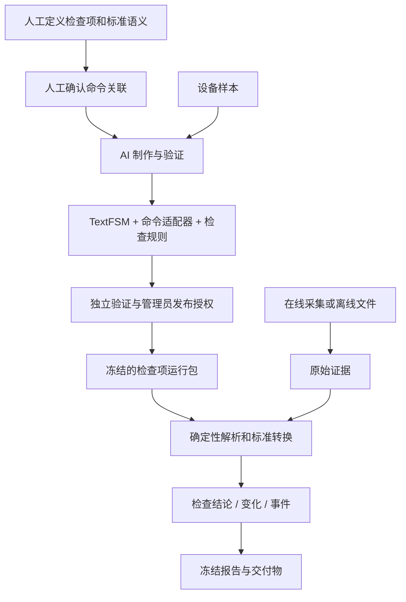

<!-- SPDX-FileCopyrightText: 2026 wangdong <wangdong5919@163.com> -->
<!-- SPDX-License-Identifier: Apache-2.0 -->

# 系统架构

核对日期：2026-09-06。本文描述当前代码的职责边界；部署资产是否就绪须按目标环境验证。

## 产品与模块

| 层 | 代码入口 | 职责 |
| --- | --- | --- |
| 应用与工作台 | [appRegistry.ts](../web/react_frontend/src/apps/appRegistry.ts)、[App.tsx](../web/react_frontend/src/App.tsx) | 应用注册、页面路由、权限入口和桌面布局 |
| Django BFF | [bff](../web/django_backend/bff/) | 登录、用户角色、个人布局、统一代理与身份转发 |
| FastAPI | [main.py](../src/gateway/main.py) | 业务 API、身份校验、业务服务与异步任务提交 |
| 巡检 | [patrol](../src/core/patrol/)、[check_items](../src/core/check_items/) | 在线/离线执行、计划、事实、评估与报告 |
| 规则制作 | [parser](../src/core/parser/)、[rule_control](../src/core/rule_control/) | 样本、TextFSM、转换、规则、审批与运行包 |
| 公文 | [official_documents](../src/core/official_documents/) | 文档版本、AI 操作、排版和 Word 导出 |
| 通用执行 | [supervisor](../src/agents/supervisor/)、[skills](../src/skills/)、[workflows](../src/core/workflows/) | 对话路由、技能加载、任务编排与回调 |
| 基础设施 | [infrastructure](../src/infrastructure/) | 数据库、迁移及基础服务适配 |

浏览器经 `/api` 访问 Django BFF，BFF 将认证身份转交 FastAPI。业务 App 直接使用专用 API，不要求用户先创建对话。通用聊天固定使用 Supervisor v2；不再提供 v1 切换开关。

## 巡检与规则制作

- `CheckItem` 是业务身份，保存版本时固定所引用的标准语义。命令关联必须由人工确认。
- TextFSM 提取设备输出，命令适配器负责将实际字段转换到检查项标准数据。字段命名一致仍不能替代单位、枚举、粒度和实体身份校验。
- 变化与事件规则依据检查项语义生成；不同设备的命令和原始字段差异留在解析与转换层。
- 自动制作保存任务检查点。管理员授权限定版本、命令和设备范围；验证不通过、输入变化或授权过期时停止发布。人工可以暂停、编辑并继续。
- 正式巡检读取已批准的冻结资产。规则验证数据、历史分析和现状证明具有不同的结论资格，不能相互冒充。
- `completed` 只表示任务结束。覆盖不足、采集失败、字段缺失或基线不适用时保留明确原因，不能据此报告“健康”。
- 报告使用不可变来源清单和对象摘要；正式 Excel 保留覆盖、结论、风险、权限及证据台账。

操作说明见 [网络巡检](patrol-workflow-refactor-guide-2026-09-05.md) 与 [自动制作](patrol-rule-autopilot-guide-2026-09-05.md)。仍被历史运行包引用的旧 Contract 和兼容读取链路保留在后端；它们不是新任务要求用户额外维护的一套标准。

## 公文与桌面

桌面布局按认证用户保存，使用 revision 检测并发修改。桌面只保存 appId 和布局，业务 URL 与权限来自应用注册表。

公文采用文档、版本和持久操作三类记录。全文生成默认作用于整篇，明确选区操作才修改局部。网页与 Word 共享模板格式配置；导出固定到已保存版本并写入 MinIO。详细约束见 [公文工作台](official-document-workspace-guide-2026-09-05.md)。

## 持久化与任务

- PostgreSQL 保存业务事实、规则版本、工作流、报告清单、公文与执行检查点；Django 默认在同一数据库的 `django` schema 保存认证与用户设置。
- Redis、RabbitMQ 的实际用途由 `CELERY_BROKER_URL` / `CELERY_RESULT_BACKEND` 等配置决定，不应将示意图代替部署配置。
- MinIO 保存原始证据和导出产物，数据库保留引用及摘要。只备份数据库不能完整恢复产物。
- [Celery 配置](../src/core/celery_tasks/celery_app.py) 将巡检、控制任务与 AI 分队列；Beat 调度恢复、心跳和补投。API 存活不代表对应 Worker 和 Beat 可用。
- 核心网关与 Worker 有独立依赖集合。AI、RAG、文档与观测能力按部署角色安装；Qdrant、Langfuse 使用可选 Compose profile。

## 权限边界

前端入口过滤改善使用体验，真正授权由 BFF 和业务 API 完成。`netops.configure` 对应设备管理和规则制作；普通巡检使用与配置分开，自动发布还检查管理员授权。[共享权限策略](../src/auth/netops_access.py) 同时约束两层 API。

这属于角色/能力控制，不等于租户或数据隔离。公文和个人布局按用户隔离；网络设备与巡检范围是否需要按组织隔离，应另建清晰的数据归属和查询约束，不能仅靠隐藏菜单实现。

## 维护边界

历史数据库迁移、已持久化任务名、历史报告读取及已发布资产的兼容层需要证据才能退出。无人导入的纯 UI、重复配置与旧渲染器可以直接移除。详见 [维护与验证](maintenance.md)；ADR 用于解释决策历史，当前接口以代码及 OpenAPI 为准。
