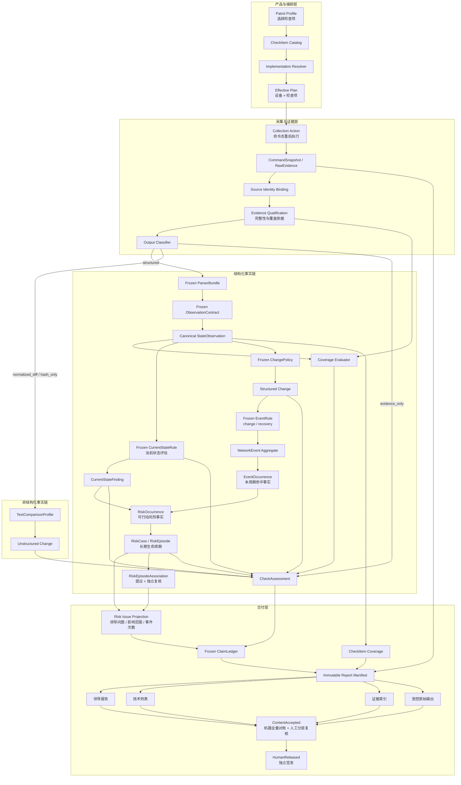

# 检查项中心的巡检与规则资产平台总体改造方案

> - 文档状态：Active / Implementation In Progress / Production Rollout Gated
> - 版本：8.32
> - 日期：2026-07-27
> - 文档所有者：NetOps Platform
> - 最后校验：2026-08-08
> - 适用范围：巡检计划、在线与离线巡检、Parser 资产生产、规则资产控制面、报告与工程治理
> - 目标读者：产品负责人、架构师、后端工程师、前端工程师、测试工程师、运维与规则工程师
> - 实施状态：[检查项平台实施矩阵](implementation/check-item-platform-completion-matrix-2026-07-28.md)
> - E2E 证据：[分层证据矩阵](implementation/check-item-platform-e2e-evidence-matrix-2026-07-30.md)
> - 6.0 校正：补齐 RuntimeBundle 控制面分页对账、子资产与运行就绪分离、blocker 唯一修复动作及
>   真实浏览器深链证据；生产 Active RuntimeBundle 仍保持为 0，不以工程夹具替代人工投产
> - 6.1 校正：补齐设备身份候选排序与人工确认后的即时门禁重算、AssetGap 只读治理控制面及
>   精确上下文深链；生产缺口直接生成规则必须 409 且 Parser Job、RuleGenerationJob、模型调用和
>   Workflow Run 均零增长
> - 6.2 校正：明确“事实终态”和“结论可判断”是两个独立门禁；补齐 RiskCase 从恢复候选、人工
>   恢复确认到整改关闭的服务端合同；增加最终产品目标到权威事实、交付物和验收证据的唯一追踪矩阵
> - 6.3 校正：区分事件聚合与本批事件发生，补齐恢复证据的批次归属；将“恢复候选、技术恢复、
>   整改完成、整改验收、风险关闭”拆成独立状态与人工动作，并明确平台工程验收和真实生产验收边界
> - 6.4 校正：完成整改独立验收、正式风险关闭、幂等审计和报告投影；以真实
>   BFF/FastAPI/PostgreSQL 纵切验证覆盖不足阻断、自验收拒绝、技术恢复、独立验收、正式关闭及
>   十一表技术附表，同时保持影子报告不得冒充当前网络状态
> - 6.5 校正：把 RiskCase 的长期业务身份与每次风险生命周期 episode 分离；RiskOccurrence、
>   RiskRemediation、动作幂等键和报告证据均绑定不可变 `episode_id`，并由数据库非空约束兜底，
>   防止风险关闭后复发时复用客户端幂等键覆盖上一轮整改、恢复与关闭事实
> - 6.6 校正：以最终产品目标建立唯一发布判定公式，明确规则资产生产线与生产巡检执行线的责任
>   边界；把首次巡检、部分设备失败、Parser 修订重调度和 fallback 韧性披露列为剩余工程纵切，
>   禁止用局部资产、任务终态或单一制品完成替代可信巡检报告闭环
> - 6.7 校正：补齐“应巡范围、已选范围、实际执行范围”三层范围合同，统一在线与经证明的离线
>   当前数据的结论权限，并增加逐条领导结论到冻结事实的 ReportClaimLedger；解决仅对账已选目标、
>   离线来源口径冲突以及报告叙述可追溯性不足三个产品级漏洞
> - 6.8 落地：范围合同、IntendedTargetMatrix、ScopeDecision 与离线当前来源资格已进入持久化和报告
>   权限主链；正式报告升级为 v5，在单一事务内冻结 ReportClaimLedger，并把 Claim ID 投影到
>   Markdown、DOCX、XLSX、JSON、证据包、签发门禁和服务端分页复核界面
> - 6.9 落地：补齐 ParserSpec 不可变修订历史和服务端“一次性重新生成”命令；语义方案修改只淘汰
>   未发布候选、保留 Active Parser，重调度前后均重验来源与生成条件，失败不再遗留不可达的灰色状态；
>   同时明确跨工作包失效传播、当前整体成熟度和剩余生产实证门禁
> - 7.0 收敛：从甲方正式交付反向补齐版本化 ReportProjectionProfile、跨厂商标准列、规则生产任务
>   可恢复交互和领导报告人工验收合同；把后续实施收敛为规则资产产品化、黄金纵切、甲方试点、
>   规模化与安全清理四个结果导向批次，明确当前仍为 `engineering_ready`
> - 7.1 校正：统一应巡、计划、执行与结论账本，要求所有已选目标即使在采集前阻断也形成终态
>   Execution/Assessment；按检查项结果模式定义五条黄金纵切的最小资产画像，并把甲方内容验收细化为
>   可执行抽样合同、受控叙述和阶段化发布判定，消除“缺行”和“所有命令都生成全规则链”两类歧义
> - 7.2 落地：将甲方内容验收升级为 `patrol-report-source/v5 + ClaimLedger + ReportProjectionSnapshot`
>   三方冻结合同；受控报告的 17 条声明与业务明细逐行对账，CPU、接口状态和接口光功率生成统一领域
>   附表，采集路径韧性、数值类型、单位、投影摘要和公式错误进入自动验收。工程完成与生产 current、
>   真实人工审批、甲方签发及两个生产周期继续严格分层
> - 7.3 补证：使用 `lixian` 真实样本完成 ParserSpec R1/R2/R3 修订纵切；R1 精确归因为
>   `contract_conflict`，旧候选激活返回 `409`，最终候选由生产 ParserRuntime 解析 8 条记录后仍保持
>   `pending_approval` 并等待人工语义复核。同步冻结控制面错误合同，将工程闭环与真实资产审批、
>   `production_current`、甲方签发和生产灰度继续分层
> - 7.4 校正：复审 W0 后确认范围与来源资格已有数据模型和服务骨架，但离线任务的
>   `current_attestation` 意图尚未贯通批次用途、幂等请求账本、不可伪造主体身份、控制面和真实全栈
>   验收。最终收敛为“离线证据任务 -> 当前资格申请 -> 独立证明 -> 新生产候选批次 -> 同链重放”；
>   原历史任务永不原地升级，`lixian` 只作为历史/拒绝路径证据，不能冒充新鲜当前数据
> - 7.5 落地：迁移 `0079`、CurrentAuthority 请求账本、独立候选批次、来源哈希与失败设备完整性台账、
>   独立证明、同链重放、精确 ObservationContract 冻结引用以及设备巡检页五阶段控制面已进入主链。
>   W0.1-W0.3 已形成工程实现，W0.4 仍需真实浏览器/Worker 正反全栈证据，W0.5 仍必须使用真实新鲜
>   采集、真实 Active RuntimeBundle、不同职责主体和正式签发；历史 `lixian` 不得充当该正向证据
> - 7.6 补证：用合成但新鲜且可重复的当前采集，经真实 BFF、FastAPI、PostgreSQL、Celery/Redis、
>   MinIO 和报告下载完成 CurrentAuthority 工程纵切；历史升级、同人证明、幂等冲突和 Snapshot 正文
>   篡改均 fail closed，独立证明后形成新的生产候选批次、终态 Execution/Assessment 与五类同源制品。
>   本证据明确标记 `production_network_claim=false`；真实浏览器故障矩阵和 W0.5 现场签发仍未完成
> - 7.7 校正：把设备证据对账主键统一为冻结 Inventory UUID/`target_pair_id`，外部设备名、Prompt 和
>   管理 IP 仅作为来源别名；把 `unable_to_determine` 扩展为全部 included 目标对的结论完整性分母，
>   非健康类检查项只有成功形成信息事实时才是 `informational`。双设备 CurrentAuthority 真实依赖纵切
>   已证明一台成功、一台命令失败时事实仍可终态对账，但整体健康权限必须关闭；并发 prepare/attest
>   与 Worker 重投递保持 exactly-once。真实浏览器与资产漂移矩阵、W0.5 现场签发仍未完成
> - 7.8 收口：把“单个批次可签发”和“最终产品目标达成”拆成两个不可互相替代的判定；正式批次增加
>   显式 `ContentAccepted` 门禁，产品完成必须同时具备五条黄金纵切、甲方生产目标矩阵、新鲜当前事实、
>   双周期、独立签发、多厂商规模与治理退出证据。统一 M1 为 CPU、接口状态、光功率、设备版本和运行
>   配置五条结果纵切，并修正 ParserSpec 重调度、CurrentAuthority 并发和 Worker 重投递的过时待办描述
> - 7.9 校正：真实浏览器完成当前证据上传、Inventory 绑定、独立双账号复核和 Beat 自动处理后，发现
>   Active RuntimeBundle 缺失会形成零设备 Workflow，却被错误标记为 `completed`。新增“空计划不是成功”
>   不变量：整批没有可执行动作且存在资产/实现阻断时必须 fail closed，保存冻结 Manifest 和设备级失败，
>   前端提供规则资产修复入口；部分目标可执行时仍继续并以 `unable_to_determine` 如实披露阻断范围
> - 8.0 校正：CurrentAuthority 复核不得只假设 Beat/Worker 在线。复核页复用统一生产准入检查并在
>   Worker、Beat、数据库、队列或交付存储阻断时禁用生产动作；Worker 冻结计划时再次校验真实
>   `patrol-attested-offline-current` Workflow。每轮恢复任务共享一份准入快照，避免百条请求重复远程
>   inspect；页面在批准后、计划冻结前继续显示阻断并自动轮询恢复，避免“已批准但静默等待”。真实停止/
>   恢复 Beat 与 Worker 已验证稳定错误码和恢复语义。临时基础设施阻断保持请求可重试且不生成设备失败
>   事实；证据/范围/资产错误仍终态失败。资产漂移与真实浏览器刷新/故障投影仍保留
> - 8.1 收口：CurrentAuthority 的暂时性平台故障与业务证据失败采用不同状态语义：Beat、Worker、队列或
>   交付存储暂不可用时保持 `approved / awaiting_current_plan`，不生成 Workflow 或设备失败事实；恢复后由
>   Beat 自动续跑。solo Worker 执行恢复任务时，以当前任务实际 delivery queue 作为该队列的可信消费者，
>   避免 Worker 自检超时造成假阴性，API 侧仍执行完整远程检查。真实浏览器已验证批准后 Beat stale、刷新
>   保持、延迟调度和恢复续跑。资产漂移合同同时冻结：计划冻结前切换 Active Bundle 只影响随后冻结的版本；
>   冻结后切换 Active 不得改变本批次，冻结 Manifest、Bundle 版本或摘要缺失/篡改必须在 Parser 前以
>   `runtime_manifest_invalid` fail closed。W0.4b 已达到 `engineering_verified`，W0.5 现场证明仍保持外部门禁
> - 8.2 校正：生产候选不得在审批时重新查询可变 Job/Dataset 样本。候选创建必须事务性冻结逐样本
>   `CandidateSampleEvidence`，审批、导出和激活只读取该证据；离线来源重试把旧 attempt 样本标记为
>   `retired`，只有当前权威 attempt 的 `current` 样本参与 ParserSpec、生成与门禁。2026-08-02 只读审计
>   发现旧四个审批候选没有不可变样本绑定，迁移后已统一拒绝且未影响三个 Active Parser；迁移审计
>   时点没有待审批 Parser 候选，必须按新协议重新生成审批包，历史 `16/677` 只保留为工程回归记录
> - 8.3 校正：真实 S6850 Q2/Q3 光模块样本证明同一命令同时包含接口状态、模块阈值和通道测量三种
>   实体粒度，单一扁平 TextFSM 不能作为通用合同。生产资产升级为按命令共享原始证据、按具名
>   record set 冻结模板和主键的 `ParserBundle`；检查项只绑定所需 record set，再由
>   ObservationContract 投影 canonical 语义。同步把模型调用阶段心跳、显式超时/重试、AI 队列隔离和
>   record-set 审批对照列为 P0，防止“后端仍在思考、前端看起来卡死”和“生成成功但运行时无法消费”
> - 8.4 收敛：从最终产品目标反向冻结唯一端到端追踪合同和五条黄金纵切的结果验收矩阵；共享命令
>   可以扇出到多个检查项，但不得丢失 record set、Contract、规则、Assessment 与 ReportClaim 的精确
>   版本关系。实施按“资产生产可运营、canonical 与运行包装配、生产执行事实、甲方报告、现场灰度”
>   五个结果工作包推进；模型与自动化只能准备候选，真实生产激活和正式报告签发继续保留独立人工门禁
> - 8.5 校正：S6850 四样本真实三轮生成验证了逐轮落库、AI 队列隔离、心跳、预算与终态回收，但也
>   暴露 ParserSpec 把原文不存在的单通道编号虚构为主键、Filldown 跨父记录泄漏以及空必填值未失败。
>   方案冻结“Parser 只表达直接源证据、显式/隐式子键按自然粒度拆表、canonical 派生留在 Contract”
>   的通用合同；单次请求截止时间与轮次必须固定、真实生产激活继续保留独立人工门禁
> - 8.6 校正：S6850 ParserSpec R3 已把光模块输出收敛为接口父记录和显式通道子记录，阈值保持父记录
>   宽字段；同时发现 `present/not_supported` 等期望值仍可能是模型推导常量而非 TextFSM 可捕获原文。
>   直接源证据合同扩展到 `expected_records` 的每个值，语义枚举只允许在 ObservationContract 中归一；
>   前端失败提示按稳定失败码区分编译错误与样本重放/主键错误，不再从日志中的字段名猜测故障层
> - 8.7 简化：R4 虽消除推导状态枚举，却把四份样本缩减为少量示例记录，证明模型预写全量
>   `expected_records` 既昂贵也不可信。自动 ParserSpec 只保留字段、主键、自然粒度和来源证据；平台执行
>   全部冻结样本并把真实解析结果交给独立 LLM 初审和工程师终审。精确记录数/主键预期仅可由工程师
>   显式确认后作为可选门禁，模型草稿不得自动升级为验收真值
> - 8.8 校正：S6850 ParserSpec R5 证明互斥输出分支不能继续滥用 `allow_empty`，数值字段也不能为兼容
>   `N/A` 降级为 `text`。record set 新增样本级 `presence=required|optional`；可选分支可在单份样本中缺席，
>   但每份正向样本在整个 ParserBundle 中仍必须至少产生一条记录。数值/百分比字段保持原类型并声明
>   来源可见的 `unavailable_tokens`，状态标准化投影为 `null + availability`，禁止转成 0。两项合同均已
>   进入生成提示、确定性编译、客观验证、生产 ParserRuntime、状态标准化和自动化测试；生产 Active
>   Parser、规则资产与 RuntimeBundle 继续保持人工审批边界
> - 8.9 落地：S6850 ParserSpec R6 已用 Q2/Q3 两设备四份真实样本完成五个 record set 的
>   ParserBundle 生成、全样本执行和独立 LLM 复核。真实运行进一步冻结“有状态 Writer + 确定性执行器
>   + 每候选无状态 Reviewer + 人工终审”的职责分离：Reviewer 不继承旧候选结论，必须逐 record set
>   审查当前模板和实际解析结果；稳定脱敏样本前缀可利用 DeepSeek KV Cache，但缓存不得携带历史判断。
>   最终候选只进入 `pending_approval`，未自动激活 Parser、规则资产或 RuntimeBundle
> - 8.10 收口：R6 候选已形成 `parser-candidate-approval-pack/v2`，并从五个具名 record set 的 508 条
>   实际解析记录构造 sanitized Contract/Policy/Event 候选；设备原生 Alarm 阈值按证据约束为
>   `critical_low`，没有虚构 Warning 事件。事务 RuntimeBundle 回放在两设备四样本上形成 524 条
>   Observation、46 条 Change 和 4 条真实周期事件，候选碰撞为 0，且生产 Active 资产计数前后不变。
>   单次周期回放仍标记 `sparse_history`，日事件量只作不可靠估算；人工 Parser/规则审批、新鲜生产巡检
>   和甲方签发继续作为不可绕过的产品门禁
> - 8.11 收敛：再次从最终产品目标反向审查方案，冻结唯一“产品真值图”、三类结果分支的汇合点、
>   五条黄金纵切的业务验收口径和当前到甲方交付的最短实施顺序。明确命令执行成功、Parser 通过、
>   Workflow 终态、零 Event、历史回放或文件生成均不能推导网络健康；规则生产与巡检执行仅通过冻结的
>   RuntimeBundle/Comparison Profile 衔接，所有正式结论必须经 Assessment 与 ClaimLedger 授权
> - 8.12 落地：把 `ContentAccepted` 从方案中的抽象条件落实为独立内容验收记录、不可变复核项、
>   确定性分层抽样和服务端签发前置门禁；正式签发必须绑定同一 v5 Manifest、ClaimLedger、复核计划、
>   机器对账摘要、内容接受摘要和五类 artifact SHA-256。明确事实、范围、表述和整改建议被退回后的
>   不同修订路径，禁止原地修改冻结报告或用相同事实无效“重新生成”；内容验收人与最终签发人职责分离
> - 8.13 补证与校正：迁移 `0084` 已在真实 PostgreSQL 应用，`lixian/Q2` 经真实 BFF、FastAPI、
>   Celery/Redis、PostgreSQL 和 MinIO 完成 v1/v2 内容验收、独立签发、精确版本下载和全量清理。全栈
>   复验同时修正两个报告真值漏洞：内容对账以冻结 `target_pairs` 作为 Execution/Assessment 分母，
>   `ScopeDecision` 只承担范围治理；已发布旧版变为 `superseded` 后仍保持原结论、权限语义、内容验收、
>   签名和制品不变，`superseded` 只表示其不再是最新版本
> - 8.14 校正：把 Parser 候选、canonical 映射和 RuntimeBundle 拆成三张不可互相替代的证明单。
>   审批包与控制面新增检查项能力声明：ParserSpec 只证明输出字段角色，`canonical_candidate` 仅为未
>   复核提示，ObservationContract 才能证明源字段到标准观测的映射，完整 RuntimeBundle 才能声明生产
>   就绪。字段角色由 Active Catalog 的实体身份、required observation 和结构化阈值约束共同推导。
>   四个当前候选已统一生成 v2 审批包；MSR5620 absent-only 光模块候选被准确标记为缺少 metric 与
>   threshold 角色，不再被包装成完整光功率能力，所有候选仍保持 `pending_approval`
> - 8.15 校正：新增 `parser-field-contract/v1`，把冻结 ParserSpec 字段集合与实际可执行
>   TextFSM/ParserBundle 头字段逐 record set 对账；RuntimeBundle 装配进一步校验 Contract 的主键、
>   源字段、transform、identity dimension、跨 record-set join 与阈值引用均来自该可执行字段契约。
>   这些仅是编译、执行和引用完整性的客观证明，不重新引入本地业务语义门禁：语义质量仍由 LLM
>   初审或工程师直审决定。数据库只读审计的 `3 active + 4 pending` 共 7 个 Parser 全部字段对齐；
>   其中真实四候选包含 `7` 份冻结样本、`534` 条记录。S6850 五 record-set
>   光功率候选与 sanitized Contract 跨表阈值引用为 `0 blocker`，生产 Active RuntimeBundle 仍为 `0`
> - 8.16 收口：为三张证明单补齐稳定阻断码、资产归属、唯一修复入口和失效传播合同。ParserSpec 与
>   TextFSM 漂移只进入 Parser 修复，Contract 源引用悬空只进入 Contract 修复，canonical 或规则缺口
>   分别回到对应资产阶段；修订只淘汰受影响候选并要求后序证明重新装配，不修改 Active 资产，也不把
>   “修复完成”自动提升为 RuntimeBundle 激活或生产健康。负向回归已覆盖 Parser/Contract 两条路由
> - 8.17 治理：为全部 `20` 份 superseded 文档增加首屏历史告警和权威后继链接，并把该要求加入 CI
>   文档审计；旧 `parser-validation.db`、旧命令中心完成声明和历史“最终设计”不再可能无提示地被当作
>   当前操作依据。严格审计覆盖 `75` 份文档，未登记、断链、索引状态和历史告警违规均为 `0`。兼容
>   代码的物理删除仍受真实零流量、零写入、替代覆盖和回滚演练门禁约束，不以文档清理替代运行证据
> - 8.18 完善：把“当前网络现状”收敛为范围、采集时点、来源资格、冻结运行资产、评估策略、比较基线
>   和证据引用共同限定的受控结论；补齐阈值/期望状态来源优先级、兼容实现唯一选择、基线资格以及
>   取消/晚到回调的终态合同。规则资产生产线与生产巡检执行线保持不变，新增要求全部落入现有
>   RuntimeBundle、ComparisonContext、Execution、Assessment 和 ClaimLedger，不建立第三套事实链
> - 8.19 完善：补齐 EventOccurrence、RiskOccurrence/RiskEpisode 与 ReportClaim 的分层计数和确定性
>   关联，防止同一物理问题被多条规则或多个检查项重复放大；冻结 Assessment 的实测值、期望状态、
>   阈值和策略来源快照，增加规则质量反馈闭环、职责分离矩阵及 38-42 五项产品验收场景。LLM 只能
>   建议关联和修订，不能合并风险、修改冻结事实或代替甲方内容验收
> - 8.20 落地：场景 40 已实现批次级取消 API、BFF 路由、协作式 Celery revoke、Workflow/
>   step 终态锁定、后续分发阻断、子 Workflow 取消传播、未完成目标结算和前端原因必填交互。单元
>   测试、真实 PostgreSQL 竞态注入、BFF 路由、前端状态合同与真实浏览器弹窗均已验证。该场景仍为
>   `engineering_partial`：预发布真实 Worker 丢失/恢复、串并行晚到失败、千台分母对账和取消报告仍是退出门禁
> - 8.21 落地：场景 41 已建立显式 `RiskEpisodeAssociation` 治理合同、数据库唯一约束、提议/独立
>   复核/拒绝/撤销 API、风险详情治理入口以及 ReportManifest、ClaimLedger、Markdown、DOCX、XLSX、
>   JSON 和证据包的统一问题投影。技术 Risk、Occurrence 与 Event 全部保留，领导问题数仅消费已批准且
>   episode 仍有效的关联；待审、过期、歧义、链式或多主关联一律不合并。旧领导报告中根据接口 Down
>   自动压低光功率风险的命令/领域启发式已删除。迁移 `0085`、108 项后端回归、4 项风险工作台测试和
>   Vite 生产构建通过；真实网络 SME 对关联策略的复核及首个甲方 `production_current` 内容验收仍是外部门禁
> - 8.22 完善：再次从“甲方领导看得懂、工程师能复核、每条结论有证据”的最终交付目标反向校准
>   方案，冻结检查项三类结果路径、规则资产生产线的客观校验/语义审核边界、RuntimeBundle-
>   RuntimeManifest-AssessmentBasis 三层评估策略快照，以及目标到报告声明的唯一事实追踪。新增按业务
>   结果退出的六阶段实施顺序和当前未关闭门禁；任何 Parser、规则、Workflow、回放或报告文件的局部
>   成功均不得替代新鲜生产双周期、人工内容验收、独立签发、多厂商规模与治理退出证据
> - 8.23 完善：把阈值、期望状态、适用性和恢复回差从设备属性中的可变 JSON 提升为独立、版本化、
>   可审批的 `AssessmentPolicyProfile/Version`；Inventory、Scope 和 Catalog 只绑定精确已批准版本，
>   RuntimeManifest 按采集时点冻结全部候选与拒绝原因，AssessmentBasis 按实体证明最终选择。新增策略
>   控制面、职责分离、迁移退出方案及场景 38 的正反验收矩阵，杜绝伪造审批、运行后换阈值和报告阶段
>   补算结论；当前仍为 `engineering_ready / production_rollout_gated`
> - 8.24 收敛：再次从“可信网络现状与甲方正式交付”反向审查全部方案，冻结来源字段、canonical
>   observation、判断策略和报告投影四层语义边界；补齐适用性策略、跨厂商统一列、两条生产线交接、
>   五条黄金纵切及报告内容验收的唯一退出门禁。同步校正判断策略当前实施状态：阈值/期望状态治理资产
>   和基础控制面已完成工程实现并应用迁移 `0087`，但不得以局部资产能力替代端到端产品验收
> - 8.25 实施校正：适用性资产、全目标影响预览、Inventory 选择器、巡检依据下钻、历史来源草稿化、
>   双读影子、目标级切换/回滚和场景 38 真实依赖纵切已经完成工程验证；迁移 `0088-0090` 已应用。
>   该纵切使用历史 `lixian` 样本且明确 `production_network_claim=false`，因此只关闭场景 38 的 `I`
>   层工程门禁。浏览器控制面复验、黄金资产真实人工审批、新鲜生产 current、双周期比较和甲方验收仍
>   是产品目标不可替代的后续门禁
> - 8.26 Parser 生成收敛：本地 TextFSM 运行时只负责编译、执行并冻结逐样本实际结果，不再使用自动
>   推测的记录数、字段价值或记录边界作语义裁决；独立 LLM Reviewer 对脱敏原文、候选模板和本轮实际
>   解析结果复核，不通过时将结构化诊断回送 Writer，最多三轮。三轮后只要候选仍可客观执行，就进入
>   带 AI 异议的人工直审，绝不自动发布。控制面新增非破坏式步骤回退，可查看任一步的冻结样本、
>   ParserSpec、候选模板、逐样本解析表与 Reviewer 结论；修订会创建新轮次并保留旧证据，不倒退或
>   覆盖持久化状态机
> - 8.27 规则资产工作面收敛：ObservationContract、ChangePolicy 与 EventRule 生产统一展示为“来源与
>   Parser、安全上下文、候选生成、验证与回放、工程复核、发布审批”六个持久化阶段。工程师可以点击
>   任一阶段，使用“返回上一步/下一步/回到当前进度”检查来源摘要、脱敏上下文、每轮候选与诊断、
>   回放指标、复核意见和发布阻断；浏览历史只改变页面所选视图，不调用生成、复核或审批接口。真正
>   修订必须通过既有 revision/attempt 服务创建新版本，保持职责分离、审计连续性和 Active 资产不变
> - 8.28 比较基线接线：生产 Effective Plan 不再依赖调用方手工注入历史候选，而是按设备与不可变
>   CheckItemVersion 批量读取最近历史事实。候选必须同时通过生产用途、终态 Assessment、Evidence
>   Qualification、原始 Snapshot、唯一 PatrolRun、冻结 RuntimeManifest/RuntimeBundle、ComparisonContext
>   和来源资格摘要校验；结构化结果冻结 canonical/identity/ObservationContract 事实合同，文本结果另冻结
>   Implementation 与 ComparisonProfile。摘要漂移、用途不符、同一时点多个合格基线或事实合同不兼容均
>   fail closed 为无可比较基线，当前状态仍独立评估。迁移 `0091` 增加批量查找索引；工程单元纵切与
>   200 目标单查询测试通过，真实 PostgreSQL、多厂商签名和新鲜双周期仍保留为场景 39 后续门禁
> - 8.29 场景 39 集成补证：使用真实 PostgreSQL、`lixian/Q2/Q3` 的 H3C MSR5620 与桌面 Q1/Q2 的
>   Cisco NEXUS9000 历史原始输出完成四设备纵切，验证首次观测、唯一最近基线、同时间歧义、基线过期、
>   Contract/Bundle 事实合同漂移以及零/多 CollectionImplementation 的失败关闭。同步修复数据库回读
>   `+08:00` 与 UTC 表示同一时刻却产生不同不可变摘要的问题，并完成 Change/Event 对冻结 Execution、
>   CheckItem、ComparisonContext、RuntimeBundle、Policy/Rule 的精确血缘回归。场景 39 的历史工程 `I`
>   层已关闭，但证据显式为 `production_network_claim=false`，未激活或修改生产资产，也不替代新鲜
>   `production_current`、五类正式制品、真实人工审批和甲方验收
> - 8.30 检查项目录产品化：检查项到厂商、设备族、平台、型号、软件版本和命令 fallback 的关系不再
>   只能由开发人员修改 YAML。Parser 控制面新增“检查项目录”工作面，以不可变采集实现版本承载 UI
>   修订，保存后先按活动 Inventory 计算逐设备命中变化，再进入提交与独立管理员审批。范围歧义、审批
>   证据漂移或旧实现仍被 Active RuntimeBundle 引用时 fail closed；YAML 只作为首次部署 seed，服务
>   重启不得把 UI 已发布的新版本回滚。迁移 `0092` 和后端/前端自动化验证已完成，真实 Inventory 的
>   浏览器发布演练仍须作为预发布证据，不以单元测试替代生产审批
> - 8.31 生产反馈闭环：新增不可变 `ProductionFeedback` 与治理待办，反馈必须绑定精确
>   CheckExecution、CheckAssessment、Event/Risk occurrence、证据摘要和冻结 RuntimeBundle 版本；
>   提交人与复核人职责分离，确认后只能形成规则样本、AssessmentPolicy 修订或数据质量待办，不修改
>   历史事件、风险、结论和报告，也不创建可直接发布的模型资产。设备巡检页新增“质量反馈”工作面及
>   结论证据抽屉中的反馈入口；灰度评估从数据库读取候选版本范围内的已确认反馈，样本充足时计算误报率，
>   越过阈值按现有策略暂停或回滚。迁移 `0093`、领域/API/灰度回归和前端组件/生产构建已通过；真实
>   预发布事件提交、候选回放、Bundle 回滚和超过 20% 灰度仍是场景 42 的 `I/P/H` 门禁
> - 8.32 采集实现发布闭环：检查项目录的 UI 修订不再止于保存候选。待审批实现可在精确变更单约束下
>   装配候选 RuntimeBundle；`rollout-target/v3` 分别冻结旧、新实现版本、命令集和 Snapshot，完成灰度后
>   由独立管理员在同一事务内切换 CollectionImplementation 与全部候选 RuntimeBundle。现网设备失去
>   检查项支持、范围不完整、摘要漂移、候选运行包变化或缺少灰度证据均 fail closed；迁移 `0094`、
>   领域/API/双路由和前端回归通过，真实 Inventory 浏览器演练及现场灰度仍属于 `P/H` 门禁
> - 8.33 双轨执行复验：`lixian` CPU、接口状态和 S6850 光功率已按 baseline/candidate 两套
>   CollectionImplementation 与 RuntimeBundle 完成隔离回放；统一 TextFSM 输入修复后得到 632 条
>   Observation、48 条 Change 和 4 条 Event。判断策略、覆盖与适用性未审批时 Campaign 保持 fail closed，
>   历史样本不得借此取得生产现状权限
> - 8.34 废弃链路退出证据：迁移 `0095` 新增无载荷、追加式旧路径观测台账，五个候选同时记录
> - 8.35 产品目标可执行审计：`check_item_product_goal_audit.py` 以当前 PostgreSQL、Inventory、
>   RuntimeBundle、正式内容验收/签发和废弃治理事实逐项计算 2.23.1 八项门禁；机器事实只能证明阻断，
>   不能自动替代真实工程证据、甲方验收或正式签发。2026-08-08 当前结果为
>   `7 blocked + 1 external_evidence_required`，`product_goal_achieved=false`。
>   Prometheus 计数、结构化日志和 PostgreSQL 事实；周期导出器按候选和时间窗生成可摘要证据。退出审计
>   要求七项门禁分别引用不可变 URI/SHA-256，并要求至少两个不重叠发布周期调用数为 0。命令级证据与
>   离线来源逐命令进度仍是检查项下钻能力，废弃范围只包含旧的命令中心顶层列表。当前只是开始采证，
>   尚未经过两个真实发布周期，五个兼容路径均不得物理删除
> - 权威性：本文是本轮检查项中心改造的唯一总体方案；专项文档不得改变本文定义的产品目标、
>   事实口径、运行边界和完成标准

## 1. 执行摘要

当前平台已经具备离线样本导入、TextFSM 生成与审批、标准 Observation、ChangePolicy、
EventRule、非结构化差异、历史回填和巡检报告等关键能力，但这些能力仍主要围绕
`vendor + profile + command` 组织。随着厂商、型号和命令数量增加，命令中心模型会产生以下问题：

- 同一个业务检查项被拆成多套命令资产，用户无法直接判断“CPU 检查是否已覆盖”。
- 巡检计划按命令维护，跨厂商 Profile 重复且难以复用。
- Parser 字段名容易反向渗透到规则和报告，造成跨厂商列名不一致。
- 命令级覆盖率不能真实表达业务检查项是否完成、是否可判断。
- 不需要 TextFSM 的配置、日志等输出缺少与检查项一致的产品模型。
- 规则资产页面展示后台命令单元，而不是用户真正关心的检查项及其兼容实现。

本产品的最终目标不是增加 Parser、规则或模型调用数量，而是面向多厂商、多型号和大规模
网络设备，将在线或离线巡检数据转换为真实、可解释、可追溯的网络现状、风险、变化与事件，
最终交付甲方领导能够理解、工程师能够复核、每项结论均有证据支撑的巡检报告。Parser、LLM
和规则资产控制面是实现这一目标的生产资料与治理手段，不是产品的最终交付。

本方案采用“从正式报告反向设计事实链”的方法。任何新增模块只有能够改善巡检范围事实、
证据资格、执行事实、结论事实或正式交付事实，才能计入产品完成度。模板数量、模型调用次数、
Workflow 完成数和 Event 数量都不能替代网络现状是否被如实表达这一最终验收。

本次改造将平台的最高层业务身份调整为：

```text
check_item = system.cpu_usage
```

命令、厂商、型号和 Parser 不被删除，而是下沉为检查项的采集实现：

```text
CheckItem
  -> CollectionImplementation
  -> Command / Collector
  -> Parser 或 TextComparisonProfile
  -> Canonical Observation / Raw Change
  -> CurrentStateAssessment / ChangePolicy / EventRule
  -> CheckAssessment / Risk Lifecycle
  -> Report Projection
```

同时，Parser 资产生产采用成熟模板优先策略：

```text
现有 Active Parser
-> 已验证历史候选
-> ntc_templates 候选
-> 本地客观执行预览（编译、解析、结果展示）
-> 默认由 LLM 初次复核，或由工程师直接人工复核
-> 复核确认后形成候选资产
-> 复核认为需修订时进入 LLM 修复或人工编辑
-> 未命中才从零生成
```

改造遵循渐进迁移，不推翻现有 PostgreSQL 资产、审批、回滚、证据和运行时链路。新旧模型在
迁移期双读、影子解析和结果对账，满足退出门禁后再删除命令中心兼容层。

## 2. 项目目标

### 2.1 产品使命与最终交付

产品使命：

> 面向多厂商、多型号和大规模网络设备，把在线或离线巡检数据转换为真实、可解释、可追溯的网络现状、
> 风险、变化与事件，最终交付一份甲方领导看得懂、工程师能复核、结论有证据支撑的巡检报告及同源交付物。

产品通过两条独立但衔接的生产线实现该使命：

```text
规则资产生产线
规则资产页显式导入的离线规则样本
-> 检查项与采集实现归类
-> structured: Parser 候选 -> LLM 初审或人工直审 -> Parser 审批
-> normalized/hash diff: TextComparisonProfile 候选与客观差异预览
-> evidence only: 证据、时效、适用性与覆盖策略
-> sanitized facts + Canonical Catalog
-> 按 AssetRequirementProfile 生成所需 Contract / CurrentStateRule / ChangePolicy / EventRule 候选
-> 当前状态验证 + 双周期回放 + 碰撞与恢复验证
-> 工程复核与审批
-> CheckItemRuntimeBundle 原子发布

生产巡检执行线
在线设备或具备明确来源资格的离线巡检数据
-> Effective Plan
-> 命令采集
-> Parser / TextComparisonProfile / Evidence-only qualification
-> StateObservation / NormalizedDiff / Evidence
-> CurrentStateFinding / Change / Event（按检查项职责执行）
-> CheckAssessment / Risk Lifecycle
-> 风险与质量评估
-> 领导报告、技术附表与证据包
```

规则资产生产线负责生产、验证、审批和发布运行所需资产；生产巡检执行线只读取冻结的
Active 资产，不在巡检过程中调用 LLM、生成规则或静默替换资产。
上图是能力超集，不表示每个检查项都必须绑定所有资产；具体要求由 2.19.1 的
AssetRequirementProfile 决定。

生产运行中的 AssetGap、解析失败或输出漂移只能登记治理待办和证据引用，不能自动创建模型任务。
工程师必须在规则资产页显式选择并固化为不可变离线样本数据集，或重新导入脱敏离线文件，才能启动
资产生产。历史结构化记录只用于经授权的回放、回填和回归，不能绕过离线样本入口直接产生候选。

最终交付不是单一 PDF 或 Excel，而是一个事实一致、权限分层的交付集合：

| 交付物 | 目标读者 | 必须回答的问题 |
|---|---|---|
| 领导报告 | 甲方领导、管理者 | 网络当前风险、重要变化、影响范围、整改优先级和结论可信度 |
| 技术附表 | 网络工程师、运维团队 | 各设备与检查项的当前值、状态、变化、事件、阈值和失败原因 |
| 机器可读事实 | 集成、二次分析与自动审计 | 与报告完全一致的冻结事实、版本、枚举、证据引用和摘要 |
| 证据索引包 | 复核、审计与排障人员 | 每项结论对应的设备、命令快照、资产版本、执行批次、规则和原始输出摘要 |
| 原始输出 | 具备原文权限的工程师与审计人员 | 按设备保存的原始 CLI `.txt`、完整设备清单、登录或采集失败清单 |

证据索引包不嵌入受保护的原始 CLI 正文，只保存对象引用、`raw_text_hash` 和必要的脱敏摘要。
原始输出作为独立、受权限控制的批次交付物下载，归档中不得暴露 `.collection.json` 等内部实现文件；
设备清单和失败清单应使用适合千台规模检索的 CSV/TXT 明细，而不是只给一个设备示例。

任何一份正式巡检报告都必须如实回答：

1. 本次计划巡检哪些设备和检查项，实际完成了多少。
2. 哪些设备采集成功，哪些登录、执行、解析或规则处理失败。
3. 当前网络有哪些已确认风险，其严重度和影响范围是什么。
4. 相比基线或上一周期发生了哪些变化，哪些问题已经恢复。
5. 哪些检查项因缺数据、缺实现或缺资产而无法判断。
6. 每项结论来自哪台设备、哪条命令、哪份原始输出和哪一版规则资产。
7. 报告结论的覆盖率、完整性和可信度边界是什么。

结论必须区分 `healthy`、`at_risk`、`unable_to_determine` 和 `not_applicable`。只有完成必要
采集、解析或比较，并执行适用规则后，才能形成 `healthy`；“没有变化”“尚未产生事件”
或“数据为空”均不得自动解释为健康。数据不完整时必须明确标记 `unable_to_determine`
及阻断原因。仅承担变化或证据留存的检查项在证据完整、职责执行成功时使用 `informational`，明确
排除在健康目标分母外；一旦该目标采集、解析、比较或证据资格失败，状态必须优先成为
`unable_to_determine`，进入全部目标的完整性分母并阻止“网络整体健康”措辞。

目标追踪矩阵：

| 报告必须回答的问题 | 权威事实来源 |
|---|---|
| 计划巡检哪些设备和检查项 | ScopeContract + IntendedTargetMatrix + ScopeDecision + Target Manifest + Effective Plan |
| 哪些设备和检查项成功或失败 | CheckExecutionRecord |
| 当前是否健康、有哪些风险 | CheckAssessmentRecord + CurrentStateRule + CurrentStateFinding + RiskCase |
| 相比上一周期发生什么变化 | ComparisonContext + NetworkChangeRecord |
| 哪些问题已恢复、哪些仍需整改 | RiskOccurrence + RiskRemediation |
| 每项结论来自什么命令和规则 | Evidence refs + CheckItemRuntimeBundle |
| 哪些数据无法判断 | CheckAssessment.blocking_reason_codes |
| 报告能否复现 | ReportManifest + artifact SHA-256 |

### 2.2 业务目标

1. 巡检计划、执行进度、结果和报告均以“检查项”为主要组织对象。
2. 同一检查项可根据设备厂商、系统族、型号、版本和能力选择不同采集实现。
3. 不同命令和 Parser 最终投影到统一、稳定、厂商无关的观测语义。
4. 用户能够回答：
   - 本次选择了哪些检查项；
   - 每台设备实际执行了什么命令；
   - 哪些检查项成功、失败、不适用或无法判断；
   - 当前网络有哪些风险、变化和数据可信度缺口。
5. 结构化命令与非结构化命令使用不同事实链路，但在检查项、证据和报告层统一呈现。
6. 规则资产控制面以检查项展示完整资产链，并允许展开查看各兼容实现。
7. 最终领导报告反映当前网络现状，技术附表保留标准化明细和完整证据索引。

### 2.3 工程目标

1. Parser 只负责忠实提取厂商输出，不承担跨厂商业务统一。
2. ObservationContract 负责字段语义、单位、维度和受控转换。
3. ChangePolicy 和 EventRule 按 canonical `observation_type` 复用，不按命令复制。
4. ntc_templates 命中后不调用 LLM 重新生成模板；默认只调用一次 LLM 初审，工程师直审时模型调用为零。
5. LLM 只生成候选资产，不进入正式巡检运行时，不拥有发布权限。
6. 所有运行使用冻结的 Parser 与规则资产清单，重试不得读取中途变更的新资产。
7. 所有状态失败必须有明确原因，不允许静默降级或静默丢弃。
8. 本地代码只提供 TextFSM 客观执行证据，不编码字段价值、记录完整性或业务语义通过门禁。
9. 文档和代码建立生命周期治理，停止长期保留无所有者、无引用、无退出日期的兼容层。
10. 当前状态评估与跨周期变化比较是两条独立事实路径；没有可比较基线不妨碍发现当前风险。
11. 每个设备与检查项必须形成独立 `CheckAssessmentRecord`，执行完成状态不得代替健康结论。
12. Parser、Contract、当前状态规则、ChangePolicy 和 EventRule 以兼容运行包原子发布和冻结。
13. 正式报告只能基于终态批次、冻结目标清单、冻结资产清单和不可变事实摘要生成。
14. 运行时发现资产缺口或输出漂移时只登记治理任务，不自动调用 LLM 或发布资产。
15. 原始输出必须先通过设备身份绑定、输出质量和实体覆盖判定，Parser 能返回记录不等于证据完整。
16. 本批次确认的当前风险与历史遗留但本次未复核的 RiskCase 分开表达，失败或过期数据不得刷新风险当前性。
17. 事实冻结与正式交付签发分离；`ReportManifest.status=final` 不等于报告已经人工批准并对甲方发布。
18. Parser 生成、审批预览和激活必须读取同一版本的客观执行门禁合同；门禁字段漂移必须 fail closed，
    但不得把生成前的推测记录数或推测实体集合冒充生产运行时门禁。
19. Parser 字段只允许做不改变语义的运行时兼容规范化，例如 TextFSM 标识符大小写；跨厂商字段统一
    必须在 ObservationContract 和报告投影层完成。
20. 全栈验收必须分别记录主流程结果与范围化清理结果，清理失败不得覆盖真实业务失败原因，也不得
    以残留测试数据换取通过结论。
21. Parser 的业务语义复核与生产激活必须是两个独立、可审计的服务端动作；生成器、LLM 初审、
    人工语义复核人和生产发布审批人的权限不得合并为一个“通过并发布”按钮。
22. 范围、证据、Execution、Assessment 和报告事实必须以冻结 `inventory_device_id` 或稳定
    `target_pair_id` 关联；设备 Prompt、主机名、管理 IP 和导入文件中的 `device_id` 仅作来源别名，
    不得作为跨事实表的权威连接键。
23. 检查项的结果模式只定义成功时的结论职责；`change/evidence` 模式失败时仍必须形成
    `unable_to_determine`，不得因其不是健康检查而从完整性分母消失。

### 2.4 可度量成功指标

| 指标 | 目标 |
|---|---:|
| 巡检 Profile 使用检查项而非裸命令的比例 | 100% |
| 批次应巡目标对具有版本化范围策略与明确处置的比例 | 100% |
| 必选目标对被静默漏选或从结论分母删除的次数 | 0 |
| 需要 structured Parser 的 Effective Plan 目标对解析成功率 | >= 99.5% |
| 已选择检查项的结果可解释率 | 100% |
| 结构化输出静默退化到 raw diff | 0 |
| NTC 候选形成客观执行预览的比例 | 100% |
| 已复用 NTC 模板调用 LLM 重新生成的比例 | 0 |
| 候选支持跳过 LLM 直接人工复核的比例 | 100% |
| Parser 语义结论可追溯到 LLM 或人工审核的比例 | 100% |
| Parser 生成、审批预览与激活读取同一门禁合同的比例 | 100% |
| 正确候选因门禁字段版本漂移被错误阻断的次数 | 0 |
| 候选在审批页由生产 ParserRuntime 复放全部冻结样本的比例 | 100% |
| AssetRequirementProfile 要求 canonical output 的 Top 检查项覆盖率 | 100% |
| 承担健康结论的目标对 Active CurrentStateRule 覆盖率 | 100% |
| 已完成检查项形成显式 assessment 的比例 | 100% |
| 计划 `设备 × 检查项` 与 CheckExecution 精确对账率 | 100% |
| CheckExecution 与 CheckAssessment 一对一覆盖率 | 100% |
| Execution、Assessment、Evidence 与 ReportClaim 使用冻结 Inventory/目标对身份对账率 | 100% |
| 外部设备别名与 Inventory UUID 不同导致终态事实误判不一致的次数 | 0 |
| included 非健康类目标失败后仍进入 `unable_to_determine` 完整性分母的比例 | 100% |
| fallback 选择具有显式原因和证据的比例 | 100% |
| 冻结运行包摘要不一致后仍继续执行的次数 | 0 |
| 无基线检查项仍完成当前状态评估的比例 | 100% |
| 报告事实可由 source digest 重建的比例 | 100% |
| 同一 ReportManifest 的领导报告、技术附表和证据包事实一致率 | 100% |
| 领导报告事实性结论具有 Claim ID、事实引用和范围限制的比例 | 100% |
| 同一 ReportManifest 与生成器版本的确定性交付物 SHA-256 一致率 | 100% |
| 风险事项具有首次发现、最近发现和生命周期状态的比例 | 100% |
| 报告中“无法判断”附带明确阻断原因 | 100% |
| 承担当前状态结论的检查项具有明确数据时效判定 | 100% |
| Parser 成功但零业务记录被直接计为健康 | 0 |
| 身份未确认或归属冲突的原始输出进入正式 Assessment | 0 |
| 已识别截断、分页残留或设备错误的输出被计为完整证据 | 0 |
| 承担健康结论的检查项具有可审计实体覆盖依据 | 100% |
| 历史未复核 RiskCase 被计入“本次已确认风险” | 0 |
| 报告截止时刻之后到达的事实被静默写入既有正式报告 | 0 |
| 单样本候选在审批页披露样本规模和适用边界的比例 | 100% |
| 生产目标矩阵 Active RuntimeBundle 覆盖率 | 100% |
| 控制面 RuntimeBundle 数量与运行时 Resolver 权威查询一致率 | 100% |
| RuntimeBundle 健康接口不可用时 UI 误报为就绪或零缺口 | 0 |
| 生产目标矩阵检查项可判断率 | >= 95%，其余必须有明确阻断原因 |
| `final` 报告中无结论来源或无证据的 Assessment | 0 |
| 正式对外交付物绑定人工签发记录和精确 artifact SHA-256 | 100% |
| 获得当前现状权限的在线或离线批次通过来源资格重验的比例 | 100% |
| 历史或规则样本任务通过修改字段原地升级为当前批次的次数 | 0 |
| 离线当前资格导入人与证明人为同一不可变主体的次数 | 0 |
| current-authority 写请求具有持久化幂等键与请求摘要的比例 | 100% |
| 相同幂等键不同证明内容被错误重放为成功的次数 | 0 |
| Active 文档具备状态、所有者和校验日期 | 100% |
| 删除代码具备引用、流量、数据和回滚证据 | 100% |

Top 检查项首批定义为：

```text
device.version
system.cpu_usage
system.memory_usage
interface.oper_status
interface.optical_power
environment.fan
environment.power
configuration.running
```

### 2.5 产品目标验收模型

本项目不以 Parser 数量、模板覆盖率、LLM 调用成功率或 Event 数量作为最终成功标准。最终产品
是否成立，由五层相互校验的事实决定：

| 事实层 | 回答的问题 | 唯一权威来源 |
|---|---|---|
| 范围事实 | 应该检查谁、检查什么，实际选择与排除了什么 | PatrolScopeContract + IntendedTargetMatrix + Target Manifest + per-device Effective Plan |
| 证据资格事实 | 输出属于哪台设备、是否完整、覆盖哪些应检查实体 | EvidenceQualificationRecord + CoverageDecision |
| 执行事实 | 实际执行了什么、在哪一层成功或失败 | CheckExecutionRecord + CollectionAction |
| 结论事实 | 当前是否健康、有什么风险、是否可比较 | CheckAssessment + CurrentStateRule + Finding + Change/Event + RiskCase |
| 交付事实 | 正式报告引用了哪些冻结事实 | ReportManifest + artifact digest |

批次进入正式报告前必须满足以下集合不变量：

```text
intended_pairs
  = {(device_id, check_item_version_id) from frozen intended target matrix}

selected_pairs
  = {(device_id, check_item_version_id) from frozen target matrix}

accounted_scope_pairs
  = selected_pairs UNION approved_exclusion_pairs UNION not_applicable_pairs

intended_pairs == accounted_scope_pairs

effective_plan_pairs
  = {(device_id, check_item_version_id) from frozen effective plan}

executable_pairs
  = {pair from effective_plan_pairs where collection implementation and runtime assets are ready}

execution_pairs
  = {(device_id, check_item_version_id) from CheckExecutionRecord}

selected_pairs == effective_plan_pairs
effective_plan_pairs == execution_pairs
executable_pairs SUBSET OF effective_plan_pairs
pre_execution_blocked_pairs == effective_plan_pairs - executable_pairs
count(CheckAssessmentRecord) == count(CheckExecutionRecord)
assessment.execution_id set == execution.id set
every evidence ref used by execution has one evidence qualification decision
every health assessment has one auditable coverage decision
```

上述集合中的 `device_id` 语义固定为冻结 Inventory UUID；导入文件中的设备名、Prompt、管理 IP、
外部设备 ID 只允许保存在 Evidence alias 中。Evidence 与 Execution 的关联优先使用
`inventory_device_id`/`target_pair_id`，只有历史只读数据确实没有该字段时才允许受控兼容回退，并且
回退结果不得获得新的 current authority。这样同一台设备即使在文件、Inventory 和页面中使用不同名称，
也不会被误判为缺失终态事实或错误归并到另一台设备。

这里的 `intended_pairs` 必须由版本化 PatrolScopeContract、冻结 Inventory 和设备角色确定；
`effective_plan_pairs` 必须按每台设备的实际 Profile 和检查项版本计算，禁止先求全批次检查项并集，再假定
每台设备都应执行全部检查项。任何应巡目标对都必须进入执行、经审批排除、证据化不适用或执行前阻断
之一，禁止通过少选检查项美化完成率。任何缺行、重复行或计划外事实都会阻断 final 报告，而不是由
报告生成器补齐、忽略或猜测。

`pre_execution_blocked` 不是“没有 Execution”。所有进入 `TargetCheckMatrix` 的目标对在冻结 Effective
Plan 时都必须物化一条 `CheckExecutionRecord`；资产缺失、适用性无法解析或调度前门禁失败的记录使用
`collection_attempted=false`、`terminal_stage=planning` 和稳定阻断原因进入终态，并形成一对一的
`unable_to_determine` Assessment。只有经审批排除或证据化不适用的目标对停留在 ScopeDecision，
不进入执行分母。这样计划前失败、登录失败、命令失败和解析失败都在同一账本中可见，不会在报告中缺行。

最终验收必须从报告反向追溯：领导报告中的每个数字和结论应能落到技术附表中的设备与检查项，
技术附表中的每行应能落到执行、规则和原始证据；任一层无法追溯时，产品目标尚未达成。

### 2.6 四层完成口径

本项目必须区分平台能力、生产资产、批次事实和正式签发，禁止用其中一层的完成冒充其他层：

| 层级 | “完成”的含义 | 不能代表 |
|---|---|---|
| 平台能力完成 | 计划、执行、Assessment、缺口反馈、报告和审批链路均可运行且通过工程验收 | 某个租户、厂商或型号的规则资产已经齐备 |
| 生产资产就绪 | 目标设备矩阵中每个目标对均按已审批 AssetRequirementProfile 装配兼容 RuntimeBundle 并激活；健康类结构化检查项至少包含所需 Parser、Contract 和 CurrentStateRule，ChangePolicy/EventRule 仅在检查项声明对应职责时要求 | 某次巡检一定健康或没有风险 |
| 批次事实终态 | 目标矩阵每一项都有终态 Execution 与 Assessment，并冻结为 ReportManifest | 所有检查项都可判断，更不等于“未发现异常” |
| 正式交付签发 | 人工对冻结事实、确定性交付物和披露边界完成复核，ReportReleaseRecord 绑定精确文件摘要 | 报告内所有检查项均健康 |

因此：

- `ReportManifest.status=final` 只表示批次事实完整、终态且不可变，不表示报告结论是 `healthy`。
- 只有 `ReportReleaseRecord.status=released` 且其 artifact digest 与当前下载文件完全一致，才表示
  该版本已获准作为甲方正式交付；重新生成、润色或补录事实都必须重新签发。
- 全部检查项因缺资产而形成 `unable_to_determine` 时，仍可以生成一份事实完整的 final 报告；
  该报告必须明确写明无法判断范围、阻断原因和待治理资产，不能写成健康报告。
- `Event=0`、`Change=0`、Workflow 完成或 Parser 编译成功均不是产品完成指标。
- 生产上线门禁必须针对具体租户的“设备身份 × 检查项 × 采集实现”矩阵计算 Active
  RuntimeBundle 覆盖率，而不是使用全库模板数量或平均 Parser 覆盖率。
- 资产缺口属于规则资产生产线的待办，生产巡检执行线只负责记录缺口并形成诚实 Assessment，
  不得在运行中调用 LLM 补资产。

阶段状态按以下规则标记：

```text
done
  = 平台代码、迁移、UI、自动化测试和真实链路证据均齐备

operationally_ready
  = 指定生产矩阵所需 Active RuntimeBundle 100% 覆盖，
    金样本回放与人工审批全部通过

blocked_by_asset_readiness
  = 平台链路正确形成 unable_to_determine 和 AssetGap，
    但生产资产尚未满足发布门禁

released
  = final ReportManifest 的全部确定性交付物已完成人工签发，
    签发记录绑定 source facts digest 与每个 artifact SHA-256
```

### 2.7 当前网络现状的时间与证据口径

“当前网络现状”不是“数据库中最后一条记录”。每个承担健康结论的检查项必须同时满足以下七项
不变量，任一项不满足时不得形成 `healthy`：

| 不变量 | 必须证明的内容 | 不满足时 |
|---|---|---|
| 身份 | 原始输出已唯一绑定到冻结 Inventory 中的目标设备，来源与租户无冲突 | `identity_unresolved`，不得进入正式结论 |
| 适用 | 版本化适用性规则证明检查项适用于该设备和实体范围 | `not_applicable` 或 `unable_to_determine`，不得由空输出猜测 |
| 范围 | 设备和检查项属于冻结 TargetCheckMatrix | 拒绝计划外事实或生成新报告版本 |
| 执行 | 实际命令、实现和 RuntimeBundle 与冻结计划一致 | `unable_to_determine` |
| 完整 | 输出质量合格，必要实体、字段、阈值和规则评估均有覆盖 | `partial/insufficient`，不得计为健康 |
| 当前 | 事实的 `observed_at` 满足检查项版本的 freshness policy | `stale/unknown`，不得计为健康 |
| 证据 | 已形成的业务结论能追溯到 Snapshot、Parser、Contract、Rule 和摘要；失败分支具有明确无证据原因 | 结论引用损坏时阻断物化/签发；无合格证据但失败事实完整时形成 `unable_to_determine` |

CheckItem 版本必须声明：

```text
freshness_policy:
  max_observation_age
  max_collection_span
  clock_source: collector | device | both
  clock_skew_tolerance

empty_result_policy:
  classification: expected_empty | not_applicable | unsupported | invalid
  evidence_conditions

coverage_policy:
  model: fixed | inventory_entity_set | derived_entity_set | command_reported_total | non_exhaustive
  reference_check_item_id
  allow_healthy_when_unbounded: false
```

默认采用 fail closed：没有经审批的空结果语义时，Parser 编译与执行成功但业务记录数为 0，只能形成
`insufficient` 或 `unable_to_determine`，不能解释为“没有异常”。设备命令明确返回“不支持”、
“无模块”或“未配置”时，必须由版本化适用性/空结果策略结合原始证据区分
`not_applicable`、`unsupported` 和合法空集合，不能由命令字符串或 UI 临时猜测。

每个批次冻结 `report_cutoff_at`。截止时刻之后到达的迟到事实不得静默改写既有 final 报告；
需要补录时创建新的事实修订和 ReportManifest 版本，并披露变化原因。领导报告必须显示数据采集区间、
报告截止时刻、过期或时间未知检查项数量，避免把历史样本包装成当前状态。

### 2.8 证据资格、覆盖分母与风险当前性

TextFSM 编译和解析成功只证明“模板能从文本中提取记录”，不能证明这份文本属于正确设备、输出没有
被分页或截断，也不能证明所有应检查实体都已出现。任何 Snapshot 进入健康评估前必须形成一个不可变
`EvidenceQualificationRecord`：

```text
source_identity_status: confirmed | ambiguous | conflict | external_unbound
output_quality_status: complete | empty | unsupported | device_error | truncated | paged | ambiguous
qualification_reason_codes
profile_version / digest
evidence_refs
```

身份绑定必须综合冻结 Inventory UUID、管理 IP、设备 Prompt、文件元数据和人工确认记录；名称或 IP
冲突时 fail closed。规则生产样本可以保留 `external_unbound`，但不得因此成为生产巡检事实。离线历史
巡检只有在每个周期的设备映射均确认后才能进入跨周期比较，且 baseline/current 必须映射到同一稳定
设备身份。

输出质量判定由版本化 `OutputQualityProfile` 执行，识别命令回显、设备错误、权限拒绝、分页残留、
截断、超时和混入下一条命令等情况。Profile 属于采集实现或 RuntimeBundle，不在报告代码中按命令
硬编码。即使部分文本能被 Parser 解析，只要质量状态不是 `complete` 或经策略批准的合法空结果，
该检查项也不得形成 `healthy`。

Parser 与标准化完成后必须另行形成 `CoverageDecisionRecord`，对预期实体集合与实际 canonical 实体
集合进行对账。覆盖分母必须来自可审计依据：

1. 系统级单实例检查使用 `fixed`，例如设备版本期望一个设备实体。
2. 接口、板卡、风扇等集合检查优先使用冻结 Inventory 实体集合。
3. 可由另一检查项推导时使用 `derived_entity_set`，并冻结被引用检查项版本、事实摘要和映射规则。
4. 设备输出包含可信总数时使用 `command_reported_total`。
5. 历史基线只能作为缺失提示 `baseline_hint`，不能单独证明本次完整。
6. 无法证明穷举覆盖时标记 `non_exhaustive/unbounded`；可以报告已发现风险，但不能据此断言整体健康。

风险当前性也必须 fail closed：

- `at_risk` 必须由本批次新鲜、完整且可追溯的 Finding/Event 确认。
- 历史未关闭 RiskCase 在本次采集失败、过期或未覆盖时保持生命周期状态，但标记
  `verification_status=not_reverified`，单列为“历史风险待复核”。
- 未复核历史风险不得刷新 `last_seen_at`，不得计入“本批次已确认风险”，也不得因本次没有 Finding
  自动恢复。

### 2.9 事实冻结与正式交付签发

`ReportManifest` 冻结事实，`ReportReleaseRecord` 表达人工对外交付决定，两者职责分离：

```text
ReportManifest(final)
-> deterministic Markdown / DOCX / XLSX / JSON / evidence package
-> quality verification
-> human sign-off
-> ReportReleaseRecord(released)
```

签发记录至少冻结 `report_manifest_id`、`source_facts_digest`、全部 artifact SHA-256、签发人、签发时间、
签发意见和披露确认。任何事实补录、LLM 润色、生成器升级或文件重建只要改变文件摘要，都必须形成新
报告版本并重新签发；旧签发记录保持不可变。下载页必须区分“事实已冻结”“待签发”“已签发”和
“已被新版本取代”，禁止把未签发的 final 预览标成正式报告。

报告查询与下载必须是无副作用只读操作。`GET` 不得隐式重建事实、创建新 `ReportManifest` 或改变
版本状态；新版本只能由带幂等键的显式异步物化命令创建。下载接口允许指定
`report_manifest_id`，并必须从对象存储回读该精确版本已经挂载的不可变制品，同时返回 Manifest ID、
版本号、签发状态和内容摘要。旧版本被新版本取代后仍可按原签发记录下载和审计，但不得被标记为当前
版本；版本历史由服务端分页接口统一提供。

### 2.10 2026-07-29 实施校正与发布边界

本轮真实样本、规则回放、对象存储和浏览器验收进一步确认：检查项中心平台主链已经具备可执行、
可审计和可交付的工程能力，但“平台实现完成”仍不等于“生产资产已审批”或“生产灰度已完成”。
后续实施和验收统一采用以下校正口径：

| 层级 | 当前状态 | 已有证据 | 仍需完成 |
|---|---|---|---|
| 平台工程能力 | `implemented / in_progress` | 检查项目录、计划冻结、RuntimeBundle、raw-first EvidenceQualification、CoverageDecision、Assessment、RiskCase、ReportManifest、五类制品、ReportRelease、规则资产工作台和运行覆盖页的主骨架已实现；报告异步故障注入、同一 Manifest 五类下载、规则资产到 RuntimeBundle 隔离发布、控制面 20 个检查项/39 个实现对的分页三方对账及 blocker 修复深链均完成真实依赖闭环，服务端职责分离、direct 入口禁用、安全 cursor 的真实 HTTP/PostgreSQL 深页、三级并发租约、持久化 RolloutCampaign 控制器和 `2000 × 20` 容量已有验证 | 按 2.13、2.14 完成其余真实全栈 E2E、真实生产资产人工审批、可信灰度和两个真实生产周期 |
| 生产资产 | `blocked_by_asset_readiness` | CPU、接口状态和光功率候选已通过真实样本生成、canonical 规则链和隔离回放；缺资产会形成 AssetGap 和 `unable_to_determine` | 当前 Active CheckItemRuntimeBundle 为 0；四个 Parser 候选仍待人工复核，随后按目标设备矩阵审批 Contract/Policy/Rule/RuntimeBundle |
| 批次事实 | 按批次独立判定 | 真实 `device.version` 样本可形成 2 条 canonical Observation、完整证据资格、覆盖决定和信息性 Assessment | 每个正式批次仍须完成 Target/Execution/Assessment 精确集合对账 |
| 正式交付 | 按报告版本独立判定 | 五类制品可写入对象存储、回读校验摘要并由不可变 ReportRelease 签发 | 只有具备签发记录和精确 artifact SHA-256 的版本可对外标记正式 |

CPU、接口状态和光功率黄金资产使用 `lixian` 真实语料完成了隔离验收：16/16 资产生成成功，
56 份样本产生 1236 条 Parser 记录，确定性路径模型调用为 0；RuntimeBundle 事务回放覆盖
3 个场景、10 份样本和 128 条 canonical Observation，并形成 2 条真实周期 Change。真实周期样本
没有可证明的故障事件时保持 0 Event；每种已生成事件规则另以受控合成事实验证触发与恢复可达性，
不能把合成事件数量写入正式巡检结论。所有验收均回滚事务，平台原有 Active 资产计数前后不变，
四个目标候选和候选 RuntimeBundle 均未被自动激活。

真实 `lixian` 验收使用 H3C MSR5620 `display version`：TextFSM 产生 12 条厂商记录，Contract
对账后形成 `device.hardware.model` 与 `device.software.version` 两条 canonical Observation；
身份确认、输出完整、实体覆盖完整，但采集时间超出 freshness policy，因此 Assessment 为
`informational / complete` 且事实被标记为 `stale`。报告结论必须是“本次仅形成信息性结果，
未判定网络健康”，不能写成“未发现异常”。这条验收同时证明：

1. Parser 记录数不是报告结论，canonical Observation、证据资格和检查项 Assessment 才是事实入口。
2. 旧数据可以用于证据与变化分析，但过期数据不得形成当前健康结论。
3. Evidence 类型检查项可使用固定实体分母完成覆盖判断，不要求虚构健康规则。
4. 报告的 Markdown、DOCX、XLSX、JSON 和证据包必须先写入对象存储并按 Manifest 摘要回读验证，
   再允许人工签发。
5. 浏览器只通过 BFF 访问报告与检查项结果；实时进度必须使用携带 Bearer Token 的流式请求，
   原生 `EventSource` 不能作为依赖本地存储令牌的认证通道。SSE 降级时必须显示原因并保留轮询。

生产启用按以下顺序收口：

1. 人工复核当前四个 Parser 候选的脱敏原文、TextFSM、逐样本解析结果、主键与兼容范围；不得由
   自动化脚本代替审批或直接激活。
2. 冻结首批生产目标矩阵，按“设备身份 × 检查项 × 采集实现”列出真实缺口，不以模板总数或命令
   覆盖率代替生产就绪度。
3. 依次为 `system.cpu_usage`、`interface.oper_status`、`interface.optical_power` 审批完整
   RuntimeBundle，并在影子批次验证首次状态、双周期变化、事件与恢复。
4. 通过同一 ReportManifest 验证领导报告、技术附表和证据包能真实表达三项检查结果、失败范围、
   阈值来源与无法判断原因。
5. 以目标设备矩阵计算资产覆盖率；达到门槛
   才按 5% -> 20% -> 50% -> 100% 灰度，未达到时继续显示 `blocked_by_asset_readiness`。
6. 两个完整生产周期对账通过后，才执行命令中心兼容读、旧路由和旧 UI 的最终删除。

### 2.11 产品目标闭环与生产资产就绪战役

当前最主要的风险已经不是“平台是否有 Parser、规则或报告代码”，而是首批生产设备矩阵还没有
形成可运行、可审批的 canonical 资产链。数据库中存在的 Active Parser 数量不能直接计入生产
覆盖：现有部分 Contract/Policy/Rule 仍使用 `cpu.idle_pct`、`device.nxos_version` 等临时语义，
接口状态与光功率尚无覆盖目标样本的 Active Parser，且当前 Active CheckItemRuntimeBundle 为 0。
因此下一阶段不再横向增加页面或框架，而是完成三条纵向资产闭环。

#### 2.11.1 资产生产的统一工序

每个“检查项 × 兼容实现”必须经过同一条可观察工序：

```text
生产目标矩阵
-> 离线脱敏样本与兼容证据
-> Existing / NTC / LLM Parser 候选
-> TextFSM 本地客观执行预览
-> LLM 初审或工程师直审
-> Parser 人工审批
-> sanitized structured records
-> LLM 生成 Contract / CurrentStateRule / ChangePolicy / EventRule 候选
-> canonical 语义与单位复核
-> 首次状态验证 + 双周期回放 + 碰撞与恢复验证
-> 工程师修订与人工审批
-> RuntimeBundle 确定性装配预览
-> RuntimeBundle 人工激活
-> 影子巡检与报告验收
```

职责边界如下：

| 环节 | 自动化职责 | LLM 职责 | 人工职责 |
|---|---|---|---|
| Parser 候选 | 查找 Active/历史/NTC，编译并执行 TextFSM，展示逐样本结果 | 无成熟候选时生成模板；对客观结果做语义初审 | 确认最终字段、主键、记录边界和兼容范围 |
| canonical 映射 | 提供已审批目录、单位转换 DSL 和冲突检查 | 从 structured records 生成候选映射，不读取 raw CLI | 修正映射；新增语义必须独立审批 |
| 状态与变化规则 | 执行 synthetic validation、Q2/Q3 回放、碰撞和恢复验证 | 生成候选规则并根据结构化诊断定向修订 | 确认业务阈值、适用范围、严重度和恢复语义 |
| RuntimeBundle | 确定性校验版本、范围、摘要和 canonical 覆盖 | 不参与装配或激活 | 审批并激活完整运行包 |
| 正式报告 | 从冻结事实确定性生成全部交付物 | 只能润色未锁定叙述，不能修改数字和结论 | 复核披露边界并签发精确制品摘要 |

TextFSM 本地执行只回答“能否编译、实际解析出什么”，不替代语义审批；LLM 初审也不拥有发布权。
人工可以跳过 LLM 初审直接确认客观结果，但不能跳过最终 Parser、规则资产和 RuntimeBundle 的职责
分离审批。

#### 2.11.2 三条结构化健康资产纵切

| 顺序 | 检查项 | canonical 最小结果 | 必须通过的业务验收 |
|---:|---|---|---|
| 1 | `system.cpu_usage` | `device.cpu.utilization`，带处理器范围与时间窗口维度 | 不同厂商输出进入相同报告列；首次高利用率形成 Finding；Q2/Q3 可比较；临时 `cpu.*` 语义完成修订、回填和回放 |
| 2 | `interface.oper_status` | `interface.oper_status`，实体键为规范接口身份 | Up/Down 当前状态、变化和恢复可区分；行政关闭、不适用和采集失败不误报；接口集合覆盖分母可审计 |
| 3 | `interface.optical_power` | presence、Rx/Tx 功率及对应 warning/alarm 阈值 | 当前低功率、恢复和模块缺失语义分离；阈值来源可追溯；N/A、DOM 不支持和缺模块不误报低光功率 |

三条纵切均先从 `lixian` 的真实厂商与型号样本形成候选和回放证据，再由工程师审批。缺少样本、
Parser、canonical 映射或业务规则时，控制面必须显示下一步行动，不能由应用代码硬编码某个厂商、
型号、命令或模板来伪造完成。

光功率阈值按以下版本化来源选择，并冻结到 Observation/Assessment 证据中：

```text
设备输出的端口/模块 warning 或 alarm 阈值
-> 精确匹配模块身份的已审批 Inventory/Transceiver Profile
-> 具有明确适用范围的已审批 CheckItem fallback
-> threshold_unknown
```

`threshold_unknown` 时仍可展示当前 Rx/Tx 值和变化，但不得判断“正常”或“低光功率”。恢复阈值与
hysteresis 必须来自同一已审批规则版本，不能在报告代码或 Parser 中按型号硬编码。

#### 2.11.3 非结构化检查项与统一报告列

并非所有巡检命令都需要 TextFSM。配置、日志和大段文本由检查项声明结果模式：

| 结果模式 | 事实产物 | 允许形成的结论 |
|---|---|---|
| `structured` | canonical Observation、Finding、Change、Event | 当前状态、风险、变化和恢复 |
| `normalized_diff` | 规范化差异、摘要和证据引用 | 具体变化；只有命中已审批规则才能升级为事件 |
| `hash_only` | 内容摘要与 changed/unchanged | 只能说明是否变化，不能说明健康或故障 |
| `evidence_only` | 原始证据引用和采集状态 | 信息性留痕，不进入健康分母 |

跨厂商 Excel 列名不通过强迫所有 TextFSM 使用完全相同的 `Value` 名称实现。Parser 字段忠实反映
厂商输出，ObservationContract 将其映射为 canonical observation，报告投影再按检查项和维度生成
稳定列。新增厂商只增加 CollectionImplementation、Parser 和 Contract 映射，不修改领导报告与
技术附表 Schema；确需新增 canonical 字段时，必须先完成目录版本审批和向后兼容评估。

#### 2.11.4 生产就绪与停止条件

每条纵切只有同时满足以下条件才可标记 `operationally_ready`：

1. 目标设备矩阵内每个兼容实现都有经审批的 Parser 或明确的非结构化结果模式。
2. Parser 审批页展示全部脱敏样本、模板、逐样本解析结果、主键、样本规模和适用边界。
3. 所有 structured 实现只产生已审批 canonical observations，单位、维度和实体键可对账。
4. 当前状态、双周期变化、事件、恢复、异常空结果和负样本均已回放；碰撞未解决时禁止审批。
5. RuntimeBundle 装配无兼容、摘要、规则归属或 canonical 覆盖阻断，并由人工激活。
6. 影子批次中每个目标对都有 Execution、EvidenceQualification、CoverageDecision 和 Assessment。
7. 领导报告、技术附表和证据包使用同一 Manifest，且任何无法判断都有明确原因和修复行动。

以下任一情况发生时停止激活并退回资产生产线：LLM 发明未审批语义、Parser 只覆盖部分实体、阈值
来源未知却产生健康结论、事件碰撞、Q2/Q3 实体无法稳定关联、输出兼容范围宽于样本证据，或报告事实
无法回溯到 Snapshot 与冻结资产版本。

### 2.12 2026-07-29 控制面终态校正

代码复核发现，任务级规则生产流程曾在 `RULE_ASSET_BUNDLE=active` 时直接显示“资产链路已完成”。
这与本方案的生产真相模型冲突：规则资产包只是经过审批的 Contract、Policy 和 EventRule 子资产集合，
并不证明它们与 Parser、检查项版本和采集实现兼容，也不证明运行时依赖摘要完整。控制面终态统一修正为：

```text
规则资产包审批发布
-> 检查项与采集实现归类完整
-> RuntimeBundle 确定性装配预检
-> RuntimeBundle 草稿
-> 独立审批激活
-> Active RuntimeBundle 依赖健康复核
-> 资产生产任务 completed
```

任务级流程必须增加 `runtime_bundle` 必选阶段，并遵守以下状态语义：

| 状态 | 判定 |
|---|---|
| `not_started` | 规则资产包尚未全部审批发布 |
| `blocked` | 存在未归类生产单元、Active Bundle 依赖漂移或检查项实现无法确定 |
| `ready` | 子资产已发布，但仍有检查项实现缺少 Active RuntimeBundle |
| `completed` | 本任务映射到的全部“检查项版本 × 实现版本”均有健康 Active RuntimeBundle |

只有 `runtime_bundle=completed` 时，任务整体状态才允许为 `completed`。覆盖与回填页面必须支持按检查项、
采集实现或命令搜索，并接受精确的 `check_item_version_id + implementation_version_id` 深链；从某条样本
任务点击下一步后，应直接打开对应装配对象，而不是要求工程师在全库列表中二次查找。

该校正已经实现并通过以下回归：

- 规则包发布不再提前形成生产完成状态。
- 未归类命令单元会引导至检查项归类，不会静默遗漏。
- RuntimeBundle 缺失会引导至精确装配对象。
- RuntimeBundle 健康接口失败仍为“无法判断”，不会退化为零缺口。
- 后端任务级流程测试、覆盖工作台组件测试和前端生产构建通过。

### 2.13 2026-07-29 完整性复审与方案再校正

本节优先于本文中较早的“工程能力全部完成”描述。完整性复审采用“需求存在代码、真实调用路径可达、
失败分支可观测、自动化证据可复现、生产门禁不被绕过”五项标准，发现平台主骨架已经成立，但仍有
若干生产级工程项不能标记为完成。后续完成度统一分为：

| 状态 | 含义 |
|---|---|
| `implemented` | 已有可调用实现，但尚未完成真实依赖或规模验收 |
| `verified` | 已通过与需求相匹配的自动化或真实环境验收 |
| `blocked_by_asset_readiness` | 平台行为正确，但生产目标矩阵所需资产尚未人工审批 |
| `blocked_by_human_gate` | 需要工程师、报告签发人或生产变更审批人作出不可代理的决定 |
| `operationally_ready` | 工程、资产、运行、报告和回滚证据全部满足，可进入对应灰度阶段 |

复审后的真实状态如下：

| 领域 | 当前状态 | 已有能力 | 必须补齐的生产证据 |
|---|---|---|---|
| 检查项目录 | `verified` | 目录已扩展到 20 个真实检查项及真实采集实现；`2000 × 20` 全链路容量实测达到 SLO，不以复制条目凑数 | 冻结首批生产目标矩阵并保持目录变更后的容量回归 |
| Parser 生产线 | `verified / blocked_by_human_gate` | Job 输入、确定性编译、有限 LLM 循环、客观执行、人工直审 API/UI、NTC 不可变 provenance、许可证、可信兼容转换和升级回归工具均已实现并通过真实 NX-OS 样本验证 | 四个生产候选仍须由独立工程师逐项核对原始输出、解析表、主键和兼容范围后审批；自动化不得替代该决定 |
| 标准语义与规则 | `in_progress` | canonical catalog、Contract、CurrentStateRule、ChangePolicy、EventRule、RuntimeBundle 和黄金回放已实现 | 四个 Parser 候选仍待人工审批；CPU、接口状态、光功率目标实现尚无生产 Active RuntimeBundle |
| 巡检运行时 | `verified_domain / integration_pending` | 检查项计划、冻结 Bundle、raw-first EvidenceQualification、Assessment、CoverageDecision、终态对账、direct 生产入口禁用和 global/site/device 三级租约已实现；真实 Redis fencing、RabbitMQ 重投递、PostgreSQL 旧 owner 拒写、安全 cursor 的 FastAPI/PostgreSQL 深页与 `2000 × 20` 容量基线已通过 | 在预发布环境观察租约并执行真实设备断连、站点限流与 Worker 恢复演练 |
| 报告与 UI | `in_progress` | 同源五类制品、对象存储摘要、异步物化、状态轮询、签发页、服务端职责分离、检查项工作台和专用 `REPEATABLE READ` 报告事务已实现并通过容量实测；场景 12/29 已完成真实 BFF/API/Celery/PostgreSQL/Redis/MinIO 全栈闭环 | 继续按 36 条证据矩阵完成其余真实全栈场景、迟到事实新版本和人工签发 |
| 文档与废弃项 | `document_verified / observation_started / removal_gated` | 75 份文档已完整登记；坏链、未登记项和索引状态违规均为 0；active 索引误引 superseded/archived 文档会被 CI 阻断。5 个候选均有 owner、替代方案、日期、回滚策略和退出门禁；迁移 `0095`、Prometheus/结构化日志/PostgreSQL 三路观测和周期证据导出器已落地，审计要求每项门禁的 URI/SHA-256 及两个不重叠发布周期 | 从部署 `0095` 后开始采集两个真实发布周期，完成零流量、零写入、替代覆盖和回滚演练证据；未满足全部门禁前不得物理删除兼容代码 |
| 生产灰度 | `implemented / integration_pending` | 版本化 RolloutCampaign/StageAttempt、目标与摘要冻结、六阶段状态机、确定性路由、摘要漂移 fail-closed、阶段门槛、职责分离、暂停/恢复/回滚，以及迁移 `0069` 的 StageExecution/Projection/ComparisonEvidence/Outbox、同源 Snapshot 双轨派生和可信回写均已实现；迁移 `0070` 已增加只读 `live_capture` 证据冻结、采集状态机和受治理 `legacy_route`；真实候选 `snapshot_replay` 已覆盖 4 场景、7 目标、14 Snapshot/Projection，执行与 Assessment 100%、报告对账和回滚通过 | 由人工审批资产后复验；使用真实 Inventory、凭据、Workflow/Worker 和对象存储执行一次非 Mock `live_capture`，完成浏览器证据回读与 Worker 故障注入，再执行两个生产周期 |

#### 2.13.1 运行时冻结语义校正

运行开始时不能冻结一个等于“启动时刻”的 `report_cutoff_at`，否则本批次正常采集到的事实都会变成
截止时刻之后的迟到事实。正确模型是：

```text
batch launch
-> RuntimeManifest 冻结 report_cutoff_policy、时间源和允许迟到策略
-> 设备 x 检查项事实持续 append-only 写入
-> batch terminal + 精确集合对账
-> 冻结 report_cutoff_at + fact_ingestion_high_watermark
-> 生成 ReportManifest
```

`report_cutoff_at` 冻结的是正式报告纳入事实的业务时间边界，
`fact_ingestion_high_watermark` 冻结的是当时数据库已经可见的事实集合。只有同时满足两个边界的事实
才能进入该版报告。截止后补录即使携带更早的 `observed_at`，也不能静默进入旧 Manifest；必须形成
新的事实修订、新 cutoff/high-watermark 和新 ReportManifest。

原始输出质量和结构化覆盖只保留两个不可混淆的权威判断，禁止再引入语义重叠的中间资格模型：

1. `EvidenceQualificationRecord`：原始 Snapshot 持久化后、TextFSM 执行前形成并冻结，回答设备身份、
   命令执行结果、分页、截断、设备错误、原始空输出和 freshness 是否允许进入 Parser。即使 Parser
   编译或执行失败也必须存在；不得读取 `observation_count`、主键数量或结构化字段来反向决定原始
   输出是否合格。
2. `CoverageDecisionRecord`：Parser 与 Contract 完成后，比较实际 canonical 实体集合与已审批分母，
   独立回答“解析出了什么、是否覆盖完整”。Parser 零记录、缺必填字段、实体缺失、重复或冲突均在
   本层及执行诊断中表达，不得改写前置 `EvidenceQualificationRecord`。

因此“TextFSM 能解析若干行”永远不能覆盖预解析质量失败，也不能替代实体覆盖证明。

#### 2.13.2 单一生产编排入口

生产检查项批次只允许一个权威编排内核。HTTP API、聊天入口和定时任务只能提交同一 Workflow/Task
请求，不各自维护一套阶段逻辑。所谓 `direct` 只允许作为管理员诊断或测试适配器：

- 未证明与 Workflow 使用同一冻结 Manifest、幂等键、阶段终态和失败补偿前，禁止创建生产检查项批次。
- 等价验收必须分别真实执行两条入口并比较数据库事实集合，不能只修改 `launch_mode` 字段模拟。
- 完成收敛后优先删除生产 `direct` 入口，而不是永久维护双实现。

#### 2.13.3 大规模调度与查询边界

2000 台设备场景需要三层租约，而不只是一个全局 semaphore：

```text
global capacity lease
-> site token bucket / maintenance-window gate
-> device exclusive lease + fencing token
-> collector session
```

租约必须具有 TTL、heartbeat、owner、attempt、fencing token 和幂等释放；Worker 丢失后旧持有者不得继续
写入。历史批次、设备结果、规则任务和审计列表采用稳定 keyset/cursor 分页；`offset` 仅作为兼容入口，
超过可配置浅页深度时返回迁移提示，禁止每页扫描和聚合固定上限的 Workflow Run。

2026-07-29 已按上述边界实现：

- global 与 site 使用 Redis ZSET 容量租约，site key 按站点标识摘要隔离；
- device 使用 Redis 独占租约和持久单调递增 fencing token，同一设备同一时刻只有一个采集 owner；
- 三层租约均有 TTL、独立 heartbeat、fail-closed、幂等释放和失效核验；
- 每台设备使用独立 Collector 实例，避免并发任务覆盖彼此的 continuation guard；
- 每条命令执行前、命令级流式持久化前、设备级结果持久化前后均核验租约；设备结果持久化保持在
  三级租约作用域内；
- Redis token 防止并发连接，PatrolRun owner token 与 analysis attempt generation 继续承担数据库
  事实写入 fencing；数据库判定旧 owner 时，中止剩余命令，不把拒写吞成普通持久化告警；
- `patrol_concurrency_lease_acquire_total`、
  `patrol_concurrency_lease_acquire_duration_ms` 和
  `patrol_concurrency_lease_lost_total` 提供 global/site/device 分层 SLO 观测。

真实故障注入已验证旧设备 token 失效后，新 Worker 获得更高 fencing token，旧 Worker 无法核验或
删除新 owner 的租约；RabbitMQ 未确认消息可重投递，PostgreSQL 旧 PatrolRun owner 无法继续写事实。
这证明工程机制可用，但不替代预发布真实设备的连接风暴、维护窗口和网络分区演练。

#### 2.13.4 审批职责分离

职责分离是服务端不变量，不是 UI 提示：

- Parser 和规则资产的候选创建人、工程复核人、发布审批人必须是三个不同的规范化 actor identity；
  该约束同时适用于 Contract、CurrentStateRule、ChangePolicy、EventRule 和手工内置 Provider 候选。
- RuntimeBundle 创建人不能激活同一版本；回滚使用独立紧急权限和理由。
- ReportManifest 生成主体不能签发同一报告版本。
- RiskCase 的确认、抑制、整改验收和关闭按权限拆分，所有状态转换保留原因与审计。
- 系统自动生成主体、服务账号和用户账号使用规范化 actor identity 比较，不能靠 `api:`、`task:` 前缀
  绕过同一主体判断。

本地测试和单人开发环境可使用显式测试身份完成流程，但不得降低生产服务的校验规则。

#### 2.13.5 灰度发布控制器

Phase 7 必须由持久化 `RolloutCampaign` 驱动，而不是人工记录百分比。状态机为：

```text
draft
-> target_frozen
-> shadow
-> canary_5
-> canary_20
-> canary_50
-> full_100
-> observing
-> completed

any active stage -> paused -> resumed | rolled_back
```

截至 2026-07-30，控制器、`snapshot_replay` 可信执行层以及 `live_capture`/受治理
`legacy_route` 的平台实现已经完成：

- `RolloutCampaignRecord` 和不可变 `RolloutStageAttemptRecord` 已由迁移 `0068` 持久化；
- `RolloutStageExecutionRecord`、隔离 `RolloutProjectionRecord`、不可变
  `RolloutComparisonEvidenceRecord` 和事务 `RolloutOutboxRecord` 已由迁移 `0069` 持久化；
- `RolloutLegacyRouteRecord`、采集批次、采集 Manifest、采集摘要和 `capturing` 状态已由迁移 `0070`
  持久化；同一 StageExecution 可以先消费“启动采集”Outbox，再消费“投影与评估”Outbox；
- 冻结目标矩阵、候选 RuntimeBundle 集合、ComparisonContext、基线窗口、门槛和回滚演练证据；
- `shadow -> 5% -> 20% -> 50% -> 100% -> observing` 顺序推进，阶段通过后仍需独立审批；
- 目标外请求回到上一生产路径，shadow 候选结果不具生产权威；
- 候选路由按稳定摘要确定，摘要或 Active RuntimeBundle 漂移时 fail-closed 并自动暂停；
- 指标越界可自动暂停或回滚，创建人/阶段执行人不能批准同一阶段；
- `start_stage` 在同一事务内创建 StageExecution 和 Outbox，HTTP 返回 `202`，浏览器没有阶段结果
  写入口；
- Celery Worker 使用租约、心跳、重试和 fencing token 消费 Outbox；同一批冻结 Snapshot 分别派生
  baseline/candidate 事实，只写隔离命名空间；
- `live_capture` 复用统一 `StartPatrolHandler` 和 `rollout-live-capture` Workflow，只执行冻结命令并
  产生 raw Snapshot；该 Workflow 不运行 StateNormalizer、ChangeDetector 或 EventBuilder，不向生产
  CurrentState/Event 写入；
- 采集完成后由服务端逐目标核对设备、命令与 Snapshot，冻结
  `capture_manifest_digest`，然后才允许 baseline/candidate 消费同一 Snapshot 集合；
- `legacy_route` 通过显式 Adapter Registry 注册，当前内置适配器只允许引用摘要未漂移的 Active
  RuntimeBundle；任意 Python import path、函数名或未版本化旧入口不得作为生产基线执行；
- Evaluator 从持久化投影反算指标，生成对象存储证据及不可变摘要，领域服务只接受
  `system:rollout-evaluator` 的可信回写；
- 控制面提供分页、筛选、冻结、阶段尝试、执行心跳、Snapshot 数量、失败码、比较证据、暂停、
  恢复和回滚视图。

当前实现证明了“基于已冻结 Snapshot 的可信影子回放可以执行”，并证明实时采集状态机、精确命令
冻结、采集结果核对、同源双轨派生和旧路径摘要漂移拒绝在自动化环境中成立；但仍不能证明真实生产
采集和灰度已经完成。生产完成还要求：候选资产经人工审批、目标矩阵冻结、真实
API/Workflow/Worker/PostgreSQL/Redis/Celery/MinIO 浏览器闭环、真实设备断连故障注入以及两个完整
生产周期。可信阶段执行链统一为：

```text
阶段启动事务
-> 创建 RolloutStageExecution + Outbox
-> 提交后由 Celery Worker 消费
-> snapshot_replay 读取冻结周期，或 live_capture 按冻结分层名单执行一次真实采集
-> 同一组 raw Snapshot 分别运行上一生产路径与候选 RuntimeBundle
-> 两套派生事实写入隔离 namespace
-> RolloutEvaluator 从数据库事实计算差异和指标
-> 生成不可变 ComparisonEvidenceManifest 并写入对象存储
-> 服务端核验摘要、阈值和证据后进入 awaiting_approval
-> 独立审批人晋级或回滚
```

阶段执行必须遵守以下不变量：

1. **同源比较**：新旧 Parser/Contract/CurrentStateRule/ChangePolicy/EventRule 必须消费同一批 raw Snapshot；禁止分别采集后直接
   比较，以免把网络瞬时变化误判为规则差异。
2. **双版本冻结**：每个目标对同时冻结 `baseline_route` 与 `candidate_runtime_bundle`。上一生产路径
   可以是旧 RuntimeBundle 或受治理 legacy adapter，但必须有精确版本、摘要和回滚能力。
3. **一次采集、双轨派生**：shadow 阶段旧路径保持 authoritative，候选仅写 shadow namespace；
   canary 阶段只有冻结名单中的目标对由候选路径 authoritative，旧路径仍产生对照事实；未入选目标
   继续走旧路径。回滚只切换权威路由，不删除历史事实。
4. **冻结名单而非临时百分比**：每阶段按站点、厂商、型号和检查项分层抽样，保存确定的目标对清单；
   小样本至少覆盖每个高风险分层。运行时不得仅凭请求时哈希临时决定范围。
5. **可信结果来源**：浏览器和普通 API 调用方不得提交成功率、差异布尔值或证据引用。Worker 只能
   上报 `execution_id` 和已持久化事实摘要，Evaluator 必须从数据库及对象存储回读后自行计算。
6. **提交后调度**：阶段启动与 Outbox 在同一数据库事务提交；Celery 仅消费已提交 Outbox，避免
   queue-before-commit。重复投递使用 attempt、幂等键和 fencing token 收敛到同一结果。
7. **不可变证据**：阶段证据至少冻结 baseline/candidate 批次、Snapshot 集合、事实高水位、
   两套 ReportManifest、全部比较域、差异解释、人工抽样结论和 artifact SHA-256。
8. **失败透明**：Worker 超时、心跳丢失、证据缺失、摘要漂移或任一比较域不可评估时自动暂停；
   不得把“没有结果”解释为“对比通过”。

当前实现与验收边界：

- `snapshot_replay` 已实现；它按 `PatrolRun.run_id` 选择最近两个包含全部实现命令的完整周期，
  同一周期的多命令 Observation 先聚合，再计算当前状态和跨周期 Change。
- 首次发布可显式使用 `no_prior_production`，baseline 标记为 `not_applicable`，候选只接受绝对
  质量门槛，不伪造一条空基线。
- 已有 Active RuntimeBundle 可作为精确 baseline；受治理 `legacy_route` 只能引用已登记 adapter、
  精确作用域、不可变配置摘要和未漂移依赖。当前内置 `runtime_bundle_compat/v1` 用于把已存在的
  Active RuntimeBundle 包装成可审计旧路径，不执行任意旧函数。
- `live_capture` 平台代码、迁移、任务调度和 UI 模式入口已实现，但尚未对真实可达设备完成非 Mock
  全栈验收；在该验收完成前状态为 `implemented / integration_pending`，不能标记
  `operationally_ready`。
- `live_capture` 自身仍是 `shadow_validation` 证据采集，不会自动把结果签发为
  `production_current`；只有候选资产正式激活、目标批次按生产用途执行并通过正式报告门禁后，才可
  表达当前网络状态。
- StageExecution 的报告域当前是隔离事实投影与对账摘要，不替代正式 ReportManifest 物化和人工签发。

冻结契约统一使用 `rollout-target/v2`。每个目标对不能再只提交一个含义不明的
`runtime_bundle_version_id`，必须明确上一生产路径和候选版本：

```json
{
  "device_id": "inventory-device-id",
  "check_item_version_id": "check-item-version-id",
  "implementation_version_id": "implementation-version-id",
  "baseline_route": {
    "mode": "runtime_bundle",
    "runtime_bundle_version_id": "active-baseline-version-id"
  },
  "candidate_runtime_bundle_version_id": "draft-candidate-version-id"
}
```

基线 RuntimeBundle 必须保持 `active`，候选必须保持 `draft` 且已经通过装配验证。冻结 Campaign
由不同于候选创建人的发布负责人执行，冻结动作即形成候选参加本次灰度的独立审批证据；在
`observing` 完成前不得调用普通激活接口替换基线。服务端依据冻结时的 Inventory 站点、厂商、型号和
检查项生成嵌套的 `stage_rosters`，5% 名单必须是 20% 名单的子集，后续请求只能查询名单，不能重新
按哈希计算。所有写操作的 `Idempotency-Key` 必须绑定规范化请求摘要；同键不同请求返回 409。

`RolloutStageExecution` 至少记录：

| 字段 | 用途 |
|---|---|
| `campaign_id / stage_attempt_id / execution_id` | 唯一关联阶段与重试 |
| `selection_manifest_digest` | 冻结本阶段实际目标名单和分层统计 |
| `baseline_batch_id / candidate_batch_id` | 关联同源双轨派生事实 |
| `snapshot_set_digest / fact_high_watermark` | 证明两条路径比较的是同一证据集合 |
| `worker_task_id / owner / fencing_token / heartbeat_at` | 防止陈旧 Worker 回写 |
| `status / started_at / completed_at / failure_code` | 运行与失败可观测 |
| `comparison_manifest_id / decision_digest` | 关联不可变比较证据和最终门禁结论 |

自动比较域固定为 `plan`、`observation`、`finding`、`assessment`、`change`、`event`、`risk_case`、
`report`、`identity_binding`、`output_quality` 和 `coverage_basis`。比较结果不是简单要求新旧完全相同：
新增且有证据支持的风险可以标记为 `explained_improvement`，已审批的语义变更可以标记为
`expected_change`；只有 `matched / explained / not_applicable` 才可进入人工审批，未解释差异必须阻断。

自动指标只计算可由事实证明的量，例如目标覆盖率、执行成功率、Assessment 完整率、无法判断比例、
事件差异/碰撞数、证据丢失数和报告事实对账。没有人工标注真值时，系统不得声称已自动计算
“事件准确率”；该指标必须拆成机器可计算的差异指标与具有样本量、复核人和证据的人工抽检结论。

只有当前目标矩阵候选 RuntimeBundle 覆盖率为 100%、上一阶段无未解释 P0/P1 差异、报告事实对账
通过、回滚演练有效且 ComparisonEvidenceManifest 可回读时才能晋级。资产或目标摘要变化必须创建
新 Campaign 并重新从 shadow 开始，不得在原 Campaign 内静默替换。

#### 2.13.6 真实验收分层

测试证据分四层记录，不能互相冒充：

| 层级 | 用途 | 不足以证明 |
|---|---|---|
| 单元/合约测试 | 领域不变量、错误码、状态机 | 真实依赖和用户流程 |
| 组件/Mock E2E | UI 交互、响应式与可访问性 | API、Worker、数据库和对象存储闭环 |
| 集成 E2E | PostgreSQL、Redis/Celery、MinIO、真实 API 和确定性 Mock LLM | 真实模型兼容性与生产网络 |
| 预发布/生产影子 | 真实模型、真实设备或批准离线证据、容量和报告复核 | 未经审批的正式发布 |

36 条分层验收场景必须在证据矩阵中标注执行层级。核心路径至少完成一次
“浏览器 -> API -> Worker -> PostgreSQL/MinIO -> 浏览器下载”的非 Mock 全栈验收。

逐项证据、当前缺口与发布判定以
[36 项分层证据矩阵](implementation/check-item-platform-e2e-evidence-matrix-2026-07-30.md)
为准。组件 Mock 只证明交互合同；除专门验证 UI 故障态的场景外，不得写成全栈 E2E 已通过。

#### 2.13.7 修订后的实施顺序

后续不再按页面横向铺功能，按以下纵向顺序收口：

1. **正确性与治理收口**：稳定时钟测试、职责分离、预解析资格事实、终态 cutoff/high-watermark、
   单一编排入口、三级并发租约、游标分页、异步报告任务和生产 SLO 指标。
2. **规则资产生产就绪**：补齐 NTC provenance/升级回归、人工直审状态、canonical 修订入口和四个
   Parser 审批材料；自动化只准备证据，不代替人工审批。
3. **三条结构化健康规则链**：CPU、接口状态和光功率逐项审批 Contract/Policy/Rule/RuntimeBundle，
   使用 `lixian` Q2/Q3 做首次状态、双周期、负样本、事件/恢复和阈值来源回放。
4. **影子报告演练**：冻结首批目标矩阵，完成相同 Manifest 的领导报告、技术附表和证据包复核；
   任何缺口保持 `unable_to_determine`。
5. **持久化灰度**：由 RolloutCampaign 完成 shadow、5%、20%、50%、100% 和 observing，
   自动比较并保留每阶段签名证据。
6. **两个生产周期与清理**：两个完整周期无未解释 P0/P1 回退后关闭旧写路径，再观察一个发布周期
   后删除兼容读、旧 UI 和已满足七项退出证据的废弃代码。

其中第 2、3、4、5 步包含不可代理的人类决策。自动化可以生成审批材料、检查摘要、提示阻断和执行
回放，但不能替用户激活生产资产、冻结真实生产范围或签发甲方正式报告。

### 2.14 产品目标一致性复审后的执行基线

本节将产品目标转换为后续实施的强制执行基线。任何功能即使单独可用，只要不能沿下列证据链形成
可复核结论，就不能计入产品完成度：

```text
冻结目标设备与检查项
-> 冻结采集实现与 RuntimeBundle
-> 原始 Snapshot
-> 前置 EvidenceQualification
-> Parser / Contract
-> 后置 CoverageDecision
-> CheckAssessment / Finding / Change / Event / RiskCase
-> ReportManifest
-> 确定性交付物
-> 独立人工签发
```

#### 2.14.1 报告事实边界与事务约束

正式报告必须同时冻结两个服务端时间边界：

- `report_cutoff_at`：批次终态时的业务时间边界；当前状态事实的 `observed_at` 不得晚于该时刻。
- `fact_ingestion_high_watermark`：报告物化请求被服务端接受时，数据库已经可见的摄入边界；
  事实的 `created_at`，以及可变投影的 `updated_at`，不得晚于该时刻。

报告事实选择必须满足：

```text
observed_at <= report_cutoff_at
AND created_at <= fact_ingestion_high_watermark
AND mutable_projection.updated_at <= fact_ingestion_high_watermark
```

报告任务使用专用数据库 Session，并在执行任何 SQL 前建立 PostgreSQL `REPEATABLE READ` 事务；
随后才锁定批次行、读取目标矩阵和汇总事实。已经执行过查询的调用方 Session 不得被复用来临时
切换隔离级别。队列状态提交与报告事实读取使用不同事务，避免“已入队但高水位未持久化”或事务隔离
设置晚于首个查询。任务失败不得覆盖上一版可下载制品；合法补录只能生成新 ReportManifest 版本。

#### 2.14.2 报告物化与大规模查询

报告物化 API 只负责排队，必须返回 `202 Accepted`、稳定任务标识和以下可轮询状态：

```text
not_requested -> queued -> generating -> completed | failed
```

报告请求必须使用持久化请求账本，而不是只依赖 Celery task id、内存锁或当前批次状态。账本至少
冻结 `batch_id`、`idempotency_key`、规范化请求摘要、`task_id`、请求人、状态、错误、结果
ReportManifest/摘要和终态时间，并遵守以下协议：

1. `(batch_id, idempotency_key)` 唯一；相同键无论任务仍在运行、已经成功或已经失败，均原样重放
   首次请求的 task/result，不创建新任务。
2. 新的幂等键只允许在当前请求进入终态后显式重试；批次保存当前 request 指针。
3. Worker 每次更新都携带 `request_id` 并核对当前指针；旧 Worker、延迟重投递或上一轮重试不得
   覆盖新请求的状态和制品。
4. `completed` 请求不得回退为 `generating/failed`；失败请求必须保存终态时间和可操作错误。
5. MinIO 写入或数据库挂载任一步失败都不得标记完成，也不得替换上一版可下载投影；对象已写入但
   数据库挂载失败时必须清理孤儿对象。
6. BFF 必须通过严格允许列表转发 `Idempotency-Key` 等受治理协议头，且不得转发客户端伪造的
   `X-User-*` 身份头。浏览器路径的幂等语义必须与直接 API 路径一致。
7. 一旦某制品的对象键与 SHA-256 已附着到 ReportManifest，未签发预览和已签发下载都必须回读
   同一不可变对象并在返回前验摘要；签发状态只能改变下载标签和授权语义，不能触发重新渲染。
8. BFF 下载路由必须覆盖 Markdown、DOCX、XLSX、JSON 和证据包，并通过严格允许列表保留
   `Content-Disposition`、事实状态、签发状态、source digest 和 release digest；不得透传任意
   上游响应头。

前端在 `queued/generating` 状态禁止重复提交，展示请求标识、最近心跳和失败原因，并在新版本完成前
继续保留上一版制品。失败后的“重试”必须生成新的幂等键，不得悄悄复用失败请求。

设备结果、检查项结果、历史批次、规则任务和审计列表以版本化 cursor/keyset 分页为主。Cursor 至少
绑定筛选摘要、排序版本和稳定唯一键；篡改、过期或筛选不匹配必须返回明确的 `400`，不能回退到第一页。
准确总数与当前页查询分离，后续 cursor 页不得重复执行高成本全量计数。兼容 `offset` 仅允许浅页，
超过阈值必须引导使用 cursor。

#### 2.14.3 当前实施证据与未完成项

截至 2026-07-29，本轮新增证据必须按以下状态解释，禁止用局部测试代替生产完成：

| 能力 | 当前状态 | 已有证据 | 下一门禁 |
|---|---|---|---|
| 服务端职责分离 | `verified` | Parser/规则/RuntimeBundle/报告签发使用规范化 actor identity 拒绝同主体审批；59 项重点测试通过 | 补真实权限角色全栈验收和紧急回滚审计 |
| 报告异步物化 | `done / verified_full_stack` | 迁移 `0071` 增加持久化请求账本；真实 BFF -> FastAPI -> PostgreSQL -> Celery/RabbitMQ -> Redis result -> MinIO 验证首次成功、运行中/完成后同键重放、停 MinIO 后重试耗尽、失败保留旧制品、新键重试成功和旧 Worker fencing；重点回归 31 项、BFF 8 项、前端构建通过 | 保持故障注入为持续回归；正式签发仍按独立场景 28 验收 |
| 同一 Manifest 下载 | `done / verified_full_stack` | 真实 `lixian` 历史样本通过 BFF/API/Worker/PostgreSQL/MinIO 生成并下载五类制品；每份下载字节均与 Manifest SHA-256 和 MinIO 对象一致，未签发状态、历史用途与来源摘要完整，证据包不含 raw CLI；下载 GET 已改为只读并支持精确 Manifest 版本 | 保持为持续回归；不得重新引入下载时动态物化 |
| report cutoff/high-watermark 与版本签发 | `done / verified_full_stack` | 数据模型、迁移、31 项重点测试和专用 `REPEATABLE READ` 事务均通过；真实 `lixian/Q2` 经 BFF/API/Celery/PostgreSQL/Redis/MinIO 生成并签发 v1，迟到事实形成摘要不同的 v2，v1 仍可按精确 ID 下载且五类字节不变，v2 必须独立签发；版本历史 API 与 UI 区分当前/已取代版本 | 保持迟到事实、旧版本精确下载、摘要与职责分离为持续回归；真实甲方签署仍是生产门禁 |
| 检查项结果 cursor 分页 | `done / verified_http_postgresql` | cursor v3 使用 HMAC、TTL、规范 Base64URL、查询 scope、稳定唯一键和浅页 offset 上限；7 项合同测试通过。真实 FastAPI/PostgreSQL 用例对 1,105 条结果连续翻至尾页，后续页复用首屏 total、`COUNT=0`，非法游标与深 offset 均返回 400；既有 `2000 × 20` keyset 性能基线仍有效 | 保持真实浏览器大数据交互和容量基准为持续回归 |
| direct 生产入口 | `implemented` | 未证明等价的检查项 direct 启动返回 409，避免形成第二条生产语义 | 真实验证所有入口均提交同一编排内核后再决定保留诊断适配器或删除 |
| 前置证据资格 | `verified` | Importer 先持久化本次完整 raw Snapshot 集合，再按 CheckExecution 冻结 EvidenceQualification，随后执行 Parser 并单次附着派生结果；流式未完成片段只落 raw；Parser/fallback 失败仍形成 `not_evaluable`，原始资格不读取 `observation_count`；47 项导入/Runner 与 33 项 Assessment 回归通过 | 保持生产批次集合对账和摘要不变量回归 |
| 三级并发租约 | `verified` | global/site Redis 容量租约、device 独占租约与单调 fencing token 已接入 PatrolTool；命令前、流式写入前和设备结果写入前后均核验；42 项单元/集成回归及真实 Redis/RabbitMQ/PostgreSQL 故障注入通过 | 预发布真实设备断连、站点限流和连接风暴演练 |
| RolloutCampaign 控制器 | `verified` | 迁移 `0068`、Campaign/StageAttempt、六阶段状态机、精确目标与摘要冻结、稳定路由、漂移 fail-closed、门槛、职责分离、暂停/恢复/回滚 API 和控制面通过；Active RuntimeBundle 仍为 0 | 保持 API 合约、幂等冲突和状态迁移回归，不把控制器可用误写成灰度完成 |
| RolloutStage 可信执行器 | `verified_snapshot_replay / implemented_live_capture / integration_pending` | 迁移 `0069/0070`、StageExecution/Projection/ComparisonEvidence/Outbox、事务排队、Celery Worker、心跳/fencing/重试、`capturing` 状态、精确命令采集、采集 Manifest、受治理 legacy route、同源 Snapshot 双轨派生、当前状态/Assessment/Change/Event/Risk/报告域对账、不可变证据和受信任回写已实现；领域与采集适配器 19 项、巡检入口 14 项及 Parser API 64 项回归通过；真实候选 `lixian` 复验为 7/7 | 使用真实设备与真实 Worker 完成浏览器全栈 `live_capture`、断连/超时/重复投递故障注入和对象存储证据回读；无基线比较仍保持 `not_applicable` |
| 黄金生产资产 | `blocked_by_human_gate` | 四个 Parser 候选与真实样本审批材料已准备；Active RuntimeBundle 仍为 0 | 工程师逐项审批 Parser、Contract、CurrentStateRule、ChangePolicy、EventRule 和 RuntimeBundle |
| 甲方正式报告 | `blocked_by_human_gate` | 确定性五类制品和签发模型已具备 | 冻结真实目标矩阵，完成影子批次、两个生产周期及报告人工签发 |

2026-07-29 第二次完整 `2000 × 20` 验收已通过。报告服务在首个 SQL 前建立专用 PostgreSQL
`REPEATABLE READ` 事务，共冻结 `40000` 个执行单元和 `40000` 个终态 Assessment；结果页 P95
`0.136` 秒、cursor 页 P95 `0.062` 秒，计划预览 `32.27` 秒、冻结 `122.36` 秒，ReportManifest
`38.26` 秒，五类交付物 `225.58` 秒，总耗时 `434.60` 秒。`38000` 个缺资产执行被如实判定为
`unable_to_determine`，报告结论为“部分检查项无法判断”，没有生成虚假健康结论。测试事务完整回滚，
证据保存在 `.tmp/check-item-capacity/runtime-2000x20-20260729-v3.json`。

#### 2.14.4 下一实施批次

后续严格按以下顺序执行：

1. 保持已生成的四个 Parser 审批包不可变，由独立工程师逐项复核；NTC provenance、许可证、
   人工直审状态和升级回归已经形成工程证据，后续只做持续回归，不自动激活任何生产资产。
2. 冻结首批真实 Inventory 目标矩阵，逐条审批 CPU、接口状态和光功率的
   Contract/CurrentStateRule/ChangePolicy/EventRule/RuntimeBundle，再以已审批版本复验现有 Q2/Q3
   历史影子证据。
3. 复用场景 29 已建立的真实 BFF/API/Worker/PostgreSQL/Redis/Celery/MinIO 故障注入测试栈，
   逐项完成其余离线导入、资产审批和运行包场景；不得以场景 29 替代其他
   业务场景的独立证据。
4. 使用已实现的 `live_capture` 与受治理 `legacy_route` adapter 完成一次真实 Inventory 非 Mock
   全栈验收；建立精确生产基线后再执行 5%、20%、50%、100% 和 observing。两个真实周期通过后
   才进入旧链路清理。

本批次的完成出口不是“测试数量增加”，而是每项门禁都有可复现证据、唯一责任人、失败处理和回滚
路径，且最终报告能从结论反向追溯到冻结目标、原始输出和精确资产版本。

#### 2.14.5 完善后的五个交付工作包

后续实施按可独立验收的工作包推进。工作包可以并行开发，但必须按下表顺序通过生产门禁：

| 工作包 | 主要交付物 | 完成门禁 | 失败时的产品表现 |
|---|---|---|---|
| WP1 事实可信 | Parser 前 EvidenceQualification、Parser 后 CoverageDecision、失败层诊断、不可变摘要 | raw Snapshot 先持久化；Parser/Normalizer 失败仍有 Qualification 和 `not_evaluable` Coverage；任何缺口均形成 Assessment | 显示“无法判断”及失败层，不显示健康 |
| WP2 资产就绪 | 四个 Parser 审批材料、canonical 映射、Contract/Policy/Rule、原子 RuntimeBundle | 工程师看到原始样本、模板、解析表、主键、字段、兼容范围和回放；独立审批后才 Active | 形成 AssetGap，不在巡检运行时调用 LLM |
| WP3 影子巡检 | 冻结目标矩阵、Q2/Q3 ComparisonContext、Change/Event/RiskCase、同源五类交付物 | CPU、接口状态、光功率分别通过首次状态、双周期、负样本、恢复和阈值来源验收 | 影子报告披露缺口，禁止晋级 |
| WP4 规模与韧性 | global/site/device 租约、fencing、真实 Worker/MinIO 闭环、RolloutCampaign | Worker 丢失旧 token 拒写；2000 × 20 SLO 持续通过；shadow 至 100% 每阶段可暂停和回滚 | 自动暂停 Campaign，保留上一 Active Bundle |
| WP5 正式交付与清理 | ReportRelease、签发审计、两个真实周期、废弃项退出证据 | 报告签发人复核事实边界；两个周期无未解释 P0/P1；旧路径满足七项退出条件 | 保留旧只读路径和上一版已签发报告 |

各工作包的责任边界如下：

- 平台负责客观执行、事实冻结、回放、门禁、审计和回滚，不替工程师确认 Parser 业务语义。
- 规则工程师负责 Parser、canonical 映射及 AssetRequirementProfile 声明为必需或本次启用的
  Contract、CurrentStateRule、ChangePolicy、EventRule 和 RuntimeBundle 的业务复核。
- 巡检负责人负责冻结设备与检查项目标矩阵，不由系统根据现有样本自动扩大生产范围。
- 报告签发人只签发绑定精确 ReportManifest 与 artifact digest 的版本，不能修改冻结事实。
- LLM 只存在于规则资产生产线和冻结事实之后的可选报告叙述环节；生产巡检运行时、Assessment、
  ClaimLedger 和正式报告事实计算不得调用 LLM，模型不可用也不得阻断确定性报告交付。

任何工作包的代码完成都不等于生产完成。只有对应门禁、失败演练、回滚证据和人工职责均满足后，
实施矩阵才可从 `in_progress` 更新为 `done` 或 `operationally_ready`。

### 2.15 最终产品目标闭环验收合同

本节是本次产品目标复审后的最终验收合同，优先于单个模块的完成声明。平台能生成 Parser、规则、
事件或文件，不代表已经能够真实反映当前网络现状。验收必须从甲方最终看到的结论反向追溯到冻结
事实，且每一层都能解释成功、失败、不适用和无法判断。

#### 2.15.1 从报告反向验收

| 甲方最终问题 | 必须存在的权威事实 | 不能接受的替代口径 |
|---|---|---|
| 巡检了哪些设备和检查项 | ScopeContract + IntendedTargetMatrix + ScopeDecision + 冻结 Target Manifest + per-device Effective Plan | 批次设备示例、命令总数或全库检查项并集 |
| 哪些成功、哪些失败 | CheckExecution + CheckAssessment 一对一终态 | Workflow `completed` 或登录成功数 |
| 当前网络是否健康 | 新鲜、身份确认、输出完整、实体覆盖充分且规则已执行的 Assessment | 无 Event、无 Change、Parser 成功或空输出 |
| 当前有哪些风险 | 本批次 Finding/Event + RiskCase 当前性与严重度 | LLM 临时判断、命令关键字或历史未复核风险 |
| 相比上一周期发生什么 | 冻结 ComparisonContext + 可兼容 canonical Change | 直接比较原文、不同设备身份或不同 Schema |
| 哪些已恢复、哪些待整改 | RiskOccurrence + RiskRemediation + 本批次恢复证据 | 事件消失或本次未采集到数据 |
| 结论可信到什么程度 | 执行覆盖、事实完整、规则评估、时效、实体覆盖及阻断分项 | 一个无法解释的综合置信分 |
| 如何复核每项结论 | Snapshot/原始输出摘要 + 精确 Parser/Contract/Rule/Bundle 版本 | 当前 Active 资产、文件名或页面展示文本 |

正式报告的“整体健康”不是设备或检查项状态的简单平均值。计算分母时必须：

1. 排除 `not_applicable` 和 `informational`，但单独披露其数量。
2. 将 `unable_to_determine` 保留在完整性分母中，不能从统计中删除。
3. 对业务关键设备和必选检查项设置阻断门槛；任一关键对无法判断时，即使总体覆盖率达到 95%，
   也不得写“网络整体健康”，只能写“已评估范围内未发现异常，并存在以下无法判断范围”。
4. 严重风险不得被大量健康设备平均稀释；领导摘要按严重度、业务等级、影响实体数、持续周期和
   整改状态确定排序，所有输入均来自冻结事实。

#### 2.15.2 报告用途决定允许表达的结论

每个 ReportManifest 必须冻结 `report_purpose`，并在标题、页眉、下载页和机器可读事实中一致展示：

| report_purpose | 用途 | 是否允许声称当前网络状态 |
|---|---|---:|
| `production_current` | 在线巡检，或经审批的当前周期离线巡检 | 仅在新鲜度、身份、完整性、覆盖和规则门禁全部满足时允许 |
| `offline_historical` | 历史周期对比和现状回溯 | 否，只能描述对应历史采集时刻 |
| `shadow_validation` | 新旧链路、资产或报告影子验证 | 否，不得作为正式生产结论 |
| `parser_validation` | Parser 样本生成与验证 | 否 |
| `rule_asset_replay` | Contract/Policy/Rule 回放与碰撞验证 | 否 |

落地契约：

- 新生成的正式批次与 ReportManifest 使用 `patrol-report-source/v5` 和
  `patrol-report-manifest/v5`，在同一冻结合同中保存用途、`conclusion-permission/v2`、ClaimLedger、
  ReportProjectionSnapshot 和制品摘要，而不是在报告页面临时推断。
- `production` 在线巡检默认映射为 `production_current`；`parser_validation` 批次只能使用
  `parser_validation`。历史兼容批次在无法证明用途时保守映射为 `shadow_validation`。
- v2-v4 历史 ReportManifest 即使事实中存在 healthy，也只能按其原冻结用途读取；既有合法签发保持
  只读可追溯，但不得补签为新的 v5 `ContentAccepted`。只有从仍然有效的权威事实重新形成 v5 Manifest，
  才能进入新的内容验收与签发流程。
- 后端结论投影、Markdown、DOCX、Excel、JSON、签发 API 和签发页面必须使用同一 purpose；
  非生产用途统一显示用途声明，并把“当前风险”改为“风险结果（非当前状态）”。

现有 `offline_patrol` 等兼容值必须在 Manifest 生成前映射为上述明确用途，不能由前端标题临时解释。
`lixian/Q1`、`Q2`、`Q3` 是历史规则样本与影子回放基线，可以证明命令切片、Parser、canonical
映射、Change/Event 可达性和报告诚实性，不能证明 2026-07-29 的生产网络现状。基于这些数据生成的
交付物必须标记为历史回放或影子报告。最终“当前网络现状”验收至少需要一个身份确认、时间新鲜、
使用 Active RuntimeBundle 的真实当前周期批次。

#### 2.15.3 两条生产线的唯一衔接协议

规则资产生产线与生产巡检执行线只通过不可变 Active RuntimeBundle 和治理反馈衔接：

```text
规则资产页显式离线样本任务
-> Parser / Contract / CurrentStateRule / ChangePolicy / EventRule
-> 独立审批
-> Active RuntimeBundle
-> 生产巡检冻结引用

生产巡检 AssetGap / output drift
-> 治理待办与证据引用
-> 工程师显式选择或重新导入离线样本
-> 新资产生产任务
```

禁止存在以下旁路：

- 生产巡检运行时直接调用 LLM。
- AssetGap 自动创建并调度模型任务。
- 定时扫描历史 Snapshot 后直接产生候选资产。
- Parser 激活后自动把 Contract/Policy/Rule 或 RuntimeBundle 变为 Active。
- 报告生成时查询“当前 Active”资产补写历史事实。

历史未结构化数据的“修复并回填”必须是显式、可预览、可限定范围和可回滚的重处理任务。它使用指定
Parser/Contract 版本生成新的派生事实修订，不修改 raw Snapshot，不覆盖旧 Observation/Change/Event，
也不把回填结果静默写入已经签发的报告。

#### 2.15.4 首批闭环验收矩阵

首批闭环不是追求全库覆盖，而是完成以下可交付纵切：

| 维度 | 首批范围 | 验收目的 |
|---|---|---|
| 厂商 | H3C/Comware + Cisco/NX-OS 或 IOS | 证明同一检查项可由不同命令和 Parser 实现 |
| 健康检查项 | `system.cpu_usage`、`interface.oper_status`、`interface.optical_power` | 证明当前风险、集合覆盖、阈值与恢复语义 |
| 非结构化检查项 | `configuration.running` | 证明无需 TextFSM 仍可形成可追溯变化，但不误报健康或故障 |
| 历史数据 | 冻结的 `lixian` Q2/Q3 | 证明 Parser、canonical 映射、双周期 Change/Event 和影子报告 |
| 当前数据 | 至少一个新鲜真实巡检批次 | 证明当前状态 Assessment、RiskCase、报告与原始证据闭环 |
| 规模 | 2000 台 × 20 检查项合成容量 + 首批真实设备矩阵 | 分别证明容量上限和真实业务正确性，二者不能互相替代 |

每个“目标设备身份 × 检查项 × 采集实现”必须形成一行生产就绪矩阵，至少包含：样本摘要、Parser
审批、canonical 映射、CurrentStateRule、ChangePolicy、EventRule、阈值来源、RuntimeBundle、
首次状态回放、双周期回放、负样本、恢复验证、影子结论和人工审批状态。没有该行的资产不得被总数或
相近命令覆盖率推定为已就绪。

#### 2.15.5 Go/No-Go 门禁

以下条件全部满足后，平台才可从“工程能力可运行”晋级为首批范围 `operationally_ready`：

1. raw Snapshot 先持久化，EvidenceQualification 在 Parser 前冻结；Parser/Normalizer 失败仍形成
   `CoverageDecision=not_evaluable` 和明确 Assessment。
2. 首批生产目标矩阵 Active RuntimeBundle 覆盖率为 100%，且不存在兼容范围扩大、临时 canonical
   语义、阈值未知或未审批规则。
3. CPU、接口状态、光功率和运行配置分别完成真实样本、负样本、首次状态、双周期、恢复和报告验证。
4. 至少一次非 Mock 全栈闭环通过：浏览器 -> API -> Workflow/Worker -> PostgreSQL/Redis/Celery
   -> MinIO -> 浏览器状态与下载回读。
5. 一个新鲜当前周期批次能够形成完整或诚实披露缺口的领导报告、技术附表、机器事实、证据索引和
   受控原始输出；任一数字都能反向追溯。
6. 三级租约、fencing、Worker 丢失、任务重试、迟到事实、报告重建和回滚演练通过。
7. 服务端职责分离、人工资产审批、灰度批准和报告签发均有不可变审计记录。
8. RolloutCampaign 完成 shadow、5%、20%、50%、100% 和 observing，连续两个真实周期无未解释
   P0/P1 差异。

任一条件不满足时，不阻止平台生成诚实的影子或不完整报告，但必须保持对应
`in_progress`、`blocked_by_asset_readiness` 或 `blocked_by_human_gate` 状态，禁止以测试通过数、
模板数量、页面完成度或局部 Demo 宣称产品已经生产就绪。

#### 2.15.6 修订后的收口顺序

后续实施只按以下纵向顺序推进：

```text
WP1 原始证据与失败事实可信
-> WP2 首批目标矩阵与规则资产人工就绪
-> WP3 lixian Q2/Q3 历史影子回放
-> WP4 新鲜当前周期真实巡检与全栈报告
-> WP5 RolloutCampaign、两个生产周期与正式签发
-> 旧文档、旧代码、旧路由和旧 UI 退出
```

每一步的输入必须是上一步冻结的摘要，输出必须包含成功证据、失败证据、人工责任、回滚方式和下一步
行动。不得再按页面、表数量或孤立接口横向扩展功能，直到首批纵切可以交付一份真实、可解释、
可追溯且用途标识正确的甲方巡检报告。

### 2.16 真实候选与影子复验后的方案校正

> 历史快照说明：本节记录 2026-07-29 当时的候选与回放结果。2026-08-02 的不可变样本证据审计发现，
> 这些候选没有冻结候选到样本的精确关联，审批时可能读取重试后变化的 Job 样本。其 Candidate ID 和
> `16/677` 审批包已由 2.26 宣告失效，只能作为生成器与运行时的历史工程证据，不再是当前待审批资产。

2026-07-29 使用最新候选和 `lixian` 冻结证据重新执行了 Parser 审批包、黄金规则链与可信
StageExecution。复验纠正了 H3C 接口输出中 `--` 被错误按纯 IP 类型校验的问题，也暴露出
“候选执行通过”“新旧对比通过”和“生产已经就绪”三种状态不能混用。本节是后续实施的最新事实
基线。

#### 2.16.1 当前证据快照

当时待人工审批的生产候选为：

| 检查项 | 厂商 / 型号 | 命令 | Candidate ID | 样本 / 记录 |
|---|---|---|---|---:|
| `system.cpu_usage` | H3C / MSR5620 | `display cpu` | `6a883f4d-04df-4595-81ba-637dbeabfccc` | 5 / 15 |
| `interface.oper_status` | H3C / MSR5620 | `display interface brief` | `51c7dabd-57f1-409e-a1e2-649fee11fd85` | 5 / 90 |
| `interface.oper_status` | Cisco / NEXUS9000 | `show interface status` | `28c056b9-74f9-4f88-88e1-d67dccd51fb6` | 4 / 560 |
| `interface.optical_power` | H3C / S5130S-54S-HI-G | `display transceiver diagnosis interface` | `bd1b9a28-e780-4057-84f2-28d47fbf5ddc` | 2 / 12 |

这四个候选当时合计 16 份审批样本、677 条解析记录，并通过 TextFSM 编译、逐样本客观执行、
生产 `ParserRuntime` 一致性复放和发布治理预检，当时状态为 `pending_approval`。证据保存在
`.tmp/parser-candidate-approval-pack-20260729`。它们不能与面向编译器广度验证的
`16/16` 资产、56 份样本、1236 条记录基准混为同一个统计口径；前者服务人工投产决策，后者服务
生成器回归。

可信 `snapshot_replay` 于 2026-07-30 再次使用四个场景、七个目标对和十四份冻结 Snapshot
完成十四条候选投影：

| 指标 | 结果 | 正确解释 |
|---|---:|---|
| RuntimeBundle 覆盖率 | 100% | 事务内候选运行包覆盖本次冻结影子目标，不代表生产 Active 覆盖 |
| 候选执行成功率 | 100%（7/7） | 七个目标对均由生产运行时完成解析和投影 |
| Assessment 覆盖率 | 100% | 每个目标对均形成终态 Assessment |
| `unable_to_determine` | 0 | 本次批准历史证据范围内没有执行缺口 |
| Event collision | 0 | 本次候选投影未产生规则碰撞 |
| 报告事实对账 | 通过 | 隔离投影与冻结证据一致 |
| 回滚核验 | 通过 | 数据库 Active 资产和生产路由前后不变 |
| baseline comparison | `not_applicable` | 当前没有可比较的上一生产 RuntimeBundle，不能声称候选优于旧链路 |

黄金规则链回放覆盖三个检查项、十份 Q2/Q3 样本、三台设备和 128 条 canonical Observation，
形成两条真实 Change、零条真实 Event。零 Event 是样本事实，不是链路失败；受控合成边界事实另行
证明 `CpuUtilizationHigh/Recovered`、`InterfaceDown/Up`、Rx/Tx warning/critical/recovery 和
`TransceiverAbsent/Restored` 共十二类事件可达。合成事件不得计入巡检报告或现场风险统计。

数据库中原有的三个 Active Parser、三个 Active Contract、十一条 Active Policy 和十一条 Active
EventRule 属于平台历史资产，不能代替首批目标矩阵的就绪证据。当前 Active
CheckItemRuntimeBundle 仍为零，四个新候选及其规则链没有被测试脚本自动激活。

#### 2.16.2 Parser 候选证据协议

本次复验把 Parser 生产线的证据协议升级为以下强制合同：

1. **双 ParserSpec 摘要**：候选同时冻结工程师确认的完整 `source_parser_spec` 与实际驱动编译器的
   `parser_spec`，分别计算 SHA-256，并记录 `parser_spec_evidence_version`。多 record set 展平、
   字段适配或编译视图转换不得覆盖源方案，也不能拿一个摘要冒充两种语义。
2. **生产运行时一致性**：审批包必须使用生产 `ParserRuntime` 执行全部冻结样本，并与 TextFSM
   客观执行结果逐记录比较。只通过离线验证器、只看 `compile_success` 或只看记录数都不足以进入审批。
3. **字段类型与占位符一致**：字段语义复核必须检查真实值域。IP 列出现 `--`、`N/A`、`unassigned`
   等合法占位时，应由通用值类型或 Contract 修订表达，不得按厂商、型号或命令硬编码，也不得通过
   删除真实记录让门禁变绿。
4. **错误归层**：模板能忠实解析、但 ParserSpec 字段类型与证据冲突时，系统返回
   `parser_spec_revision_required`，引导修订方案；不能继续要求 LLM 反复修正本来正确的 TextFSM。
5. **不可变内容与生命周期分离**：Parser 被拒绝、失效或退役时，只更新派生 Contract 的生命周期
   状态，不重新构造或覆盖已冻结内容。任何内容变化必须形成新版本。
6. **旧候选失效**：源 ParserSpec、样本集合或兼容范围摘要变化后，旧候选不得激活；必须重新执行并
   生成绑定新摘要的审批材料。

#### 2.16.3 影子证据的许可边界

首次引入检查项时允许 `baseline_route=no_prior_production`，但只能采用绝对质量门槛：

- 候选 Parser/Contract/Rule/Bundle 必须完整执行，目标覆盖率和 Assessment 覆盖率达到冻结门槛。
- 所有比较域必须明确标记 `not_applicable`，不得伪造空基线或把零差异写成“优于旧链路”。
- 历史 `lixian` 证据只能形成 `shadow_validation` 或 `offline_historical` 结果，不能生成当前网络
  健康结论。
- 当生产中已有精确 Active RuntimeBundle 或受治理 legacy adapter 后，后续 Campaign 必须执行同源
  双轨比较；没有基线适配器不得进入 5% 及以上阶段。
- 影子目标的 `healthy` 只描述该历史证据和候选规则下的 Assessment，不得投影为 2026-07-29 的
  当前网络健康状态。

#### 2.16.4 修订后的投产路径

后续不再重复已经完成的候选生成和历史影子技术演练，按以下门禁推进：

1. 规则工程师逐项审阅四个审批包中的脱敏样本、TextFSM、生产运行时解析表、主键、字段和兼容范围；
   创建人与审批人必须分离。
2. 巡检负责人冻结首批真实 Inventory 设备、检查项、采集实现和业务关键性矩阵；不得由 `lixian`
   样本设备名自动推定生产范围。
3. 以已审批 Parser 的 structured records 生成并人工审批 canonical mapping、
   ObservationContract、CurrentStateRule、ChangePolicy 和 EventRule；光功率必须冻结实际阈值来源
   与 hysteresis。
4. 对每个“设备适用范围 × 检查项 × 实现”确定性装配 RuntimeBundle，复核摘要、fallback、
   observation projection 和规则归属，再由独立发布人激活。
5. 使用已审批资产重新执行 Q2/Q3 历史影子和一次新鲜 `live_capture`；前者验证变化与规则可达性，
   后者在独立生产批次、Active RuntimeBundle 和 `production_current` 报告门禁下才可验证当前网络
   现状，灰度采集本身仍只形成 shadow 证据。
6. 完成浏览器、API、Workflow/Worker、PostgreSQL、Redis/Celery、MinIO、报告下载和失败恢复的
   非 Mock 全栈验收。
7. 建立精确 baseline 后依次运行 shadow、5%、20%、50%、100% 和 observing；连续两个生产周期
   无未解释 P0/P1 差异并完成报告签发，才允许退出旧链路。

当前可以声明的是“首批候选技术证据已准备，历史影子候选执行 7/7 通过”；仍不能声明“生产资产
已发布”“灰度已完成”或“当前网络健康”。

### 2.17 2026-07-30 实时采集与旧路径基线实施合同

本节把“实时采集”“旧路径对照”和“当前网络现状”三个容易混淆的概念拆开，并作为 Phase 7 的最新
实施合同。其核心目标不是增加一种执行模式，而是确保灰度比较的数据来源一致、旧路径可审计、失败
不会被误写成通过。

#### 2.17.1 最终产品目标对齐

`live_capture` 服务于规则灰度，不直接形成甲方当前网络结论。完整关系为：

```text
RolloutCampaign
-> 冻结设备 × 检查项 × 实现 × 命令
-> live_capture 只读采集 raw Snapshot
-> 同一 Snapshot 集合分别进入 baseline/candidate
-> 隔离事实与差异证据
-> 独立审批灰度阶段

正式生产巡检
-> 冻结 Active RuntimeBundle 与 production_current 用途
-> 新鲜证据、Assessment、RiskCase
-> final ReportManifest
-> 人工签发
-> 甲方正式巡检报告
```

因此：

- 灰度阶段解析出 `healthy`，只说明候选在本次 shadow 证据上得到该结果，不能刷新生产当前状态。
- 灰度阶段无 Event、无 Change 或两条路径结果一致，均不能单独证明网络健康。
- 当前网络结论只能来自用途为 `production_current`、使用 Active RuntimeBundle、通过证据资格和
  报告签发门禁的生产批次。
- `snapshot_replay` 与 `lixian` 继续用于历史兼容性、变化与规则可达性验证；它们不冒充新鲜数据。

#### 2.17.2 `live_capture` 执行协议

实时采集采用两段式持久状态机：

```text
queued
-> capture outbox
-> capturing
-> PatrolBatch / Workflow / raw Snapshot
-> capture reconcile
-> queued
-> projection outbox
-> running
-> awaiting_approval | failed
```

强制不变量：

1. StageExecution 在启动事务中冻结 `rollout-stage-selection/v2`，其中每个目标包含精确
   `device_id`、`check_item_version_id`、`implementation_version_id` 和去重后的命令清单。
2. `rollout-live-capture` Workflow 只执行设备采集，不执行 StateNormalizer、ChangeDetector、
   EventBuilder 或生产报告生成。
3. 每台设备复用生产 CollectionPolicy 和凭据引用，但将用途固定为
   `parser_validation + shadow_validation`，禁止写入生产 CurrentState/Event。
4. 采集协调器逐目标核对终态 Workflow、Snapshot Run、命令集合和缺失命令；任一设备或命令缺失，
   StageExecution 失败并暂停 Campaign。
5. 采集成功后冻结 `capture_batch_id`、`capture_manifest_json`、
   `capture_manifest_digest`、Snapshot 集合摘要和完成时间；后续重试只能复用该集合，不能重新选择
   “最新 Snapshot”。
6. baseline 与 candidate 必须读取同一 `snapshot_run_id + normalized_command` 集合；任何一侧缺证据
   都是不可评估，不得按零差异处理。
7. 采集 Outbox 与投影 Outbox 使用不同不可变事件 ID；重复投递通过 execution/attempt/fencing 收敛，
   不能依赖一条 aggregate 唯一约束吞掉第二阶段。

#### 2.17.3 受治理 `legacy_route`

旧路径不是任意函数调用，而是版本化 Adapter：

```text
RolloutLegacyRouteRecord
  route_id
  adapter_kind + adapter_version
  check_item_version_id + implementation_version_id
  immutable config_json + config_digest
  dependency_digest
  active/deprecated
```

当前平台只内置 `runtime_bundle_compat/v1`，用于把一个现存 Active RuntimeBundle 固化为旧路径基线。
创建时冻结 RuntimeBundle、全部依赖摘要和精确作用域；解析执行前再次校验：

- route 仍为 active；
- adapter kind/version 已在显式 Registry 注册；
- route 的检查项与实现等于冻结目标；
- 依赖 RuntimeBundle 仍为 active；
- 配置摘要与依赖摘要均未漂移。

任一条件不满足即 fail-closed 并暂停 Campaign。Adapter Registry 是保留手工内置旧规则接口的工程
扩展点，但新增 adapter 必须有明确输入/输出协议、隔离投影、摘要、测试和回滚；不得接收数据库中的
任意 Python 模块路径并动态执行。

#### 2.17.4 控制面交互

阶段启动只允许选择：

- `历史快照回放`：验证冻结历史周期，不能声称当前状态。
- `实时只读采集`：按冻结名单发起一次新采集，状态先显示“采集中”，完成后再显示双轨评估。

详情页必须展示：

- 执行模式、冻结目标与命令数；
- 采集批次、采集状态、Snapshot 数量及采集摘要；
- baseline route 与 candidate RuntimeBundle 的精确版本和摘要；
- 两侧执行、Assessment、Change、Event、RiskCase 和报告域对账；
- 失败阶段、失败码、缺失设备/命令和下一步行动；
- ComparisonEvidenceManifest 与审批记录。

“采集中”期间不得显示最终通过、无风险或无事件结论。旧路径登记与弃用属于管理员治理操作；普通
阶段操作员只能选择已经 active 且与冻结目标精确匹配的 route。

#### 2.17.5 当前完成度与下一验收

| 项目 | 当前状态 | 已有证据 | 仍需完成 |
|---|---|---|---|
| 数据库协议 | `verified` | 迁移 `0071-0074` 已应用到 PostgreSQL；`heads=current=0074_risk_remediation_episode`，同时保留 `0070` 的 rollout live-capture 协议、`0071` 的报告请求账本及 `0072-0074` 的风险 episode 治理 | 保持升级/降级、历史 outbox、报告请求账本和风险生命周期兼容回归 |
| 实时采集适配器 | `implemented` | 精确命令、shadow 用途、完整 Snapshot 核对、缺命令失败测试通过 | 对真实可达设备完成一次非 Mock Workflow/Worker 采集 |
| 两段执行状态机 | `verified_automated` | capture -> reconcile -> projection；baseline/candidate 同源 Snapshot 回归通过 | 注入 Worker 崩溃、超时、重投递和采集中取消 |
| legacy route | `verified_automated` | 明确 Registry、RuntimeBundle 兼容适配、作用域与依赖摘要漂移拒绝测试通过 | 冻结现场实际旧生产路径；若不是 RuntimeBundle，新增受治理 adapter |
| API 与 UI | `implemented` | 执行模式、`capturing` 状态、采集证据字段、管理员 route API、前端组件测试和生产构建通过 | 浏览器真实操作、权限角色和错误恢复验收 |
| 生产灰度 | `blocked_by_asset_readiness` | 控制器与执行器可用；Active RuntimeBundle 仍为 0 | 人工审批资产、冻结真实目标矩阵并执行全部灰度阶段 |
| 当前网络报告 | `blocked_by_human_gate` | 报告事实与签发机制可用 | 新鲜生产批次、两个周期对账和人工签发 |

本轮工程完成出口是“实时采集与旧路径对照能力可进入真实集成验收”，不是“生产灰度完成”。下一步
严格按照以下顺序推进：

1. 独立工程师审批 Parser、Contract、CurrentStateRule、ChangePolicy、EventRule 和 RuntimeBundle。
2. 巡检负责人冻结真实 Inventory 目标矩阵与业务关键性。
3. 管理员登记精确 baseline route，并执行一次真实 `live_capture` 全栈闭环。
4. 注入断连、超时、重投递、摘要漂移和回滚故障，核对失败是否透明。
5. 依次执行 shadow、5%、20%、50%、100% 和 observing。
6. 连续两个真实周期无未解释 P0/P1 差异后，生成并人工签发正式报告，再评估旧路径退出。

### 2.18 2026-07-30 产品目标可达性复审与最终补强

本次复审结论是：本文定义的检查项中心架构能够支撑最终产品目标，但当前只能声明“核心平台能力
已实现并进入生产集成与人工资产就绪阶段”，不能声明“已经能够稳定交付甲方正式巡检报告”。
要从平台能力跨越到产品交付，必须补强以下四个相互独立、不可互相替代的合同：

| 合同 | 必须解决的问题 | 缺失时的真实状态 |
|---|---|---|
| 资产来源合同 | 规则是否确实来自经工程师显式确认、可复现且未漂移的离线证据 | 候选来源不可证明，禁止生成、审批或发布 |
| 规则语义合同 | 当前状态、跨周期变化、事件和恢复是否由不同职责资产正确表达 | 只能解析数据，不能可靠判断网络现状 |
| 生产事实合同 | 新鲜生产批次是否对每个设备与检查项形成完整终态事实 | 只能证明历史回放或影子能力，不能描述当前网络 |
| 正式交付合同 | 领导报告、技术附表和证据是否来自同一冻结事实并经人工签发 | 只能下载预览文件，不能作为甲方正式交付 |

#### 2.18.1 完整规则资产链

规则资产生产线的完整顺序修订为：

```text
规则资产页显式创建 OfflinePatrolJob(rule_asset_source)
-> 冻结源文件、SHA-256、周期、Dataset、PatrolRun、Snapshot Manifest
-> Parser 客观执行、LLM 初审或工程师直审、人工审批
-> ObservationContract 映射到受控 canonical observations
-> CurrentStateRule 判断本次采集时刻已经存在的异常
-> ChangePolicy 定义可比较字段、实体身份和变化语义
-> EventRule 定义变化触发、恢复、抑制和严重度
-> 当前状态回放 + 双周期回放 + 负样本 + 碰撞与恢复验证
-> 工程复核与独立审批
-> CheckItemRuntimeBundle 原子装配、灰度和激活
```

`CurrentStateRule` 必须是一等资产，不能假定 `ChangePolicy/EventRule` 可以替代它。首次巡检没有历史
基线时，Change 可以合法为零，但 CPU 已超阈值、接口已 Down 或光功率已越界仍必须形成
CurrentStateFinding 和 RiskCase。相反，CurrentStateRule 不能代替跨周期 Change 和恢复事件；
两条事实路径分别验收、在 CheckAssessment 和报告层汇合。

实现可以继续复用现有 EventRule 存储模型及 `evaluation_scope=current_state`，但控制面、运行包、
审计和报告必须把它明确显示为 `current_state_rule`，不能让用户通过规则名称猜测用途。

#### 2.18.2 不可变来源与最终审批重校验

资产来源不是创建 Job 时检查一次即可。以下阶段必须基于同一不可变 source manifest 重新校验，
任一摘要、文件、周期、Dataset、PatrolRun 或 Snapshot 集合发生变化都必须 fail closed：

```text
Parser Job 调度
-> sanitized rule context 创建与读取
-> Contract/Policy/Rule 持久化
-> 工程修订
-> 自动化发布资格评估（只准备审批材料，不执行发布）
-> 最终人工审批
-> RuntimeBundle 装配
```

每个生成上下文必须冻结：

- 唯一 `offline_job_id`，且任务 `purpose=rule_asset_source`、状态为 `completed`；
- 经校验的原始文件清单、相对路径、对象引用和 SHA-256；
- `parser_validation` Dataset、权威 PatrolRun、周期角色和 Snapshot Manifest；
- 仅由 `structured_json` 构造的脱敏记录、隐私报告和 `context_digest`；
- 完整 `source_scope_manifest` 与 `source_scope_digest`。

生产 AssetGap、parse failure 和 output drift 只能携带治理线索并打开预填页面，不能自动创建上述
来源。历史 Snapshot 只有被有权限工程师显式选择、脱敏、固化为新的离线来源任务后才能进入生成。
手工内置规则 Provider/Registry 继续保留，用于紧急兼容、旧路径适配和测试；其产物必须标记
`legacy_manual` 或等价 provenance，并经过同样的回放、职责分离、RuntimeBundle 和回滚门禁。

#### 2.18.3 canonical 语义与阈值责任

TextFSM Value 名称不承担跨厂商报表统一。不同厂商、型号和命令可以保留各自忠实字段，
ObservationContract 再把它们映射为检查项的 canonical observation。报告列只读取 canonical schema，
禁止按命令字符串、厂商分支或临时字段别名拼接。

光功率等设备相关阈值按以下来源优先级冻结：

```text
同次设备输出中的 warning/alarm 阈值
-> 已审批的光模块/Inventory 阈值 Profile
-> 已审批的甲方/站点/角色作用域覆盖
-> 已审批 CheckItem 兜底策略
-> threshold_unknown
```

只有前三种来源可以参与 CurrentStateRule 和 EventRule。`threshold_unknown` 必须形成信息性结果或
`unable_to_determine`，不能由 Parser、报告或型号判断代码写入一个看似合理的默认 dBm。阈值来源、
单位转换、hysteresis 和适用范围必须随 RuntimeBundle 冻结并在技术附表中展示。

#### 2.18.4 报告结论的确定性边界

LLM 可以在事实冻结后根据受控机器事实生成或润色叙述，但不得：

- 修改设备数、检查项数、风险数、严重度、当前值、阈值、时间或覆盖率；
- 把 `unable_to_determine`、`not_applicable`、`informational` 改写为健康；
- 从 raw CLI、命令名称或自由文本推断未被规则资产确认的故障；
- 合并或删除技术附表中的失败、缺资产和证据不完整记录；
- 改变 ReportManifest、source facts digest 或任何 artifact SHA-256。

领导摘要中的每条风险、变化、恢复和整改建议必须携带稳定事实 ID，并能跳转到技术附表与证据。
整改建议可以由受控规则或 LLM 生成，但必须与事实结论分栏保存；建议质量不能反向改变风险事实。
公文写作 Skill 只消费锁定事实和允许表达的结论模板，输出后仍需语义对账与人工签发。

#### 2.18.5 修订后的分阶段收口计划

| 收口批次 | 交付内容 | 完成门禁 | 当前状态 |
|---|---|---|---|
| A. 来源与 Parser 治理 | 显式离线来源、不可变上下文、NTC provenance、客观执行、LLM 初审与人工直审 | 来源在调度、生成、修订和最终审批均可重校验；ParserRuntime 全样本一致；不自动激活 | `implemented`，待持续回归与人工候选审批 |
| B. 首批规则链与运行包 | CPU、接口状态、光功率按检查项职责形成 Contract、CurrentStateRule、ChangePolicy、EventRule、阈值和 RuntimeBundle | 三个健康检查项的完整规则链均通过首次状态、双周期、负样本、恢复和影子报告；目标矩阵 Active Bundle 覆盖 100% | `blocked_by_human_gate` |
| C. 新鲜生产巡检 | 真实 Inventory、冻结检查项计划、Active Bundle、一次新鲜 `production_current` 批次 | 浏览器到设备、Workflow/Worker、数据库、队列、对象存储和下载全链路通过；每个目标对有终态 Assessment | `integration_pending` |
| D. 甲方报告 | 同一 ReportManifest 的领导报告、Excel、机器事实、证据索引和受控原始输出 | 数字和枚举一致；关键缺口阻断整体健康；独立签发绑定精确摘要 | `blocked_by_human_gate` |
| E. 灰度与清理 | baseline、shadow、5/20/50/100%、observing、两个生产周期、旧链路退出 | 无未解释 P0/P1；故障与回滚演练通过；读取真实流量与数据证明旧路径可删 | `pending` |

实施顺序固定为 A -> B -> C -> D -> E。B 的人工审批不能由测试脚本代替，C 的新鲜生产事实不能由
`lixian` 历史样本代替，D 的正式签发不能由 `ReportManifest.status=final` 代替，E 的旧代码删除不能
由“新页面已经存在”代替。

#### 2.18.6 产品级最终验收

只有以下结果同时成立，才能宣布首批产品目标达成：

1. 首批真实生产目标矩阵的 Active RuntimeBundle 覆盖率为 100%；每个目标对均满足其
   `result_mode + assessment_mode + canonical assessment_roles + event_constraints` 派生出的资产需求。
   CPU、接口状态和光功率必须包含 Parser、Contract、CurrentStateRule、ChangePolicy、EventRule
   和阈值/适用性证据；非结构化或仅留痕检查项不得用伪造资产补齐链路。
2. 一个新鲜当前周期批次完整回答计划范围、成功与失败、当前风险、无法判断范围和证据来源。
3. 一个冻结双周期完整回答新增、持续、恢复和整改状态；无基线时明确 `not_applicable`。
4. CPU、接口状态和光功率分别通过首次状态、真实双周期、负样本、阈值未知和恢复验证。
5. 同一 ReportManifest 的领导报告、技术附表、机器事实、证据索引和原始输出集合摘要完全一致。
6. 关键设备或必选检查项无法判断时，报告不出现“网络整体健康”；所有缺口都有责任和下一行动。
7. 浏览器、API、Workflow/Worker、PostgreSQL、Redis/Celery、MinIO、报告下载与回读至少完成一次
   非 Mock 全栈验收，并通过断连、超时、重复投递、取消和回滚演练。
8. 正式版本由独立签发人复核并签发，签发记录绑定精确 ReportManifest 与 artifact SHA-256。
9. 连续两个真实生产周期无未解释 P0/P1 差异，灰度完成且旧链路退出证据齐备。

在这些门禁完成前，平台仍然有业务价值：它可以诚实生成历史回放、影子验证、资产缺口和不完整
报告；但状态必须保持 `in_progress`、`blocked_by_asset_readiness`、`blocked_by_human_gate` 或
`integration_pending`，不能把“未发现 Event”包装成“当前网络健康”。

### 2.19 2026-07-30 最终方案收口：按能力装配、按事实结论、按里程碑交付

本节修正总体方案中五类容易造成产品偏航的歧义：

1. “完整规则资产链”不等于每类检查项都机械绑定全部资产。
2. “发现风险”和“评估是否完整”是两个维度，不能压缩成一个模糊的绿色或红色状态。
3. 三条结构化健康规则链、容量测试或报告文件生成成功都只是阶段证据，不能单独代表多厂商、大规模产品
   已经完成。
4. 资产需求不能只在 RuntimeBundle 装配时判断；生成、持久化、复核、审批、控制面投影和运行时
   必须消费同一份冻结画像。
5. 自动化可以准备候选和审批材料，但规则资产、RuntimeBundle 和正式报告的最终发布权必须属于
   独立人工角色。

#### 2.19.1 按检查项职责派生资产需求

资产装配必须从已审批 `CheckItemVersion` 派生，不得由命令名称、页面阶段或固定全资产清单决定。
权威输入为：

```text
result_mode
+ assessment_mode
+ canonical observation assessment_roles
+ event_constraints
+ comparison policy
= AssetRequirementProfile
```

首批资产需求矩阵如下：

| 检查项模式 | 必需资产 | 条件必需资产 | 明确不要求 | 报告语义 |
|---|---|---|---|---|
| `structured + health` | Parser、ObservationContract、CurrentStateRule、EvidenceQualification、CoverageDecision | canonical 字段承担 `change` 职责时要求 ChangePolicy；声明故障/恢复事件时要求 EventRule | 无业务声明的额外事件规则 | 可形成当前健康、风险、变化与恢复 |
| `structured + evidence` | Parser、ObservationContract、证据与覆盖策略 | 只有明确声明比较或事件语义时才要求 Policy/Rule | 默认不要求 CurrentStateRule | 仅形成标准化事实，不进入健康分母 |
| `normalized_diff + change` | TextComparisonProfile、原始证据资格 | 如需升级为事件，必须先建立经审批的标准语义投影，并作为独立 structured 检查项装配 ChangePolicy/EventRule | Parser、ObservationContract、CurrentStateRule、直接绑定的 Canonical ChangePolicy/EventRule | 形成可解释文本变化；默认不等于故障 |
| `hash_only + change` | 版本化 hash/normalize profile、原始证据资格 | 如需解释变化含义，必须新增经审批的结构化语义投影 | Parser、ObservationContract、CurrentStateRule、直接绑定的 Canonical ChangePolicy/EventRule | 只证明内容变化，不能解释变化含义 |
| `evidence_only + evidence` | CollectionImplementation、证据资格、时效与适用性策略 | 无 | Parser、Contract、CurrentStateRule、ChangePolicy、EventRule | 仅留痕并明确排除健康结论 |

装配规则：

- `CurrentStateRule` 只对 `assessment_mode=health` 且 canonical observation 声明
  `current_state` 职责的字段强制要求。
- Canonical `ChangePolicy` 只对标准 Observation 声明 `change` 职责的 structured 检查项强制要求；
  `normalized_diff/hash_only` 的变化策略由 `TextComparisonProfile` 自身承担。
- `EventRule` 只在 structured 检查项版本的 `event_constraints` 明确要求事件类型、恢复配对和严重度时
  强制要求；原始文本或 hash 差异不得直接产生故障事件。
- `event_constraints` 是完整的生产合同，而不是事件名称清单：每个必需事件必须同时声明
  `event_type`、`event_class`、`severity`，每个恢复事件必须精确声明其 `resolves` 故障事件集合。
  Catalog v8 已补齐 CPU、接口状态、光模块在位、Rx/Tx 光功率的故障与恢复语义；目录加载、运行包
  装配和依赖漂移检查均 fail closed，禁止错误级别、错误恢复对象或目录外事件进入 Active Bundle。
- 不需要的资产必须记录为 `not_required` 及派生依据，不能显示成缺口，也不能创建空规则、万能规则
  或占位 Parser 来提高覆盖率。
- RuntimeBundle 冻结 `AssetRequirementProfile` 摘要；检查项版本或职责变化后，旧 Bundle 必须失效并
  重新装配。
- 首批黄金健康检查项 `system.cpu_usage`、`interface.oper_status` 和
  `interface.optical_power` 已明确要求当前状态、变化、故障与恢复，因此必须经过完整规则资产链。
  `configuration.running` 继续走 `normalized_diff`，不为形式完整伪造 TextFSM。

这一定义同时修正生产覆盖率口径：

```text
runtime_ready
  = 实际绑定资产集合
    精确满足 AssetRequirementProfile
    且全部必需版本兼容、Active、摘要未漂移
```

“全部五类子资产都有记录”既不是充分条件，也不是必要条件。

##### 2.19.1.1 AssetRequirementProfile 端到端执行协议

`AssetRequirementProfile` 不是 RuntimeBundle 页面上的展示字段，而是规则资产生产线和生产巡检
执行线共同遵守的不可变协议。规则上下文必须从已审批检查项版本确定性冻结
`rule-asset-requirements/v1`，至少包含：

```text
requires_observation_contract
requires_change_policy
requires_current_state_rule
requires_event_rule
requires_event_rule_assets
requires_historical_replay
current_state_observation_types[]
change_policy_observation_types[]
required_event_types_by_observation{}
```

同一摘要必须依次贯穿：

```text
sanitized context
-> Workflow 条件步骤
-> 候选持久化与 Bundle composition
-> 工程复核
-> 独立审批
-> RuntimeBundleAssemblyPlanner
-> 检查项生产工作台
-> Effective Plan 与冻结 RuntimeManifest
```

各阶段不得自行重新猜测“应该有哪些资产”。具体约束如下：

- `structured + evidence` 可以只形成 ObservationContract 候选；ChangePolicy、CurrentStateRule 和
  EventRule 必须显示为 `not_required`，工作流不执行对应生成步骤。
- 健康检查项必须按 `current_state_observation_types` 逐一覆盖当前状态规则，不能用“存在任意一条
  current_state 规则”冒充完整。
- 事件检查项必须按 `required_event_types_by_observation` 逐一覆盖 Catalog 声明的故障与恢复类型；
  只生成一个同名万能事件或缺少恢复事件均不能进入审批。
- ChangePolicy 必须覆盖 `change_policy_observation_types`；命令级 Policy 数量不能替代 canonical
  observation 覆盖。
- 不需要的 Policy/Rule 不仅不算缺口，也不得作为多余子资产混入 Bundle。多余资产会扩大运行语义，
  必须阻断并要求重新生成符合画像的候选。
- 历史回放只在画像声明 `requires_historical_replay=true` 时作为发布门禁；证据型检查项不能因为
  没有 Change 而被错误阻断。
- `min_period_count`、`min_device_count` 和 `min_record_count` 只约束声明
  `requires_historical_replay=true` 的变化/事件资产。Contract-only 证据型检查项允许使用一个周期、
  一台设备和一条有效结构化记录进入人工复核；控制面必须把这些参数标记为“历史回放门槛”，不得
  伪装成所有资产共同的生成门禁。
- `max_estimated_daily_events` 同样只用于历史回放后的事件量风险复核，控制面必须标记为
  “历史回放每日事件上限”；未要求 EventRule 的检查项不得因该值被阻断。

规则资产生产状态机固定为：

```text
source_ready
-> context_frozen
-> generating_required_assets
-> deterministic_validation
-> pending_engineering_review
-> pending_release_approval
-> released_assets
-> runtime_bundle_draft
-> pending_runtime_bundle_approval
-> active_runtime_bundle
```

只有画像要求的资产才进入 `generating_required_assets`；其余阶段必须记录 `not_required`，不得伪造
空资产。`source_manifest_digest`、`context_digest`、`asset_requirement_profile_digest` 或任一候选
内容摘要发生变化时，后续状态全部失效并回到相应上游阶段，不允许沿用旧验证、旧复核或旧审批事实。
工程复核与发布审批是两个独立决定：前者确认语义和回放证据，后者确认生产作用域、职责分离和发布
风险；即使由同一工作台连续操作，也必须生成不同 actor 的独立审计记录。

`CurrentStateRule` 在产品模型中是一等逻辑资产。现阶段为兼容既有不可变存储，物理上继续复用
`EventRuleVersionRecord`，由 `evaluation_scope=current_state|both` 和非 recovery 角色承载；控制面、
Bundle composition、装配、审计和报告必须始终以 `current_state_rule` 单独展示和验收。未来是否拆分
独立表属于存储迁移，不得改变当前逻辑合同。

规则资产自动化只允许两种运行语义：

```text
disabled       = 人工触发生成
generate_only  = 自动发现、生成、验证并准备审批材料
```

旧 `auto_publish` 配置只做兼容读取并安全降级为 `generate_only`。API 和 UI 不再提供无人值守发布；
自动化服务不得调用工程复核或审批服务。无论候选是否通过全部机器门禁，都必须由不同于候选创建者的
工程师完成语义复核，再由具备发布权限的独立角色审批。该约束同时适用于 LLM 候选和手工内置 Provider。

#### 2.19.2 网络级结论采用风险与完整性双维模型

设备级 `CheckAssessment` 继续使用 `healthy / at_risk / unable_to_determine /
not_applicable / informational`。领导报告不得直接把这些状态做简单多数投票，而应确定性形成四个
互相独立的摘要维度：

| 维度 | 枚举 | 回答的问题 |
|---|---|---|
| `risk_conclusion` | `confirmed_risk / no_confirmed_risk / unknown` | 已有合格证据中是否确认风险 |
| `assessment_completeness` | `complete / partial / insufficient` | 冻结目标矩阵有多少可以判断 |
| `comparison_readiness` | `comparable / partial / no_baseline` | 周期变化结论是否完整 |
| `authority` | `production_current / historical / shadow / validation` | 这些事实是否允许描述当前网络 |

固定表达规则：

| 风险 | 完整性 | 允许的领导结论 |
|---|---|---|
| `confirmed_risk` | 任意 | “已发现当前风险”；若不完整，必须同时写明未知范围 |
| `no_confirmed_risk` | `complete` | “本次覆盖范围内未发现异常”，并显示冻结范围和规则版本 |
| `no_confirmed_risk` | `partial/insufficient` | “已评估范围未发现异常，部分范围无法判断”；禁止写“网络健康” |
| `unknown` | 任意 | “当前网络健康状态无法判断” |
| 任意 | 任意且 authority 非 `production_current` | 只能表述历史、影子或验证结果，不得描述当前网络 |

“事实已经完整”与“网络状态可以判断”必须分开：

- 冻结目标对缺少终态 Execution、Assessment 或明确失败事实时，`facts_final=false`，不能生成 final
  ReportManifest。
- 登录失败、缺 Parser、解析失败、阈值未知等情况已经形成终态失败事实和
  `unable_to_determine` Assessment 时，批次事实可以 final；final 表示失败也被完整记录，不表示
  数据充分或网络健康。
- `healthy`、`at_risk`、恢复或关闭等业务结论缺少合格证据引用时，禁止形成该结论；不能用
  `unable_to_determine` 之外的状态掩盖证据不足。
- 已声明的结论缺少 Snapshot、规则版本或摘要引用，或者引用摘要不一致时，属于交付事实损坏，
  不只是业务数据未知，必须阻断物化或签发。

首批上线阶段采用保守规则：任何健康类目标对为 `unable_to_determine`，整体
`assessment_completeness` 就不能是 `complete`。后续如引入设备或检查项关键性分级，只能改善报告
优先级和整改排序，不能把未评估范围自动计为健康。

领导结论由冻结事实确定性计算。LLM 和公文写作 Skill 只能在已批准表达模板内润色，不得决定上述
四个维度，也不得通过措辞隐藏未知范围。

#### 2.19.3 甲方正式交付包的内容合同

正式交付不是“成功生成一个 Markdown、Word 或 Excel 文件”，而是同一 `ReportManifest` 派生的
五类一致制品：

| 制品 | 最小内容 | 禁止内容 |
|---|---|---|
| 领导报告 | 执行摘要、范围与覆盖、当前风险、重要变化、恢复事项、无法判断范围、整改优先级、责任人与期限、可信度边界和签发信息 | 原始 CLI 正文、后台 Job 细节、未经事实支持的风险 |
| 技术附表 | 设备、检查项、实体键、当前值、单位、阈值与来源、状态、变化、事件、失败层、证据 ID、RuntimeBundle 摘要 | 按厂商临时拼接列、缺失行静默省略 |
| 机器可读事实 | 冻结目标、Execution、Assessment、Finding、Change、Event、Risk、整改和全部枚举 | 自由文本替代结构化事实 |
| 证据索引 | Snapshot、命令、Parser、Contract、Rule、Workflow、对象摘要和跳转关系 | 受保护 raw CLI 正文 |
| 原始输出 | 按设备保存的 CLI `.txt`、完整设备清单、采集/登录失败清单和文件摘要 | `.collection.json` 等内部实现文件 |

领导报告章节顺序固定为：

```text
1. 执行摘要与结论权限
2. 巡检范围、完成率和数据时效
3. 当前风险与影响范围
4. 历史风险待复核
5. 恢复待确认
6. 设备 × 检查项结论及无法判断范围
7. 相比基线的变化与事件
8. 整改建议、责任人、期限与状态
9. 数据完整性、不适用范围和限制
10. 证据、规则版本、可信度边界和签发
```

所有制品必须满足：

- 设备数、检查项数、风险数、变化数、恢复数和无法判断数逐项一致。
- 恢复事件只进入“恢复待确认”；只有服务端验证同一目标对与实体的成功 Assessment、已审批恢复
  规则、恢复 Event 和证据引用，并由有权限人员确认后，才能进入“技术已恢复”。
- “技术已恢复”“整改已完成”和“风险已关闭”分别统计。设备状态恢复不能自动替代整改验收，
  整改完成也不能在缺少恢复证据时关闭风险。
- 技术附表每行都能追溯到目标对、Execution、Assessment 和证据；领导报告每个数字都能下钻到
  技术附表。
- 同一 canonical observation 在不同厂商下使用相同标准列；厂商字段只出现在证据和采集实现层。
- 阈值值、来源、单位、hysteresis 和适用范围完整披露；阈值未知时显示未知，不补默认值。
- 报告生成失败、对象回读摘要不一致或任一制品语义对账失败时禁止签发。
- 正式下载入口只展示 `ReportReleaseRecord` 精确绑定的制品版本；重新生成后必须重新签发。
- Markdown 与领导版 DOCX 使用同一十章合同；变化和事件均展示可复核明细，领导版各最多 20 条，
  全量记录进入 Excel 技术附表，不能出现“Markdown 有事实、领导版只剩数量”的内容降级。

#### 2.19.4 产品投产采用四级里程碑

为避免“局部闭环”冒充最终产品，投产按以下里程碑验收：

| 里程碑 | 业务范围 | 必须证据 | 可对外声明 |
|---|---|---|---|
| M0 平台工程就绪 | 领域模型、控制面、运行时、报告和灰度基础设施 | 自动化、真实依赖集成、容量与故障注入 | 平台具备试点条件，不能声明已掌握网络现状 |
| M1 黄金试点闭环 | H3C + Cisco；CPU、接口状态、光功率、设备版本、运行配置五条结果纵切；至少覆盖每项两类真实输出签名 | 按 AssetRequirementProfile 人工审批资产、新鲜 current 批次、双周期、影子报告、内容验收和一次独立签发 | 指定试点范围可以交付可信报告 |
| M2 首批甲方生产就绪 | 冻结甲方 Top 检查项目标矩阵 | 目标对 Active RuntimeBundle 100%、关键路径全栈、正式报告、回滚和两个周期 | 首批合同范围投入生产 |
| M3 多厂商规模化 | 至少 20 个真实检查项、目标多厂商多型号矩阵、2000 台规模 | 新厂商接入不改报告代码、`2000 × 20` SLO、分层灰度和持续治理指标 | 达成多厂商、大规模平台目标 |

M1 不是 M3。三条结构化健康规则链通过只证明 structured health 子集成立；设备版本和运行配置还要
分别证明 structured evidence 与 normalized diff。五条 M1 纵切均通过后也只代表指定试点闭环；只有
M2 的甲方目标矩阵和 M3 的多厂商规模证据齐备，才能分别声明生产交付和平台规模化完成。

#### 2.19.5 修订后的执行工作包

后续实施按可验收纵切推进，不再按页面或代码模块横向铺开：

| 工作包 | 输入 | 输出 | 退出门禁 |
|---|---|---|---|
| WP1 目标矩阵冻结 | Inventory、甲方范围、检查项版本、适用性 | per-device TargetCheckMatrix、关键范围和摘要 | 无歧义设备身份；每个目标对有明确 result/assessment mode |
| WP2 生产资产就绪 | 显式离线规则样本、NTC/LLM/人工候选 | 按 AssetRequirementProfile 装配的 Active RuntimeBundle | 三条结构化健康规则链、版本证据链和配置 diff 链分别审批；目标矩阵覆盖率 100% |
| WP3 新鲜事实闭环 | Active Bundle、真实设备、统一 Workflow | Snapshot、Execution、Qualification、Coverage、Assessment、Risk | 浏览器到真实设备和对象存储闭环；失败分支形成明确无法判断 |
| WP4 双周期与报告 | 当前周期、冻结基线、整改事实 | Change/Event、恢复候选、人工恢复确认、五类制品、ReportRelease | 同源语义对账；恢复证据与整改状态分离；无虚假健康；独立人工签发 |
| WP5 灰度与退出 | baseline route、candidate Bundle、回滚方案 | shadow 到 observing 的不可变阶段证据 | 两个周期无未解释 P0/P1，回滚演练通过 |
| WP6 规模化与清理 | 首批生产证据、真实流量与使用清单 | Top 20 扩展、旧链路退出、文档和代码清理 | `2000 × 20` SLO；旧路径零流量、零任务、零依赖且可回滚 |

当前最短关键路径是：

```text
当前权威样本重新生成证据协议 v1 Parser 候选与 v2 审批包
-> 新候选独立人工复核与发布
-> CPU / 接口状态 / 光功率规则链与 RuntimeBundle 审批
-> 冻结真实试点目标矩阵
-> 非 Mock live_capture 与故障演练
-> 新鲜 production_current 批次
-> 双周期比较
-> 五类制品语义对账
-> 独立签发
-> 两周期灰度
```

上述路径中，自动化可以准备材料、执行回放、计算差异和阻断错误，但不能替代 Parser/规则审批、
真实范围冻结、灰度晋级或甲方报告签发。

#### 2.19.6 报告用途与“当前现状”权限必须由来源事实证明

`report_purpose` 不能只是调用方可自由填写的展示字段。平台必须在创建批次时，根据采集入口和
证据来源确定用途，并冻结不可变 `ReportAuthorityContext`：

```text
patrol_mode + target_type
-> 独立派生 source_kind
+ acquisition_mode
+ observed_at range
+ inventory binding digest
+ TargetCheckMatrix digest
+ RuntimeBundle manifest digest
= source purpose compatibility
= report source authority eligibility + authority context digest
```

`source_kind` 的计算不得读取 `report_purpose`，否则会形成“先把用途写成 current，再用用途证明来源
是 production”的循环证明。人工说明本身不能提升来源权限；经授权的离线当前证明必须按 2.24.3
创建新的 `attested_offline_current` SourceQualification 和 AuthorityContext。shadow、validation 或
未知来源不能升级。来源无法归类时统一为 `unclassified`，最多形成 shadow 结果。

来源与默认权限如下：

| 来源 | 默认 report purpose | 是否可描述当前网络 | 说明 |
|---|---|---|---|
| 在线生产巡检 | `production_current` 候选 | 条件满足后可以 | 仍需身份、时效、资产、覆盖和终态门禁 |
| 设备巡检页离线历史导入 | `offline_historical` | 否 | 只能描述原始采集时点；Q1/Q2/Q3 和 `lixian` 均属于此类 |
| 经证明的离线当前周期 | `production_current` 候选 | 条件满足后可以 | 必须通过 chain of custody、可信采集时间、身份、应巡范围、完整性和独立证明 |
| 灰度同源双轨采集 | `shadow_validation` | 否 | 候选结果不得刷新生产当前状态 |
| Parser 样本验证 | `parser_validation` | 否 | 只证明解析能力 |
| 规则资产历史回放 | `rule_asset_replay` | 否 | 只证明规则在冻结历史事实上的行为 |

`production_current` 不是入口名称，而是一项受控资格。来源权限与结论完整性分开计算：

- `ReportAuthorityContext` 证明批次是否来自允许描述当前网络的生产入口，且目标与运行清单已经冻结。
- EvidenceQualification、freshness、CoverageDecision 和 CheckAssessment 证明具体目标对是否可以
  判断；它们决定风险与完整性维度，不得用来反向修改来源类型。

以下条件必须同时成立：

1. 采集来源属于允许形成当前现状的生产入口，且不是规则样本、历史回放或 shadow namespace。
2. 设备身份绑定已确认，原始 Snapshot 完整、哈希冻结，采集时间满足检查项 freshness policy。
3. 冻结目标矩阵中的健康类目标对全部有 Active RuntimeBundle，且运行时实际读取的摘要与清单一致。
4. 所有目标对形成终态 Execution 和 Assessment；任何缺失、失败或超时均进入无法判断分母。
5. 报告事实、五类制品和签发记录绑定同一 authority context、ReportManifest 和 artifact digest。
6. 当前风险、变化、恢复和无法判断结论均来自冻结事实；LLM、公文写作 Skill 和前端参数无权提升
   结论权限。

用途只能保持或降级，不能在原批次上从 historical/shadow/validation 原地升级为
`production_current`。“新鲜离线采集”只有按 2.24.3 由有权限工程师完成独立现状证明，创建新的
生产批次、SourceQualification 和 authority context，并重新执行身份、时效、应巡范围、目标矩阵、
资产和签发门禁，才可成为 current 候选；修改一个字段不得完成升级。

“正式”与“当前”是两个正交属性：

- 历史报告可以经过人工签发成为正式历史交付物，但结论代码仍为 `historical_result`，
  `current_state_authoritative=false`。
- 当前生产报告只有在上述资格成立后才允许使用当前风险、当前健康等措辞。
- 任何旧版 Manifest 缺少来源或用途证据时，安全降级为 shadow/validation，不做向上推断。

该边界必须贯穿 Batch、Workflow Run、ReportManifest、JSON、Markdown、DOCX、XLSX、下载页和
ReportReleaseRecord。任一层用途、authority digest 或当前权限不一致时，物化与签发均 fail closed。

当前实现已在 `patrol-report-source/v3` 中冻结 `report-authority-context/v2`，并将其纳入
`source_digest`、五类制品和签发摘要。报告读取时会独立重算 context digest；缺少 context、摘要被
篡改、来源类型不合格、目标或 Runtime Manifest 未冻结、事实未终态时，即使用途字段写成
`production_current`，也只能形成 `current_authority_blocked`。签发控制面会展示结构化阻断原因。

签发服务还必须重算整个 `source_facts_json` 摘要、验证 Manifest 与事实中的用途一致、验证
`raw_evidence_set_digest`，核对 authority 中的 Inventory、Target Manifest 和 Runtime Manifest
摘要，并依据 `patrol_mode + target_type` 重新派生 `source_kind`。旧版 v1
authority context 因来源类型由用途反推，不能再授予 current 权限；需要重新生成新的 Manifest。

#### 2.19.7 五个正交状态轴与规范优先级

为防止“任务完成”“事实 final”“当前可判断”“报告正式”和“资产已发布”再次被压缩成一个绿色状态，
平台统一使用五个正交状态轴：

| 状态轴 | 典型枚举 | 只回答 |
|---|---|---|
| 执行生命周期 | `planned/running/completed/failed/cancelled` | Workflow 与设备检查是否到达终态 |
| 事实冻结 | `partial/final/revised` | 报告输入集合是否完成对账并被冻结 |
| 来源权限 | `production_current/historical/shadow/validation/blocked` | 事实能否描述当前网络 |
| 结论质量 | 风险、完整性、比较就绪度三维 | 已确认什么、未知多少、能否比较 |
| 交付生命周期 | `preview/released/superseded` | 哪个精确制品版本已经人工签发 |

任一状态轴不得推导另一状态轴：

- Workflow `completed` 不等于健康，也不等于 ReportManifest `final`。
- ReportManifest `final` 不等于正式签发。
- `released` 不会把历史报告提升为当前报告，也不会把 `unable_to_determine` 变成健康。
- `production_current` 来源允许报告本次当前巡检，但健康类目标存在失败或缺口时，结论完整性仍为
  partial/insufficient。
- 合法的历史报告、当前巡检受限报告和无法判断报告可以被正式签发；签发确认的是事实与披露边界，
  不是确认网络健康。authority 摘要无效、用途与来源冲突或制品摘要不一致时则禁止签发。

`CurrentStateRule` 是独立的**运行角色和装配门禁**，但不强制新增一套重复的物理规则表。一个已经
审批的不可变条件版本只有在 `evaluation_scope=current_state|both`、canonical 类型、阈值、严重度
和适用范围均满足时，才可在 RuntimeBundle 中作为 `current_state_rule` 角色冻结；同一版本如还承担
变化事件，可同时以 `event_rule` 角色冻结。两种角色必须分别对账，Event 数量永远不能代替当前状态
评估结果。

本文较长是因为保留了历次实施校正。规范冲突时采用以下优先级：

```text
2.23 - 2.24 的最终产品收口合同
-> 2.19.1 - 2.19.9 的领域与交付决策
-> 第 5 - 25 章的领域合同与验收
-> 2.10 - 2.18 的历史实施快照
```

后续整理文档时，应把 2.10 - 2.18 移入实施决策附录；在迁移完成前，它们只能说明当时状态，不能
覆盖本节的最终产品合同。

#### 2.19.8 最终产品目标验收合同与唯一关键路径

本轮改造的最终验收对象不是 Parser、规则、Workflow、页面或单个报告文件，而是一个能够回答
“巡检范围、当前风险、周期变化、恢复状态、未知范围和证据来源”的可信巡检交付版本。

首先必须区分“事实集合已经完整对账”和“每个检查项都成功且可判断”。前者允许显式记录
`unable_to_determine`，后者才允许形成完整健康结论：

```text
TerminalTruthReconciled
  = every_target_pair_has_exactly_one_terminal_execution
  AND every_target_pair_has_exactly_one_terminal_assessment
  AND every_selected_evidence_set_has_qualification_or_explicit_no_evidence_reason
  AND every_applicable_entity_set_has_coverage_decision_or_explicit_not_evaluable_reason
  AND no_missing_duplicate_or_unplanned_target_pair
  AND report_manifest_source_facts_reconciled
```

平台只有在以下事实同时成立时，才允许把某一批次标记为“可形成当前网络结论”：

```text
CurrentConclusionReady
  = authority_context_valid
  AND report_purpose == production_current
  AND frozen_target_matrix_complete
  AND active_runtime_bundle_digest_matched
  AND TerminalTruthReconciled
```

这里的 `qualification_or_explicit_no_evidence_reason` 和
`coverage_decision_or_explicit_not_evaluable_reason` 表示每个失败分支也必须形成终态事实，
不表示所有证据均合格。登录失败、缺 Parser、解析失败、阈值未知和覆盖无法证明都可以进入一份
事实完整的 current 报告，但对应 Assessment 必须是 `unable_to_determine`。

“可形成当前网络结论”仍不等于“网络整体健康”。报告用语分成两个权限等级：

```text
EvaluatedScopeNoAbnormalityAllowed
  = CurrentConclusionReady
  AND evaluated_health_target_pair_count > 0
  AND every_evaluated_health_target_pair == healthy
  AND unresolved_evaluated_scope_risk_case_count == 0

OverallHealthyAllowed
  = CurrentConclusionReady
  AND health_target_pair_count > 0
  AND healthy_health_target_pair_count > 0
  AND every_health_target_pair IN {healthy, not_applicable_with_frozen_applicability_evidence}
  AND all_target_pair_unable_to_determine_count == 0
  AND health_at_risk_count == 0
  AND unresolved_in_scope_risk_case_count == 0
```

只满足 `EvaluatedScopeNoAbnormalityAllowed` 时，报告只能表述为“已评估范围内未发现异常，
以下范围无法判断”。任何承担健康判断的目标对，即使是非关键项，只要失败、缺资产、证据不足或
时效过期，就不得表述“网络整体健康”。设备与检查项关键性只决定风险排序、升级路径和签发关注点，
不能把未知事实从健康分母中删除。报告可以在披露完整的前提下正式签发，但签发不会改变结论质量
和来源权限。`not_applicable` 必须由冻结适用性规则与证据产生；人工隐藏、空输出或未执行不得进入
该集合。全部健康目标均为 `not_applicable` 时，只能表述“本次无适用健康检查项”，不能表述整体
健康。历史 open RiskCase 若本批次未取得合格恢复证据，仍属于 `unresolved_in_scope`；即使当前
值暂未再次触发规则，也不能在缺少合格恢复证据时进入“已评估范围无异常”。

`all_target_pair_unable_to_determine_count` 覆盖所有 included 目标对，不只覆盖 health 模式。
`change/evidence` 模式在成功时形成 `informational`，不进入健康目标分母；但若采集、解析、比较或
证据资格失败，其 Assessment 是 `unable_to_determine`，必须进入全目标完整性分母。否则平台会把
“配置证据未采到”错误包装为“不影响整体健康”，违背报告必须如实披露巡检范围的产品目标。

上述四个条件不能只存在于文档或散落在报告渲染分支中。Phase 5 必须新增一个确定性的服务端
`ReportConclusionPolicy`，在冻结 ReportManifest 时生成不可变 `conclusion-permission/v2`：

```json
{
  "schema_version": "conclusion-permission/v2",
  "terminal_truth_reconciled": true,
  "current_conclusion_ready": true,
  "evaluated_scope_no_abnormality_allowed": false,
  "overall_healthy_allowed": false,
  "counts": {
    "health_target_pair_count": 100,
    "healthy": 95,
    "at_risk": 0,
    "unable_to_determine": 5,
    "health_unable_to_determine": 4,
    "not_applicable": 0,
    "informational": 20,
    "unresolved_in_scope_risk_case_count": 0
  },
  "blocker_reason_codes": [
    "health_target_pair_unable_to_determine",
    "target_pair_unable_to_determine"
  ],
  "blocker_ref_digest": "<sha256>",
  "decision_digest": "<sha256>"
}
```

实现约束：

1. 先以 IntendedTargetMatrix 证明应巡目标均有 ScopeDecision，再以冻结 Target Manifest 中的
   `target_pair_id` 为执行集合身份，证明已选集合无缺失、无重复、无计划外行后进行结论计算。
   健康目标必须满足
   `health_target_pair_count = healthy + at_risk + unable_to_determine + not_applicable`；
   `informational` 只单列披露，不能进入健康分母。全部 included 目标还必须满足
   `all_target_pair_count = healthy + at_risk + unable_to_determine + not_applicable + informational`；
   其中任一 `unable_to_determine` 都阻止 `OverallHealthyAllowed`。
2. `evaluated_health_target_pair_count` 只包含已经执行健康规则并形成 `healthy/at_risk` 的目标对；
   未知和不适用不得伪装成已评估。该集合为空时，
   `evaluated_scope_no_abnormality_allowed=false`。
3. 未关闭、待恢复确认、待整改或本批次未复核的 in-scope RiskCase 均属于 unresolved；只有同一
   目标对与实体的合格恢复证据及生命周期状态转换能够将其移出阻断集合。
4. `blocker_reason_codes` 使用受控枚举，`blocker_ref_digest` 冻结对应目标对、RiskCase 和证据引用；
   UI 可以展示中文行动建议，但不得删除、合并或改写服务端阻断事实。
5. Markdown、DOCX、XLSX、JSON、BFF API 和签发页只消费同一
   `conclusion-permission/v2`，不得各自重算“未发现异常”或“整体健康”。
6. ReportRelease 在签发前从冻结 source facts 重新计算决定；结果或摘要与 Manifest 不一致时
   fail closed，必须生成新的 ReportManifest 修订，不能原地修补。
7. 这是确定性事实策略，不调用 LLM。公文写作 Skill 只能从已允许的表达模板中润色，不得提升
   `evaluated_scope_no_abnormality_allowed` 或 `overall_healthy_allowed`。

该新增字段改变了正式结论合同。现有 `patrol-report-source/v3` 与
`patrol-report-manifest/v3` 继续作为只读兼容报告，但不能单凭旧 `current_state_authoritative`
字段声称“网络整体健康”。新的 `production_current` 报告必须使用
`patrol-report-source/v4`、`patrol-report-manifest/v4` 并冻结 `conclusion-permission/v2`；
旧 v3 报告需要获得当前健康表达权限时，必须基于仍然有效的冻结事实重新物化为新 Manifest，禁止
原地升级 Schema 或沿用旧签发记录。

截至 2026-07-30，本项工程实现已经完成：服务端 `ReportConclusionPolicy` 以冻结 Target
Manifest 为集合基准，对 Execution、Assessment、EvidenceQualification、CoverageDecision、
Snapshot、CheckItem applicability 和 RiskCase 逐项校验；`not_applicable` 没有同一执行的
适用性与覆盖证据时失败关闭。`patrol-report-source/v4` 与
`patrol-report-manifest/v4` 已冻结 `conclusion-permission/v2`，Markdown、DOCX、XLSX、JSON、
证据包、API 和签发页消费同一决定，签发前会从冻结事实重算并比较摘要。

本项状态更新为 `implemented / verified_full_stack / production_acceptance_pending`。这里的
`production_acceptance_pending` 不是代码缺口，而是明确保留的生产安全边界：真实 Active
RuntimeBundle、真实设备 `production_current` 批次、独立签发人和连续两个生产周期尚未完成，
因此仍不能声称当前网络整体健康或平台已完成生产投产。

Phase 5 已按以下顺序落地，后一步只消费前一步的不可变输出：

| 步骤 | 交付物 | 硬门禁 | 失败时的产品表现 |
|---|---|---|---|
| CP1 领域策略 | 纯函数 `ReportConclusionPolicy`、受控枚举与集合对账测试 | 相同冻结输入产生字节稳定决定；缺行、重复行、未知状态 fail closed | 只显示“结论权限无法计算”及阻断码 |
| CP2 Manifest v4 | source/manifest v4、决定摘要和 blocker 引用摘要 | 决定进入 source digest；v3 不原地升级 | v3 保持只读兼容，不显示整体健康 |
| CP3 消费端收敛 | Markdown、DOCX、XLSX、JSON、API、UI 共用同一决定 | 六个出口的布尔值、计数、枚举和阻断码一致 | 任一出口不一致时物化失败，保留上一版 |
| CP4 签发重验 | ReportRelease 重算与摘要比较 | source facts、authority、raw evidence、决定及全部 artifact 摘要一致 | 禁止签发并要求生成新 Manifest 修订 |
| CP5 真实集成 | 场景 35 的 HTTP/PostgreSQL/Celery/MinIO/BFF 下载验收 | 四类边界事实均产生预期权限和相同制品内容 | 拒绝签发并禁止进入生产 current 灰度 |

CP1 至 CP5 的工程证据如下：

- 领域合同和报告事务相关回归共 `103 passed`；结论策略单独 `10 passed`。
- 真实全栈脚本使用 `lixian/Q3/XA-FOTIC-RT5620-1-10.34.2.219.txt` 中的 CPU 输出，经过
  Django BFF、FastAPI、PostgreSQL、Celery/RabbitMQ、Redis 和 MinIO 创建 11 个隔离批次、
  共 112 个目标对。
- `95 healthy + 5 unable_to_determine` 只允许“已评估范围内未发现异常”；全部
  `not_applicable` 只允许“本次无适用健康检查项”；存在未关闭历史风险时禁止“未发现异常”；
  只有全部适用目标健康且无未关闭风险时允许“本次巡检范围整体健康”。
- Inventory 期望 48 个接口但仅观测 40 个接口时，报告冻结缺失/额外实体样例，并在
  JSON、Markdown、DOCX 和 XLSX 中显示同一覆盖分母与缺失接口；最终只允许
  “部分检查项无法判断”，不得标记 complete/healthy。
- 成功但零业务记录、输出截断但部分可解析、缺 Parser 模板、模板编译失败和运行时解析失败均形成
  可交付但受限的“无法判断”结论；原始证据资质、覆盖决定、机器失败码和中文失败层不会相互覆盖。
- 30 天前的 open RiskCase 在本批解析失败时保持原 `last_seen_at`，不自动恢复，并在五类制品中进入
  “历史风险待复核”。
- 每个场景的 Markdown、DOCX、XLSX、JSON 和证据包均与同一 Manifest SHA-256、MinIO 对象字节、
  API 和签发页决定一致；测试结束后隔离数据与 55 个对象全部按作用域清理。
- 可复现证据为
  `.tmp/report-conclusion-permission-full-stack-e2e/summary.json`。

上述证据关闭的是确定性结论合同和真实依赖集成门禁，不替代真实生产设备、真实网络现状、
人工资产审批和甲方正式签发。

首版受控阻断码至少包含：

```text
terminal_truth_not_reconciled
authority_context_invalid
runtime_bundle_digest_mismatch
health_scope_empty
all_health_targets_not_applicable
health_target_pair_at_risk
health_target_pair_unable_to_determine
unresolved_in_scope_risk_case
conclusion_permission_digest_mismatch
```

阻断码表达“为什么不能使用某一级结论”，不替代设备、检查项、执行层和证据层的原始失败码。
机器事实保留精确引用；领导报告聚合数量和治理行动；技术附表列出逐目标对明细。

最终报告问题、权威事实和失败语义统一如下：

| 报告必须回答的问题 | 唯一权威事实 | 不满足时的正式表述 |
|---|---|---|
| 巡检了哪些设备和检查项 | ScopeContract + IntendedTargetMatrix + ScopeDecision + Frozen Target Manifest + Effective Plan | 范围无法证明时只能形成范围受限报告，禁止整体健康结论 |
| 哪些设备成功、失败或未执行 | CheckExecution + CollectionAction + Device Result | 明列失败层、设备和原因，不得从分母删除 |
| 当前网络是否存在风险 | CurrentStateRule + Finding + Assessment + RiskCase | 缺规则、阈值、证据或时效时为“无法判断” |
| 相比上一周期发生了什么 | Frozen ComparisonContext + Change | 缺少合格基线时为“暂无可比基线” |
| 哪些问题已恢复、哪些仍需整改 | RiskOccurrence + recovery evidence + remediation status | 未成功复核时保持“历史风险待复核” |
| 每项结论来自哪里 | Snapshot + RuntimeBundle + rule versions + evidence digest | 引用缺失或摘要不一致时禁止签发 |
| 领导版和技术版是否一致 | 同一 ReportManifest 的五类确定性交付物 | 数量、枚举或摘要不一致时禁止签发 |

从当前状态到产品目标只允许按以下关键路径推进，后续阶段不得用模拟证据替代前置门禁：

1. **生产资产人工就绪**：逐项审批首批 Parser、Contract、CurrentStateRule、ChangePolicy、
   EventRule 和 RuntimeBundle；冻结 Cisco/H3C 首批设备、型号、检查项和兼容输出签名。
2. **真实在线采集闭环**：通过浏览器、API、Workflow/Worker、真实凭据、PostgreSQL、Redis/Celery
   和 MinIO 完成非 Mock `live_capture`；验证断连、超时、重投递、取消和原始输出回读。
3. **新鲜当前周期**：使用 Active RuntimeBundle 运行首个 `production_current` 批次，逐目标对完成
   Execution、Qualification、Coverage、Assessment 和 Risk 对账；任何缺口如实进入未知分母。
4. **双周期变化与恢复**：使用同一目标矩阵和兼容 Bundle 完成第二周期，验证 Change、Event、
   RiskCase 持续/恢复、基线兼容和迟到事实处理。
5. **甲方交付验收**：从同一 Manifest 生成领导报告、技术附表、机器事实、证据索引和受控原始输出，
   完成语义对账、DOCX/XLSX 视觉复核、权限复核和独立签发。
6. **灰度与旧链退出**：按 5% -> 20% -> 50% -> 100% 观察两个完整周期；达到流量、数据、任务、
   回滚、审计和文档退出门禁后，才删除命令中心兼容路径与废弃代码。

以下指标只能作为过程证据，不能单独用于宣告产品目标完成：

- Parser、Contract、Policy、Rule 或 RuntimeBundle 的资产数量；
- LLM 生成成功率、模型调用次数或本地校验通过率；
- Workflow、设备 Run 或 Step 的完成数量；
- Change、Event 或 RiskCase 的数量；
- Mock E2E、事务回放、合成事件或容量压测通过；
- ReportManifest 已生成、文件可下载或报告已经签发。

项目完成状态必须由实施矩阵逐项给出实际证据。当前仍为
`Implementation In Progress / Production Rollout Gated`：平台主骨架和历史报告闭环已有证据，
历史零风险报告已通过本机 Office 排版引擎的 A4 全页视觉复核；最新受控风险生命周期报告形成
15 页技术附表，新增 CPU、接口状态和接口光功率三个统一领域页，并冻结 17 条 Claim、报告投影摘要
和采集路径韧性。各页已完成渲染与公式扫描，业务字段前置、内部标识后置，空结果、采集状态、解析
状态、技术恢复、整改验收和正式关闭均有明确中文表达，数值与单位保持独立类型且公式错误为零。但
Active RuntimeBundle、真实在线 current 批次、双生产周期，以及包含真实风险、变化、阈值和整改
内容的甲方报告视觉复核与正式签发尚未全部完成。

#### 2.19.9 本轮完善后的产品目标执行基线

后续所有需求、代码、页面和测试必须先说明它改善了哪一类最终交付事实。无法落到以下任一层，
也不能降低安全、治理或运维成本的工作，不进入产品关键路径：

| 事实层 | 必须形成的产品结果 | 主要权威对象 | 失败时必须如何表达 |
|---|---|---|---|
| 范围事实 | 每台设备应检查、已选择、排除和实际执行哪些检查项 | ScopeContract、IntendedTargetMatrix、ScopeDecision、Target Manifest、per-device Effective Plan | 范围无法证明时只允许范围受限结论 |
| 证据资格 | 原始输出属于谁、是否完整、新鲜、适用且覆盖充分 | Snapshot、EvidenceQualification、CoverageDecision | 对应目标对为 `unable_to_determine` |
| 执行事实 | 实际执行到哪一层、成功或失败原因是什么 | CollectionAction、CheckExecution、Workflow Step | 保留失败行、失败层和重试状态，不从分母删除 |
| 结论事实 | 当前风险、变化、恢复、未知与整改状态是什么 | Assessment、Finding、Change、Event、RiskCase | 缺规则、阈值或基线时分别表达无法判断或暂无可比基线 |
| 交付事实 | 哪一版冻结事实已生成、复核并正式签发 | ReportManifest、ReportRelease、artifact SHA-256 | 只能作为预览或历史/影子结果，不能冒充正式当前报告 |

最终产品目标采用以下唯一追踪矩阵。实施矩阵、E2E 证据矩阵和甲方验收清单必须引用这些目标 ID，
不得再用孤立模块完成数替代产品结果：

| 目标 ID | 最终产品必须做到 | 权威事实 | 用户可见交付 | 完成门禁 |
|---|---|---|---|---|
| `G1_SCOPE` | 如实说明应巡、已选、排除和实巡的设备与检查项 | ScopeContract + IntendedTargetMatrix + ScopeDecision + Target Manifest + per-device Effective Plan | 领导报告范围、完整设备/检查项清单 | 应巡目标全部有明确处置，已选目标无缺失、重复或计划外项 |
| `G2_EXECUTION` | 如实说明哪些成功、失败和未执行 | CollectionAction + CheckExecution + CheckAssessment | 执行摘要、失败设备与失败层明细 | 每个目标对恰有一条终态 Execution 和 Assessment |
| `G3_CURRENT_RISK` | 用新鲜且合格的事实表达当前网络风险 | EvidenceQualification + CoverageDecision + CurrentStateRule + Finding + RiskCase | 当前风险、影响范围和未知范围 | 来源权限、时效、身份、完整性、覆盖和规则均可审计 |
| `G4_CHANGE_RECOVERY` | 说明相比上一周期的变化、恢复和持续问题 | ComparisonContext + Change + Event + RiskOccurrence | 变化、恢复待确认、技术已恢复与持续风险 | 基线兼容；恢复候选经服务端校验和人工确认 |
| `G5_REMEDIATION` | 说明哪些问题需要谁在何时整改 | RiskRemediation + owner + due_at + audit | 整改优先级、责任人、期限和状态 | 技术恢复、整改完成、风险关闭三种状态不混用 |
| `G6_TRACEABILITY` | 每项结论可追溯到原始输出和精确资产版本 | ReportClaimLedger + Snapshot + RuntimeBundle + evidence refs + digests | 技术附表、证据索引和受控原始输出 | 每条事实性表述有 Claim ID，且同一 Manifest 五类制品事实、枚举和 SHA-256 一致 |
| `G7_SCALE` | 在多厂商、多型号和千台规模下保持上述语义 | CheckItem + CollectionImplementation + canonical observations + SLO facts | 跨厂商统一列、分页工作台和容量报告 | 新厂商接入不改报告领域代码，`2000 x 20` SLO 持续通过 |
| `G8_REPORT_SCHEMA` | 把不同厂商实现投影为稳定、版本化且同源的报告结构 | Canonical Observation + CheckAssessment + ReportProjectionProfile + Presentation Catalog | 领导报告、统一领域表和技术长表 | 报告列不依赖命令/Parser 字段；新增兼容实现不修改报告领域分支；投影摘要随 Manifest 冻结 |

两条链路的产品边界固定如下：

```text
规则资产生产线
  输出 = 经人工审批的不可变 Active RuntimeBundle
  不输出 = 当前网络健康结论

生产巡检执行线
  输入 = 冻结的 TargetCheckMatrix + Active RuntimeBundle
  输出 = 终态批次事实 + 五类同源交付物
  不执行 = LLM 生成、规则修订或自动资产发布
```

两条链路只通过 `Active RuntimeBundle` 单向衔接，并通过 `AssetGap/output_drift` 治理待办反向反馈。
反向反馈必须由工程师在规则资产页显式固化为离线来源后才能启动生成，不能把生产 Snapshot 扫描、
运行时 LLM 或自动审批重新引入巡检链路。

规则资产生产线的来源边界必须进一步满足：

- 已审批的 Active Parser 和 Active 规则资产可以按兼容范围复用；
- `RuleGenerationContext` 和候选 `RuleAssetBundle` 属于本次生产任务的来源证据，必须精确绑定当前
  `offline_job_id`、`source_scope_digest` 和 `context_digest`；
- 当前来源尚未形成 Context 或候选 Bundle 时，控制面必须显示 `not_started/ready` 与空引用，
  不得按命令、Seed 或 observation type 借用其他离线任务的 Context/Bundle；
- 历史无来源上下文仅可留作审计，不能参与新任务的生成、复核、审批或 RuntimeBundle 装配；
- 来源文件、Dataset、PatrolRun、Snapshot 或摘要发生漂移时，本来源全部未发布候选立即失去发布资格。

实施优先级按最终报告的可达性排序：

1. **生产资料可用**：人工审批首批 Parser 与规则链，冻结真实试点目标矩阵并形成 Active
   RuntimeBundle；这是当前最短阻断项。
2. **当前事实可信**：使用真实设备和统一 Workflow 完成新鲜 `production_current` 批次，确保每个
   目标对都有 Execution、Qualification、Coverage 和 Assessment。
3. **变化与恢复可信**：第二周期复用同一目标矩阵和兼容语义，验证 Change、Event、RiskCase
   持续/恢复和整改状态。
4. **甲方交付可信**：领导报告、技术附表、机器事实、证据索引和原始输出来自同一 Manifest，
   经语义、视觉、权限和摘要复核后独立签发。
5. **规模化与退出**：完成灰度、故障演练、两个生产周期和旧路径退出证据，再清理废弃代码与文档。

每个工作包的 Definition of Done 必须同时包含：权威输入、不可变输出、正常证据、失败证据、
用户可见反馈、审计记录、回滚方式和对应 E2E 证据层。仅有单元测试、Mock 页面、一次 LLM 成功、
一个可下载文件或一条 Event，均不能把工作包标记为产品完成。

生产巡检公共 API 已按上述边界收口：`mode=production + launch_mode=direct` 在解析设备、检查平台
依赖、写数据库或投递队列前固定返回 409；非生产 `parser_validation` 仍保留 direct 诊断适配器。
真实 BFF 验收确认拒绝前后 PatrolBatch、ExecutionPlan、WorkflowRun、巡检启动审计及
`netops.patrol` 队列均无变化，证据见
`.tmp/check-item-direct-launch-rejection-e2e/summary.json`。因此生产执行线现在只有一个权威
Workflow 编排入口，后续运行状态、时间线、失败反馈和报告事实不再存在双路径语义。

### 2.20 2026-07-30 真实 NTC 全栈复验后的最终校正

本轮使用 `lixian/Q2/SW1-10.34.2.11_2025-12-24_15-24-35.txt` 中真实
`display device manuinfo` 输出完成了以下非 Mock 链路：

```text
Django BFF
-> FastAPI
-> MinIO 原始样本
-> Celery 预览
-> parser-validation-ingest Workflow
-> PostgreSQL Snapshot / Parser Job
-> ntc_templates 候选
-> DeepSeek 独立语义初审
-> 生产 ParserRuntime 审批复放
-> pending_approval
```

实测命中 `hp_comware_display_device_manuinfo.textfsm`，候选在审批视图解析 `8/8` 条组件记录，
LLM 初审通过，候选保持 `pending_approval`，没有自动激活；测试任务、候选、离线来源、Workflow、
Run、Dataset、文件元数据、文件夹和 MinIO 对象均范围化清理。证据位于
`.tmp/parser-ntc-candidate-full-stack-e2e/summary.json`。

该复验同时暴露并修正了两个跨层合同问题：

1. NTC 原模板使用大写 Value 标识符，而生产 ParserSpec 使用小写字段，候选虽然在生成器中可解析，
   在审批页却会因运行时字段合同不一致失败。平台现在只做版本化、可审计的
   `field_name_case_normalization`，原模板、派生模板、映射、许可证和双摘要仍不可变冻结。
2. 生成链记录 `source_executed`，激活校验仍要求旧键 `executed`，导致正确候选被误拦截。客观执行
   门禁现已在生成、审批预览和激活间统一，并由回归测试约束。

#### 2.20.1 Parser 三层判定权

| 层级 | 只回答什么 | 不得回答什么 | 权威主体 |
|---|---|---|---|
| 客观运行时门禁 | TextFSM 能否编译和执行；生产 ParserRuntime 能否读取必填字段、主键、类型；源文本与脱敏文本结构是否兼容；负样本是否被拒绝 | 字段是否“有运维价值”、记录范围是否满足业务需要、检查项是否健康 | 本地确定性代码 |
| 语义初审 | 字段是否有运维价值；实体、主键、记录边界、完整性和兼容范围是否合理 | 发布生产资产、扩大兼容范围、修改 canonical 目录 | LLM，或工程师直接人工复核 |
| 生产发布 | 最终结果是否满足甲方业务范围、样本边界、回放和职责分离要求 | 自动跳过人工责任、把单样本证据扩大为厂商级兼容 | 独立人工审批人 |

生成前的 `ParserSpec`、记录方案和预期实体只作为可修订引导。它们可以帮助模型生成和工程师定位
问题，但不能因为“推测 8 条、实际 15 条”而否定一个实际结果正确的模板。客观门禁只检查生产
运行时不可绕过的技术合同；业务完整性由 LLM 初审和人工最终结果审核承担。

一份正样本允许形成候选，但审批页必须明确披露：

- 样本数、设备数、输出签名数和兼容范围；
- 原始脱敏输出、TextFSM、逐样本解析表和主键；
- LLM 初审结论、诊断、模型版本和人工覆盖记录；
- “只验证当前结构变体，新增型号或输出变体须重新回归”的证据边界。

#### 2.20.2 Parser 字段与 canonical 字段严格分层

Parser Value 名称是采集实现合同，不是跨厂商报告合同。允许的确定性转换仅限：

- 标识符大小写和非法字符等运行时语法兼容；
- 平台 TextFSM 方言要求的、逐行可追溯的安全转换；
- 不改变字段含义、值域、记录边界和兼容范围的机械处理。

禁止在 NTC Resolver 或 TextFSM 生成器中把 `CPU_USAGE`、`UTILIZATION`、`RX_POWER` 等字段按猜测
直接改成全局 canonical 名称。跨厂商统一采用：

```text
厂商 Parser records
-> ObservationContract 受控字段映射、单位转换与实体维度
-> canonical observation_type
-> CheckAssessment / Change / Event
-> 按检查项投影的统一 Excel 长表
```

因此新增厂商或型号时通常只新增 CollectionImplementation、Parser 和 Contract 映射，不修改报告
代码，也不要求所有 TextFSM 使用完全相同的列名。

#### 2.20.3 门禁证据与 E2E 摘要合同

Parser 候选必须冻结版本化 `hard_gate_schema_version` 或等价协议标识。生成器、审批比较 API 和激活
服务必须从同一门禁定义读取必需键；新增、重命名或废弃门禁时必须提供：

1. 兼容读取或显式迁移策略；
2. 旧候选的产品表现；
3. 生成、审批、激活三段合同测试；
4. 一条真实样本全栈复验。

E2E 摘要至少独立记录：

```text
flow_success
run_error
cleanup_success
cleanup_error
source_job_id / parser_job_id / candidate_id
provider / source_template / transformation_version
sample_count / passed_samples / parsed_record_count
ai_review_passed / approval_ready
preview_task_state / parser_task_state
```

终端只输出精简摘要，完整原文、模板和解析表留在证据文件；清理异常不能覆盖主流程异常。测试默认
不激活候选，并只删除自身隔离作用域的数据。

#### 2.20.4 修订后的近期落地顺序

| 顺序 | 目标 | 完成门禁 | 当前状态 |
|---:|---|---|---|
| 1 | 离线来源与命令资产归组 | 真实 BFF/MinIO/Celery/Workflow/PostgreSQL；按稳定 ParserAssetKey 归组；当前来源结构变体、分页、筛选和数据库投影逐字段一致；已有 Active Parser 时不重复创建 Job 或调用模型 | `done / verified_full_stack` |
| 2 | 离线来源到 Parser 候选 | NTC provenance；客观执行；LLM 初审；审批页生产 Runtime 复放；不自动激活 | `done / verified_full_stack` |
| 3 | Parser 人工语义复核 | 工程师核对真实候选的原文、模板、解析结果、主键、字段和兼容范围；保存不可变复核证据后候选仍为 `pending_approval` | `verified_full_stack / production_human_review_pending` |
| 4 | Parser 独立发布 | 与语义复核人不同的发布审批人重校验候选、样本和复核摘要后激活；激活产生 Outbox 和审计事实 | `verified_full_stack / blocked_by_human_gate` |
| 5 | canonical 规则资产链 | 仅从已审批 Parser records 生成 Contract/CurrentStateRule/ChangePolicy/EventRule，完成回放、工程修订和独立审批 | `in_progress` |
| 6 | Active RuntimeBundle | 按 AssetRequirementProfile 原子装配、摘要校验、人工激活并由 Resolver 读取 | `blocked_by_asset_readiness` |
| 7 | 新鲜巡检与甲方报告 | 真实 Inventory、两个生产周期、正式 Manifest、五类同源交付物和人工签发 | `blocked_by_environment` |

场景 3 的完成不能替代场景 5 至 7：候选可生成、可复核，只证明 Parser 生产资料链可用；没有人工
审批、canonical 规则资产和 Active RuntimeBundle，生产巡检仍必须形成 AssetGap 或
`unable_to_determine`。

#### 2.20.5 Parser 资产身份与输出变体集合

Parser 资产身份不得包含 `output_signature`。同一厂家、兼容 Profile 和规范命令可能存在多个合法
输出结构，例如不同补丁版本、板卡数量、可选列或分页形态；这些结构必须作为同一 Parser 资产的
冻结验证样本集合，而不是各自创建一个 Parser Job。

```text
ParserAssetKey
= normalized(vendor + compatibility_profile + canonical_command)

ValidatedOutputVariants
= distinct(output_signature(sample.raw_text))
```

`output_signature` 只承担结构变体发现、样本去重、兼容性回归和输出漂移登记，不拥有以下权限：

- 不能单独扩大 `compatibility_profile`；
- 不能因为出现新签名就自动发布新模板；
- 不能把同一资产拆成多个并行开放任务；
- 不能替代 TextFSM 客观执行、LLM/工程师语义复核或人工审批。

新签名在现有 Active Parser 的冻结回归范围内全部通过时，可登记为该资产的新验证变体；解析失败、
字段形态变化或实体覆盖变化时，向同一资产创建修订任务。只有工程师确认输出确实不兼容时，才创建
新的 `compatibility_profile`，并重新完成模板、Contract、规则资产和 RuntimeBundle 的独立审批。

规则资产生产工作台必须分别显示“当前离线来源的设备数、命令切片数、结构变体数”和“已发布
Parser 的验证范围”。当前来源的结构变体数必须从该来源 Snapshot 计算，不能借用另一个历史
Parser Job 的样本计数；全局分页 API、来源详情和 PostgreSQL 投影必须逐字段一致。

#### 2.20.6 Parser 语义复核与生产激活的独立事实

Parser 候选从“可以客观执行”到“生产 Active”必须经过两个互不替代的人工阶段：

```text
pending_approval
-> 人工语义复核
   - 确认实际解析结果
   - 确认主键
   - 核对字段、记录范围和兼容边界
   - 保存复核理由与证据摘要
-> 仍保持 pending_approval
-> 独立发布审批
   - 重算客观门禁
   - 重算语义复核证据摘要
   - 校验复核人与发布人不同
   - 激活并产生 Outbox / Audit
-> active
```

人工语义复核必须冻结至少以下内容：

```text
template_sha256
source_parser_spec_sha256
compiled_parser_spec_sha256
sample_manifest_sha256
regression_sample_count
regression_record_count
final_parsed_results_digest
review_mode
reviewed_by
reviewed_at
reason
```

模板、ParserSpec、样本清单、回归结果或最终解析值任一变化，旧复核证据立即失效。发布服务必须在
事务内重新计算摘要并 fail closed，不能信任前端提交的 `review_passed=true`。同一操作人不能同时
承担该候选的语义复核和发布审批；紧急强制激活保留为单独管理员能力，必须填写理由、记录审计，
且不得计入常规生产验收。

控制面采用同一审批工作面，但明确分成两个连续区段：

1. **保存人工复核**：展示脱敏原文、TextFSM、逐样本解析表、主键、字段和 LLM 初审；保存后显示
   复核人、模式、时间、理由和证据摘要。
2. **批准发布**：仅在复核证据仍然有效时开放，由不同发布审批人填写独立发布理由。

自动化测试可以用隔离候选验证 API、数据库、审计、职责分离、激活副作用和 Resolver 读取，但只能
形成工程集成证据。它不得替代真实生产候选的工程师语义判断，也不得把测试资产激活写成生产
资产已经就绪。

该合同已通过隔离全栈夹具验证：
`.tmp/parser-semantic-review-full-stack-e2e/summary.json`。测试使用两个临时认证账号，经真实
Django BFF、FastAPI 和 PostgreSQL 完成 `1` 份样本、`2` 条解析记录的审批流程；复核前发布与
同人发布均返回 `400`，保存复核后候选保持 `pending_approval`，独立发布后 Resolver 读取同一
Active Parser，并形成 `parser_template_semantic_reviewed`、`parser_template_activated`、
Active Contract 和 Parser Outbox。测试结束后模板、Contract、Outbox、Snapshot、规则种子和临时
用户均按隔离作用域清零。该证据完成工程链路验收；真实生产候选仍保持人工门禁，且 8.2 起必须先
满足不可变 CandidateSampleEvidence 协议。

#### 2.20.7 策略权威来源与候选编译优先级

规则生成不得出现“生成器根据样本算出一个值，再被同一平台已经批准的检查项约束拒绝”的自相矛盾。
ChangePolicy 和 EventRule 候选统一采用以下权威顺序：

```text
设备输出中的逐实体阈值引用
> 已审批 Inventory 设备/板卡/光模块 Profile
> CheckItem 明确允许的已审批站点或设备角色覆盖策略
> 已审批 CheckItem policy_constraints / event_constraints 兜底
> 历史样本统计建议（仅候选证据）
> LLM 自由建议（仅候选证据）
```

- 光功率等设备输出自带告警阈值的场景，运行时使用 Contract 映射后的逐实体阈值引用；样本中位数
  只能证明数据分布，不能成为其他光模块的默认阈值。
- Inventory 中经审批的光模块料号、板卡或设备 Profile 可以在设备未返回阈值时提供更具体的阈值；
  站点或设备角色策略只有在 CheckItem 明确声明允许覆盖且满足单位、范围和版本约束时才能生效。
- CPU 等检查项目录已经批准 `high=80`、`recovery=75`、`deadband=5` 的场景，生成器应将这些
  约束确定性编译进候选；样本分位数只写入验证证据，不得覆盖批准值。
- 目录只声明允许范围、尚未批准具体阈值时，LLM 或统计方法可以提出候选，但必须清楚标记来源，
  经工程复核和独立审批后才能进入 Active 资产。
- 更具体的策略不是无条件覆盖。每次覆盖必须冻结 `threshold_source_type`、来源资产版本、适用范围、
  单位、实际值、hysteresis 和摘要；超出 CheckItem 允许范围或来源摘要漂移时 fail closed。
- 人工编辑模式继续采用“显示差异并校验”的方式，不得静默改写工程师提交的候选；若工程师认为
  已批准约束本身错误，应先修订 CheckItem 版本，再重新生成和审批规则资产。
- EventRule 的事件类型、严重度、故障/恢复配对、适用维度和最大规则数同样由
  `event_constraints` 约束；LLM 负责补全表达，不拥有扩大业务语义范围的权限。

该优先级不包含厂商、型号或命令硬编码。生成器只消费冻结的 CheckItem 和 Contract 元数据，因此
同一规则适用于所有映射到该检查项和 canonical observation 的采集实现。

#### 2.20.8 规则资产到 RuntimeBundle 的生产级闭环验收

规则生成“能返回 JSON”不代表规则资产生产线已经完成。生产级验收必须使用一个隔离、可清理的
真实依赖纵切，证明来源、生成、复核、发布、装配和运行时解析的是同一组不可变事实：

```text
显式离线规则来源
-> Active Parser + frozen structured records
-> sanitized context + source/context/profile digests
-> 按 AssetRequirementProfile 生成必需候选
-> CurrentState / Change / Event 本地验证与历史回放
-> pending engineering review
-> 独立发布审批
-> runtime resolver 读取 Active 规则资产
-> RuntimeBundle preview / draft
-> 独立激活
-> Effective Plan / runtime resolver 读取同一 Active RuntimeBundle
```

该纵切必须同时验证正常路径和拒绝路径：

1. 上下文只包含 `structured_json` 和脱敏后的 canonical 元数据，不包含 raw CLI、真实设备名、
   管理 IP、密码或密钥。
2. Workflow 只生成 AssetRequirementProfile 要求的资产；`not_required` 资产既不生成也不混入 Bundle。
3. ChangePolicy 使用 2.20.7 的权威阈值，EventRule 使用 Catalog 批准的事件类型、严重度和恢复配对；
   历史统计与 LLM 建议不得覆盖已审批策略。
4. 未完成工程复核时审批返回冲突；候选创建人不能复核，工程复核人不能批准发布。
5. 发布前重新校验 source manifest、context、AssetRequirementProfile、候选内容和回放摘要；
   任一漂移使旧复核和旧审批失效。
6. RuntimeBundle 创建人不能激活同一版本；激活时重新校验全部子资产状态、兼容范围和依赖摘要。
7. 激活后运行时 Resolver 读取的 Contract、CurrentStateRule、ChangePolicy、EventRule 和 Parser
   必须与 Bundle 冻结角色逐项一致，不能回退到“当前最新 Active 子资产”拼装。
8. 测试结束后只清理本次隔离作用域；主流程结果与清理结果分别记录，生产 Active 资产计数和摘要
   前后完全一致。

本轮已完成三项代码级校正：

- ChangePolicy 确定性候选会编译已审批静态阈值、恢复阈值、deadband、比较模式和持续时间；人工
  validate 模式仍只展示冲突，不静默改写输入。
- EventRule 确定性候选会编译 Catalog 批准的事件身份、严重度、故障/恢复配对和 observation
  归属；规则资产审批服务已增加“工程复核人与发布审批人不同”的服务端拒绝。
- 规则生成发起人的规范化 actor identity 会被冻结到 Workflow context，并由 persister 写入候选
  Bundle 的 `created_by`；创建人、工程复核人和发布审批人的三方分离不再依赖缺省系统账号或
  前端传参。

本节定义的隔离真实依赖纵切已经通过。测试经真实 BFF、FastAPI、Celery Worker、七步
`rule-asset-generation` Workflow 和 PostgreSQL，从两个离线 CPU 周期生成 `1` 个 Contract、
`1` 个 ChangePolicy 和 `2` 个 EventRule；发布前审批、创建人自审、复核人自批和 RuntimeBundle
创建人自激活均被服务端返回 `409`。独立复核、独立审批和独立激活后，规则 Resolver 与
RuntimeBundle Resolver 均读取冻结版本；测试结束后隔离数据完成范围化清理，生产 Active
Parser/Contract/Policy/Rule/RuntimeBundle 的身份和摘要前后完全一致。证据位于
`.tmp/rule-asset-runtime-bundle-full-stack-e2e/summary.json`。

因此，规则资产与 RuntimeBundle 的**平台工程闭环**状态可标记为
`verified_full_stack`；但这不代表真实生产资产已经批准。该测试使用隔离作用域、确定性内置
生成 Provider 和临时职责账号，只证明编排、来源约束、回放、职责分离、原子发布和运行时读取
正确，不证明真实 LLM 输出语义正确，也不替代工程师对真实 CPU、接口状态和光功率候选的人工
复核。当前生产仍保持 `Active RuntimeBundle=0`，状态继续为
`blocked_by_human_gate / blocked_by_asset_readiness`。

#### 2.20.9 TextFSM 三轮复核回路与可回退工作面

TextFSM 生成采用“Writer 生成、运行时取证、独立 Reviewer 判断、人工终审”的有限回路，不再把
自动推测的 ParserSpec、记录数、字段价值或记录边界编码成本地业务门禁：

```text
冻结脱敏样本与当前 ParserSpec
-> Writer 生成 TextFSM / ParserBundle 候选
-> Python TextFSM + 生产 ParserRuntime 客观执行
-> 冻结逐样本记录、空结果、编译/执行错误和字段集合
-> 独立 LLM Reviewer 对照脱敏原文复核
   -> 通过：进入人工终审
   -> 不通过：结构化诊断回送 Writer，生成下一轮
-> 最多三轮
   -> 有可执行候选：携带 AI 异议进入人工直审
   -> 无可执行候选：阻断并要求修订 ParserSpec 或补充样本
```

本地代码仍必须拒绝无法编译、无法执行、证据摘要漂移、源文本与脱敏文本结构不兼容以及生产
ParserRuntime 无法读取的候选。这些是技术真实性和证据完整性约束，不是字段是否有运维价值、主键
是否符合业务需求或记录是否完整的语义结论。Reviewer 必须读取本轮全部冻结样本的实际解析结果，
不得复用上一轮结论；自动生成的 `expected_records` 仅为可编辑提示，不能因“推测 8 条、实际 15 条”
单独否定忠实结果。

Parser 控制面必须提供五个可直接进入的步骤视图：

1. **样本识别**：文件、设备、角色、脱敏命令输出和来源摘要。
2. **语义方案**：当前 ParserSpec、修订历史和生成依据。
3. **生成与执行**：每轮候选模板、本地编译/执行事实和逐样本解析表。
4. **独立复核**：每轮 Reviewer 结论、诊断目标和回送给 Writer 的修复意见。
5. **人工确认**：最终候选、主键、字段、兼容边界、AI 异议和发布审批证据。

“返回上一步”和点击步骤仅切换只读证据视图，不直接回写任务状态。工程师从历史步骤发起修订时，
服务端创建新的 ParserSpec revision 或 generation attempt，使尚未发布的后续候选失效并重新生成；旧
模板、解析结果、Reviewer 结论和操作者理由继续保留。已经 Active 的 Parser 不被原地修改。页面刷新
后必须从持久化 attempt/revision 恢复相同历史，不能依赖浏览器临时状态。

#### 2.20.10 规则资产六阶段可回退工作面

Parser 通过人工审批后，ObservationContract、ChangePolicy 与 EventRule 继续进入同一条规则资产生产
流程。控制面不得只显示一条不可操作的进度条，也不得把历史浏览误实现为服务端状态回滚。每个资产包
固定展示六个可直接进入的只读阶段：

1. **来源与 Parser**：离线来源任务、Dataset、命令实现、Parser 版本、record set 和生成种子。
2. **安全上下文**：不可变 `context_id`、摘要、隐私检查、结构化记录数和 `raw CLI=false` 证明。
3. **候选生成**：Agent 每轮生成的 Contract、Policy、EventRule 摘要、验证反馈和 revision request。
4. **验证与回放**：synthetic validation、历史 Change/Event 回放、collision、估算事件量和阻断原因。
5. **工程复核**：当前候选完整 JSON、复核主体、复核理由、修订入口及职责分离状态。
6. **发布审批**：发布就绪性、剩余 blocker、独立审批主体、原子 Bundle 版本和 Active 状态。

页面必须同时提供“返回上一步”“下一步”“回到当前进度”，并以持久化 Bundle、Step、AgentAttempt、
EngineeringDraft 和 Replay 记录重建各阶段结果。点击步骤和前后导航不得发送任何 mutation 请求；只有
显式的“重新生成”“提交修订”“接受复核”“批准发布”等命令才允许改变服务端状态，并继续执行幂等、
权限与职责分离校验。页面刷新、关闭抽屉或切换检查项后，再次进入必须得到相同的历史证据。

当前进度由服务端持久化事实推导，不由浏览器本地步骤编号决定。若 Parser 尚未人工发布、生成种子不
存在或安全上下文不合格，工作面应停在对应阶段并展示唯一下一动作；不得为了展示完整流程伪造后续
阶段，也不得允许历史视图中的按钮绕过当前 blocker。

#### 2.20.11 生产历史基线自动装载与资格证明

`ComparisonContextService` 只有在收到历史候选时才能作出比较决定。生产调用方不得要求操作员手工
拼装 `baseline_candidates`，也不得因为该参数为空而把每个周期都标成 `first_observation`。Effective
Plan 在 `report_purpose=production_current` 时，按全部 `device_id + check_item_version_id` 一次批量读取
历史候选；影响预览、Parser 验证、历史回放和影子用途不自动读取生产历史。显式测试或受治理的离线
双周期输入继续具有优先权，包括显式空集合。

历史执行只有同时满足以下条件才是 `successful baseline fact`：

1. 来源批次用途为 `production_current`，经证明的离线 current 还必须通过独立 SourceQualification
   摘要、范围合同和目标矩阵复验。
2. CheckExecution 已完成，CheckAssessment 为 `healthy/at_risk/informational + complete`；UTD、部分、
   失败、取消和未结束事实均不可作为基线。
3. EvidenceQualification 的身份为 confirmed，输出为 complete 或经批准的 expected-empty，freshness 为
   fresh；资格记录、策略快照和引用摘要均可重算。
4. Snapshot 集合完整、设备身份一致、实现版本一致并且只属于一个 PatrolRun；不得从多个 Run 拼接基线。
5. 冻结 RuntimeManifest、ComparisonContext 和 RuntimeBundle 的内容摘要、外键引用和目标范围相互一致。
6. 当前与历史的比较事实合同兼容。结构化检查项比较 CheckItem、canonical catalog、EntityIdentityPolicy
   和 ObservationContract 摘要；`normalized_diff/hash_only` 另外要求同一 Implementation 与
   TextComparisonProfile。EventRule 等不改变事实形状的资产升级不应单独使历史事实失效。

候选存在但全部不合格时使用 `baseline_missing / prior_facts_failed_qualification` 并保存稳定拒绝码；
Schema、身份或事实合同不兼容时使用 `schema_incompatible`；最近合格事实过期时使用 `baseline_stale`；
同一最新时点存在多个同等权威候选时使用
`baseline_missing / multiple_equally_recent_compatible_baselines`。只有从未形成任何先前事实时才使用
`first_observation`。所有无基线状态只关闭 Change/Event 权限，不关闭本周期 CurrentStateFinding、
Assessment 和 Risk 判断，也不得把 `Change=0` 表述为“没有变化”。

当前工程证据为迁移 `0091_comparison_baseline_idx`、`ProductionBaselineCandidateRepository`、事实合同
摘要、批量查询回归以及场景 39 真实 PostgreSQL 纵切。H3C MSR5620 的 `display version` 与 Cisco
NEXUS9000 的 `show version` 各使用两台设备的历史双周期原始输出，已证明首次观测、唯一最近基线、
同时间歧义、60 天过期、Contract/RuntimeBundle 事实合同漂移及零/多实现均按合同结算。200 个目标在
无历史数据时只执行一条 SELECT。该证据关闭历史工程 `I` 层，不关闭新鲜生产双周期、真实 Active 资产
审批、正式报告和甲方变化结论验收。

#### 2.20.12 ComparisonContext 到 Change/Event 的精确血缘

Change/Event 不得只按 `device_id + observation_type` 从数据库中寻找“最近看起来相似”的事实。每次比较
必须消费 Effective Plan 已冻结的 ComparisonContext，并把以下身份写入 Change 及 EventOccurrence：

```text
execution_id + inventory_device_id + check_item_version_id
+ comparison_context_id/digest + runtime_bundle_version_id/digest
+ observation_contract_id/digest + change_policy_id/digest
+ event_rule_id/digest + baseline/current run/snapshot/observation refs
```

约束如下：

1. 没有合格基线时不生成 Change/Event，并保留 `first_observation / baseline_missing /
   baseline_stale / schema_incompatible`，报告不得把零 Change 写成“没有变化”。
2. RuntimeBundle 没有 Active ChangePolicy 时不生成结构化 Change；不得回退到按 observation type 猜测
   的通用策略。只有明确声明为文本比较的检查项可以读取冻结 TextComparisonProfile。
3. EventRule 只消费同一设备、检查项、Execution、ComparisonContext 和 Bundle 所产生的 Change；删除型
   Change 即使没有 `current_observation_id` 也必须进入同一终态结算和事件判定。
4. PostgreSQL 写入、读取、幂等键和报告投影必须保留上述 lineage；任何引用缺失、摘要漂移或跨执行
   混用均 fail closed，并形成稳定 no-change/no-event 原因。
5. 参与不可变摘要的时间统一规范为 UTC 后再序列化。数据库返回的 `+08:00` 与输入的 `Z` 若表示同一
   时刻，必须产生相同 ComparisonContext/EvidenceQualification digest。

聚焦回归结果为 Parser 三轮复核 `55 passed`、RuntimeManifest/Change/Event `52 passed`、Assessment/
Reporting `88 passed`；场景 39 摘要位于
`.tmp/scenario39-comparison-context-e2e/summary.json`。场景写入全部位于事务作用域，执行前后生产数据库
Active Bundle、Active Contract、Execution、Assessment 和 ComparisonContext 计数及身份完全一致。

### 2.21 2026-07-31 RuntimeBundle 控制面闭环校正

RuntimeBundle 控制面不是资产数量看板，而是生产可执行性的权威入口。它必须同时回答：

1. Active Catalog 中有多少“检查项版本 × 采集实现版本”。
2. 数据库中有多少健康 Active RuntimeBundle，Runtime Resolver 实际能解析多少。
3. 子资产存在但尚未原子装配时，为什么仍不能进入生产。
4. 每个阻断项下一步由谁、到哪个页面、补什么证据。

当前真实 BFF/API/PostgreSQL 对账基线为：20 个 Active 检查项、39 个实现对、0 个健康 Active
RuntimeBundle、39 个缺口。控制面以每页 7 条读取 6 页，稳定实现键无遗漏和重复；数据库 Active
Bundle、健康接口和 Runtime Resolver 三方均为 0。该结果是数据库初始化后的真实生产状态，必须
如实显示为 0%，不能使用 Active Parser、已发布子规则或事务内夹具替代。

装配 blocker 的服务端合同统一为：

```json
{
  "code": "comparison_profile_missing",
  "message": "缺少 Active TextComparisonProfile",
  "remediation": "先导入该检查项的离线规则样本并生成、验证和审批缺失资产。",
  "remediation_action": {
    "code": "import_rule_samples",
    "label": "导入规则样本",
    "target_url": "/skills/parser?workspace=production&subtab=source-jobs&check_item_id=configuration.running"
  }
}
```

动作分流只依赖资产状态和稳定诊断码，不依赖厂商或命令硬编码：

| 问题类型 | 唯一下一步 | 原因 |
|---|---|---|
| 必需资产不存在 | 进入规则样本来源，携带精确 `check_item_id` | 没有候选可修，必须先补真实离线证据 |
| 已有资产不兼容或验证失败 | 进入生产资产工作台，定位资产类型和实现 | 应修订现有候选，不应重复导入或盲目装配 |
| 存在多个兼容候选 | 回到当前实现的装配选择 | 选择属于工程决策，服务端不得静默挑选 |

任何 blocker 存在时，preview 返回冲突、数据库零写入，草稿保存和激活按钮均禁用。浏览器已经从
`configuration.running` 装配抽屉沿服务端动作到达带精确检查项的单/双周期规则样本导入页。
可复现证据为 `.tmp/runtime-bundle-control-plane-full-stack-e2e/summary.json`。

该闭环完成的是场景 17、18、19 的平台工程验收，不改变人工审批边界：测试不会激活生产资产，
真实 CPU、接口状态和光功率 RuntimeBundle 仍需工程复核、独立审批和生产批次验证。

### 2.22 2026-07-31 产品目标闭环校正：事件发生、技术恢复与风险关闭

本轮从最终报告反查运行事实后，确认原方案还需防止两类“技术上有记录、业务上说错话”的风险：

1. `NetworkEventRecord` 是跨周期聚合事件，复发或恢复可能继续使用原事件身份；如果报告只按该记录
   最初的批次或 Execution 查询，本批恢复会消失，旧故障反而可能被错误算入当前批次。
2. 恢复 Event、健康 Assessment、人工确认、整改完成和正式关闭是五个不同事实；任何一步都不能
   自动替代下一步。

因此，事件事实采用“聚合身份 + 不可变发生记录”双层模型：

```text
NetworkEventRecord
  = 跨周期事件聚合身份、首次/最近发生和当前投影

NetworkEventOccurrenceRecord
  = 每次 fault / recurrence / recovery 的不可变发生事实
  -> source Change
  -> CheckExecution
  -> PatrolBatch
  -> frozen EventRuleVersion
```

批次内的 `event_count`、报告事件明细、恢复候选和证据索引必须以当前 Change 关联的
`NetworkEventOccurrenceRecord` 为准；`NetworkEventRecord` 只补充聚合身份和生命周期状态。
不得按聚合事件最初的 `run_id` 判断恢复属于哪个批次，也不得让当前 recovery occurrence 被旧 fault
投影覆盖。报告事实同时保留 occurrence ID、aggregate event ID、source Change、Execution、
EventRuleVersion 和 `projection_applied`，使乱序或被取代的发生记录仍可审计但不改变当前结论。

风险治理采用五步状态，而不是一个“已恢复”标签：

```text
1. recovery_candidate
   服务端从本批成功 Assessment 或 recovery occurrence 计算，只表示存在待复核证据

2. technical_recovered
   服务端重验同一设备、检查项、实体、Execution、Assessment、Qualification、Coverage、
   frozen RuntimeBundle 和规则版本后，由有权限人员确认

3. remediation_completed
   责任人登记整改动作已执行并附证据，不代表验收通过

4. remediation_accepted
   独立验收人确认整改效果、范围和证据

5. risk_closed
   在技术恢复与整改验收均满足，或有审计完备的“无需整改”决定后，由有权限人员正式关闭
```

当前实现已经完成第 1 至 5 步的平台工程合同：

- 风险详情只展示服务端计算的候选，不要求用户手填 Execution、规则或证据 ID。
- `POST /api/v1/patrol/risk-cases/{risk_case_id}/confirm-recovery` 在事务内锁定 RiskCase，重新读取
  当前事实；候选过期、证据不完整、覆盖不全、规则不属于冻结 RuntimeBundle 或重复确认时均
  fail closed。
- 确认接口使用幂等键，追加 RiskOccurrence，并将 `last_verified_at` 记录为技术证据时间、
  `resolved_at` 记录为人工确认时间。
- 风险工作台明确显示“恢复待确认”，只有服务端返回 eligible 候选时才允许“复核并确认”。
- 当前批报告按 EventOccurrence 统计，避免恢复发生挂在旧聚合事件或旧批次。
- 整改完成和整改验收是两个独立动作；完成登记人不得验收自己的整改，验收必须记录意见、证据、
  验收人和验收时间。
- 正式关闭风险要求技术恢复和整改验收同时成立；存在整改记录时不得使用“无需整改”绕过验收。
- 风险关闭记录关闭人、原因、处置方式和证据；重复提交同一幂等键不得新增关闭 occurrence 或审计。
- RiskCase 使用 `episode_id` 区分生命周期轮次；RiskOccurrence 与 RiskRemediation 显式绑定该
  episode，所有生命周期动作幂等键同时包含 `risk_case_id + episode_id + action + client_key`。
  历史 Finding、Event、Occurrence、整改与已签发报告均保持不可变；风险复发必须创建新 episode，
  即使客户端复用上一轮幂等键，也不得命中或覆盖上一轮事实。
- Markdown 和十一表 Excel 技术附表分别投影技术恢复、整改验收和正式关闭，不用一个“已恢复”
  标签吞掉治理状态。

第 3 至 5 步已经按以下合同收口；该合同继续作为生产操作和回归测试的强约束：

| 动作 | 服务端前置条件 | 结果 | 不得产生的副作用 |
|---|---|---|---|
| 登记整改完成 | 整改为进行中，提供执行证据 | `remediation_completed` | 不自动验收、不自动关闭 |
| 验收整改 | 整改已完成，验收人与完成登记人职责分离，提供验收意见与证据 | `remediation_accepted` | 不反向伪造技术恢复 |
| 正式关闭风险 | 技术状态已恢复，且整改已验收；或明确记录无需整改的审批决定 | `risk_closed` | 不删除历史 Finding/Event/RiskOccurrence |
| 风险复发 | 新鲜合格事实再次命中 | 新 occurrence 并重新打开技术风险 | 不覆盖原关闭、验收和报告版本 |

正式关闭必须记录 `closed_at`、`closed_by`、关闭原因、证据摘要和幂等键。若没有整改计划，关闭人
必须显式选择“无需整改”，说明理由并提供依据；系统不得把“没有整改记录”解释为“整改已完成”。
技术恢复可以解除“当前故障仍存在”的判断，但在正式关闭前仍应进入管理跟踪区，报告分别统计
恢复待确认、技术已恢复、整改待验收和正式关闭。

本轮实施证据与剩余门禁统一为：

| 能力 | 当前状态 | 证据 | 下一门禁 |
|---|---|---|---|
| 恢复候选与技术恢复确认 | `implemented / verified_full_stack` | 领域、API、页面合同及真实 BFF/FastAPI/PostgreSQL 纵切；覆盖不足先阻断，证据补齐后才可确认 | 使用真实生产 Active RuntimeBundle 和新鲜 current 批次验收 |
| 本批 EventOccurrence 归属 | `implemented / verified_full_stack` | Finalizer、Manifest、报告回归和纵切证明 current recovery 不被旧 event 投影替代 | 纳入真实生产双周期 |
| 整改完成与独立验收 | `implemented / verified_full_stack` | 完成登记人与验收人职责分离；自验收返回 conflict，独立验收形成不可变审计与证据 | 由真实责任人与验收人完成生产业务闭环 |
| 正式风险关闭 | `implemented / verified_full_stack` | 迁移 `0072-0074`、关闭 API、episode-bound occurrence/remediation、幂等重放、报告与风险工作台对账通过 | 由真实关闭人和甲方签发人完成生产复核 |
| 关闭后风险复发 | `implemented / verified_domain` | 回归在同一 RiskCase 创建第二个 episode，并复用上一轮客户端幂等键完成第二套整改、技术恢复、验收和关闭；两轮 closed occurrence 保持独立 episode | 用真实生产第三周期复发事实完成集成验收 |
| 生产双周期结论 | `blocked_by_asset_readiness / environment` | Q2/Q3 影子回放可证明算法可达 | Active RuntimeBundle、真实设备、两个新鲜周期和人工签发 |

可复现工程证据为：

```powershell
venv\Scripts\python.exe scripts\test\check_item_risk_closure_full_stack_e2e.py
venv\Scripts\python.exe -m pytest `
  tests\unit\test_check_item_assessment_runtime.py `
  tests\unit\test_check_item_reporting.py `
  tests\unit\test_patrol_risk_api.py -q
npm --prefix web\react_frontend run test -- `
  --run src/components/devices/RiskCaseWorkspace.test.tsx --reporter=dot
```

结果为后端 `81 passed`、前端 `3 passed`、Vite 生产构建通过；全栈摘要位于
`.tmp/check-item-risk-closure-full-stack-e2e-episode-v2/summary.json`。纵切确认恢复和关闭
occurrence 各只有一条且绑定当前 episode；领域回归另验证关闭后新 episode 可复用相同客户端幂等键，
并形成第二套独立整改与关闭 occurrence。审计包含恢复确认、整改验收和正式关闭，清理后生产 Active
资产摘要不变。生成的报告用途为
`shadow_validation`，`production_network_claim=false`，即使闭环成功也只证明平台能力，不得声明
当前网络健康。十一张技术附表已通过 `artifact-tool` 逐表渲染和公式错误扫描，证据位于
`.tmp/check-item-risk-closure-visual-qa-v1`。

这次校正不改变产品目标：Parser、规则和事件只是事实生产手段。只有报告能稳定区分“本批发生了
什么、哪些问题技术上恢复、哪些整改已验收、哪些风险正式关闭、哪些范围仍无法判断”，才算真正
形成可交付的网络现状。

### 2.23 2026-08-01 最终产品目标收口合同

#### 2.23.1 唯一发布判定

本方案后续不再用“功能存在”“Workflow completed”“Parser 已发布”“Event 数为 0”或“报告文件
已生成”单独判断产品完成。一个生产巡检批次只有同时满足以下条件，才具备正式交付资格：

```text
ScopeReconciled
AND EvidenceAccounted
AND ExecutionTerminal
AND AssessmentComplete
AND ConclusionAuthorized
AND ArtifactsConsistent
AND ContentAccepted
AND HumanReleased
```

| 条件 | 权威判定 | 失败时的产品语义 |
|---|---|---|
| `ScopeReconciled` | 应巡矩阵中的每个目标对均进入已选范围、经审批排除或证据化不适用，且已选矩阵与实际计划一一对应 | 未处置的应巡缺口必须披露并限制结论范围；禁止形成整体健康结论 |
| `EvidenceAccounted` | 每个目标对都有证据资格、覆盖决定或明确的无证据原因 | 对应目标为 `unable_to_determine`，不得按无异常处理 |
| `ExecutionTerminal` | 每个目标对都有终态 CheckExecution | 批次仍在运行或执行账本缺失，不得形成 final |
| `AssessmentComplete` | 每个目标对都有 CheckAssessment | 缺失结论行视为系统错误，不允许从 Event/Change 数量补推 |
| `ConclusionAuthorized` | 服务端结论权限合同允许相应层级措辞 | 只能降级表达，不得由前端、LLM 或报告模板提升结论 |
| `ArtifactsConsistent` | Markdown、DOCX、XLSX、JSON 和证据索引来自同一 ReportManifest 摘要 | 任一制品不一致即禁止签发 |
| `ContentAccepted` | 机器全量对账通过，P0/P1、未知、排除、恢复、整改和关闭记录完成人工全量复核，普通事实按冻结抽样合同通过 | 文件只能作为技术预览；禁止用“摘要一致”替代甲方可读性、工程可复核性和行动可执行性验收 |
| `HumanReleased` | 独立签发人绑定精确 Manifest 与 artifact SHA-256 | 只能作为预览或待签发报告，不得对外标记正式 |

`final` 允许包含 `unable_to_determine`，因为“事实已经完整结算”和“所有目标均可判断”不是同一件事。
但只要任一承担健康结论的目标对无法判断，报告必须披露其设备、检查项、失败层和行动建议，且不得
使用“网络整体健康”或“未发现异常”概括未知范围。

上述公式只回答“一份具体批次是否可以正式交付”，不回答“整个产品改造是否已经完成”。最终产品目标
只有在既有里程碑和证据门禁同时成立时才算达成：

```text
ProductGoalAchieved
  = PlatformEngineeringVerified
  AND FiveGoldenSlicesAccepted
  AND CustomerProductionMatrixReady
  AND FreshCurrentCycleAccepted
  AND TwoProductionCyclesAccepted
  AND FormalContentAcceptedAndReleased
  AND MultiVendorScaleValidated
  AND GovernanceExitGatesPassed
```

| 产品门禁 | 必须证明的结果 | 不可替代证据 |
|---|---|---|
| `PlatformEngineeringVerified` | 浏览器、API、Worker、PostgreSQL、Redis/Celery、MinIO 和下载回读的正反路径闭合 | 代码存在、Mock、单元测试或 Workflow completed |
| `FiveGoldenSlicesAccepted` | CPU、接口状态、光功率、设备版本和运行配置覆盖 structured health、structured evidence 与 normalized diff | 单个 Parser、单条命令或 Event 数量 |
| `CustomerProductionMatrixReady` | 冻结甲方 Inventory、ScopeContract、IntendedTargetMatrix，全部 included 目标对按画像具有 Active RuntimeBundle 或诚实阻断事实 | 全库 Parser 数量或平均覆盖率 |
| `FreshCurrentCycleAccepted` | 真实新鲜采集、真实身份、冻结资产和不同职责主体形成 `production_current` 事实 | `lixian` 历史数据或 `production_network_claim=false` 工程夹具 |
| `TwoProductionCyclesAccepted` | 相同冻结范围完成至少两个生产周期，变化、恢复、持续风险和首次观测语义均可复核 | 单周期当前状态或合成事件可达性测试 |
| `FormalContentAcceptedAndReleased` | 五类同源制品通过内容验收并由独立签发人绑定精确摘要 | ReportManifest final、文件生成成功或自动化测试账号签发 |
| `MultiVendorScaleValidated` | 真实多厂商/多型号目标矩阵与 `2000 x 20` 规模均通过，新厂商接入不修改报告分支代码 | 复制虚假检查项、线性外推或单厂商容量压测 |
| `GovernanceExitGatesPassed` | 旧路径、废弃代码和过时文档满足零流量、零任务、零依赖、回滚与所有者门禁后退出 | 直接删除或仅标记 deprecated |

任何一项为 false 时，实施矩阵必须保留精确的 `engineering_ready`、`pilot_ready`、
`production_released` 以及 M0/M1/M2/M3 边界；M1、某一份可签发报告或容量压测通过均不得被表述为
“最终产品目标已经全部完成”。

#### 2.23.2 两条生产线的最终责任边界

规则资产生产线的终点是可审计的 Active RuntimeBundle，不是巡检报告；生产巡检执行线的起点是
冻结 RuntimeBundle，不是临时调用 LLM。两条链路只通过版本化、不可变资产衔接：

```text
规则资产生产线
离线规则样本
-> 检查项与兼容实现
-> Parser / Contract / CurrentStateRule / ChangePolicy / EventRule
-> 客观执行证据 + LLM 初审或人工直审
-> 工程复核 + 独立审批
-> Active CheckItemRuntimeBundle

生产巡检执行线
目标设备 × 检查项
-> 冻结 Effective Plan + RuntimeBundle
-> 采集与证据资格
-> Execution + Assessment
-> Finding / Change / EventOccurrence / RiskOccurrence
-> ReportManifest
-> 确定性制品
-> 人工签发
```

生产巡检运行时不得生成、修复、审批或激活规则。运行中发现的模板缺失、输出漂移和规则缺口只形成
AssetGap 与证据引用；工程师回到规则资产页，显式选择离线样本后才能创建新的资产生产任务。
设备巡检页的离线历史巡检继续用于历史数据分析，不得因共享导入基础设施而被合并或迁移到规则页。

#### 2.23.3 检查项、采集实现与报告列的职责分离

最高层业务身份始终是 `CheckItem`。命令和 TextFSM 只负责适配设备输出，不能成为报告 Schema：

```text
厂商原始字段
-> Parser 忠实提取
-> ObservationContract 映射、单位转换和实体归一
-> canonical observation
-> CheckAssessment / report projection
-> 跨厂商统一列
```

因此，不强制不同厂商的 TextFSM 使用完全相同的 Value 名，也不允许报告按命令字符串临时猜测列名。
Canonical Catalog 中不存在的业务语义只能形成目录候选并经审批，LLM 不得直接把新字段写入生产语义。
光功率等设备相关阈值按“设备输出阈值 > 已审批 Inventory 覆盖 > 检查项版本兜底 > 未知”解析；
阈值未知时可保留当前值和证据，但必须 `unable_to_determine`，不得在 Parser 或报告中按型号硬编码。

#### 2.23.4 采集 fallback 的事实与披露

一个检查项可以声明多个有序采集命令，但 RuntimeBundle 只允许执行资产完整且兼容的命令。计划阶段
必须同时冻结声明命令、可执行命令、跳过原因和 fallback 韧性：

| 韧性 | 含义 | 运行与报告行为 |
|---|---|---|
| `full` | 所有声明路径均可执行 | 按优先级执行，成功后记录其余路径 `fallback_not_needed` |
| `reduced` | 至少一条路径可执行，但部分路径因资产不完整被裁剪 | 允许运行，ReportManifest 和报告必须披露降级路径与原因 |
| `none` | 没有完整可执行路径 | 计划阶段阻断，形成明确 AssetGap，不得把任务发给采集器 |

fallback 只处理采集失败或设备明确返回不支持命令；Parser、Contract、规则或报告失败不得静默改跑
另一条命令掩盖资产问题。报告披露不得包含密码、token、community 或 collector 私密参数。

#### 2.23.5 工程纵切与完成证据

以下四个场景定义为本轮工程纵切，必须用真实 API、Worker、数据库和同一 ReportManifest 关闭，
不能只保留单元测试。2026-08-01 四个纵切均已关闭工程集成门禁；其完成不替代后续真实资产审批、
现场 current、甲方内容验收和正式签发：

| 顺序 | 纵切 | 必须证明的事实 | 完成证据 |
|---:|---|---|---|
| 1 | 首次巡检、无历史基线 | 当前状态规则仍能发现风险；比较状态明确为首次观测，不伪造 Change | Workflow/API/Worker 形成 Finding、Assessment、RiskCase 和报告 |
| 2 | 同批次部分设备失败 | 成功设备保留真实结论，失败设备形成明确未知；目标矩阵无缺行 | 同一 ReportManifest 下载的五类制品结论一致 |
| 3 | Parser 失败后修订 | 首次失败可修 ParserSpec、重新调度；旧候选因 source/spec 摘要过期禁止发布 | 真实 Worker 失败、修订、重调度、旧候选 409 的组合流 |
| 4 | 单 fallback 可运行 | 高优先级命令因资产不可用被计划裁剪，备用命令真实执行成功，报告披露 `reduced` | 同一批次的计划、Snapshot、Execution、Assessment 和报告证据 |

纵切 1、2、4 应合并成一个最小但真实的多设备批次：一台设备使用备用 CPU 命令完成首次巡检并
命中当前风险，另一台设备真实连接失败。这样可一次验证当前状态与变化分离、per-device matrix、
fallback、失败语义和报告结论权限。纵切 3 独立运行，避免 Parser 治理任务与生产巡检事实混杂。

2026-08-01 工程实证：`scripts/test/check_item_patrol_workflow_full_stack_e2e.py` 已通过真实
BFF、FastAPI、Celery/RabbitMQ、Redis、PostgreSQL、MinIO 和 SSH 协议完成上述双设备批次。
成功设备由备用 `display cpu` 解析出 91% CPU，形成 1 Observation、1 Finding、1 RiskCase 和
`at_risk` Assessment；失败设备形成 `unable_to_determine`。两个目标均为首次观测，Change/Event
均为 0。主命令 `display cpu-usage` 以 `asset_unavailable_at_plan_time` 留痕，报告披露
`fallback_resilience=reduced`。五类制品与同一 Manifest 摘要一致，清理后 Active 资产集合不变。
证据位于 `.tmp/check-item-patrol-workflow-full-stack-e2e/summary.json`。该夹具用途为
`shadow_validation`，不得据此声称甲方当前网络健康。

纵切 3 使用真实 `lixian/Q2/SW1 display device manuinfo`，经 BFF、FastAPI、MinIO、Celery Worker、
Workflow 和 PostgreSQL 完成不可满足 ParserSpec、R2/R3 修订、重新调度及旧候选 409 拒绝；最终候选
由生产 ParserRuntime 复放 8 条记录后保持 `pending_approval`。证据位于
`.tmp/parser-spec-revision-full-stack-e2e/summary.json`。这只关闭生成与治理的工程纵切，不能替代
工程师对真实候选的语义复核和另一审批人的生产激活。

#### 2.23.6 生产投产门禁

上述四个纵切完成只代表平台工程闭环。产品目标在生产环境达成还必须完成：

1. 由工程师按各自 AssetRequirementProfile 复核，并由不同审批人激活 CPU、接口状态、光功率、
   设备版本和运行配置五条黄金检查项所需的真实资产与 RuntimeBundle。
2. 以真实设备运行新鲜 `production_current` 首次巡检和至少两个连续生产周期。
3. 对登录失败、空输出、截断输出、阈值未知、规则缺失和 fallback 降级做现场抽样复核。
4. 以 1000 至 2000 台目标规模验证服务端分页、并发租约、异步报告和对象存储交付。
5. 由真实责任人完成风险整改与独立验收，由甲方授权签发人复核并签发正式报告。
6. 完成两个发布周期的影子对账后，才按所有者、引用和退出日期清理旧代码、旧路由与过时文档。

任何一项未完成时，平台都必须准确标记为 `engineering_ready`、`asset_ready`、`pilot_ready` 或
`production_released` 中对应的真实层级，不得用“全部完成”这一无边界状态覆盖剩余人工或现场门禁。

### 2.24 2026-08-01 产品目标复审后的三项最终补强

#### 2.24.1 复审结论

复审结论是：检查项中心、两条生产线、冻结 RuntimeBundle、事实优先报告和人工签发这条总体路线
能够达成产品目标，但现有合同还存在三个会导致“链路走通却不能证明网络现状”的漏洞：

| 漏洞 | 现有能力能证明什么 | 仍不能证明什么 | 本次补强 |
|---|---|---|---|
| 只对账已选范围 | 已选设备与检查项是否执行闭合 | 应巡设备或必选检查项是否在创建批次时被漏掉 | PatrolScopeContract + IntendedTargetMatrix + ScopeDecision |
| 在线/离线权限口径不一致 | 在线生产和离线历史可分开 | 新鲜、完整且经证明的离线当前周期数据能否形成当前结论 | SourceQualification + `attested_offline_current` |
| 报告只做制品级一致性 | 多种文件是否来自同一 Manifest | 领导摘要中的每句事实性表述是否有精确证据和合法范围 | ReportClaimLedger |

这三项不是新增后台装饰。缺少任一项时，平台仍可生成资产、影子结果或范围受限报告，但不得声称
已经完整、真实地反映整个目标网络的当前现状。

#### 2.24.2 应巡范围、已选范围与执行范围

平台新增版本化 `PatrolScopeContract`，它表达一次巡检承诺覆盖什么，而不是表达采集器最后执行了
什么。最小合同为：

```yaml
scope_contract_id: core-network-quarterly@3
report_purpose: production_current
inventory_selector:
  sites: [xian]
  lifecycle_states: [in_service]
device_role_rules:
  - roles: [core, aggregation]
    required_check_items:
      - system.cpu_usage
      - system.memory_usage
      - interface.oper_status
      - interface.optical_power
    recommended_check_items:
      - configuration.running
criticality_source: inventory
allowed_exclusion_codes:
  - approved_maintenance
  - decommission_pending
claim_boundary: selected_network_scope
version: 3
```

范围派生固定为：

```text
PatrolScopeContract + frozen InventorySnapshot
-> IntendedTargetMatrix              应该巡检的设备 × 检查项
-> ScopeDecision                     included / approved_exclusion / not_applicable / unresolved
-> TargetCheckMatrix                 本批实际选择的目标对
-> Effective Plan                    具备运行资产并将实际执行的目标对
-> CheckExecution / CheckAssessment  终态事实
```

范围不变量：

1. `required` 目标对不得被 UI 筛选、Profile 缺项或资产缺失静默删除。
2. `not_applicable` 必须由已审批 applicability 规则和设备事实支持，不能由操作员为提高完成率随意选择。
3. 人工排除必须记录权限、原因码、说明、有效期和审批人；排除仍保留在领导报告的范围披露中。
4. 资产不完整属于 `pre_execution_blocked`，不是不适用，也不是已审批排除。
5. 可以签发范围受限报告，但 ClaimLedger 必须把结论限制为“本次已评估范围”；只有必选范围全部处置、
   关键目标对可判断且结论权限通过时，才允许使用整体网络级健康措辞。
6. 完成率、可判断率和资产覆盖率均以 `IntendedTargetMatrix` 为权威分母，同时另行展示已选与已执行
   分母，禁止只对 Effective Plan 计算一个看似完整的百分比。

#### 2.24.3 在线与离线数据的统一结论权限

`acquisition_mode`、`source_kind` 和 `report_purpose` 是三个独立字段。离线只描述数据怎样进入平台，
不自动等于历史；当前现状权限取决于证据资格，而不是上传入口名称：

| acquisition/source | 默认用途 | 当前现状资格 |
|---|---|---|
| `live_cli / production_online` | `production_current` 候选 | 通过身份、时效、范围、完整性和资产门禁后获得 |
| `offline_upload / attested_offline_current` | `production_current` 候选 | 仅在下述离线现状门禁全部通过后获得 |
| `offline_upload / historical_offline` | `offline_historical` | 不获得，只描述冻结采集时点 |
| `offline_upload / rule_asset_source` | `parser_validation` 或 `rule_asset_replay` | 永不获得 |
| `live_or_replay / shadow_validation` | `shadow_validation` | 永不获得 |

离线当前周期门禁：

1. 每个文件或命令片段具有可信 `observed_at`；上传时间不得代替采集时间。
2. 原始文件、相对路径、哈希、采集工具/人员和导入人形成不可变 chain of custody。
3. 设备身份与冻结 Inventory 唯一绑定，歧义已经人工确认且保留原始身份证据。
4. 使用同一 PatrolScopeContract 生成 IntendedTargetMatrix，并完成应巡范围对账。
5. 文件集合能够证明命令输出未被截断、漏页或人工编辑；无法证明的目标对进入
   `unable_to_determine`。
6. freshness、RuntimeBundle、EvidenceQualification、CoverageDecision、Assessment、报告物化和签发
   门禁与在线生产完全相同，不设置“离线上传宽松模式”。
7. 资格由有权限工程师独立证明并创建新的 AuthorityContext；修改 `report_purpose` 字段不能升级。

因此，设备巡检页的离线巡检既可形成历史比较，也可在满足严格证据条件时形成“当前采集时点”的
正式巡检报告；规则资产页导入的离线文件始终只服务资产生产。此前 2.19.6 中把全部离线来源默认
限制为 historical 的表述，以本节的 `source_kind + qualification` 合同为准。

#### 2.24.4 领导结论账本

在 Markdown、DOCX、XLSX 或公文叙述生成前，报告服务必须先从冻结事实确定性生成
`ReportClaimLedger`。每条事实性结论至少包含：

```text
claim_id
claim_code
claim_scope                 network / site / device_group / device / check_item / entity
assertion_level             observed / assessed / current / historical / limited
allowed_phrase_code
fact_refs[]                 Assessment / RiskOccurrence / Change / Event / ScopeDecision
evidence_refs[]
limitation_refs[]
authority_context_digest
source_facts_digest
```

为避免摘要自引用，Claim 中的 `source_facts_digest` 明确定义为 `claim_basis_digest`：它覆盖加入
Claim Ledger 之前的完整冻结事实与 ConclusionPermission。随后平台计算 `claim_ledger_digest`，再将
二者写入 source facts，最终形成 ReportManifest 的完整 `source_digest`。任何事实、Claim、范围、
限制条件或允许措辞变化都会改变最终摘要并生成新的 Manifest 版本，不能原地修改已签发版本。

规则如下：

- 领导报告中的风险、变化、恢复、未知范围、整改状态和“未发现异常”均必须引用一个 Claim ID。
- “建议采取的动作”属于 recommendation，可由规则或 LLM 草拟，但必须与事实 claim 分栏，不能反向
  改写风险等级或事实状态。
- LLM 和公文写作 Skill 只能在 `allowed_phrase_code` 允许的语义范围内润色，不得创建新 claim、扩大
  `claim_scope`、删除 limitation 或改变数字。
- 技术附表和机器事实必须可按 Claim ID 反查；证据索引按 Evidence ID 反查，不在领导报告嵌入 raw CLI。
- 签发前重新计算 ClaimLedger 摘要并与全部制品对账；某个制品出现无 Claim ID 的事实性结论时
  fail closed。

这样，产品不再只证明“文件来自同一个 Manifest”，还可以证明“领导看到的每个事实判断都来自
哪组设备、哪些检查项、哪版规则和什么证据，并且没有超出可证明范围”。

#### 2.24.5 产品目标到验收对象的最终映射

| 最终产品问题 | 权威对象 | 允许的受限结果 | 禁止替代 |
|---|---|---|---|
| 应巡与实巡范围是什么 | ScopeContract、Intended/Target Matrix、ScopeDecision | 披露排除与阻断后的范围受限报告 | 设备示例、已执行命令数 |
| 哪些成功或失败 | Execution、Assessment | `unable_to_determine` 及明确失败层 | Workflow completed |
| 当前有哪些风险 | 新鲜 Finding、RiskOccurrence、CurrentStateRule | 已评估范围风险和历史待复核风险分区 | Event 数、LLM 自由判断 |
| 相比上一周期变化什么 | ComparisonContext、Change、EventOccurrence | 无兼容基线时 `not_comparable` | raw 文本直接对比后下业务结论 |
| 哪些已恢复、哪些待整改 | Recovery evidence、RiskEpisode、Remediation、独立验收 | 技术恢复但整改未关闭 | Event 消失即关闭风险 |
| 结论可信到什么范围 | ScopeDecision、AuthorityContext、ConclusionPermission、ClaimLedger | 正式但范围受限或无法判断的报告 | 单一置信分、总体平均值 |
| 如何复核 | Bundle、Snapshot、Evidence、Manifest、artifact digest | 按权限访问原始输出 | 当前 Active 资产或页面文字 |

#### 2.24.6 修订后的产品收口工作包

| 工作包 | 交付 | 退出门禁 | 当前真实状态 |
|---|---|---|---|
| W0 范围与来源权威 | ScopeContract、IntendedTargetMatrix、ScopeDecision、当前资格申请账本、离线当前资格 | 历史任务不可原地升级；漏选必选项、同人证明、重复请求冲突和伪造 offline current 均 fail closed | `persistence_skeleton_implemented / end_to_end_contract_gap` |
| W1 黄金规则资产 | CPU、接口状态、光功率完整 Bundle | 真实样本、回放、工程复核、独立审批、Active Bundle | `engineering_ready / human_gate_pending` |
| W2 当前状态纵切 | 在线或经证明离线的首次巡检 | 无基线仍发现当前风险，部分失败诚实进入未知 | `shadow_full_stack_verified / production_pending` |
| W3 变化与风险生命周期 | 双周期 Change、Event、恢复、复发、整改与关闭 | 两个真实周期、人工恢复确认和独立整改验收 | `engineering_verified / production_cycles_pending` |
| W4 正式交付 | ClaimLedger、ReportProjectionProfile、五类制品、结论权限与签发 | 每句事实可追溯、跨厂商领域列稳定、制品一致、真实授权人签发 | `claim_pipeline_implemented / report_projection_implemented / formal_signoff_pending` |
| W5 规模化与清理 | 2000 台容量、灰度、回滚、旧链路和旧文档退出 | 连续两个生产周期无未解释 P0/P1，退出证据齐全 | `platform_tested / rollout_pending` |

执行顺序为 W0 -> W1 -> W2 -> W3 -> W4 -> W5。W1 可以与 W0 的代码开发并行，但不得先于 W0
获得生产整体范围结论；W4 的模板开发可以提前进行，但正式签发必须消费 W0-W3 的冻结事实。
任何工作包的局部完成都不能把产品状态提升为 `production_released`。

#### 2.24.7 跨工作包失效传播与不可变版本链

产品闭环不能只保证每个服务内部自洽，还必须保证上游事实或资产变化时，下游结论自动失效。权威
版本链固定为：

```text
ScopeContract + InventorySnapshot
-> IntendedTargetMatrix + ScopeDecision
-> SourceQualification + AuthorityContext
-> EffectivePlan + RuntimeBundle
-> Snapshot + Execution + Assessment
-> Finding / Change / EventOccurrence / RiskEpisode
-> ReportManifest + ReportClaimLedger
-> Artifacts
-> ReportRelease
```

所有箭头均以 ID、版本和 SHA-256 绑定，不允许“继续引用最新值”。失效规则如下：

| 上游发生变化 | 必须失效或重建 | 不得自动改变 |
|---|---|---|
| ParserSpec、样本集合或样本角色变化 | 未发布 Parser 候选、模型复核、回放结果和待审批证据 | 当前 Active Parser 与既有生产批次 |
| Parser、Contract、Policy、Rule 任一资产变化 | 未激活 RuntimeBundle 候选及其预览摘要 | 已冻结 RuntimeBundle 和历史报告 |
| ScopeContract 或 InventorySnapshot 变化 | IntendedTargetMatrix、计划预览和未签发 Manifest | 已签发报告及其范围披露 |
| SourceQualification 被撤销、过期或事实变化 | AuthorityContext、未签发 Manifest 和当前结论权限 | 原始文件、Snapshot 和历史审计 |
| Assessment、RiskEpisode 或整改状态变化 | 新 ReportManifest、ClaimLedger 和全部制品 | 已签发 Manifest、Claim 和 artifact 内容 |
| Claim、限制条件或允许措辞变化 | 全部制品摘要与待签发 Release | 旧版签发记录 |

签发和审批只能冻结精确版本，不能原地更新。生产运行始终消费批次创建时冻结的 RuntimeBundle，报告
始终消费 Manifest 冻结的事实；页面上的“当前 Active”或“最新风险状态”只能用于导航，不能替代
历史证据。

#### 2.24.8 Parser 失败修订纵切的最终状态机

ParserSpec 是可编辑生成引导，但每次保存都必须形成不可变修订 `R<n>`。当前实现和目标状态机为：

```text
failed / succeeded-with-retired-candidate
-> revise ParserSpec R<n+1>
-> reject mutable candidates from R<n>
-> preserve Active Parser
-> revalidate immutable source + sanitized samples + roles
-> retry-and-dispatch
-> pending / running / validating
-> candidate ready for direct human review
```

实现不变量：

1. `netops_parser_spec_revisions` 保存完整 ParserSpec、摘要、来源、操作人、原因和被淘汰候选，不依赖
   可覆盖的 Job JSON 充当历史。
2. LLM 首次建议和工程师修订使用相同版本合同；LLM 建议不是隐式生产变更。
3. 修订只拒绝 `draft/validating/pending_approval` 候选，绝不修改 Active Parser。
4. “重新生成”调用服务端 `retry-dispatch` 命令；服务端在改变状态前检查门禁，Worker 调度前再次检查。
5. 调度失败或末次门禁变化时任务回到带 `failure_code` 的失败状态，不得停留在无 Worker 的
   `pending`，UI 必须展示具体 blocker 和修复动作。
6. 旧候选即使被保留用于审计，也必须因 ParserSpec/sample manifest 摘要不一致而在审批端返回冲突。
7. 控制面使用稳定错误合同：请求格式错误返回 `400`，资源不存在返回 `404`，状态、摘要、职责分离或
   前置条件冲突返回 `409`，异步任务成功受理返回 `202`；Worker 失败必须保留
   `contract_conflict`、`insufficient_sample`、`semantic_review_failed` 等结构化原因，禁止统一压平为
   `skill_execution_failed` 后要求工程师阅读整段子进程 JSON。

该纵切已使用 `lixian/Q2/SW1` 的真实 `display device manuinfo` 输出，通过真实 Django BFF、FastAPI、
MinIO、Celery Worker、Workflow 和 PostgreSQL 完成全栈验证：故意不可满足的 R1 以
`contract_conflict` 失败，R2 修订后生成成功，R3 再次修订使旧候选变为 `rejected`，旧候选激活返回
`409`；最终 NTC 候选通过 DeepSeek 初审和生产 ParserRuntime `1/1` 样本、8 条记录复放，但
`approval_ready=false`，唯一 blocker 为 `human semantic review has not been accepted`。临时用户、离线任务、
Parser Job、候选和对象存储均清理完成。证据为
`.tmp/parser-spec-revision-full-stack-e2e/summary.json`；前端修订/重调度交互由 `ParserGenerationStep`
8 项组件回归覆盖，本节不把组件测试表述为新增浏览器点击证据。当前状态为
`done / verified_full_stack / verified_worker / blocked_by_human_gate`。

#### 2.24.9 当前达成判断与剩余最高优先级

本方案在逻辑上能够达成最终产品目标，原因是它已经为“范围、来源、执行、判断、风险生命周期、
结论措辞、交付物和签发”分别建立权威对象，并通过不可变摘要连接成单一路径。但“架构能够达成”
不等于“当前生产已经达成”。整体成熟度采用最弱门禁，而不是各模块完成率平均：

```text
overall_status = min(W0, W1, W2, W3, W4, W5)
```

截至 2026-08-01，平台整体只能声明 `engineering_ready`，不能声明 `production_released`。剩余工作按
对最终报告可信度的影响排序：

1. 按 2.25.7 完成 W0 资格申请账本、principal 级职责分离、离线任务到独立生产候选批次的衔接、
   浏览器范围对账和当前资格证明；验证 UI、BFF 和直接 API 均无法通过改字段升级结论权限。
2. 由真实工程师复核现有生产 Parser 候选，并由不同发布审批人激活；随后按同一职责分离路径审批
   CPU、接口状态、光功率规则资产并装配首批 Active RuntimeBundle，工程夹具不得计入生产覆盖率。
3. 以真实设备或经证明的离线当前周期运行首次巡检，再运行两个连续生产周期，证明当前风险、变化、
   恢复和复发均来自同一检查项语义。
4. 使用已实现的 ReportProjectionProfile v1、ClaimLedger 和 15 页技术附表完成甲方内容复核；在
   Office/WPS 中逐页复核含风险 DOCX，再由真实责任人与独立验收人完成整改闭环，由甲方授权签发人
   签发正式报告。
5. 完成 1000 至 2000 台现场容量、故障注入、5/20/50/100% 灰度、回滚和连续两个生产周期观察，
   满足退出门禁后再清理旧代码和旧文档。

任何剩余项都不得被“Parser 已发布”“Workflow completed”“Event 为 0”“报告可下载”或单元测试通过
替代。只有最终报告能够逐条回答产品使命中的六个问题，并且未知范围没有被包装成健康，才允许提升
为 `production_released`。

#### 2.24.10 规范优先级

本文出现历史校正口径冲突时，按以下顺序解释：

```text
2.25 最终执行收敛与交付补强
-> 2.23 - 2.24 最终产品收口合同
-> 2.19.1 - 2.19.9 领域与交付合同
-> 第 5 - 25 章实施规范
-> 2.10 - 2.18 历史实施快照
```

历史章节保留是为了审计决策演进，不再拥有覆盖本节的规范权。下一轮文档治理应把 2.10-2.18 移入
附录或决策日志，主文只保留最终合同、领域模型、实施计划和验收标准。

### 2.25 2026-08-01 从甲方交付反推的最终执行收敛

#### 2.25.1 本次复审新增的四个产品级补强

现有方案已经解决“如何采集、解析、形成规则和冻结事实”，但从最终报告反向复审后，仍需把以下
四项从隐含约定提升为正式合同：

| 补强项 | 不补强的后果 | 最终合同 |
|---|---|---|
| 跨厂商报告投影 | Canonical Observation 已统一，但 Excel 和领导报告仍可能在代码中按命令或厂商临时拼列 | 版本化 `ReportProjectionProfile`，只消费 canonical fact 与 Assessment |
| 规则生产任务可恢复 | 创建任务后关闭抽屉、首次生成失败或页面刷新会让用户找不到唯一下一步 | 持久化阶段、可继续配置、可重试、可人工修订且不重复创建 Job |
| 结果模式完整纵切 | 只验证 CPU、接口和光功率会证明 structured 链路，却不能证明“不需要 TextFSM”的命令可交付 | structured health、structured evidence、normalized diff、hash/evidence 四类至少各有一条真实纵切 |
| 甲方内容验收 | 文件可生成、摘要一致并不等于领导看得懂或工程师能复核 | 发布前执行内容、事实、可读性、行动性和证据五类硬验收 |

这四项不改变两条生产线和检查项中心架构，只补齐产品最后一公里。任何一项未完成，都可以形成工程
预览、历史报告或影子证据，但不能宣称最终产品目标已经达成。

#### 2.25.2 版本化 ReportProjectionProfile

`ObservationContract` 解决“厂商字段是什么意思”，`ReportProjectionProfile` 解决“同一业务事实
如何稳定出现在报告和 Excel 中”。两者职责不得混合：

```text
厂商 TextFSM 字段
-> ObservationContract
-> canonical observation 长表
-> CheckAssessment / Risk / Change / Event
-> ReportProjectionProfile
-> 领导摘要 + 领域技术表 + 通用事实表
```

最小合同：

```yaml
profile_id: cpu-summary
version: 1
check_item_id: system.cpu_usage
row_grain: device_and_scope
canonical_columns:
  - column_id: scope
    source: entity.scope_id
  - column_id: cpu_5s_pct
    source: device.cpu.utilization
    dimensions: {window: 5s}
  - column_id: cpu_5m_pct
    source: device.cpu.utilization
    dimensions: {window: 5m}
status_columns:
  - assessment_status
  - threshold_value
  - threshold_source
evidence_columns:
  - execution_id
  - snapshot_id
  - runtime_bundle_digest
sheet: CPU
sort: [device_name, scope]
```

约束：

1. Canonical 长表是权威事实；CPU、内存、接口状态、接口光功率等宽表只是确定性投影。
2. 列 ID、行粒度、维度选择、单位展示和空值语义均版本化；厂商命令和 Parser 字段不得参与投影选择。
3. Profile 只展示事实，不重新计算健康、严重度、阈值或变化；这些结论必须来自冻结 Assessment、
   Rule 和 ComparisonContext。
4. 新厂商若映射到既有 canonical observation，不修改报告代码；新增业务语义必须先升级 Canonical
   Catalog 和 Profile 版本。
5. `CheckItemVersion` 引用精确 Profile 版本；`ReportManifest` 冻结 Profile 摘要。Profile 变化只生成
   新报告版本，不原地修改已签发制品。
6. 中文名称、帮助文案和列标题由独立版本化 Presentation Catalog 提供，不参与稳定业务 ID；事实列
   缺少中文展示时 CI 阻断发布。
7. 未被领域 Profile 消费的合法 canonical 字段仍进入“当前观测/其他结构化数据”长表，不得静默丢失。

迁移期允许把现有字符串 `report_projection: cpu` 解释为 `cpu@1`，但新增 Catalog 版本必须使用显式
`profile_id + version`。旧报告保持可读；只有重新物化的新 Manifest 才采用新版投影。

2026-08-01 实施校验：`ReportProjectionProfile v1` 已以独立 Profile YAML 和 `zh-CN` Presentation
Catalog 落地，覆盖当前 20 个检查项。`ReportManifest` 在冻结事实时同时冻结 CheckItemVersion 到
`profile@version` 的绑定、Profile 摘要、Presentation 摘要、列定义和显示标题；报告物化只读取该快照。
CPU 跨 Cisco/H3C canonical observation 同列、无观测目标仍保留“无法判断”状态、快照篡改拒绝和旧
Manifest 兼容均已自动化验证。该状态只证明投影合同和确定性渲染已完成，不替代真实甲方数据的内容复核、
签发或新厂商生产验收。

#### 2.25.3 四类结果模式的黄金纵切

M1 不再只以“生成三条 Parser”为验收，而以五条真实业务纵切覆盖所有主要结果模式：

| 纵切 | 模式 | 必须证明的业务结果 | 甲方交付位置 |
|---|---|---|---|
| CPU 使用率 | `structured + health` | 首巡可发现当前高负载；有基线时产生变化和故障/恢复事件 | CPU 表、当前风险、变化与整改 |
| 接口运行状态 | `structured + health` | up/down、管理关闭和不适用可区分，Down/Up 生命周期可追溯 | 接口状态表、当前风险、恢复待确认 |
| 接口光功率 | `structured + health` | 当前值、设备/Inventory 阈值、单位、迟滞和阈值未知均正确表达 | 光功率表、风险、阈值来源 |
| 设备版本 | `structured + evidence` | 跨厂商版本事实进入统一列，但不因没有 CurrentStateRule 被误报缺资产 | 版本表、设备清单和证据索引 |
| 运行配置 | `normalized_diff + change` | 不生成伪 TextFSM；产生可解释文本变化，默认不直接升级为故障事件 | 非结构化变更表、原始输出 |

五条纵切不使用同一套“完整规则链”门禁，而由版本化 `AssetRequirementProfile` 声明各自职责：

| 检查项 | 必需资产 | 条件资产 | 明确不要求 |
|---|---|---|---|
| CPU 使用率 | Parser、ObservationContract、CurrentStateRule、ReportProjectionProfile | ChangePolicy、故障/恢复 EventRule（声明跨周期告警职责时） | 与 CPU 语义无关的规则 |
| 接口运行状态 | Parser、ObservationContract、CurrentStateRule、ChangePolicy、Down/Up EventRule、ReportProjectionProfile | 管理关闭、err-disabled 等细分规则 | 光功率阈值规则 |
| 接口光功率 | Parser、ObservationContract、CurrentStateRule、ChangePolicy、故障/恢复 EventRule、阈值策略、ReportProjectionProfile | 模块缺失独立事件、Inventory 阈值覆盖 | 按设备型号硬编码阈值 |
| 设备版本 | Parser、ObservationContract、ReportProjectionProfile | 版本合规 CurrentStateRule（只有检查项明确声明合规判断时） | 为凑齐链路生成 ChangePolicy/EventRule |
| 运行配置 | TextComparisonProfile、ReportProjectionProfile | 无；若需事件，先建立独立 structured 语义检查项 | TextFSM、ObservationContract、结构化 ChangePolicy、直接绑定配置文本的 EventRule |

`not_required` 必须作为正式资产状态进入上下文、UI、RuntimeBundle 装配和审计，不能与 `missing`、
`blocked` 或 `not_started` 混用。LLM 只生成 Profile 声明为 required/conditional 且本次已选择的资产；
不得因为页面采用统一流程就为证据型或非结构化检查项编造无业务职责的规则。

每条纵切必须覆盖：至少两类真实输出签名、单样本可生产但边界可见、空输出/错误输出负样本、人工复核、
独立审批、Active RuntimeBundle 或适用的非结构化运行资产、首次巡检、双周期回放、报告投影和证据下钻。
五条纵切均通过才可声明 M1 黄金试点闭环；单个 Parser、单条命令或单个 Event 成功不能替代。

#### 2.25.4 规则资产控制面的可恢复任务合同

规则资产页是资产生产入口，设备巡检页的离线巡检功能继续独立存在。规则生产任务必须满足：

```text
导入离线规则样本
-> 识别设备与命令资产单元
-> Parser 复用/生成/人工确认
-> canonical 映射
-> 按 AssetRequirementProfile 生成必要规则
-> 回放与工程复核
-> 独立发布审批
-> RuntimeBundle 装配与激活
```

产品交互不变量：

1. 创建后的 `draft/uploading/failed` 任务可以从任务列表和详情页“继续配置”，刷新页面或关闭抽屉不丢失。
2. 每个阶段只展示一个主行动，例如“上传样本”“确认设备”“修订 ParserSpec”“人工确认解析结果”或
   “补齐规则”；未来阶段不能提前暴露不可执行按钮。
3. 继续任务必须复用原 `offline_job_id/job_id`，不得因重进页面重复创建任务、样本或候选资产。
4. ParserSpec、TextFSM、解析结果、ObservationContract、CurrentStateRule、ChangePolicy 和 EventRule
   均提供工程师修订入口；修订创建新版本并使下游旧证据失效，不修改 Active 资产。
5. LLM 失败、超时或拒绝建议时任务进入可理解的终态，保留诊断、模型调用和人工接管入口；不得只显示
   `409`、Skill JSON 或灰色按钮。
6. UI 必须展示阶段、完成证据、阻断原因、影响范围和唯一下一步，内部 Job ID 只作为高级审计信息。

#### 2.25.5 甲方正式报告发布前验收卡

正式签发采用硬门禁，不使用平均分掩盖关键失败：

| 验收域 | 必须通过 | 失败行为 |
|---|---|---|
| 事实正确 | 抽样结论与原始输出、Parser、规则和 Claim 一致；数字无二次推断 | 阻断签发并生成事实修订任务 |
| 范围完整 | 应巡、排除、不适用、阻断、实巡和未知均有明确分母 | 降级为范围受限报告，禁止整体健康措辞 |
| 跨制品一致 | Markdown、DOCX、XLSX、JSON、证据索引和原始输出摘要一致 | 阻断签发 |
| 管理可读 | 首页明确结论权限、Top 风险、影响范围、优先级、责任人与期限，不展示后台 Job 术语 | 退回报告投影或文案修订，不改事实 |
| 工程可复核 | 每条风险、变化、恢复和未知可按 Claim/Evidence 下钻到设备、命令、原文和资产版本 | 阻断签发 |
| 行动可执行 | 每项整改建议与事实分栏，具有责任范围、期限和状态；建议不改变风险事实 | 退回人工补充 |
| 权限与职责 | 事实复核、整改验收和报告签发满足服务端职责分离 | 返回冲突，不生成正式下载标识 |

报告可以诚实地签发“存在未知范围”或“当前无法判断”的结论；不能签发的是无证据、跨范围、制品不一致
或把未知包装成健康的结论。甲方内容验收记录绑定精确 ReportManifest 和 artifact SHA-256。

内容验收采用“机器全量对账 + 人工风险分层抽样”，不能靠浏览几页后主观确认：

1. 机器对 100% ScopeDecision、Execution、Assessment、Claim、制品枚举和摘要执行全量一致性校验。
2. 人工复核 100% P0/P1 风险、`unable_to_determine`、人工排除、恢复、整改验收和正式关闭记录。
3. 每个 `检查项 × 厂商兼容 Profile × 结论状态` 最多抽取 3 条普通事实；不足 3 条时全部复核。
   抽样使用 Manifest 摘要驱动的确定性排序，相同 Manifest 重开页面或翻页时清单不得变化。
4. 每个 included 检查项至少保留一条可追溯复核项；五条黄金纵切均须从领导结论反向下钻到
   Assessment、Snapshot、原始输出引用和冻结资产版本。
5. 抽样发现事实错误时，不允许只改报告文字；必须创建事实或资产修订，重新生成 Manifest 和全部制品。

LLM 或公文写作 Skill 只生成受控叙述草稿。它只能引用 ClaimLedger 提供的数字、枚举、范围和限制，
不能修改事实或删除“无法判断”。模型不可用时，平台必须仍能用确定性模板生成完整、可签发的事实报告；
人工签发人只能接受、退回或补充独立的管理建议，不能直接改写已冻结事实句绕过修订链路。

内容验收与最终签发使用两个独立状态机，不再共用一个“确认发布”动作：

```text
ReportManifest final + 五类制品已物化
-> pending_content_acceptance
-> machine_validated
-> in_review
-> accepted -> pending_signoff -> released
   \-> revision_required -> 形成新事实/投影版本 -> 新 Manifest -> 重新验收
```

`ContentAccepted` 必须由服务端同时证明：

1. Manifest/source 均为 v5 且 source digest 可重算。
2. 报告合同和 ClaimLedger 校验通过，持久化 Claim 与冻结 Claim 逐条同序一致。
3. Markdown、DOCX、XLSX、JSON、证据索引五类制品齐全，对象键与 SHA-256 枚举一致。
4. included TargetCheckMatrix、CheckExecution 和 CheckAssessment 精确一一对账。
5. 每条 Execution 都有 EvidenceQualification/CoverageDecision，或有明确无证据原因。
6. 报告 readiness 允许形成 final，冻结复核清单中不存在 pending 或 rejected 项。
7. 内容验收人确认事实对账、高风险与未知、普通事实抽样、证据可追溯、管理可读和行动可执行六项声明。

验收退回必须按错误所有权路由，不能提供会产出同一摘要的空洞“重新生成”按钮：

| 退回类型 | 权威修订入口 | 新版本要求 |
|---|---|---|
| 事实、数值、阈值或证据错误 | 修复 Snapshot 资格、Parser/Contract/Rule、Execution、Assessment 或 Risk 事实，并重新执行受影响纵切 | source digest、ClaimLedger、Manifest 和全部制品均形成新版本 |
| 范围、排除或不适用错误 | 修订 ScopeContract、IntendedTargetMatrix 或 ScopeDecision，并重新完成范围与终态对账 | 形成新的 Target Manifest、Execution/Assessment 分母和 ReportManifest |
| 表述、排版或管理可读性不足 | 修订版本化 ReportProjectionProfile、Presentation Catalog 或受控叙述，不改变冻结业务事实 | projection/presentation digest 改变，重新物化为新 Manifest 和新制品 |
| 整改建议、责任人或期限不完整 | 修订 RiskRemediation 事实，不回写风险发现事实 | remediation/claim/source digest 改变并形成新 Manifest |

`ReportContentReviewRecord` 冻结 Manifest、source、ClaimLedger、artifact、复核计划和机器校验摘要；
`ReportContentReviewItemRecord` 保存每个复核事实的分类、复核原因、分层键、证据引用、脱敏摘要与不可变
决定。写接口必须带幂等键；相同请求可重放，不同载荷复用同一键或改写既有决定必须返回冲突。
正式 `ReportReleaseRecord` 必须额外绑定 `content_review_id + content_acceptance_digest`，且最终签发人必须
不同于内容验收人，内容验收人必须不同于 Manifest 生成人。

报告页按“待内容验收 -> 验收中 -> 已退回/待修订 -> 待独立签发 -> 已签发”展示唯一下一步。复核清单
使用服务端分页、状态/类别筛选和最多 200 项的批量决定，能够处理千台、两千台批次；页面只展示脱敏
事实摘要和证据引用，原始 CLI 仍走单独授权下载。

#### 2.25.6 修订后的四批实施路线

后续不再同时铺开所有检查项，按结果纵切推进：

| 批次 | 对应工作包 | 主要交付 | 退出门禁 |
|---|---|---|---|
| R1 规则资产产品化 | W0 + W1 | 可恢复规则样本任务、Parser 修订重调度、五条黄金资产、ReportProjectionProfile v1 | 浏览器/Worker 全链路通过；真实候选完成人工复核和独立审批 |
| R2 黄金巡检与报告 | W2 + W3 + W4 | H3C/Cisco 五条纵切、首次状态、双周期、风险生命周期、五类同源制品 | 新鲜或经证明当前数据；报告验收卡全部通过；独立签发 |
| R3 甲方试点投产 | W0-W5 | 冻结甲方目标矩阵、现场故障演练、5/20/50/100% 灰度、两个生产周期 | 目标对运行资产 100%；无未解释 P0/P1；回滚演练通过 |
| R4 多厂商规模化与清理 | W5 | Top 20 检查项、多厂商型号矩阵、2000 台容量、旧路径和过时文档退出 | 新厂商不改报告代码；零流量/零任务/零依赖及回滚证据齐全 |

当前最高优先级按可交付结果固定为：

```text
规则样本任务可恢复 + Parser 修订重调度全栈验收
-> 按 AssetRequirementProfile 完成 CPU / 接口状态 / 光功率 / 版本 / 配置五条资产复核与审批
-> 新鲜 current + 双周期真实巡检
-> 甲方内容验收与独立签发
-> 生产灰度、规模验证和安全清理
```

具体的服务重启、深链复验、测试命令和临时阻断项只记录在实施矩阵和 E2E 证据矩阵，不再作为总体架构
里程碑。总体方案只按上述可交付结果判定完成，避免某次环境操作被误当成产品能力。

在 R2 完成前只能声明 `engineering_ready`；R2 通过后可对指定试点范围声明 `pilot_ready`；R3 完成后
才可声明 `production_released`；R4 完成后才可声明达到“多厂商、大规模平台”目标。

#### 2.25.7 W0 范围与离线当前资格的最终实施合同

本节关闭 2026-08-01 复审发现的 W0 设计断点，优先于前文中仅写“已有来源资格”的完成描述。
迁移 `0079_patrol_current_authority` 以及 CurrentAuthority 服务、API、Worker 重放和设备巡检页控制面已落地，
但“代码存在”与“生产当前结论成立”继续分层。当前工程基线和剩余门禁如下：

| 原设计断点 | 当前工程基线 | 尚未关闭的验收门 |
|---|---|---|
| `report_intent` 未贯通产品入口 | 创建向导、API 契约和任务摘要已显式区分 `historical/current_attestation`，默认历史；真实 HTTP 已验证两种意图 | 浏览器刷新、重试、权限切换和移动端可用性复验 |
| 历史任务可能原地升级为当前 | `prepare` 创建独立 `production_current` 候选批次；合成全栈纵切已验证历史任务返回 `historical_intent_only`，原 Job、Run、Snapshot 不升级 | 浏览器历史任务复核和数据库零新增生产事实审计固化为自动断言 |
| 资格、批次和计划存在循环依赖 | prepare 建候选批次，attest 后进入 `awaiting_current_plan`，Worker 冻结 Effective Plan 后调度；真实双目标同链重放、并发 prepare/attest 和同一 Worker 任务重投递已证明 exactly-once | 进程重启、Beat/Worker 不可用时的超时终态和页面可恢复反馈 |
| 幂等与职责主体不可证明 | 真实双账号 HTTP 已验证同键同摘要重放、同键异摘要冲突和同人证明拒绝；并发 prepare/attest 只形成一条有效资格与候选批次，Worker 重投递不重复事实；`0079` 以 principal ID 和唯一约束兜底 | 旧 Worker fencing 与浏览器双击、刷新、跨账号恢复的故障注入 |
| 完整性只看成功 Snapshot | 已冻结源文件、PatrolRun、命令级 CollectionResult、Snapshot 和逐设备成功/部分/失败/缺失台账；正文实时 SHA-256 与存储哈希不一致会在证明前拒绝；两设备一成功一命令失败已形成完整终态分母与范围受限报告 | 千台规模分页核对以及“全失败但已如实入账”的范围受限报告 |
| 计划后资产可能漂移 | Effective Plan 冻结 RuntimeBundle 子资产，Snapshot 携带精确 ObservationContract ID/摘要，Normalizer 按冻结引用读取 | 运行中替换 Active Contract/Bundle 的真实故障注入和 fail-closed 证据 |
| 用户不知道下一步 | 创建向导与历史任务详情已在真实浏览器复核；当前现状证明页按证据核验、独立复核、计划冻结、生产执行、报告门禁五阶段展示 | 浏览器正向当前流程、双账号切换和全部 blocker 的唯一修复动作验收 |
| 尚无新鲜当前正向证据 | 合成且新鲜的工程采集已通过真实依赖纵切，并明确 `production_network_claim=false` | 使用真实采集工具生成新鲜文件，经真实职责主体证明、真实人工批准 Active Bundle 和正式签发完成 W0.5 |

##### 2.25.7.1 领域边界

`report_intent` 只是用户在导入时声明的处理意图，不是来源资格，也不是报告权限：

```text
OfflinePatrolJob(report_intent=historical)
-> 导入、身份确认、历史分析
-> 只可形成 offline_historical

OfflinePatrolJob(report_intent=current_attestation)
-> 导入、身份确认、文件与采集时间冻结
-> CurrentAuthorityRequest
-> 范围对账与完整性证据
-> 独立证明
-> SourceQualification(attested_offline_current)
-> 新的 production_current 候选批次
-> 与在线巡检相同的 RuntimeBundle / Execution / Assessment / Report 链路
```

原 `OfflinePatrolJob` 始终是不可变证据容器，不因审批而变成生产批次；普通历史任务也不能通过修改
`report_intent`、`report_purpose` 或前端参数升级。当前资格申请创建一个独立候选批次上下文，关联原始
文件和 Snapshot，但生产 Execution、Assessment、Finding、Change、Event 和报告必须在新批次命名空间
按冻结 Active RuntimeBundle 重新形成，不能复用历史任务中已经计算的健康或风险结论。

来源真实性与结论可判断性继续保持正交：SourceQualification 只证明“这些文件和失败清单在声明时刻
由声明主体针对冻结范围采集，所有应巡目标均已如实入账且没有隐匿缺失”。这里的“完整”是证据集合、
目标账本和失败披露完整，不要求每台设备登录成功或每条命令都有输出；登录失败、命令失败和缺失输出
仍可进入当前批次，但必须由生产执行链形成 `unable_to_determine`。RuntimeBundle 缺失、Parser 失败、
实体覆盖不足或规则失败同样由生产执行链独立判定。来源证明不能把未知变健康，资产缺口也不能篡改
真实来源。

可信采集时间按以下优先级取得并冻结：签名采集 Manifest 中的时间范围；设备输出时间与采集日志的
交叉证明；由独立证明人引用平台内证据确认的采集时间。上传时间、浏览器本地修改时间和用户单独输入
的时间均不能作为唯一依据。无法证明 `observed_at` 时可以继续形成历史任务，但 current-authority
申请必须返回 `observed_at_untrusted`。

##### 2.25.7.2 状态机与不可变对象

资格申请使用独立状态机：

```text
not_requested（派生状态，不落库）
-> blocked | ready_for_attestation
ready_for_attestation -> attesting -> approved
approved -> dispatching -> completed | failed

approved | dispatching -> revoked
ready_for_attestation -> expired
```

- `blocked` 必须保存结构化 blocker 和唯一下一步，不允许只返回自由文本。
- `expired` 表示申请摘要或允许证明窗口失效；每个检查项的 freshness 仍在生产 Assessment 中单独计算。
- `approved` 只表示来源资格通过，不表示巡检成功、网络健康或报告已经签发。
- `completed` 必须有可对账的终态事实：至少一个设备 Workflow 已实际启动并终态结束，或冻结范围全部由
  经治理的 `not_applicable` 决定合法消解。整批 `launched_count=0` 且存在 `blocked_asset_missing`、
  `unsupported`、缺少 collection action 或未知计划状态时必须转为 `failed`，不能显示“执行已结束”。
- `revoked` 不删除原始文件和审计；未签发 Manifest 立即失去当前权限，已签发制品保持不可变并创建
  撤销/取代记录，禁止静默改写旧文件。

迁移 `0079_patrol_current_authority` 已增加 `PatrolCurrentAuthorityRequestRecord`，冻结：

```text
request_id / offline_job_id / candidate_batch_id
status / blocker_codes
idempotency_scope / idempotency_key_hash / request_digest
source_manifest_digest / observed_at_digest
identity_binding_digest
scope_contract_version_id / scope_contract_digest
intended_target_matrix_digest / scope_decision_digest
completeness_evidence_digest
requested_by_principal_id / requested_by_display
prepared_at / expires_at / approved_qualification_id
```

`PatrolSourceQualificationRecord` 增加 `request_id`、`request_digest`、规范化导入人与证明人 principal ID、
显示名、`supersedes_id` 和版本原因。`PatrolBatchRecord` 增加显式
`source_offline_job_id/source_authority_request_id`，不得只依赖可变 `selector_json` 建立来源关系。

数据库不变量：

1. 同一 operation scope 下 `idempotency_key_hash` 唯一。
2. 同一冻结请求摘要最多存在一个未撤销的资格。
3. `imported_by_principal_id != attested_by_principal_id` 使用数据库可校验字段和服务端双重保障。
4. 历史或规则资产来源任务不能关联 current-authority request。
5. 一个候选批次只能绑定一个当前有效资格；新版本通过 `supersedes_id` 串联，不覆盖旧行。
6. 文件、身份、范围或完整性摘要变化使旧申请失效，必须重新 prepare，不允许在 attest 请求中临时替换。
7. `completed` 且 `launched_count=0` 时，所有冻结目标必须明确为经治理的 `not_applicable`；任何资产缺失、
   不支持或计划动作缺失都违反状态不变量，并以设备级 `preflight_status=failed` 留痕。

##### 2.25.7.3 完整性台账、冻结资产与同链重放

CurrentAuthority 的“完整”不能只统计解析成功的 Snapshot。prepare 必须在同一请求摘要中冻结以下五层
台账，并分别计算规范化摘要：

| 台账 | 最低字段 | 作用 |
|---|---|---|
| 源文件清单 | 对象/文件 ID、相对路径、字节数、SHA-256、验证状态 | 证明输入文件集合未被替换或遗漏 |
| Snapshot 清单 | Snapshot ID、设备、命令、存储 `raw_text_hash`、按当前正文重算的 `calculated_raw_text_hash`、`source_file_hash`、可信 `observed_at` | 同时证明正文未被改写，并把每段 CLI 绑定回已验证源文件 |
| 命令执行清单 | CollectionResult ID、设备、命令、执行状态、输出状态、解析状态、事实状态、失败码 | 失败命令与成功命令使用同一分母，不能只保留成功数据 |
| 设备结果清单 | 每台目标设备的 complete/partial/failed/missing、成功与失败命令数 | 千台规模下证明没有设备静默消失 |
| 离线任务结果账本 | Job/Period/PatrolRun 终态与计数、以上清单及摘要 | 防止完成后的 Job、Run 或失败统计被改写 |

硬门禁包括：平台必须直接对数据库中的 `raw_text` 字节重算 SHA-256，并与存储 `raw_text_hash` 比较，
禁止只比较两个可同时被改写的元数据字段；每个 Snapshot 还必须通过 source file hash，且其
`source_file_hash` 必须存在于已验证文件清单；每个冻结设备必须至少有 Snapshot 或 CollectionResult；所有失败命令也必须能够
归属到冻结检查项。`all failed but accounted` 可以通过来源完整性证明，但生产结果必须是
`unable_to_determine`；`missing/unaccounted` 必须在 prepare 阶段阻断。

`calculated_raw_text_hash` 必须进入 CurrentAuthority request 摘要。prepare 后正文发生任何变化时，attest
首先返回 `snapshot_content_hash_mismatch`；恢复到原字节后才允许对原请求继续独立复核。Worker 在 Parser
前再次执行同样校验，形成“证明前拒绝 + 执行前拒绝”双层防线。

生产重放不复用历史结构化结论，执行顺序固定为：

```text
重验 CurrentAuthority request JSON 摘要与有效 SourceQualification
-> 重验源文件哈希、Snapshot raw hash/source hash、命令、设备和采集时间
-> 按冻结 ScopeContract 和 scope_device_facts 重建 Effective Plan
-> 比对 scope_contract / intended_target_matrix / scope_decision 三个摘要
-> 校验每个 resolved 目标均引用真实 collection action，空计划不存在资产/实现阻断
-> 为每个 action 选择同一来源中的命令证据或记录明确缺失
-> 在 candidate_batch_id 命名空间执行 Parser / Normalizer / Change / Event / Assessment
-> 全目标终态后才允许生成 ReportManifest
```

计划冻结时，每个 action 必须从 Active RuntimeBundle 写入精确的
`observation_contract_refs[{contract_id, schema_id, digest}]`。导入或重放时将该引用复制到 Snapshot
元数据，StateNormalizer 只按冻结 Contract ID 和摘要加载生产语义；Contract 不存在、摘要漂移、一个
schema 同时出现多个冲突 Contract 时均 fail closed。`CommandSnapshot.contract_version` 只表示 Parser
契约版本，禁止把它误当成 ObservationContract 版本。没有冻结引用的历史 Snapshot 可继续走兼容读，
但不得由兼容读获得新的 `production_current` 权限。

##### 2.25.7.4 API 与错误合同

唯一写路径为离线任务资源下的 current-authority API；批次资源只提供资格查询：

```text
POST /api/v1/patrol/offline-jobs/{job_id}/current-authority/prepare
GET  /api/v1/patrol/offline-jobs/{job_id}/current-authority
POST /api/v1/patrol/offline-jobs/{job_id}/current-authority/attest
POST /api/v1/patrol/offline-jobs/{job_id}/current-authority/revoke
GET  /api/v1/patrol/batches/{batch_id}/source-qualification
```

`prepare` 首次成功返回 `201`，同键重放返回相同资源；`attest` 成功创建资格并投递生产处理时返回
`202`，同时返回 `request_id/qualification_id/candidate_batch_id/workflow_run_id`。所有写请求必须携带
`Idempotency-Key`。规范化摘要覆盖 job、文件、采集时间、身份绑定、范围决定、完整性声明与证据引用、
采集工具和采集人；相同键不同摘要必须返回 `409 idempotency_conflict`。

稳定错误码至少包括：

```text
historical_intent_only
offline_job_not_completed
source_manifest_mismatch
snapshot_source_unlinked
snapshot_content_hash_mismatch
device_result_unaccounted
observed_at_untrusted
identity_binding_unconfirmed
scope_unresolved
completeness_evidence_missing
same_actor_forbidden
idempotency_conflict
qualification_expired
qualification_revoked
authority_digest_mismatch
authority_request_digest_mismatch
authority_scope_drift
authority_production_plan_incomplete
frozen_observation_contract_mismatch
```

请求格式错误返回 `400`，无权限返回 `403`，资源不存在返回 `404`，状态/摘要/职责分离冲突返回
`409`，异步受理返回 `202`。BFF 只转发允许的幂等与追踪头，不接受浏览器伪造用户身份头。

##### 2.25.7.5 设备巡检页交互

离线巡检创建向导第一步使用清晰的二选一，不暴露内部枚举：

| 页面选项 | 默认 | 用户理解 | 系统值 |
|---|---:|---|---|
| 历史巡检分析 | 是 | 查看某个历史采集时点或比较两个历史周期 | `report_intent=historical` |
| 申请作为当前巡检证据 | 否 | 需要真实采集时间、完整文件、设备绑定和另一位有权限人员证明 | `report_intent=current_attestation` |

选择当前证据后，页面必须在提交前说明“申请不等于当前结论”；文件上传后不得切换意图，改变意图需
新建任务。任务详情增加“范围与资格”页签，并按以下五个独立轴展示状态，禁止合并成一个绿色完成态：

1. 数据导入：文件、命令切片、哈希和采集时间。
2. 来源证明：chain of custody、设备身份、范围与完整性。
3. 运行就绪：Active RuntimeBundle、Parser 和规则资产覆盖。
4. 巡检判断：Execution、Assessment、风险、变化与未知范围。
5. 报告交付：Manifest、内容验收、签发和取代版本。

页面为每个 blocker 只给一个业务动作，例如“确认设备绑定”“处理范围差异”“补充完整性证据”或
“提交独立证明”。证明抽屉自动展示冻结文件、设备、范围和摘要，用户不手填内部 ID；只允许填写或
选择采集工具、采集主体、完整性声明和平台内证据引用。导入人登录时“独立证明”按钮不可用，并明确
说明需要另一位有权限人员，而不是点击后才返回模糊 409。

当冻结计划因 `authority_production_plan_incomplete` 失败时，页面必须显示“没有执行，尚未形成网络结论”，
保留目标设备数、检查项数、RuntimeManifest 摘要和设备级预检失败，并提供唯一动作“前往规则资产控制面”。
不得同时显示绿色完成态或“尚未创建设备 Workflow”却又宣称执行结束。修复资产后必须新建或重新提交
资格请求，使新的请求摘要绑定新的 Active RuntimeBundle；禁止原记录原地变绿。

规则资产页的离线来源继续固定为 `rule_asset_source`，不展示当前资格入口；设备巡检页的历史分析也不
触发规则生成。两条产品线只通过已发布 RuntimeBundle 和显式 AssetGap 治理深链衔接。

##### 2.25.7.6 报告权限与失效传播

生产候选批次在资格批准前可以存在，但必须满足：

```text
current_state_authoritative = false
dispatch_status = awaiting_source_qualification
report_materialization = blocked
```

批准后仍需经过正常执行链。ReportConclusionPolicy 在物化和签发时重验资格 ID/摘要、批次来源、
ScopeContract、IntendedTargetMatrix、ReportAuthorityContext 和事实高水位。资格通过但部分目标缺资产或
解析失败时，可以生成“当前采集、范围受限、部分无法判断”的报告，不能写整体健康。资格被撤销、
摘要漂移或证据超过允许窗口时，未签发报告失去当前权限；已签发报告只能被新版本取代并保留审计。

##### 2.25.7.7 分阶段落地与退出门禁

| 子阶段 | 实施内容 | 当前状态 | 退出门禁 |
|---|---|---|---|
| W0.1 领域与持久化 | 资格申请账本、principal ID、摘要、唯一约束、版本与撤销 | implemented / targeted tests passed | 并发和重试不能生成重复有效资格；同人证明由数据库与服务端拒绝 |
| W0.2 批次衔接 | `report_intent`、独立候选批次、attest 后计划冻结和同链重放、历史任务不变 | implemented / targeted tests passed | 历史任务无法升级；成功申请产生独立批次及独立 Execution/Assessment，运行中资产漂移 fail closed |
| W0.3 API 与 UI | current-authority API、BFF 幂等头、创建向导、五阶段详情和唯一修复动作 | implemented / build passed | 组件测试、浏览器刷新/重试、双账号职责分离与可访问性通过 |
| W0.4a 真实依赖集成 | BFF、FastAPI、PostgreSQL、Celery/Redis、MinIO、同链重放和报告下载 | engineering_verified / synthetic fresh fixture | 历史拒绝、同人拒绝、幂等冲突、正文篡改、独立证明、终态事实、五类制品、撤销和清理均有不可变证据 |
| W0.4b 浏览器与故障矩阵 | 当前证据创建、双账号证明、刷新恢复、并发、Worker 重投递、部分/全失败和冻结资产漂移 | engineering_verified / browser + infrastructure + frozen-asset matrix | 后端真实依赖已证明并发 exactly-once、重投递无重复事实和范围受限失败；真实浏览器已证明上传、身份确认、独立复核、Beat 自动处理、空计划 fail closed、批准后 Beat stale、整页刷新保持、延迟调度及恢复自动续跑。solo Worker 当前 delivery queue 不再被自检误判；计划只读取冻结 Bundle 版本，Active 切换不影响已冻结批次，冻结 Manifest/版本/摘要缺失或篡改在 Parser 前稳定失败。工程门禁已关闭，生产声明仍由 W0.5 单独控制 |
| W0.5 生产证明 | 新鲜真实采集、独立证明、真实 Active Bundle、授权签发 | pending / external production evidence required | 精确试点范围可声明 `pilot_ready`；未完成前整体仍为 `engineering_ready` |

W0 的自动化验收必须同时包含正反路径：

1. 使用 `lixian/Q2/Q3` 验证历史导入、历史报告和“过期样本不能获得当前权限”；这些语料不得修改
   `observed_at` 后冒充正向当前证据。
2. 同一源文件以 `historical` 创建时，调用 prepare 返回 `409 historical_intent_only`。
3. 当前资格任务缺文件哈希、采集时间、Inventory 绑定、范围处置或完整性证据中的任一项均 fail closed。
4. 导入人与证明人为同一 principal 时，即使用户名、大小写或显示名不同也返回 `409 same_actor_forbidden`。
5. 相同幂等键和相同摘要重放同一结果；相同键不同摘要返回 409；并发请求只产生一条有效资格。
6. 证明后修改文件、绑定、范围或声明时旧摘要失效，不得继续调度或签发。
7. 使用由真实采集工具在当前窗口生成的新鲜文件完成正向链路；批准后创建独立生产候选批次，经同一
   Worker 链形成每目标 Execution/Assessment，并从 UI 下载目的、摘要和 Claim 一致的报告。
8. 正向链路故意制造一台设备解析失败，报告必须显示该设备 `unable_to_determine`，不能因来源资格
   通过而写“未发现异常”。
9. 撤销未签发资格后物化被阻断；已签发版本保持字节不变并出现可审计的取代/撤销状态。
10. Snapshot raw hash 正确但 `source_file_hash` 不在冻结源文件清单时返回 `snapshot_source_unlinked`。
11. 某目标设备既无 Snapshot 也无命令级失败结果时返回 `device_result_unaccounted`；有失败结果时允许进入
    生产批次，并在报告中保留该设备和失败命令。
12. 独立证明后、计划冻结前修改 ScopeContract、目标矩阵或 ScopeDecision，必须返回
    `authority_scope_drift`，不得静默使用新范围。
13. 计划冻结后切换 Active ObservationContract 不影响本批次；删除或篡改冻结 Contract ID/摘要时
    Normalizer fail closed，禁止回退到当前 Active Contract。
14. 重放前修改 authority request JSON、Snapshot raw text、命令、设备、采集时间或源文件关联中的任一项，
    必须在进入 Parser 前失败，且候选批次不得产生部分健康事实。
15. 报告物化后必须逐一下载 Markdown、DOCX、XLSX、JSON 和证据包，校验响应字节、Manifest SHA-256
    和 MinIO 对象三方一致；工程事实冻结为 `final` 时，交付状态仍必须是 `pending_signoff`。
16. 启动与生产就绪检查必须读取 Celery Beat 的 Redis 心跳，而不是仅检查 pidfile 或进程名；启动脚本
    必须清理已确认无存活进程的陈旧 Beat pidfile，Worker/Beat 任一不可用时 current-authority 调度 fail closed。
17. Evidence 中外部设备名与 Inventory UUID 不同时，必须用冻结 `inventory_device_id`/`target_pair_id`
    完成 Execution、Assessment 和 Claim 对账；不得因别名差异误报 `terminal_truth_reconciled=false`。
18. 非健康类检查项若命令失败或缺少合格证据，必须形成 `unable_to_determine` 并进入全目标未知计数；
    只有真正形成完整信息事实时才可计为 `informational`。
19. 冻结范围仅包含缺少 Active RuntimeBundle 的检查项时，必须返回
    `authority_production_plan_incomplete`，`launched_count=0`、设备预检失败且没有 Workflow；页面显示
    “未执行”和规则资产修复入口。加入一个可执行目标后，允许执行可运行部分，但资产缺失目标仍形成
    `blocked_asset_missing + unable_to_determine`，不得从目标分母消失。
20. 独立复核前停止 Celery Beat 或 Worker，生产准入必须分别返回
    `patrol_celery_beat_not_ready`、`patrol_celery_patrol_queues_not_ready`，复核按钮禁用并展示修复动作；恢复
    后同一页面重新检查即可继续。即使绕过页面，Worker 冻结计划也必须二次阻断，且一轮最多执行一次
    远程准入探测。临时基础设施阻断不得把请求、批次或设备写成业务失败；请求保持 `approved`、批次保持
    `awaiting_current_plan`，不产生 Workflow，恢复后由 Beat 重试。
21. 资格已经批准但 Beat 尚未拾取、或 Worker 尚未冻结计划时，页面仍必须按真实
    `patrol-attested-offline-current` Workflow 持续读取生产准入；故障必须显示稳定错误码对应的修复说明，
    恢复后由 Beat 自动续跑。不得因状态从 `ready_for_attestation` 进入 `approved/attesting` 就隐藏阻断，
    也不得用其他 Workflow 的健康结果替代本链路准入。
22. 计划冻结前切换 Active RuntimeBundle 时，本批次应冻结切换后解析到的精确版本；计划冻结后再次切换
    Active 不得改变本批次的 Parser、Contract 或规则版本。冻结 Runtime Manifest、Bundle version ID、内容
    摘要或签名缺失/篡改时，必须在 Parser 前返回稳定的 `runtime_manifest_invalid`，不得回退到当前 Active、
    legacy 资产或生成部分事实。

只有 W0.1-W0.4b 全部通过，W0 才可标记 `engineering_verified`；只有 W0.5 使用真实新鲜数据、真实
职责主体和真实签发通过，才可对该试点范围标记 `operationally_ready`。数据模型或单元测试存在均不再
使用 `core_implemented` 模糊表达端到端完成度。

##### 2.25.7.8 7.6 工程集成证据与 W0.5 现场合同

可复现工程证据：

```powershell
venv\Scripts\python.exe scripts\test\patrol_current_authority_full_stack_e2e.py `
  --timeout-seconds 240
```

证据文件：`.tmp/patrol-current-authority-full-stack-e2e/summary.json`。该纵切使用运行时生成的 H3C
`display current-configuration` 合成新鲜输出，并通过真实 BFF、FastAPI、PostgreSQL、Celery Worker、
Redis、MinIO 和报告 API 验证：

| 验证域 | 已取得的工程证据 |
|---|---|
| 来源边界 | 同类历史任务申请当前权限返回 `historical_intent_only`；当前任务单独创建 |
| 身份与职责 | 导入人自证返回 `same_actor_forbidden`；不同 principal 的管理员完成独立证明 |
| 幂等 | prepare 同键同摘要返回原资源；同键不同内容返回 `idempotency_conflict` |
| 不可变性 | prepare 后直接改写 Snapshot 正文但不改存储哈希，attest 返回 `snapshot_content_hash_mismatch`；恢复原字节后方可继续 |
| 并发与重投递 | prepare/attest 并发请求只形成一条有效资格与候选批次；同一 Worker 任务重投递前后 Execution、Assessment、Qualification、Manifest 和制品计数完全一致 |
| 同链执行 | 独立创建 `production_current` 候选批次，四个 Workflow Step 全部终态完成；冻结范围含两台设备，一台形成 `completed + informational + complete + first_observation`，另一台命令级失败形成 `comparison_failed + unable_to_determine + insufficient`，两台均保留在 Execution/Assessment 分母 |
| 身份对账 | Snapshot 可保留外部设备名用于展示，但 Evidence、Execution、Assessment 和 Claim 以冻结 Inventory UUID 对账，设备别名差异不再破坏 `terminal_truth_reconciled` |
| 结论权限 | `terminal_truth_reconciled=true`、`current_conclusion_ready=true`，但全目标 `unable_to_determine=1`，因此 `overall_healthy_allowed=false`；信息型检查项失败也不能从完整性分母消失 |
| 报告交付 | Manifest 为 `facts_status=final`、`release_status=pending_signoff`；Markdown、DOCX、XLSX、JSON、证据包的下载字节与 Manifest SHA-256、MinIO 对象三方一致 |
| 生命周期 | 资格撤销可审计；测试后数据库运行资产计数恢复、源对象删除，不以残留夹具换取通过结论 |

该证据固定包含 `production_network_claim=false`，可把 W0.4a 标记为 `engineering_verified`。在此基础上，
W0.4b 又关闭了浏览器上传、Inventory 绑定、独立复核、Beat 自动处理、空计划 fail-closed、批准后故障投影、
整页刷新保持、基础设施恢复续跑、并发 exactly-once、Worker 重投递、范围受限失败和冻结资产漂移矩阵，
因此 W0.4b 整体标记为 `engineering_verified`。该工程证据不能证明任何真实设备当前健康，也不能替代以下
W0.5 现场合同：

1. 由甲方确认并冻结试点 Inventory、ScopeContract、IntendedTargetMatrix 和允许的采集窗口。
2. Parser、ObservationContract、CurrentStateRule 以及适用的 ChangePolicy/EventRule 必须来自真实样本，
   由真实工程师语义复核、不同发布人批准并装配为 Active RuntimeBundle。
3. 真实采集工具在窗口内生成带采集主体、设备身份、失败清单和哈希 Manifest 的新鲜文件；浏览器上传人
   与独立证明人为两个真实职责主体。
4. 至少完成一个全成功批次和一个包含登录/命令/解析失败的范围受限批次；两者都必须保持
   `Execution == Assessment == frozen target matrix`，失败目标不得消失或被写成健康。
5. 用真实浏览器完成刷新恢复、重复点击、双账号切换、阻断修复、报告预览、甲方内容复核和独立签发；
   签发记录绑定精确 Manifest 与五类 artifact SHA-256。
6. 撤销或证据过期后未签发报告立即失去当前权限；已签发版本字节不变，只能以审计化新版本取代。

W0.5 通过后的声明也必须限制为冻结试点范围和报告截止时刻，不得从一台设备、一个检查项或一次批次
外推为“整个网络已健康”。

### 2.26 2026-08-02 Parser 候选证据与离线重试生命周期校正

#### 2.26.1 审计结论

2026-08-02 对当前 PostgreSQL、Parser Job、候选模板和审批包进行了只读交叉审计。审计确认生成器的
编译、执行与审批动作本身已经具备工程能力，但原候选证据合同仍存在一个生产级漏洞：候选只保存了
样本 Manifest 的描述，没有在数据库中冻结“该候选究竟使用了哪几条 Parser Job Sample”。审批比较和
审批包导出会再次读取 Job 当前样本；离线来源重试、Snapshot 清理或 Job 样本替换后，同一个 Candidate ID
可能看到另一组证据。

这不是 TextFSM 正则质量问题，而是候选身份与审批证据不一致。生产系统必须满足：

```text
Candidate identity
= template bytes
+ ParserSpec revision/digest
+ exact candidate sample links
+ per-sample role/expectation
+ sanitized payload digest
+ source Snapshot raw digest
+ compatibility scope digest
```

任何一项变化都必须形成新候选；不得让旧 Candidate ID 在审批时重新解释为另一组样本。基于该原则，
原四个未发布候选已按 fail-closed 迁移为 `rejected`，其派生 draft/pending 规则资产同步失效；三个既有
Active Parser 未被修改。历史审批包继续保留为审计与回归证据，但不再具备生产审批资格。

当前事实快照为：

| 对象 | 2026-08-02 状态 | 正确解释 |
|---|---:|---|
| Active Parser | 3 | 历史生产资产保持不变，不因未发布候选失效而回退 |
| Pending Approval Parser | 3 | CPU、接口状态和光模块存在性候选已按新协议生成，均等待人工语义复核 |
| Rejected Parser | 15 | 包含 4 个缺少不可变样本绑定的旧候选及既有历史失败候选 |
| CandidateSampleEvidence | 3 | 三个新候选均精确绑定一份当前样本；不再在审批时扫描可变 Dataset |
| Active RuntimeBundle | 0 | 目标检查项仍不可进入生产巡检运行时 |

#### 2.26.2 不可变候选样本证据合同

新增 `ParserCandidateSampleEvidence` 作为候选与样本之间的持久化关联。每个关联至少冻结：

- `template_id`、`sample_id`、`snapshot_id` 和来源 Job；
- 样本角色 `generation/acceptance/negative` 与人工确认的期望；
- sanitized text 的 SHA-256、Snapshot raw text 的 SHA-256；
- 单条 Manifest JSON、单条摘要和候选级 Manifest 摘要；
- 证据协议版本、创建时间和责任主体。

候选创建、样本关联和候选级摘要必须在一个数据库事务内完成。候选进入语义复核、审批包导出和激活
前，服务端都必须重新验证：

1. 候选链接集合与冻结 Manifest 完全一致，无缺失、无额外、无重复。
2. 样本仍属于候选的来源 Job；角色、期望和 sanitized digest 未变化。
3. Snapshot raw digest 与候选创建时一致；正文变化即失效，不能只信任存储字段。
4. 当前 Job 样本集合与候选冻结集合一致；来源新增、退休或修订后旧的未发布候选必须拒绝。
5. 生产运行时只审批当前证据协议版本；旧版本不得靠 `force` 绕过，显式回滚既有 Active 版本除外。

审批比较默认展示不可变的脱敏命令输出、TextFSM、ParserSpec、逐样本解析表、主键和记录数。具备原始
证据权限的工程师可通过独立、审计化的 Snapshot 下载入口查看对应原始 CLI；原文不得进入 LLM 上下文，
也不得被复制进普通审批 API。审批页禁止扫描整个 Dataset 来“补齐”候选样本。

删除策略遵循证据优先：未发布候选可先拒绝并解除关联；仍被 Active Parser 或正式审计引用的样本不得
物理删除。删除 Job 时若存在 Active 候选引用，服务端必须阻断，而不是依赖级联删除消除证据。

#### 2.26.3 离线重试样本生命周期

离线导入的一个业务来源可以产生多个执行 attempt，但 Parser Job 只能有一组当前权威样本。样本新增：

```text
lifecycle_status = current | retired
retired_at
retirement_reason
```

规则如下：

1. `current` 样本来自离线任务当前 period 指向的权威 PatrolRun，参与 ParserSpec、生成、验证和 readiness。
2. `retired` 样本只保留历史 attempt、失败诊断和既有候选证据，不参与新候选或样本数量门禁。
3. 同一离线 period 重试成功后，平台在事务中把非权威 PatrolRun 的样本退休；不得物理删除后再猜历史。
4. `ParserJob.sample_count` 只统计 `current`，由数据库触发器维护，并由迁移一次性校正存量漂移。
5. 角色、期望、sanitized digest、当前/退休状态或来源权威 Run 变化时，只淘汰未发布候选；Active Parser
   保持冻结，直到新候选经独立审批替代。
6. 审计页同时显示“当前样本数”和“历史留痕数”；生成按钮、就绪门禁和审批页不得把二者相加。

#### 2.26.4 数据迁移与兼容边界

本次校正由三个连续迁移承载：

| 迁移 | 职责 | 存量处理 |
|---|---|---|
| `0080_parser_candidate_sample_evidence` | 建立候选到精确样本的不可变关联 | 缺少关联的旧未发布候选统一拒绝；Active Parser 不变 |
| `0081_parser_job_sample_count_integrity` | 修复并数据库维护当前样本计数 | 对账所有 Job 的存储计数与实际样本 |
| `0082_parser_sample_lifecycle` | 区分 current/retired attempt 样本 | 按离线 period 的权威 PatrolRun 退休旧 attempt，并重建计数触发器 |

兼容 `file_path`、手工内置 Parser Provider 和既有 Active Parser 的接口继续保留。兼容不意味着允许旧的
可变审批语义继续存在：所有新生成的生产候选必须使用证据协议 v1；历史候选只能查看、拒绝或作为回归
输入，不能直接补写一条关联后恢复审批。

#### 2.26.5 控制面交互校正

Parser 控制面以“生产单元”展示以下状态，而不是只显示后台 Job 状态：

| 治理状态 | 页面含义 | 唯一主动作 |
|---|---|---|
| `collecting_evidence` | 当前样本或 ParserSpec 不完整 | 补样本或确认 ParserSpec |
| `ready_to_generate` | 当前证据已满足生成门禁 | 生成并验证 Parser |
| `generating` | Worker 正在生成或复核 | 查看实时阶段与失败诊断 |
| `candidate_stale` | 样本、Spec 或来源 attempt 已变化 | 基于当前证据重新生成 |
| `pending_review` | 候选及精确样本证据完整 | 查看并确认解析结果 |
| `pending_release` | 工程复核完成，等待独立发布人 | 独立审批发布 |
| `published` | Active Parser 已冻结 | 查看版本、证据和回滚入口 |

审批抽屉必须显示 Candidate evidence version、当前/退休样本数和逐样本固定标识；旧候选显示明确的
“审批证据已失效”，按钮不可用，并给出“基于当前样本重新生成”，不得只显示模糊 409。离线任务详情
继续保留其巡检/历史导入职责；规则资产页只通过 `rule_asset_source` 离线样本触发生产，不把离线巡检
功能迁移到 Parser 控制面。

#### 2.26.6 修订后的首批资产落地顺序

旧四候选失效后，不再执行“直接审批旧包”，近期路径修订为：

1. **重新形成 Parser 候选**：先调度当前已 ready 的 H3C MSR5620 `display cpu` 与
   `display interface brief`；光功率先由 LLM 形成并由工程师确认 ParserSpec，再调度；Cisco 接口状态
   必须重新导入或确认当前权威样本，不得复用已删除样本的旧候选。
2. **生成 v2 审批包**：只包含候选精确绑定的 sanitized 样本和生产 `ParserRuntime` 结果；包内逐项验证
   Manifest/link/current-set/raw-hash/sanitized-hash，任何漂移即整体失败。
3. **人工语义复核与独立发布**：工程师确认最终字段、主键、记录边界、值完整性和兼容范围；另一主体
   发布。自动化不得代替这两个动作。
4. **生成并审批标准规则链**：只从已发布 Parser 的 structured records 构建 canonical mapping、
   ObservationContract、CurrentStateRule、ChangePolicy 和 EventRule；按检查项画像跳过不需要的资产。
5. **装配 RuntimeBundle 并影子复验**：重新执行 Q2/Q3、事件边界、报告投影和回滚，不沿用绑定旧候选
   ID 的影子结果作为新 Bundle 的审批证据。
6. **进入 W0.5 与生产灰度**：只有真实 Active RuntimeBundle、冻结 Inventory 范围、新鲜现场证据、
   独立签发和两个生产周期齐备后，才可提升试点完成声明。

当前四条真实 Parser 路径的状态为：

| Profile / 命令 | 当前样本 | 历史留痕 | ParserSpec | 当前结果与下一步 |
|---|---:|---:|---|---|
| MSR5620 / `display cpu` | 1 | 1 | confirmed | v1 证据候选待人工复核；披露无独立 acceptance |
| MSR5620 / `display interface brief` | 1 | 1 | confirmed | v1 证据候选待人工复核；披露无独立 acceptance |
| MSR5620 / `display transceiver diagnosis interface` | 1 | 1 | confirmed | v1 证据候选待人工复核；仅覆盖 absent 结构，只能声明光模块存在性 |
| S6850-56HF / `display transceiver diagnosis interface` | 4 | 0 | confirmed v2 | 两设备、两周期、两结构；首次多 record-set 生成在外层 Skill 600 秒超时后失败，先修通用超时、阶段持久化和 Bundle 验收再重试 |

#### 2.26.7 验收门禁

本轮校正只有同时满足以下条件才可关闭：

- 新候选创建后每份样本都有唯一 `ParserCandidateSampleEvidence`，候选样本数与链接数完全一致。
- Snapshot、sanitized 内容、样本角色、ParserSpec 或来源权威 attempt 变化会使旧未发布候选稳定失效。
- retired 样本仍可审计，但不会进入 readiness、LLM prompt、客观验证或审批比较。
- 审批比较和导出在 Dataset 中存在额外 Snapshot 时结果不变；删除冻结证据被数据库或服务端拒绝。
- 服务端重启、Celery 重投递和重复 dispatch 不产生重复候选关联或重复 Snapshot。
- v2 审批包通过生产 ParserRuntime 全样本复放，且 UI 能明确展示样本局限、解析表与人工责任。
- 相关数据库迁移、定向后端回归、前端审批组件、生产构建和真实 Worker 调度均通过。
- 任何测试不得激活生产 Parser、规则资产或 RuntimeBundle；最终人工审批继续作为有意保留的安全边界。

### 2.27 2026-08-02 多记录集 ParserBundle 与生成任务可运营性校正

#### 2.27.1 真实样本复审结论

使用 `lixian` 中 S6850-56HF 的 Q2/Q3 两周期、两设备、四份
`display transceiver diagnosis interface` 命令输出重新走规则样本导入、MinIO、Workflow、
Parser Job 和 LLM ParserSpec 建议链路。四份样本形成两个输出结构签名，模型能够从脱敏原文识别：

1. 每接口一条的光模块存在、缺失、功能不支持或诊断可用状态。
2. 每接口一条的模块温度、电压和设备原生告警阈值。
3. 每接口/通道一条的 Bias、Rx Power 和 Tx Power 测量值。

这证明“一个命令对应一个扁平表”不是可靠的生产假设。三类记录的自然主键和行数不同；若强行合并，
要么重复模块阈值，要么丢失通道测量，要么虚构通道编号。此前 MSR5620 的单份样本只包含五个
`transceiver absent` 结构，只能证明“光模块存在性”分支，不能证明 `interface.optical_power` 的 dBm
采集能力。相同命令字符串、不同设备 Profile 或输出结构不得因此合并成同一生产兼容范围。

本轮真实调度还确认生成任务存在产品可运营性缺口：模型请求使用 240 秒超时且 SDK 可能发生传输重试，
数据库和前端期间只看到 `running`，无法区分模型生成、网络重试、本地编译、样本重放或语义复核。
“任务仍在执行”不能继续表现为无阶段、无心跳、无剩余预算的黑盒等待。

该任务的第一轮模型调用实际耗时 421328 ms，输入 31003 tokens、输出 29017 tokens，返回完整
ParserBundle 后客观验证为 `compiled=true/executed=true`，但因部分正样本未解析及主键问题进入
`validation_failed`；第二轮已经预留模型额度，随后外层 Skill 在 600 秒总超时处杀死子进程。最终 Job
只有两条 ModelCallLedger（第二条仍为 `reserved`），没有 GenerationAttempt，也没有可复用候选。
因此修复不能只是把 600 改成更大：必须限制提示与输出规模、显式总 deadline、逐轮持久化候选和验证、
回收超时 reservation，并让重试从最后完整尝试继续。

完成上述改造后的第二次真实调度进一步校正了方案：三次模型调用分别形成三条不可变
GenerationAttempt 和终态 ModelCallLedger，AI Worker 心跳、总 deadline、失败恢复与生产队列隔离均正常，
且没有候选被自动发布。三轮候选从“部分样本零记录”逐步修复到 12 个 record-set/样本组合中 8 个通过；
最终失败集中在单通道测量的主键。原文只在多通道结构中提供 `[channel]` 和通道号，单通道结构没有该值，
但自动采纳的 ParserSpec 错误地把 `channel_number=1` 当成源字段。模型为满足不可实现合同又使用 Filldown，
导致上一多通道接口的 `channel_number=4` 泄漏到后续单通道接口，并产生空测量记录和重复主键。

因此新增一条命令无关的不变量：**ParserSpec 只能声明可从当前记录原文直接捕获的字段和身份键**。
默认值、隐含序号、canonical 维度与跨记录集合并属于 ObservationContract；当同一业务测量在一种布局中
具有显式子键、另一布局中没有子键时，必须按自然粒度拆分 record set，不能让 TextFSM 虚构值或继承
上一条记录的键。客观验证同时将“必填字段存在”收紧为“字段存在且非空”；生成轮次和单次请求截止
时间必须冻结展示，心跳只能更新活跃时间，不能把截止时间不断后移。

第三次 ParserSpec 重新分析证明上述结构合同可由通用提示稳定表达，而不需要为命令或型号硬编码：

| record set | 自然粒度与主键 | 字段职责 |
|---|---|---|
| `transceiver_diagnosis` | 每接口一条，`interface_name` | 模块状态、单通道当前值、温度/电压和模块阈值保持宽字段 |
| `transceiver_channel_diagnosis` | 仅显式通道行，`interface_name + channel_id` | 多通道 Bias/Rx/Tx，不继承也不虚构通道号 |

R3 同时揭示“字段有来源”仍不足以证明候选可实现：模型在 `expected_records` 中把
`Current diagnostic parameters:` 推导为 `status=present`，把 `does not support this function` 推导为
`status=not_supported`。这些值具有正确业务含义，但并非 TextFSM 能从对应行直接捕获的字面值。
因此直接源证据合同必须同时覆盖字段定义、主键和每条期望记录值：除数值/百分比等保义类型转换外，
期望值必须来自对应记录的可见 token 或短语；业务枚举、默认值、布尔化和状态归一统一进入
ObservationContract。若冻结 Spec 仍含推导常量，生成器应返回 `contract_conflict`，而不是用正则伪造值。

R4 在增加字面值约束后不再输出 `present/not_supported`，但通过删除记录规避约束：四份样本被缩减为
少量接口和通道示例，互斥状态还被错误设计为同时 required 的 `is_absent/is_unsupported`，其
`true/false` 同样不存在于原文。这说明问题不应继续通过更长提示要求模型预先抄写所有正确答案解决。

R5 去掉模型预写的实际记录清单后，字段与自然粒度明显更接近原文，但又暴露两个命令无关的合同缺口：

1. 模型把 absent、unsupported、单通道和多通道拆成互斥 record set，却仍为每个集合设置
   `allow_empty=false`。`allow_empty` 表达的是“整条命令合法无业务记录”，不能表达“某个结构分支在这份
   样本中没有出现”。若继续复用该字段，要么每个可选分支都误报失败，要么整个 Bundle 零输出也会假通过。
2. 为兼容设备输出中的 `N/A`，模型把 Rx/Tx/Bias、温度、电压和阈值全部降为 `text`。这会丢失数值
   类型、单位、阈值比较和报告列排序能力，并可能把缺测值误送进事件规则。缺测是数值的可用性状态，
   不是文本业务类型。

因此 ParserSpec 增加两个正交合同，而不是继续增加命令或型号特例：

```json
{
  "name": "interface_transceiver_channel_diagnostics",
  "presence": "optional",
  "fields": {
    "rx_power_dbm": {
      "type": "number",
      "unavailable_tokens": ["N/A", "--"]
    }
  }
}
```

- `presence=required`：除显式合法空结果外，每份正向样本都必须形成该 record set 的记录。
- `presence=optional`：该自然结构分支可以在某份样本中缺席；一旦产生记录，必填、主键、类型和来源
  兼容门禁仍全部生效。
- Bundle 级覆盖：无论包含多少 optional record set，每份正向样本至少由一个 record set 产生记录；
  否则以 `positive_samples_parsed=false` 和逐样本诊断阻断，禁止“所有可选模板均为空”通过。
- `unavailable_tokens`：只允许声明样本原文中可见的缺测 token，字段继续保持 `number` 或 `percent`。
  Parser 保留原始 token 用于证据复核；State Normalizer 将其投影为 `value_number=null`、
  `availability=unavailable` 和 `unavailable_token`，不得转换为 0。ObservationContract 和报告据此形成
  “无法判断/阈值未知”，CurrentStateRule 与 EventRule 必须跳过数值比较。

修订后的 ParserSpec 合同为：

1. 自动语义分析只生成字段、类型、主键、record set、记录边界和直接来源证据。
2. 自动结果不得写入 `expected_records`，也不得据此限制某份样本的应有记录数。
3. TextFSM 候选必须由 Python 对全部冻结样本真实执行；完整解析表、空值、重复键和逐样本诊断进入
   独立 LLM 复核上下文。
4. LLM 初审直接比较原文与最终解析表，判断遗漏、错位、伪造、主键和记录粒度；工程师在审批页确认
   最终结果，可修改 ParserSpec/模板后重跑。
5. 只有工程师显式录入或确认的样本预期才是可选精确门禁，并必须记录作者、修订、摘要和确认时间；
   模型示例永远不能自动获得该权限。

#### 2.27.2 ParserBundle 运行时合同

生产 Parser 资产对单记录输出仍可保存一个模板；对不同自然粒度并存的输出必须保存版本化
`ParserBundle`：

```text
CommandSnapshot
-> ParserBundleVersion
   -> interface_transceiver_status  [PK: interface_name]
   -> interface_diagnostic_module   [PK: interface_name; parent/module values]
   -> interface_diagnostic_channel  [PK: interface_name, channel_number; explicit channel rows only]
-> StructuredResultEnvelope.record_sets
-> ObservationContract record-set binding
-> canonical observations
```

每个 record set 独立冻结：

- 名称、实体粒度、主键、字段和可空性；
- TextFSM 模板正文、SHA-256 和 Parser 方言版本；
- 精确 CandidateSampleEvidence、逐样本解析结果和结果摘要；
- 适用的设备兼容范围与输出结构签名集合；
- LLM 初审或人工直审结论、工程复核和发布审批记录。

Bundle 是审批、发布、回滚和运行时解析的原子单位。运行时必须返回具名
`structured_json.record_sets`，不得只返回第一套模板结果，也不得把多张表未经声明地拼成一个数组。
单 record-set 资产继续使用兼容包装，避免破坏现有 CPU、接口状态和版本 Parser。

Parser 忠实表达设备输出。设备没有显式通道号的单通道测量不能冒充原文中的 `channel_number=1`；
应把该测量保留在 `interface_diagnostic_module`，多通道结构才写入
`interface_diagnostic_channel` 并保留真实通道号。已审批 ObservationContract 可以把两类来源投影为统一
canonical optical observation，并在需要时显式派生 lane 维度。任何结构归一化都必须有版本、转换说明
和重放证据，不能藏在 TextFSM 正则中。

ParserSpec 生成和复核必须执行以下语义合同：

- 每个 Parser 字段及主键均有当前记录中的直接原文证据，`evidence` 不接受“implicit/default”等说明文字；
- 子键只在含该键的结构分支中出现，不能通过 Filldown 跨父记录继承；
- Parser 保持原文物理行/块粒度；横向列不得在 ParserSpec 中透视成多个虚构记录，表头不得冒充每条
  记录都存在的值，阈值宽表应按父实体保存明确字段；
- 自动 ParserSpec 不包含 `expected_records`；工程师可选确认的精确预期中，每个值都必须能在对应原始
  记录中直接定位，只允许字符串到数字、百分比等保义类型转换；
- 互斥状态分支不能建成多个同时 required 的布尔字段；应捕获一个原文字面状态短语，或拆成允许按样本
  为空的自然 record set，再由 Contract 归一业务枚举；
- `presence` 与 `allow_empty` 分离：前者控制 record set 是否必须在每份样本出现，后者仅证明整条命令
  输出是经证据确认的合法空结果；两者不得互相替代；
- 数值和百分比字段遇到来源可见的缺测 token 时通过 `unavailable_tokens` 声明，TextFSM 同时捕获数值与
  token，类型验证接受声明 token，状态层输出 null 与缺测原因；不得把字段改成 text 或用 0 兜底；
- 单通道与多通道共享业务语义时，在 Contract 层联合，不在 Parser 层制造统一假象；
- 若冻结 Spec 要求原文不存在的值，模型必须返回 `contract_conflict` 请求修订，而不是继续消耗模板预算；
- 必填字段的空字符串与缺列同样失败，空 required 记录不能作为状态切换或 EOF flush 的副产品。

#### 2.27.3 检查项绑定与光功率阈值语义

一条命令可以服务多个检查项，但每个 RuntimeBundle 必须冻结自己消费的 record set 和字段投影：

| 检查项 | 主要 record set | 语义边界 |
|---|---|---|
| `interface.transceiver_presence` | `interface_transceiver_status` | absent/unsupported/diagnostic_available，不推断光功率高低 |
| `interface.optical_power` | module/channel measurements + module thresholds | 输出 Rx/Tx 当前值、阈值来源和判定结果 |
| `interface.transceiver_environment` | `interface_diagnostic_module` | 温度、电压及其设备原生阈值 |

光功率阈值继续遵循：设备输出阈值 > 已审批 Inventory 覆盖 > 检查项版本兜底 > 未知。模块阈值按
`interface_name` 与通道测量关联；设备输出 `N/A` 表示该阈值未知或不支持，不得转换为 0，也不得触发
低光功率事件。`absent`、`unsupported` 和“诊断不可用”分别形成状态事实或无法判断原因，不能伪装成
`rx_power_dbm` 极低。阈值选择、单位转换和 hysteresis 属于 Contract/CurrentStateRule，不写进
TextFSM，也不按厂商型号硬编码业务规则。

报告投影必须分别统计“有有效测量”“模块缺失”“设备不支持”“测量/阈值缺测”和“低于阈值”，并在
技术附表保留接口、通道、原始 token、阈值来源和证据引用。只有有效数值与有效阈值同时存在时才允许
形成健康/风险比较；其余情况按已审批适用性规则输出 `not_applicable` 或 `unable_to_determine`，不得计入
“未发现异常”。

资产身份至少包含：

```text
vendor + os_family/profile + model scope + canonical_command
+ ParserSpec/record-set digest + validated output-signature set
```

新增厂商、型号或输出结构时先走兼容匹配和回归；未被当前证据覆盖的结构生成新 revision 或新
CollectionImplementation，不能静默扩大旧 Parser 的声明范围。

#### 2.27.4 结果导向审核的三层责任

Parser 生产不恢复本地业务语义硬门禁，但必须区分三层责任：

| 层级 | 负责内容 | 是否可独立发布 |
|---|---|---|
| 客观执行器 | TextFSM 编译/执行、逐样本完整结果、空主键/重复键等诊断、ParserRuntime 一致性和摘要 | 否，只提供事实 |
| LLM 初审或工程师直审 | 字段是否有运维价值、记录粒度与边界是否合理、值是否忠实、兼容范围是否可信 | 否，形成语义复核证据 |
| 独立发布审批 | 重验候选正文、Spec、精确样本、复核结论和职责分离后激活 | 是 |

ParserSpec 和记录边界是可随时修订的生成引导，不是不可覆盖的验收真值。模型生成的
`expected_records` 不进入自动采纳结果；精确记录数和主键集合只在工程师显式确认时成为可选门禁。
本地执行器必须完整报告主键为空、重复记录、类型冲突和 record-set 缺失，但候选阶段由 LLM/工程师
判断是否需要修订；进入 RuntimeBundle 前，工程师确认的字段和实体身份必须满足下游 Contract 技术约束。

默认路径为：模型生成候选并决定调用本地验证工具，平台执行每个 record set 的 TextFSM 编译与全样本
重放，把结构化诊断原样追加到同一会话，再由模型定向修复或请求工程复核。最多模型调用次数和总预算
必须冻结在 Job；每轮失败必须改变候选或明确停止原因，禁止用同一模板反复消耗预算。工程师可在任意
阶段修改 ParserSpec/模板并重跑，也可跳过 LLM 直接复核，但不能把语义复核和生产发布合并为一次动作。

生成者与复核者采用不同的会话策略：

- Writer 是有状态修复循环，只携带当前 ParserSpec、当前候选、本轮客观诊断和有限的失败摘要；旧模板
  正文和已经被新证据推翻的结论不得无限累积。它负责根据真实执行结果修正候选，不负责批准自己的结果。
- TextFSM 执行器是确定性的无模型工具，对冻结样本执行当前模板并返回完整 record-set 结果；它只证明
  “这份模板实际产生了什么”，不把记录数、字段价值或业务完整性编码成不可覆盖的语义真值。
- Reviewer 对每个候选开启新的无状态复核上下文，只读取冻结的脱敏样本、当前 ParserSpec、当前候选和
  当前实际解析结果。Reviewer 不读取上一个候选的结论，防止旧错误判断污染已修复结果。
- 人工终审可以接受 LLM 建议，也可以基于同一证据直接确认、修订或拒绝；任何人工覆盖都必须记录理由、
  候选摘要、样本摘要和审核主体，仍不得绕过独立发布审批。

独立 Reviewer 必须对 ParserSpec 中每个 record set 返回且只返回一条结构化评估，包括覆盖是否忠实、
记录粒度、主键、关键值、遗漏和错位。缺少任一 record set 的评估、评估失败或无法判断时，自动流程不得
把候选标记为“AI 复核通过”；任务应进入工程复核或 Writer 定向修复。Reviewer 的总体结论不能用一句
“样例看起来正确”代替逐集合证据。

DeepSeek KV Cache 只作为成本与时延优化：system 约束、冻结 ParserSpec 和脱敏样本按稳定顺序放在前缀，
当前候选、当前解析结果和本轮问题放在动态后缀。前缀摘要必须绑定样本清单与 Spec revision；样本或 Spec
变化即形成新前缀。不得为了提高 cache hit 把旧 Reviewer 回答、旧候选诊断或人工结论放回稳定前缀，
也不得把 cache hit 率当作质量门禁。

#### 2.27.5 生成任务状态、心跳与超时

Parser Job 的 `running` 必须细分为持久化阶段，而不是只存在于 Worker 日志：

```text
queued
-> semantic_context_prepared
-> semantic_model_analyzing
-> semantic_plan_freezing
-> context_prepared
-> model_generating
-> local_compiling
-> sample_replaying
-> model_revising | semantic_reviewing
-> candidate_freezing
-> succeeded | failed | cancelled
```

每次阶段变化和长调用期间至少记录 `stage`、`attempt_number`、`heartbeat_at`、`elapsed_ms`、
`model_calls_used/limit`、`request_deadline_at`、最近诊断码和可取消状态。实现要求：

- ParserSpec 建议不是按钮级临时请求，而是同一 Parser Job 下的可恢复语义阶段；必须持久化
  `suggestion_task_id`、心跳、固定 deadline、模型与 token 摘要和终态，刷新页面后继续展示真实状态。
- 语义分析超时返回稳定 `semantic_analysis_timeout`，保留当前 ParserSpec 和样本角色；用户可重试分析或
  直接人工修订，不能留下永久禁用的“重新分析/生成”按钮。
- 单次模型请求超时、SDK 传输重试次数和任务总 deadline 显式配置并写入审计；SDK 隐式重试不能让总
  时长失控。
- 等待模型时由可续租心跳记录存活；超时统一产生 `model_timeout`，任务保持可重试，不能永久卡在
  `running`。
- Job 总 deadline 在一次调度中不可变；单次 provider `request_deadline_at` 只在实际模型请求期间存在，
  进入编译、样本重放或语义复核后必须清空。心跳只能续报存活，不能回退阶段、延长总 deadline 或把
  已离开的模型请求重新标为活跃。
- 语义复核本身必须持续心跳。即使复用已持久化候选、Writer 本轮调用数为 0，也必须显示
  `semantic_reviewing`、复核耗时和 Reviewer 终态，不能表现为按钮无响应。
- `netops.ai` 使用独立 Worker/并发与资源上限，长模型调用不能阻塞巡检、报告、Beat 心跳或生产调度。
- 取消在安全边界生效；重复 dispatch、Worker 重投递和超时重试复用 Job 幂等合同，不产生重复候选。
- 前端显示当前阶段、已耗时、尝试次数、最近一次模型/本地校验结果和下一可执行动作，不展示伪进度条。

稳定失败码至少包括 `model_timeout`、`provider_error`、`template_compile_failed`、
`bundle_contract_mismatch`、`sample_replay_failed`、`semantic_review_requested` 和
`candidate_freeze_failed`。UI 使用失败码给出“重试、修订 ParserSpec、补样本或人工复核”的唯一动作，
不得只透传 Skill JSON。

#### 2.27.6 光模块黄金验收合同

S6850 光模块候选只有满足以下结果才能进入人工语义复核；通过仍不等于自动发布：

1. 四份 Q2/Q3 当前样本全部绑定为不可变 CandidateSampleEvidence，两个输出签名均在兼容声明中。
2. 每份原文中的接口块均出现在状态 record set；absent、unsupported 和诊断可用不混淆。
3. 单通道和多通道结构均不丢测量值；多通道 `(interface, channel)` 唯一，单通道不虚构原始证据。
4. Rx/Tx/Bias、温度、电压和设备阈值逐值对照原文；负数、小数及 `N/A` 保真。
5. TextFSM 直接执行与生产 ParserRuntime 的每个 record set、记录顺序和摘要一致。
6. 审批页可按 record set 切换原文、模板、解析表、主键、记录数和诊断，并披露无独立 acceptance 样本。
7. MSR5620 absent-only 候选只可归入光模块存在性兼容实现；补到真实测量样本前不能声明光功率 ready。
8. Parser 发布后才允许从 structured records 生成 Contract/CurrentStateRule/Policy/Rule；运行时不得临时
   调用模型修补。
9. 每个期望字段值均可回指到对应样本记录的原文片段；`present/not_supported` 等业务状态只有在原文
   确实出现该 token 时才可由 Parser 输出，否则保留原始短语并由 Contract 映射。
10. absent、unsupported、单通道和多通道等互斥分支使用 `presence=optional`；任选一个分支为空不失败，
    但人为使所有分支零输出时 Bundle 级覆盖门禁必须失败。
11. Rx/Tx/Bias、温度、电压和阈值保持 number/percent；`N/A` 或 `--` 只在原文出现时进入
    `unavailable_tokens`，StateObservation 的 `value_number` 为 null，并保留 availability 证据。
12. 独立 Reviewer 必须针对 ParserSpec 的全部 record set 返回逐集合评估；当前候选的原文覆盖、解析值、
    主键和自然粒度全部通过后，才允许进入人工确认，且 Reviewer 不得继承旧候选的判断历史。

#### 2.27.7 修订后的近期执行顺序

1. 由工程师在审批页复核已经通过独立 Reviewer 的 S6850 R6 ParserBundle；发布动作保留给不同主体，
   本方案与自动化不得代替该生产决定。
2. 将相同的无状态逐 record-set Reviewer 合同扩展到 CPU、接口状态、设备版本等候选，并验证超时、
   取消、失败候选复用和人工直审路径。
3. 只从已发布 Parser 生成 canonical Contract、CurrentStateRule、ChangePolicy 与 EventRule，完成 Q2/Q3
   当前异常、变化、恢复和 `unable_to_determine` 回放。
4. 装配检查项 RuntimeBundle，影子执行五条黄金纵切并生成同源领导报告、技术附表和证据包；达到
   现场范围、新鲜采集、双周期和人工签发门禁后再进入生产灰度。

当前实施证据与边界：

- `presence`、`unavailable_tokens` 已进入 ParserSpec 序列化、确定性正则编译、全样本验证、候选发布
  合同、生产 ParserRuntime 和 State Normalizer；相关定向回归持续作为合并门禁。
- 语义分析与模板生成阶段已展示持久化任务 ID、阶段、心跳、已耗时和固定截止时间；前端审批页已支持
  record-set 导航、原文、模板和实际解析结果对照。测试环境的 React 警告不得替代真实断言。
- 自动化已经证明“可选分支为空但 Bundle 有覆盖”通过、“整个 Bundle 零输出”失败，以及 `N/A` 不转 0。
- 真实 S6850 R6 ParserSpec 和 ParserBundle 已完成四份样本重跑与逐 record-set 独立复核；候选保持
  `pending_approval`，尚未由工程师确认或发布。
- 生产 Active Parser、规则资产和 RuntimeBundle 未由本轮自动化激活；人工语义复核与独立发布审批继续
  作为有意保留的生产边界。

### 2.28 2026-08-02 最终产品目标复审后的实施收敛

#### 2.28.1 可达性结论与边界

本方案在架构上能够达到最终产品目标，但前提不是“Parser、规则、页面和报告模块都存在”，而是同一
`设备 × 检查项` 从应巡范围到甲方结论形成一条不可断裂的事实链。任意局部能力完成都不能替代以下
四个闭环同时成立：

1. 范围与执行闭环：应巡目标、实际计划、采集动作、失败和无法判断全部入账。
2. 语义与规则闭环：厂商输出通过精确 record set 和 Contract 投影到版本化 canonical 语义。
3. 当前与变化闭环：CurrentStateFinding、Change、Event 和 RiskCase 各司其职，零事件不等于健康。
4. 报告与证据闭环：每条领导结论由冻结事实、限制条件和原始证据共同支撑。

因此，后续实施不再新增另一套“统一结果”聚合模型。现有 Scope、TargetCheckMatrix、Execution、
Assessment、RuntimeBundle、ReportManifest 和 ClaimLedger 就是权威对象；需要补齐的是它们之间的
版本引用、集合对账、状态投影和真实全栈证据。

#### 2.28.2 唯一端到端追踪合同

每个结构化事实必须能够沿以下引用链双向追踪：

```text
PatrolScopeContractVersion
-> target_pair_id
-> CollectionActionBinding / collection_action_id
-> CommandSnapshot / raw_text_sha256
-> ParserBundleVersion + record_set_name
-> ObservationContractVersion
-> canonical observation key
-> CheckItemRuntimeBundleVersion
-> CheckExecutionRecord
-> CheckAssessmentRecord / Finding / Change / Event / RiskCase
-> ReportManifest
-> ReportClaimLedger.claim_id
```

约束如下：

- 一个物理命令可被多个检查项复用，但每条逻辑检查必须冻结自己的 `record_set_name`、字段投影、
  AssetRequirementProfile 和 Assessment；物理采集去重不得合并业务身份。
- 一个 ParserBundle 可输出多个自然粒度的 record set；ObservationContract 只能消费显式声明的集合，
  禁止按数组顺序、字段重名或“第一张表”隐式选择。
- normalized diff 和 evidence-only 检查项不伪造 Parser、Contract 或 canonical Observation；它们沿
  `Snapshot -> TextComparisonProfile/EvidenceQualification -> Execution -> Assessment -> Claim`
  的对应链路追踪。
- 上游版本或摘要变化会使下游未发布验证失效；已经冻结的批次和报告继续引用原版本，不查询“当前
  Active”替换历史事实。
- 任一正式 Claim 无法回到目标对、Execution、Assessment、资产版本和证据摘要时，报告物化或签发
  必须失败，而不是由前端或公文写作 Skill 补写解释。

#### 2.28.3 五条黄金纵切的结果验收矩阵

| 检查项 | 结果模式 | 必需运行资产 | 必须形成的事实 | 报告验收重点 |
|---|---|---|---|---|
| `system.cpu_usage` | structured health | Parser、Contract、CurrentStateRule；声明变化/事件职责时再要求 Policy/Rule | 当前利用率、维度、阈值来源、Finding、可选 Change/Event | 首次巡检超阈值也能报风险；无基线不包装为健康或失败 |
| `interface.oper_status` | structured health | Parser、Contract、CurrentStateRule、ChangePolicy、上下线 EventRule | 每接口当前状态、up/down 变化、恢复候选、实体覆盖 | admin down、故障 down、缺失接口和恢复分别表达，不以 Event=0 推断健康 |
| `interface.optical_power` | multi-record structured health | ParserBundle、精确 record-set Contract、CurrentStateRule、ChangePolicy、告警/恢复 EventRule | 模块存在性、模块阈值、通道 Rx/Tx、阈值来源、hysteresis、Finding/Change/Event | `N/A`、absent、unsupported、阈值未知和低光功率互不混淆 |
| `device.version` | structured evidence | Parser、Contract；只有画像声明比较职责时要求 ChangePolicy | 当前版本事实、采集时效、可选版本变化 | 进入标准技术列；信息事实成功为 `informational`，解析失败仍为 `unable_to_determine` |
| `configuration.running` | normalized diff | TextComparisonProfile；事件升级必须进入独立 structured 语义检查项 | 原文摘要、规范化摘要、差异片段、变更事实 | 不生成占位 TextFSM/Contract/Rule；变化默认是信息事实，不自动升级为故障 |

每条纵切必须至少覆盖正常、当前异常或信息事实、采集/解析失败、无法判断和适用性边界。承担变化职责的
纵切还必须覆盖 baseline、current、recovery 三个周期语义。五条纵切通过后只表示 M1 工程黄金闭环；
没有真实新鲜生产周期、人工审批、甲方内容验收和规模灰度时，不得宣称最终产品已经投产。

#### 2.28.4 五个结果工作包与退出条件

| 工作包 | 交付结果 | 退出条件 |
|---|---|---|
| A. 规则资产生产可运营 | 离线规则样本可恢复地完成 Parser/ParserBundle 生成、客观重放、LLM 初审或人工直审 | 刷新、超时、取消和重试不重复建 Job；每轮候选与诊断已持久化；审批页可逐 record set 核对 |
| B. canonical 与运行包装配 | 检查项精确绑定 record set、Contract、所需规则和 ReportProjectionProfile | AssetRequirementProfile 全链一致；缺少必需资产或混入 `not_required` 资产均阻断；无自动激活 |
| C. 生产巡检事实 | 冻结 Scope/Plan/RuntimeManifest 后形成一对一 Execution 与 Assessment | 计划前阻断、登录失败、命令失败、解析失败均有终态；巡检运行时不调用 LLM |
| D. 甲方报告交付 | 领导报告、技术附表、机器事实、证据索引和原始输出来自同一 Manifest | 范围、风险、变化、恢复、未知、整改和证据数量一致；ContentAccepted 与独立签发完成 |
| E. 现场试点与退出 | H3C/Cisco 真实目标矩阵完成新鲜当前周期、双周期、灰度和回滚 | 5/20/50/100% 阶段证据齐备，连续两个生产周期无不可解释 P0/P1 差异后才清理旧路径 |

工作包必须按 A -> B -> C -> D -> E 的依赖推进，但同一工作包内可以按检查项做小步纵切。不得为了让
报告“有内容”绕过 B，也不得为了提高覆盖率自动批准 A 的候选。自动化的最高终态固定为
`ready_for_human_review`；生产 Parser、规则资产、RuntimeBundle 激活和报告正式签发均由独立人工动作
完成。

#### 2.28.5 两个控制面的最终用户流程

规则资产页只负责资产生产：

```text
导入离线规则样本
-> 识别命令输出与兼容范围
-> 归类检查项和采集实现
-> Parser/ParserBundle 生成与重放
-> canonical 字段映射
-> 按 AssetRequirementProfile 生成必要规则
-> 当前状态与双周期回放
-> 工程修订
-> 人工语义复核
-> 独立发布审批
-> RuntimeBundle 装配与灰度准备
```

设备巡检页只负责生产执行和历史离线巡检：

```text
选择范围与检查项
-> 预检 Active RuntimeBundle
-> 冻结 Effective Plan
-> 采集与执行
-> Assessment / Risk
-> 报告验收与下载
```

生产执行发现缺口时只创建可追溯 AssetGap，并深链到规则资产页的离线样本入口；不得直接创建模型任务。
两个页面都必须展示稳定阶段、最近心跳、阻断原因和唯一下一步动作，但不能把“来源已证明”“资产已生成”
“运行已结束”或“报告已签发”压成一个模糊的完成状态。

#### 2.28.6 近期唯一执行顺序

1. S6850 R6 已完成四样本 ParserBundle 生成、逐轮持久化、超时恢复、optional record-set 覆盖、数值
   缺测语义和独立 LLM 逐集合复核；当前只推进到 `ready_for_human_review`，不执行人工确认、激活或发布。
2. 由真实工程师复核 CPU、接口状态、光模块存在性和 S6850 光功率 Parser 候选，再由不同主体发布；
   AI 复核通过不等于生产授权，AI 复核失败也不取消工程师基于完整证据直接确认的权利。
3. 从已发布 Parser 生成并人工确认 canonical Contract、CurrentStateRule、ChangePolicy 与 EventRule，
   按检查项画像装配 RuntimeBundle。
4. 用 `lixian` Q2/Q3 完成 historical/shadow 的当前异常、变化、恢复、未知和报告语义回放；明确
   `production_network_claim=false`。
5. 冻结甲方试点 Inventory、ScopeContract 和 IntendedTargetMatrix，使用真实新鲜采集完成
   `production_current`、内容验收、独立签发和两个生产周期灰度。
6. 只有 E 工作包退出后，才按文档和代码删除门禁清理旧命令中心路径、过时说明和废弃 UI。

### 2.29 2026-08-02 S6850 R6 真实闭环后的方案冻结

#### 2.29.1 真实执行证据

本次不是用 Mock 或单元夹具宣告 Parser 可用，而是从规则资产页导入的离线来源，经真实 Workflow、
Parser Job、AI Worker、DeepSeek、TextFSM 引擎、PostgreSQL 持久化和浏览器审批页完成一条纵切：

| 证据 | 结果 |
|---|---|
| 来源任务 | `offline-6c991cc234e1438d8da8` |
| Workflow Run | `c2dcbb84-176f-4160-a517-47bb71b4086e` |
| Parser Job | `fdee94d2-4bc5-4f55-9b55-99e7569c6ca9` |
| 设备范围 | H3C S6850-56HF；Q2/Q3；2 台设备；4 份样本；2 种结构签名 |
| 命令 | `display transceiver diagnosis interface` |
| ParserSpec | R6；不预写模型推断的 `expected_records`；Spec SHA-256 为 `a9131dfa...c6b` |
| 候选 | `4fe4184d-e9c7-4a72-95c6-4ee7ae08def6`；ParserBundle SHA-256 为 `8de2f91b...e31c`；最终重验 attempt 12 |
| 自动终态 | 客观执行通过、独立 LLM 逐集合复核通过、`pending_approval` |
| 生产状态 | 未执行人工确认、Parser 激活、规则发布或 RuntimeBundle 激活；Active RuntimeBundle 版本数为 0 |
| 定向回归 | 后端 162 项、前端 15 项通过；Vite 生产构建与文档治理审计通过 |

四份样本的真实记录数如下。记录数用于复核本次实际覆盖，不被反向硬编码为其他设备的固定验收值：

| record set | 样本 1 | 样本 2 | 样本 3 | 样本 4 | 业务粒度 |
|---|---:|---:|---:|---:|---|
| `interface_transceiver_status` | 59 | 59 | 59 | 59 | 每接口状态 |
| `module_diagnostic_measurements` | 2 | 2 | 2 | 2 | 每诊断模块温度/电压 |
| `single_channel_measurements` | 26 | 24 | 32 | 30 | 无显式通道号的每接口测量 |
| `channel_measurements` | 8 | 8 | 8 | 8 | 每接口/显式通道测量 |
| `diagnostic_thresholds` | 28 | 26 | 34 | 32 | 每接口设备原生阈值 |

独立复核对五个 record set 均返回明确评估，并核对 absent 状态、模块温度/电压、单通道功率、多通道
功率及告警阈值。最终复核耗时约 66 秒，使用 41410 tokens，其中 KV Cache 命中 26112 tokens。该数据
只说明稳定前缀缓存已生效，不代表质量通过；质量结论仍来自当前候选与当前实际解析结果的逐集合审查。

#### 2.29.2 四角色生成与审核架构

生产主路径冻结为：

```text
不可变样本 + 可编辑 ParserSpec revision
-> Stateful Writer 生成/定向修复当前候选
-> Deterministic TextFSM Executor 全样本执行
-> Fresh Independent Reviewer 逐 record set 语义复核
-> Human Semantic Review
-> Independent Publish Approval
-> Active ParserBundle
```

四类责任不可合并：

| 角色 | 输入 | 输出 | 禁止事项 |
|---|---|---|---|
| Writer | 当前 Spec、当前候选和客观诊断 | 新候选或明确停止原因 | 自我批准、无限重试、修改生产资产 |
| Executor | 当前模板与冻结样本 | 编译/执行事实、完整解析表和诊断 | 判断字段业务价值、把推断记录数当真值 |
| Reviewer | 冻结前缀、当前候选和当前解析结果 | 每个 record set 的独立评估与总体建议 | 继承旧候选结论、发布资产 |
| Human/Publisher | 原文、Spec、模板、解析表、复核证据 | 语义确认与独立发布决定 | 一次动作同时完成自审、自批和激活 |

TextFSM 无法编译或执行是绝对技术阻断。空主键、重复键、类型冲突、分支零记录和字段遗漏由平台完整
计算并展示，但它们是复核证据，不是平台偷偷编码的业务真值。默认流程可因这些诊断要求模型修复或
工程复核；工程师若认为 ParserSpec 本身错误，应先修订 Spec 并重跑，而不是用审批覆盖一个不可解释的
技术结果。

#### 2.29.3 会话、缓存与重试合同

Writer 与 Reviewer 不共享会话历史：

1. Writer 只保留解决当前失败所需的有限上下文。每轮必须产生不同模板、不同 Spec revision 或明确
   `needs_engineer_review`；相同候选与相同诊断不得重复消耗模型额度。
2. Executor 每轮均用生产 TextFSM 方言重新编译并执行全部冻结样本，不能相信模型自述的记录数。
3. Reviewer 每个候选使用新会话，只复用稳定输入前缀，不复用任何旧回答。这样既可利用 DeepSeek
   KV Cache，也消除“上一版模板失败，所以这一版仍失败”的结论污染。
4. Reviewer 输出必须覆盖 ParserSpec 的 record-set 名称全集；缺项、重复项、未知集合或任一集合未通过，
   总体 `passed` 必须为 false，前端进入定向修复或人工复核。
5. 失败候选及其诊断永久保留为审计和下一轮修复底稿，但其状态保持 rejected/needs_review，不能因被
   后续 Writer 读取而恢复发布资格。

Job 状态以数据库为准，前端刷新不能丢失。总 deadline、模型调用上限和 attempt 编号在一次调度开始时
冻结；provider request deadline 只覆盖当前网络请求。心跳只更新活跃时间，不改变阶段、尝试号或截止
时间；离开模型阶段后旧 request deadline 必须清空。Worker 重投递从最近完整 attempt 继续，未完整的
ModelCallLedger 由恢复任务收口，不生成重复候选。

#### 2.29.4 控制面终态交互

每条命令资产在同一详情页展示以下五步，并给出唯一下一动作：

```text
样本与兼容范围
-> ParserSpec/记录方案
-> 生成与本地执行
-> 独立 LLM 复核
-> 人工确认与发布审批
```

人工确认区必须同时可见或可切换：脱敏原始 CLI、当前 TextFSM、按 record set 的完整解析表、主键、
记录数、空值/重复键诊断、ParserSpec revision、Reviewer 逐集合结论和样本局限。用户可以：

- 接受结果并提交独立发布审批；
- 修改 ParserSpec 或模板后重新执行；
- 拒绝候选并保留原因；
- 在 Reviewer 失败或不确定时直接人工复核，但必须填写覆盖理由并留下不可变审计。

页面不得以蓝色主按钮或灰色禁用按钮暗示不存在的成功/死锁状态。按钮可用性由服务端状态机和下一动作
驱动；超时、失败或候选撤回后必须提供“重试当前阶段”“修订 Spec”“补样本”或“人工复核”中的一个
明确动作。

#### 2.29.5 从 Parser 候选到最终产品目标的下一工作包

R6 只证明“复杂多记录集 Parser 可以被生成、执行和复核”，不证明光功率检查项已经可用于生产，更不
证明甲方报告目标已经达成。后续按以下顺序推进，禁止跨级：

| 阶段 | 工作 | 退出条件 |
|---|---|---|
| A1 Parser 人工决策 | 工程师核对 R6 全部 record set；独立审批人决定是否激活 | Active ParserBundle 精确绑定候选、样本与复核摘要；无自动激活 |
| B1 canonical Contract | 从已发布结构化字段生成 `interface.transceiver_presence`、`interface.optical_power` 和环境测量 Contract 候选 | 字段、单位、自然键、`N/A -> null`、阈值来源经人工确认 |
| B2 判断与变化规则 | 生成 CurrentStateRule、ChangePolicy、EventRule；设备阈值优先，缺阈值时明确无法判断 | 正常、低光功率、模块缺失、不支持、恢复和阈值未知均有独立结果语义 |
| B3 RuntimeBundle | 按检查项装配已审批资产，不按命令自动要求全规则链 | 缺资产 fail closed；版本、record set 和字段投影全部冻结 |
| C1 Q2/Q3 影子回放 | 形成 Observation、Finding、Change、Event、Risk 和恢复候选 | 所有设备 × 检查项终态对账；`production_network_claim=false` |
| D1 甲方交付验证 | 生成领导报告、Excel 技术附表、机器事实、证据索引和原始输出 | 数量同源；未知不包装为健康；每条结论可回到原始输出和规则版本 |
| E1 生产试点 | 新鲜在线采集、双周期、职责分离审批与甲方内容签发 | 完成 5/20/50/100% 灰度和两个稳定生产周期后才允许清理旧路径 |

下一开发纵切从 B1 开始，但只有人工完成 A1 后才能产生可发布的下游资产。等待 A1 期间可以完善
Contract/Policy/Event 生成器的候选、验证、回放和 UI，不得使用未审批 Parser 组装 Active
RuntimeBundle，也不得让 LLM 在生产巡检运行时临时补规则。

### 2.30 2026-08-02 ParserBundle 到规则链真实回放后的方案完善

本节以 2.29 的 R6 候选为输入，继续验证了“复杂 Parser 结果能否真正进入 canonical 规则链和生产
Runtime”。本节覆盖并更新 2.29.5 中尚未执行的工程候选演练，但不改变人工发布顺序，也不把历史样本
提升为当前网络事实。

#### 2.30.1 本次复审结论

总体方向正确，但生产方案必须同时守住以下三条边界：

1. `ParserBundle` 负责忠实提取一个命令中的多个自然记录集；它不能直接定义跨厂商报告列或事件语义。
2. ObservationContract 负责把选定 record set 投影为 canonical observation，并显式编译跨记录集阈值
   关系；ChangePolicy 和 EventRule 只能消费已证明的 canonical 字段与阈值角色。
3. 候选 dry-run 和事务回放只证明工程可达性。只有人工复核、独立发布、Active RuntimeBundle、新鲜
   `production_current` 批次和正式内容签发完成后，才能形成甲方网络现状结论。

因此，最终产品目标仍然是把多厂商、多型号、大规模设备的在线或离线证据转换为真实、可解释、可追溯
的网络现状、风险、变化和事件，并交付领导看得懂、工程师能复核、每条结论有证据支撑的报告；Parser、
LLM 和规则控制面仍只是生产资料。

#### 2.30.2 规则资产生产架构冻结

候选演练路径与生产发布路径必须分开：

```text
候选演练路径
不可变离线样本
-> ParserBundle 候选
-> 生产 ParserRuntime 全样本执行
-> 具名 record sets
-> sanitized structured context
-> Contract / Policy / Event 候选
-> synthetic validation + historical replay + collision analysis
-> 事务 RuntimeBundle 回放
-> 全部回滚，production_activation_performed=false

生产发布路径
人工确认 ParserSpec、模板、逐样本解析表和主键
-> 独立发布人激活 ParserBundle
-> 从 Active Parser 和不可变 context_id 重新生成规则候选
-> 工程复核 Contract / CurrentStateRule / Policy / Event
-> 独立审批规则资产
-> RuntimeBundle preview / draft
-> 独立激活 RuntimeBundle
-> 生产巡检只读取冻结 Active RuntimeBundle
```

候选演练允许使用尚未激活但证据完整的 Parser 候选验证后续架构；它不得持久化 Active Contract、Policy、
EventRule 或 RuntimeBundle，也不得成为生产巡检 Resolver 的输入。生产发布必须从已激活 Parser 的
不可变结构化上下文重新生成或重验，避免候选与生产 Parser 内容漂移。

#### 2.30.3 多记录集到 canonical 语义的通用规则

S6850 样本包含五个 record set，但 `interface.optical_power` 只消费与自身职责有关的集合：

| record set | 责任 | 是否直接形成光功率事实 |
|---|---|---|
| `interface_transceiver_status` | 接口光模块存在/缺失状态 | 是，投影 presence observation |
| `single_channel_measurements` | 无显式通道编号的接口测量 | 是，按自然接口粒度投影 Rx/Tx |
| `channel_measurements` | 有显式通道编号的测量 | 是，按接口和通道投影 Rx/Tx |
| `diagnostic_thresholds` | 设备原生告警阈值 | 作为跨记录集参考上下文，不单独制造功率事件 |
| `module_diagnostic_measurements` | 模块温度、电压等环境测量 | 留给相应环境检查项，不强塞进光功率报告列 |

实现必须遵守以下命令无关规则：

- 每个规则生成目标使用 record-set-specific Contract view，不得把顶层 `multi_record` 空语义直接交给
  EventRule 生成器。
- 多个 record set 若投影为同一 canonical observation，只有实体身份、单位、适用性和策略语义一致时
  才可合并；仅阈值来源关系名不同可以保留为 provenance，不得误判为业务冲突。
- ParserSpec 已确认的 `source_labels` 是阈值角色的重要证据。`Alarm Low` 可把弱模型提出的 `low`
  校正为 `critical_low`；没有 Warning 证据时不得生成 `Optical*PowerLow`。
- 阈值要求由已审批 ChangePolicy 的实际角色派生。Catalog 只声明角色到事件类型的允许映射，不得静态
  强迫每个型号同时具备 warning、alarm 和 recovery 全套事件。
- 优先使用设备输出中的阈值。阈值缺失、关联失败、`N/A` 或模块不支持时输出明确适用性/无法判断，
  不按厂商型号硬编码默认光功率值。
- TextFSM Value 名仍可忠实反映厂商输出；跨厂商统一列由 ObservationContract 和
  ReportProjectionProfile 生成，不要求不同模板伪装成完全相同的物理字段。

#### 2.30.4 回放与审批门禁

历史回放必须输出以下可审计指标：

| 指标 | 判定方式 | 审批语义 |
|---|---|---|
| `matched_change_count` | 候选规则在冻结 Change 集合中的真实命中变化数 | 可以为 0；0 只说明历史窗口未命中，不代表规则无效 |
| `collision_count` | 同一 Change 被多个非替代候选或现有 Active 规则同时命中的数量 | 大于 0 必须阻断审批 |
| `estimated_daily_event_count` | 事件数除以可证明的观测时间窗 | 时间窗不足时仍展示数值，但必须标记 `one_day_floor` 和不可靠 |
| `sparse_history` | 样本量、变化形态、run 数或观测时间窗不足 | 不自动拒绝单样本候选，但必须进入人工复核并披露局限 |
| `unexpected_matches` | 最多保留受控数量的脱敏冲突样例 | 必须能回到规则 ID、Change 摘要和修订动作 |

`collision_count=0` 只证明已回放范围内没有碰撞，不是自动审批权。单个 Q2→Q3 周期不足以得到可靠日
事件量，因此本次 `estimated_daily_event_count=4.0` 的依据是 `one_day_floor`，
`estimated_daily_event_count_reliable=false`、`sparse_history=true`；后续应在更多真实周期上重放后再将
事件量作为自动化阈值依据。

#### 2.30.5 当前真实证据

| 证据 | 结果 |
|---|---|
| Parser 审批包 | `parser-candidate-approval-pack/v2`；1 个候选、4 份样本、508 条记录、5 个 record set；Runtime parity 与激活治理检查通过；未执行激活 |
| sanitized 规则链 dry-run | 4 个样本组、508 条结构化记录、0 条 raw CLI；生成 3 个 Policy 和 6 个 EventRule；事件仅为模块缺失/恢复、Rx/Tx Critical/Recovered |
| Q2/Q3 事务 Runtime 回放 | 2 台设备、4 份样本、524 条 Observation、46 条 Change、4 条周期事件、4 条当前事件 |
| 历史规则回放 | 4 条 Change 命中；`OpticalRxPowerCritical=2`、`OpticalRxPowerRecovered=2`；`collision_count=0` |
| 数据库隔离 | 回放前后均为 Active Parser 3、Contract 3、Policy 11、EventRule 11、RuntimeBundle 0 |
| 生产状态 | Parser 候选仍为 `pending_approval`；未完成人工语义复核、独立发布、规则审批或 RuntimeBundle 激活 |

可复现证据：

```text
.tmp/parser-candidate-approval-pack-s6850-r6/manifest.json
.tmp/s6850-r6-rule-chain-dry-run-v7.json
.tmp/s6850-r6-runtime-replay-v3/summary.json
```

#### 2.30.6 修订后的近期实施顺序

| 顺序 | 工作 | 退出条件 | 当前状态 |
|---|---|---|---|
| A1 | 工程师查看原文、R6 Spec、五个模板和逐样本完整解析表，记录语义决定 | `semantic_review_accepted` 或明确拒绝/修订原因 | 外部人工门禁 |
| A2 | 与复核人不同的发布人激活 ParserBundle | Active Parser 精确冻结候选、样本集、Spec、模板和复核摘要 | 外部人工门禁 |
| B1 | 从 Active Parser 创建不可变 sanitized context，重新生成 Contract/CurrentState/Policy/Event 候选 | 上下文无 raw CLI；record-set relation、单位、自然键和阈值角色可审计 | 工程演练已通过，生产候选待 A2 |
| B2 | synthetic validation、真实历史 replay、碰撞与估算可靠性检查 | `collision_count=0`；局限明确；不可靠估算不得自动发布 | 工程演练已通过 |
| B3 | 工程复核、独立审批并装配/激活 RuntimeBundle | Resolver 读取冻结资产；缺失角色 fail closed；Active Bundle 健康 | 待人工审批 |
| C1 | 用 Active Bundle 重跑 Q2/Q3 影子链并生成五类交付物 | 全部设备×检查项目标终态对账；`production_network_claim=false` | 待 B3 |
| D1 | 冻结甲方试点矩阵并完成新鲜 current 与双周期 | 风险、变化、恢复、未知范围和证据链可复核 | 待现场环境 |
| E1 | 内容验收、独立签发、5/20/50/100% 灰度与治理退出 | 满足 `ProductGoalAchieved` 全部条件 | 未开始 |

在 A1/A2 等待期间，允许继续完善候选生成器、验证器、审批 UI 和回放证据；禁止自动接受当前 R6 候选，
禁止将事务内规则候选写成 Active 资产，也禁止把 Q2/Q3 历史结果写成“当前网络健康”。

### 2.31 2026-08-02 最终产品目标可达性复审后的收敛方案

#### 2.31.1 复审结论

现有方案在架构方向上能够支撑最终产品目标，但“具备模块”不等于“已经形成产品”。只有把所有能力
收敛为一套受治理的事实生产系统，并由正式报告反向约束每个上游阶段，才能稳定交付甲方可相信的
网络现状。后续不再新增平行概念或第三条链路，优先关闭以下五类产品风险：

1. **业务身份漂移**：命令、模板或厂商字段重新成为最高层身份，导致跨厂商结果无法汇总。
2. **终态误推健康**：命令成功、Parser 成功、Workflow 完成、`Event=0` 或报告已生成被误写成无异常。
3. **事实权限越级**：历史离线样本、影子回放或过期证据被提升为当前网络事实。
4. **资产局部就绪**：Parser、Contract 或 Rule 单独 Active，却没有兼容且冻结的 RuntimeBundle，运行时
   仍查询“最新资产”拼装结果。
5. **叙述反向造事实**：LLM、公文写作 Skill、前端或报告模板重新计算范围、阈值、严重度、恢复或健康。

上述风险均使用现有权威对象解决，不再为同一语义增加第二套 Job、状态机、覆盖率或报告事实表。

#### 2.31.2 唯一产品真值图

所有 structured health、structured evidence 和 normalized diff 检查项都必须落到同一条业务真值图：

```text
PatrolScopeContract
-> IntendedTargetMatrix 中的 device_id x check_item_version_id
-> ScopeDecision
-> Frozen CollectionImplementationVersion
-> Frozen RuntimeBundle / TextComparisonProfile / CheckItem evidence policy
-> CollectionAction
-> CommandSnapshot + EvidenceQualification
-> ParserBundle.RecordSet -> CanonicalObservation       [structured]
   TextComparisonResult                                 [normalized diff]
   QualifiedEvidence                                    [evidence only]
-> CoverageDecision
-> CheckExecution + CheckAssessment
-> Finding / Change / EventOccurrence / RiskOccurrence
-> ReportClaimLedger.claim_id
-> ReportManifest
-> Markdown / DOCX / XLSX / JSON / Evidence Index / Raw Evidence
```

不可变约束：

- `device_id x check_item_version_id` 是报告分母中的稳定目标对；一个物理命令可去重采集，但不能合并
  不同检查项的业务身份、资产要求或 Assessment。
- 三类结果分支只在 `CoverageDecision -> CheckExecution -> CheckAssessment` 汇合。证据型和
  normalized diff 检查项不得为统一页面流程而伪造 TextFSM、Observation 或 EventRule。
- structured 分支必须冻结精确 `parser_bundle_id + record_set_name + observation_contract_id`；跨记录集
  阈值关联必须由版本化关系声明，禁止按数组位置或同名字段猜测。
- 每个 included 目标对恰有一条终态 Execution 和一条 Assessment。计划前缺资产、登录失败、命令失败、
  空输出、Parser 失败和阈值未知都必须保留在分母，并形成稳定失败层与修复行动。
- 已冻结批次始终读取自己的 Runtime Manifest 和摘要，Active 资产后续变化不得改写历史结果。
- 每条正式事实性表述必须有 Claim ID，并能回到目标对、Assessment、原始 Snapshot 和精确资产版本；
  任一引用或摘要断裂时，报告物化与签发均 fail closed。

#### 2.31.3 两条生产线的唯一衔接合同

```text
规则资产生产线
离线规则样本 -> 候选 Parser/规则 -> 客观回放 -> LLM 初审或人工直审
-> 工程复核 -> 独立发布审批 -> Active RuntimeBundle / TextComparisonProfile

生产巡检执行线
设备与检查项范围 -> 冻结 Active 运行资产 -> 采集 -> 事实 -> Assessment
-> 风险/变化/恢复 -> ClaimLedger -> 正式报告
```

衔接规则固定为：

1. 规则资产生产线只输出不可变、可回滚、适用范围明确的运行资产，不输出网络健康结论。
2. 生产巡检执行线不调用 LLM 生成或修复规则，不自动审批资产；发现缺口只创建 `AssetGap` 并深链回
   规则资产页，由工程师显式导入离线规则样本。
3. 规则自动化的最高状态是 `ready_for_human_review`。Parser、规则、RuntimeBundle 激活和正式报告
   签发继续由服务端强制职责分离。
4. 普通离线巡检仍留在设备巡检页；规则样本导入只留在规则资产页。普通历史离线数据默认只能形成
   `offline_historical` 事实；只有通过 CurrentAuthority 全部门禁的 `attested_offline_current` 才可创建
   独立 `production_current` 候选批次，且原历史任务永不原地升级。

#### 2.31.4 结论权限必须先于报告措辞

| 事实状态 | 允许的最高表述 | 明确禁止 |
|---|---|---|
| 历史或影子证据合格 | “在采集时点发现/未发现……” | “当前网络健康” |
| 当前证据存在但执行或 Assessment 未终态 | “巡检进行中，最终结果尚未形成” | “巡检完成，未发现异常” |
| 当前事实终态但存在未知目标对 | “已评估范围内……；以下范围无法判断” | 用成功率或多数健康概括整体健康 |
| 当前状态可判断但无合格基线 | 当前风险可以判断；变化为“暂无可比基线” | 把无 Change 写成“没有发生变化” |
| `Event=0` | “本批未形成事件” | “当前没有风险”或“网络健康” |
| 全部健康类目标可判断、无未关闭风险且范围权限通过 | “本次授权覆盖范围内未发现异常” | 扩大到未纳入或经排除范围 |

“事实已终态”“当前状态可判断”“已评估范围未发现异常”“允许整体健康”继续作为四个独立服务端
布尔门禁及拒绝原因保存。前端、LLM 和报告模板只消费结果，无权自行组合状态。

#### 2.31.5 五条黄金纵切的最终业务验收

| 检查项 | 资产路径 | 最终必须证明 | 失败时的正式语义 |
|---|---|---|---|
| `system.cpu_usage` | Parser -> Contract -> CurrentStateRule；声明跨周期职责时追加 Policy/Event | 设备/板卡维度、窗口、数值、单位、阈值来源和首次巡检当前风险 | 缺阈值、实体覆盖或 Parser 时为无法判断，不因无历史基线判健康 |
| `interface.oper_status` | Parser -> Contract -> CurrentStateRule -> ChangePolicy -> Down/Up EventRule | 全接口实体覆盖、管理关闭/故障 Down 区分、Down/Up 与恢复证据 | 截断、缺接口或状态未知时保留未知实体，不以已解析少量端口代表整机 |
| `interface.optical_power` | ParserBundle record sets -> relation -> Contract -> CurrentStateRule -> Policy/Event | 模块存在性、接口/通道 Rx/Tx、设备或审批阈值、单位、迟滞、故障与恢复 | `N/A`、absent、unsupported、threshold unknown 分开表达，禁止默认 `-17/-20 dBm` 猜测 |
| `device.version` | Parser -> Contract -> ReportProjection | 跨厂商版本事实进入统一列并可回到原始证据 | 成功为 `informational`；缺 Parser/事实为无法判断，不要求占位 Policy/Event |
| `configuration.running` | TextComparisonProfile -> ReportProjection | 原文与规范化摘要、可解释差异、基线兼容和证据下钻；规范化与比较语义由 Profile 冻结 | 不生成 TextFSM 或结构化 ChangePolicy；无基线为暂无可比基线，变化默认不是故障事件 |

每条纵切必须同时验收正常/信息事实、真实异常或变化、恢复、采集或解析失败、空或不适用输出、实体覆盖
和报告下钻。单样本可以形成待审候选，但兼容范围只能覆盖已证明的输出签名；不得自动提升到厂商全系列。

#### 2.31.6 从当前状态到甲方交付的最短实施顺序

后续实施按现有 A-E 工作包推进，不再扩大功能面：

| 顺序 | 必须完成的结果 | 当前基线 | 退出证据 |
|---|---|---|---|
| A1 | 按五条黄金纵切各自结果模式冻结候选证据与人工复核包 | S6850 光功率、CPU、接口状态已形成 v2 Parser 审批证据；设备版本已完成 Q2/Q3 历史事实与报告投影；运行配置已完成真实规范化差异与报告投影。四个 Parser 候选仍待人工决定，所有临时 Runtime 资产均已回滚 | structured 项逐样本展示 record set、原文、解析结果、主键、字段和 Reviewer 结论；normalized diff 项展示 Profile、摘要、脱敏差异与投影；无自动激活 |
| A2 | 独立人工复核和发布必要 Parser/规则资产 | 当前生产 Active RuntimeBundle 为 0 | 创建者、工程复核者、发布审批者职责分离；资产摘要与候选证据一致 |
| B1 | 按 AssetRequirementProfile 装配并激活五条黄金 RuntimeBundle/Comparison Profile | 候选事务回放不能替代生产装配 | 精确版本、record set、Contract、阈值和 Projection 冻结；缺失或混入 `not_required` 均拒绝 |
| B2 | 使用 `lixian` Q2/Q3 完成五条纵切 historical/shadow 回放 | 五条纵切的发布前工程回放均已有证据：光功率真实命中事件；CPU/接口真实周期事实保持零越阈事件并通过合成边界可达性；设备版本和运行配置按各自结果模式通过。仍须在 A2/B1 后以精确 Active 资产重跑一次 | 当前状态、变化、恢复、未知、碰撞和报告投影逐项对账；真实样本未触发事件时必须保留 0；用途保持非当前 |
| C1 | 冻结真实甲方 Inventory、ScopeContract 与 IntendedTargetMatrix，完成新鲜当前采集 | 当前环境没有可代表现场的合法目标矩阵 | 浏览器/API/Workflow/Worker/DB/队列/MinIO/下载真实闭环，失败目标不从分母消失 |
| C2 | 使用 Active 运行资产执行首个 `production_current` 批次 | 尚未完成 | 每个目标对终态 Execution/Assessment；结论权限、范围、未知和风险可复核 |
| D1 | 同一范围完成第二生产周期 | 尚未完成 | 基线兼容、Change、Event、持续风险、恢复候选和迟到事实处理通过 |
| D2 | 完成甲方内容验收与独立签发 | `ReportContentReview` 服务、API、内容验收工作台和签发前置门禁已实现；迁移 `0084` 已应用，`lixian/Q2` 通过真实 BFF/API/Celery/Redis/PostgreSQL/MinIO 完成 v1/v2 内容接受、独立签发、旧版冻结与清理。自动化账号只证明机制，不代表甲方决定 | 五类同源制品、Claim 全量对账、P0/P1 与未知全量复核、普通事实分层抽样、浏览器视觉与权限验收通过；由真实内容验收人与独立签发人决定生产报告 |
| E1 | 多厂商规模灰度和旧路径退出 | `2000 x 20` 容量已通过，但不等于真实多厂商投产 | 5/20/50/100% 两周期证据、新厂商不改报告领域代码、回滚演练和零流量/零任务/零依赖门禁 |

执行纪律：A1-B2 可以使用历史 `lixian` 证明资产和语义；C1 之后必须使用真实新鲜现场事实。任何工程
回放不得改写生产 Active 资产或冒充甲方现状。人工审批和现场条件是明确外部门禁，不应由自动化替代，
但自动化必须把待审证据、阻断原因和唯一下一步准备完整。

#### 2.31.7 产品 KPI 与完成判定

主要 KPI 从命令和资产数量切换为以下业务指标：

- **范围结算率**：已明确 included/excluded/not-applicable 的目标对 / 应巡目标对。
- **运行资产就绪率**：具有兼容 Active RuntimeBundle 或对应 Profile 的 included 目标对 / included 目标对。
- **结论完整率**：具有终态 Assessment 的目标对 / included 目标对；失败也必须计入分母。
- **可判断率**：非 `unable_to_determine` 的终态 Assessment / included 目标对。
- **实体覆盖率**：已形成 CoverageDecision 的适用实体 / 期望适用实体；不能只数 Parser 记录。
- **声明可追溯率**：能够完整回到目标对、Assessment、Snapshot 和资产摘要的 Claim / 全部事实 Claim，
  正式签发要求 `100%`。
- **交付一致率**：五类制品与同一 Manifest 的枚举、数量和 SHA-256 一致率，正式签发要求 `100%`。

Parser 覆盖率、模型成功率、Workflow 完成率和 Event 数继续保留为诊断指标，不进入产品健康结论公式。
最终完成仍以 2.23.1 的 `ProductGoalAchieved` 全部因子为准；当前状态只能标记
`Implementation In Progress / Production Rollout Gated`。

#### 2.31.8 本轮工程证据回填与计划校准

2026-08-02 已使用 `lixian` 完成五条黄金纵切的发布前历史/影子校验。该结果用于缩短人工审批后的
生产复验路径，不提升任何历史事实的当前权限：

| 检查项 | 已形成的客观证据 | 当前仍不能声称 |
|---|---|---|
| `system.cpu_usage` | H3C MSR5620 两设备、Q2/Q3 四样本形成 36 条 Observation、2 条真实 Change；真实样本为 0 Event；High/Recovered 仅通过合成边界可达性；事件日流量标记为稀疏历史且不可靠 | 不能声称现场存在 CPU 告警，也不能用边界测试替代真实生产事件 |
| `interface.oper_status` | 同一四样本形成 72 条接口 Observation，真实周期为 0 Change/0 Event；Down/Up 边界可达性通过，空描述接口没有被丢弃 | 不能声称当前全部接口正常，也不能把零变化解释为健康 |
| `interface.optical_power` | S6850 两设备、两周期、四样本形成 524 条 Observation、46 条 Change、4 条周期事件和 4 条当前事件，`collision_count=0` | 不能代表 MSR absent-only 输出具备 dBm 能力，也不能跳过 Parser/规则人工审批 |
| `device.version` | MSR5620 Q2/Q3 均由 Active Parser 解析 12 条原生记录并投影为型号与完整版本两条 canonical fact；`7.1.064, Release 0821P18` 未丢失 Release | 只能形成历史 `informational` 事实，不能声明当前版本或自动要求版本 EventRule |
| `configuration.running` | S6850 SW1 Q2/Q3 经 `configuration.ordered_lines` 形成 41 行新增、4 行删除、1 条 normalized Change 和 1 行 `configuration_change@1` 报告投影；Assessment 为 `informational` | 不能把配置变化自动升级为故障；本检查项不需要 TextFSM、ObservationContract、ChangePolicy 或 EventRule |

可复现证据：

```text
.tmp/cpu-msr5620-runtime-replay-v1/summary.json
.tmp/interface-msr5620-runtime-replay-v1/summary.json
.tmp/s6850-r6-runtime-replay-v3/summary.json
.tmp/device-version-lixian-e2e-20260802-q2/summary.json
.tmp/device-version-lixian-e2e-20260802-v1/summary.json
.tmp/configuration-s6850-runtime-replay-v1/summary.json
```

所有专用回放均未自动审批生产资产；事务夹具回滚前后 Active RuntimeBundle 仍为 `0`。因此本轮关闭的是
“五条结果模式能否进入统一事实与报告体系”的工程疑问，不关闭 A2 独立人工审批、B1 生产装配、现场
新鲜 current、第二生产周期、甲方内容验收、正式签发和多厂商灰度门禁。后续不得继续扩展黄金范围，
而应按 `A2 -> B1 -> B2 精确 Active 资产复验 -> C1` 顺序推进。

#### 2.31.9 `ContentAccepted` 落地方案与剩余门禁

本次复审确认，最终产品目标不能只依赖 ReportManifest `final` 和三项签发勾选。前者证明事实冻结，
后者证明某人批准交付，但两者之间仍缺少“这份报告内容是否真实、完整、可读、可复核、可行动”的
持久化结论。`ContentAccepted` 因此作为独立领域对象落地，不再是 UI 文案或签发人的临时心证。

| 层次 | 落地合同 | 当前工程状态 | 剩余验收 |
|---|---|---|---|
| 数据 | `ReportContentReviewRecord`、`ReportContentReviewItemRecord`；`ReportReleaseRecord` 增加内容验收绑定 | 迁移 `0084` 已应用到真实 PostgreSQL，正向约束和清理通过 | 在预发布备份上补一次 downgrade/upgrade 演练，不对生产数据直接降级 |
| 机器门禁 | v5 Manifest/source、source digest、报告合同、ClaimLedger、五类制品、目标/执行/结论、证据和 readiness 全量重验 | 领域回归与真实 Manifest/PostgreSQL/MinIO 正向纵切已通过；实际执行分母固定为 `target_pairs` | 在预发布补齐对象缺失、摘要漂移和大批量数据故障注入 |
| 人工复核 | P0/P1、未知、排除、恢复、整改和关闭全审；普通事实每分层最多 3 条；每检查项至少一条证据下钻 | 确定性计划、服务端分页/筛选、不可变决定、API 双账号重放已实现 | 千台任务真实分页、跨账号刷新和中断恢复浏览器验收 |
| 内容接受 | 六项确认、精确 artifact SHA-256、验收摘要、幂等与职责分离 | 真实 BFF/API/PostgreSQL 纵切已完成 v1/v2 内容接受；组件回归覆盖页面状态 | 真实甲方内容验收人对生产报告作出接受或退回决定 |
| 正式签发 | 必须读取已 accepted 的同一复核记录；签发人不同于内容验收人 | 真实双账号完成 v1/v2 独立签发；旧版结论、内容验收、签名和制品在 supersede 后不变 | 真实甲方独立签发人完成生产签发，自动化账号不得替代 |

报告生命周期必须拆成四个正交维度，禁止再用一个“报告状态”覆盖全部语义：

| 维度 | 状态示例 | 回答的问题 |
|---|---|---|
| 事实冻结 | `draft / partial / final` | 本版事实是否完整冻结并具备进入内容复核的资格 |
| 内容验收 | `not_started / in_review / revision_required / accepted` | 机器对账和人工内容复核是否通过 |
| 正式签发 | `pending_content_acceptance / pending_signoff / released` | 是否已由独立签发人绑定精确摘要对外交付 |
| 版本时效 | `current / superseded` | 它是否仍是该批次最新报告版本 |

`superseded` 是版本时效，不是事实或签发状态。一个 `released + superseded` 的旧版本仍是当时正式签发的
不可变历史报告；其结论、`formal` 标志、采集时点权限语义、ContentAccepted 记录、ReportRelease 和五类
制品必须保持不变。页面应同时显示“已签发”和“已有新版”，不能把旧版降级成草稿，也不能把它继续
展示为最新现状。`current_state_authoritative` 表示报告在冻结 cutoff 上是否具备当前状态结论资格，
“现在是否为最新版”必须读取独立的 `superseded` 维度。

机器内容对账使用冻结 `target_pairs` 作为 Execution/Assessment 的权威分母，并要求三个集合精确相等、
主键唯一。`ScopeDecision` 用于证明应巡范围、排除和不适用是否合法；历史/影子报告可以在结论权限明确
受限时没有生产 ScopeContract，不能因此把已终态 Execution 错判为缺失。生产 current 仍必须由
`ReportConclusionPolicy` 对 ScopeContract、IntendedTargetMatrix 和 ScopeDecision 单独 fail closed。

完成顺序固定为：

```text
0084 迁移与回滚验证
-> 受控 v5 Manifest 的 API/BFF/PostgreSQL/MinIO 正向内容验收
-> 机器对账失败、事实退回、表述退回、幂等冲突和同人签发负向路径
-> 千台分页与浏览器刷新恢复
-> lixian historical/shadow 报告演练（不得提升当前权限）
-> 新鲜 production_current 两周期的真实内容验收与独立签发
```

截至 2026-08-02，迁移应用、受控正向内容验收、API 双账号职责分离、v1/v2 独立签发、旧版取代后
内容与结论冻结，以及测试数据/对象清理已经通过。可复现证据为
`.tmp/report-revision-release-full-stack-e2e/summary.json`。因此剩余工作收敛为预发布故障注入、千台浏览器
恢复性验收，以及真实 `production_current` 两周期上的甲方内容验收和独立签发；不得重复建设第三套
报告状态机。

工程自动化可以验证状态机、摘要和权限拒绝，但不得代替真实内容验收决定。任何测试夹具中的
`accepted/released` 都必须标记为隔离工程证据并清理；生产 Active RuntimeBundle 保持现状，禁止为了
跑通报告签发而自动批准 Parser、规则或运行包。

### 2.32 2026-08-02 最终产品目标的可执行补强

本节是 8.18 的当前执行基线。它不增加第三条生产线，也不替换 2.31 的产品真值图；当历史增量说明与
本节冲突时，以本节、2.31 和第 25 章完成定义为准。

#### 2.32.1 “网络现状”不是一个脱离上下文的状态值

任何进入领导报告的当前事实或结论都必须能够还原以下上下文：

```text
NetworkTruthContext = (
  scope_digest,
  target_pair_id,
  observed_at + report_cutoff_at,
  source_authority_digest,
  runtime_manifest_digest,
  assessment_policy_digest,
  comparison_context_id | no_comparable_baseline,
  evidence_refs
)
```

这些字段分别由现有 Scope/Target、SourceQualification、Runtime Manifest、CurrentStateRule、
ComparisonContext、Assessment 和 ClaimLedger 冻结，不新增平行事实表。任何必需上下文缺失时，只能
降低结论权限或形成 `unable_to_determine`，不得由前端、报告模板或 LLM 补默认值。

产品发布判定收敛为：

```text
AuthoritativeAssessment
  = ScopeAccounted
  AND SourceAuthorized
  AND RuntimeAssetsFrozen
  AND ExecutionTerminal
  AND EvidenceQualified
  AND AssessmentPolicyFrozen
  AND ConclusionPermissionGranted

FormalDelivery
  = FactSetFrozen
  AND ClaimLedgerTraceable
  AND ContentAccepted
  AND IndependentlyReleased

ProductGoalAchieved
  = M1GoldenSlices
  AND M2RealCustomerTwoCycles
  AND M3MultiVendorScale
  AND GovernanceExitEvidence
```

`AuthoritativeAssessment=false` 不妨碍生成诚实披露失败和未知范围的技术报告，但会限制其当前健康措辞；
`FormalDelivery=true` 也只证明精确报告版本已签发，不自动证明整网健康或整个产品目标已经完成。

#### 2.32.2 评估策略、阈值与业务意图必须有来源

Parser 只提取源证据，ObservationContract 只完成标准语义和受控转换。CurrentStateRule、ChangePolicy
和 EventRule 作出的判断必须冻结策略来源。数值阈值采用“来源可信 + 作用域最具体”优先级：

1. `device_output`：设备输出中与当前实体直接关联、可回到原文的原生阈值。
2. `inventory_profile`：经审批的设备、板卡、接口或光模块 Profile 策略，并绑定 Inventory 身份与版本。
3. `scope_override`：经审批的甲方、站点、设备角色或接口用途覆盖，并绑定精确范围、版本和有效期。
4. `catalog_default`：检查项目录明确允许且独立审批的全局默认；必须在报告中标明这是默认值。
5. 以上均不可用、单位不可比较或同一优先级出现不同值时，结论为 `unable_to_determine` 或信息事实，
   不得猜测。

期望状态与数值阈值分开处理。接口是否“应该 Up”、某能力是否“应该存在”等业务意图只能来自
`inventory_profile -> scope_override -> catalog_default`；设备当前输出只能证明实际状态，不能反向证明
期望状态。迁移期已审批规则常量可以作为显式标记的 `legacy_rule_constant` 被读取，但优先级低于上述
来源，并且不得用于新资产；完成策略回填后删除该兼容分支。

每个可参与选择的策略源都必须具备 `policy_id + version + approval_status + approved_by + scope +
effective_period + content_digest`。未审批、摘要不一致、作用域不匹配或已过期的来源不能降级为“无
配置”后继续计算，而应形成稳定阻断原因。低优先级来源不会推翻已选高优先级来源，但仍应进入审计
快照；同一优先级的不同值属于真正冲突，必须列出双方并停止该实体的风险判断。

具体约束：

- 光功率优先使用模块原生阈值；不同模块、接口或通道不得共用按设备型号硬编码的 dBm。
- 接口 `down` 只有结合管理状态、预期启用状态、接口角色和适用规则后才能判断风险；未知业务意图时
  可以报告接口事实，但不得擅自断言故障或健康。
- CPU/内存等阈值必须保留窗口、单位、适用维度和策略版本；不同窗口不能混为同一指标。
- 配置变化默认是 `informational` 变化；只有另有审批的合规/禁止项规则时才可升级为风险。
- 策略摘要按三层冻结：RuntimeBundle 保存检查项允许的策略角色与默认合同；RuntimeManifest/
  CheckExecution 保存目标设备实际可用的策略源快照；CheckAssessment 保存每个实体最终采用的
  `AssessmentBasis`。ClaimLedger 和报告只引用这些不可变摘要，运行中修改 Inventory 或全局策略不得
  改变已冻结批次。

#### 2.32.3 兼容实现和比较基线必须确定性选择

同一命令字符串不代表同一输出合同。Implementation Resolver 必须使用冻结的
`vendor + family + model + os/version + capability + output_signature` 范围选择实现：

- 精确命中一个兼容实现才可执行；零命中形成资产/实现缺口，多命中形成 `implementation_ambiguous`。
- 单样本可以形成窄范围候选，但不能自动扩大为厂商、系列或所有软件版本通用。
- fallback 只能使用同一检查项下已审批且对当前设备兼容的实现，并冻结选择顺序和降级原因。
- 新厂商或新型号只新增/修订 CollectionImplementation、Parser/Contract 和必要规则，不修改 canonical
  报告列和领导报告分支代码。

ComparisonContext 只能选择设备身份、检查项版本、canonical schema、实体键、策略语义和采集用途均
兼容的基线。没有合格基线时，当前状态仍可评估，但变化结论只能是 `no_comparable_baseline`；禁止把
`Change=0` 写成“未发生变化”。基线被替换、过期或摘要漂移时必须生成新的比较上下文和报告版本。

#### 2.32.4 取消、失败和晚到回调必须进入事实链

千台任务不能假设所有 Worker 都正常结束。批次、设备 Workflow 和检查项执行必须具备一致的取消与
故障恢复合同：

- `completed / failed / cancelled` 均为终态；终态只能幂等重放，不能被迟到的成功或失败回调覆盖。
- 用户取消、设备断连、命令超时、Worker 丢失、平台暂时不可用和资产/证据错误使用不同稳定原因码。
- 取消采用协作式停止：阻止后续步骤分发，保留已经持久化的原始证据和已完成事实；运行中的外部调用
  返回后必须先重验父 Run、step 和 fencing token，终态后结果只记审计，不再写业务事实。
- 每个 included 目标对最终仍须有 Execution 与 Assessment。已完成目标保留真实结论；未开始或取消中的
  目标形成 `cancelled + unable_to_determine`，不能从报告分母消失。
- 取消或部分失败批次可以生成带明确范围限制的报告，但不得获得整体健康权限；重试创建新的 attempt
  并引用原始批次，不覆盖旧终态和旧报告。
- 页面必须展示批次级流程、设备级执行和检查项级 Assessment 三个层级；每个阻断项只给一个首要责任域
  和可执行下一步，不能用“Workflow 失败”覆盖真实失败阶段。

#### 2.32.5 结果导向的剩余实施门禁

后续工作只按下表关闭产品风险，不再以“新增多少模板、规则或页面”衡量完成：

| 门禁 | 必须形成的业务结果 | 退出证据 |
|---|---|---|
| G-A 生产资产 | 五条黄金纵切按各自 AssetRequirementProfile 完成真实人工复核、独立发布和原子装配 | Parser/Contract/Rule/Profile/RuntimeBundle 精确摘要、职责分离审计、Active Resolver 对账 |
| G-B 运行韧性 | 真实设备采集在成功、部分失败、取消、断连、超时、重投递和 Worker 恢复后均结算全部目标对 | 浏览器到 BFF/API/Workflow/Worker/DB/Redis/MinIO 的正负全栈证据；晚到回调零越权写入 |
| G-C 当前事实 | 冻结真实甲方 Inventory 与范围，使用 Active 资产完成一个新鲜 `production_current` 周期 | 每个目标对终态 Execution/Assessment，未知与风险如实披露，Claim 可下钻到原文和资产版本 |
| G-D 变化与交付 | 同一范围完成第二周期、变化/恢复/持续风险闭环，并由甲方完成内容验收和独立签发 | 合格 ComparisonContext、Risk episode、五类同源制品、ContentAccepted 与 ReportRelease |
| G-E 规模与退出 | H3C/Cisco 试点后完成多厂商 5/20/50/100% 灰度、容量和回滚，旧路径满足退出门禁 | 两个生产周期、SLO、回滚演练、零流量/零写入/零任务/替代覆盖和删除审计 |

当前平台最多仍可标记为 `engineering_ready / production_rollout_gated`。只有 G-A 至 G-D 对明确甲方范围
全部关闭后，才能标记该范围 `operationally_ready`；只有 G-E 和 2.23.1 的全部产品因子关闭后，才能
声明 `ProductGoalAchieved`。

### 2.33 2026-08-02 从事实正确到风险不重复放大的最终收敛

2.31 和 2.32 已保证“数据从哪里来、能否用于当前结论、运行失败如何进入报告”。本节继续关闭最后一类
容易影响甲方判断的产品风险：同一物理问题可能同时触发多个 Finding、Change 和 Event，如果直接按
事件数汇总，领导报告会夸大风险；如果简单合并，又可能丢失工程证据。平台必须同时保留完整技术事实和
稳定管理口径。

#### 2.33.1 Event、Risk 与 ReportClaim 是三个不同层次

```text
Observation / QualifiedEvidence / TextComparisonResult
-> Finding / Change
-> EventOccurrence                  规则在某次执行中的命中事实
-> RiskOccurrence                   某实体上的可行动风险事实
-> RiskEpisode / RiskCase           风险从出现、持续、恢复到关闭的生命周期
-> ReportClaim                      面向报告读者的受控事实表述
```

不可变约束：

- `EventOccurrence` 数量回答“本周期规则命中了多少次”，不能直接作为“有多少个风险问题”。
- `RiskOccurrence` 必须引用触发它的 Finding/Change、EventRule、Assessment 和精确 RuntimeBundle；没有
  这些引用的事件只能作为诊断事实，不能进入领导风险统计。
- `RiskEpisode` 是整改和恢复的权威生命周期。领导报告的“问题数”按仍有效的 `episode_id` 统计，
  “影响设备数”“影响实体数”“事件次数”分别列示，禁止互相替代。
- 稳定风险身份使用
  `tenant_id + device_id + check_item_id + canonical_entity_key + risk_type`；每次关闭后复发创建新的
  `episode_id`。规则版本、策略版本和发生批次绑定到 occurrence，不得因规则升级覆盖历史 episode。
- 跨检查项只能建立显式、版本化的 `cause / symptom / related / duplicate_candidate` 关系，不能删除
  原始 occurrence。比如光模块缺失、Rx/Tx 不可用和接口 Down 只有在实体关系、时间窗口和已批准关联
  策略同时成立时，才可在领导报告中归为一个主问题；技术附表仍展示全部症状及各自证据。
- 自动关联必须是确定性规则并可回放。LLM 可以建议关系或根因候选，但不能直接合并 RiskEpisode、
  降低严重度或删除报告事项；不确定时保持多个事实并标记“待工程复核”。
- `unable_to_determine`、Parser 缺口和采集失败属于“评估完整性/数据质量事项”，不伪装成网络故障，
  但必须进入领导报告的未知范围和治理行动，并有责任人及修复期限。

#### 2.33.2 Assessment 必须冻结实测值与判断依据

每条健康或风险 Assessment 除 2.32.1 的 `NetworkTruthContext` 外，还必须能重建以下输入：

```text
AssessmentBasis = (
  observed_value + unit + observed_at,
  expected_state_binding | no_expected_state,
  threshold_binding | no_threshold,
  policy_version,
  entity_identity,
  applicability_decision,
  evidence_refs
)
```

`AssessmentBasis` 是现有 Assessment、Runtime Manifest 和 ClaimLedger 中的冻结摘要与引用，不新增第二套
Assessment 真值表。判断规则如下：

1. 实测值必须来自合格源证据和已批准的 canonical 投影。
2. 期望状态来自经确认的 Inventory/业务角色/接口用途或客户策略，不得由命令输出中的当前状态反推。
3. 阈值使用 2.32.2 的固定优先级，并保存适用实体、单位、窗口、hysteresis 和来源摘要。
4. 期望状态、阈值或适用性发生冲突时，当前事实仍可展示，但风险结论为 `unable_to_determine`，并明确
   标记冲突双方和责任域。
5. 规则或 Inventory 在运行后发生变化，只能影响新批次或显式新报告版本，不能改写已有 Assessment。

#### 2.33.3 生产职责与人工门禁

| 决策 | 负责准备 | 最终负责/批准 | 明确禁止 |
|---|---|---|---|
| 甲方范围、设备重要度、检查项适用性 | 产品负责人、资产管理员 | 甲方业务负责人 | 平台从成功采集设备反推应巡范围 |
| ParserSpec、模板与记录粒度 | LLM/规则工程师 | 网络 SME 复核，独立发布人激活 | 模型或模板作者自发布 |
| canonical Contract、期望状态和阈值策略 | 规则工程师、网络 SME | 策略所有者和独立审批人 | Parser 或报告代码偷偷补业务默认值 |
| Change/Event 与风险关联策略 | 规则工程师 | 网络 SME/风险所有者 | 以事件数量自动决定严重度或合并风险 |
| RuntimeBundle 与生产 Profile | 平台准备装配 | 独立发布审批人 | 运行时临时拼接“最新”子资产 |
| 巡检启动、取消和重试 | 运维操作员 | 批次权限所有者 | 晚到 Worker 回调覆盖人工取消终态 |
| 报告内容验收 | 平台机器对账、甲方内容复核人 | 甲方内容验收人 | LLM、公文 Skill 或测试账号自动接受 |
| 正式签发 | 报告服务准备精确摘要 | 与内容验收人不同的签发人 | 签发提升历史/影子数据的结论权限 |
| 整改完成、验收和风险关闭 | 整改责任人 | 独立验收人及关闭人 | 同一责任人自验收、自关闭 |

小团队可以由同一人员承担不冲突的准备职责，但服务端必须继续强制 Parser/规则发布、内容验收/签发、
整改执行/验收等关键职责分离。UI 只能展示当前用户允许执行的动作，不能先展示按钮再依赖错误消息解释。

#### 2.33.4 生产反馈只能形成新候选，不能改写历史

规则质量不是一次审批后永久正确。生产反馈必须成为受治理的离线资产输入：

- 反馈类型固定为 `false_positive / missed_detection / wrong_severity / wrong_scope /
  expected_behavior / evidence_quality_issue`。
- 每条反馈绑定精确 `execution_id`、`assessment_id`、`occurrence_id/episode_id`、原始证据摘要和
  RuntimeBundle 版本；不得只提交一段无上下文文字。
- 反馈不会删除 Event、Risk 或已签发 Claim。它创建新的规则样本任务、策略修订候选或数据质量任务，
  经回放、影响评估、人工审批和新 Bundle 灰度后才影响后续批次。
- 每个 Bundle 版本持续统计误报确认率、漏报反馈数、未知率、事件频率漂移和回滚次数；样本不足时只
  展示观测值和可信度，不生成虚假精确率。
- 超出批准阈值时自动暂停晋级或回退至上一 Active Bundle，但不得自动发布模型生成的新规则。

#### 2.33.5 新增五项产品验收场景

| 场景 | 必须证明 | 关闭阶段 |
|---|---|---|
| 38 策略来源与冲突 | 设备阈值、客户覆盖和默认策略按优先级冻结；冲突时 UTD 且报告可解释 | Phase 3 |
| 39 实现与基线唯一选择 | 同命令多输出、兼容实现歧义和不合格基线均 fail closed；当前状态与变化权限分离 | Phase 3/4 |
| 40 取消与晚到回调 | 取消幂等、后续步骤停止、已完成事实保留、未完成目标 UTD、晚到回调零越权写入 | Phase 4 |
| 41 风险关联与报告去重 | 多事件/多检查项保留完整证据，领导问题数按 RiskEpisode 去重，影响实体和事件次数分列 | Phase 3/5 |
| 42 生产反馈与治理回路 | 误报/漏报反馈绑定冻结证据，只生成新候选；灰度暂停、回滚及历史不变可证明 | Phase 7 |

场景 38-42 必须进入实施矩阵和 E2E 证据矩阵。未取得对应证据层之前保持 `pending`，不得因本文已经
定义合同而标记 `done`。2026-08-06 场景 38 与场景 39 已关闭历史工程 `I` 层证据，但不替代 `P/H`
层；场景 40、42 和场景 41 的真实 SME 门禁继续按矩阵推进。执行顺序固定为 `40 -> 38/39 -> 41 -> 42`：先确保
任务终态可信，再确保判断依据可信，然后确保领导统计不重复放大，最后用生产反馈维持长期质量。场景 38-41 未完成前不得进入
首个甲方 `production_current` 内容验收；场景 42 未完成前不得晋级 20% 以上生产灰度。

8.31 实施校正：场景 42 的工程主链已经落地，但产品完成度继续分层：

1. `ProductionFeedback` 冻结 `execution_id / assessment_id / event_occurrence_id / risk_occurrence_id`、
   CheckItem、RuntimeBundle 版本与摘要、AssessmentBasis/证据摘要和提交时上下文；服务端拒绝把其他
   Execution 的事件或风险附到当前反馈。
2. 误报、严重度错误、作用域错误和预期行为反馈必须选择具体 Event/Risk occurrence；漏报和证据质量
   问题允许在尚无 occurrence 时提交，但仍须绑定冻结 Execution 与 Assessment。
3. 提交人不能复核自己的反馈。确认反馈只创建 `rule_sample / assessment_policy / data_quality` 三类治理
   待办，并且只能关联受治理的离线规则来源、非 Active 策略候选或未关闭 AssetGap；不得创建 Active
   资产、改写历史事实或跳过离线回放与独立审批。
4. 灰度评估只读取候选 Bundle、目标设备/检查项和当前阶段时间窗内的已确认反馈。误报率样本不足时必须
   显示 `sample_sufficient=false`，不伪造统计置信度；误报、漏报、严重度、作用域或证据质量超过批准阈值
   时，复用现有 RolloutCampaign 自动暂停或回滚，模型不得自动发布修复规则。
5. “设备巡检 -> 质量反馈”提供服务端分页、筛选、冻结证据查看、独立复核和治理去向；检查项结果证据
   抽屉提供反馈入口。规则样本、判断策略和数据质量待办分别深链到规则资产控制面，不另建第三条生产线。

迁移 `0093`、31 项相关后端回归、2 项反馈工作台组件测试和 React 生产构建已通过。场景 42 状态提升为
`engineering_done / production_feedback_pending / rollout_evidence_pending`；只有使用真实或预发布事件完成
反馈提交、独立复核、离线候选回放、阈值暂停及上一 Bundle 回滚，并观察至批准样本窗口后，才可标记
场景完成并允许超过 20% 灰度。

8.32 实施校正：检查项目录已经形成可维护、可验证、可发布的工程闭环：

1. 工程师在 UI 中维护检查项到厂商、设备族、平台、型号正则、软件版本正则、命令 fallback、Parser
   模式和选择优先级；每次修改只创建不可变候选版本，YAML 继续仅作为首次部署 seed。
2. 候选实现只有在精确变更单处于 `pending_approval` 时才允许装配草稿 RuntimeBundle；普通激活接口仍
   拒绝引用 draft 实现，避免候选绕过目录治理进入生产。
3. 双路由灰度分别冻结 baseline/candidate implementation、命令集、周期和 Snapshot；旧、新命令不同
   时不再错误共用单一 Snapshot 集。旧 `rollout-target/v2` 仅保持只读兼容，新的实现切换必须使用 v3。
4. 审批抽屉只列出范围匹配、证据未漂移且已完成观察阶段的灰度活动。管理员无需填写内部 Bundle ID；
   服务端从冻结引用推导候选 Bundle，并在单一事务中完成旧 Bundle 废弃、新 Bundle 激活、旧实现废弃、
   新实现激活和审计证据写入。
5. 候选导致现网设备失去检查项支持时直接阻断；灰度未覆盖全部受影响设备/检查项、baseline 不一致、
   Bundle 摘要或状态变化、职责主体冲突均拒绝切换。失败事务不得留下“新映射 + 旧运行包”等半状态。

迁移 `0094`、目录治理 `4 passed`、双路由 Rollout/Capture `22 passed`、目录/API 聚焦测试、前端工作台
`12 passed` 和 Vite 生产构建已通过。该结论只标记 `engineering_done`；使用真实 Inventory 在浏览器创建
修订、装配真实候选资产、完成 `live_capture` 六阶段灰度和独立审批，仍是预发布/生产门禁。

8.20 实施校正：场景 40 的核心状态机和控制面已进入主链，但矩阵总状态只能从
`implementation_required` 提升为 `engineering_partial / production_fault_matrix_pending`。只有在预发布真实
Worker、队列和报告链路上完成千台抽样取消、串并行晚到成功/失败、Worker 丢失/恢复、所有目标对
结算与五类制品对账后，才能标记 `done`。

8.21 实施校正：场景 41 的工程主链已落地，但产品完成度必须继续分层：

1. 数据库以不可变 `primary_risk_episode_id + related_risk_episode_id` 保存关联，状态固定为
   `pending_review / approved / rejected / revoked`；提议人不得复核自己的建议，同一关联症状不得同时
   归入多个主问题，链式、循环和多主拓扑失败关闭。
2. 报告投影只消费 `approved`、有独立复核人、episode 与当前风险精确一致且策略来源完整的关联；风险
   复发产生新 episode 后旧关联自动过期，撤销只影响后续 ReportManifest，已签发报告保持不可变。
3. 领导口径分别冻结 `problem_count / risk_episode_count / affected_device_count /
   affected_entity_count / event_occurrence_count`。技术附表继续列出全部 RiskCase、RiskOccurrence、
   EventOccurrence 和证据，不以“去重”为名删除事实。
4. 风险工作台只提供“提出关联、独立批准/拒绝、撤销”四类动作，并明确显示主问题、关联症状、提议人、
   复核人、证据和过期状态；没有批准关联时报告按独立问题计数。
5. 旧领导报告不得按命令、领域、接口状态或事件名称猜测根因。现有接口 Down 与光功率异常启发式已经
   删除，只有冻结的显式关联可以改变管理口径。

迁移 `0085` 已应用到 PostgreSQL，生产 Active RuntimeBundle 仍为 `0`，数据库无测试关联残留。工程测试
已经证明两个技术风险和两个事件可在批准关联后形成一个领导问题，撤销、待审、episode 变化和歧义均
恢复独立计数，五种报告输出使用同一投影。场景状态提升为
`engineering_done / network_sme_policy_pending / production_current_pending`；只有网络 SME 对真实关联策略
复核通过，并在新鲜甲方 `production_current` 报告中完成内容验收和独立签发后，才可标记产品场景完成。

### 2.34 2026-08-02 最终目标反向校准后的执行基线 v8.22

本节是对全文的实施收敛，不增加第三条生产线，也不新增第二套网络事实或 Assessment 真值表。后续
需求、代码、测试、UI 和验收应先映射到本节；早期章节若存在命令中心、全资产链或局部完成口径，均以
本节、2.23、2.32、2.33 和第 25 章为准。

#### 2.34.1 可达性结论与当前边界

当前总体架构具备达成最终产品目标的必要结构，但尚未具备对外声明“已经掌握甲方当前网络现状”的
证据。判断不是“方案不可行”，而是“架构可达，生产门禁尚未关闭”。

| 层次 | 已具备的正确方向 | 尚未关闭的产品门禁 |
|---|---|---|
| 业务模型 | CheckItem、CollectionImplementation、canonical observation 和 ReportProjection 已分层 | 五条黄金纵切尚未全部形成真实 Active RuntimeBundle |
| 资产生产 | 离线来源、NTC 优先、LLM 初审/人工直审、候选与审批可追溯 | 真实 Parser、Contract、Policy、Rule 和 Bundle 仍需独立人工审批 |
| 巡检执行 | 目标矩阵、冻结 Manifest、Execution/Assessment 和失败语义已有主链 | 策略来源/冲突、实现/基线唯一性及真实故障矩阵仍需关闭 |
| 网络结论 | CurrentState、Change/Event、RiskEpisode 和 ClaimLedger 已有权威分层 | 新鲜甲方 `production_current` 双周期尚未完成 |
| 正式交付 | 五类同源制品、内容验收和独立签发合同已定义并有工程证据 | 真实甲方内容验收、独立签发和现场整改闭环尚未完成 |
| 规模治理 | 分页、容量、灰度、回滚和文档/代码退出门禁已有设计 | 多厂商 Top 20、`2000 x 20` 持续 SLO、两周期灰度和旧路径退出尚未完成 |

因此，当前产品状态保持：

```text
engineering_ready / production_rollout_gated
```

Parser 编译通过、规则回放通过、Workflow 完成、Event 为 0、生成了 Excel 或某个工程 E2E 通过，都只
能关闭对应局部证明，不能提升为 `operationally_ready` 或 `ProductGoalAchieved`。

#### 2.34.2 从检查项到报告声明的唯一真值链

平台只允许下面这一条业务真值链：

```text
CheckItemVersion
-> CollectionImplementationVersion
-> Parser/ParserBundle + ObservationContract + required rules
-> Active RuntimeBundle
-> ScopeContract + IntendedTargetMatrix + TargetCheckMatrix
-> RuntimeManifest + CollectionAction
-> Snapshot + EvidenceQualification + CoverageDecision
-> canonical Observation | TextComparisonResult | EvidenceFact
-> AssessmentBasis + CheckAssessment
-> Change/EventOccurrence
-> RiskOccurrence + RiskEpisode
-> ReportClaimLedger
-> ReportManifest
-> Markdown/DOCX/XLSX/JSON/EvidencePackage
-> ContentAccepted
-> HumanReleased
```

不可变身份至少贯穿：

```text
check_item_version_id
implementation_version_id
record_set_id | result_mode
parser_version_id | comparison_policy_version
contract/rule version ids
runtime_bundle_version_id
target_pair_id
execution_id
assessment_id
risk_episode_id | no_risk
claim_id
report_manifest_id
```

一条物理命令可以为多个检查项复用，但每个 `target_pair_id` 必须保持独立逻辑绑定，并最终恰有一条终态
Execution 和一条 Assessment。报告不得根据命令字符串、Parser 字段名、Event 数量或当前数据库中的
“最新规则”反推缺失关系；任何版本引用或摘要缺失都必须失败关闭。

#### 2.34.3 三条业务结果路径与四种执行模式

不是所有检查项都需要 TextFSM、ChangePolicy 和 EventRule。平台按业务结果选择路径，再由
`AssetRequirementProfile` 确定性派生最小资产集合：

| 业务路径 | `result_mode / assessment_mode` | 典型检查项 | 必需资产 | 允许的结论 |
|---|---|---|---|---|
| 结构化健康 | `structured / health` | CPU、内存、接口状态、光功率 | Parser、Contract、CurrentStateRule；按 Catalog 语义要求 ChangePolicy/EventRule | 当前健康/风险、变化、事件和恢复 |
| 结构化证据 | `structured / evidence` | 设备版本、序列号、板卡清单 | Parser、Contract；规则按明确业务需求可选 | 当前信息事实；不得因没有 Event 被视为缺口 |
| 非结构化比较 | `normalized_diff` 或 `hash_only` | 运行配置、ACL、路由策略、长日志 | 规范化/哈希策略、比较上下文；只有已审批语义策略才能升级风险 | 变化事实，默认 `informational` |
| 证据留存 | `evidence_only / evidence` | 设备时钟、分页控制、诊断附件 | 采集实现、证据资格和适用性策略 | 仅证明已采集或明确排除健康结论 |

`not_required` 是正式资产状态，不是缺口。禁止为非结构化或证据型检查项生成占位 Parser、空 Contract、
万能 ChangePolicy 或无业务含义的 EventRule。配置或日志即使不结构化，也必须能够产生可追溯 diff/hash
Change；未经审批的语义规则只能进入变化附表，不能自动升级为风险或领导问题。

#### 2.34.4 规则资产生产线的最终实现

规则资产生产线只由规则控制面的离线样本入口触发；设备巡检页的离线巡检继续承担历史数据分析，两个
入口共享底层导入能力但不合并用途、权限或任务状态。

```text
离线规则样本
-> 命令输出切片与来源冻结
-> vendor/profile/model/os/output_signature 兼容分组
-> NTC 候选检索与 provenance 冻结
-> 本地 TextFSM 客观编译和全样本执行
-> 独立 LLM 语义初审，或工程师直接人工复核
-> Parser 修订与独立发布审批
-> canonical ObservationContract 候选
-> 按 AssetRequirementProfile 生成所需 CurrentState/Change/Event 资产
-> synthetic validation + historical replay + collision/impact analysis
-> 工程语义复核
-> 独立发布审批
-> RuntimeBundle 装配、回放、独立激活
```

职责边界固定如下：

- 本地确定性代码只判断客观事实：TextFSM 是否可编译、是否能执行全部冻结样本、实际输出哪些记录与
  字段、主键是否为空/重复、类型/单位是否满足已确认合同、证据摘要是否一致。它不得按厂商或命令写入
  “哪些字段有运维价值”“应该有几条业务记录”等语义真值。
- LLM 读取脱敏样本、模板和客观解析结果，初审字段价值、实体粒度、主键、记录边界、兼容范围和
  canonical 候选；模型建议不是发布事实，也不得直接激活资产。
- 工程师可跳过 LLM 初审，直接核对或修订结果；这条路径不得跳过客观完整性检查、审计理由、独立发布
  审批和 RuntimeBundle 审批。
- ParserSpec 在任何候选状态均可创建新修订。修订生成新版本并使旧未发布候选失效，不原地修改 Active
  Parser；模型草拟的 `expected_records` 不能自动成为验收真值，只有人工显式确认后才是可选门禁。
- NTC 模板命中后不能直接复制上线。平台必须保存来源版本、许可证/provenance、规范化副本、样本执行
  结果和语义复核；通过后形成普通候选，走与 LLM 候选相同的人工发布和回滚合同。
- 生产巡检运行时只读取 Active RuntimeBundle，发现缺口时创建 AssetGap；不得临时调用 LLM、选择
  draft 候选或拼接数据库中的“最新”子资产。

人工审批页必须同时展示：原始/脱敏样本、兼容范围、ParserSpec 修订、TextFSM/ParserBundle 模板、每份
样本的实际解析表、字段来源对照、空值/主键/类型诊断、LLM 初审意见、工程修订记录、历史回放与影响
分析。内部 Job ID 只作为辅助信息，不能替代可读样本名称、设备范围、命令和当前下一步。

#### 2.34.5 评估策略采用三层冻结，不在报告阶段补规则

规则资产能解析数据，不代表已经能够判断健康。评估策略必须分三层冻结：

| 冻结层 | 形成时点 | 冻结内容 | 作用 |
|---|---|---|---|
| RuntimeBundle policy contract | 资产装配/激活 | 检查项允许的策略角色、必需阈值/期望状态、单位、hysteresis、Catalog 默认及摘要 | 限制运行时可以使用什么策略 |
| Target policy snapshot | Effective Plan/RuntimeManifest 冻结 | 当前设备可用的 Inventory Profile、甲方/站点/角色覆盖、审批证据、作用域、有效期和摘要 | 确定本批次目标实际有哪些策略来源 |
| AssessmentBasis | 每个实体评估时 | 实测值、单位、时点、选中的期望状态/阈值、未选来源、冲突、适用性、规则版本和证据引用 | 证明为什么得到这条健康、风险或无法判断结论 |

固定原则：

- 光功率阈值按模块/接口/通道实体绑定，优先读取设备原生阈值；不能按设备型号硬编码统一 dBm。
- 接口期望状态来自经审批的 Inventory/接口用途/甲方策略，不能从当前 `up/down` 反推。
- 同优先级不同值、单位不可比较、来源摘要错误、策略过期或必需策略缺失时，事实仍可展示，但
  Assessment 必须为 `unable_to_determine` 并给出稳定原因和责任域。
- `AssessmentBasis` 是 CheckAssessment 的不可变输入摘要和引用，不建立第二套 Assessment 表，也不让
  UI、报告模板或 LLM重新计算结论。
- ClaimLedger 中每条健康或风险声明必须引用精确 `assessment_basis_digest`；无法引用时不得形成该声明。

#### 2.34.6 生产巡检执行线的阶段与失败语义

生产巡检执行线只执行已发布资产：

```text
Inventory + ScopeContract + CheckItem Profile
-> IntendedTargetMatrix / TargetCheckMatrix
-> RuntimeBundle assembly preview
-> RuntimeManifest freeze
-> 去重后的 CollectionAction
-> Snapshot 与来源资格
-> Parser/Contract 或 diff/hash 路径
-> CurrentState Assessment
-> 合格 ComparisonContext 下的 Change/Event
-> RiskEpisode
-> ClaimLedger 与报告
```

每层都必须产生可解释结果：

- 设备登录失败、命令失败、空白输出、身份歧义、Parser 缺失、解析失败、Contract/策略缺失和基线不合格
  使用不同稳定原因码，不得统一显示“Workflow 失败”。
- 空白输出只能在已审批适用性规则证明“不适用/合法为空”时成为 `not_applicable`；否则是未知或失败。
- 无合格基线不影响当前状态评估，但变化状态为 `no_comparable_baseline`；零 Change 不等于没有变化。
- 零 Event 只能说明当前规则没有产生事件，不能替代 CurrentState Assessment，也不能推导健康。
- 部分失败、取消和超时仍结算全部目标对；已完成事实保留，未完成目标进入
  `unable_to_determine`，且整体健康权限关闭。
- 一个物理命令可以去重执行一次，但必须把 Snapshot 和处理结果扇出回所有逻辑目标对，不能因采集
  优化让检查项从分母消失。

#### 2.34.7 报告与 UI 以用户任务而不是后台对象组织

最终报告必须逐项回答并能下钻：

| 甲方问题 | 唯一事实来源 |
|---|---|
| 巡检了哪些设备、哪些检查项 | ScopeContract、IntendedTargetMatrix、TargetCheckMatrix |
| 哪些成功、失败、取消或未执行 | CheckExecution、EvidenceQualification、CoverageDecision |
| 当前网络是否健康、有哪些风险 | CheckAssessment + AssessmentBasis、RiskEpisode |
| 相比上一周期发生了什么 | ComparisonContext、Change、EventOccurrence |
| 哪些已恢复、仍需整改或已关闭 | RiskEpisode、Recovery、Remediation、Acceptance、Closure facts |
| 结论来自哪里 | ReportClaimLedger -> Assessment/Change/Risk -> Snapshot/Rule/Bundle |
| 哪些范围无法判断 | `unable_to_determine` Assessment 和稳定 blocker/owner/next action |

规则资产控制面与设备巡检页保持两套清晰心智：

- **规则资产控制面**：导入规则样本、查看按检查项归组的生产单元、完成 Parser/语义规则修订与审批、
  装配 RuntimeBundle、处理覆盖/回填和审计。列表状态面向用户映射为“证据收集中、待 Parser、语义规则
  待生成/复核、待发布、运行包待激活、生产可用、已阻断”，每行只给一个首要下一步。
- **设备巡检页**：在线巡检与离线历史巡检继续并列存在；负责范围选择、执行监控、设备级明细、检查项
  Assessment、变化/事件、风险和报告交付。批次流水线、设备 Workflow 和检查项结论分层展示。
- **报告工作台**：事实冻结、内容验收、独立签发和版本时效使用四个正交状态；“生成完成”不能显示成
  “内容已验收”或“正式已签发”。

前端必须用真实业务标签展示设备、检查项、命令、样本、版本和阻断原因。内部 UUID 可复制但不作为主
标题；按钮是否可用由服务端 capability/next_action 决定，禁用时直接说明唯一原因和修复入口。

#### 2.34.8 修订后的六阶段落地顺序

后续不再以模块数量推进，按可交付业务结果关闭：

| 阶段 | 主要交付 | 退出门禁 | 当前状态 |
|---|---|---|---|
| P0 权威目录与目标基线 | CheckItem/Catalog/Projection、ScopeContract、五条黄金目标矩阵 | 检查项、结果模式、适用性、关键性和报告列均有版本摘要 | `engineering_done / customer_scope_pending` |
| P1 判断依据与选择唯一性 | 三层策略快照、AssessmentBasis、实现 Resolver、ComparisonContext | 场景 38/39 正负路径通过；冲突/缺失 UTD；Claim 可重建判断 | `integration_verified_historical_evidence / production_policy_data_pending` |
| P2 黄金生产资产 | H3C/Cisco 五条纵切的 Parser、Contract、按需规则、Projection 和 Bundle | 真实样本复核、独立审批、Active Resolver 100% 对账；无占位资产 | `human_approval_pending` |
| P3 新鲜当前巡检 | 真实范围、非 Mock 采集、终态 Execution/Assessment、故障矩阵 | 场景 40 预发布全栈关闭；全部目标对结算；无虚假健康 | `production_evidence_pending` |
| P4 双周期与正式报告 | 合格基线、Change/Event、风险恢复/整改、五类制品 | 场景 41 真实策略复核；甲方内容验收、独立签发；两个生产周期 | `customer_acceptance_pending` |
| P5 反馈、灰度与规模 | 场景 42、5/20/50/100%、Top 20、多厂商、`2000 x 20` | 误报/漏报回路、SLO、回滚、两个周期无未解释 P0/P1 | `engineering_done / production_feedback_pending` |
| P6 治理退出与清理 | 旧文档归档、兼容层/废弃代码删除、Runbook 和所有权移交 | 零流量、零写入、零任务、零依赖、替代覆盖和回滚演练 | `pending` |

P1 与 P2 可以在不同检查项上并行，但任何目标进入 P3 前必须同时具备 P1 的可重建判断合同和 P2 的
Active RuntimeBundle。P4 不因单份报告文件生成而完成；P5 不因一次容量脚本通过而完成；P6 只能在
真实使用证据证明旧路径退出后执行。

#### 2.34.9 发布 KPI 与否决项

阶段验收使用业务 KPI，不使用全库 Parser 覆盖率作为主指标：

- 冻结范围目标对账率、终态 Execution 覆盖率、Assessment 覆盖率均为 `100%`；失败目标必须以明确
  终态入账，不能被删除分母。
- 生产 Effective Plan 中必需 RuntimeBundle 可执行覆盖率为 `100%`，或存在甲方审批的明确排除。
- 所有 `healthy / at_risk` Assessment 的有效 AssessmentBasis 覆盖率为 `100%`。
- 所有领导事实 Claim 的事实引用、证据引用和摘要可验证率为 `100%`。
- 五类制品同源对账率为 `100%`，签发对象回读 SHA-256 一致率为 `100%`。
- 未知范围披露率为 `100%`；把失败、未知、无基线或未执行写成“未发现异常”的次数必须为 `0`。
- 新厂商接入既有检查项时修改报告领域代码的次数必须为 `0`。

以下任一项为一票否决：应巡目标缺行、健康/风险缺少 AssessmentBasis、运行时读取 draft 资产、按厂商/
型号硬编码阈值、零 Event 推导健康、无基线写成无变化、LLM 自动发布资产、内容验收与签发同人、制品
摘要不一致、历史/影子数据冒充当前事实。

#### 2.34.10 变更传播、文档与废弃代码清理

上游内容变化必须按依赖摘要使下游证明失效：Parser/record set 变化使 Contract 与后续 Bundle 重新
装配；canonical/策略变化使 Assessment 回放和报告投影重验；范围、来源或目标变化创建新 Manifest；
已签发报告永不原地修改。

文档治理继续以本文为唯一总体方案，实施矩阵记录“完成了什么”，E2E 证据矩阵记录“用什么真实证据
证明”。专项设计不得重新定义产品目标或完成标准。历史文档先标记 `superseded` 并链接本文，再按引用
和使用审计归档；数据库迁移和不可变审计记录不删除。

兼容代码、旧 Provider、旧 Workflow 和旧页面只有同时满足以下条件才可物理删除：连续两个发布周期
零生产流量、零写入、零排队任务、零运行时依赖；替代路径覆盖全部正负场景；数据可读或已显式归档；
回滚演练通过；责任人批准删除清单。清理不得与首个生产投产同批执行。

### 2.35 2026-08-02 判断依据资产产品化补强 v8.23

本节是 2.34.5 和 P1“判断依据与选择唯一性”的最新执行合同。它不新增第三条生产线，也不把阈值
重新塞回 EventRule；它解决的是一个直接影响甲方报告可信度的问题：**谁定义了期望状态或阈值、该定义
是否被批准、在本次巡检时是否有效，以及最终为什么选择它。**

当前三层快照方向正确，但若 Inventory 的 `attributes_json` 或 Scope 配置可以直接内嵌一段自称
`approved` 的策略内容，审批真实性仍然依赖普通配置写权限，无法满足不可变版本、职责分离和独立审计。
因此，可变配置只能保存绑定关系，不能再充当已批准策略本体。

#### 2.35.1 目标状态与领域对象

判断策略成为规则资产生产线中的正式治理资产，但其运行消费仍只通过 Active RuntimeBundle 和冻结
RuntimeManifest：

```text
脱敏结构化样本 / 甲方运维意图 / 设备或模块规格
-> AssessmentPolicyProfile
-> immutable AssessmentPolicyVersion
-> 客观校验 + 影响预览
-> 工程语义复核
-> 独立审批
-> approved/active policy version
-> InventoryPolicyBinding | ScopePolicyBinding | CatalogDefaultBinding
-> RuntimeBundle policy contract
-> Target policy snapshot as-of collection time
-> entity-level AssessmentBasis
-> CheckAssessment
-> ReportClaimLedger / 报告判断依据
```

领域对象职责固定如下：

| 对象 | 身份与内容 | 允许变化 | 禁止行为 |
|---|---|---|---|
| `AssessmentPolicyProfile` | 稳定业务身份；绑定 `check_item_id`、策略角色和所有者 | 可创建新 Version | 原地改写已批准语义 |
| `AssessmentPolicyVersion` | 不可变策略正文、作用域 Schema、值/单位、有效期、来源证据和 SHA-256 | 只能以新版本修订 | 伪造 `approved=true`、覆盖历史版本 |
| `AssessmentPolicyApproval` | 审批主体、决定、理由、时间和被审批摘要 | 可追加新决定或撤销 | 申请人与批准人为同一职责主体 |
| `InventoryPolicyBinding` | 设备、模块、接口或通道绑定精确 Version ID | 新建/结束绑定有效期 | 内嵌一份可变策略正文 |
| `ScopePolicyBinding` | 甲方、站点、角色或设备组绑定精确 Version ID | 新建/结束绑定有效期 | 用任意优先级覆盖平台规则 |
| `CatalogDefaultBinding` | 检查项允许的保守默认策略版本 | 随 Catalog 新版本演进 | 用代码常量替代审批资产 |
| `TargetPolicySnapshot` | 计划冻结时可用的全部来源、校验结果、拒绝原因和摘要 | 不可变 | 运行中重新读取“最新策略” |
| `AssessmentBasis` | 每个实体的实测值、选中值、未选来源、冲突和证据 | 不可变 | UI、报告或 LLM 重新计算结论 |

`AssessmentPolicyProfile.policy_role` 的生产合同至少包含：

```text
high | critical_high | low | critical_low | expected_state | applicability
```

`applicability` 只回答“目标实体是否应执行该检查、何种输出可被解释为合法为空或不适用”，不能携带
健康阈值，也不能把登录失败、命令失败、输出截断或身份未知改写为 `not_applicable`。freshness 仍属于
版本化 EvidenceQuality/CheckItem 合同，基线兼容性仍属于 ComparisonProfile；两者不得为了减少对象数量
被塞入 AssessmentPolicy。

`AssessmentPolicyVersion` 至少冻结：

- `check_item_version_id`、`observation_type`、`policy_role` 和自然实体粒度；
- `entity_selector_schema`，例如设备、板卡、接口、光模块和通道维度，不保存模糊命令字符串选择器；
- 期望状态或阈值的值、标准单位、比较运算、严重级别、恢复回差及 unavailable 语义；
- 适用性策略的能力条件、实体选择器、合法空输出模式、明确排除原因和失败优先级；
- `source_class`、来源证据引用、适用厂商/Profile/模块范围、`valid_from/valid_until`；
- 创建人、语义复核人、独立批准人、状态、正文摘要和 supersession 关系。

LLM 可以根据脱敏 Observation、历史值和策略意图生成草稿，或解释不同来源的差异；它不能批准、激活、
修改已冻结 Version，也不能根据一次异常值反推告警阈值。工程师始终可以不用 LLM 直接创建或修订草稿，
但不能跳过客观校验、审计理由和独立审批。

#### 2.35.2 固定解析算法与时间语义

策略优先级由平台协议固定，不能由某条记录自行填写更高 `priority`：

```text
适用性:
  inventory_capability > scope_policy > catalog_default

数值阈值:
  device_output > inventory_profile > scope_policy > catalog_default

期望状态:
  inventory_profile > scope_policy > catalog_default
```

设备输出只在 Parser/ObservationContract 明确证明“这是当前实体的原生阈值”时参与数值阈值选择；它不是
可审批策略资产，也绝不能用于推导接口的期望 up/down 状态。光功率必须按接口、模块和通道实体匹配，
优先消费模块输出中的原生阈值；没有原生阈值时才使用绑定到该模块/Profile 或范围的已批准版本，禁止按
设备型号在业务代码中硬编码统一 dBm。

冻结与评估算法为：

1. Effective Plan 以计划的 `policy_effective_at` 读取当时已批准且有效的精确 Version 和 Binding。
2. 校验检查项、Observation、实体作用域、单位、有效期、审批摘要和正文摘要；失败来源保留在快照中，
   并记录稳定拒绝原因，不能静默丢弃。
3. RuntimeManifest 冻结所有相关候选、校验结果、优先级和摘要；冻结后发布新版本不影响本批次。
4. 执行与 Assessment 先解析冻结的适用性策略；只有明确命中已批准规则时才能形成
   `not_applicable` 或合法空集合，采集/身份/完整性失败始终优先成为 `unable_to_determine`。
5. Assessment 按每个 Observation 实体解析设备原生阈值和冻结策略来源；同优先级不同值、单位不可换算、
   过期、摘要漂移或必需来源缺失时，结果为 `unable_to_determine`。
6. `AssessmentBasis` 同时保存实测值、最终选择、全部被考虑来源、未选择原因、适用性决定、规则版本和
   证据引用。
7. CurrentState、ClaimLedger、Markdown、DOCX、XLSX、JSON 和证据包只投影冻结结果，不执行第二次选择。

历史回放必须使用当次历史 Manifest 已冻结的策略；若历史批次没有可信策略快照，只能形成
`historical_policy_unknown`，不得用今天的策略重写过去的健康结论。策略失效后，已签发报告保持不可变；
重评估只能创建新 Assessment/Manifest 版本并说明理由。

#### 2.35.3 策略控制面与人工流程

规则资产控制面在检查项生产单元下增加“判断策略”工作区，不把它放入设备巡检页编辑。设备巡检页只读
展示本批次实际使用的判断依据和修复深链。

策略工作区采用服务端分页和以下治理状态：

```text
草稿 -> 校验中 -> 待工程复核 -> 待独立审批 -> 已批准 -> 已绑定/生产可用
                                         -> 已拒绝
已批准/已绑定 -> 已取代 | 已撤销 | 已过期
```

列表以“检查项 + 策略角色 + 作用范围”为主标题，展示当前版本、绑定设备/范围数、有效期、冲突数、
受影响目标数和唯一下一步。详情页至少包含：

- 当前值、单位、比较方式、恢复回差、实体选择器和来源证据；
- 与上一版的结构化差异、审批链、摘要和有效期；
- 基于真实结构化样本的解析预览，不向 LLM 发送 raw CLI；
- 对目标矩阵的命中、无命中、多命中、单位不兼容、过期和冲突影响；
- “策略解析模拟器”：选择设备、检查项和时点，显示全部候选、拒绝原因及最终选择；
- 新建修订、提交复核、批准/拒绝、绑定、结束绑定和回滚入口。

职责分离固定为：规则工程师创建/修订，网络 SME 复核语义，资产发布人独立批准和绑定，巡检操作员只
执行已冻结资产，报告内容验收人只核对事实与表述。前端隐藏按钮不构成权限控制，服务端必须对每个动作
执行 RBAC、职责冲突和幂等校验。

#### 2.35.4 迁移与兼容退出

迁移采用“盘点、草稿化、影子对账、人工批准、受控切换、退出”六步，不自动把历史 JSON 提升为生产
策略：

1. 只读盘点 Inventory attributes、Scope 配置、Catalog 默认和规则常量中的阈值/期望状态，形成来源清单。
2. 阻止新增内嵌 `approved` 策略正文；可识别内容转换为 `draft AssessmentPolicyVersion`，保留原路径和摘要。
3. 新旧 Resolver 双读但只让旧路径生效，比较命中版本、值、单位、实体范围和冲突；差异进入工程复核。
4. 经网络 SME 与独立发布人批准后建立精确 Binding；只对完成绑定的目标切换新 Resolver。
5. 用相同 Snapshot 回放至少一个历史周期并执行一个新鲜 current 影子批次，确认 Assessment、Claim 和
   五类制品的 basis digest 一致。
6. 连续两个生产周期零旧读取、零旧写入、零排队任务且回滚演练通过后，删除内嵌读取和
   `approved_rule_constant` 兼容路径；迁移文件与历史审计继续保留。

无法可靠转换的历史值不得自动绑定；它们形成 `policy_migration_review_required`，相关健康检查项在切换后
保持 `unable_to_determine`，而不是回退到硬编码默认值。

#### 2.35.5 场景 38 完整验收矩阵

场景 38 从“已有部分领域逻辑”升级为以下不可拆分的真实依赖纵切：

| 用例 | 必须证明 |
|---|---|
| 设备原生光功率阈值 | 精确接口/模块/通道匹配并胜出；错误实体阈值不串用 |
| Inventory Profile 阈值 | 无设备阈值时选择已批准精确版本，并保留 Scope/Default 未选原因 |
| 接口期望状态 | 只从 Inventory/Scope/Catalog 意图选择，当前 up/down 不参与期望值推断 |
| Scope 与 Catalog 回退 | 上层缺失时按固定次序选择；单位规范化后结果可重放 |
| 同级冲突 | 两个同级有效来源不同值时 UTD，不按插入时间或任意 priority 选一个 |
| 失效与篡改 | 过期、审批晚于冻结时点、正文摘要错误、作用域不匹配均拒绝并可下钻 |
| 无关坏来源隔离 | 内存策略损坏不得污染同设备 CPU 评估，阻断范围精确到 Observation/实体 |
| 冻结后资产漂移 | 发布或撤销新版本不改变已冻结批次；新批次使用新的有效版本 |
| 报告同源 | Assessment、ClaimLedger、API/UI 和五类制品使用同一 policy/basis digest |
| 失败结论权限 | 策略缺失或冲突时保留实测事实并输出 UTD，整体健康权限关闭且行动项明确 |

验收必须经过真实 BFF/FastAPI/PostgreSQL/Worker/对象存储链路，并包含 API 权限拒绝、并发审批幂等、
Worker 重投递和报告对象回读。单元测试、Mock LLM 或文档合同只能证明局部实现，不能关闭场景 38。

#### 2.35.6 阶段交付与完成判定

P1 细分为以下可落地批次：

| 批次 | 交付 | 退出条件 | 当前状态 |
|---|---|---|---|
| P1.1 解析内核 | 固定优先级、来源/摘要/有效期校验、TargetPolicySnapshot、AssessmentBasis | 正负单测、重放确定性和 UTD 语义通过 | `engineering_implemented / focused_regression_passed` |
| P1.2a 阈值/期望状态治理资产 | Profile/Version/Approval/Binding 模型、迁移、Repository、API | 不可变版本、RBAC、职责分离、幂等和并发冲突通过 | `engineering_implemented / pg_0087_applied` |
| P1.2b 适用性治理资产 | `applicability` Profile/Version/Approval/Binding、合法空输出语义及 Runtime 冻结 | 不适用、合法为空、未知和采集失败不会混淆；同样执行独立审批 | `engineering_implemented / pg_0088_applied / focused_regression_passed` |
| P1.3 控制面 | 策略列表、差异复核、全目标影响预览、Inventory 设备选择器、解析模拟器和巡检只读下钻 | 万级分页、桌面/移动可用、唯一下一步与权限反馈通过 | `engineering_implemented / frontend_unit_and_build_passed / browser_navigation_verified / populated_data_path_pending` |
| P1.4 迁移切换 | 历史来源盘点、草稿化、双读影子、人工绑定、兼容退出开关 | 零自动批准、差异全处理、回滚可用 | `integration_verified / pg_0089_0090_applied / rollback_verified` |
| P1.5 场景 38 | 真实依赖正反全栈、Claim 和五类制品对账 | 2.35.5 全部用例及对象回读通过 | `integration_verified / real_dependencies_passed / browser_control_plane_pending` |

P1 完成不等于最终产品完成。它只证明平台能够重建“为什么这样判断”。随后仍须完成黄金 Active
RuntimeBundle、新鲜生产 current、合格双周期、真实甲方内容验收、独立签发、多厂商规模和治理退出。
当前总体状态继续保持 `engineering_ready / production_rollout_gated`。

P1 当前工程证据（2026-08-02）：迁移 `0086-0090` 已在真实 PostgreSQL 应用；适用性、合法空输出、
全目标影响预览、Inventory 选择器、巡检 Basis 只读下钻、历史来源盘点/草稿化、双读影子和目标级
切换/回滚已经进入主链。策略内核与资产相关后端聚焦回归 `34` 项通过，其中包括版本正文、Binding
范围和发布审批三类篡改失败关闭；真实 PostgreSQL 并发审批测试 `1` 项通过。前端判断策略工作区测试
`8` 项与 Vite 生产构建（`3389 modules transformed`）通过。

场景 38 已由 `scripts/test/assessment_policy_scenario38_full_stack_e2e.py` 使用真实 BFF、FastAPI、
PostgreSQL、Celery/RabbitMQ、Redis 和 MinIO 完成 141.9 秒纵切。证据覆盖并发语义复核幂等、RBAC、
设备输出/Inventory/Scope/Catalog 优先级、冲突、过期、篡改、冻结重放、接口期望状态、光功率实体级
阈值、历史影子/切换/回滚、Worker 重投递和五类制品对象摘要回读；摘要位于
`.tmp/assessment-policy-scenario38-full-stack-e2e/summary.json`。测试清理了全部隔离资产，且
`production_network_claim=false`。浏览器已验证判断策略路由、空状态、27 条历史来源盘点、来源/影子/
切换三阶段导航、1280 桌面与 390 移动布局，且控制台无错误；由于清理后库中没有策略资产，已填充策略的
影响预览、Inventory 绑定、目标级切换和回滚仍须在隔离夹具中复验。因此 P1 的服务端工程纵切已完成，但浏览器数据路径仍未关闭，
P1 总体继续为 `in_progress`，更不得据此宣称当前网络健康或产品已经通过甲方验收。

新增量化门禁：

- 所有生产健康/风险 Assessment 的有效 `AssessmentBasis` 覆盖率为 `100%`；
- 所有非设备原生策略来源引用精确已批准 Version 的比例为 `100%`；
- 所有 `not_applicable` 与合法空输出结论引用精确已批准 `applicability` Version 的比例为 `100%`；
- 生产路径可变 JSON 策略正文和未审批规则常量读取次数为 `0`；
- 相同 Manifest 重放的策略选择、Basis 摘要和 Assessment 结果一致率为 `100%`；
- 策略缺失、冲突、过期和摘要漂移在报告与 UI 的披露率为 `100%`；
- 未知判断依据被表述为“健康”或“未发现异常”的次数为 `0`。

### 2.36 2026-08-02 最终产品目标反向校准与落地基线 v8.25

本节根据最终产品目标对 2.1、2.23、2.34 和 2.35 再次做收口。它不增加新的平台概念，而是把后续工作
限定在能直接改善甲方报告真实性、工程可复核性和行动可执行性的事项上。若本节与更早的阶段状态或
局部完成描述冲突，以本节和实施矩阵中的最新证据为准。

#### 2.36.1 审查结论

现有架构**可以**达成最终产品目标，但不是因为 Parser、规则、Workflow、风险页和报告页都已经存在，
而是因为系统已经具备把它们串成唯一事实链的基础。仍需关闭以下四座桥：

| 必须关闭的桥 | 当前风险 | 完成证据 |
|---|---|---|
| 来源证据 -> 标准事实 | 命令成功或 Parser 有记录被误当成检查项完成 | 每个目标对都有来源资格、实体覆盖和 canonical Observation/diff/evidence 终态 |
| 标准事实 -> 健康判断 | 阈值、期望状态、适用性或时效来源不可信 | 每条健康/风险/不适用结论都有冻结 AssessmentBasis；缺失或冲突时 UTD |
| 健康判断 -> 风险与报告声明 | Event 数、Risk 数或报告文字脱离原始事实 | 每条领导声明由 ClaimLedger 引用精确 Assessment/Change/Risk 和证据摘要 |
| 报告声明 -> 正式交付 | 文件生成完成被误当成甲方接受 | 五类制品同源、内容验收、独立签发、对象回读和版本时效全部通过 |

因此，当前结论保持：

```text
架构方向可达
工程基础已具备
生产闭环尚未完成
甲方产品目标尚未达成
```

任何局部成功都不能跨级：Parser 通过不等于 canonical 语义正确，RuntimeBundle Active 不等于本批次
巡检完成，Workflow completed 不等于网络健康，报告生成成功不等于内容验收或正式签发。

#### 2.36.2 唯一产品验收模型

每份生产批次必须依次通过八类事实验收；状态不能互相替代：

| 目标 ID | 产品必须回答 | 权威对象 | 失败时的诚实结果 |
|---|---|---|---|
| `PG-SCOPE` | 应巡哪些设备与检查项，实际选择了什么 | ScopeContract、IntendedTargetMatrix、TargetCheckMatrix | 范围冲突或遗漏，禁止整体结论 |
| `PG-SOURCE` | 原始数据来自哪里，是否完整、新鲜且身份唯一 | Snapshot、EvidenceQualification、CoverageDecision | `unable_to_determine` 或 `not_executed` |
| `PG-FACT` | 不同厂商输出代表哪些统一业务事实 | Parser/ComparisonProfile、ObservationContract、canonical Observation | 资产缺口或语义未知 |
| `PG-ASSESS` | 为什么健康、风险、不适用或无法判断 | TargetPolicySnapshot、AssessmentBasis、CheckAssessment | 保留实测事实，但关闭健康权限 |
| `PG-CHANGE` | 与哪一个合格基线相比发生了什么 | ComparisonContext、Change、EventOccurrence | `no_comparable_baseline`，不得写“无变化” |
| `PG-RISK` | 哪些问题新发现、持续、恢复或待整改 | RiskOccurrence、RiskEpisode、Remediation/Acceptance/Closure | 风险待复核，不自动关闭 |
| `PG-CLAIM` | 每句结论由什么事实和规则支撑 | ReportClaimLedger、evidence refs、asset digests | 该声明不得进入正式报告 |
| `PG-DELIVERY` | 甲方收到的五类制品是否同源、可读、可复核 | ReportManifest、ContentAcceptance、ReportReleaseRecord | 可保留草稿，不得标记正式交付 |

单批次达到 `DeliverableBatchReady` 只说明该批次可签发。整个产品达到 `ProductGoalAchieved` 仍须满足
2.23.1：五条黄金纵切、甲方实际生产目标矩阵、两个新鲜生产周期、多厂商 Profile、规模/SLO、反馈闭环
和旧路径治理退出全部有真实证据。

#### 2.36.3 跨厂商统一的四层语义合同

不同厂商、型号和版本输出不同是正常事实，平台不得要求所有 TextFSM 使用完全相同的 Value 名来掩盖
差异。统一应发生在四个职责分明的层次：

| 层次 | 负责什么 | 版本化资产 | 禁止行为 |
|---|---|---|---|
| 来源字段层 | 忠实捕获 CLI 中实际存在的字段、记录粒度和实体键 | ParserSpec、ParserFieldContract、ParserBundle | 为迎合报告列虚构源字段或派生常量 |
| 标准事实层 | 将厂商字段映射为稳定检查项语义、标准单位和可用性 | ObservationContract、Canonical Catalog | 报告按命令字符串或厂商名称临时映射 |
| 判断依据层 | 定义适用性、期望状态、阈值、恢复回差、时效和比较资格 | AssessmentPolicy、EvidenceQuality Contract、ComparisonProfile | 代码硬编码设备阈值或从当前值反推意图 |
| 展示投影层 | 把 canonical facts 投影为中文报告列、领导结论和技术附表 | ReportProjectionProfile、Claim template | 修改事实、补默认值或隐藏未知范围 |

例如，不同设备可以分别输出 `CPU Usage`、`CPU utilization` 或板卡级 CPU 表，Parser 只忠实捕获本地
字段；ObservationContract 统一映射为 `system.cpu.utilization`，同时携带 `usage_percent`、`window`、
`slot` 和 availability。报告只消费该 canonical observation。新增厂商时只新增或复用
CollectionImplementation、Parser/ComparisonProfile 和 Contract 映射，不修改 CPU 报告领域代码。

NTC 模板的 Value 名应在不破坏上游兼容和 provenance 的前提下尽量复用成熟命名，但 NTC 命名只是来源
字段约定，不是跨厂商报告 Schema。复制 NTC 模板、LLM 新生成模板和人工模板都必须走同一 Parser
候选、客观执行预览、语义复核、独立审批和 RuntimeBundle 装配流程。

#### 2.36.4 判断策略的完整边界

健康判断至少涉及五类合同，不能继续用一段可变 JSON 混在一起：

| 合同 | 回答的问题 | 资产归属 |
|---|---|---|
| ApplicabilityPolicy | 这个检查项/实体是否应该执行，空输出何时才合法 | AssessmentPolicy 受治理角色 |
| ExpectedStatePolicy | 接口等实体在业务意图上应该是什么状态 | AssessmentPolicy 受治理角色 |
| ThresholdPolicy | 数值何时 warning/critical、如何恢复和防抖 | AssessmentPolicy 受治理角色 |
| EvidenceQuality/Freshness | 数据是否完整、当前、身份可信并覆盖预期实体 | CheckItem/RuntimeBundle 质量合同 |
| ComparisonProfile | baseline 与 current 是否在身份、用途、Schema、实体键和策略上可比 | 独立比较资产 |

适用性必须先于健康判断解析，但错误优先级固定为：身份/采集/完整性失败不能被适用性规则吞掉。只有
精确命中已批准 ApplicabilityPolicy，空白输出、`not configured`、模块不存在等情况才能形成
`not_applicable` 或合法空集合；没有命中时为 `unable_to_determine`。设备原生光模块阈值必须绑定到
接口、模块和通道实体；缺少原生阈值时只能选择已批准 Profile/Scope/Catalog 策略，禁止用统一 dBm
常量覆盖所有模块。

#### 2.36.5 两条生产线的唯一交接合同

两条生产线保持独立，且只在以下受控对象上交接：

| 方向 | 允许交接 | 禁止交接 |
|---|---|---|
| 规则资产生产线 -> 巡检执行线 | Active RuntimeBundle、AssessmentPolicy 绑定、ReportProjectionProfile、精确版本和摘要 | draft 候选、LLM 临时结果、数据库“最新”资产、原始规则样本路径 |
| 巡检执行线 -> 规则资产生产线 | AssetGap、ParserDrift、RuleQualityFeedback、脱敏证据引用和人工创建数据集动作 | 巡检运行时自动启动 LLM、自动修复/审批/替换生产资产 |

规则资产控制面的离线导入用于**生产规则资产**；设备巡检页的离线巡检用于**历史巡检与双周期分析**。
两个入口可以复用上传、切片、脱敏和 Snapshot 基础设施，但任务类型、权限、状态、结论用途和数据保留
必须分开。历史巡检中的缺口只能提供深链和预填上下文，不能自动变成规则生成任务。

#### 2.36.6 五条黄金纵切的最终业务验收

首批不追求全库 Parser 数量，固定用五条能够覆盖不同结果模式的纵切证明产品：

| 检查项 | 结果模式 | 必须形成的业务结果 | 关键反例 |
|---|---|---|---|
| `system.cpu_usage` | structured health | 当前 CPU 值、阈值来源、首次状态风险、双周期变化 | 缺阈值/数据过期不得健康 |
| `interface.oper_status` | structured health | 期望状态、InterfaceDown/Up、影响实体和恢复 | admin disabled、未知意图不得误报 |
| `interface.optical_power` | structured health | 接口/模块/通道值、原生或批准阈值、低功率和恢复 | absent/N/A/DOM unsupported 不得当低功率 |
| `device.version` | structured evidence | 软件、硬件、板卡/子卡事实及跨厂商标准列 | 无 Event 不得被视为规则缺口 |
| `configuration.running` | normalized diff | 配置变化摘要、敏感信息脱敏、原始证据追溯 | 未批准语义规则不得自动升级风险 |

每条纵切至少覆盖两个真实兼容 Profile、正常/异常或变化/恢复样本、空白/错误/截断负样本、独立资产
审批、RuntimeBundle 激活、首次状态、双周期、同源报告和证据下钻。`lixian/Q2/Q3` 用于 Parser、
canonical、历史变化、回放和报告语义验证；它的历史采集时间不能证明当前网络现状，正向 current 验收
必须另行使用新鲜、身份确认且由 Active RuntimeBundle 执行的真实采集。

#### 2.36.7 报告即产品，而不是格式化附件

正式报告由确定性事实生成器负责事实、数字、表格、Claim ID 和证据链接；LLM 或公文写作 Skill 只能在
ReportManifest 与 ClaimLedger 冻结后优化受控叙述，不得新增事实、阈值、严重度、根因或整改完成状态。
模型不可用时仍必须能够生成事实完整的降级报告。

领导报告固定回答：

1. 本次巡检范围、采集时点、成功率和结论权限。
2. 当前网络总体结论，以及该结论覆盖和未知范围。
3. P0/P1 风险、影响设备/实体、证据和优先整改建议。
4. 相比上一合格周期的新发现、持续、恢复和已关闭事项。
5. 登录、采集、Parser、规则、策略、基线和覆盖缺口造成的“无法判断”。
6. 整改责任、计划时间、验收和签发信息。

技术附表保留逐设备、逐检查项、逐实体的 observed value、expected/threshold、Assessment、Change、
Event、Risk、阻断原因和 Claim ID；证据包再下钻到 Snapshot、命令、Parser/Contract/Policy/Rule/Bundle
精确版本。领导报告不堆内部 UUID 和 Workflow 日志，工程附表不丢失这些可复核引用。

#### 2.36.8 从当前状态到甲方交付的最短路径

后续开发严格按以下顺序推进；前一阶段的退出门禁未满足时，不用后续页面或报告效果掩盖缺口：

| 顺序 | 工作包 | 当前状态 | 退出门禁 |
|---|---|---|---|
| 1 | 完成 AssessmentPolicy 产品化 | `integration_verified / browser_navigation_verified / populated_data_path_pending` | 使用隔离的已审批策略完成浏览器全目标影响预览、Inventory 选择、巡检只读 Basis、迁移影子、目标级切换/回滚与权限反馈 |
| 2 | 完成五条黄金生产资产 | `human_approval_pending` | Parser/Contract/按需规则/Projection/Bundle 由真实不同职责人员复核、批准并 Active |
| 3 | 执行首个新鲜 production_current 试点 | `pending` | H3C/Cisco 目标矩阵 100% 结算；失败均 UTD；场景 39/40 故障矩阵通过 |
| 4 | 执行第二生产周期与正式报告 | `pending` | 合格 ComparisonContext、变化/恢复/风险生命周期、五类同源制品、甲方内容验收和独立签发 |
| 5 | 扩展多厂商与规模灰度 | `pending` | Huawei/更多 Profile、Top 20、5/20/50/100%、`2000 x 20` SLO 和场景 41/42 |
| 6 | 清理旧文档与废弃代码 | `pending` | 连续两个生产周期零流量/零写入/零任务/零依赖，替代覆盖和回滚演练通过 |

当前立即执行顺序固定为：

```text
P1.3/P1.4 已填充策略的浏览器数据路径复验
-> 五条黄金资产人工审批与 RuntimeBundle 激活
-> 新鲜 current 试点
```

#### 2.36.9 状态、证据和否决规则

所有工作包统一使用以下成熟度，不再用模糊的“已完成”：

```text
contract_defined
-> engineering_implemented
-> integration_verified
-> production_verified
-> customer_accepted
-> governance_exited
```

单元测试、Mock LLM、历史 `lixian` 回放和组件截图最多提升到 `engineering_implemented`；真实
BFF/FastAPI/PostgreSQL/Redis-Celery/MinIO/浏览器纵切才能提升到 `integration_verified`；新鲜生产数据、
真实 Active 资产和现场故障矩阵才能提升到 `production_verified`；甲方内容复核与不同主体签发才能
提升到 `customer_accepted`。

以下情况一票否决正式“网络健康”结论：应巡目标缺行、身份或来源不明、输出不完整、必需 Bundle/策略
缺失、阈值或期望状态冲突、集合覆盖分母未知、基线不合格、Claim 无证据、制品不同源、历史数据冒充
当前事实。报告可以在如实披露 UTD 后签发，但签发本身不能提高结论权限。

#### 2.36.10 文档与代码治理纳入产品退出

清理不是一次性删文件。先由 `docs/document-governance.yaml` 保证每个主题只有一个 Active 文档，旧文档
标记 superseded 并指向本文；再为旧 Workflow、Provider、API、数据库读写和 UI 建立 owner、替代路径、
流量指标和 remove-after。只有连续两个生产周期零调用、零写入、零排队任务，且替代路径正负测试、数据
可读性和回滚演练通过后才能删除。迁移历史、审批记录、报告 Manifest 和证据摘要永不因代码清理而删除。

本轮改造的最终判断保持简单：**规则资产是生产资料，巡检执行形成事实，Assessment 授予结论权限，
ClaimLedger 约束报告声明，甲方认可的可信报告才是产品完成。**

## 3. 非目标与边界

- 不把厂商和命令从 Parser 资产身份中删除。Parser 仍需精确识别输出兼容范围。
- 不建设一个包含所有厂商字段的“超级宽表”。
- 不允许巡检运行时发现缺口后自动调用 LLM 并发布资产。
- 不把设备巡检页的“离线巡检”迁移到规则资产页。
- 不将规则样本导入和离线历史巡检合并为同一个产品入口。
- 不允许非结构化文本变化默认升级为故障事件。
- 不删除已经执行过的数据库迁移文件。
- 不在缺少引用和生产流量证据时直接删除历史兼容代码。
- 不因本次架构改造硬编码具体厂商、型号或光模块阈值。

## 4. 现状评估

### 4.1 可复用能力

当前实现已经提供以下基础：

- `ParserPolicy`：命令归一化、capability、structured/raw handling 和模板作用域。
- `SimpleParserGenerationService`：有限模型调用、TextFSM 客观执行、候选持久化和人工审批。
- `ParserBundle`：一个命令包含多个 record set 的不可变 Parser 资产。
- `ObservationContract`：字段语义、单位、维度和标准 `observation_type`。
- `StateObservation`：稳定事实身份和不可变观测。
- `CurrentStateRule`、`ChangePolicy`、`EventRule`：分别承担当前状态、跨周期变化和事件/恢复语义，
  运行时只读取冻结 RuntimeBundle 中的 active 资产。
- `raw_hash_diff` 与 `unstructured_diff`：配置有序差异、日志滚动窗口、脱敏预览。
- `RuleAssetCommandUnitRecord`：命令级规则生产过程读模型。
- `Patrol Runtime Manifest`：运行开始时冻结 Parser 和规则资产。
- 领导报告与 Excel 技术附表：风险、变化、事件、质量和证据交付。

### 4.2 当前结构性缺口

| 缺口 | 当前表现 | 目标状态 |
|---|---|---|
| 顶层身份错误 | `vendor + profile + command` | `check_item` |
| 巡检计划命令化 | Profile 直接维护命令 | Profile 选择检查项 |
| 采集实现缺失 | 命令策略混合业务和技术规则 | 独立 CollectionImplementation |
| Parser 生成成本高 | 未优先复用成熟公共模板 | NTC first |
| 报告仍含命令推断 | 部分领域靠 command/entity 字符串判断 | check_item/report projection |
| 非结构化输出孤立 | handling 仍绑定命令 | 检查项声明 result mode |
| 覆盖率口径偏低层 | 展示 Parser/命令覆盖 | 展示检查项可判断率 |
| UI 生产单元偏技术 | 以命令资产单元为中心 | 检查项展开兼容实现 |
| 风险恢复缺少产品闭环 | 恢复 Event、风险关闭和整改完成容易混为同一状态 | 恢复候选 -> 服务端证据校验 -> 人工确认 -> 技术恢复；整改独立验收 |
| 文档重复 | 多轮 remediation 并列为“最新” | 单一权威文档 + 历史归档 |
| 兼容代码缺少退出 | legacy/read-only 长期存在 | 观测、截止日期和删除门禁 |

### 4.3 2026-07-28 实测基线

本轮改造使用 `lixian/Q2` 与 `lixian/Q3` 进行真实离线链路验证，并使用 PostgreSQL 事务进行
2000 台容量验证。当前事实如下：

| 验证项 | 实测结果 | 判定 |
|---|---|---|
| Q2 离线数据 | 6 文件、6 设备、152 命令 | 身份与命令切片成功 |
| Q3 离线数据 | 6 文件、6 设备、162 命令 | 身份与命令切片成功 |
| Q2→Q3 Observation | 420 → 420 | 已形成结构化与 raw compare 事实 |
| Q2→Q3 Change | 30 | 24 条 `slot_uptime`，6 条配置 raw hash 变化 |
| Q2→Q3 Event | 0 | 当前 Active Rule 未匹配这些变化，不应伪造 Event |
| Q2 structured ready | 2 / 75 eligible，2.67% | 生产资产明显未就绪 |
| Q3 structured ready | 2 / 77 eligible，2.60% | 生产资产明显未就绪 |
| 结构化 Parser 候选基准 | 4 型号 × 4 命令 = 16 资产，56 样本、1236 记录 | CPU、接口状态、IP 接口与光功率均通过全部客观硬门禁 |
| 黄金 Parser 模型调用 | 0 | 已知布局由确定性编译器完成；弱模型替身未被调用 |
| Active CheckItemRuntimeBundle | 0 | 生产检查项矩阵必须形成 AssetGap 与 `unable_to_determine` |
| 活动目录 RuntimeBundle 覆盖 | 20 个检查项、39 个实现对、0 就绪、39 缺失 | 2026-07-31 真实 BFF/API/PostgreSQL/Resolver 六页对账；控制面必须显示 0%，不得沿用旧规则阶段 3/3 |
| 真实成功链路 | MSR5620 `display version`：12 条 Parser 记录 -> 2 条 canonical Observation -> 1 条完整 Assessment | 新运行时成功路径通过 |
| 规范版本值 | `7.1.064, Release 0821P18` | 多 Parser 字段经受控投影后未丢失 Release |
| 成功链路报告 | `offline_historical` final ReportManifest + Markdown/DOCX/XLSX/JSON/证据包 | 正式签发的历史结果，`current_state_authoritative=false`，未冒充当前网络健康 |
| 测试资产隔离 | E2E 前后 Active RuntimeBundle 均为 0，原 Active Contract ID 不变 | 外层事务回滚有效 |
| 2000 台 × 8 检查项 | 16000 Execution + 16000 Assessment | 平台容量链路通过 |
| 资产缺口聚合 | 16000 次影响聚合为 8 个工作项 | 避免按设备制造治理任务风暴 |
| 批次摘要 | 0.63 秒 | 数据库聚合后满足交互基线 |
| 100 条结果页 P95 | 0.805 秒 | 满足 <= 1 秒当前基线 |
| ReportManifest + 五类交付物 | 69.3 秒 | 满足 <= 10 分钟基线 |
| 相同 Manifest 延时重建 XLSX | 文件 SHA-256 一致 | Office 保存时间元数据已归一化 |
| 缺资产报告结论 | 16000 项全部 `unable_to_determine`，0 项 `healthy` | 诚实结论门禁通过 |

以上结果说明平台的终态、分页和报告骨架已能处理当前 Top 八项规模，但生产资产尚未达到
`operationally_ready`。后续不得为了提高 Event 数量或报告观感硬编码规则；应由规则资产生产线
利用真实样本完成 Parser、Contract、CurrentStateRule、ChangePolicy、EventRule 和 RuntimeBundle
的生成、复核、审批与发布。

容量证据由以下可重复脚本生成，默认在外层事务中回滚，不污染生产数据：

```powershell
venv\Scripts\python.exe scripts\test\check_item_runtime_capacity_benchmark.py `
  --devices 2000 `
  --page-size 100 `
  --page-samples 20 `
  --output .tmp\check-item-capacity\runtime-2000.json
```

Parser 候选基准使用冻结的 `lixian/Q1/Q2/Q3` 语料，覆盖 H3C MSR5620、S5130S-52S-HI、
S5130S-54S-HI-G 与 S6850-56HF。该脚本只验证候选生成和逐样本客观结果，不写入生产资产，也不
代替 Parser、规则或 RuntimeBundle 的人工审批：

```powershell
venv\Scripts\python.exe scripts\test\textfsm_agent_lixian_benchmark.py `
  --source-root lixian `
  --reports-dir .tmp\simple-parser-lixian-benchmark-20260729
```

本次实测新增了“重复实体头 + 带标签标量指标”的通用布局编译能力，用于 CPU 等多槽位指标；同时
修复表格图例行被误识别为摘要字段的问题。实现依据布局、ParserSpec 和样本证据编译，不按厂商、
型号或命令硬编码模板。输出证据位于
`.tmp/simple-parser-lixian-benchmark-20260729/simple-parser-lixian-benchmark.json`。

真实成功链路由以下脚本生成，同样默认回滚全部数据库资产与事实，只保留本地验收交付物：

```powershell
venv\Scripts\python.exe scripts\test\check_item_lixian_runtime_e2e.py `
  --source-file lixian\Q2\XA-FOTIC-RT5620-1-10.34.2.219.txt `
  --output-dir .tmp\check-item-lixian-e2e\20260728-final
```

该 E2E 曾真实发现 `canonical_catalog_version + SHA-256` 共 66 字符，而比较上下文列仅允许
64 字符，导致拥有 RuntimeBundle 的首次 Effective Plan 无法冻结。迁移
`0062_comparison_schema_ref` 已将不可变 schema reference 扩展为 128 字符，并禁止存在超长
历史值时执行有损 downgrade。此类“缺资产路径通过、成功路径失败”的问题说明两条路径必须分别验收。

### 4.4 运行资产装配专项审计

2026-07-28 对生产库进行了只读审计。审计目的不是把现有 Active 子资产包装成“已就绪”，而是验证
它们是否能够组成与检查项契约一致的生产运行包：

| 审计项 | 当前事实 | 结论 |
|---|---|---|
| Active Parser | 3 个：MSR5620 `display version`、NEXUS9000 `show system resources`、`show version` | Parser 独立审批可用，但不能代表检查项就绪 |
| Implementation/Parser 关联 | 0 个 Active 关联 | 当前没有可由控制面完成的正式装配入口 |
| Active ObservationContract | 3 个 | 1 个未声明 observation type；2 个使用命令级临时语义 |
| Active ChangePolicy/EventRule | 各 11 个 | 规则围绕临时 observation type 齐备，不等于覆盖 Canonical Catalog |
| Active RuntimeBundle | 0 个 | 权威覆盖率 0%，该结果是正确的 |

当前目录要求 `device.software.version`、`device.hardware.model`、`device.cpu.utilization` 等标准
observation；现有 NEXUS 资产仍使用 `device.nxos_version`、`cpu.idle_pct`、`cpu.kernel_pct`
等命令级临时语义，不能通过运行包装配伪装为标准检查项资产。另有部分
CollectionImplementation 只限定到厂商，而现有 Parser 的验证证据只覆盖具体型号；厂商级实现
不能绑定型号级 Parser 后宣称覆盖整个厂商。

专项审计确认的缺口是控制面和兼容性治理缺口，不是简单缺一张关联表。Phase 3 必须增加确定性的
运行包装配预检、草稿、审批和原子激活流程，并遵循以下原则：

- 不根据相同厂商、相同命令或相似字段名自动扩大兼容范围。
- 不根据 EventRule 名称、事件类型或 UI 选择猜测 observation type。
- 不把 Active Rule Asset Bundle、Active Parser 或“规则阶段齐备”当作 Active RuntimeBundle。
- 现有临时 observation type 必须经 Contract 修订、历史回填和回放迁移到 Canonical Catalog，
  不能在装配层做别名硬编码。
- 当前 0 个 Active RuntimeBundle 在上述缺口修复前保持不变，报告继续诚实输出
  `unable_to_determine`。

## 5. 设计原则

### 5.1 业务身份与语法身份分离

- 检查项回答“检查什么”。
- 采集实现回答“这类设备怎么采”。
- Parser 回答“这份输出怎么解析”。
- ObservationContract 回答“解析字段在业务上是什么”。
- ChangePolicy 回答“如何比较和判定变化”。
- EventRule 回答“什么变化构成事件”。

### 5.2 标准语义采用长表模型

CPU 的底层身份不是固定宽表字段 `cpu_5s/cpu_1m/cpu_5m`，而是：

```text
observation_type = device.cpu.utilization
dimensions.window = 5s | 1m | 5m | 15m
unit = percent
```

报告层再将其透视为稳定列。这样可以容纳不同厂商只提供部分时间窗口、板卡 CPU、核心 CPU
或系统总 CPU 的情况。

同一 Parser 也可能因槽位、板卡或子模块产生多条记录，而多个记录共同携带一个设备级事实。
标准化层必须执行以下快照内不变量：

```text
same snapshot + same canonical state key + same value
  -> 幂等去重为一个 Observation

same snapshot + same canonical state key + different value
  -> normalization_failed / semantic_projection_conflict
  -> 不允许按数据库写入顺序选择“最后一个值”
```

如果多个值本来都合法，Contract 必须用实体主键或 `dimensions` 显式区分它们。报告透视不能
承担消歧职责，也不能吞掉冲突。

### 5.3 能验证的成熟资产优先复用

公共模板、历史模板和 LLM 模板必须进入同一客观执行、语义复核和审批链路。来源不能改变
TextFSM 可执行性要求、证据要求和最终人工发布审批，但可以决定是否需要消耗模型调用。
本地执行器不得据此恢复字段价值、记录完整性等业务语义门禁。

### 5.4 运行时确定性

巡检运行时禁止调用 LLM。LLM 只能在规则资产控制面读取脱敏样本并生成候选。

### 5.5 不静默降级

- structured 命令缺模板或解析失败时不得自动改为 raw diff。
- raw diff 未配置比较 Profile 时不得生成正式变化结论。
- 缺少规则或阈值时必须显示“无法判断”或“数据不完整”，不得显示“健康”。

### 5.6 不可变、幂等、可回滚

Parser、Contract、CurrentStateRule、ChangePolicy、EventRule、CheckItem 和
CollectionImplementation 均版本化。执行引用冻结
版本，审批激活原子化，所有写接口要求幂等键。

### 5.7 当前状态、变化与事件分离

- CurrentStateAssessment 回答“现在是否存在风险”。
- Change 回答“与可比较基线相比发生了什么”。
- Event 回答“哪些状态或变化需要形成运营事件”。
- RiskCase 回答“问题是否仍存在、是否已确认、是否已恢复和是否完成整改”。

首次巡检或缺少可比较基线时仍必须执行当前状态评估，但不得伪造变化结论。报告可以同时出现
“当前存在风险”和“无可比较基线”。

### 5.8 报告事实不可变

正式报告必须绑定目标设备快照、检查项计划、资产运行包、比较上下文、检查项结论和证据摘要。
报告生成器只能聚合这些事实，不得重新执行规则或根据命令名称二次推断健康状态。

同一 `ReportManifest` 与同一 `generator_version` 的确定性交付物必须字节级可复现。DOCX/XLSX
等 Office 容器中的 ZIP 条目顺序、时间戳以及 `docProps/core.xml` 保存时间必须归一化；不得让
第三方库写入的当前时间导致相同事实生成不同文件摘要。含人工确认的 LLM 润色稿必须形成新的
生成器版本或报告版本，不能覆盖确定性事实交付物。

### 5.9 Parser 采用结果导向审核

ParserSpec、记录方案、样本角色和预期结果用于帮助模型生成及帮助工程师定位问题，但都不是凌驾于
原始输出和真实解析结果之上的业务事实。Parser 审核的核心对象始终是：

```text
脱敏原始 CLI
+ 候选 TextFSM
+ TextFSM 引擎逐样本实际解析结果
+ 工程师确认的主键与业务字段
```

具体约束：

- ParserSpec 在任务任何阶段都可修改；保存后使旧候选失效并要求重新生成或重新执行，不直接修改
  已发布模板。
- 平台可以建议记录数、记录边界和主键，但不得把推断值伪装成不可修改的验收真值。
- 不设置固定的最少样本数量。一份有效样本可以生成、复核和发布候选，但审批页必须显著展示
  `sample_count=1`、实际兼容范围和证据局限，审批人对该范围负责。
- 本地代码只执行编译、解析、完整输出留痕、摘要和技术错误检查，不编码“字段是否有运维价值”
  “记录是否语义完整”等业务结论。
- 默认由 LLM 对照原始输出、模板和解析表进行初审；工程师可直接人工复核、覆盖模型建议或编辑模板
  后重跑。LLM 和人工的判断均需留下输入摘要、结论和审核记录。
- 只有无法被生产 TextFSM 引擎编译或执行的候选属于技术上不可发布；语义是否满足需求由 LLM 建议
  与最终人工审批共同决定。

### 5.10 逻辑检查与物理采集分离

`设备 × 检查项` 是逻辑执行和结论单位，`CollectionAction` 是物理采集单位。一条命令可以服务多个
检查项，因此命令去重不得丢失逻辑绑定。每个采集动作必须保留：

```text
collection_action_id
command / collector arguments
ordered fallback actions
bindings[]:
  check_item_version_id
  implementation_version_id
  runtime_bundle_version_id
  fallback_rank
```

fallback 只在声明的采集级条件下触发，例如连接或命令执行失败、输出为空、设备明确返回不支持命令。
主命令已经返回可用输出但 Parser/Contract/Rule 失败时，不得静默换命令掩盖资产缺口；应形成
`parse_failed`、`blocked_asset_missing` 或 `AssetGapRecord`。如确需允许解析失败后 fallback，
必须在 CollectionImplementation 中显式版本化声明，并在审批与报告证据中展示。

### 5.11 控制面与生产面单向发布

规则资产生产任务只能从规则资产页显式创建的离线样本数据集启动。数据集可以来自新上传的脱敏
CLI 文件，也可以由有权限的工程师从历史 Snapshot 中选择证据并显式固化；后者必须生成新的不可变
样本数据集、用途声明、样本摘要和审计记录，不能直接把生产表中的可变查询结果作为模型输入。
历史结构化记录只在 Parser 已审批后用于回填、回放和兼容回归。生产巡检执行面只能读取已激活的
冻结 RuntimeBundle：

```text
control plane --approved immutable bundle--> runtime
runtime --asset gap / sanitized evidence ref--> control plane
```

反向反馈只能登记缺口和证据引用，不能自动启动 LLM、自动生成候选或改变正在运行批次的资产。
AssetGap 上的“前往治理”动作必须携带稳定的 gap ID、检查项、采集实现和命令范围，打开规则资产页
并自动进入预填的离线样本导入步骤；它不得因此创建 Job、读取 raw CLI 给模型或触发 Workflow。
工程师仍须检查脱敏结果、确认样本用途并创建离线样本任务。生产 Change 缺口或 AssetGap 直接调用
规则生成接口必须返回 `409`，且 Parser Job、RuleGenerationJob、模型调用和 Workflow Run 计数均
不得增长。由系统定时扫描数据库后直接生成 Parser、Contract、Policy 或 Rule 的路径一律视为越权
旁路。

离线文件中的设备名、Prompt 和管理 IP 与 Inventory 冲突时，服务端必须返回有序候选、匹配依据和
置信度，不得按最高分静默绑定。人工选择精确 Inventory UUID 后，绑定、阻断项和任务状态应在同一
事务中重算，使任务无需重新上传或重新预览即可继续；选择记录必须进入审计。

### 5.12 先证明证据合格，再解释证据

原始输出必须先完成来源身份、采集完整性和覆盖资格判定，再进入 Parser、比较和 Assessment。
“SSH 返回成功”“TextFSM 返回了若干行”以及“没有解析异常”都不能替代输出质量与实体覆盖证明。
质量判定使用版本化策略并冻结摘要，报告层只消费判定结果，不二次扫描文本猜测完整性。

### 5.13 当前确认与历史遗留分离

本批次 Assessment 只表达本批次证据能够确认的当前结论。历史 RiskCase 是跨批次运营事实，可以在
本次未复核时继续保持 open，但必须同时披露最后确认时间和 `verification_status`。平台不得用旧风险
填充本批次 `at_risk`，也不得因本批次采集失败或零记录把旧风险自动恢复。

### 5.14 事实冻结与交付签发分离

ReportManifest 负责不可变事实和确定性交付物，ReportReleaseRecord 负责人工签发。生成完成不是签发，
事实 final 不是对外发布，重新生成出不同摘要的文件不是原签发文件。该边界必须同时体现在状态机、
权限、API、下载页和审计记录中。

### 5.15 内容验收与最终签发分离

`ArtifactsConsistent` 只证明五类文件来自同一事实版本，不能证明领导读得懂、工程师查得到证据或整改
建议可以执行。`ContentAccepted` 对内容质量负责，`HumanReleased` 对正式对外交付负责，两者必须由
不同主体完成并绑定同一 Manifest 与 artifact digest。内容退回只创建修订请求，不修改冻结事实；
最终签发也不得提升报告用途、当前性或健康结论权限。

### 5.16 技术事实与管理问题分离

EventOccurrence、RiskOccurrence 和 RiskEpisode 是不可删除的技术与生命周期事实；领导问题是由这些事实
确定性投影出的管理视图。系统默认每个活动 RiskEpisode 都是独立问题，只有显式
RiskEpisodeAssociation 经不同主体复核批准后，关联症状才可归入主问题。任何 LLM 建议、命令名称、
相似实体、同一时间窗口或前端选择都不能直接改变问题数。影响设备、影响实体、RiskEpisode 和事件次数
必须分列，避免“去重”掩盖技术影响，也避免事件风暴放大领导风险数量。

## 6. 改造后的总体架构

### 6.1 总体分层



### 6.2 规则资产控制面

```mermaid
flowchart LR
  Upload["导入规则样本"] --> Slice["命令切片"]
  Slice --> Bind["检查项与兼容实现归组"]
  Bind --> Existing{"已有可用 Parser?"}
  Existing -->|是| Regression["新增样本回归"]
  Existing -->|否| NTC["ntc_templates Resolver"]
  NTC -->|命中| Execute["TextFSM 客观执行预览"]
  NTC -->|未命中| Generate["LLM 生成"]
  Regression --> Execute
  Generate --> Execute
  Execute -->|可执行| ReviewRoute{"复核方式"}
  Execute -->|执行错误| Repair["LLM 修复或人工编辑"]
  ReviewRoute -->|默认| LLMReview["LLM 初次语义复核"]
  ReviewRoute -->|工程师直审| HumanReview["人工核对结果"]
  LLMReview -->|认可或不确定| HumanReview
  LLMReview -->|建议修复| Repair
  Repair --> Execute
  HumanReview -->|确认| Candidate["不可变候选"]
  HumanReview -->|需修订| Repair
  Candidate --> Approval["发布审批"]
  Approval --> ActiveParser["Active Parser"]
  ActiveParser --> Context["仅 structured_json<br/>构造安全上下文"]
  Catalog["Active CheckItem<br/>Canonical Catalog"] --> Context
  Context --> RuleGeneration["Contract / CurrentStateRule<br/>ChangePolicy / EventRule 候选"]
  RuleGeneration --> Replay["当前状态评估 + 历史回放<br/>碰撞与恢复验证"]
  Replay --> RuleApproval["审批发布"]
  RuleApproval --> Bundle["组装兼容运行包<br/>依赖摘要与完整性检查"]
  Bundle --> ActiveBundle["Active CheckItemRuntimeBundle"]
```



### 6.3 两条产品链路保持分离

| 产品入口 | 输入 | 输出 | 是否生产规则 |
|---|---|---|---:|
| 设备巡检 | 在线设备或历史周期数据 | Observation、Change、Event、巡检报告 | 否 |
| 巡检规则资产 | 离线规则样本 | Parser、Contract、CurrentStateRule、Policy、EventRule、RuntimeBundle | 是 |

底层可以复用上传、文件存储、CLI 切片和身份识别服务，但必须使用不同的 `purpose`、权限、
状态机、页面文案和交付物。

生产巡检链路可以把 `template_missing`、`parse_failed`、输出签名漂移和规则覆盖缺口登记为
`AssetGapRecord`，但不得直接启动模型生成。工程师必须在规则资产控制面选择已脱敏样本或
显式导入离线样本后，才能创建资产生产任务。

## 7. 核心领域模型

### 7.1 CheckItemDefinition

检查项是平台稳定的业务目录项。

```yaml
id: system.cpu_usage
version: 1
name: CPU 使用率
category: system
description: 检查设备、板卡或处理器范围的 CPU 使用情况
result_mode: structured
assessment_mode: health
canonical_contract:
  entity_type: cpu_scope
  identity_dimensions: [scope, scope_id]
  observations:
    - observation_type: device.cpu.utilization
      unit: percent
      dimensions: [window]
report_projection:
  profile_id: cpu-summary
  version: 1
freshness_policy:
  max_observation_age: PT24H
  max_collection_span: PT2H
  clock_source: collector
  clock_skew_tolerance: PT5M
empty_result_policy:
  classification: invalid
coverage_policy:
  model: fixed
  fixed_count: 1
  allow_healthy_when_unbounded: false
status: active
```

关键字段：

- `id`：永久稳定的业务 ID，不包含厂商或命令。
- `version`：定义版本。
- `result_mode`：`structured`、`normalized_diff`、`hash_only` 或 `evidence_only`。
- `assessment_mode`：`health`、`change` 或 `evidence`，决定是否进入健康结论分母。
- `canonical_contract`：预期标准语义，不直接约束厂商 TextFSM 字段名。
- `report_projection`：精确引用版本化报告领域投影；旧字符串形式只作为迁移兼容输入。
- `freshness_policy`：当前状态事实的最大年龄、采集跨度和时钟容差。
- `empty_result_policy`：零业务记录、未配置、不支持和不适用的证据化分类规则。
- `coverage_policy`：如何证明应检查实体集合与覆盖分母，禁止报告层根据已解析行数反推完整性。
- `applicability`：业务级适用条件。
- `status`：`draft/active/deprecated`。

#### 7.1.1 PatrolScopeContract 与 ScopeDecision

`CheckItemDefinition` 说明“可以检查什么”，`PatrolScopeContract` 说明“本次按合同应该检查什么”。
二者不得合并，否则目录新增检查项会静默改变既有巡检范围，或操作员少选检查项却仍得到 100% 完成率。

```text
PatrolScopeContractVersion
  -> InventorySnapshot selector
  -> device role / criticality rules
  -> required / recommended CheckItemVersion
  -> approved applicability and exclusion policy
  -> IntendedTargetMatrix digest
```

每个 intended 目标对必须形成唯一 `ScopeDecisionRecord`：

```text
included
approved_exclusion
not_applicable
unresolved
```

`approved_exclusion` 必须带审批、有效期和原因；`not_applicable` 必须带规则版本和设备事实；
`unresolved` 进入报告未知范围并阻断整体健康措辞。TargetCheckMatrix 只能由 `included` 目标对派生，
不得由前端临时列表直接成为权威范围。ScopeContract、InventorySnapshot、IntendedTargetMatrix、
ScopeDecision 集合和 TargetCheckMatrix 分别冻结摘要，签发前重新对账。

#### 7.1.2 ReportProjectionProfile

`ReportProjectionProfile` 是检查项事实到领导报告和技术附表的版本化展示合同，不是新的判断引擎。
它至少冻结 `profile_id/version/check_item_id/row_grain/canonical_columns/status_columns/
evidence_columns/sheet/sort/null_policy`。所有 source 只能引用 canonical observation、Assessment、Risk、
Change、Event 和 Evidence 字段，禁止引用命令文本或 Parser Value 名。

Profile 与中文 Presentation Catalog 分离：前者决定稳定列 ID、行粒度和事实来源，后者决定界面与
制品中的中文标题。Profile 摘要进入 ReportManifest；展示文本和模板版本进入 artifact 元数据。
若 Profile 试图计算阈值、健康、严重度或恢复状态，应拒绝并把逻辑放回 Contract、CurrentStateRule、
ChangePolicy 或 EventRule。

### 7.2 CollectionImplementation

采集实现描述某类设备如何满足一个或多个检查项。

```yaml
id: cisco-nxos-system-resources
version: 1
check_item_ids: [system.cpu_usage, system.memory_usage]
match:
  vendor: Cisco
  families: [NXOS]
  model_patterns: ['^N[0-9]']
commands:
  - command: show system resources
    priority: 100
collector: cli
parser_requirement: structured
template_scope: family
output_quality_profile: h3c.comware.cli.complete-output@1
status: active
```

设计要求：

- 一个检查项可以有多个实现。
- 一个实现可以满足多个检查项。
- 一个实现可以声明主命令和有序 fallback。
- 每个实现必须绑定版本化 OutputQualityProfile，声明完整输出、设备错误、分页、截断和合法空结果证据。
- 同一设备相同命令在 Effective Plan 中只能采集一次。
- 选择结果必须记录匹配原因、实现版本和 fallback 原因。
- 未证明兼容的输出结构不得仅因命令相同而共用 Parser。

#### 7.2.1 TargetCheckMatrix

批次目标不是“设备集合 + 检查项并集”，而是精确的设备检查矩阵：

```json
{
  "device_id": "device-1",
  "profile_version_ids": ["profile-v3"],
  "check_item_versions": [
    "system.cpu_usage@1",
    "interface.oper_status@2"
  ]
}
```

不同设备可以绑定不同 Profile 版本和不同检查项集合。TargetCheckMatrix 与 InventorySnapshot
一起冻结，后续计划、执行、Assessment 和报告均以该矩阵为准。批次级检查项并集只可用于展示和聚合，
不得用于生成预期执行行或计算完成率。

#### 7.2.2 CollectionActionBinding

采集动作去重后，仍为每个逻辑检查保留独立绑定：

```text
CollectionAction
  -> Binding(check_item, implementation, runtime_bundle, fallback_rank)
  -> Binding(check_item, implementation, runtime_bundle, fallback_rank)
```

采集输出必须记录本次实际选择了哪个 action、哪些 binding 被满足、哪些 fallback 被跳过及原因。
一个物理命令成功不代表其绑定的全部检查项成功；每个 binding 仍需分别通过 Parser、Contract、
Assessment 链路并形成终态。

#### 7.2.3 EvidenceQualificationRecord

每个进入检查项链路的选中 Snapshot 都必须被所属 `CheckExecution` 的资格判定覆盖；一个检查项由
多条命令共同取证时，必须先持久化完整 Snapshot 集合，再形成一条集合级资格判定。同一冻结输入摘要
幂等，不能因流式到达顺序拆成多个互相矛盾的资格事实：

```text
qualification_id
execution_id / check_item_version_id
snapshot_ids[] / collection_action_ids[]
device_id / inventory_snapshot_digest
source_identity_status
source_identity_evidence
output_quality_status
output_quality_profile_version / digest
reason_codes
qualified_at
evidence_refs
```

`source_identity_status` 不是概率分数，而是可审计枚举；冲突时记录全部候选与证据，不自动选择最高分。
`output_quality_status=truncated/paged/device_error/ambiguous` 时，即使 Parser 可返回部分记录也不得形成
完整 Assessment。未完成的流式片段只保存 `parse_status=not_attempted` 的 raw Snapshot，不冻结最终
资格，也不运行 Parser；设备采集完成后才按 Execution 对完整选中证据集合执行一次冻结。

#### 7.2.4 CoverageDecisionRecord

Parser 与 Contract 完成 canonical 投影后，按冻结 coverage policy 对账实体覆盖：

```text
coverage_decision_id
execution_id / check_item_version_id
coverage_policy_version / digest
coverage_basis
reference_fact_ids / reference_digest
expected_entity_count / expected_entity_set_digest
observed_entity_count / observed_entity_set_digest
missing_entity_count / unexpected_entity_count
coverage_status: complete | partial | unbounded | not_evaluable
reason_codes
decided_at
```

实体集合摘要必须由排序后的稳定 canonical entity key 计算，不能保存数据库查询顺序。`unbounded`
允许保留已发现 Finding，但默认不能形成整体健康结论；`partial` 必须在技术附表中列出缺失实体或
受限预览。

### 7.3 CheckExecutionRecord

每个批次、设备、检查项形成一条执行事实。它只描述链路是否完成，不表达健康结论：

```text
batch_id
device_id
check_item_id
check_item_version
implementation_id
implementation_version
collection_action_ids
runtime_bundle_id
runtime_bundle_digest
comparison_context_id
evidence_qualification_id / digest
coverage_decision_id / digest
execution_status
reason_codes
output_quality_status
observation_count
observed_entity_count
coverage_basis
expected_entity_set_digest
observed_entity_set_digest
expected_evidence_count
observed_evidence_count
evidence_coverage_status
collection_started_at / collection_finished_at
observation_min_at / observation_max_at
freshness_status
empty_result_classification
change_count
event_count
current_finding_count
risk_verification_status
assessment_id
target_manifest_digest
asset_manifest_digest
evidence_refs
```

执行状态统一为：

```text
planned
collecting
processing
completed
not_applicable
unsupported
blocked_asset_missing
collection_failed
parse_failed
normalization_failed
comparison_failed
assessment_failed
cancelled
```

`completed` 只表示检查项链路已完成，不直接代表健康。健康结论必须来自活动规则评估。
`freshness_status` 统一为 `fresh / stale / unknown`；`empty_result_classification` 统一为
`not_empty / expected_empty / not_applicable / unsupported / invalid / unknown`。二者由冻结的
CheckItem 与 RuntimeBundle 版本计算，报告层不得重新解释。
`risk_verification_status` 统一为 `confirmed_current / no_current_risk / not_reverified / not_applicable`；
它不改变 RiskCase 生命周期，只表达本批次是否取得了足以刷新风险当前性的证据。

### 7.4 CurrentStateFindingRecord

当前状态评估命中故障条件时形成不可变 Finding：

```text
finding_id
batch_id
device_id
check_item_id / check_item_version
entity_type / entity_key / dimensions
observation_id / observation_type
actual_value / unit
reference_value / reference_source
severity
event_type
rule_id / rule_version / rule_digest
runtime_bundle_digest
observed_at / assessed_at
evidence_refs
```

Finding 表示“本次评估时该对象命中风险条件”，不是跨批次工单，也不能因后续恢复而修改。
首次巡检没有基线时仍可形成 Finding。

### 7.5 CheckAssessmentRecord

每条 `CheckExecutionRecord` 最终对应一条版本化、可重建的检查项结论：

```text
assessment_id
batch_id / device_id / check_item_id
execution_id
assessment_status
completeness_status
freshness_status
comparison_status
evidence_qualification_id / digest
coverage_decision_id / digest
output_quality_status
coverage_basis
expected_entity_count
expected_entity_set_digest
observed_entity_count
evaluated_entity_count
expected_evidence_count
observed_evidence_count
threshold_unknown_count
current_finding_ids
risk_case_ids
risk_verification_status
blocking_reason_codes
assessment_rule_bundle_digest
comparison_context_digest
evidence_digest
assessed_at
```

字段语义：

- `assessment_status`：`healthy / at_risk / unable_to_determine / not_applicable / informational`。
- `completeness_status`：`complete / partial / insufficient`，与风险状态正交。
- `freshness_status`：`fresh / stale / unknown`，表达事实是否足以代表报告截止时刻的当前状态。
- `comparison_status`：`comparable / first_observation / baseline_missing / baseline_stale / schema_incompatible`。
- `coverage_basis`：实体覆盖分母的来源；`unbounded` 不得被包装为完整覆盖。
- `expected_entity_count` 无法可靠获得时允许为 `null`，但必须说明覆盖依据，不能伪造数量。

形成规则：

- `healthy`：执行成功、必要事实完整且新鲜、适用规则均已评估、无 Finding 且没有阻断原因。
- `at_risk`：本批次至少一个新鲜、合格且可追溯的 Finding/Event 确认当前风险；数据不完整时可同时
  标记 `partial`，但必须说明已确认范围。
- `unable_to_determine`：执行、事实、阈值、规则或资产存在阻断，且没有足够事实形成健康判断。
- `not_applicable`：只能由冻结的适用性规则明确产生。
- `informational`：`change/evidence` 模式已完成事实留存，但该检查项不承担健康判断。

### 7.6 RiskCase 与生命周期

`CurrentStateFinding` 和 `NetworkEvent` 通过稳定相关键投影为跨批次风险事项：

```text
risk_case_id
check_item_id
device_id
entity_type / entity_key / correlation_dimensions
risk_type / severity
status: open / acknowledged / recovering / resolved / suppressed
first_seen_at / last_seen_at / resolved_at
last_verified_at / verification_status
source_finding_ids / source_event_ids
owner / remediation_status / due_at
resolution_evidence_refs
```

生命周期变更使用 append-only `RiskOccurrenceRecord` 留痕。现有
`NetworkEventRecord/NetworkEventOccurrenceRecord` 的相关键、首次/最近发现和恢复能力继续
保留；迁移初期可投影为 RiskCase，不得另建一套互不一致的事件生命周期。

RiskCase 不能仅因后续批次“没有 Finding”而自动恢复。只有同一设备、检查项和实体在成功完成
当前状态评估后命中明确 recovery 条件，或产生经审批的恢复 Event，才能进入
`verification_status=recovery_pending`；完成服务端证据重验和有权限人员确认后，才能转为
`resolved`。
采集失败、解析失败、规则缺失、实体身份不明和基线不可比只能保持原状态并标记本次无法确认。
此时 `verification_status=not_reverified`，`last_seen_at` 与 `last_verified_at` 不得刷新；报告把它列入
“历史风险待复核”，而不是“本次已确认风险”。
技术恢复状态与整改流程状态分开记录，避免“设备已恢复”被误写成“整改工作已完成”。

恢复候选与整改状态采用两条正交状态轴：

```text
risk: open / acknowledged -> recovery_pending -> resolved
remediation: not_started -> in_progress -> completed -> accepted
```

`recovery_pending` 不得自动变为 `resolved`。服务端提供
`POST /api/v1/patrol/risk-cases/{risk_case_id}/confirm-recovery`，并在同一事务中验证：

1. 目标 RiskCase 仍为 open/acknowledged/recovering，且恢复候选属于同一设备、检查项和实体。
2. 候选 CheckExecution 成功终态，CheckAssessment 使用新鲜、完整证据形成健康或明确恢复结论。
3. 恢复 Event 来自该 Execution 冻结 RuntimeBundle 中已审批的 recovery rule，并关联 source Change。
4. Snapshot、Assessment、Event、Change、RuntimeBundle 和规则版本的证据引用完整且摘要一致。
5. 操作者具备风险恢复确认权限，提供确认原因和幂等键；服务端使用规范化 actor identity 记录审计。

客户端不得提交 `successful_current_evaluation=true`、任意 recovery rule ID 或自行拼接证据来绕过
校验。确认成功后追加 RiskOccurrence、保存 `resolution_evidence_refs` 并更新技术状态；整改状态仍
独立保持，只有整改验收人确认后才能标记整改完成。重复确认同一候选必须幂等，候选摘要漂移、风险已
关闭或证据不完整时返回明确冲突，不得静默成功。

### 7.7 CheckItemRuntimeBundle

生产运行不分别拼接“当前 Active”的多类资产，而是读取原子发布的兼容运行包：

```text
bundle_id / version / digest
check_item_version
implementation_version
parser_bundle_version
observation_contract_versions
current_state_rule_versions
change_policy_versions
event_rule_versions
comparison_profile_version
entity_identity_policy_version
output_quality_profile_version
observation_projection
executable_commands / unavailable_fallbacks
freshness_policy / empty_result_policy / coverage_policy
compatibility_manifest
dependency_digests
status: draft / active / deprecated
```

发布时校验依赖摘要、字段引用、canonical schema 和兼容范围。新 Parser 可以先独立成为已审批
资产，但只有完整 `CheckItemRuntimeBundle` 激活后，相关设备与检查项才进入 runtime ready。
因此 `Parser.status=active`、`ObservationContract.status=active` 或模板编译通过都不是生产就绪
信号；控制面必须按“检查项版本 × 采集实现版本”展示 Bundle 完整性和具体缺口。

#### 7.7.1 唯一权威绑定

RuntimeBundle 版本是 CollectionImplementation 与生产
Parser/Contract/CurrentStateRule/ChangePolicy/EventRule 的唯一运行
绑定，也是 Effective Plan 判断就绪的唯一事实。`netops_collection_implementation_parsers`
只作为候选发现、兼容查询和迁移投影，不再作为独立审批门禁；否则工程师需要先审批关联、再审批
Bundle，且两者可能产生不一致的双重真相。

装配时选择的每个子资产以 `RuntimeBundleAssetRecord` 冻结，记录资产类型、版本、摘要、命令、
observation type 和角色。运行时不得读取候选关联表重新拼装，也不得使用“最新 Active”替换冻结
版本。

#### 7.7.2 兼容范围包含关系

实现与 Parser 的兼容关系按集合包含判断，不按字符串相等或人工印象判断：

```text
Implementation applicability
  = vendor + family + model + os/version + capability selector

Parser validated scope
  = vendor + family/model + canonical command
    + output signatures + validated sample set

可绑定条件
  = Implementation applicability ⊆ Parser validated scope
```

如果实现只声明 `vendor=H3C`，而 Parser 仅在 `model=MSR5620` 上通过验证，装配必须返回
`implementation_scope_broader_than_parser`。正确修复是新增或修订为 MSR5620/Comware7 的窄范围
Implementation，或者补充足够回归证据并审批一个真正的 family/vendor 级 Parser；不得在 Bundle
中把型号级证据提升为厂商级事实。

兼容清单至少冻结 vendor、family、model、命令、Parser scope、输出签名、样本数量、样本摘要和
判断依据。任一关键维度未知、冲突或无法证明包含关系时 fail closed，并提供“拆分实现”“补充样本”
或“修订 Parser 兼容范围”的行动入口。

#### 7.7.3 Canonical Observation 投影

运行包装配校验的是检查项所需标准语义，不是字段名数量：

```text
required canonical types ⊆ selected Contract produced types
bundle observation projection == check item required canonical types
```

同一命令服务多个检查项时，Contract 可以产生经 Canonical Catalog 审批的标准语义超集，但每个
Bundle 必须显式冻结属于本检查项的 `observation_projection` 和 record-set 绑定。未被目录审批的
临时 observation type 一律阻断；不得在 Bundle 中通过字段别名、命令名或运行时代码临时映射。

Bundle 同时冻结 CheckItem 版本中的 freshness/empty-result 策略摘要。运行时只执行该版本策略；
目录后来修改默认时效或空结果规则，不得改变已启动批次。策略缺失、摘要不一致或规则引用了未冻结的
字段时阻断装配。

#### 7.7.4 EventRule 归属

EventRule 必须在不可变规则内容中显式声明 `condition_json.observation_types`。装配服务从该字段
确定归属并写入 RuntimeBundleAssetRecord，不让工程师在装配页面再次手工猜测映射。

- observation type 缺失、为空或不在 Canonical Catalog 中时阻断。
- 规则名、event type、命令、字段名和 UI 当前上下文均不得作为归属依据。
- 一个规则引用多个 observation type 时，所有类型都必须属于同一已审批条件语义，并逐项冻结关联。
- health 检查项必须覆盖目录要求的 current-state 规则；change 角色必须覆盖对应 ChangePolicy；
  recovery 规则按相同实体键和阈值来源验证。

#### 7.7.5 Fallback 可执行覆盖

CollectionImplementation 的命令是按优先级排列的采集候选，RuntimeBundle 只把具有完整
Parser/Contract 路径的结构化命令标记为 `executable`：

- 至少一个命令可执行，Bundle 才具有 `operationally_ready=true`。
- 全部声明命令可执行时，`fallback_resilience=full`。
- 仅部分命令可执行时，允许审批为 `fallback_resilience=reduced`，但控制面、计划预览和报告质量
  必须显示降级，不得显示为“全部覆盖”。
- 没有可执行命令时阻断；非结构化实现则按 ComparisonProfile 完整性判断。
- Effective Plan 只计划冻结 Bundle 中的可执行命令，并选择原优先级最高的可执行项；因资产缺失
  跳过的更高优先级命令记录为 `asset_unavailable_at_plan_time`，这不是运行时采集 fallback。
- 运行中只在可执行命令之间按既定采集失败条件 fallback；Parser 或规则失败仍登记 AssetGap，
  不继续换命令掩盖资产错误。

#### 7.7.6 装配与激活状态机

```text
read-only preview
-> draft（依赖与选择已冻结）
-> ready_for_approval（确定性校验全部通过）
-> active（人工审批，原子切换）
-> deprecated / rolled_back
```

装配本身不调用 LLM。存在多个 Active 候选时必须让工程师看到差异并显式选择，不能默认取“最新”。
保存相同输入摘要幂等返回同一 draft；任何子资产、目录版本或兼容证据变化均创建新 draft。激活必须
校验审批权限、审批理由、依赖状态与摘要，并在同一事务中激活新版本、废弃旧版本和写入审计记录。
`ready_for_approval` 可以作为由验证报告计算的产品状态，不要求另建可被绕过的独立写状态；无论
采用持久化还是投影实现，激活接口都必须重新执行同一套确定性校验。

### 7.8 ComparisonContext

每次检查项比较冻结：

```text
comparison_context_id / digest
mode: online_previous_success / explicit_periods / no_baseline
current_observed_at
baseline_observed_at
baseline_run_id / baseline_snapshot_ids
max_baseline_age
canonical_schema_version
entity_identity_policy_version
selection_reason
```

规则要求：

- 在线巡检默认选择同设备、同检查项、同 canonical schema 下最近一次成功且未过期的事实。
- canonical schema reference 必须保存完整、不可变的版本与摘要，不得截断；数据库长度、API
  Schema 和摘要构造必须做边界测试。
- 离线历史巡检必须显式指定 baseline/current 周期，且 baseline 早于 current。
- 首次巡检或基线不可比时使用 `no_baseline`，仍执行当前状态评估，不产生“无变化”结论。
- 实体缺失必须区分“确认消失”“本次未采集”“命令不适用”和“解析失败”。
- 接口简称、槽位和模块标识使用版本化 EntityIdentityPolicy 归一化，避免跨周期假变化。

### 7.9 TextComparisonProfile

非结构化检查项使用版本化比较 Profile：

```yaml
id: configuration.ordered_lines
version: 1
mode: ordered_lines
ignore_blank_lines: true
ignore_patterns: []
normalize_patterns: []
redact_patterns: []
categories: []
```

Profile 是治理资产，不在 Change Detector 中按型号硬编码。

## 8. CPU 检查项示例

```yaml
id: system.cpu_usage
name: CPU 使用率
result_mode: structured
assessment_mode: health
canonical_observations:
  - observation_type: device.cpu.utilization
    unit: percent
    entity_type: cpu_scope
    dimensions: [scope, scope_id, window]

implementations:
  - id: cisco-ios-processes-cpu
    match: {vendor: Cisco, families: [IOS, IOS-XE]}
    commands: [{command: show processes cpu, priority: 100}]

  - id: cisco-nxos-system-resources
    match: {vendor: Cisco, families: [NXOS]}
    commands: [{command: show system resources, priority: 100}]

  - id: huawei-vrp-cpu
    match: {vendor: Huawei, families: [VRP]}
    commands: [{command: display cpu-usage, priority: 100}]

  - id: h3c-comware-cpu
    match: {vendor: H3C, families: [Comware7]}
    commands: [{command: display cpu-usage, priority: 100}]
```

Parser 原始字段可以不同：

```text
CPU_USAGE_5_SEC
CPU_5_SEC
cpu_5s
cpu_usage_last_5_seconds
```

ObservationContract 统一投影为：

```json
{
  "observation_type": "device.cpu.utilization",
  "unit": "percent",
  "dimensions": {
    "scope": "system",
    "scope_id": "system",
    "window": "5s"
  }
}
```

Excel 再稳定透视为 `CPU 5秒`、`CPU 1分钟`、`CPU 5分钟`，不存在的时间窗口保持空值并附
覆盖说明，不伪造数值。

## 9. 非结构化命令处理

### 9.1 结果模式

| result_mode | 典型检查项 | 处理方式 | 是否产生 Change |
|---|---|---|---:|
| `structured` | CPU、内存、接口、光衰 | Parser + Contract | 是 |
| `normalized_diff` | 运行配置、日志窗口 | 规范化文本差异 | 是 |
| `hash_only` | 高敏感或超大文本 | 规范化摘要比较 | 是 |
| `evidence_only` | 设备时钟、分页控制 | 仅保留证据 | 否 |

`result_mode` 决定如何处理数据，`assessment_mode` 决定是否形成健康判断。配置、日志等
`change` 模式和纯留痕 `evidence` 模式默认形成 `informational`，不进入健康率分母；只有经
审批的状态或事件规则命中后才可形成 `at_risk`。

### 9.2 配置检查项

```yaml
id: configuration.running
name: 当前运行配置
result_mode: normalized_diff
assessment_mode: change
comparison_profile: configuration.ordered_lines
event_policy: review_only
implementations:
  - match: {vendor: H3C}
    commands: [{command: display current-configuration, priority: 100}]
  - match: {vendor: Huawei}
    commands: [{command: display current-configuration, priority: 100}]
  - match: {vendor: Cisco}
    commands: [{command: show running-config, priority: 100}]
```

输出的 Change 保存：

- 前后 Snapshot ID 和原始摘要。
- 比较 Profile、版本和摘要。
- 新增、删除和变化块数量。
- 变化分类。
- 限长且脱敏的预览。
- `check_item_id`、`implementation_id` 和 evidence refs。

默认只进入“非结构化变化”报告，不自动成为故障事件。只有经审批的规则才能将明确类别的
变化提升为 `ConfigurationChanged` 等事件。

### 9.3 旧 `no_compare` 的迁移

旧配置中的 `no_compare` 语义过于粗糙，迁移时必须拆分：

| 旧命令 | 新策略 |
|---|---|
| `display clock` | `evidence_only` |
| `display version` | structured + exact/version-aware |
| CPU、内存 | structured + threshold/deadband |
| 光功率 | structured + 设备阈值/hysteresis |
| 接口计数器 | structured + counter delta/reset-aware |

## 10. ntc_templates 优先复用

### 10.1 解析顺序

规则资产生产中的 Parser 候选顺序：

```text
1. 当前 Active Parser 对新增样本做回归
2. 输入未变化时复用历史有效候选
3. ntc_templates 匹配候选
4. 确定性本地编译器（显式 fallback）
5. LLM 生成或修复
```

### 10.2 NTC Resolver

新增 `NtcTemplateResolver`，职责包括：

- 将 Inventory/Compatibility Profile 映射为 NTC platform。
- 使用 NTC index 的 Platform 与 Command 匹配模板。
- 多个平台候选存在时全部执行并生成客观预览，不依赖猜测选择。
- 同时冻结 NTC 原始模板、平台实际执行的候选模板、两份内容摘要、源文件、包版本、许可证、
  platform mapping 与全部兼容转换记录。
- 只对可信 NTC 模板中标准的末尾 catch-all `Error` 规则执行版本化
  `catch_all_error_to_ignore` 转换，使其符合平台运行方言；其他不兼容结构仍返回
  `execution_error`。该转换不得扩展到 LLM 生成模板。

### 10.3 三类结果

| 结果 | 客观事实 | 后续 |
|---|---|---|
| `resolved` | 找到模板，并已获得编译状态、逐样本解析结果和错误信息 | 默认进入 LLM 初审，也可直接进入人工复核 |
| `not_found` | NTC index 没有匹配模板 | 进入原生成链路 |
| `execution_error` | TextFSM 引擎无法编译或执行该模板 | 携带引擎错误进入 LLM 修复或人工编辑 |

本地执行器不得根据记录数量、字段覆盖率、主键集合、字段“运维价值”或预设语义返回
`semantic_pass/semantic_failed`。它只返回客观事实：

```text
template_sha256
compile_status
runtime_error
sample_id
parsed_records
record_count
field_names
engine_version
latency
```

`execution_error` 不能直接激活，不是因为平台设置了业务门禁，而是因为当前没有可供生产
TextFSM 引擎执行的资产。工程师可以直接修改模板并重新执行，直到形成可查看的客观结果。

#### 10.3.1 Parser 候选能力声明

“TextFSM 能正确解析样本”和“检查项已经具备完整生产能力”必须是两个不同结论。每个候选审批材料
必须同时输出下列声明，但不得把后两项作为 Parser 自身的客观编译门禁：

```text
ParserOutputProfile
  = record sets + fields + primary keys + identity/state/metric/threshold/context roles

ParserFieldContract/v1
  = frozen ParserSpec field sets == executable TextFSM/ParserBundle headers

CheckItemTarget
  = catalog version + required canonical observations + required semantic roles

CapabilityBoundary
  = Parser 形态是否可承载目标语义
  + ObservationContract 映射是否已证明
  + RuntimeBundle 是否已装配并激活
```

判定规则：

- ParserSpec 在候选生成阶段仍可由工程师随时修改；每次修改必须使旧候选失效并重新生成。进入审批包后，
  ParserSpec、TextFSM/ParserBundle、冻结样本和解析结果共同成为不可变 Parser Evidence。
- `parser-field-contract/v1` 只检查声明字段与可执行字段是否逐 record set 一致。它不判断“哪些字段对运维
  有价值”、值是否符合业务语义或 canonical 名称是否正确；这些继续由 LLM 初审或工程师直审决定。
- 生成型候选存在 `schema_drift`、`parser_spec_missing` 或 `template_invalid` 时不得伪装为可审批。工程师
  可以修改 ParserSpec 或模板并重新生成，但不能用人工确认覆盖一个运行时无法输出的字段。
- ParserSpec 的 `canonical_candidate` 只是 LLM 提示，不能计为标准字段映射，也不能直接进入报告列。
- 只有 ObservationContract `state_semantics.*.observation_type` 的已审批内容才能证明 canonical mapping。
- Parser 字段角色只能做通用的形态诊断，并由 Active Catalog 推导：非设备级实体身份要求
  `identity`，required gauge/counter/state/threshold observation 分别要求对应角色；Policy 明确要求
  structured threshold reference 时还必须具备 `threshold`。缺少任一角色时显示
  `parser_shape_incomplete`；它说明该候选不能独立满足完整检查项，不等于模板对当前输出解析错误。
- 只含 `identity + state` 的光模块 absent 输出可以作为该输出结构的窄范围 Parser 候选人工审批，但不得
  满足 `interface.optical.rx_power/tx_power`；完整测量需要另一兼容输出结构或可证明的 fallback。
- 字段角色齐全只表示 `compatible shape`，仍必须经过 Contract、规则资产和 RuntimeBundle 证明。
- 候选审批包的顶层状态只能表达 `ready_for_human_review`；生产就绪必须单列且默认 `false`。
- 调用方传入的 `check_item_id` 必须与 Active Catalog 中该厂商、型号、命令的采集实现匹配；不匹配时
  形成稳定阻断码，不允许靠页面上下文或命令名称猜测归属。

### 10.4 LLM 初审与人工直审

默认路径：

```text
客观执行预览
-> LLM 对照脱敏 CLI、模板和解析结果进行初次复核
-> accepted / repair_recommended / uncertain
-> 人工核对
-> 发布审批
```

LLM 复核关注：

- 解析结果是否忠实覆盖命令输出中的业务记录。
- 字段与原始内容是否对应。
- 主键是否具有稳定识别意义。
- 是否遗漏 LLM 认为对运维有价值的字段。
- 空输出、错误输出和不适用输出是否被误当作业务记录。
- 多份样本之间是否保持相同记录语义。

LLM 的结论是审核建议，不是生产发布权。`repair_recommended` 或 `uncertain` 不得锁死任务，
工程师可以直接核对证据并确认结果符合需求。

ParserSpec 的产品定位是“可编辑生成引导”，不是生成按钮的永久前置锁：

```text
自动分析草稿
-> 工程师可直接修改，或要求 LLM 重新分析
-> 保存当前 revision
-> 生成/重跑候选
-> 对照真实解析表确认最终结果
```

生成失败、候选被撤回或已通过初审后，ParserSpec 仍可编辑。修改会创建新 revision、失效旧候选的
审批资格，并重新开放调度；不能出现“第一次生成失败后按钮永久变灰”的死状态。平台建议的
`record_count`、记录边界和主键必须展示推断来源，并允许删除或修正。最终审批以实际解析表和主键核对
为准，而不是要求解析结果机械迎合错误草稿。

样本数量不作为硬编码门禁：单份样本可以继续生产，但 UI 必须显示样本数、设备数、输出签名数和
未覆盖的兼容范围；后续新增样本自动进入已发布 Parser 的回归任务，失败时生成新修订任务，不静默
扩大原模板兼容范围。

人工直审路径：

```text
客观执行预览
-> 工程师选择“直接人工复核”
-> 查看原始 CLI、TextFSM、逐样本解析结果和主键
-> 确认 / 编辑后重跑 / 拒绝
-> 发布审批
```

工程师可以在任何阶段跳过 LLM 初审。直审必须记录审核人、时间、模板摘要、样本摘要、
确认说明和最终解析结果；它替代的是 LLM 初审，不绕过最终发布审批和职责分离。

人工语义复核与最终发布不是同一个状态迁移。复核成功只写入不可变复核证据，候选继续保持
`pending_approval`；随后由不同发布审批人重校验当前模板、ParserSpec、样本清单和实际解析结果摘要
后才可激活。任何相关证据变化都会使旧复核失效并重新开放复核，不允许前端用一次提交同时完成
“结果正确”和“允许生产使用”两个决定。

### 10.5 导入而不是运行时引用

不得让生产运行时直接读取 `venv/site-packages`。经人工确认使用的 NTC 模板应复制内容到平台的不可变
Parser 候选资产，并记录：

```text
provider
package_version
source_template
source_template_text
source_content_sha256
content_sha256
platform
command
license
platform_mapping_version
platform_mapping_ids
transformation_version
transformations
execution_evidence_digest
review_mode
review_digest
sample_manifest_digest
```

审批页必须并排显示原始模板与平台最终候选，并逐行展示兼容转换。生产运行读取审批后存入平台的
候选内容，不读取本机当前安装包。升级 ntc_templates 只能产生新候选版本，不得静默修改
Active Parser。

### 10.6 标准字段适配

NTC 原始模板作为证据保留。TextFSM Value 名属于采集实现字段，不承担跨厂商标准语义；
默认由 ObservationContract 将其映射到 canonical observation。只有字段语义和单位明确、且确有
运行时兼容需要时，平台才能生成标准字段派生 Parser 版本：

```text
INTERFACE        -> interface
PHY / LINK       -> oper_status
PROTO / PROTOCOL -> protocol_status
RX_POWER         -> rx_power_dbm（仅确认单位为 dBm 时）
```

字段适配后必须重新执行全部样本并展示新的客观解析结果，但本地执行器不负责判定适配是否
正确。`STATUS` 等歧义字段不得静默重命名，应由 LLM 提出建议并由工程师确认，或直接在
ObservationContract 中完成语义映射。

### 10.7 NTC 升级差异与回归

NTC 依赖升级采用“升级前冻结、升级后重放”，不能只比较包版本。冻结基线不得保存 raw CLI 正文，
只保存样本文件引用与摘要、模板 provenance、客观执行证据及逐样本结构化结果摘要：

```text
record_count
field_names
record_shape_sha256
records_sha256
```

输入清单只描述设备兼容身份、命令和已经切分好的命令输出样本：

```json
{
  "schema_version": "ntc-regression-input/v1",
  "entries": [
    {
      "id": "cisco-nxos-show-vpc",
      "device": {"vendor": "Cisco", "family": "NXOS"},
      "command": "show vpc",
      "samples": [
        {"sample_id": "sample-1", "path": "samples/show-vpc.txt"}
      ]
    }
  ]
}
```

工具入口：

```powershell
venv\Scripts\python.exe scripts\test\ntc_template_upgrade_regression.py freeze `
  --manifest .tmp\ntc-regression-input.json `
  --output .tmp\ntc-regression-baseline.json

venv\Scripts\python.exe scripts\test\ntc_template_upgrade_regression.py compare `
  --manifest .tmp\ntc-regression-baseline.json `
  --output .tmp\ntc-regression-report.json
```

差异状态：

| 状态 | 含义 | 后续 |
|---|---|---|
| `unchanged` | provenance 与全部结构化结果摘要一致 | 无升级动作 |
| `metadata_changed` | 包版本或许可证变化，模板与结果未变 | 人工确认依赖治理信息 |
| `template_changed_output_equivalent` | 模板或映射变化，但冻结样本结果一致 | 形成新候选并人工回归 |
| `output_changed` | 记录数、字段、非空结构或结构化值摘要变化 | 阻断，逐样本复核并修订 |
| `unavailable` | 原 platform/command 已无法解析到可执行模板 | 阻断，保留原 Active Parser |

工具的 `automatic_replacement_allowed` 永远为 `false`。即使结果完全一致，也只能证明当前安装包可
重建既有候选，不能修改数据库中的 Active Parser；有变化时必须创建新候选、复核全部样本并走审批。

2026-07-30 已使用真实 NX-OS `show interface status` 脱敏样本完成工具自验证：冻结和比较均解析
`140` 条记录，结果为 `unchanged`，并验证标准 NTC `^. -> Error` 只在可信来源通道转换为
可审计的 ignore 规则。基线和比较报告分别保存在
`.tmp/ntc-upgrade-regression-e2e/baseline.json` 与
`.tmp/ntc-upgrade-regression-e2e/report.json`；两份制品均不包含 raw CLI 正文。

## 11. Parser 与规则资产边界

### 11.1 Parser 资产

Parser 仍按输出兼容性管理：

```text
asset_key = vendor + compatibility_profile + canonical_command
validated_variants = distinct(output_signature)
```

一个资产可以覆盖多个经验证输出签名；新签名默认进入同一资产的补样本或修订流程，不能直接制造
重复任务。只有输出语法确实不兼容并经工程师确认后，才拆分新的 `compatibility_profile`。

Parser 资产不是检查项身份，但必须关联：

```text
implementation_id
produced_record_sets
candidate_check_item_ids
```

### 11.2 ObservationContract

Contract 将 Parser 字段投影到 canonical observation，并声明：

- entity 和 primary keys；
- semantic type；
- unit；
- dimensions；
- comparison role；
- threshold references；
- applicability；
- 受控转换。

受控转换使用平台白名单 DSL，例如数值换算、单位转换、`coalesce` 和有长度上限的字符串
`concat`。它用于把 `software_version + release` 等 Parser 原生字段确定性映射为完整规范值，
不得执行 Python、任意表达式或模型生成代码。重复记录投影到同一 canonical state key 时，
相同值去重，冲突值阻断标准化并进入工程复核。

Contract 生成上下文必须包含目标 `check_item_id`、CheckItem 版本和 canonical catalog 版本。
LLM 只能引用目录中已审批的 observation type、单位、维度和枚举；需要新增标准语义时必须
单独创建 Canonical Catalog 提案，经目录审批后才能继续规则资产生产。

### 11.3 CurrentStateRule 与 CurrentStateAssessment

CurrentStateEvaluator 只读取 RuntimeBundle 中显式冻结为 `current_state_rule` 角色的条件，
直接评估最新 canonical observation：

```text
Canonical Observation
  -> 适用规则与阈值解析
  -> evaluated / threshold_unknown / rule_missing
  -> CurrentStateFinding
  -> CheckAssessment
```

不得通过伪造 previous value 或假变化来表达当前状态。首次巡检、基线缺失或基线过期时仍执行
该路径。现有 `evaluate_current_state()`、当前 Finding 汇总和规则覆盖统计作为迁移基础保留，
但应从报告服务中的临时计算提升为可审计的运行阶段与不可变事实。

物理存储可以复用已审批的 `EventRuleVersionRecord` 条件载荷，但逻辑角色不得合并：

- `evaluation_scope=current_state|both` 只是允许该版本成为 current-state 候选。
- RuntimeBundle 必须单独写入 `asset_type=current_state_rule`、canonical observation 归属和摘要。
- `evaluation_scope=change` 的规则不得承担当前健康判断。
- `event_rule` 负责变化触发、恢复与运营通知；`current_state_rule` 负责无基线时的即时状态判断。
- 即使同一规则版本同时承担两种角色，装配覆盖率、运行结果和阻断原因也必须分别计算。

### 11.4 ChangePolicy 与 EventRule

Policy 和 Rule 主要按 `observation_type + dimension selector` 共享：

```text
不同厂商 Parser
  -> 不同 Contract
  -> 相同 device.cpu.utilization
  -> 共享 ChangePolicy / EventRule
```

设备、接口或模块输出自带的阈值作为 Observation 上下文进入规则，不按型号写入业务代码。
阈值必须携带来源和优先级：

```text
device_output -> approved_inventory_profile -> approved_scope_override -> approved_catalog_default -> unknown
```

缺少阈值且没有已审批兜底值时返回 `threshold_unknown`，不得使用模型临时猜测。EventRule 增加：

```text
evaluation_scope: current_state | change | both
event_class: fault | recovery | informational
correlation_keys
severity
condition
recovery
```

光功率等阈值随光模块和通道变化的检查项，阈值必须绑定到实际 Observation 实体，而不是绑定到命令
或设备型号：

```text
interface + lane/channel
transceiver identity（可获得时）
rx/tx direction
warning/alarm level
threshold value + unit
threshold source + observed_at
```

设备输出携带的模块阈值优先且随本次证据冻结；Inventory 覆盖必须说明适用模块范围；检查项默认阈值
只能作为经审批、版本化且明确适用范围的兜底。设备更换光模块后，下一次观察使用新模块身份和新阈值，
不得继续沿用旧模块阈值。恢复条件使用同一阈值来源上的 hysteresis/deadband；阈值缺失时形成
`threshold_unknown`，而不是按厂商或型号在业务代码中硬编码。

### 11.5 规则生成与运行包发布

```text
Active Parser
-> 历史结构化数据回填
-> sanitized structured records
-> CheckItem + Canonical Catalog 约束上下文
-> ObservationContract 候选
-> 规则目标规划
-> CurrentStateRule 候选
-> ChangePolicy 候选
-> EventRule 候选
-> current-state synthetic validation
-> baseline/current historical replay
-> collision check
-> 工程复核
-> 审批
-> RuntimeBundle 只读装配预检
-> 工程师确认子资产、兼容范围与 fallback 覆盖
-> RuntimeBundle draft
-> RuntimeBundle 独立发布审批
-> 原子激活
```

原始 CLI 不进入 Contract、CurrentStateRule、ChangePolicy 或 EventRule 的 LLM 上下文。
Parser 可以先独立审批，但在 Contract、CurrentStateRule、ChangePolicy、EventRule 和依赖摘要完整前不得使检查项进入
runtime ready。运行包任一子资产升级都产生新 Bundle 版本，不得在原 Bundle 内替换。

规则资产审批和运行包审批解决不同问题：

- 规则资产审批确认“该 Parser/Contract/CurrentStateRule/ChangePolicy/EventRule 自身是否可信”。
- 运行包审批确认“这些特定版本能否在某个检查项与采集实现范围内共同运行”。

Active Rule Asset Bundle 只是候选子资产集合，不能自动升级为 Active CheckItemRuntimeBundle。
装配服务必须重新执行兼容范围包含、canonical 投影、规则显式归属、fallback 可执行覆盖和依赖摘要
校验。两次审批可以在同一工作台连续完成，但必须保留独立审计事实。

### 11.6 三张不可替代的证明单

规则资产生产线统一保存并展示三种证据：

| 证明单 | 证明什么 | 不证明什么 | 权威内容 |
|---|---|---|---|
| Parser Evidence | 模板可编译，ParserSpec 与执行字段一致，并忠实解析冻结样本、记录集和主键 | 不证明跨厂商标准语义、阈值或事件规则 | 候选模板、CandidateSampleEvidence、ParserSpec、ParserFieldContract、ParserRuntime replay |
| Canonical Mapping | 源字段确定性映射到目录允许的 observation type、单位、维度和身份 | 不证明规则链完整或可进入 Effective Plan | 已审批 ObservationContract + CheckItem Catalog |
| Runtime Assembly | 特定检查项版本与采集实现所需资产完整、兼容、摘要冻结 | 不证明现场数据健康或报告已签发 | Active CheckItemRuntimeBundle + AssetRequirementProfile |

三张证明单按顺序衔接，但状态互不覆盖。Parser 可以在 canonical mapping 尚未完成时发布为解析资产；
该解析资产只会进入规则资产生产和回填，不会让检查项进入生产计划。RuntimeBundle 激活后也只证明
资产可运行，实际网络健康仍由新鲜 EvidenceQualification、CoverageDecision 和 CheckAssessment 决定。

### 11.7 阻断归属、修复与失效传播

每个稳定阻断码必须只有一个首要资产所有者和一个默认修复入口。控制面不得用“重新生成全部”掩盖
故障层，也不得让用户在 Job、候选、模板和规则页面之间自行猜测：

| 阻断类别 | 典型稳定码 | 首要修复入口 | 修复后必须重验 |
|---|---|---|---|
| Parser 声明与执行不一致 | `parser_field_contract_drift`、`parser_field_contract_missing` | Parser 候选修订；调整 ParserSpec 或模板并形成新候选 | Parser Evidence 全量样本执行、字段契约、主键和不可变摘要 |
| Contract 引用不存在的 Parser 字段或记录集 | `observation_contract_source_field_missing`、`observation_contract_source_record_set_missing` | ObservationContract 修订；选择真实源字段、transform 或 relation | Canonical Mapping、单位/维度/身份、跨记录集引用和受影响历史回放 |
| canonical、状态、变化或事件资产缺失/不兼容 | `canonical_observation_*`、`current_state_*`、`change_policy_*`、`event_rule_*` | 对应规则资产阶段 | synthetic validation、双周期回放、碰撞、恢复和适用范围 |
| 资产版本选择或装配不唯一 | `*_ambiguous`、`runtime_bundle_*` | RuntimeBundle 装配 | 兼容范围、显式选择、依赖摘要和完整 AssetRequirementProfile |
| 现场证据或范围不足 | `identity_*`、`coverage_*`、`evidence_*` | 巡检证据/范围治理，不回写规则资产 | EvidenceQualification、CoverageDecision、Execution 与 Assessment |

失效传播固定为单向、可审计：Parser 新版本使依赖它的未激活 Mapping/RuntimeBundle 草稿过期；Mapping
或规则新版本使后序 RuntimeBundle 草稿过期；Active 资产保持不可变，直到独立审批的新 RuntimeBundle
显式切换。任何修复动作都只表示“已形成待复核新版本”，不得自动发布、激活、回填生产事实或改写既有
报告。生产巡检遇到这些阻断时形成 `unable_to_determine + AssetGap`，并把相同稳定码深链回唯一入口。

## 12. 巡检计划与运行时

### 12.1 Profile 选择检查项

用户创建巡检 Profile 时选择：

```text
CPU 使用率
内存使用率
接口状态
接口光功率
风扇
电源
运行配置
```

不直接编辑每个厂商的命令列表。管理员可以在高级视图查看实现和命令。

### 12.2 Effective Plan Resolver

对每台设备执行：

1. 读取 Inventory 身份和能力。
2. 解析检查项适用性。
3. 选择最高优先级 Active Implementation。
4. 选择与设备、检查项和实现兼容的 Active CheckItemRuntimeBundle。
5. 只展开 Bundle 冻结的 `executable_commands`，记录因资产缺失而不可用的实现命令。
6. 对相同 command/collector 参数进行采集动作去重。
7. 冻结 SourceIdentity、OutputQualityProfile 和 coverage policy 的执行引用。
8. 生成 ComparisonContext。
9. 生成不可变 Effective Plan 和 readiness。

无匹配实现时返回 `unsupported`，缺资产时返回 `blocked_asset_missing`，不得等到执行中静默失败。
Effective Plan 完成后立即为全部 `设备 × 检查项` 物化 planned CheckExecutionRecord；适用性失败、
登录失败或调度失败均更新这些记录并形成对应 Assessment，不能靠报告阶段补猜缺失行。

检查项 Profile 的 readiness 只检查“该设备、该检查项、该实现是否存在完整 Active
CheckItemRuntimeBundle”，不再经过旧的命令级 Parser 覆盖率门禁。旧门禁只服务 legacy 命令 Profile；
两种 Profile 不得在同一批次混合，以免产生两套完成率口径。

预览与冻结必须使用相同输入并比较摘要。预览通过后若 Inventory、Profile、检查项版本、实现或运行包
发生变化，正式启动必须重新预览或显式 replay，不能按旧预览静默启动。

### 12.3 冻结运行清单

Runtime Manifest 增加：

```text
target_manifest_digest
inventory_snapshot_digest
check_item_versions
implementation_versions
collection_actions
runtime_bundle_ids / runtime_bundle_digests
entity_identity_policy_versions
comparison_contexts
profile_version_ids_by_device
device_check_item_versions
collection_action_bindings
source_identity_policy_versions
output_quality_profile_versions
coverage_policy_digests
assessment_schema_version
report_schema_version
digest
```

Bundle 内继续展开记录 Parser、Contract、CurrentStateRule、ChangePolicy、EventRule 和
ComparisonProfile 版本，便于证据下钻。
重试复用同一清单；只有用户显式发起 replay 才能使用新资产或新比较上下文。

Runner 不得根据命令再次查询“当前 Active Parser”。它必须从冻结 Runtime Manifest 找到准确的
RuntimeBundle，再由 Bundle 找到准确的
Parser/Contract/CurrentStateRule/ChangePolicy/EventRule 版本并校验摘要。任一引用缺失、
重复、摘要不一致或命令与 action 不一致时立即阻断对应检查项，禁止回退到当前 Active 资产。

### 12.4 比较基线与时间语义

- `observed_at` 表示设备事实的实际采集时间，`ingested_at` 表示进入平台的时间，两者不得混用。
- 在线模式按 ComparisonContext 选择最近可比较成功事实，并受最大基线年龄限制。
- 离线模式使用用户明确确认的 baseline/current 周期和设备映射。
- canonical schema、实体身份规则或关键 Contract 语义不兼容时必须重新基线或执行审批后的迁移。
- 乱序到达的历史事实可进入回放，但不得覆盖时间上更新的 CurrentState。

### 12.5 一个命令服务多个检查项

Plan Resolver 将多个逻辑检查绑定到一个物理 CollectionAction：

```text
show environment
  -> environment.fan
  -> environment.power
  -> environment.temperature
```

原始输出只采集一次，ParserBundle 可产生多个 record set，后续分别投影到对应检查项。

fallback 按 binding 结算：

1. Plan Resolver 先从冻结 Bundle 排除没有完整资产路径的命令，并记录 plan-time unavailable 原因。
2. 原目录优先级最高的可执行 action 成为本次主 action；不重写目录中的原始优先级。
3. 主 action 对某 binding 返回可用输出，该 binding 不再执行后续 fallback。
4. 主 action 为空、明确不支持或命令执行失败时，仅为尚未满足的 binding 尝试下一级可执行 action。
5. fallback 成功必须记录主 action 失败原因、实际 action 和证据。
6. 所有可执行 fallback 用尽后仍未满足的 binding 独立进入失败 Assessment。
7. Parser 或规则失败默认不触发采集 fallback，而是登记资产或结构漂移缺口。

### 12.6 批次终态、报告生成与资产反馈

正式报告只能在以下客观条件同时成立后进入生成队列：

1. 启动时目标设备清单和筛选条件已经持久化。
2. 每台已启动设备的 Workflow Run 已进入 completed/failed/cancelled 终态。
3. 每个 included TargetCheckMatrix 目标对已有终态 CheckExecutionRecord 和 CheckAssessmentRecord；
   计划前阻断使用 planning-stage terminal 记录，不得缺行。
4. 目标数、已启动数、跳过数和终态数完成对账。
5. Runtime Manifest、ComparisonContext 和事实源摘要已经冻结。
6. 批次 `report_cutoff_at` 已冻结，迟到事实与当前报告版本的归属已经确定。
7. 每份被执行引用的 Snapshot 都有 EvidenceQualificationRecord，每个健康 Assessment 都有
   CoverageDecisionRecord；身份冲突、输出不完整和无覆盖依据已形成明确结论。

未满足时只能生成带 `partial/draft` 水印的运行中预览，不能形成正式健康结论。现有
`PatrolBatchRecord`、`PatrolBatchDeviceRecord`、`request_terminal_report()` 和
`PatrolBatchSummaryProjection.source_digest` 必须保留并扩展。

运行中发现 Parser/Contract/Rule 缺口或输出结构漂移时，写入 `AssetGapRecord`，关联检查项、
实现、命令、输出签名和脱敏样本引用。该记录只提供“前往规则资产控制面”操作，不自动生成资产。

报告门禁还必须执行精确对账：

```text
TargetCheckMatrix pairs == CheckExecution pairs
CheckExecution ids == CheckAssessment.execution_id set
all workflow/direct runs are terminal
runtime manifest id/digest == batch frozen refs
report source facts digest is recalculable
all health assessments satisfy frozen freshness/empty-result policy
all health assessments have qualified identity/output and auditable coverage basis
```

直接执行模式和 Workflow 模式必须经过相同的采集、解析、标准化、当前状态评估、比较、事件、
Assessment 和报告终态阶段。直接模式不能以“命令执行完成”作为捷径；尚未具备相同语义前，应禁用
检查项批次的直接模式，而不是生成不完整报告。

## 13. UI 改造

### 13.1 设备巡检页

Profile 编辑器：

- 默认展示检查项目录。
- 按系统、接口、环境、路由、安全和配置分类。
- 显示适用设备数、预计命令数和资产就绪度。
- 高级展开显示各厂商实际命令和 fallback。
- Profile 只表达可复用选择，不直接定义生产应巡范围；正式批次必须选择 PatrolScopeContract。

执行预览：

```text
检查项 | 应巡设备 | 已选 | 经审批排除 | 不适用 | 缺实现 | 缺资产 | 可执行
```

执行预览顶部固定展示 ScopeContract 版本、Inventory 截止时刻、应巡/已选差异和结论范围。必选项漏选
时不允许用绿色“全部就绪”，而是保留 unresolved 行并给出补选或申请排除两个明确动作。

批次详情：

- 总体流水线展示批次阶段。
- 设备详情分别展示执行状态、检查项结论、完整性和比较状态。
- 每个检查项可追溯到实现、命令、Snapshot、Parser 和规则。
- 当前风险展示 Finding、RiskCase、阈值来源、首次/最近发现、恢复和整改状态。
- “本次已确认风险”与“历史风险待复核”分区展示；后者显示最后确认时间和本次未复核原因。
- 展示批次采集时间窗、报告截止时刻、数据新鲜度和零记录分类；过期或未知数据不能使用成功色。
- 展示设备身份绑定、输出质量、覆盖依据、预期/实际实体数；截断或覆盖未知不得使用完成色。
- `unable_to_determine` 展示全部阻断原因及对应治理入口。
- 命令日志作为证据下钻，不作为一级产品对象。
- 离线巡检创建时明确选择“历史分析”或“当前周期证明”；后者分步展示采集时间、文件完整性、设备
  绑定、应巡范围和独立证明进度，任一未完成时只可保存为历史/受限任务，不能伪装为当前巡检。
- 报告详情中的每个事实性摘要支持按 Claim ID 下钻至技术附表和证据，但主界面不暴露内部数据库 ID。

### 13.2 巡检规则资产页

一级生产单元由“命令规则资产”调整为“检查项资产”：

```text
CPU 使用率
  Cisco IOS / show processes cpu
  Cisco NXOS / show system resources
  Huawei VRP / display cpu-usage
  H3C Comware / display cpu-usage
```

列表展示：

- 检查项覆盖健康度。
- 兼容实现数量。
- Parser/Contract/Policy/Event 总体状态。
- CheckItemRuntimeBundle 完整性和当前状态规则覆盖。
- “覆盖与回填”必须通过 CheckItemRuntimeBundle 权威读模型，按活动目录或明确选择的生产目标矩阵
  展示 `ready/missing/invalid`，不得使用
  Contract/CurrentStateRule/ChangePolicy/EventRule 的旧阶段数量推断运行就绪。
- 健康接口加载中、超时或失败时显示“无法判断生产就绪”，不得将缺失响应渲染为 0 个缺口或就绪。
- 待处理样本和阻断数量。
- 来自生产巡检的 AssetGap 与输出漂移数量。
- 明确的下一步操作。

实现详情展示：

- 来源：平台资产、NTC 复用、NTC 修复、AI 生成、手工内置。
- 原始样本、ParserSpec、TextFSM、解析结果和主键。
- Contract 字段到 canonical observation 的映射。
- 当前状态评估、双周期回放、碰撞、恢复、工程复核和审批证据。
- Bundle 依赖树、摘要、兼容范围和历史版本。
- Parser 审批页固定展示“能力边界”页签：目标标准观测、Parser 已输出字段角色、缺失角色、Contract
  映射状态和稳定阻断码；页面必须明确“Parser 可审批不等于检查项已具备生产能力”。
- 一个候选映射多个检查项时逐项展示能力声明，不得把一个检查项的 Contract 覆盖推断到另一个检查项。
- 未归类候选允许复核 Parser 客观结果，但必须引导先完成 Catalog 采集实现映射，禁止显示运行就绪。

运行包装配使用独立但不跳页的工作步骤：

```text
1. 校验装配
2. 查看自动选择的 Parser/Contract/CurrentStateRule/ChangePolicy/EventRule
3. 处理兼容范围、canonical 语义、规则归属或 fallback 阻断
4. 保存不可变 draft
5. 填写发布理由并审批激活
```

装配抽屉必须展示：

- 检查项和实现的适用范围，以及每个 Parser 的已验证范围。
- 每条声明命令是可执行、缺 Parser、缺 Contract 还是不适用。
- required/produced/selected canonical observation 对照。
- 每条 Policy/Rule 的显式 observation type、evaluation scope 和验证证据。
- `operationally_ready`、`fallback_resilience`、阻断码、警告和对应修复深链。
- 当前 Active Bundle、待审批 draft、依赖摘要和激活后替换范围。

没有阻断项时才显示“保存运行包草稿”；只有 ready_for_approval draft 才显示“审批激活”。按钮禁用时
必须在同一区域解释原因。Active Parser、Active Rule Asset Bundle 或子资产数量齐备不得直接渲染
为“运行包已发布”。

#### 13.2.1 检查项目录与采集实现配置

检查项与设备采集方式必须由产品控制面维护，不得把厂商、型号和命令关系散落在业务代码或要求用户
修改仓库 YAML。目录工作面位于规则资产生产区，与“样本批次”和“检查项资产生成”并列；它只治理
检查项身份及采集实现，不导入离线巡检数据，也不直接生成 Parser、Contract、Policy 或 Event Rule。

目录采用两层模型：

```text
CheckItem（稳定业务身份）
  system.cpu_usage / interface.oper_status / interface.optical_power
    -> CollectionImplementation vN（某个兼容范围内的采集实现）
       -> vendor / family / platform / model regex / os version regex
       -> primary command + ordered fallback commands
       -> structured / normalized_diff / hash_only / evidence_only
       -> template scope / selection priority / output quality policy
```

UI 必须提供：

- 按检查项、厂商、设备族、型号和命令搜索，展开检查项查看全部活动采集实现。
- 新增实现和基于活动版本创建修订；稳定实现 ID 不允许在修订中更换。
- 同一实现可关联多个检查项，共享命令只采集一次，但每个检查项仍装配自己的 Contract、判断与报告投影。
- 命令按优先级形成明确 fallback；处理方式决定是否需要 TextFSM，而不是由命令名称猜测。
- 保存只创建不可变 `draft`，不覆盖 Active 版本；修订完整保留兼容范围、模板粒度和质量策略。
- 影响预览按当前活动 Inventory 对 `device x check_item` 逐对比较发布前后 Resolver 结果，展示新增支持、
  失去支持、实现切换、歧义和受影响运行包。
- `implementation_resolution_ambiguous` 与 `active_runtime_bundle_requires_rollout` 为发布阻断项；后者
  不得简单深链到现有 Rollout，因为当前 Target Matrix 只支持同一 ImplementationVersion 下的规则包
  对比。必须先扩展为 baseline/candidate 双 ImplementationVersion 路由、冻结和回滚，再允许替换已有
  生产引用。未来型号尚无 Inventory 命中时只允许带明确警告提交，不能伪造已验证覆盖。
- 创建/提交人与发布审批人职责分离；审批使用提交时冻结的影响摘要，Inventory 或活动资产变化造成
  摘要漂移时必须重新提交修订。
- 发布只切换精确 ImplementationVersion。新结构化实现发布后仍显示“待准备 Parser/规则资产/
  RuntimeBundle”，不得把目录发布包装为生产可巡。
- YAML Catalog 只负责空库 bootstrap 和灾备种子；数据库中已经由 UI 发布的更高活动版本是运行时
  权威，应用重启不得重新激活旧 seed。

列表使用服务端分页，桌面操作列保持单一“修订/查看”，移动端抽屉占满可用宽度；界面沿用平台中性
灰黑强调色。批准、拒绝、命中歧义和影响漂移同时使用文字说明，不以颜色作为唯一信号。

### 13.3 状态模型

产品层统一展示：

```text
信息收集中
待生成
生成中
待工程复核
待发布审批
已发布
不适用
已阻断
异常
```

后台 Job、资产版本和运行时状态继续保留，但不能直接混成同一个筛选枚举。

### 13.4 页面信息架构与交互约束

设备巡检和规则资产继续作为两个独立一级入口：

```text
设备巡检
  在线巡检 | 离线巡检
  Profile | 批次 | 设备执行 | 风险与报告

巡检规则资产
  样本导入 | 资产生产工作台 | 已发布资产 | 覆盖与回填 | 审计记录
```

规则资产工作台以检查项为一行，展开后才显示厂商/Profile/命令实现。每个实现按固定流程展示：

```text
样本就绪
-> Parser 候选
-> Parser 复核与审批
-> Contract
-> Current-state / Change Policy / Event Rule
-> 回放与工程复核
-> RuntimeBundle 发布
```

Parser 审批必须在同一工作面并排或分栏展示脱敏原始输出、TextFSM、实际解析表、主键和审核记录；
ParserSpec 放在“高级修订”中并始终可编辑。页面先提供“保存人工复核”，保存后仍显示
`pending_approval`，再向不同发布审批人提供“批准发布”；两个动作使用不同理由并分别显示操作者、
时间和不可变证据摘要。主流程只强调当前阻断原因和下一步操作，不让用户在 Job、Candidate、
Template、Rule 四套后台页面之间来回寻找。

多 record-set 候选不能继续套用单模板抽屉。审批工作面增加具名记录集导航，每个记录集同步展示
“原文定位、模板、解析表、主键、记录数、字段诊断”；顶部展示 Bundle 级兼容 Profile、输出结构签名、
当前/退休样本数、Candidate evidence version 和独立 acceptance 是否缺失。样本名称优先展示
设备别名、周期、原文件相对路径和命令，不以裸 UUID 作为主要标签。

生成中页面展示真实持久化阶段：模型生成、本地编译、样本重放、模型修订、语义复核和候选冻结。
长模型调用显示最近心跳、已耗时、请求截止时间、尝试次数与模型预算；超时后提供“原证据重试”或
“修订后重新生成”，不得让按钮永久灰置，也不得用无法校验的百分比伪造进度。

企业级可用性约束：

- 列表全部服务端分页，默认 20/50/100 条可选，URL 保存页码、筛选和搜索状态。
- 万级记录不使用无限滚动；批量操作使用跨页选择摘要和异步任务。
- 桌面端操作列保持紧凑，只保留一个主要动作与“更多”菜单；窄屏改为行内菜单，不固定超宽列。
- 页面沿用 Agent 平台的中性底色、文字层级和既有品牌强调色，不新增孤立的高饱和蓝色主题。
- 颜色只辅助表达状态，成功、警告、失败和进行中必须同时具有文本与图标，不依赖颜色辨识。
- 每个页面只保留一个视觉主操作；不可点击状态必须同时说明缺少什么和如何继续。
- 抽屉用于单条详情与审批，独立页面用于长流程生产；不得在多层抽屉中嵌套关键操作。
- 桌面、平板和移动端均需进行真实数据截图、可点击性、文本溢出和遮挡验证。

### 13.5 稳定资产身份与中文业务展示

检查项目录中的 `id`、版本、英文原始名称和说明属于不可变资产元数据，可参与目录版本治理；面向
用户的中文名称与说明属于展示投影，不得参与 Catalog、RuntimeBundle 或报告事实摘要。两者必须
同时保留：

```text
stable identity: system.cpu_usage
catalog name:    CPU utilization
display name:    CPU 使用率
```

统一要求：

- 后端使用一份共享检查项术语表向规则控制面、巡检 Profile、运行包覆盖、批次结果、风险详情和报告
  投影中文名称与说明，前端不得在各页面重复维护映射。
- API 同时保留稳定 ID、Catalog 原文和 `display_name/display_description`；现有面向人的
  `check_item_name` 字段可以直接返回中文投影，但不能反向写回资产表。
- 搜索同时覆盖稳定 ID、中英文名称、中英文说明、厂商、型号和命令。
- 新增 Active CheckItem 时必须同步提供中文名称与说明；Catalog 与术语表集合不一致时 CI 失败。
- 未知或尚未归类的检查项使用明确的安全回退，不得隐藏稳定 ID，也不得凭命令字符串自动翻译或归类。
- 厂商命令、event type、observation type 和资产版本等工程标识保持原文，以免翻译改变技术语义。
- 浏览器验收必须证明中文业务名称在桌面和移动端可见、英文 Catalog 名称不会穿透主要业务视图，
  稳定 ID 仍可供工程师复核。

## 14. 报告与交付

### 14.1 领导报告

领导报告按检查项和风险领域组织：

1. 应巡、已选、排除、不适用、阻断、实巡范围和执行完成度。
2. 当前风险及严重度。
3. CPU、内存、接口、光功率、环境等检查项摘要。
4. 配置和日志等非结构化变化摘要。
5. 已恢复事项。
6. 检查项覆盖缺口和结论可信度。
7. 整改建议、责任范围和证据编号。
8. 数据采集时间窗、报告截止时刻和当前性限制。
9. 历史风险待复核数量、最后确认时间和本次无法复核原因。

报告不能用“没有变化”替代“当前健康”。
报告摘要中的健康、风险、无法判断和不适用数量必须与技术附表及证据包使用同一批次、
同一冻结资产清单和同一统计口径，不得由报告生成器二次推断或改写事实。
报告标题和首页必须展示 `report_purpose`。历史回放、影子验证、Parser 验证和规则回放不得使用
“当前网络总体健康”一类生产结论措辞。领导摘要中的整改优先级由冻结严重度、设备业务等级、影响
范围、持续周期和整改状态确定，禁止让报告 LLM 临时重排事实或通过平均值掩盖局部重大风险。
所有事实性句子先由 ReportClaimLedger 授权，再投影为叙述；LLM 只能润色已授权 claim，不能新增
“整体健康”、扩大站点/网络范围或删除无法判断限制。

### 14.2 Excel 技术附表

固定包含：

```text
总览
检查项覆盖
检查项结论
当前风险
整改跟踪
事件
变化
版本
CPU
内存
接口状态
接口光衰
环境
非结构化变更
其他结构化数据
证据索引
```

领域列来自冻结的 canonical observation 和 `ReportProjectionProfile`，不来自 TextFSM 原始字段名。
“当前观测”保留标准长表以完整承载全部合法字段；CPU、内存、接口状态、接口光功率、环境、版本等
领域表由 Profile 确定性派生，面向工程师快速筛选和横向比较。同一检查项的不同厂商、型号和命令必须
进入相同稳定列；无法映射的字段进入“其他结构化数据”并形成语义治理待办，不得由 Excel 生成器猜列。

领域 Profile 未激活、版本摘要不匹配或引用不存在的 canonical 字段时，报告物化必须 fail closed；
不能退化成按厂商临时拼表，也不能丢掉该检查项后继续显示报告完整。

### 14.3 质量口径

报告至少展示：

- 计划检查项数量。
- 应巡、已选、经审批排除、不适用、未处置和实际执行目标对数量，分别展示分母。
- 完成、不适用、缺实现、缺资产和执行失败数量。
- 形成标准 Observation 的比例。
- 形成 CheckAssessment 的比例及各类结论数量。
- 当前状态规则已评估 Observation/实体的比例。
- 具有活动 Policy/Rule 覆盖的比例。
- 可比较、首次观测、基线缺失、基线过期和 Schema 不兼容数量。
- 阈值未知和数据不完整数量。
- 新鲜、过期、时间未知、合法空集合和异常零记录数量。
- 身份已确认、身份冲突、输出完整、截断/分页和覆盖分母未知数量。
- 本批次确认风险与历史待复核风险分别计数。
- 非结构化变化数量。

### 14.4 结论形成规则

| 结论 | 形成条件 | 禁止的替代判断 |
|---|---|---|
| `healthy` | 必要数据完整且在时效范围内、处理链路成功、适用规则已执行且未发现风险 | 无事件、无变化、旧数据或空输出 |
| `at_risk` | 本批次合格且新鲜证据形成可追溯风险或事件，并具有严重度和证据 | 历史未复核 RiskCase、命令关键字或未经审批的模型结论 |
| `unable_to_determine` | 登录、采集、解析、资产、阈值或规则存在阻断 | 静默忽略或计入健康 |
| `not_applicable` | 由版本化适用性规则明确判定该检查项不适用于设备 | 命令空输出或执行失败 |
| `informational` | change/evidence 模式已完成事实留存，但不承担健康判断 | 计入健康率或包装为无异常 |

领导报告、技术附表和 API 必须使用同一结论枚举及同一 `CheckAssessmentRecord` 事实来源。
`CheckExecutionRecord` 只提供执行事实，不得被报告生成器直接转换为健康结论。

### 14.5 ReportManifest 与可复现性

每份正式报告保存不可变清单：

```text
report_id / schema_version / status
report_purpose
patrol_batch_id
report_cutoff_at / collection_time_range
scope_contract_digest
intended_target_matrix_digest
scope_decision_fact_digest
target_manifest_digest
runtime_manifest_digest
evidence_qualification_fact_digest
coverage_decision_fact_digest
comparison_context_digests
check_execution_fact_digest
check_assessment_fact_digest
risk_case_revision
evidence_index_digest
claim_ledger_digest
report_projection_profile_refs_and_digests
generator_version
generated_at
artifact_object_keys / artifact_sha256
```

相同事实摘要和生成器版本必须产生字节一致的确定性交付物及相同 SHA-256。事实发生合法补录或
历史回放时必须生成新 ReportManifest 和新报告版本，不能覆盖旧交付物。`draft/partial` 报告
必须显著标记；只有 `final` 才有资格进入签发，但只有与 `released` ReportReleaseRecord 精确绑定的
文件才可作为正式交付。

ReportManifest 的 `source_facts` 至少冻结：

```text
target device/check-item matrix
intended device/check-item matrix and scope decisions
CheckExecution rows
CheckAssessment rows
CurrentStateFinding rows
ComparisonContext rows
Change/Event rows
RiskCase/RiskOccurrence/RiskRemediation rows
evidence references
EvidenceQualification and CoverageDecision rows
CheckItem/RuntimeBundle display metadata
ReportProjectionProfile refs, digests and canonical column bindings
freshness and empty-result decisions
ReportClaimLedger rows and limitation references
```

报告生成器不得再查询“当前 Active”资产补充解释，也不得根据命令字符串、Workflow 完成数或事件为零
自行推导健康。领导报告、技术附表和证据包必须由同一 `source_facts_digest` 生成，并分别记录文件
SHA-256。生成失败可以重试，但不得改变事实；事实合法补录时创建新的 ReportManifest 和报告版本。

领导报告的事实段落和统计表采用确定性投影。公文写作或 LLM 只可在锁定事实之后润色表述和整改建议，
不得修改设备、数量、结论、严重度、时间、责任状态和证据编号。润色前后均保存生成器版本与摘要，
正式交付仍需人工确认。

### 14.6 风险、恢复与整改

报告分别展示：

- 本批次新发现风险。
- 经本批次合格、新鲜证据再次确认仍持续存在的 RiskCase。
- 历史仍 open 但本批次未取得合格证据复核的 RiskCase，单列并显示 `last_verified_at`。
- 本批次恢复候选、经人工确认的技术恢复和正式关闭事项分别展示，并附恢复证据与确认审计。
- 已确认但未完成整改的事项、责任人和期限。
- 被抑制或误报确认的事项及审批记录。

风险严重度来自审批后的规则，影响优先级可叠加冻结的设备业务等级和范围，但不得由报告 LLM
临时改写。整改建议允许使用公文写作能力润色，事实、数量、设备、严重度和证据引用必须来自
ReportManifest。

### 14.7 正式报告签发

报告下载与签发使用以下状态：

```text
draft/partial
-> facts_final
-> artifacts_verified
-> pending_content_acceptance
-> content_accepted
-> pending_signoff
-> released
```

`facts_final` 只说明 ReportManifest 已冻结；`released` 才允许标记为“正式巡检报告”。签发页必须并列
展示巡检范围、无法判断范围、历史待复核风险、采集时间窗、report cutoff、artifact SHA-256 和事实
摘要，并提供 ClaimLedger 的风险、变化、恢复、未知和健康表述抽样复核。签发人确认后写入不可变
ReportReleaseRecord；签发记录冻结 ClaimLedger 摘要，不能通过重新上传同名文件或改变叙述后复用。

`superseded` 不属于上述签发状态机，而是与其正交的版本时效标记。新版本产生后，旧版可以同时保持
`released + superseded`：原 source facts、结论、ContentAccepted、ReportRelease、artifact SHA-256 和
下载字节不得重算或降级；只有“是否为最新版本”的指针发生变化。旧版查询必须继续返回其冻结 cutoff
上的正式结论，并显式提示已有新版，不能显示“正式结论尚未形成”。

### 14.8 原始输出与证据索引分离

原始输出与证据索引承担不同职责，不得合并成一个含义模糊的“证据链下载”：

| 交付物 | 内容 | 权限与用途 |
|---|---|---|
| 原始输出 | 按设备目录保存采集器实际返回的 `.txt`；批次设备清单；登录、连接或采集失败清单 | 高权限原文复核、Parser 调试和审计 |
| 证据索引包 | ReportManifest、Assessment、Change/Event、规则版本、Snapshot 引用、`raw_text_hash` | 普通技术复核和自动审计，不包含 raw CLI 正文 |

原始输出 ZIP 只能包含显式批准的业务文件，必须拒绝路径穿越并排除 `.collection.json`、临时凭据、
调试状态和内部对象存储元数据。设备清单与失败清单必须覆盖完整目标矩阵，支持千台规模筛选，不能
只展示样例设备。证据索引中的 `raw_text_hash` 必须能校验原始输出与报告所引用 Snapshot 的一致性。

领导报告不嵌入长 CLI；技术附表提供证据编号和受权限控制的跳转。任何原始输出缺失、摘要不一致或
访问被拒绝都不能由报告生成器静默忽略，应在签发页显示制品完整性状态。

实现时，原始输出下载必须显式或确定性绑定一个已物化 ReportManifest，并按其 evidence index 中
冻结的 `(PatrolRun, source_file_hash)` 集合读取采集归档。服务端必须比较期望集合与实际归档集合，
缺失、多出、无源文件摘要或 Manifest 摘要不一致均返回 `409`；不能按“当前批次最近一次运行”动态
拼包。下载响应同时返回 Manifest ID、报告版本、`raw_evidence_set_digest` 和文件数，便于签发页与
自动审计对账。

2026-07-31 已使用 `lixian/Q2/XA-FOTIC-RT5620-1-10.34.2.219.txt` 完成真实 BFF、FastAPI、
PostgreSQL、Celery/Redis 与 MinIO 纵切：operator 原文下载为 `403`，admin 为 `200`；原始文件
逐字节和 SHA-256 一致，归档只包含设备 `.txt` 与四份清单，内部 `.collection.json` 被排除；证据
索引包不含 raw CLI 正文。证据为
`.tmp/check-item-report-download-full-stack-e2e/summary.json`。该验收只证明交付协议，不把历史
样本提升为当前网络事实，也不替代真实签发。

## 15. 数据与 API 改造

### 15.1 新增权威数据

建议新增：

```text
netops_check_items
netops_check_item_versions
netops_collection_implementations
netops_collection_implementation_versions
netops_check_item_implementation_links
netops_patrol_profile_check_items
netops_patrol_scope_contracts
netops_patrol_scope_contract_versions
netops_intended_target_matrices
netops_scope_decisions
netops_source_qualifications
netops_check_executions
netops_check_assessments
netops_current_state_findings
netops_check_item_runtime_bundles
netops_check_item_runtime_bundle_versions
netops_runtime_bundle_assets
netops_collection_action_bindings
netops_evidence_qualification_records
netops_coverage_decisions
netops_comparison_contexts
netops_entity_identity_policies
netops_output_quality_profiles
netops_text_comparison_profiles
netops_asset_gaps
netops_risk_cases
netops_risk_occurrences
netops_risk_remediations
netops_report_manifests
netops_report_claims
netops_report_content_reviews
netops_report_content_review_items
netops_report_releases
netops_report_projection_profiles
netops_report_projection_profile_versions
```

资产定义采用不可变版本表，当前激活关系具有唯一约束。检查项、实现、Parser 和运行包之间的
多对多关系使用带版本和有效期的关联表，不使用 JSON/数组作为唯一权威关系，以保留外键、
唯一约束和高效覆盖查询。

`ReportProjectionProfile` 初期可由受版本控制的 YAML 资产 bootstrap 到上述不可变版本表；生产报告
只读取数据库中的精确版本和摘要，不直接读取工作区文件。现有 `report_projection` 字符串在迁移时
映射为同名 `@1`，映射不存在时阻断新报告物化，不按字符串进入条件分支猜测列。

其中生产运行关系以 `netops_runtime_bundle_assets` 为权威；
`netops_collection_implementation_parsers` 仅承担候选发现、查询加速和迁移投影，不单独决定
runtime ready。若保留该表的可写入口，写入必须由 RuntimeBundle 装配事务派生，禁止 UI 先独立
激活关联再拼 Bundle。Bundle 的 compatibility manifest、observation projection、
executable command set 和 unavailable fallback 可以保存在不可变版本 JSON 中，同时把每个实际
子资产关系规范化写入资产明细表，二者摘要必须一致。

`netops_check_executions` 必须对
`(patrol_batch_id, device_id, check_item_version_id)` 建立唯一约束；
`netops_check_assessments.execution_id` 必须唯一。CollectionActionBinding 可以在独立表中持久化，
也可以作为带摘要的 Runtime Manifest 子资源存储，但必须支持按 batch/device/check item 精确查询，
不能只保留批次级检查项并集。

`netops_report_manifests` 必须冻结 `report_purpose` 和 `raw_evidence_set_digest`。前者约束报告允许使用
的结论模板，后者冻结本版报告引用的 Snapshot ID、对象引用与 `raw_text_hash` 集合。原始输出 ZIP
可以按权限动态重建，但每个文件都必须落入该冻结集合；新增、缺失或摘要不一致的原文不能沿用旧签发。

`raw_evidence_set_digest` 的规范输入按 `snapshot_id` 稳定排序，仅包含
`snapshot_id/raw_text_hash/source_file_hash/run_id/dataset_id`。Parser 状态、Observation、报告文案和
页面展示字段不得进入该摘要；这样 Parser 或规则重算可以产生新的派生事实版本，但不会冒充原始 CLI
发生变化。v3 Manifest 必须同时校验 Manifest 列、source facts 中的摘要和从 `evidence_index` 重算的
摘要三者一致。迁移前 v2 Manifest 的旧摘要只作为历史兼容标记，不能获得当前状态结论权限。

以下现有表不替换，作为新模型的迁移基础保留并扩展：

```text
netops_patrol_batches
netops_patrol_batch_devices
netops_patrol_batch_summary_projections
netops_network_events
netops_network_event_occurrences
```

### 15.2 现有数据扩展

以下记录增加可空引用，迁移期允许双读：

```text
CommandSnapshot.collection_action_id / implementation_id / check_item_ids / runtime_bundle_ids
PatrolCollectionResult.collection_action_id / selected_bindings / fallback_reason
ParserTemplate.provenance
RuleAssetCommandUnitRecord.check_item_id
NetworkChangeRecord.check_item_id
NetworkEventRecord.check_item_id
PatrolBatchRecord.target_manifest_digest / runtime_manifest_id / runtime_manifest_digest / report_manifest_digest
PatrolBatchSummaryProjection.report_manifest_id / source_digest
ReportManifestRecord.report_purpose / raw_evidence_set_digest
CheckItemVersionRecord.report_projection_profile_id / report_projection_profile_version / report_projection_profile_digest
ReportManifestRecord.report_projection_profile_refs_json / report_projection_profiles_digest
```

`CollectionAction -> CheckItem` 使用规范化关联表表达；`Implementation -> ParserTemplate` 的候选
关系可保留在关联表中，生产有效关系必须来自 `RuntimeBundleAssetRecord`。已有 JSON/数组字段仅作为
不可变清单或兼容投影，不单独承担权威查询与约束。

历史 Snapshot 保持不可变，通过映射投影补充检查项身份，不重写原始 CLI。

### 15.3 API

新增或重构：

```text
GET  /api/v1/patrol/check-items
GET  /api/v1/patrol/check-items/{id}
GET  /api/v1/patrol/check-items/{id}/implementations
GET  /api/v1/patrol/report-projection-profiles
GET  /api/v1/patrol/report-projection-profiles/{id}/versions/{version}
GET  /api/v1/patrol/scope-contracts
GET  /api/v1/patrol/scope-contracts/{id}
POST /api/v1/patrol/plans/preview
GET  /api/v1/patrol/batches/{id}/scope-decisions
POST /api/v1/patrol/offline-jobs/{id}/current-authority/prepare
GET  /api/v1/patrol/offline-jobs/{id}/current-authority
POST /api/v1/patrol/offline-jobs/{id}/current-authority/attest
POST /api/v1/patrol/offline-jobs/{id}/current-authority/revoke
GET  /api/v1/patrol/batches/{id}/source-qualification
GET  /api/v1/patrol/batches/{id}/check-executions
GET  /api/v1/patrol/batches/{id}/check-assessments
GET  /api/v1/patrol/batches/{id}/evidence-qualifications
GET  /api/v1/patrol/batches/{id}/coverage-decisions
GET  /api/v1/patrol/batches/{id}/findings
GET  /api/v1/patrol/batches/{id}/report-manifest
GET  /api/v1/patrol/batches/{id}/report-claims
POST /api/v1/patrol/batches/{id}/reports/materialize
GET  /api/v1/patrol/batches/{id}/reports/materialization-status
GET  /api/v1/patrol/batches/{id}/reports/{report_id}/artifacts/{kind}
GET  /api/v1/patrol/batches/{id}/raw-output
POST /api/v1/patrol/batches/{id}/reports/{report_id}/release
GET  /api/v1/patrol/batches/{id}/reports/{report_id}/release
GET  /api/v1/patrol/risk-cases
GET  /api/v1/patrol/risk-cases/{id}
POST /api/v1/patrol/risk-cases/{id}/acknowledge
POST /api/v1/patrol/risk-cases/{id}/remediation
GET  /api/v1/patrol/asset-gaps

GET  /api/v1/parser/ntc-candidates
POST /api/v1/parser/jobs/{id}/resolve-ntc
POST /api/v1/parser/jobs/{id}/import-ntc-candidate
POST /api/v1/rule-assets/gaps/{id}/prepare-source
POST /api/v1/parser/asset-source-jobs
GET  /api/v1/parser/check-item-runtime-bundles/health
POST /api/v1/parser/check-item-runtime-bundles/assembly-preview
POST /api/v1/parser/check-item-runtime-bundles/assemble
GET  /api/v1/parser/check-item-runtime-bundles/{version_id}
POST /api/v1/parser/check-item-runtime-bundles/{version_id}/activate
POST /api/v1/parser/check-item-runtime-bundles/{version_id}/rollback

GET  /api/v1/parser/check-item-rollout-campaigns
POST /api/v1/parser/check-item-rollout-campaigns
GET  /api/v1/parser/check-item-rollout-campaigns/{campaign_id}
POST /api/v1/parser/check-item-rollout-campaigns/{campaign_id}/freeze
POST /api/v1/parser/check-item-rollout-campaigns/{campaign_id}/start
POST /api/v1/parser/check-item-rollout-campaigns/{campaign_id}/approve
POST /api/v1/parser/check-item-rollout-campaigns/{campaign_id}/pause
POST /api/v1/parser/check-item-rollout-campaigns/{campaign_id}/resume
POST /api/v1/parser/check-item-rollout-campaigns/{campaign_id}/rollback
GET  /api/v1/parser/check-item-rollout-campaigns/{campaign_id}/executions
GET  /api/v1/parser/check-item-rollout-campaigns/{campaign_id}/executions/{execution_id}
POST /api/v1/parser/check-item-rollout-campaigns/{campaign_id}/routing-decision
```

执行接口要求 `Idempotency-Key`，BFF 必须通过受控头允许列表把该键原样转发至 FastAPI。报告物化
接口只排队并返回 `202`，不得在 HTTP 请求中同步生成 Markdown、DOCX、XLSX、JSON 或证据包；
相同批次与幂等键必须通过持久化请求账本重放原 task/result，新键才表示显式重试。列表全部使用
服务端分页、稳定排序和准确总数；万级结果集
默认返回版本化 cursor，准确总数允许单独查询或只在第一页计算，后续页不得重复扫描全部结果。

`current-authority` 只能针对设备巡检页完成且创建时声明 `report_intent=current_attestation` 的离线
任务。`prepare` 冻结文件、可信采集时间、身份、ScopeContract、IntendedTargetMatrix、完整性证据与
对应摘要，创建独立的资格申请和生产候选批次上下文，但不授予当前结论权限，也不调度生产 Assessment。
`attest` 只能由不同于导入人的有权限工程师执行；服务端按不可变主体 ID 重验全部摘要后，在同一事务内
创建 SourceQualification、绑定候选批次并投递正常巡检阶段。RuntimeBundle、Coverage 和 Assessment
仍由后续生产阶段独立判定；缺资产可以形成诚实的 `unable_to_determine`，不能反向否定来源真实性，
也不能被来源证明掩盖。该流程不得修改原历史任务用途，也不得用于规则资产来源任务。

所有 `current-authority` 写接口必须携带 `Idempotency-Key`，并持久化规范化请求摘要。相同键和相同
摘要重放原申请或资格；相同键与不同证明内容返回 `409 idempotency_conflict`；新键但相同冻结摘要
不得生成第二个有效资格。已批准证明发生实质变化时必须先显式撤销，再创建新版本，禁止覆盖旧记录。
批次级 `GET source-qualification` 仅用于运行和报告复核；现有批次级 POST 若在兼容期保留，只能转发到
上述领域服务并要求同一请求摘要，不得继续成为第二条写路径。

`prepare-source` 只创建治理上下文、预填筛选和样本选择草稿，不创建 Parser 或规则生成 Job。
`asset-source-jobs` 必须由有权限用户显式提交不可变离线样本数据集后才可创建。旧
`/rule-assets/gaps/{id}/create-job` 若保留兼容期，只能在请求携带已确认的 `offline_dataset_id`、
样本摘要和用户幂等键时转发到同一服务；无离线数据集的调用返回冲突，不得直接调度 LLM。

`assembly-preview` 是无副作用的确定性接口，返回自动选择候选、可执行命令、兼容清单、canonical
覆盖、规则覆盖、阻断码、警告和修复深链。`assemble` 只接受 preview digest 与显式选择，防止
预览后资产变化；相同 digest 幂等返回同一 draft。`activate/rollback` 要求审批权限和非空理由，
并在服务端重新验证依赖状态及摘要。客户端不得通过连续调用低层资产接口自行模拟原子发布。

Rollout `start` 只负责在事务内创建 StageExecution 与 Outbox，返回 `202` 和包含执行标识的 Campaign
快照，不在 HTTP
请求内运行双轨巡检。阶段结果由 Worker 调用同进程领域服务，根据持久化事实自行计算；最终 API
不得允许浏览器直接提交 `metrics`、`comparisons` 或任意证据引用。原过渡性的
`POST .../{campaign_id}/result` 已删除。所有幂等键必须绑定
规范化请求摘要；相同键与不同请求体组合返回 `409 idempotency_conflict`，不能静默复用旧结果。

## 16. 分阶段改造计划

### Phase 0：冻结基线与架构决策

目标：建立可比较基线，防止边改边改变口径。

工作内容：

- 新增 ADR：检查项是巡检业务主身份。
- 新增 ADR：生产范围由 PatrolScopeContract 和 IntendedTargetMatrix 定义，Profile 与 Effective Plan
  不能反向充当应巡范围。
- 新增 ADR：在线/离线是采集方式，当前/历史是经过来源资格判定的结论权限，两者不得绑定为同一枚举。
- 新增 ADR：canonical 长表是跨厂商事实权威，领域宽表由版本化 ReportProjectionProfile 派生，
  报告生成器不得按命令或厂商猜测 Schema。
- 固定 `lixian` 金样本、现有 Active 资产和当前报告作为回归基线。
- 固定 `tests/fixtures/check_item_lixian_manifest.v1.json` 为语料清单；当前基线为 Q1
  `2 文件/2 设备/54 命令`、Q2 `6/6/152`、Q3 `6/6/162`，语料摘要为
  `4ac2ea3c73c6edb95783e25265ad3276180b9a4db77b0e864003a441fd06d500`。
- 导出命令、模板、Contract、CurrentStateRule、ChangePolicy、EventRule、Profile 和报告字段清单。
- 建立文档、路由、Celery task、数据库表和前端页面的使用清单。
- 盘点并冻结现有 `evaluate_current_state()`、NetworkEvent 生命周期、批次目标快照、
  `request_terminal_report()` 和报告 `source_digest` 行为。
- 为首次巡检当前异常、事件恢复、部分设备失败和报告重建建立黄金断言。
- 为设备身份冲突、CLI 分页/截断、部分实体缺失、历史风险未复核和报告签发建立黄金断言。
- 为命令中心兼容层增加运行指标，不立即删除。

验收：

- 基线数据、报告和资产摘要可重复生成。
- `lixian` 文件数量、设备身份、命令切片和摘要与 manifest 完全一致，新增或修改样本必须显式升级
  manifest 版本或摘要。
- 现有当前状态 Finding、风险恢复、目标清单和终态报告能力有明确迁移归属。
- 每个待迁移对象有所有者和当前用途。
- 不存在“未盘点即删除”的文件。

### Phase 1：检查项目录与采集实现

目标：建立新领域模型，但不改变正式巡检结果。

工作内容：

- 新增 CheckItem 和 CollectionImplementation 版本模型。
- 新增 ReportProjectionProfile 不可变版本模型及旧字符串映射，CheckItemVersion 引用精确版本。
- 新增 PatrolScopeContract、IntendedTargetMatrix 和 ScopeDecision 版本模型，把“应巡范围”与用户已选
  范围、Effective Plan 和执行事实分开。
- 建立规范化 CheckItem/Implementation/Parser 关联表。
- 建立首批 Top 检查项目录。
- 把现有 `command_policy.yaml` 投影为实现候选。
- 实现 Compatibility Matcher 和 Implementation Resolver。
- Resolver 使用冻结的厂商、系统族、型号、软件版本、能力与输出签名做集合包含和唯一选择；零命中、
  多命中和仅命令相同均不得猜测，分别形成稳定缺口或 `implementation_ambiguous`。
- 建立 SourceIdentityBinding 与版本化 OutputQualityProfile 基础模型；规则样本和生产巡检事实按
  `purpose` 隔离。
- 实现同命令采集去重。
- 以 shadow mode 为现有批次生成检查项 Effective Plan。
- 提供检查项目录 UI、服务端分页、不可变采集实现草稿、Inventory 影响预览、提交、独立审批和审计。
- YAML 目录降级为 bootstrap seed；数据库活动版本覆盖 seed，重启与低版本部署不得回滚已发布修订。

验收：

- 现有命令 Profile 可无损投影到检查项。
- 同一批次新旧计划实际执行命令集合一致。
- 每个设备/检查项均有明确 resolver decision。
- 每个应巡目标对均形成 included、approved_exclusion、not_applicable 或 unresolved 决定；必选项不能
  因 Profile 漏配、资产缺失或前端筛选而从分母消失。
- 范围预览同时展示应巡、已选、排除、不适用、执行前阻断和可执行数量，所有百分比明确标注分母。
- 离线样本映射到 Inventory 设备时冲突会阻断，规则样本不会被误写为生产巡检事实。
- 启动目标设备和筛选条件可以形成不可变 target manifest digest。
- 不匹配和歧义不会被自动猜测。
- 未审批草稿不改变 Active Resolver；发起人不能自批，影响摘要漂移和 Active RuntimeBundle 引用会
  阻断直接发布；所有行为具备幂等键和审计记录。

### Phase 2：NTC 模板优先复用

目标：减少从零生成和模型调用。

工作内容：

- 实现 NTC platform mapping、index resolver 和候选 provenance。
- 把 NTC 候选接入 `SimpleParserGenerationService` 的 seed candidate 阶段。
- 将 seed candidate 阶段改为 `seed_candidate_execution`，只形成客观执行证据。
- 删除本地记录数量、字段覆盖率、预期主键集合和业务语义通过门禁。
- 实现默认 LLM 初审、人工直审和人工覆盖 LLM 建议的状态机。
- NTC Value 名保持采集实现语义；跨厂商标准字段映射进入 ObservationContract。只有必须修改
  Parser 字段时才形成派生候选，并重新执行全部样本供 LLM/工程师复核。
- NTC Value 标识符可按 `ntc-platform-compat` 版本执行纯语法大小写规范化，但不得在 Resolver
  中猜测或写入 canonical 字段名；所有转换必须冻结原模板、派生模板、映射和双摘要。
- 把 ParserSpec、记录方案和预期结果改为可随时修订的生成引导；生成失败后仍可保存新 revision 并重新调度。
- 分别冻结完整 source ParserSpec 与实际编译 ParserSpec，使用版本化双摘要证明二者的关系；任何
  编译视图转换不得覆盖工程师确认的源方案。
- 将多自然粒度命令编译为原子 `ParserBundle`：每个具名 record set 独立模板、主键和结果摘要，
  运行时统一返回 `structured_json.record_sets`；禁止只持久化第一套模板或把不同粒度强行扁平化。
- 为 Parser Job 持久化模型生成、本地编译、样本重放、修订、语义复核和候选冻结阶段；长调用保持
  可续租心跳，并显式冻结单请求超时、传输重试次数、总 deadline 与取消边界。
- 将 `netops.ai` 从巡检、报告和 Beat 关键队列隔离，模型超时或 Provider 阻塞不得占用唯一生产 Worker。
- 将字段类型和值域一致性纳入 LLM/工程师语义复核；发现合法占位符与字段类型冲突时引导修订
  ParserSpec，不让模板修复循环删除或歪曲真实记录。
- 允许单样本进入候选和审批，同时展示证据规模、兼容范围和后续回归责任，不设置伪业务门禁。
- UI 展示公共模板来源、版本、许可证、原模板和派生模板。
- 增加 NTC 升级差异与回归工具。
- 同步更新 Simple Parser 专项文档、API 状态和审计字段。

验收：

- `resolved/not_found/execution_error` 三条路径均可追溯。
- 已复用 NTC 模板不会调用 LLM 重新生成；默认最多进行一次 LLM 初审。
- 工程师直审路径的模型调用次数为 0。
- 本地执行器不输出业务语义通过或失败结论。
- LLM 建议可由有权限的工程师确认、覆盖或退回修订。
- ParserSpec 修订不会修改 Active Parser，旧候选失效后调度按钮可恢复，任务不存在不可达状态。
- 最终审批页同时展示脱敏 CLI、TextFSM、逐样本解析表、主键和审核轨迹。
- 多 record-set 候选在审批页按记录集分别展示模板、字段、主键、逐样本结果和诊断；Bundle 的任一
  record set 缺失、运行时不可消费或样本证据漂移时，整个候选不得发布。
- 审批材料使用生产 `ParserRuntime` 复放全部样本，且结果与客观 TextFSM 执行逐记录一致。
- 模型调用超过单请求或任务总 deadline 时形成稳定失败码并恢复为可重试状态；前端能看到最后心跳、
  当前阶段、尝试次数和剩余模型预算，不再以无反馈的 `running` 表示全部过程。
- 生成、审批比较与激活使用同一版本客观门禁合同；`executed/source_executed` 等协议字段不得在
  层间各自定义，生成前推测的记录数和实体集合不得成为激活门禁。
- source ParserSpec、编译 ParserSpec、样本 Manifest 和模板内容均有独立摘要；任一摘要漂移都会
  使候选失去激活资格。
- Parser 退役或拒绝只改变派生资产生命周期；不可变 Contract 内容不会被退役动作重新生成。
- 生产资产不依赖 site-packages 中的可变文件。
- 公共模板的任何兼容转换都有版本、原始行、派生行和两份模板摘要；LLM 模板方言没有被放宽。
- NTC 包升级不会自动替换 Active Parser。
- 一条真实 `lixian` 样本必须完成 BFF、MinIO、Celery、Workflow、PostgreSQL、NTC 候选、LLM
  初审和审批页复放；主流程与范围化清理分别留存结果。

### Phase 3：标准语义、当前状态评估与运行包

目标：让不同厂商实现产生统一检查项事实，并能在无历史基线时判断当前风险。

工作内容：

- 完善版本化 canonical observation catalog、字段别名目录和 EntityIdentityPolicy。
- 建立版本化 ReportProjectionProfile 和 Presentation Catalog，把 canonical 长表确定性投影为跨厂商
  统一领域列；旧 `report_projection` 字符串迁移为显式版本引用。
- 增加快照内 canonical Observation 对账：重复事实幂等去重，冲突事实阻断，不允许
  last-write-wins。
- 扩展受控语义投影 DSL，覆盖必要的数值、单位和有界字符串组合，同时保持无任意代码执行。
- 为 Top 检查项完成 Contract 映射和单位规范。
- 在 Parser 审批与规则生成之间固化 `parser-check-item-capability/v1` 投影；它从 Active Catalog 和
  ParserSpec 生成字段角色与目标观测对照，只做声明边界和下一步引导，不修改 Parser 或硬编码命令。
- Contract 生成后使用同一投影重算 `mapping_declared/partial_mapping/mapping_missing`；缺少必需标准
  观测时不得进入 RuntimeBundle 装配，Parser 本身仍按其已验证输出范围独立治理。
- 为 Top 检查项定义 freshness policy、empty-result policy 和必要证据口径。
- 为 Top 检查项定义 coverage policy，为每个采集实现定义 OutputQualityProfile。
- 为承担健康结论的检查项冻结评估策略来源与优先级：设备原生阈值、经审批的甲方/站点/设备角色覆盖、
  目录明确允许的全局默认；来源缺失或冲突时失败关闭。接口状态同时冻结预期启用/管理意图，配置变化
  默认只形成信息事实。
- 在 CheckAssessment 中冻结 2.33.2 的 AssessmentBasis 摘要：实测值、单位、期望状态、阈值、策略版本、
  实体身份、适用性和证据引用必须可重建；期望状态不得由当前观测反推，冲突时保留事实并降为
  `unable_to_determine`。
- 为多 record set 命令建立 `ParserBundleVersion -> StructuredResultEnvelope.record_sets ->
  ObservationContract record-set binding` 的完整合同；模块级、接口级和通道级记录分别保持自然主键，
  单通道缺少原始通道号时不得由 Parser 冒充设备输出的 `channel=1`。
- 约束 LLM 只能引用已审批 canonical observation；新增语义走独立目录审批。
- 将现有 `evaluate_current_state()` 提升为正式 CurrentStateAssessment 阶段，并把
  `CurrentStateRule` 作为独立资产类型、控制面阶段和 RuntimeBundle 依赖展示；底层可复用
  `EventRuleVersionRecord + evaluation_scope=current_state`，但不能在业务层省略该阶段。
- EventRule 增加 `evaluation_scope`，完成当前状态、变化和恢复三类回放。
- 建立 CurrentStateFindingRecord、CheckAssessmentRecord 和 RiskCase 投影。
- 建立 EventOccurrence -> RiskOccurrence -> RiskEpisode 的确定性投影和显式 RiskRelation；同一风险
  episode、影响实体和事件次数分别统计，跨检查项根因关联只能由已审批策略或人工复核形成。
- 建立 EvidenceQualificationRecord、实体集合摘要和 RiskCase `verification_status`。
- 建立恢复候选与服务端恢复确认合同；恢复 Event 不自动关闭 RiskCase，确认时重新验证同一目标对、
  实体、成功 Assessment、冻结恢复规则和完整证据，并保留幂等审计。
- 建立 ComparisonContext、基线选择和 Schema/实体兼容规则。
- ComparisonContext 增加来源用途、设备身份、检查项/Schema、实体键和评估策略摘要兼容门禁；无合格
  基线时保留当前状态评估，并明确 `no_comparable_baseline`，不得据零 Change 推导无变化。
- ChangePolicy/EventRule 按 observation type 和维度复用。
- 实现 CheckItemRuntimeBundle 只读装配预检、幂等 draft、独立审批、依赖摘要校验和原子激活。
- 从 `result_mode + assessment_mode + canonical assessment_roles + event_constraints` 确定性派生
  AssetRequirementProfile，并随 RuntimeBundle 冻结摘要；不需要的资产记录为 `not_required`，
  不得以占位 Parser 或空规则伪造完整度。
- 将同一份冻结 AssetRequirementProfile 传递给 sanitized context、Workflow 条件步骤、生成器、
  persister、Bundle read model、工程复核、最终审批和 RuntimeBundleAssemblyPlanner；任何阶段
  不得重新按命令名或资产数量推断需求。
- 规则自动化仅允许 `disabled` 与 `generate_only`；后者只负责发现、生成、验证和准备审批材料，
  不得调用工程复核、审批、资产激活或 RuntimeBundle 激活接口。旧 `auto_publish` 配置读取时必须
  安全降级为 `generate_only`。
- 将 RuntimeBundleAssetRecord 作为生产绑定权威，收敛独立 Parser/Implementation 绑定的双重审批。
- 实现 Implementation applicability 与 Parser validated scope 的集合包含校验；宽实现绑定窄 Parser
  时阻断并引导拆分实现或补充兼容证据。
- 从 EventRule 不可变 `condition_json.observation_types` 自动建立规则归属；缺失或临时语义阻断，
  不允许通过规则名或人工临时映射绕过。
- 为共享命令冻结 check-item-specific observation projection 与 record-set binding。
- 计算结构化命令的 executable set 和 fallback resilience；至少一条完整路径才可进入运行审批。
- 对现有 `cpu.idle_pct`、`device.nxos_version` 等临时语义建立修订任务，完成 canonical Contract、
  Policy、Rule、回填和回放后再装配，不在 RuntimeBundle 层硬编码转换。
- 按 2.11 的统一工序依次完成 CPU、接口状态和光功率三条结构化健康资产纵切；每条纵切都必须从生产
  目标矩阵和真实样本开始，以 Active RuntimeBundle 和影子报告验收结束。
- 将规则生产过程建模为可恢复的阶段状态，控制面逐步展示样本、Parser、canonical 映射、当前状态
  验证、双周期回放、工程复核和 RuntimeBundle 装配，并为每个阻断码提供唯一下一步行动。
- RuntimeBundle blocker 由服务端返回稳定码、说明、修复建议和动作合同；缺失新资产进入规则样本
  导入，已有不兼容资产进入生产工作台，多候选歧义回到精确实现的装配选择。前端不得按错误文案
  猜测路由，也不得把没有可修候选的缺失问题带到空资产列表。
- 运行覆盖页必须对 Active Catalog、数据库 Active RuntimeBundle 和 Runtime Resolver 做同一稳定
  实现键对账，并使用服务端分页；子资产已发布但 Bundle 缺失时仍显示待装配。
- 在 Parser 调度、sanitized context 创建/读取、规则持久化、工程修订、自动化发布资格评估和最终审批时
  重新校验同一离线来源 Manifest、`source_scope_digest` 与 `context_digest`；来源漂移后旧候选
  立即失去发布资格，不允许只依赖创建时的一次校验。
- Context 与候选 Bundle 的读取模型必须按当前 `offline_job_id` 精确筛选；Active Parser/规则资产
  的兼容复用不能被错误扩展为跨任务复用生成证据。
- 完成旧结构化数据回填和跨厂商结果对账。

验收：

- CPU、内存、接口和光功率在不同厂商下进入相同标准报告列。
- Presence-only 光模块 Parser 不得被计为完整光功率测量能力；审批页和 RuntimeBundle 预检均明确
  缺少 `metric` 角色或 RX/TX canonical observation，且不影响工程师对其 absent 输出解析结果作窄范围审批。
- 新厂商映射到既有 canonical observation 后无需修改报告生成代码；Profile 摘要漂移会阻断旧报告
  继续签发，并要求生成新的 ReportManifest 版本。
- 时间窗口、板卡、接口和通道维度不会互相覆盖。
- Parser 原始字段变化不会直接破坏报告 Schema。
- 多行 Parser 记录携带相同设备级事实时只形成一条 Observation；冲突时必须失败并给出原因。
- 首次巡检 CPU 超阈值、接口 Down 或光功率异常可以形成 CurrentStateFinding。
- 承担健康结论的每个目标对均具有已审批 CurrentStateRule；只有 ChangePolicy/EventRule 而缺少
  CurrentStateRule 时必须阻断 RuntimeBundle 生产就绪。
- 无可比较基线时不产生虚假 Change，但形成明确 comparison status。
- 首次发布使用 `no_prior_production` 时，所有新旧比较域明确为 `not_applicable`，只执行绝对质量
  门槛；不得把候选成功率或零差异描述为优于旧链路。
- 过期、时间未知或异常零记录的健康检查项不能形成 `healthy`；合法空集合必须有冻结策略和证据。
- Parser 能解析部分记录但输出被截断、分页未结束或实体覆盖未知时不能形成 `healthy`。
- 本批次未取得合格证据时，历史 open RiskCase 保持但标记待复核，不刷新最近确认时间。
- 恢复 Event 或健康 Assessment 只形成 `recovery_pending`；缺少服务端证据重验或人工确认时
  RiskCase 不得 resolved，整改状态不得随技术恢复自动完成。
- 规则回放无碰撞，Finding/Event/RiskCase 均可追溯到实现和命令证据。
- 同一物理问题触发多个 Event 或多个检查项时，技术事实全部保留，领导问题数按 RiskEpisode 稳定去重；
  无法确定根因时不静默合并，并显示待工程复核。
- 每条健康或风险 Assessment 均能还原实测值、期望状态、阈值和策略来源；来源冲突的负向样本不得
  形成健康或风险断言。
- 任一子资产版本不兼容时不能激活 RuntimeBundle。
- 厂商级 Implementation 不能绑定仅有型号证据的 Parser；修订为窄范围实现后才可装配。
- EventRule 未显式声明 canonical observation type 时不能进入 Bundle。
- 一条命令产生多个检查项语义时，每个 Bundle 只冻结本检查项投影，运行结果不会串项。
- 光模块同一输出中的存在性、模块阈值和通道测量可由不同检查项复用，但只采集一次；阈值按接口
  关联到测量，`N/A`、absent 和 unsupported 不会被转换为低光功率事件。
- 部分 fallback 资产齐备时可形成 `operationally_ready + reduced resilience`，计划只使用可执行命令
  并披露降级；全部命令不可执行时必须阻断。
- Rule Asset Bundle 已发布但 RuntimeBundle 未审批时，覆盖页仍显示未就绪。
- Active Catalog 全部实现对可经服务端分页无遗漏、无重复读取；控制面、数据库和 Runtime Resolver
  计数必须完全一致，越界页为空，筛选和搜索不能改变权威分母。
- 装配 blocker 存在时 preview/assemble 均 fail closed 且数据库零写入；每个 blocker 的操作可到达
  对应真实工作台，草稿保存和激活按钮保持禁用。
- structured health、structured evidence、normalized diff、hash only 和 evidence only 五类检查项分别
  满足 2.19.1 的资产需求；缺必需资产会阻断，不适用资产不会被误报为缺口。
- Contract-only 证据型检查项不会生成多余 Policy/Rule；健康类检查项按 observation type 验证
  CurrentStateRule、ChangePolicy 与全部故障/恢复事件类型，缺失任一角色或混入画像外资产均阻断。
- 机器门禁全部通过后状态只能是 `pending_engineering_review` 或 `pending_release_approval`；
  自动化运行结果中的 `publish_authority` 必须始终为 `human_only`，且 Active 资产计数不得变化。
- 三条结构化健康纵切中任一条缺少真实首次状态验证、双周期回放或影子报告证据时，不得标记生产就绪。
- 光功率阈值未知时只能形成信息性事实或 `unable_to_determine`，不能使用 Parser、报告或型号分支
  中的硬编码默认值绕过资产审批。
- 离线来源文件、Dataset、PatrolRun、Snapshot Manifest 或 sanitized context 任一摘要发生漂移时，
  规则生成、工程修订、自动化发布资格评估和最终审批均 fail closed，重新固化来源后才能创建新候选。

### Phase 4：运行时切换到检查项计划

目标：正式巡检由检查项驱动。

工作内容：

- Patrol Profile 存储检查项选择。
- Effective Plan 使用 Implementation Resolver。
- Effective Plan 只选择 Active CheckItemRuntimeBundle。
- Runtime Manifest 冻结目标范围、Inventory 摘要、运行包、ComparisonContext 和身份归一化版本。
- Runtime Manifest 同时冻结 ScopeContract、IntendedTargetMatrix、ScopeDecision 和 TargetCheckMatrix
  摘要，运行时不得只对账已经进入 Effective Plan 的子集。
- Runtime Manifest 冻结每个检查项的 freshness/empty-result 策略摘要和
  `report_cutoff_policy`；实际 `report_cutoff_at + fact_ingestion_high_watermark` 只在批次终态
  精确对账后冻结。
- Runtime Manifest 冻结身份策略、OutputQualityProfile、coverage policy 及其摘要。
- ComparisonContext 持久化完整 canonical schema reference；数据库契约不得截断版本或摘要。
- Runtime Manifest 按设备冻结 Profile 版本、检查项版本和 CollectionActionBinding，不使用批次并集代替
  per-device matrix。
- 在任务分发前为全部 included TargetCheckMatrix 目标物化 CheckExecutionRecord；可执行目标进入调度，
  资产、适用性或计划门禁阻断的目标以 `collection_attempted=false + terminal_stage=planning` 直接终态化；
  两者都必须形成一对一 CheckAssessmentRecord。持久化 CurrentStateFindingRecord 和
  CheckAssessmentRecord。
- Snapshot 持久化后、进入 Parser 前冻结唯一的 `EvidenceQualificationRecord`；它只消费身份、
  原始输出类别、采集时间与 Snapshot 证据，不消费解析记录数。Parser/Normalizer 完成后另行形成
  `CoverageDecisionRecord` 和执行诊断，不得反向改写资格决定。同一冻结输入重试不得产生不同资格
  结论。
- Runner 只从冻结 Bundle 解析 exact
  Parser/Contract/CurrentStateRule/ChangePolicy/EventRule 版本，不再查询当前 Active Parser。
- 实现采集级 fallback 与 per-binding 满足状态；解析或规则失败默认不触发命令 fallback。
- Runtime Manifest 对每个目标对冻结声明命令数、可执行命令数、命令选择顺序、不可执行命令及
  稳定原因码，并确定性派生 `fallback_resilience=full/reduced/none`；不得在 Worker 内临时重算。
- Workflow 与 direct 模式执行相同阶段；在 direct 模式具备等价链路前禁用其检查项批次入口。
- 把 structured、normalized_diff、hash_only、evidence_only 接入统一执行状态。
- 为设备巡检页的离线任务增加 `historical` 与 `current_attestation` 两类创建意图；意图不是资格。
  历史任务固定派生 `historical_offline`，当前意图只有按 2.25.7 完成不可变资格申请和独立证明后，
  才创建 `attested_offline_current` SourceQualification 与独立生产候选批次。后者必须验证真实采集
  时间、chain of custody、身份、范围和完整性，并使用与在线生产相同的 RuntimeBundle、Assessment
  和报告门禁；缺资产或 freshness 不足进入无法判断，不得反向修改来源事实。
- 输出签名漂移、模板缺失、解析失败和规则覆盖缺口登记 AssetGapRecord。
- 增加批次级取消合同：取消原因持久化，阻止后续 step 分发，保留已完成事实和原始证据；未开始或
  中断目标仍结算为 `cancelled + unable_to_determine`，不得从目标分母消失。
- 所有串行/并行 step 完成回调在写入前重验父 Run、step 终态和 fencing token；取消、失败或完成后的
  晚到回调只写审计，不得覆盖终态、推进后续阶段或请求错误的“完成”报告。
- 保留并扩展现有批次目标清单、事件生命周期和终态报告请求机制。
- 保留旧命令 Profile 只读兼容一个发布周期。

验收：

- 正式巡检仅从 Active CheckItem/Implementation 生成计划。
- 重试结果不因资产中途发布而变化。
- 预览与冻结摘要一致；未知检查项、设备矩阵变化或 Bundle 摘要不一致均在分发前阻断。
- 每个已选目标对均形成终态 Execution 与 Assessment；计划前阻断也必须占一行并携带明确阻断原因，
  不允许停留在只存在 UI 提示或 AssetGap 的账外状态。
- 每个应巡目标对均可追溯到范围决定；未选必选项、未审批排除和未证明不适用均保持 unresolved，
  不会被 Effective Plan 分母隐藏。
- 身份冲突、输出截断和覆盖分母未知均形成明确 Assessment，不会因 Parser 返回记录而被忽略。
- 迟到事实不会改写已发布 ReportManifest；补录必须创建新报告版本。
- 首次巡检、在线历史比较和离线双周期均遵循冻结 ComparisonContext。
- 满足全部来源资格的离线当前周期可以形成 `production_current` 候选；普通离线历史、规则样本和
  shadow 数据即使新鲜也不能通过修改用途字段获得当前权限。
- 非结构化 Change 与故障 Event 在数据和 UI 上严格区分。
- 一项命令服务多个检查项时只执行一次。
- fallback 仅执行未满足 binding，且每次选择、跳过和耗尽原因均可追溯。
- `reduced` 的目标对可以执行但必须贯穿 Snapshot、Execution、ReportManifest 和报告；`none`
  必须在分发前阻断，不能让登录或采集失败掩盖运行资产缺口。
- 用户取消、设备断连、命令超时、Worker 丢失、平台阻断和资产错误在 API、UI、Execution、Assessment
  与报告中保持不同稳定原因；取消重试创建新 attempt，不覆盖原终态。
- 取消与 Worker 恢复故障注入证明终态不会被晚到回调改写，已完成目标保留真实结论，未完成目标进入
  无法判断；范围受限报告可以生成但 `overall_healthy_allowed=false`。
- 运行时不会因 AssetGap 自动调用 LLM。

### Phase 5：UI 与报告切换

目标：用户无需理解命令和后台 Job 即可完成主流程。

工作内容：

- 巡检 Profile 改为检查项选择器。
- 批次、设备详情增加执行状态、Assessment、完整性和比较状态矩阵。
- 规则资产生产工作台按检查项分组，兼容实现可展开。
- 增加 NTC 来源、RuntimeBundle、AssetGap 和修复路径展示。
- 所有检查项主表、实现详情、运行包装配、巡检 Profile、批次结果、风险详情和报告签发页面均使用
  同一服务端展示投影；稳定 Catalog ID/原名继续用于资产身份、审计和摘要，不直接穿透主要业务界面。
- 增加 RiskCase 恢复、确认、整改责任人与期限界面；“确认恢复”只在服务端返回合格恢复候选时
  可用，页面展示关联执行、当前 Assessment、恢复 Event、规则版本和证据，不能要求用户手填内部 ID。
- 报告移除命令字符串领域推断，仅读取 CheckAssessment、RiskCase 和 ReportManifest。
- 领域技术表只读取 ReportManifest 冻结的 ReportProjectionProfile；保留 canonical 长表作为完整事实
  视图，Profile 未覆盖的合法字段进入治理待办而不是静默丢弃。
- 报告从冻结事实确定性计算 `risk_conclusion`、`assessment_completeness`、
  `comparison_readiness` 和 `authority`；LLM 与公文写作 Skill 只能润色已批准表达模板。
- 每条当前结论同时投影 2.32.1 的 NetworkTruthContext：范围、目标对、采集/截止时点、来源资格、
  运行资产、评估策略、比较基线状态和证据引用；任一必需上下文缺失时降低结论权限。
- 在任何叙述和制品生成前确定性构建 ReportClaimLedger；每条风险、变化、恢复、未知、整改和健康
  表述冻结 Claim ID、作用范围、事实引用、证据引用、限制条件和允许措辞。
- 报告风险统计只读取 RiskEpisode/RiskOccurrence 权威投影；领导问题数、影响设备数、影响实体数和
  EventOccurrence 数分别列示。跨检查项症状可关联到主问题，但技术附表不得丢失任何原始 occurrence。
- 新增服务端 `ReportConclusionPolicy`，按 2.19.8 从冻结 target pair、Assessment、RiskCase 和
  authority facts 生成 `conclusion-permission/v2`；五类交付物、API 和 UI 只消费该决定。
- 新的 Claim Ledger 报告升级为 `patrol-report-source/v5` /
  `patrol-report-manifest/v5`；v2-v4 保持只读兼容，未重新物化前不得取得逐 Claim 签发能力。
- 正式报告保留 target/runtime/comparison/fact digest 和版本化交付物。
- ReportManifest 冻结 `report_purpose`；历史、影子、Parser 验证和规则回放报告不得使用当前网络
  健康结论模板。
- 新增不可变 `ReportAuthorityContext`：先由 `patrol_mode + target_type` 独立派生
  `source_kind`，再冻结时间范围、目标矩阵与 RuntimeBundle 摘要；`report_purpose` 只能与来源兼容
  并保持或降级，不能在原批次上从历史/影子/验证用途提升为当前生产用途。身份、时效、覆盖和
  Assessment 继续作为独立结论质量门禁，人工说明不能提升来源类型。
- 增加 ReportReleaseRecord、签发权限与签发页；事实 final、待签发和已签发使用不同状态。
- 增加独立 ReportContentReview 状态机；事实 final、内容验收、独立签发和版本时效使用四个正交状态，
  `superseded` 不得改变旧版已冻结结论或签发事实。
- 报告生成先执行 IntendedTargetMatrix、ScopeDecision、TargetCheckMatrix、CheckExecution、
  CheckAssessment 的完整集合对账；未处置应巡目标对阻断整体健康结论，但允许生成诚实披露缺口的
  范围受限 final 报告。对账后再冻结 source facts，领导报告、技术附表与证据包从同一摘要生成并
  保存各自 SHA-256。
- ReportManifest 从冻结 Runtime Manifest 投影非敏感的采集路径韧性事实；领导报告和技术附表展示
  声明路径、可执行路径、实际选中命令及跳过原因，且不得带出 collector 凭据或私密参数。
- 报告物化由幂等 Celery 任务异步执行，API 返回 202；前端轮询 queued/generating/completed/failed，
  失败时保留上一版制品并展示可操作原因。
- 报告物化请求由数据库账本持久化；BFF 转发 `Idempotency-Key`，相同键在运行中和终态后均重放
  原 task/result。新键重试使用 request fencing，旧 Worker 不得覆盖新请求；对象存储或数据库挂载
  失败不得替换上一版制品。
- 报告签发前执行 2.25.5 的“机器全量对账 + 人工风险分层抽样”，验收记录绑定 Manifest、抽样集合、
  结论、复核人和 artifact SHA-256；发现事实错误只能走事实/资产修订并重新物化，不能原地改文案。
- 提供不依赖 LLM 的确定性报告叙述路径；LLM 与公文写作 Skill 只在 ClaimLedger 和允许措辞范围内生成
  可退回草稿，模型超时、限流或不可用不得阻断机器事实表、证据包和受控正式报告生成。
- 报告任务在任何事实查询前建立专用 `REPEATABLE READ` 事务，冻结
  `report_cutoff_at + fact_ingestion_high_watermark`，禁止复用已开始查询的 Session 临时切换
  隔离级别。
- 完成 1000 至 2000 台规模下的分页、异步导出和可用性验证。

验收：

- 用户能从检查项进入实现、命令、Snapshot 和规则证据。
- 无需跨多个后台资源页完成 Parser 与规则审批。
- 报告按检查项表达覆盖、当前风险、变化、恢复、整改和可信度。
- 领导报告中的每条事实性结论都能按 Claim ID 跳转到技术附表和证据；没有 Claim ID 的新叙述、
  扩大作用范围或删除 limitation 会在物化或签发时被拒绝。
- 风险页和五类制品明确区分“恢复待确认”“技术已恢复”“整改进行中”“整改已验收”和“风险已关闭”；
  恢复事件出现但尚未确认时仍进入未解决风险分区。
- 同一风险的重复事件不会扩大领导问题数；同一根因的跨检查项症状经批准关联后只形成一个主问题，
  同时保留症状数、影响范围、关联策略和全部证据。未批准或歧义关联保持分列并标记待复核。
- 领导结论同时展示风险与评估完整性；已评估范围无风险但存在未知范围时，不得显示“网络健康”。
- 高覆盖但存在任一健康目标未知时，`overall_healthy_allowed=false`；全部健康目标均不适用时，
  显示“本次无适用健康检查项”；历史 open RiskCase 缺少恢复证据时，不得显示“已评估范围无异常”。
- Markdown、DOCX、XLSX、JSON、BFF API 和签发页展示的四级结论权限、阻断码与数量完全一致；
  任一消费端自行重算或签发前重验摘要不一致时，验收失败。
- 领导报告明确披露采集时间窗、报告截止时刻以及过期、时间未知和异常零记录范围。
- 领导报告明确分开本批次确认风险与历史风险待复核，并披露身份/输出质量/实体覆盖缺口。
- 领导报告和技术附表对 `fallback_resilience=reduced` 使用“可运行但采集冗余降低”的事实措辞；
  它不能自动降低已取得结论的健康状态，但必须进入可信度边界和后续资产治理行动。
- 报告用途、标题和结论权限一致；`lixian` 历史回放不会被渲染为当前网络健康报告。
- 离线历史报告即使完成正式签发，仍返回 `historical_result` 和
  `current_state_authoritative=false`；签发状态不提升结论权限。
- 调用方、LLM 或前端篡改 `report_purpose`、authority digest 或来源身份时，报告物化与签发
  fail closed。
- 运行中批次不能显示最终健康结论；partial 报告具有明确水印。
- 取消或部分失败报告明确展示已完成、失败、取消和未执行目标；已取消目标不得显示为健康、无事件或
  不适用，批次级“完成”也不得掩盖其设备与检查项级失败原因。
- 同一 ReportManifest 可重建语义等价的 Markdown、DOCX 和 Excel。
- H3C、Cisco 等不同实现的同一检查项在领域表中使用完全相同的稳定列 ID；增加新厂商不修改报告
  分支代码，投影 Profile 引用和摘要可从 Manifest 复核。
- 事件为 0、变化为 0 或 Workflow completed 不会被报告生成器自动写成“健康”。
- 公文润色不会修改锁定事实；修改事实必须产生新 ReportManifest 和新报告版本。
- 关闭 LLM 或模拟模型超时后，平台仍能由同一 Manifest 生成事实完整、结论权限正确且摘要一致的全部
  必需制品；重新启用模型只允许产生叙述修订版本，不得改变事实集合。
- 内容验收覆盖全部 P0/P1、未知、排除、恢复和整改状态，并满足每个检查项、兼容 Profile 和结论状态
  的最小抽样；抽样清单与复核结论可审计、可重放。
- 只有签发记录绑定的精确文件摘要可标记为正式交付；文件摘要变化必须重新签发。
- 原始输出与证据索引使用独立下载和权限；原始输出包含完整设备与失败清单，不包含内部
  `.collection.json`。
- 规则自动化设置明确区分通用执行参数与历史回放门槛；Contract-only 检查项不会因全局“两周期”
  文案或校验而被误导、阻断。
- 检查项中文展示在生产工作台、覆盖页和运行包装配抽屉保持一致；英文 Catalog 原名只在审计或
  高级资产元数据中按需展示。
- 桌面、平板和移动端不存在遮挡、不可点击或文本溢出。
- 浏览器通过 BFF 重复提交同一报告幂等键时不产生第二条请求；对象存储故障后页面显示终态错误且
  旧下载仍可用，新键重试成功后才切换到新版本。

### Phase 6：文档与废弃代码清理

目标：只保留一个可维护的当前架构，并安全退出兼容层。

工作内容见第 17、18 章。

验收：

- 文档中心不存在多个同时声称“最新”的同主题设计。
- 已归档文档不进入正式文档索引和搜索默认结果。
- 删除代码满足引用、流量、数据、任务和回滚五类门禁。
- 全量测试、迁移测试、构建和 E2E 通过。

### Phase 7：生产灰度与收尾

目标：以可回滚方式完成生产切换。

工作内容：

- 按设备组执行 5% -> 20% -> 50% -> 100% 灰度。
- 维护已落地的持久化 RolloutCampaign 与 StageAttempt，状态覆盖 target_frozen、shadow、
  canary_5、canary_20、canary_50、full_100、observing、paused、rolled_back 和 completed。
- 维护已落地的 RolloutStageExecution、事务 Outbox、Celery Worker 与 RolloutEvaluator；阶段启动
  只能排队，不能由 HTTP 请求同步执行或由浏览器提交指标。
- 每个目标对同时冻结 baseline route 与 candidate RuntimeBundle；按站点、厂商、型号和检查项分层
  冻结各阶段实际名单，不在路由时临时计算一个不可审计的百分比。
- 一次真实采集产生一组 raw Snapshot，再分别由 baseline/candidate 路径派生事实；shadow 事实隔离，
  canary 仅对冻结名单切换权威路径。
- 首先使用已落地的 `snapshot_replay` 对冻结完整周期验收；随后使用已实现的 `live_capture`，由
  同一次采集产生 Snapshot 后再双轨派生，禁止两条路径分别采集。真实设备全栈验收通过前不得把
  `implemented` 标记为 `operationally_ready`。
- 每阶段比较新旧计划、Observation、Finding、Assessment、Change、Event、RiskCase 和报告。
- 每阶段同时比较身份绑定、输出质量、覆盖分母、RiskCase 复核状态和报告签发摘要。
- 每阶段收集 2.33.4 的误报、漏报、严重度、作用域、预期行为和证据质量反馈；反馈只创建新候选或
  治理任务，不修改历史 Event、RiskEpisode、Claim 或已签发报告。
- 比较结果写入不可变 ComparisonEvidenceManifest，冻结批次、Snapshot 集合、事实高水位、两套
  ReportManifest、差异解释与 artifact SHA-256；阶段指标必须由持久化事实反算。
- 灰度前冻结具体生产目标矩阵，并验证 CPU、接口状态和光功率 RuntimeBundle 覆盖率为 100%；
  覆盖率按目标实现计算，不能用全库 Parser 数量或平均命令覆盖率替代。
- 使用冻结的 `lixian` Q1/Q2/Q3 语料执行规则资产生产、首次状态评估、Q1->Q2 和 Q2->Q3
  跨周期回放，并对新增 S5130S/MSR5620 输出兼容范围逐项对账。
- 使用已落地的 `RolloutLegacyRouteRecord` 与显式 Adapter Registry 登记已有生产路径；当前
  `runtime_bundle_compat/v1` 仅适用于现存 Active RuntimeBundle。其他旧路径必须新增受治理 adapter；
  没有精确版本、摘要、隔离投影和回滚语义时必须阻断，不能把任意旧函数调用包装成基线。
- 连续两个完整巡检周期无 P0/P1 回退后关闭旧写路径。
- 再观察一个发布周期后删除兼容读路径和旧 UI。
- 发布迁移报告、资产覆盖报告和最终清理清单。
- 每个阶段冻结目标矩阵、RuntimeBundle、比较上下文、门槛和审批人；指标越界自动暂停，资产摘要漂移
  必须退回 shadow，不允许原地替换。

验收：

- 检查项执行成功率、当前状态评估覆盖率和事件准确性不低于基线。
- 新旧报告的范围、风险、恢复、无法判断和证据数量差异均可解释。
- 无历史证据丢失。
- 回滚演练在规定窗口内完成。
- 旧链路无新写入且生产流量为 0。
- 灰度晋级、暂停和回滚均有持久化证据；创建 Campaign、批准晋级和报告签发满足职责分离。
- Worker 重投递、崩溃恢复、陈旧 fencing token、queue-before-commit、摘要漂移和自动暂停/回滚均有
  真实依赖故障注入证据。
- 浏览器不能伪造阶段结果；没有 ComparisonEvidenceManifest 的阶段不能进入 `awaiting_approval`。
- shadow 与 canary 的新旧结果来自同一 Snapshot 集合，任一比较域不可评估时保持阻断而非默认通过。
- `live_capture` 的采集 Workflow 不写生产 CurrentState/Event；采集摘要漂移、目标设备缺失或冻结
  命令不完整时自动暂停，不得进入投影和审批。
- `legacy_route` 的 adapter、作用域、配置摘要与依赖摘要均须匹配冻结目标；未登记 adapter 或任一
  依赖漂移时 fail-closed。

## 17. 文档治理与清理方案

### 17.1 文档状态

所有正式文档增加元数据：

```yaml
status: proposed | active | superseded | archived
owner: team-or-role
last_verified: YYYY-MM-DD
supersedes: []
superseded_by: null
code_refs: []
```

状态规则：

- `active`：当前唯一权威说明。
- `proposed`：尚未完成实施。
- `superseded`：被新设计替代，但迁移期仍可能用于理解旧实现。
- `archived`：仅保留历史审计。

### 17.2 目标目录

```text
docs/
  README.md
  architecture/
    current/
    adr/
  product/
  operations/
  testing/
  archive/
    2026/
```

不要为整理目录一次性移动全部文件。先建立索引和状态，再按主题分批迁移，避免大量链接失效。

### 17.3 当前文档候选分类

以下为清理候选，不代表立即删除：

| 候选 | 建议 |
|---|---|
| 本文 | 作为检查项中心总体改造权威方案 |
| `simple-parser-pipeline-v2-2026-07-22.md` | 保留为 Parser 专项 active 文档 |
| `patrol-report-canonical-observation-design-2026-07-27.md` | 保留为报告专项 active 文档 |
| `unstructured-patrol-comparison-remediation-2026-07-19.md` | 合并为非结构化比较规范后归档 |
| `rule-asset-control-plane-final-detailed-design-2026-07-23.md` | Phase 5 前作为当前 UI 基线；切换后标记 superseded |
| `textfsm-parser-agent-loop-design-2026-07-13.md` | 被 Simple v2 和 DeepSeek 工具循环文档替代，候选归档 |
| 多份 `patrol-chain-*-remediation` | 提取最终不变量和验收结果到当前架构后归档 |
| `phase-1-6-implementation-status.md` | 作为历史实施记录归档 |
| `API文档.md`、`DEPLOYMENT.md`、`logging-handbook.md` | 更新全部引用后删除重定向壳文件 |
| 01-13 正式文档 | 逐份对照代码复核，不能因文件较旧直接删除 |

### 17.4 文档审计工具

新增 `scripts/docs/audit_docs.py`，CI 检查：

- Markdown 内部链接有效。
- Active 文档必须具有 owner 和 last_verified。
- 同一 topic 只能存在一个 Active 文档。
- superseded 文档必须填写 superseded_by。
- 超过约定复核周期的 Active 文档失败或告警。
- 文档中的路径、配置键和 API 可通过允许清单抽样验证。

### 17.5 文档删除门禁

文档只有在满足以下条件时才可删除：

1. 内容已合并到明确的新文档。
2. 仓库内引用已更新。
3. 外部交付或运维手册没有依赖旧路径，或已提供一个发布周期重定向。
4. Git 历史可以恢复原内容。
5. 删除清单经过文档所有者确认。

## 18. 废弃代码治理与清理方案

### 18.1 清理对象

- legacy Parser Job 的执行与重试入口。
- 命令中心 RuleAssetCommandUnit 的写路径和 UI。
- 旧 Patrol Profile 命令编辑路径。
- 已无调用的兼容 API、前端 service 类型和路由参数。
- 重复 Validator、重复配置加载器和重复状态映射。
- 长期只读但无审计保留要求的数据模型投影。
- 已下线的 Feature Flag、Celery task alias 和定时任务。

数据库迁移文件和不可变历史审计数据不属于可直接删除对象。

### 18.2 删除证据

每个候选建立 `deprecation.yaml`：

```yaml
id: legacy-parser-dispatch
owner: parser-platform
replacement: simple-v2-dispatch
deprecated_at: 2026-07-27
remove_after: 2026-09-01
code_refs: []
api_routes: []
celery_tasks: []
db_writes: []
telemetry_query: null
rollback: git-revert-or-feature-toggle
```

删除前必须同时满足：

1. 静态引用为 0，或剩余引用只有明确的历史读路径。
2. 生产 API/页面/任务流量连续一个完整观察周期为 0。
3. Celery 队列和 Beat 中不存在旧 task 名称。
4. 数据库不再产生旧模型新写入。
5. 新链路覆盖所有受支持用例。
6. 测试、构建、迁移和回滚演练通过。

### 18.3 清理顺序

```text
停止新写
-> 增加弃用日志与指标
-> 切换所有调用方
-> 保留只读兼容
-> 观察一个发布周期
-> 删除 API/UI/任务入口
-> 删除内部实现
-> 最后处理数据投影
```

### 18.4 工具与验证

- `rg`：引用与路由检查。
- Ruff/类型检查：未使用导入和不可达分支。
- pytest coverage：确认删除路径不再承担覆盖。
- 前端 ESLint、TypeScript 和生产构建。
- API schema diff：识别破坏性变更。
- Alembic migration smoke test：空库升级和生产副本升级。
- Celery task registry/Beat schedule 审计。
- 运行时 telemetry：确认无真实调用。

## 19. 数据迁移策略

### 19.1 映射原则

现有命令按以下优先级映射到检查项：

1. 已审批的 capability/check item 绑定。
2. Active ObservationContract 的 observation types。
3. 明确的管理员映射。
4. 无法确定时标记 `unclassified`，不得由命令名称猜测后自动发布。

### 19.2 双读与双写

迁移期：

- Profile 同时保留旧命令配置和新检查项绑定。
- Plan Resolver 生成新计划但先 shadow，不执行。
- CheckExecution、CurrentStateFinding、CheckAssessment 从现有事实和
  `evaluate_current_state()` 结果投影回填。
- 现有 NetworkEvent/Occurrence 投影为 RiskCase/RiskOccurrence，保留原事件 ID 和相关键。
- 现有 PatrolBatch/Device Manifest 与 SummaryProjection 同步生成新 target/report digest。
- 新资产写入检查项关联，旧运行时仍可读取原资产键。

对账通过后：

- 切换为检查项计划主写。
- CurrentStateAssessment 和 CheckAssessment 成为报告结论唯一事实源。
- 旧命令配置只读。
- 关闭旧写路径。
- 观察完成后删除兼容读。

### 19.3 历史数据

- 不修改 CommandSnapshot 原始内容和摘要。
- 不重写历史事件结论。
- 通过版本化映射建立历史检查项投影。
- 使用原始 `observed_at` 构造 ComparisonContext，不以导入时间替代采集时间。
- 无可靠设备或实体映射的历史数据标记 `identity_unresolved`，不得自动产生变化和恢复。
- 回放必须声明使用“历史资产”还是“当前资产”，不得混用。

### 19.4 现有可信能力继承

以下实现是迁移不变量，不得因模型重构而删除或退化：

- `evaluate_current_state()` 的首次巡检当前风险发现能力。
- `NetworkEventRecord/NetworkEventOccurrenceRecord` 的幂等、相关、复发和恢复语义。
- `PatrolBatchRecord/PatrolBatchDeviceRecord` 的目标范围与设备留痕。
- `request_terminal_report()` 的全运行终态条件。
- `PatrolBatchSummaryProjection.source_digest` 和不可变对象存储交付物。

只有新模型通过等价或更严格的黄金测试后，旧实现才可转为兼容适配层并按删除门禁退出。

## 20. 测试策略

### 20.1 单元测试

- CheckItem/Implementation schema 与版本约束。
- Compatibility Matcher 优先级、歧义和 fallback。
- CollectionAction 去重。
- per-device TargetCheckMatrix 与批次检查项并集不混用。
- SourceIdentityBinding 的唯一匹配、歧义、冲突、外部样本和人工确认分支。
- OutputQualityProfile 的完整、空、设备错误、分页残留、截断和混入下一命令分支。
- coverage policy 的 fixed、inventory、derived、command-reported 和 unbounded 分支。
- fallback 的 primary usable、empty、unsupported、command failed 和 exhausted 分支。
- 一条 action 服务多个 binding 时逐项结算且不重复采集。
- NTC platform/index 匹配、客观执行证据和 provenance。
- LLM `accepted/repair_recommended/uncertain` 初审路由。
- 人工直审、人工覆盖 LLM 建议和完整审计。
- canonical observation 映射、单位和维度。
- Canonical Catalog 约束和未审批 observation type 拒绝。
- CurrentStateAssessment、Finding 与 CheckAssessment 各类结论。
- ComparisonContext 基线选择、过期、乱序和 Schema 不兼容。
- EntityIdentityPolicy 接口、槽位和模块归一化。
- RuntimeBundle 依赖摘要、原子激活和版本不兼容拒绝。
- RuntimeBundle preview 无写入、相同输入 draft 幂等、预览后依赖变化拒绝激活。
- Implementation selector 与 Parser validation scope 的包含、冲突、未知和拆分实现分支。
- EventRule 只从显式 `condition_json.observation_types` 归属；缺失、越界和多类型规则分支。
- shared-command Contract 语义超集与 check-item-specific observation projection。
- fallback executable set 的 full/reduced/none 三种覆盖以及 plan-time unavailable 留痕。
- Active Rule Asset Bundle、Active Parser 和 Active RuntimeBundle 三种状态不相互冒充。
- Runner 只能使用冻结 Parser；Active Parser 中途切换不改变当前批次。
- RiskCase 复发、恢复、确认和整改状态。
- 历史 open RiskCase 在本次失败/过期时保持生命周期、标记 not_reverified 且不刷新 last_seen。
- ReportManifest 摘要和可重建性。
- ReportManifest 专用 Session 在首条 SQL 前建立 `REPEATABLE READ`；已进入事务的 Session 不得
  临时切换隔离级别。
- report cutoff 与 ingestion high-watermark 的双边界筛选、迟到补录新版本、旧版本不可变和
  `late_fact_count`。
- 报告物化任务的持久化请求账本、运行中与终态同键重放、新键显式重试、旧 Worker fencing、
  Worker/MinIO/数据库挂载失败和上一版制品保留。
- cursor 的版本、筛选摘要、唯一排序键、篡改、过期和深页免重复计数。
- ReportReleaseRecord 只接受已验证 artifact digest，摘要变化或新 Manifest 必须重新签发。
- TargetCheckMatrix/Execution/Assessment 缺行、重行和计划外行均阻断 final。
- 同一 source facts 生成多种交付物时数字、结论和证据引用一致。
- 同一 ReportManifest 延时重复生成时 Markdown、DOCX、XLSX、JSON 和证据包 SHA-256 一致。
- Office 容器的保存时间与 ZIP 元数据归一化，不受生成进程当前时间影响。
- `report_purpose` 对当前状态措辞的许可矩阵；历史、影子、Parser 验证和规则回放均不得生成当前健康结论。
- 关键设备或必选检查项 `unable_to_determine` 时禁止整体健康措辞，即使总体覆盖率超过 95%。
- 原始输出与证据索引分离；前者只包含批准的 `.txt` 和完整设备/失败清单，后者不包含 raw CLI 正文。
- AssetGap 幂等登记且不自动启动 LLM。
- AssetGap 未绑定经人工确认的不可变离线数据集时，不能创建或调度资产生成 Job。
- structured/raw/evidence 四种模式。
- 状态机、幂等键和错误原因。

### 20.2 合约与金样本测试

使用 `lixian` 和最小脱敏 CI 样本验证：

- H3C、Huawei、Cisco 及新增型号。
- CPU、内存、接口、光衰、版本、风扇和电源。
- 配置与日志非结构化变化。
- 相同命令不同输出结构。
- 不同命令相同检查项。
- 一个命令多个检查项。
- 不同设备绑定不同 Profile 和检查项集合。
- 空输出、不支持、权限错误和截断输出。
- Parser 可解析部分记录但原始输出存在 `--More--`、分页提示、超时尾部或缺少结束证据。
- 文件名、Prompt、管理 IP 和 Inventory UUID 一致/冲突的设备身份样本。
- 接口或板卡只解析出子集时，按 Inventory/派生实体集合识别缺失实体。
- Parser 成功但零记录、经策略批准的合法空集合、过期数据和采集时间未知。
- 首次巡检 CPU 超阈值、接口 Down 和光功率异常。
- 首次巡检正常但无基线：可形成当前结论，不产生虚假 Change。
- baseline/current 实体简称变化但身份相同。
- 设备阈值、批准的 Inventory 覆盖、检查项兜底和阈值未知四种路径。
- 当前异常、持续异常、恢复、复发和误报抑制。
- 历史风险未在本周期复核时进入“待复核”而非“本次确认风险”。

### 20.3 集成测试

- PostgreSQL、Redis/Celery、MinIO 全链路。
- Offline rule source -> NTC/LLM Parser -> 审批 -> Contract/Policy/Rule -> RuntimeBundle。
- RuntimeBundle preview -> draft -> approval -> atomic activation，并验证旧 Active 在同一事务中退役。
- model-scoped Parser + vendor-scoped Implementation 被拒绝；拆分 Implementation 后成功装配。
- 临时 observation type 资产被拒绝；canonical 修订、回填和回放后成功装配。
- Patrol Profile -> Effective Plan -> Snapshot -> Observation -> Finding/Assessment。
- Snapshot -> identity/output qualification -> Parser，验证不合格输出不能绕过资格层。
- Observation + ComparisonContext -> Change -> Event -> RiskCase。
- Target/Runtime Manifest 冻结和 retry/replay。
- Active Parser/Rule 在批次运行中升级时，当前批次仍读取冻结版本。
- 主命令不支持时 fallback 成功、主命令解析失败时不静默 fallback。
- 所有运行终态 -> ReportManifest -> 领导报告/Excel/证据包。
- final ReportManifest -> artifact verification -> human sign-off -> ReportReleaseRecord。
- report cutoff 前后到达事实的版本归属、迟到补录和正式报告不可变性。
- BFF `Idempotency-Key` 转发 -> HTTP 202 -> 持久化请求账本 -> Redis/Celery -> 专用数据库事务
  -> MinIO 原子写入 -> 状态轮询 -> 下载回读；对象存储故障时验证失败终态、旧制品不变和新键重试。
- Parser 缺失、编译失败和解析失败时仍存在前置 EvidenceQualification；CoverageDecision 明确为
  `not_evaluable`，两者不相互覆盖。
- 生产 AssetGap -> 人工选择样本 -> 规则资产任务，运行时模型调用数保持 0。
- `lixian` Q2/Q3 生成的 Manifest 用途为历史或影子，当前新鲜批次用途为 `production_current`；
  两者使用不同结论模板且不能互换。
- 原始输出归档、证据索引和 ReportManifest 的 Snapshot/hash 集合一致；动态重建 ZIP 不能混入范围外文件。

### 20.4 E2E

浏览器真实测试：

1. 在规则资产页导入离线样本。

场景 1 的无现场设备集成层已于 2026-07-30 使用真实 `lixian` 数据通过 Django BFF、FastAPI、
MinIO 直传/回读、Celery 预览、`parser-validation-ingest` Workflow 与 PostgreSQL 验证。测试形成
1 个文件、1 台经人工确认为外部身份的设备、1 条命令和 12 条结构化记录；已有 Active Parser 时
Parser Job 与模型调用均无增长。控制面同时验证当前来源未生成自己的 Context/Bundle 时返回空引用，
不会串用其他来源证据。证据为
`.tmp/rule-asset-source-import-full-stack-e2e/summary.json`。

2. 查看检查项和兼容实现归组。

场景 2 已由同一真实全栈夹具验证：`H3C + MSR5620 + display version` 形成一个稳定
`ParserAssetKey`，当前来源为 1 台设备、1 个命令切片和 1 个结构变体；来源详情、全局生产工作台
分页 API 与 PostgreSQL 投影逐字段一致。`vendor/model/search` 筛选、第二页空结果和稳定
`total/page_count` 均通过，且没有因已有 Active Parser 再建 Parser Job 或发起模型调用。测试结束后
离线任务、Workflow、Run、Dataset、文件、审计和 MinIO 对象均按隔离范围清理。

场景 1 和 2 只关闭离线来源导入与归组，不替代 Parser/规则候选生成、人工审批或 RuntimeBundle
激活。

3. 复用 NTC 或生成 Parser，并查看 TextFSM 客观执行结果。
4. 分别验证“LLM 初审后人工确认”和“跳过 LLM 直接人工复核”。
5. 审批 Parser。
6. 生成并审批规则资产。
7. 查看并激活完整 RuntimeBundle。
8. 在巡检页创建检查项 Profile。
9. 执行首次巡检并查看 CurrentStateFinding、Assessment 和无基线说明。
10. 执行下一周期并查看 Change、Event、RiskCase 恢复候选、人工恢复确认和整改；确认动作必须由
    服务端重验同一 Execution、Assessment、恢复规则与证据，技术恢复和整改验收保持独立。

场景 10 的无现场设备集成层已于 2026-07-31 通过真实 Django BFF、FastAPI 和 PostgreSQL 纵切。
受控双周期事实先以不完整 Coverage 阻断恢复，补齐覆盖后形成服务端恢复候选；恢复确认、整改完成、
独立整改验收和正式风险关闭均通过认证 API 执行。同人自验收和存在整改记录时选择“无需整改”关闭
均返回 conflict；同一幂等键重放只保留 1 条 resolved occurrence、1 条 closed occurrence 和稳定
关闭时间，Occurrence 显式绑定当前 episode。领域回归另覆盖关闭后复发的新 episode，复用旧客户端
幂等键不会覆盖上一轮整改或关闭。报告按同一事实生成 Markdown 和十一表 Excel，其中技术恢复、
整改验收和正式关闭分别列示。证据为
`.tmp/check-item-risk-closure-full-stack-e2e-episode-v2/summary.json`。该测试明确设置
`production_network_claim=false`，关闭的是工程集成门禁，不替代真实生产双周期和甲方签发。

11. 验证部分设备失败时仅对应检查项为“无法判断”，不会包装为健康。
12. 下载并核对同一 ReportManifest 的领导报告、Excel 和证据包。

场景 12 的无现场设备集成层已于 2026-07-30 通过真实 BFF、FastAPI、PostgreSQL、
Celery/RabbitMQ、Redis result backend 与 MinIO 验证。五类下载字节分别与同一 Manifest SHA-256
及 MinIO 对象一致，证据为 `.tmp/check-item-report-download-full-stack-e2e/summary.json`。
该证据只关闭同源下载场景，不替代报告内容人工复核、正式签发或当前网络结论。
13. 使用同一批次验证 Workflow 与 direct 编排具有相同终态事实；尚未支持时验证 direct 入口被明确禁用。
14. 在 Parser 生成失败后修改 ParserSpec 并重新调度，确认按钮可用且旧候选不可发布。
15. 使用一份样本完成候选审核，确认页面显示证据局限但不会被固定样本数门禁阻断。
16. 停止或模拟 RuntimeBundle 健康接口失败，确认页面显示“无法判断生产就绪”，不会显示 0 个缺口、
    3/3 就绪或可用。
17. 对照数据库和 Effective Plan Resolver，确认控制面按活动目录显示的
    `implementation_pair_count/ready/missing/invalid` 完全一致并支持服务端分页。
18. 打开一个规则子资产已发布但 RuntimeBundle 缺失的实现，确认页面显示“待装配”而不是“已就绪”。
19. 执行运行包预检，查看 Parser/Implementation 范围不包含、临时 observation type、规则归属缺失
    和 fallback 覆盖不足的逐项阻断及修复入口。

场景 17 至 19 已于 2026-07-31 通过真实 Django BFF、FastAPI 和 PostgreSQL 验证：Active Catalog
20 个检查项、39 个实现对以每页 7 条遍历 6 页，控制面、数据库和 Runtime Resolver 均为
0 ready / 39 missing；隔离子资产存在但无 Bundle 时仍不就绪；阻断装配返回 409、数据库零写入，
且每个 blocker 均提供服务端生成的 remediation/action。浏览器已从 `configuration.running`
装配抽屉进入携带精确 `check_item_id` 的规则样本来源页。证据为
`.tmp/runtime-bundle-control-plane-full-stack-e2e/summary.json`，测试没有激活任何生产资产。

20. 修复资产后保存 draft，刷新页面仍保持同一 digest；填写审批理由激活后，覆盖页与 Effective Plan
    同时读取新 Active Bundle。
21. 对只有一条 fallback 路径可执行的实现，确认页面显示“可运行、fallback 韧性降低”，运行计划
    不包含无资产命令且保留跳过原因。
22. 用成功执行但零业务记录的健康检查项验证：无批准空结果策略时显示“无法判断”，不得显示健康。
23. 用超过 freshness policy 的事实验证：Execution 可完成，但 Assessment 为数据过期，领导报告
    披露过期范围；在 report cutoff 后补录新事实会创建新 ReportManifest，不修改旧报告。
24. 导入设备名、Prompt 与管理 IP 指向不同 Inventory 设备的样本，确认系统阻断身份归属并要求人工
    处理；规则样本可以保留但不能进入生产巡检事实。
25. 使用仍能解析出部分接口记录的分页/截断 CLI，确认输出质量为不完整、Assessment 无法判断，
    不会因存在若干正常记录而形成健康。
26. 使用 Inventory 期望 48 个接口但仅观测 40 个接口的样本，确认技术附表展示缺失实体，整体检查项
    不得标记 complete/healthy。

场景 26 的无现场设备集成层已于 2026-07-31 复用结论权限真实全栈夹具通过。测试冻结
`expected_entity_count=48`、`observed_entity_count=40`、缺失接口和额外接口样例，经真实
BFF/API/Celery/PostgreSQL/Redis/MinIO 生成同一 Manifest 的五类制品；JSON、Markdown、DOCX
和 XLSX 均保留覆盖数量与缺失实体，结论为“部分检查项无法判断”。证据为
`.tmp/report-conclusion-permission-full-stack-e2e/summary.json`。该证据关闭工程集成门禁，不替代
真实设备当前周期或人工签发。
27. 让历史 open RiskCase 对应检查项在本批次采集失败，确认 RiskCase 不自动恢复、不刷新 last_seen，
    且报告将其放入“历史风险待复核”。
28. 冻结 final ReportManifest 后完成签发，再生成摘要不同的新文件或补录事实，确认旧签发保持有效且
    仅绑定旧文件，新版本必须重新签发后才可标记正式交付。

场景 23 与 28 的无现场设备集成层已于 2026-07-31 使用 `lixian/Q2` 真实输出通过。测试通过真实
BFF、FastAPI、Celery、PostgreSQL、Redis 和 MinIO 物化并由独立临时签署账号发布 v1；补录迟到
事实后显式物化 v2，确认 `late_fact_count=4`、事实摘要变化、v1 被标记为旧版本但五类制品字节及
签发记录保持不变，v2 未继承 v1 签发并由独立动作重新签署。版本列表返回 v1/v2，精确版本下载响应
同时返回 Manifest ID 与版本号。证据为
`.tmp/report-revision-release-full-stack-e2e/summary.json`。该证据关闭工程集成门禁，但临时账号
不能替代真实甲方签发人对生产报告内容的业务复核。
29. 在浏览器发起报告物化，验证 API 返回 202、页面显示 queued/generating、重复点击不会创建新任务；
    Worker 失败时显示原因并保留上一版下载，重试成功后再原子切换到新版本。

场景 29 的无现场设备集成层已于 2026-07-30 通过真实 BFF、FastAPI、PostgreSQL、Celery/RabbitMQ、
Redis result backend 与 MinIO 故障注入验证，证据为
`.tmp/patrol-report-async-full-stack-e2e/summary.json`。该证据只关闭报告异步物化场景，不替代
报告人工签发、迟到事实新版本或其他业务场景。
30. 使用 Parser 缺失、编译失败和解析失败三组 Snapshot，确认每组在 Parser 前已有不可变
    EvidenceQualification，后置 CoverageDecision 为 `not_evaluable`，报告明确显示失败层。

场景 22、25、27 和 30 已于 2026-07-31 完成领域服务与真实交付栈的组合验收：零业务记录不会因
命令执行成功而变为健康；截断输出即使产生部分记录也保持无法判断；历史风险在本批失败时不恢复、
不刷新并进入待复核分区；Parser 缺失、模板编译失败和解析失败分别保留独立机器码及中文失败层。
同一脚本逐场景创建批次并经真实 BFF/API/Celery/PostgreSQL/Redis/MinIO 生成五类制品，证据为
`.tmp/report-conclusion-permission-full-stack-e2e/summary.json`。这关闭的是工程事实与交付门禁，
不替代现场设备、生产资产审批或人工签发。
31. 使用篡改、过期、筛选不匹配和深页 cursor，确认接口拒绝非法游标且合法后续页不重复执行高成本
    总数扫描。
32. 用 `lixian` Q2/Q3 生成历史影子报告，确认标题、页眉和摘要明确说明历史/影子用途，不出现当前网络
    健康结论；再用新鲜当前周期批次验证 `production_current` 结论门禁。
33. 从生产 AssetGap 点击治理入口，确认系统只预填离线样本任务；未确认数据集时不能直接调度 LLM。
34. 分别下载证据索引和原始输出，确认前者无 raw CLI 正文，后者仅有设备 `.txt`、完整设备清单和
    登录/采集失败清单，不含 `.collection.json`。

场景 34 已于 2026-07-31 使用真实 `lixian/Q2` 源文件通过 BFF/FastAPI/PostgreSQL/MinIO 验收：
原始包绑定精确 ReportManifest，operator 被拒绝、admin 下载成功，原始文件字节和源 SHA-256
一致，并附设备、登录失败、输出缺失和校验四份 TXT 清单；证据索引包保持无 raw CLI 正文。证据
位于 `.tmp/check-item-report-download-full-stack-e2e/summary.json`。这不替代场景 32 的真实
当前周期或场景 28 的甲方签发。
35. 构造总体覆盖率超过 95% 但关键设备必选检查项无法判断的批次，确认报告只写“已评估范围内未发现
    异常”，并显著披露关键缺口，不写“网络整体健康”。
36. ScopeContract 要求核心设备执行 CPU、内存、接口状态和光功率，但创建批次时故意漏选光功率；
    确认 IntendedTargetMatrix 仍保留该目标对，范围预览显示 unresolved，完成率不因漏选变高，报告
    只能形成范围受限结论。再分别验证经审批排除和规则判定不适用，两者均保留审计且统计口径不同。
37. 使用 `lixian/Q2/Q3` 证明历史任务和过期样本永远不能获得当前权限；另使用真实采集工具在验收窗口
    生成的一份新鲜离线文件分别创建 `historical` 与 `current_attestation` 任务。前者调用当前资格申请
    必须返回 `409 historical_intent_only`；后者只有采集时间、文件哈希、身份、应巡范围、完整性和
    独立证明全部通过时，才产生新的 `attested_offline_current` 资格和独立 `production_current`
    候选批次。验证同人证明拒绝、相同幂等键重放、同键不同证明 409、证明后摘要漂移失效，以及任一
    目标解析失败时报告仍为 `unable_to_determine`。不得修改 `lixian` 时间戳或用上传时间冒充正向证据。
38. 为同一 ReportManifest 生成领导报告、技术附表和机器事实，逐条核对风险、变化、恢复、未知和
    “已评估范围未发现异常”均具有 Claim ID、事实引用和 limitation。让 LLM 新增整体健康句、扩大
    claim scope 或删除限制时，物化/签发必须拒绝且原已验证制品保持不变。

### 20.5 性能和容量

目标场景：

```text
2000 台设备
20 个检查项
每台 8-15 个去重后命令
万级历史批次与规则生产记录
```

验证：

- Effective Plan 分页/批量生成。
- 资产预加载消除 N+1。
- 批次列表和检查项明细服务端分页。
- 报告异步生成和对象存储。
- Celery 队列背压和取消。
- 全局、站点和设备三级并发限制；同一设备同时只允许一个采集会话。
- 可配置连接速率、超时、重试预算和站点维护窗口。
- Worker 中断后按冻结 Manifest 幂等续跑，不重复产生 Finding/Event。

容量基线：

| 场景 | SLO |
|---|---:|
| 2000 台 × 20 检查项 Effective Plan 异步生成 P95 | <= 180 秒 |
| 批次列表、设备明细、检查项明细 API P95（每页 <= 100） | <= 1 秒 |
| 全部设备终态后生成领导报告、Excel 和证据包 P95 | <= 10 分钟 |
| 相同 ReportManifest 重建摘要一致率 | 100% |
| 相同 ReportManifest 与生成器版本的交付物 SHA-256 一致率 | 100% |
| 因重试产生重复 Finding/Event/RiskOccurrence | 0 |

容量验收分两级：

1. 当前目录基线：2000 台 × Top 八项，必须作为每次架构改动后的回归门禁。
2. 最终目标基线：目录扩展到 20 个真实检查项后，使用真实 CheckItemVersion 和
   CollectionImplementation 重跑 2000 × 20；不得通过复制虚假检查项或线性外推替代实测。

2026-07-28 当前目录基线为：Effective Plan 10.57 秒、PostgreSQL freeze 36.39 秒、
批次摘要 0.63 秒、每页 100 条查询 P95 0.805 秒、ReportManifest 10.59 秒、
五类交付物 58.71 秒。该结果证明
Top 八项容量满足当前门槛，但不构成 20 项最终容量验收。

2026-07-29 首次真实 `2000 × 20` 运行因事务隔离设置晚于首个查询而失败，修复后已从零完成第二次
全链路重跑。第二次运行使用首条 SQL 前配置为 `REPEATABLE READ` 的专用 Session，计划预览、冻结、
稳定分页、ReportManifest、五类交付物和事务回滚均成功；所有 SLO 为 `true`。该基线是后续目录、
报告或查询架构变更的持续回归门禁，不能因一次通过而从 CI/预发布验收中移除。

## 21. 可观测性与 SLO

新增指标：

```text
check_item_plan_resolution_rate
check_item_execution_success_rate
patrol_concurrency_lease_acquire_total
patrol_concurrency_lease_acquire_duration_ms
patrol_concurrency_lease_lost_total
check_item_assessment_coverage_rate
current_state_evaluation_rate
assessment_status_counts
assessment_incomplete_reason_counts
assessment_freshness_status_counts
empty_result_classification_counts
source_identity_status_counts
output_quality_status_counts
coverage_basis_counts
coverage_entity_gap_count
late_fact_count
comparison_status_counts
baseline_missing_rate
baseline_stale_rate
implementation_ambiguity_count
collection_action_dedup_ratio
collection_fallback_selected_count
collection_fallback_exhausted_count
target_execution_matrix_mismatch_count
runtime_bundle_resolution_failure_count
runtime_bundle_digest_mismatch_count
ntc_template_hit_rate
ntc_template_reuse_rate
parser_generation_model_calls
parser_generation_stage_duration_ms
parser_generation_heartbeat_age_seconds
parser_generation_model_timeout_total
parser_generation_transport_retry_total
parser_generation_stuck_recovered_total
parser_bundle_record_set_count
parser_bundle_runtime_mismatch_total
canonical_observation_coverage_rate
raw_diff_noise_suppression_rate
unclassified_output_count
asset_gap_count
output_signature_drift_count
risk_case_open_count
risk_case_mean_age
risk_case_not_reverified_count
report_execution_coverage_rate
report_fact_completeness_rate
report_rule_evaluation_rate
report_projection_profile_coverage_rate
report_projection_digest_mismatch_count
report_manifest_digest_mismatch_count
report_artifact_fact_mismatch_count
report_materialization_request_count
report_materialization_idempotent_replay_count
report_materialization_stale_worker_reject_count
report_materialization_failure_count
report_materialization_duration_ms
report_release_pending_count
report_release_digest_mismatch_count
legacy_path_call_count
```

Parser 生成可运营性门槛：运行中 Job 的心跳年龄 P99 不超过 30 秒；超过冻结总 deadline 的 Job 必须在
一次协调周期内转为可重试失败或取消终态；模型调用不得阻塞巡检/报告队列；候选中 TextFSM 客观执行与
生产 ParserRuntime 的 record-set 摘要不一致次数必须为 0。阶段耗时按模型、Provider、输出结构签名和
record-set 数量分层统计，禁止记录 raw CLI 或未脱敏字段。

不使用无法解释的单一模型 `report_confidence_score`。报告可信度由执行覆盖率、事实完整率、
规则评估率、基线可比率和阻断原因按版本化公式投影，并同时展示各分项。

每个失败必须携带：

```text
batch_id
device_id
check_item_id
implementation_id
collection_action_id
target_manifest_digest
runtime_bundle_digest
comparison_context_digest
reason_code
evidence_id
```

## 22. 安全与合规

- 原始 CLI 仅进入受权限控制的证据和 Parser 审批页面。
- 规则资产 LLM 上下文只能使用脱敏后的 structured records。
- Parser LLM 初审只能读取脱敏 CLI、模板和客观解析结果。
- 非结构化差异必须先脱敏再生成预览。
- NTC 模板导入保留 Apache-2.0 来源和版本信息。
- 用户、IP、密码、community、token 和密钥不得进入 LLM 或领导报告。
- 审批人和候选创建人默认职责分离。
- 人工直审替代 LLM 初审，但不得绕过最终发布审批和职责分离。
- RiskCase 确认、抑制、整改和关闭使用独立权限并保留原因、操作人和时间。
- ReportManifest、正式报告和证据包使用对象级权限、保留策略和完整性摘要。
- 资产激活、回滚、废弃和紧急绕过全部进入审计。

## 23. 发布与回滚

### 23.1 发布策略

- Feature Flag 只用于迁移期，不允许永久双轨。
- 按设备组和检查项灰度。
- 每次灰度冻结同一份目标、运行包和比较上下文清单。
- 自动比较新旧计划、Observation、Finding、Assessment、Change、Event、RiskCase 和报告摘要。

### 23.2 自动回滚条件

任一条件触发暂停或回滚：

- Effective Plan 解析失败率超过基线。
- 同一检查项出现实现选择漂移。
- Observation 主键或数量发生未解释的大幅变化。
- CurrentStateAssessment 评估覆盖率下降或结论分布出现未解释漂移。
- 相同输入使用新旧 RuntimeBundle 时 Finding/RiskCase 出现不可解释差异。
- ComparisonContext 选择错误、基线过期未阻断或实体身份假变化超过门限。
- 事件数量出现未解释突增。
- 报告缺失检查项、Assessment、证据链接或 Manifest 摘要不一致。
- 非结构化预览发现敏感数据。

### 23.3 回滚范围

- Profile 可回退到上一个 Active CheckItem/Implementation 版本。
- RuntimeBundle 按不可变版本整体回滚，不在运行时拆分回滚子资产。
- 数据库迁移优先采用向前修复；只有无生产数据写入时才使用 downgrade。
- 历史 Snapshot、Observation、Finding、Assessment、Change、Event、RiskOccurrence 和报告不执行
  破坏性回滚。

## 24. 风险与缓解

| 风险 | 缓解措施 |
|---|---|
| 检查项粒度过粗或过细 | 首批 Top 项试点，版本化目录和 ADR 评审 |
| 同一命令多检查项导致重复采集 | 物理 CollectionAction 去重 |
| 批次检查项并集被误当成每台设备计划 | 冻结 per-device TargetCheckMatrix 并在报告前做集合对账 |
| 操作员少选必选项却得到 100% 完成率 | ScopeContract 派生 IntendedTargetMatrix；所有应巡目标对必须有 ScopeDecision，指标以应巡矩阵为分母 |
| fallback 掩盖 Parser 或规则缺口 | fallback 仅处理显式采集失败，按 binding 留痕，解析失败登记 AssetGap |
| NTC 模板能执行但字段不完整 | LLM 初审提示、人工逐样本核对和可编辑修订 |
| 多粒度命令被压成单表导致阈值重复或通道丢失 | 原子 ParserBundle、具名 record set、自然主键和检查项级投影绑定 |
| 单通道数据被虚构为设备输出的 channel 1 | Parser 保留原始粒度；仅由已审批 Contract 显式派生 canonical lane 维度 |
| 模型调用长时间无反馈或占住唯一 Worker | 持久化阶段心跳、显式总 deadline、稳定失败码和独立 `netops.ai` Worker |
| LLM 初审错误拒绝正确结果 | 工程师可跳过或覆盖 LLM 建议，最终以人工审核为准 |
| 人工直审误操作 | 完整证据视图、确认说明、职责分离和版本回滚 |
| 厂商字段错误映射 | 歧义字段禁止自动重命名 |
| Canonical 已统一但 Excel 仍按厂商拼列 | 版本化 ReportProjectionProfile；长表为权威、领域宽表确定性派生，摘要随 Manifest 冻结 |
| 规则错误跨厂商扩散 | dimensions、replay、collision 和灰度 |
| 首次巡检异常因无基线被漏掉 | 独立 CurrentStateAssessment，不依赖 Change |
| 基线错误或实体简称变化产生假变化 | ComparisonContext + EntityIdentityPolicy + 回放 |
| Parser/Contract/Rule 版本不兼容 | CheckItemRuntimeBundle 依赖摘要和原子激活 |
| 厂商级实现错误绑定型号级 Parser | 兼容范围集合包含校验；拆分实现或补充经审批回归证据 |
| 独立 Parser 关联与 RuntimeBundle 形成双重真相 | RuntimeBundleAssetRecord 作为生产绑定权威，关联表降为候选投影 |
| 根据规则名猜 observation type 导致串项 | 仅接受规则内容显式 `condition_json.observation_types` |
| 临时 observation type 被装配层伪装成标准语义 | canonical 修订、回填与回放前阻断，不在 Bundle 硬编码别名 |
| 部分 fallback 无资产却仍被计划执行 | Bundle 冻结 executable set；计划只展开可执行命令并披露韧性 |
| Rule Asset Bundle 已发布被误认为运行就绪 | 控制面和 Resolver 只认 Active CheckItemRuntimeBundle |
| 运行中读取到新 Active Parser | Runner 只按冻结 Bundle 解析并校验依赖摘要 |
| 运行时输出结构漂移 | AssetGap 幂等登记、告警、人工回填和 Bundle 灰度 |
| 报告在批次未终态时提前下结论 | 终态对账、ReportManifest 和 partial 水印 |
| 设备身份误绑定导致跨设备结论 | 冻结身份多证据绑定、冲突 fail closed、人工确认留痕 |
| CLI 被截断但 Parser 仍返回部分正常记录 | OutputQualityProfile 先于 Parser 资格判定，覆盖不足不得 healthy |
| 已解析实体被误当作全部应检查实体 | 版本化 coverage policy、实体集合摘要和 unbounded fail closed |
| 旧数据或零记录被包装成当前健康 | 冻结 freshness/empty-result policy；Assessment fail closed；报告披露时间与覆盖 |
| 离线上传时间被冒充为采集时间并获得当前权限 | 独立 SourceQualification、chain of custody、可信 observed_at 和 AuthorityContext 重验 |
| 迟到事实静默改变正式结论 | report cutoff + append-only fact revision + 新 ReportManifest 版本 |
| 历史 open RiskCase 被冒充为本次确认风险 | verification_status、最后确认时间和独立“待复核”报告区 |
| 多种报告交付物数字不一致 | 单一 source facts digest、各 artifact 摘要和语义一致性测试 |
| LLM 润色新增事实或扩大结论范围 | ReportClaimLedger 限定事实、作用域和允许措辞；签发前逐 Claim 对账 |
| 报告重复提交或旧 Worker 覆盖新结果 | 持久化请求账本、批次当前 request 指针、同键重放和 request fencing |
| 对象存储失败却把报告标记完成 | MinIO/数据库挂载 fail closed、孤儿对象清理、上一版投影与制品保留 |
| BFF 丢失幂等协议头 | 受治理头允许列表、伪造身份头拒绝和真实浏览器路径合同测试 |
| 未经人工确认的 final 报告被当作正式交付 | ReportReleaseRecord 绑定精确摘要，下载页区分事实冻结与签发 |
| 风险恢复但整改状态丢失 | RiskCase/RiskOccurrence 与整改记录分离 |
| 恢复 Event 自动关闭风险 | 只形成 `recovery_pending`；服务端重验执行、Assessment、恢复规则和证据后由有权限人员确认 |
| raw diff 噪声过多 | 版本化 normalize profile 和 noise-only 指标 |
| 迁移期双轨长期存在 | 每个兼容层配置 remove_after 和 owner |
| 文档清理误删重要历史 | 先 superseded/archive，再按门禁删除 |
| 大规模计划生成变慢 | 批量 resolver、缓存 Active 版本、消除 N+1 |

## 25. 完成定义

本项目只有同时满足以下条件才算完成：

1. 平台能够把在线或离线巡检数据转换为真实、可解释、可追溯的网络现状、风险、变化与事件。
2. 领导报告、技术附表和证据包能够一致回答巡检范围、执行结果、当前风险、周期变化、恢复事项和可信度边界。
3. `healthy`、`at_risk`、`unable_to_determine`、`not_applicable` 和 `informational` 均由明确事实形成，缺数据、无事件和纯留痕检查不会被误报为健康。
4. 首次巡检或无可比较基线时仍能发现当前风险，并明确标记 comparison status。
5. 每个 included TargetCheckMatrix 目标对都有终态 CheckExecution 和 CheckAssessment，计划前资产阻断、
   登录失败和调度失败也不产生缺失行。
6. 当前 Finding、跨周期 Change、运营 Event 和 RiskCase 生命周期语义分离且可以互相追溯。
7. 巡检 Profile、执行、设备详情和报告均以检查项为中心。
8. 厂商与型号差异被封装在版本化采集实现中。
9. Parser 仍按输出兼容范围治理，且可优先复用 NTC 模板。
9.1. 同一命令包含多个自然记录粒度时以原子 ParserBundle 发布，所有具名 record set 均可被生产
     ParserRuntime 消费、独立复放并由检查项显式绑定。
10. Top 检查项形成稳定 canonical observations，LLM 不能绕过 Canonical Catalog 发明生产语义。
11. 结构化与非结构化链路均可产生可追溯的 Change，但语义不混淆。
12. CheckItemRuntimeBundle 原子绑定兼容资产，运行时无 LLM。
13. 本地 Parser 执行器只输出客观结果，不编码业务语义门禁。
13.1. Parser 生成任务具有持久化阶段、心跳、显式超时、稳定失败码和队列隔离；模型阻塞不会阻断
      巡检执行，失败后不存在永久 `running` 或不可达灰色按钮。
14. LLM 初审和人工直审均可完成 Parser 审核，最终发布权始终属于人工。
15. 目标设备、筛选条件、运行包、比较上下文和报告事实均有不可变摘要。
16. 报告只在终态对账后形成 final，且同一 ReportManifest 可重建语义等价交付物。
17. RiskCase 能表达新发现、持续、确认、恢复候选、人工恢复确认、抑制和整改状态；恢复 Event
    不会自动关闭风险，技术恢复不会自动完成整改。
18. 生产资产缺口和输出漂移可反馈到控制面，但不会自动生成或发布资产。
19. 2000 台规模下列表、计划、执行和报告满足量化容量基线。
20. 历史证据、审批和回滚能力保持完整。
21. 文档中心每个主题只有一份 Active 权威文档。
22. 旧代码、旧路由和旧 UI 在满足删除门禁后完成清理。
23. 每台设备的 Profile 与检查项集合独立冻结，TargetCheckMatrix、Execution 和 Assessment 精确对账。
24. 物理命令去重和 fallback 不丢失逻辑检查绑定，所有 fallback 原因可审计。
25. ParserSpec 是可随时修订的生成引导；单样本可生产候选，最终语义以真实解析结果和人工审批为准。
26. Runner 仅使用冻结 RuntimeBundle，任何当前 Active 资产变化不影响已启动批次。
27. 领导报告、技术附表和证据包来自同一 ReportManifest，事实不一致时不得交付。
28. 平台能力完成、生产资产就绪和批次事实终态使用独立状态与指标，不得相互替代。
29. 指定生产设备矩阵所需 RuntimeBundle 未达到 100% Active 覆盖时，发布状态必须是
    `blocked_by_asset_readiness`，即使平台代码与 UI 已完成。
30. `final` 报告允许包含 `unable_to_determine`，但必须完整披露范围、原因和治理行动；
    只有明确完成健康评估的检查项才可进入“未发现异常”的结论分母。
31. 同一快照映射到同一 canonical state key 的相同值必须幂等去重，冲突值必须阻断；
    禁止依赖查询顺序或 last-write-wins 隐藏语义冲突。
32. Active Parser 不能单独代表生产就绪；只有检查项与采集实现对应的完整、兼容且 Active
    RuntimeBundle 才能进入生产 Effective Plan。
33. 同一 ReportManifest 与生成器版本必须重建出字节一致的确定性交付物；Office 保存时间、
    ZIP 元数据或任务重试不得改变文件 SHA-256。
34. 覆盖控制面只能以 Active CheckItemRuntimeBundle 权威查询声明生产就绪；旧规则阶段齐备、
    API 失败、空响应或 Parser Active 均不得显示为运行包就绪。
35. RuntimeBundle 是生产 Parser/Contract/CurrentStateRule/ChangePolicy/EventRule 绑定的唯一权威；候选关联表不得形成第二套
    runtime ready 或独立审批事实。
36. Implementation applicability 必须被每个选中 Parser 的 validated scope 覆盖；范围未知或宽实现
    绑定窄 Parser 时必须阻断，不能依靠相同命令或厂商自动扩大。
37. EventRule 只能通过不可变规则内容中显式、已审批的 canonical observation type 进入 Bundle；
    禁止按名称、事件类型、命令或 UI 上下文推断。
38. shared-command Contract 可以生产 canonical 语义超集，但每个 Bundle 必须冻结本检查项的
    observation projection 和 record-set binding，禁止跨检查项串用。
39. Effective Plan 只展开 Active Bundle 中冻结的 executable commands；部分 fallback 缺资产时必须
    披露 reduced resilience，全部不可执行时不得启动。
40. RuntimeBundle 装配不调用 LLM；preview、draft、审批、激活和回滚均可审计、幂等且在服务端
    重新校验依赖摘要。
41. 承担健康结论的检查项必须按冻结 freshness policy 判断数据当前性；旧数据、采集时间未知或采集
    跨度超限不得形成 `healthy`。
42. Parser 编译和执行成功但零业务记录时，只有命中已审批且有证据的 empty-result policy 才能形成
    合法空集合或 `not_applicable`；默认必须 `unable_to_determine`。
43. 每个正式批次冻结 report cutoff；截止后迟到或补录事实只能生成新事实修订和新 ReportManifest，
    不得覆盖既有正式报告。
44. 每份进入生产 Assessment 的 Snapshot 都必须具有唯一、可审计的设备身份绑定；身份歧义或冲突
    不得通过名称优先级、最高分或最后写入自动消解。
45. Parser 返回记录不能替代输出完整性证明；分页、截断、设备错误或混入其他命令的输出即使可解析，
    也不得形成完整或健康结论。
46. 承担健康结论的集合型检查项必须冻结实体覆盖依据和预期实体集合摘要；覆盖分母无法证明时允许
    报告已发现风险，但不得声称整体健康。
47. 历史未关闭 RiskCase 在本批次没有合格新证据时必须标记 `not_reverified`，不刷新最近确认时间，
    不计入本批次已确认风险，也不自动恢复。
48. ReportManifest 的事实终态与正式交付签发必须分离；只有不可变 ReportReleaseRecord 所绑定的
    精确 artifact SHA-256 可作为甲方正式交付版本。
49. 生产资产必须按“目标设备身份 × 检查项 × 兼容实现”计算覆盖；Parser、Contract 或规则单项
    Active 均不能替代完整 RuntimeBundle 就绪。
50. CPU、接口状态和光功率必须分别通过真实首次状态、双周期变化、事件恢复、负样本和影子报告
    验收，不能只以模板编译或单次解析成功宣告闭环。
51. 光功率判断必须冻结阈值来源和 hysteresis 规则；阈值未知时不得形成健康或低功率结论。
52. 非结构化检查项可以形成 normalized diff 或 hash change，但未经已审批语义规则不得自动升级为
    故障事件，也不得进入健康结论分母。
53. 跨厂商统一列由 canonical observation 和报告投影实现，不要求 Parser 使用同名原始字段，也
    不允许报告层按厂商或命令字符串临时拼接语义。
54. 规则生产控制面必须展示从样本到 RuntimeBundle 的完整阶段、阻断原因和唯一下一步行动，并在
    Parser、canonical 映射、规则和最终运行包层保留工程师修订与人工审批入口。
55. RuntimeManifest 只冻结 report cutoff 策略；实际 cutoff 与事实摄入高水位在批次终态后共同冻结，
    迟到补录不得借更早的 observed_at 进入旧报告。
56. 原始 Snapshot 在 Parser 前必须形成不可变预解析资格决定；Parser 结果只能补充结构化证据，
    不能覆盖分页、截断、设备错误、身份冲突或时效失败。
57. 生产检查项批次只有一个权威编排内核；未完成真实事实集合等价验证的 direct 入口必须禁用，
    不能以修改 launch_mode 字段代替双路径验收。
58. 大规模采集必须具备全局、站点、设备三级租约和 fencing token；同一设备的失效旧 Worker
    不能继续写入。
59. 万级历史与任务列表采用稳定 cursor/keyset 分页；兼容 offset 不得导致固定上限截断或深页全量扫描。
60. Parser 与规则资产的候选创建、工程复核和发布审批必须由三个不同的规范化 actor identity
    承担；RuntimeBundle 创建与激活、报告生成与报告签发也必须职责分离。全部约束由服务端强制，
    UI 提示和审计日志不能替代拒绝规则。
61. 生产灰度由持久化 RolloutCampaign 驱动；每阶段冻结 baseline/candidate、实际目标名单和资产
    摘要，以同一 Snapshot 双轨派生并由可信 Worker 反算指标。控制器状态机、页面或调用方提交数字
    均不能替代真实阶段证据；未完成 shadow、5%、20%、50%、100% 和 observing 不得宣告迁移完成。
62. Mock 浏览器测试只能证明交互；核心流程必须至少完成一次浏览器、API、Worker、PostgreSQL、
    Redis/Celery、MinIO 和下载回读均为真实依赖的全栈验收。
63. 每个 ReportManifest 必须冻结 `report_purpose`；历史回放、影子验证、Parser 验证和规则回放
    不得使用当前网络健康结论模板。
64. `lixian` 历史语料只能证明资产、回放和报告语义；产品当前现状闭环必须另有新鲜、身份确认且使用
    Active RuntimeBundle 的真实当前周期批次。
65. 规则资产 Job 只能由规则资产页显式确认的不可变离线样本数据集启动；AssetGap 和生产 Snapshot
    不得自动调度模型生成。
66. 证据索引与原始输出必须独立交付；证据索引不含 raw CLI 正文，原始输出包含完整设备与失败清单，
    并能通过冻结 `raw_evidence_set_digest` 对账。
67. 任何承担健康判断的目标对无法判断时都不得形成“网络整体健康”，无论该目标是否标记关键；
    关键性只影响风险排序和升级路径。此时最多表述“已评估范围内未发现异常”，并披露全部未知范围、
    关键缺口及治理行动；该措辞还要求已评估范围非空、全部已评估健康目标为 `healthy`，且该范围
    不存在缺少恢复证据的未关闭 RiskCase。全部目标均不适用时不得使用健康措辞。
68. Parser 候选必须分别冻结 source ParserSpec 与编译 ParserSpec 的版本化摘要；任何一个摘要与
    当前 Job 不一致时不得激活。
69. Parser 审批包必须通过生产 `ParserRuntime` 全样本复放，并证明与客观 TextFSM 执行结果逐记录
    一致；离线验证器通过不能替代生产运行时一致性。
70. 字段类型与真实值域冲突必须归因到 ParserSpec/Contract 修订，不得通过厂商命令硬编码、丢弃
    合法占位记录或反复修正正确模板来绕过。
71. 不可变资产内容与生命周期状态必须分离；拒绝、失效、退役和回滚只能更新状态及审计，内容变化
    必须创建新版本。
72. `no_prior_production` 影子阶段只能证明候选绝对质量，所有无基线比较域保持
    `not_applicable`；不得据此声称候选优于旧链路或网络当前健康。
73. 宽生成器基准、待审批生产候选集、影子目标矩阵和生产目标矩阵必须分别统计；不得用样本数、
    Parser Active 数或事务内候选 Bundle 覆盖率代替生产 Active RuntimeBundle 覆盖率。
74. `live_capture` 必须先冻结精确设备、实现和命令，再通过只读 Workflow 采集；baseline 与
    candidate 只能消费该次冻结的同一 Snapshot 集合，禁止分别采集或重新查询“最新记录”。
75. 实时采集 Workflow 不得运行生产 State/Change/Event 写路径；`capturing` 不是完成状态，任何
    页面和报告不得在采集期间形成“无异常”结论。
76. `legacy_route` 必须由版本化记录和显式 Adapter Registry 解析，冻结配置、作用域和依赖摘要；
    任意动态 import、未版本化函数或摘要漂移均不得作为灰度基线。
77. `live_capture` 和 `legacy_route` 的代码与 Mock/单元测试完成只能标记 `implemented` 或
    `verified_automated`；真实设备、真实 Worker 和对象存储闭环通过后才可标记
    `operationally_ready`。
78. `CurrentStateRule` 是承担当前健康结论的独立运行资产；只有 ChangePolicy/EventRule 而缺少
    CurrentStateRule 的目标对不得装配为生产就绪 RuntimeBundle，也不得因无 Change/Event 而判定健康。
79. LLM 规则生成上下文必须绑定唯一显式离线来源任务，并在 Parser 调度、上下文创建/读取、规则
    持久化、工程修订、自动化发布资格评估和最终审批时重校验 source manifest、source digest 与 context
    digest；任一漂移必须使旧候选失去发布资格。
80. 光功率等动态阈值必须冻结来源、单位、适用范围和 hysteresis；权威顺序为设备逐实体输出、
    已审批 Inventory Profile、CheckItem 允许的站点/角色覆盖策略、已审批 CheckItem 兜底。
    历史统计和 LLM 只能提出候选；其余未知阈值必须 fail closed，禁止报告或 Parser 代码补默认值。
81. LLM 或公文写作 Skill 只能消费冻结机器事实并生成受控叙述，不能修改事实数量、枚举、阈值、
    严重度、覆盖率、证据引用、ReportManifest 摘要或 artifact SHA-256。
82. 手工内置规则 Provider/Registry 作为明确扩展点保留，但其 provenance、回放、职责分离、
    RuntimeBundle、灰度和回滚要求不得低于 LLM 候选。
83. 产品完成必须同时具备规则资产来源可信、CurrentState/Change/Event 语义完整、新鲜生产事实、
    同源正式交付、独立签发和两个生产周期灰度证据；任一层的局部完成不得冒充最终产品目标达成。
84. RuntimeBundle 的完整性按 AssetRequirementProfile 判定，而不是要求所有检查项绑定同一套资产；
    不需要的资产必须显式为 `not_required`，缺少必需资产与不适用资产不得使用同一缺口状态。
85. 网络级结论必须分别冻结风险结论、评估完整性、比较就绪度和事实权限；只有生产当前事实且健康类
    目标全部可判断时，才允许表达“本次覆盖范围内未发现异常”。
86. 黄金纵切、首批甲方生产和多厂商规模化使用 M1/M2/M3 独立里程碑；M1 通过不得宣称 M2/M3 完成，
    容量压测通过也不得替代真实目标矩阵、生产周期和正式签发。
87. 正式领导报告必须包含范围、当前风险、变化与恢复、无法判断、整改责任和可信度边界；它与技术
    附表、机器事实、证据索引及原始输出集合的数量、枚举和摘要不一致时不得签发。
88. `ReportAuthorityContext.source_kind` 必须从不可变采集事实独立派生，禁止读取
    `report_purpose` 反向证明来源；未知来源只能形成 shadow/blocked 结论。
89. CurrentStateRule 是独立运行角色与装配门禁；即使复用同一不可变 EventRuleVersion 载荷，也必须
    在 RuntimeBundle 中单独冻结、覆盖和执行，Event 数量不得替代当前状态判断。
90. 执行生命周期、事实冻结、来源权限、结论质量和交付生命周期是五个正交状态轴；任何“完成”
    “final”“released”或“0 Event”均不得跨轴推导健康。
91. 签发前必须重算来源事实摘要、authority context、用途一致性、raw evidence 摘要和全部 artifact
    SHA-256；幂等重试也不得跳过重验。合法历史或无法判断报告可签发，但签发不得提升其结论权限。
92. 检查项稳定 ID、版本和 Catalog 原文必须与中文业务展示投影分离；中文术语不得参与资产摘要，
    所有面向用户的检查项视图必须共用后端术语表，并由 CI 保证 Active Catalog 具有完整展示覆盖。
93. AssetRequirementProfile 必须作为同一不可变协议贯穿规则上下文、条件 Workflow、候选持久化、
    Bundle 读取、工程复核、最终审批、RuntimeBundle 装配和运行时；画像或来源摘要漂移后旧验证与
    审批全部失效，缺少必需角色或混入不适用资产均不得发布。
94. 规则自动化只能准备候选和审批材料，不得调用工程复核、审批或激活 API；旧 `auto_publish`
    配置必须降级为 `generate_only`。机器门禁通过只表示 `ready_for_human_review`，不能产生
    Active 资产，也不能替代候选创建者、工程复核者和发布审批者之间的服务端职责分离。
95. 自动化的周期、设备和记录数量门槛只能在 AssetRequirementProfile 要求历史回放时生效；
    Contract-only 证据型检查项不得被全局数量门槛阻断，UI 必须明确表达该条件作用域。
96. 所有面向业务用户的检查项视图必须消费同一服务端中文展示投影；Catalog 稳定 ID、原名和版本
    继续参与资产治理与摘要，但不得在主表、运行包装配或报告中形成彼此矛盾的名称。
97. 报告物化幂等性必须跨浏览器、BFF、API、数据库请求账本、Celery Worker 和对象存储成立；
    相同 `(batch_id, idempotency_key)` 在运行中、成功或失败后均重放原 task/result，只有新键可
    显式重试。旧 Worker、重复投递或对象存储故障不得回退完成状态、覆盖新请求或替换上一版制品。
98. 已附着到 ReportManifest 的任何交付物都必须通过 BFF 下载同一不可变对象；未签发状态只能
    标记为预览，不能重新渲染。Markdown、DOCX、XLSX、JSON 和证据包的下载字节必须分别与
    Manifest SHA-256 和对象存储字节一致，且完整性响应头只能按允许列表转发。
99. 生成型 Parser 候选必须先保存人工语义复核证据，再由不同发布审批人激活；两步均由服务端
    使用当前模板、ParserSpec、样本清单和最终解析结果重算摘要，任一漂移必须使旧复核失效。
100. 隔离测试候选的自动复核或激活只能证明控制面集成能力，不能替代真实生产候选的人工语义判断、
     目标范围冻结和生产发布审批，也不能改变 `blocked_by_human_gate` 或
     `blocked_by_asset_readiness` 的真实状态。
101. 新的 `production_current` 报告必须冻结 `conclusion-permission/v2`，并由同一服务端决定控制
     Markdown、DOCX、XLSX、JSON、BFF API 与签发页；任何消费端不得从 Event 数、Change 数、
     Workflow 状态或局部 Assessment 自行推导健康措辞。
102. “事实已终态”“可形成当前结论”“已评估范围无异常”“允许整体健康”必须作为四个独立门禁
     计算并保存拒绝原因。健康目标存在任一未知、全部目标均不适用，或范围内未关闭 RiskCase 缺少
     合格恢复证据时，均不得通过对应更高等级的健康表达门禁。
103. 每个生产批次必须冻结 PatrolScopeContract、IntendedTargetMatrix 和 ScopeDecision；应巡目标对
     必须精确归入 included、approved_exclusion、not_applicable 或 unresolved，禁止只对已选目标或
     Effective Plan 计算完成率并据此声称范围完整。
104. 离线采集不自动等于历史，也不自动获得当前权限。只有 `attested_offline_current` 在采集时间、
     chain of custody、设备身份、应巡范围、输出完整性、freshness、资产和独立证明全部通过时，才可
     创建 `production_current` 候选；规则资产样本和普通历史导入永不获得该权限。
105. 领导报告中的每条事实性表述必须来自不可变 ReportClaimLedger，携带 Claim ID、作用范围、事实与
     证据引用及限制条件；LLM、公文写作 Skill、前端和模板不得新增事实 claim、扩大范围或删除限制。
106. 正式交付可以诚实包含经审批排除、无法判断和范围限制，但“整体网络健康”必须额外满足全部必选
     范围已处置、关键目标可判断、当前来源资格有效、未关闭风险具有合格处置证据和 ClaimLedger 授权。
107. 每个进入正式报告的检查项必须绑定精确 ReportProjectionProfile 版本；领域宽表只从 canonical
     长表和冻结结论派生，Profile 不得重新计算健康、阈值、严重度或恢复状态。
108. 规则资产任务在页面刷新、抽屉关闭、模型超时或首次生成失败后仍可按原 Job 继续；继续操作不得
     重复创建离线任务、样本、Parser Job 或规则候选，且 UI 始终给出唯一可执行下一步。
109. M1 黄金试点必须同时覆盖 structured health、structured evidence 和 normalized diff；只完成
     CPU、接口或光功率 Parser 不能证明非结构化变化和证据型检查项可交付。
110. 甲方正式签发除技术摘要一致外，还必须通过 2.25.5 的事实正确、范围完整、管理可读、工程可复核、
     行动可执行和职责分离验收；任何硬门禁失败均不得用综合评分抵消。
111. 每个 included TargetCheckMatrix 目标对必须恰有一条终态 CheckExecution 和一条 CheckAssessment；
     计划前资产或适用性阻断以 `collection_attempted=false + terminal_stage=planning` 入账，禁止因未发出
     CLI 而从执行与报告分母消失。
112. CPU、接口状态、光功率、设备版本和运行配置必须分别按 2.25.3 的 AssetRequirementProfile 验收；
     `not_required` 是正式状态，不得把证据型或非结构化检查项误报为缺少全规则链，也不得生成占位资产
     提高覆盖率。
113. 甲方内容验收必须保存机器全量对账和人工风险分层抽样证据；P0/P1、未知、排除、恢复、整改与关闭
     全量复核，普通事实按 `检查项 × 兼容 Profile × 结论状态` 抽样，错误只能通过事实修订闭环修复。
114. 正式报告生成不得以在线 LLM 可用性为前提；模型不可用时仍能从 ClaimLedger 确定性生成事实完整、
     权限正确、摘要一致的交付物，模型或人工文案不得绕过 Manifest 修订直接改变冻结事实。
115. `report_intent=current_attestation` 只允许创建资格申请，不能直接改变历史 Job、PatrolRun、Snapshot、
     report purpose 或结论权限；批准后必须创建独立 `production_current` 批次并重新形成全部生产事实。
116. CurrentAuthority prepare 必须冻结源文件、Snapshot、PatrolRun、命令级 CollectionResult 和逐设备
     结果账本；登录失败、命令失败和输出缺失必须进入分母，任何未入账设备都阻断来源资格。
117. 来源完整与结论可判断必须正交。失败已如实入账可以取得来源资格，但对应 Assessment 必须为
     `unable_to_determine`；SourceQualification 不得把失败、缺资产或 Parser 错误提升为健康。
118. 当前资格的采集时间必须来自可验证 Manifest、采集日志或独立平台证据；上传时间、文件修改时间和
     用户手填时间均不能单独授予当前权限。`lixian` 历史语料只能用于拒绝路径、回放和报告语义验证。
119. Effective Plan 必须冻结 RuntimeBundle 中精确 ObservationContract ID、schema ID 和摘要，并传递到
     Snapshot；生产 Normalizer 禁止用当前 Active Contract 替代缺失或漂移的冻结 Contract。
120. 当前同链重放必须在 Parser 前重验 request、qualification、源文件、raw text、命令、设备、采集时间
     和范围摘要；任一漂移不得留下部分生产事实或自动走 legacy fallback。
121. 设备巡检页必须把证据核验、独立复核、计划冻结、生产执行和报告门禁作为五个独立阶段展示；
     “已证明来源”不能显示成“巡检完成”，运行结束也不能显示成“报告已签发”。
122. W0 只有在真实浏览器到 Worker/数据库/对象存储/报告下载的正反全栈路径通过后才能标记
     `engineering_verified`；只有真实新鲜采集、真实 Active RuntimeBundle、不同职责主体和正式签发
     完成后，才能对精确试点范围标记 `operationally_ready`。
123. CurrentAuthority 的 Snapshot 完整性必须按正文当前字节重算 SHA-256，并同时校验存储 raw hash 与
     已验证 source file hash；只比较两个持久化哈希字段不构成防篡改证明。该校验在 attest 和 Worker
     Parser 前各执行一次，失败不得产生部分生产事实。
124. 工程集成夹具必须显式保存 `production_network_claim=false`；合成新鲜数据可以证明系统链路，
     不能证明真实网络现状。正式声明必须绑定真实 Inventory、真实职责主体、现场采集和精确签发版本。
125. Celery Beat 是否可用以 Redis 调度心跳为准；pidfile、启动日志或进程存在均不能单独证明周期调度
     正常。Beat/Worker 任一不可用时，自动规则任务和 CurrentAuthority 异步处理必须报告阻断而非静默等待。
126. 所有跨事实层设备关联必须使用冻结 Inventory UUID 或 `target_pair_id`；Prompt、主机名、管理 IP、
     外部 `device_id` 只能作为别名。别名不同不得导致合法证据失联，别名相同也不得把不同 Inventory
     设备合并。
127. `informational` 是非健康类检查项成功形成事实后的终态，不是失败兜底。任何 included 目标对一旦
     为 `unable_to_determine`，无论其结果模式为何，都必须进入结论完整性分母并阻止整体健康权限。
128. 批次正式交付必须显式通过 `ContentAccepted` 后才能进入独立签发；制品摘要一致、自动化抽样通过、
     ReportManifest final 或签发按钮可用均不能替代甲方可读性、工程可复核性和行动可执行性验收。
129. 单批次可签发与最终产品目标达成是两个独立判定。最终完成必须满足 2.23.1 的
     `ProductGoalAchieved` 全部因子；M1、单个生产周期、某份报告或 `2000 x 20` 容量结果均不得单独
     宣告多厂商、大规模巡检产品已经完成。
130. M1 的黄金范围固定为 CPU、接口状态、光功率、设备版本和运行配置五条业务纵切，并覆盖
     structured health、structured evidence 和 normalized diff；各检查项只按 AssetRequirementProfile
     要求其必要资产，禁止用占位 Policy/Event 提高“完整规则链”覆盖率。
131. 正式报告的事实冻结、内容验收、独立签发和版本时效必须使用四个正交状态；任何单一“完成”枚举
     不得同时表达这些含义，`released + superseded` 必须是合法且可查询的组合。
132. 旧版 ReportManifest 被新版本取代时只能更新 supersession 关系；原结论、正式性、采集时点权限、
     ClaimLedger、ContentAccepted、ReportRelease、artifact 摘要和下载字节必须保持不变。
133. v5 内容验收的实际执行分母以冻结 `target_pairs` 为准，并与 Execution、Assessment 做唯一集合等值
     对账；ScopeDecision 只负责范围治理，不能替代实际执行分母或让历史受限报告产生假缺口。
134. 自动化测试账号可以证明内容验收和职责分离机制，但不得计入真实甲方内容接受或正式签发；只有
     绑定真实生产目标矩阵、新鲜事实和真实职责主体的决定才可关闭产品外部门禁。
135. 内容验收与独立签发不得只信任 ReportManifest 中保存的对象名、大小和 SHA-256；preview、start、
     accept、release 及其幂等重放都必须重新读取对象存储中的五类实际交付物，流式计算字节摘要并与
     Manifest 精确对账。对象缺失、摘要漂移、元数据不全或存储不可读均须 fail closed，且不得沿用
     “验收开始时曾通过”的旧机器校验结果。
136. 内容验收清单必须支持至少 1000 条事实的服务端稳定分页、筛选和批量决定；浏览器只能加载当前页，
     每条决定使用不可变 item identity 和幂等语义持久化。页面刷新、抽屉关闭、重新登录、网络重试或
     Worker 重投递后必须从服务端恢复精确进度，不能重建另一份清单、重复计数或丢失已完成决定。
137. `machine_validation_passed`、`content_review_in_progress`、`content_accepted` 与 `human_released`
     必须作为独立状态展示和审计。工程全栈夹具可以关闭对象完整性、规模和恢复性门禁，但不能自动
     生成真实甲方接受或正式签发决定，也不能因此把产品状态提升为 `ProductGoalAchieved`。
138. Parser 候选、canonical mapping 与 RuntimeBundle 必须分别形成 Parser Evidence、Canonical Mapping
     和 Runtime Assembly 三张证明单；任何前序状态都不得覆盖后序状态或自动推导生产就绪。
139. ParserSpec 字段角色和 `canonical_candidate` 只能作为能力形态与映射提示；只有已审批
     ObservationContract 中显式 observation type 才能证明标准语义覆盖。
140. Parser 审批允许确认一个窄输出结构的忠实解析，即使它不足以满足目标检查项全部观测；此时控制面
     必须保留 `parser_shape_incomplete` 或 mapping blocker，RuntimeBundle 不得装配为 ready。
141. Parser 审批包、comparison API 和审批 UI 必须从 Active Catalog 对账厂商、型号、命令与检查项
     实现范围，并分别展示 Parser review status 与 check-item runtime readiness；调用参数不能代替对账。
142. 每个生成型 Parser 候选必须形成 `parser-field-contract/v1`：冻结 ParserSpec 与实际可执行
     TextFSM/ParserBundle 的 record-set 名称和字段集合必须精确一致；漂移、缺失或模板不可执行时不得
     进入“可人工审批”状态。人工可以修改后重生，不能直接覆盖客观不一致。
143. RuntimeBundle 装配必须以实际 Parser 字段契约校验 ObservationContract 的主键、必填/可选字段、
     validator、identity dimension、transform、threshold reference、record-set relation join key 和
     threshold binding。任何悬空引用均须 fail closed 并给出 record set、字段和修复入口。
144. `target_field` 等语义关联提示不得被误判为其所在 record set 的本地 Parser 字段；跨 record-set
     引用的权威作用域由显式 relation、join key 与 threshold binding 决定，并必须用多记录集回归保护。
145. 确定性校验只拥有编译、摘要、执行和引用完整性裁决权；“字段是否有运维价值、最终记录是否符合
     业务需求、canonical 语义是否正确”仍走 LLM 初审或工程师直审。两条路径都必须保留人工理由和审计，
     但均不得绕过不可执行、证据漂移或悬空引用。
146. 巡检执行若因 Parser/Contract 字段契约失效而无法形成标准事实，必须产生明确失败层和
     `unable_to_determine`，并进入报告数据质量与缺口清单；不得降级叙述为“未发现异常”。
147. 每个装配阻断码必须映射到唯一首要资产所有者和可执行深链；Parser 字段漂移进入 Parser 修复，
     Contract 源引用悬空进入 Contract 修复。修订后必须重验受影响证明单及全部后序装配，不得修改
     Active 资产或自动提升生产就绪状态。
148. 所有 `superseded` 文档必须在首屏显示机器可校验的历史状态，并链接注册表声明的唯一后继文档；
     缺少告警、链接错误、Active 索引引用旧文档或未登记 Markdown 均须使 CI 失败。历史文档只保留
     审计背景，不能作为当前操作、完成状态或生产发布依据。
149. 每条当前事实性 Claim 必须能够还原 2.32.1 的 NetworkTruthContext；范围、时点、来源资格、冻结
     资产、评估策略、基线状态或证据引用缺失时，报告不得补默认值或获得更高结论权限。
150. 健康评估的阈值和业务意图必须按“设备原生证据 -> 经审批的范围覆盖 -> 明确允许的全局默认”
     选择并冻结来源；冲突、缺失或适用范围不明时必须 `unable_to_determine`，不得在 Parser、UI 或
     报告代码中按厂商/型号硬编码兜底。
151. CollectionImplementation 必须按冻结兼容范围唯一解析；同命令不同输出不得自动合并，零命中和
     多命中均须 fail closed。fallback 只能选择同检查项下已审批兼容实现，并保留顺序和原因。
152. ComparisonContext 的基线必须在身份、用途、检查项/Schema、实体键和评估策略上兼容；无合格
     基线只影响变化权限，不影响当前状态评估，也绝不能把零 Change 表述为“没有发生变化”。
153. 取消、失败和完成是不可互相覆盖的 Workflow 终态；串行/并行晚到回调必须在业务写入前重验父
     Run、step 和 fencing token。取消不得删除已持久化证据，也不得让未完成目标从 Execution、
     Assessment 或报告分母消失。
154. 取消或部分失败批次的已完成目标保留真实结论，未完成目标必须为
     `cancelled + unable_to_determine`；此类报告可以诚实签发，但 `overall_healthy_allowed` 必须为
     false，且重试只能创建新 attempt，不覆盖旧终态或旧报告。
155. 每个生产 blocker 必须有一个首要责任域、稳定原因码、唯一下一步和可恢复状态；批次级流程、设备
     Workflow 与检查项 Assessment 必须分层展示，不能用通用“任务失败”替代真实故障层。
156. EventOccurrence、RiskOccurrence/RiskEpisode 和 ReportClaim 必须使用不同身份、计数和生命周期；
     领导“问题数”不得直接读取事件数，影响设备、影响实体和事件次数必须分列。
157. 风险去重只能按稳定风险身份和显式关联策略执行；跨检查项根因关系必须保留全部症状 occurrence、
     关联版本和复核事实。LLM 建议、名称相似或时间接近均不得直接合并 episode。
158. 每条健康或风险 Assessment 必须冻结可重建的 AssessmentBasis。实测值、期望状态、阈值、单位、
     策略版本、适用性或证据引用缺失/冲突时，不得形成更高结论权限。
159. 数据质量问题和网络风险必须分区统计。采集、身份、Parser、覆盖或阈值缺口进入未知范围与治理行动，
     不能伪装为故障，也不能因其不是故障而从领导报告消失。
160. 生产误报、漏报、严重度和作用域反馈必须绑定精确执行、事实、资产版本和证据摘要，只能创建新候选
     或治理任务；任何反馈都不得原地修改历史事件、风险、Claim 或已签发制品。
161. 范围、Parser/规则发布、RuntimeBundle 激活、报告内容验收/签发和整改执行/验收必须遵守 2.33.3
     的职责合同；前端隐藏无权动作，服务端继续作为最终权限和职责分离权威。
162. 场景 38-42 必须在分层证据矩阵中以实际证据层关闭：场景 38-41 完成前不得验收首个甲方 current
     报告，场景 42 完成前不得晋级 20% 以上生产灰度；文档合同和 Mock 结果不能替代。
163. TextFSM 语义复核失败时必须把本轮候选、全部冻结样本的实际解析结果和结构化诊断回送 Writer；
     最多执行三轮。三轮后可执行候选只能进入带 AI 异议的人工直审，不能自动激活；不可执行候选必须
     明确阻断，不能用记录数、ParserSpec 推测或空白成功状态掩盖。
164. Parser 生成 UI 必须允许直接查看样本、语义方案、每轮生成与执行、每轮独立复核和人工确认五个
     步骤。步骤回退只改变证据视图；任何修订必须形成新 revision/attempt、使未发布后序结果失效并
     保留旧历史，刷新后仍可从服务端恢复。

## 26. 建议实施顺序

8.4 基线之后不再扩充新概念，按以下顺序关闭剩余产品风险：

```text
W0.4b current-authority 浏览器与故障矩阵验收（已关闭）
-> W0.4c 报告对象完整性、千条内容验收分页与中断恢复验收（已关闭）
-> Parser/检查项能力声明、统一四候选 v2 审批包与控制面边界（已关闭工程实现）
-> 合成全栈已通过项保持回归：历史拒绝、同人拒绝、幂等冲突、正文篡改、并发 exactly-once、
   Worker 重投递、范围受限失败设备入账、同链重放、五类制品和撤销
-> 已关闭真实浏览器上传/双账号正向链、空计划 fail closed，以及真实 Beat/Worker 停止与恢复语义
-> 已关闭真实浏览器刷新保持、批准后故障投影、自动恢复续跑和冻结资产漂移证据
-> 四个黄金 Parser 的真实人工复核与独立发布审批；允许窄范围 Parser，但不得跨级声明检查项就绪
-> 从已发布 Parser 生成并审批 canonical mapping、所需规则和 RuntimeBundle
-> 冻结试点 Inventory、ScopeContract 和 IntendedTargetMatrix
-> 用真实采集工具取得新鲜证据并由另一主体证明；同时完成取消、断连、超时、重投递、Worker 恢复
   和晚到回调零越权写入故障矩阵
-> 独立 production_current 批次执行、范围受限场景和五类同源报告
-> 甲方内容验收与独立签发
-> 5/20/50/100% 灰度、两个生产周期、回滚演练
-> 两个生产周期验收后再扩厂商、检查项和按退出门禁清理旧路径
```

首个试点只完成以下业务闭环，不同时铺开全部领域：

```text
CheckItem Catalog
-> PatrolScopeContract + IntendedTargetMatrix
-> CPU / 接口状态 / 光功率 / 设备版本 / 运行配置
-> H3C + Cisco
-> NTC Resolver
-> Shadow Effective Plan
-> Source Identity + Output Qualification + Coverage Decision
-> canonical Observation
-> CurrentStateFinding + CheckAssessment
-> ComparisonContext + Change/Event
-> RiskCase
-> ReportProjectionProfile
-> ReportClaimLedger
-> ReportManifest
-> 领导报告 + Excel + 机器事实 + 证据索引 + 受控原始输出
-> ContentAccepted
-> HumanReleased
```

该闭环通过后再扩展 Huawei、版本、内存、风扇、电源和日志。这样可以尽早验证检查项模型、
NTC 复用、当前状态与变化双路径、风险生命周期、结构化与非结构化双路径、报告投影和 UI
心智是否成立，同时控制迁移风险。首个迭代的演示和验收必须同时展示应巡、已选、执行和无法判断
四类范围，不得只展示成功执行的检查项；离线数据演示必须明确其 historical 或
`attested_offline_current` 来源资格。
