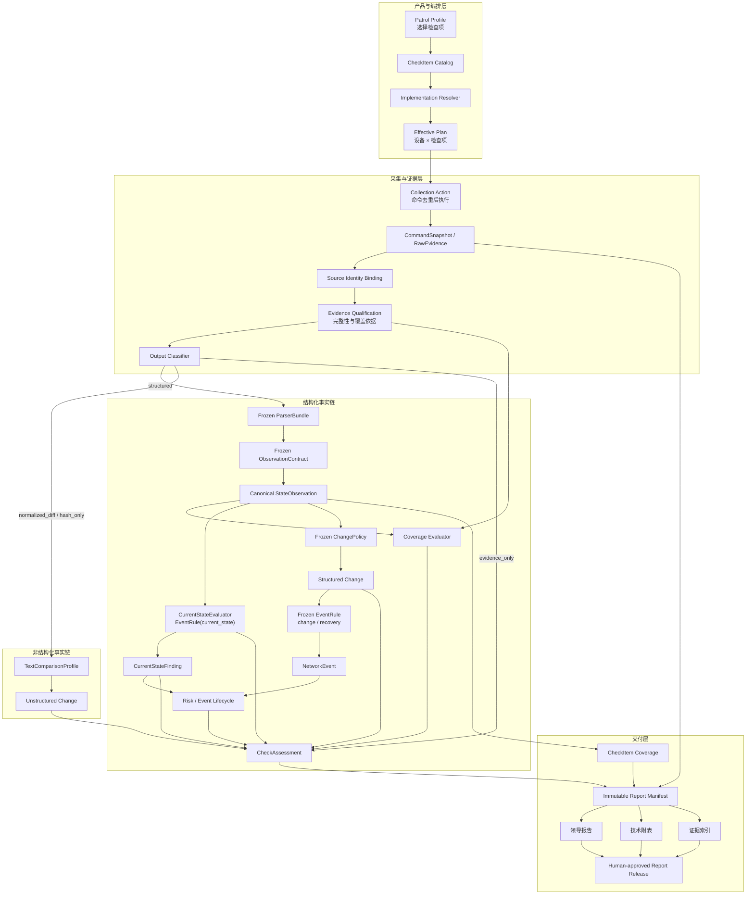

# 检查项中心的巡检与规则资产平台总体改造方案

> - 文档状态：Active / Implementing
> - 版本：2.4
> - 日期：2026-07-27
> - 文档所有者：NetOps Platform
> - 最后校验：2026-07-28
> - 适用范围：巡检计划、在线与离线巡检、Parser 资产生产、规则资产控制面、报告与工程治理
> - 目标读者：产品负责人、架构师、后端工程师、前端工程师、测试工程师、运维与规则工程师
> - 实施状态：[检查项平台实施矩阵](implementation/check-item-platform-completion-matrix-2026-07-28.md)
> - 权威性：本文是本轮检查项中心改造的唯一总体方案；专项文档不得改变本文定义的产品目标、
>   事实口径、运行边界和完成标准

## 1. 执行摘要

当前平台已经具备离线样本导入、TextFSM 生成与审批、标准 Observation、ChangePolicy、
EventRule、非结构化差异、历史回填和巡检报告等关键能力，但这些能力仍主要围绕
`vendor + profile + command` 组织。随着厂商、型号和命令数量增加，命令中心模型会产生以下问题：

- 同一个业务检查项被拆成多套命令资产，用户无法直接判断“CPU 检查是否已覆盖”。
- 巡检计划按命令维护，跨厂商 Profile 重复且难以复用。
- Parser 字段名容易反向渗透到规则和报告，造成跨厂商列名不一致。
- 命令级覆盖率不能真实表达业务检查项是否完成、是否可判断。
- 不需要 TextFSM 的配置、日志等输出缺少与检查项一致的产品模型。
- 规则资产页面展示后台命令单元，而不是用户真正关心的检查项及其兼容实现。

本产品的最终目标不是增加 Parser、规则或模型调用数量，而是面向多厂商、多型号和大规模
网络设备，将在线或离线巡检数据转换为真实、可解释、可追溯的网络现状、风险、变化与事件，
最终交付甲方领导能够理解、工程师能够复核、每项结论均有证据支撑的巡检报告。Parser、LLM
和规则资产控制面是实现这一目标的生产资料与治理手段，不是产品的最终交付。

本次改造将平台的最高层业务身份调整为：

```text
check_item = system.cpu_usage
```

命令、厂商、型号和 Parser 不被删除，而是下沉为检查项的采集实现：

```text
CheckItem
  -> CollectionImplementation
  -> Command / Collector
  -> Parser 或 TextComparisonProfile
  -> Canonical Observation / Raw Change
  -> CurrentStateAssessment / ChangePolicy / EventRule
  -> CheckAssessment / Risk Lifecycle
  -> Report Projection
```

同时，Parser 资产生产采用成熟模板优先策略：

```text
现有 Active Parser
-> 已验证历史候选
-> ntc_templates 候选
-> 本地客观执行预览（编译、解析、结果展示）
-> 默认由 LLM 初次复核，或由工程师直接人工复核
-> 复核确认后形成候选资产
-> 复核认为需修订时进入 LLM 修复或人工编辑
-> 未命中才从零生成
```

改造遵循渐进迁移，不推翻现有 PostgreSQL 资产、审批、回滚、证据和运行时链路。新旧模型在
迁移期双读、影子解析和结果对账，满足退出门禁后再删除命令中心兼容层。

## 2. 项目目标

### 2.1 产品使命与最终交付

产品使命：

> 面向多厂商、多型号和大规模网络设备，把在线或离线巡检数据转换为可信的当前状态、风险、
> 变化与事件，并形成管理者看得懂、工程师可复核、全过程可追溯的巡检交付物。

产品通过两条独立但衔接的生产线实现该使命：

```text
规则资产生产线
离线规则样本
-> Parser 候选
-> LLM 初审或人工直审
-> Parser 审批
-> sanitized structured records + Canonical Catalog
-> LLM 生成 ObservationContract / ChangePolicy / EventRule 候选
-> 当前状态验证 + 双周期回放 + 碰撞与恢复验证
-> 工程复核与审批
-> CheckItemRuntimeBundle 原子发布

生产巡检执行线
在线设备或离线历史周期数据
-> Effective Plan
-> 命令采集
-> Parser
-> StateObservation
-> CurrentStateFinding / Change / Event
-> CheckAssessment / Risk Lifecycle
-> 风险与质量评估
-> 领导报告、技术附表与证据包
```

规则资产生产线负责生产、验证、审批和发布运行所需资产；生产巡检执行线只读取冻结的
Active 资产，不在巡检过程中调用 LLM、生成规则或静默替换资产。

最终交付不是单一 PDF 或 Excel，而是一个一致的交付集合：

| 交付物 | 目标读者 | 必须回答的问题 |
|---|---|---|
| 领导报告 | 甲方领导、管理者 | 网络当前风险、重要变化、影响范围、整改优先级和结论可信度 |
| 技术附表 | 网络工程师、运维团队 | 各设备与检查项的当前值、状态、变化、事件、阈值和失败原因 |
| 证据包 | 复核、审计与排障人员 | 每项结论对应的设备、命令、原始输出、资产版本、执行批次和规则 |

任何一份正式巡检报告都必须如实回答：

1. 本次计划巡检哪些设备和检查项，实际完成了多少。
2. 哪些设备采集成功，哪些登录、执行、解析或规则处理失败。
3. 当前网络有哪些已确认风险，其严重度和影响范围是什么。
4. 相比基线或上一周期发生了哪些变化，哪些问题已经恢复。
5. 哪些检查项因缺数据、缺实现或缺资产而无法判断。
6. 每项结论来自哪台设备、哪条命令、哪份原始输出和哪一版规则资产。
7. 报告结论的覆盖率、完整性和可信度边界是什么。

结论必须区分 `healthy`、`at_risk`、`unable_to_determine` 和 `not_applicable`。只有完成必要
采集、解析或比较，并执行适用规则后，才能形成 `healthy`；“没有变化”“尚未产生事件”
或“数据为空”均不得自动解释为健康。数据不完整时必须明确标记 `unable_to_determine`
及阻断原因。仅承担变化或证据留存的检查项使用 `informational`，明确排除在健康结论分母外。

目标追踪矩阵：

| 报告必须回答的问题 | 权威事实来源 |
|---|---|
| 计划巡检哪些设备和检查项 | Target Manifest + Effective Plan |
| 哪些设备和检查项成功或失败 | CheckExecutionRecord |
| 当前是否健康、有哪些风险 | CheckAssessmentRecord + CurrentStateFinding + RiskCase |
| 相比上一周期发生什么变化 | ComparisonContext + NetworkChangeRecord |
| 哪些问题已恢复、哪些仍需整改 | RiskOccurrence + RiskRemediation |
| 每项结论来自什么命令和规则 | Evidence refs + CheckItemRuntimeBundle |
| 哪些数据无法判断 | CheckAssessment.blocking_reason_codes |
| 报告能否复现 | ReportManifest + artifact SHA-256 |

### 2.2 业务目标

1. 巡检计划、执行进度、结果和报告均以“检查项”为主要组织对象。
2. 同一检查项可根据设备厂商、系统族、型号、版本和能力选择不同采集实现。
3. 不同命令和 Parser 最终投影到统一、稳定、厂商无关的观测语义。
4. 用户能够回答：
   - 本次选择了哪些检查项；
   - 每台设备实际执行了什么命令；
   - 哪些检查项成功、失败、不适用或无法判断；
   - 当前网络有哪些风险、变化和数据可信度缺口。
5. 结构化命令与非结构化命令使用不同事实链路，但在检查项、证据和报告层统一呈现。
6. 规则资产控制面以检查项展示完整资产链，并允许展开查看各兼容实现。
7. 最终领导报告反映当前网络现状，技术附表保留标准化明细和完整证据索引。

### 2.3 工程目标

1. Parser 只负责忠实提取厂商输出，不承担跨厂商业务统一。
2. ObservationContract 负责字段语义、单位、维度和受控转换。
3. ChangePolicy 和 EventRule 按 canonical `observation_type` 复用，不按命令复制。
4. ntc_templates 命中后不调用 LLM 重新生成模板；默认只调用一次 LLM 初审，工程师直审时模型调用为零。
5. LLM 只生成候选资产，不进入正式巡检运行时，不拥有发布权限。
6. 所有运行使用冻结的 Parser 与规则资产清单，重试不得读取中途变更的新资产。
7. 所有状态失败必须有明确原因，不允许静默降级或静默丢弃。
8. 本地代码只提供 TextFSM 客观执行证据，不编码字段价值、记录完整性或业务语义通过门禁。
9. 文档和代码建立生命周期治理，停止长期保留无所有者、无引用、无退出日期的兼容层。
10. 当前状态评估与跨周期变化比较是两条独立事实路径；没有可比较基线不妨碍发现当前风险。
11. 每个设备与检查项必须形成独立 `CheckAssessmentRecord`，执行完成状态不得代替健康结论。
12. Parser、Contract、当前状态规则、ChangePolicy 和 EventRule 以兼容运行包原子发布和冻结。
13. 正式报告只能基于终态批次、冻结目标清单、冻结资产清单和不可变事实摘要生成。
14. 运行时发现资产缺口或输出漂移时只登记治理任务，不自动调用 LLM 或发布资产。
15. 原始输出必须先通过设备身份绑定、输出质量和实体覆盖判定，Parser 能返回记录不等于证据完整。
16. 本批次确认的当前风险与历史遗留但本次未复核的 RiskCase 分开表达，失败或过期数据不得刷新风险当前性。
17. 事实冻结与正式交付签发分离；`ReportManifest.status=final` 不等于报告已经人工批准并对甲方发布。

### 2.4 可度量成功指标

| 指标 | 目标 |
|---|---:|
| 巡检 Profile 使用检查项而非裸命令的比例 | 100% |
| Effective Plan 检查项解析成功率 | >= 99.5% |
| 已选择检查项的结果可解释率 | 100% |
| 结构化输出静默退化到 raw diff | 0 |
| NTC 候选形成客观执行预览的比例 | 100% |
| 已复用 NTC 模板调用 LLM 重新生成的比例 | 0 |
| 候选支持跳过 LLM 直接人工复核的比例 | 100% |
| Parser 语义结论可追溯到 LLM 或人工审核的比例 | 100% |
| Top 检查项 canonical observation 覆盖率 | 100% |
| 已完成检查项形成显式 assessment 的比例 | 100% |
| 计划 `设备 × 检查项` 与 CheckExecution 精确对账率 | 100% |
| CheckExecution 与 CheckAssessment 一对一覆盖率 | 100% |
| fallback 选择具有显式原因和证据的比例 | 100% |
| 冻结运行包摘要不一致后仍继续执行的次数 | 0 |
| 无基线检查项仍完成当前状态评估的比例 | 100% |
| 报告事实可由 source digest 重建的比例 | 100% |
| 同一 ReportManifest 的领导报告、技术附表和证据包事实一致率 | 100% |
| 同一 ReportManifest 与生成器版本的确定性交付物 SHA-256 一致率 | 100% |
| 风险事项具有首次发现、最近发现和生命周期状态的比例 | 100% |
| 报告中“无法判断”附带明确阻断原因 | 100% |
| 承担当前状态结论的检查项具有明确数据时效判定 | 100% |
| Parser 成功但零业务记录被直接计为健康 | 0 |
| 身份未确认或归属冲突的原始输出进入正式 Assessment | 0 |
| 已识别截断、分页残留或设备错误的输出被计为完整证据 | 0 |
| 承担健康结论的检查项具有可审计实体覆盖依据 | 100% |
| 历史未复核 RiskCase 被计入“本次已确认风险” | 0 |
| 报告截止时刻之后到达的事实被静默写入既有正式报告 | 0 |
| 单样本候选在审批页披露样本规模和适用边界的比例 | 100% |
| 生产目标矩阵 Active RuntimeBundle 覆盖率 | 100% |
| 控制面 RuntimeBundle 数量与运行时 Resolver 权威查询一致率 | 100% |
| RuntimeBundle 健康接口不可用时 UI 误报为就绪或零缺口 | 0 |
| 生产目标矩阵检查项可判断率 | >= 95%，其余必须有明确阻断原因 |
| `final` 报告中无结论来源或无证据的 Assessment | 0 |
| 正式对外交付物绑定人工签发记录和精确 artifact SHA-256 | 100% |
| Active 文档具备状态、所有者和校验日期 | 100% |
| 删除代码具备引用、流量、数据和回滚证据 | 100% |

Top 检查项首批定义为：

```text
device.version
system.cpu_usage
system.memory_usage
interface.oper_status
interface.optical_power
environment.fan
environment.power
configuration.running
```

### 2.5 产品目标验收模型

本项目不以 Parser 数量、模板覆盖率、LLM 调用成功率或 Event 数量作为最终成功标准。最终产品
是否成立，由五层相互校验的事实决定：

| 事实层 | 回答的问题 | 唯一权威来源 |
|---|---|---|
| 范围事实 | 计划检查谁、检查什么 | Target Manifest + per-device Effective Plan |
| 证据资格事实 | 输出属于哪台设备、是否完整、覆盖哪些应检查实体 | EvidenceQualificationRecord + CoverageDecision |
| 执行事实 | 实际执行了什么、在哪一层成功或失败 | CheckExecutionRecord + CollectionAction |
| 结论事实 | 当前是否健康、有什么风险、是否可比较 | CheckAssessment + Finding + Change/Event + RiskCase |
| 交付事实 | 正式报告引用了哪些冻结事实 | ReportManifest + artifact digest |

批次进入正式报告前必须满足以下集合不变量：

```text
planned_pairs
  = {(device_id, check_item_version_id) from frozen effective plan}

execution_pairs
  = {(device_id, check_item_version_id) from CheckExecutionRecord}

planned_pairs == execution_pairs
count(CheckAssessmentRecord) == count(CheckExecutionRecord)
assessment.execution_id set == execution.id set
every evidence ref used by execution has one evidence qualification decision
every health assessment has one auditable coverage decision
```

这里的 `planned_pairs` 必须按每台设备的实际 Profile 和检查项版本计算，禁止先求全批次检查项并集，
再假定每台设备都应执行全部检查项。任何缺行、重复行或计划外事实都会阻断 final 报告，而不是由报告
生成器补齐、忽略或猜测。

最终验收必须从报告反向追溯：领导报告中的每个数字和结论应能落到技术附表中的设备与检查项，
技术附表中的每行应能落到执行、规则和原始证据；任一层无法追溯时，产品目标尚未达成。

### 2.6 四层完成口径

本项目必须区分平台能力、生产资产、批次事实和正式签发，禁止用其中一层的完成冒充其他层：

| 层级 | “完成”的含义 | 不能代表 |
|---|---|---|
| 平台能力完成 | 计划、执行、Assessment、缺口反馈、报告和审批链路均可运行且通过工程验收 | 某个租户、厂商或型号的规则资产已经齐备 |
| 生产资产就绪 | 目标设备矩阵所需 Parser、Contract、Policy、Rule 已形成兼容 RuntimeBundle 并审批激活 | 某次巡检一定健康或没有风险 |
| 批次事实终态 | 目标矩阵每一项都有终态 Execution 与 Assessment，并冻结为 ReportManifest | 所有检查项都可判断，更不等于“未发现异常” |
| 正式交付签发 | 人工对冻结事实、确定性交付物和披露边界完成复核，ReportReleaseRecord 绑定精确文件摘要 | 报告内所有检查项均健康 |

因此：

- `ReportManifest.status=final` 只表示批次事实完整、终态且不可变，不表示报告结论是 `healthy`。
- 只有 `ReportReleaseRecord.status=released` 且其 artifact digest 与当前下载文件完全一致，才表示
  该版本已获准作为甲方正式交付；重新生成、润色或补录事实都必须重新签发。
- 全部检查项因缺资产而形成 `unable_to_determine` 时，仍可以生成一份事实完整的 final 报告；
  该报告必须明确写明无法判断范围、阻断原因和待治理资产，不能写成健康报告。
- `Event=0`、`Change=0`、Workflow 完成或 Parser 编译成功均不是产品完成指标。
- 生产上线门禁必须针对具体租户的“设备身份 × 检查项 × 采集实现”矩阵计算 Active
  RuntimeBundle 覆盖率，而不是使用全库模板数量或平均 Parser 覆盖率。
- 资产缺口属于规则资产生产线的待办，生产巡检执行线只负责记录缺口并形成诚实 Assessment，
  不得在运行中调用 LLM 补资产。

阶段状态按以下规则标记：

```text
done
  = 平台代码、迁移、UI、自动化测试和真实链路证据均齐备

operationally_ready
  = 指定生产矩阵所需 Active RuntimeBundle 100% 覆盖，
    金样本回放与人工审批全部通过

blocked_by_asset_readiness
  = 平台链路正确形成 unable_to_determine 和 AssetGap，
    但生产资产尚未满足发布门禁

released
  = final ReportManifest 的全部确定性交付物已完成人工签发，
    签发记录绑定 source facts digest 与每个 artifact SHA-256
```

### 2.7 当前网络现状的时间与证据口径

“当前网络现状”不是“数据库中最后一条记录”。每个承担健康结论的检查项必须同时满足以下七项
不变量，任一项不满足时不得形成 `healthy`：

| 不变量 | 必须证明的内容 | 不满足时 |
|---|---|---|
| 身份 | 原始输出已唯一绑定到冻结 Inventory 中的目标设备，来源与租户无冲突 | `identity_unresolved`，不得进入正式结论 |
| 适用 | 版本化适用性规则证明检查项适用于该设备和实体范围 | `not_applicable` 或 `unable_to_determine`，不得由空输出猜测 |
| 范围 | 设备和检查项属于冻结 TargetCheckMatrix | 拒绝计划外事实或生成新报告版本 |
| 执行 | 实际命令、实现和 RuntimeBundle 与冻结计划一致 | `unable_to_determine` |
| 完整 | 输出质量合格，必要实体、字段、阈值和规则评估均有覆盖 | `partial/insufficient`，不得计为健康 |
| 当前 | 事实的 `observed_at` 满足检查项版本的 freshness policy | `stale/unknown`，不得计为健康 |
| 证据 | 结论能追溯到 Snapshot、Parser、Contract、Rule 和摘要 | 阻断 final 报告 |

CheckItem 版本必须声明：

```text
freshness_policy:
  max_observation_age
  max_collection_span
  clock_source: collector | device | both
  clock_skew_tolerance

empty_result_policy:
  classification: expected_empty | not_applicable | unsupported | invalid
  evidence_conditions

coverage_policy:
  model: fixed | inventory_entity_set | derived_entity_set | command_reported_total | non_exhaustive
  reference_check_item_id
  allow_healthy_when_unbounded: false
```

默认采用 fail closed：没有经审批的空结果语义时，Parser 编译与执行成功但业务记录数为 0，只能形成
`insufficient` 或 `unable_to_determine`，不能解释为“没有异常”。设备命令明确返回“不支持”、
“无模块”或“未配置”时，必须由版本化适用性/空结果策略结合原始证据区分
`not_applicable`、`unsupported` 和合法空集合，不能由命令字符串或 UI 临时猜测。

每个批次冻结 `report_cutoff_at`。截止时刻之后到达的迟到事实不得静默改写既有 final 报告；
需要补录时创建新的事实修订和 ReportManifest 版本，并披露变化原因。领导报告必须显示数据采集区间、
报告截止时刻、过期或时间未知检查项数量，避免把历史样本包装成当前状态。

### 2.8 证据资格、覆盖分母与风险当前性

TextFSM 编译和解析成功只证明“模板能从文本中提取记录”，不能证明这份文本属于正确设备、输出没有
被分页或截断，也不能证明所有应检查实体都已出现。任何 Snapshot 进入健康评估前必须形成一个不可变
`EvidenceQualificationRecord`：

```text
source_identity_status: confirmed | ambiguous | conflict | external_unbound
output_quality_status: complete | empty | unsupported | device_error | truncated | paged | ambiguous
qualification_reason_codes
profile_version / digest
evidence_refs
```

身份绑定必须综合冻结 Inventory UUID、管理 IP、设备 Prompt、文件元数据和人工确认记录；名称或 IP
冲突时 fail closed。规则生产样本可以保留 `external_unbound`，但不得因此成为生产巡检事实。离线历史
巡检只有在每个周期的设备映射均确认后才能进入跨周期比较，且 baseline/current 必须映射到同一稳定
设备身份。

输出质量判定由版本化 `OutputQualityProfile` 执行，识别命令回显、设备错误、权限拒绝、分页残留、
截断、超时和混入下一条命令等情况。Profile 属于采集实现或 RuntimeBundle，不在报告代码中按命令
硬编码。即使部分文本能被 Parser 解析，只要质量状态不是 `complete` 或经策略批准的合法空结果，
该检查项也不得形成 `healthy`。

Parser 与标准化完成后必须另行形成 `CoverageDecisionRecord`，对预期实体集合与实际 canonical 实体
集合进行对账。覆盖分母必须来自可审计依据：

1. 系统级单实例检查使用 `fixed`，例如设备版本期望一个设备实体。
2. 接口、板卡、风扇等集合检查优先使用冻结 Inventory 实体集合。
3. 可由另一检查项推导时使用 `derived_entity_set`，并冻结被引用检查项版本、事实摘要和映射规则。
4. 设备输出包含可信总数时使用 `command_reported_total`。
5. 历史基线只能作为缺失提示 `baseline_hint`，不能单独证明本次完整。
6. 无法证明穷举覆盖时标记 `non_exhaustive/unbounded`；可以报告已发现风险，但不能据此断言整体健康。

风险当前性也必须 fail closed：

- `at_risk` 必须由本批次新鲜、完整且可追溯的 Finding/Event 确认。
- 历史未关闭 RiskCase 在本次采集失败、过期或未覆盖时保持生命周期状态，但标记
  `verification_status=not_reverified`，单列为“历史风险待复核”。
- 未复核历史风险不得刷新 `last_seen_at`，不得计入“本批次已确认风险”，也不得因本次没有 Finding
  自动恢复。

### 2.9 事实冻结与正式交付签发

`ReportManifest` 冻结事实，`ReportReleaseRecord` 表达人工对外交付决定，两者职责分离：

```text
ReportManifest(final)
-> deterministic Markdown / DOCX / XLSX / JSON / evidence package
-> quality verification
-> human sign-off
-> ReportReleaseRecord(released)
```

签发记录至少冻结 `report_manifest_id`、`source_facts_digest`、全部 artifact SHA-256、签发人、签发时间、
签发意见和披露确认。任何事实补录、LLM 润色、生成器升级或文件重建只要改变文件摘要，都必须形成新
报告版本并重新签发；旧签发记录保持不可变。下载页必须区分“事实已冻结”“待签发”“已签发”和
“已被新版本取代”，禁止把未签发的 final 预览标成正式报告。

### 2.10 2026-07-28 实施校正与发布边界

本轮真实样本、对象存储和浏览器验收进一步确认：检查项中心架构能够形成可信交付，但“平台
工程能力可运行”仍不等于“生产资产已就绪”。后续实施和验收统一采用以下校正口径：

| 层级 | 当前状态 | 已有证据 | 仍需完成 |
|---|---|---|---|
| 平台工程能力 | `in_progress` | 计划冻结、RuntimeBundle、EvidenceQualification、CoverageDecision、Assessment、RiskCase 当前性、ReportManifest、五类 MinIO 制品和 ReportRelease 均已有实现与测试；多设备部分失败、direct/workflow 终态等价和迟到事实新 Manifest 链路已通过定向测试 | Top 健康类检查项真实闭环、完整权限矩阵、大批次交互和生产灰度 |
| 生产资产 | `blocked_by_asset_readiness` | Active Parser 能被客观解析和装配验证，缺资产会形成 AssetGap 和 `unable_to_determine` | 当前 Active CheckItemRuntimeBundle 为 0；必须按目标设备矩阵补齐并审批 Parser/Contract/Policy/Rule |
| 批次事实 | 按批次独立判定 | 真实 `device.version` 样本可形成 2 条 canonical Observation、完整证据资格、覆盖决定和信息性 Assessment | 每个正式批次仍须完成 Target/Execution/Assessment 精确集合对账 |
| 正式交付 | 按报告版本独立判定 | 五类制品可写入对象存储、回读校验摘要并由不可变 ReportRelease 签发 | 只有具备签发记录和精确 artifact SHA-256 的版本可对外标记正式 |

真实 `lixian` 验收使用 H3C MSR5620 `display version`：TextFSM 产生 12 条厂商记录，Contract
对账后形成 `device.hardware.model` 与 `device.software.version` 两条 canonical Observation；
身份确认、输出完整、实体覆盖完整，但采集时间超出 freshness policy，因此 Assessment 为
`informational / complete` 且事实被标记为 `stale`。报告结论必须是“本次仅形成信息性结果，
未判定网络健康”，不能写成“未发现异常”。这条验收同时证明：

1. Parser 记录数不是报告结论，canonical Observation、证据资格和检查项 Assessment 才是事实入口。
2. 旧数据可以用于证据与变化分析，但过期数据不得形成当前健康结论。
3. Evidence 类型检查项可使用固定实体分母完成覆盖判断，不要求虚构健康规则。
4. 报告的 Markdown、DOCX、XLSX、JSON 和证据包必须先写入对象存储并按 Manifest 摘要回读验证，
   再允许人工签发。
5. 浏览器只通过 BFF 访问报告与检查项结果；实时进度必须使用携带 Bearer Token 的流式请求，
   原生 `EventSource` 不能作为依赖本地存储令牌的认证通道。SSE 降级时必须显示原因并保留轮询。

剩余实施按以下顺序收口：

1. 冻结首批生产目标矩阵，按“设备身份 × 检查项 × 采集实现”列出真实缺口，不以模板总数或命令
   覆盖率代替生产就绪度。
2. 依次为 `system.cpu_usage`、`interface.oper_status`、`interface.optical_power` 生产并审批完整
   RuntimeBundle，验证首次巡检当前风险、双周期变化、事件和恢复。
3. 通过同一 ReportManifest 验证领导报告、技术附表和证据包能真实表达三项检查结果、失败范围、
   阈值来源与无法判断原因。
4. 完成完整权限矩阵和 1000 至 2000 台真实交互验收后，以目标设备矩阵计算资产覆盖率；达到门槛
   才按 5% -> 20% -> 50% -> 100% 灰度，未达到时继续显示 `blocked_by_asset_readiness`。
5. 两个完整周期对账通过后，才执行命令中心兼容读、旧路由和旧 UI 的最终删除。

### 2.11 产品目标闭环与生产资产就绪战役

当前最主要的风险已经不是“平台是否有 Parser、规则或报告代码”，而是首批生产设备矩阵还没有
形成可运行、可审批的 canonical 资产链。数据库中存在的 Active Parser 数量不能直接计入生产
覆盖：现有部分 Contract/Policy/Rule 仍使用 `cpu.idle_pct`、`device.nxos_version` 等临时语义，
接口状态与光功率尚无覆盖目标样本的 Active Parser，且当前 Active CheckItemRuntimeBundle 为 0。
因此下一阶段不再横向增加页面或框架，而是完成三条纵向资产闭环。

#### 2.11.1 资产生产的统一工序

每个“检查项 × 兼容实现”必须经过同一条可观察工序：

```text
生产目标矩阵
-> 离线脱敏样本与兼容证据
-> Existing / NTC / LLM Parser 候选
-> TextFSM 本地客观执行预览
-> LLM 初审或工程师直审
-> Parser 人工审批
-> sanitized structured records
-> LLM 生成 Contract / CurrentStateRule / ChangePolicy / EventRule 候选
-> canonical 语义与单位复核
-> 首次状态验证 + 双周期回放 + 碰撞与恢复验证
-> 工程师修订与人工审批
-> RuntimeBundle 确定性装配预览
-> RuntimeBundle 人工激活
-> 影子巡检与报告验收
```

职责边界如下：

| 环节 | 自动化职责 | LLM 职责 | 人工职责 |
|---|---|---|---|
| Parser 候选 | 查找 Active/历史/NTC，编译并执行 TextFSM，展示逐样本结果 | 无成熟候选时生成模板；对客观结果做语义初审 | 确认最终字段、主键、记录边界和兼容范围 |
| canonical 映射 | 提供已审批目录、单位转换 DSL 和冲突检查 | 从 structured records 生成候选映射，不读取 raw CLI | 修正映射；新增语义必须独立审批 |
| 状态与变化规则 | 执行 synthetic validation、Q2/Q3 回放、碰撞和恢复验证 | 生成候选规则并根据结构化诊断定向修订 | 确认业务阈值、适用范围、严重度和恢复语义 |
| RuntimeBundle | 确定性校验版本、范围、摘要和 canonical 覆盖 | 不参与装配或激活 | 审批并激活完整运行包 |
| 正式报告 | 从冻结事实确定性生成全部交付物 | 只能润色未锁定叙述，不能修改数字和结论 | 复核披露边界并签发精确制品摘要 |

TextFSM 本地执行只回答“能否编译、实际解析出什么”，不替代语义审批；LLM 初审也不拥有发布权。
人工可以跳过 LLM 初审直接确认客观结果，但不能跳过最终 Parser、规则资产和 RuntimeBundle 的职责
分离审批。

#### 2.11.2 三条黄金资产纵切

| 顺序 | 检查项 | canonical 最小结果 | 必须通过的业务验收 |
|---:|---|---|---|
| 1 | `system.cpu_usage` | `device.cpu.utilization`，带处理器范围与时间窗口维度 | 不同厂商输出进入相同报告列；首次高利用率形成 Finding；Q2/Q3 可比较；临时 `cpu.*` 语义完成修订、回填和回放 |
| 2 | `interface.oper_status` | `interface.oper_status`，实体键为规范接口身份 | Up/Down 当前状态、变化和恢复可区分；行政关闭、不适用和采集失败不误报；接口集合覆盖分母可审计 |
| 3 | `interface.optical_power` | presence、Rx/Tx 功率及对应 warning/alarm 阈值 | 当前低功率、恢复和模块缺失语义分离；阈值来源可追溯；N/A、DOM 不支持和缺模块不误报低光功率 |

三条纵切均先从 `lixian` 的真实厂商与型号样本形成候选和回放证据，再由工程师审批。缺少样本、
Parser、canonical 映射或业务规则时，控制面必须显示下一步行动，不能由应用代码硬编码某个厂商、
型号、命令或模板来伪造完成。

光功率阈值按以下版本化来源选择，并冻结到 Observation/Assessment 证据中：

```text
设备输出的端口/模块 warning 或 alarm 阈值
-> 精确匹配模块身份的已审批 Inventory/Transceiver Profile
-> 具有明确适用范围的已审批 CheckItem fallback
-> threshold_unknown
```

`threshold_unknown` 时仍可展示当前 Rx/Tx 值和变化，但不得判断“正常”或“低光功率”。恢复阈值与
hysteresis 必须来自同一已审批规则版本，不能在报告代码或 Parser 中按型号硬编码。

#### 2.11.3 非结构化检查项与统一报告列

并非所有巡检命令都需要 TextFSM。配置、日志和大段文本由检查项声明结果模式：

| 结果模式 | 事实产物 | 允许形成的结论 |
|---|---|---|
| `structured` | canonical Observation、Finding、Change、Event | 当前状态、风险、变化和恢复 |
| `normalized_diff` | 规范化差异、摘要和证据引用 | 具体变化；只有命中已审批规则才能升级为事件 |
| `hash_only` | 内容摘要与 changed/unchanged | 只能说明是否变化，不能说明健康或故障 |
| `evidence_only` | 原始证据引用和采集状态 | 信息性留痕，不进入健康分母 |

跨厂商 Excel 列名不通过强迫所有 TextFSM 使用完全相同的 `Value` 名称实现。Parser 字段忠实反映
厂商输出，ObservationContract 将其映射为 canonical observation，报告投影再按检查项和维度生成
稳定列。新增厂商只增加 CollectionImplementation、Parser 和 Contract 映射，不修改领导报告与
技术附表 Schema；确需新增 canonical 字段时，必须先完成目录版本审批和向后兼容评估。

#### 2.11.4 生产就绪与停止条件

每条纵切只有同时满足以下条件才可标记 `operationally_ready`：

1. 目标设备矩阵内每个兼容实现都有经审批的 Parser 或明确的非结构化结果模式。
2. Parser 审批页展示全部脱敏样本、模板、逐样本解析结果、主键、样本规模和适用边界。
3. 所有 structured 实现只产生已审批 canonical observations，单位、维度和实体键可对账。
4. 当前状态、双周期变化、事件、恢复、异常空结果和负样本均已回放；碰撞未解决时禁止审批。
5. RuntimeBundle 装配无兼容、摘要、规则归属或 canonical 覆盖阻断，并由人工激活。
6. 影子批次中每个目标对都有 Execution、EvidenceQualification、CoverageDecision 和 Assessment。
7. 领导报告、技术附表和证据包使用同一 Manifest，且任何无法判断都有明确原因和修复行动。

以下任一情况发生时停止激活并退回资产生产线：LLM 发明未审批语义、Parser 只覆盖部分实体、阈值
来源未知却产生健康结论、事件碰撞、Q2/Q3 实体无法稳定关联、输出兼容范围宽于样本证据，或报告事实
无法回溯到 Snapshot 与冻结资产版本。

### 2.12 2026-07-29 控制面终态校正

代码复核发现，任务级规则生产流程曾在 `RULE_ASSET_BUNDLE=active` 时直接显示“资产链路已完成”。
这与本方案的生产真相模型冲突：规则资产包只是经过审批的 Contract、Policy 和 EventRule 子资产集合，
并不证明它们与 Parser、检查项版本和采集实现兼容，也不证明运行时依赖摘要完整。控制面终态统一修正为：

```text
规则资产包审批发布
-> 检查项与采集实现归类完整
-> RuntimeBundle 确定性装配预检
-> RuntimeBundle 草稿
-> 独立审批激活
-> Active RuntimeBundle 依赖健康复核
-> 资产生产任务 completed
```

任务级流程必须增加 `runtime_bundle` 必选阶段，并遵守以下状态语义：

| 状态 | 判定 |
|---|---|
| `not_started` | 规则资产包尚未全部审批发布 |
| `blocked` | 存在未归类生产单元、Active Bundle 依赖漂移或检查项实现无法确定 |
| `ready` | 子资产已发布，但仍有检查项实现缺少 Active RuntimeBundle |
| `completed` | 本任务映射到的全部“检查项版本 × 实现版本”均有健康 Active RuntimeBundle |

只有 `runtime_bundle=completed` 时，任务整体状态才允许为 `completed`。覆盖与回填页面必须支持按检查项、
采集实现或命令搜索，并接受精确的 `check_item_version_id + implementation_version_id` 深链；从某条样本
任务点击下一步后，应直接打开对应装配对象，而不是要求工程师在全库列表中二次查找。

该校正已经实现并通过以下回归：

- 规则包发布不再提前形成生产完成状态。
- 未归类命令单元会引导至检查项归类，不会静默遗漏。
- RuntimeBundle 缺失会引导至精确装配对象。
- RuntimeBundle 健康接口失败仍为“无法判断”，不会退化为零缺口。
- 后端任务级流程测试、覆盖工作台组件测试和前端生产构建通过。

## 3. 非目标与边界

- 不把厂商和命令从 Parser 资产身份中删除。Parser 仍需精确识别输出兼容范围。
- 不建设一个包含所有厂商字段的“超级宽表”。
- 不允许巡检运行时发现缺口后自动调用 LLM 并发布资产。
- 不把设备巡检页的“离线巡检”迁移到规则资产页。
- 不将规则样本导入和离线历史巡检合并为同一个产品入口。
- 不允许非结构化文本变化默认升级为故障事件。
- 不删除已经执行过的数据库迁移文件。
- 不在缺少引用和生产流量证据时直接删除历史兼容代码。
- 不因本次架构改造硬编码具体厂商、型号或光模块阈值。

## 4. 现状评估

### 4.1 可复用能力

当前实现已经提供以下基础：

- `ParserPolicy`：命令归一化、capability、structured/raw handling 和模板作用域。
- `SimpleParserGenerationService`：有限模型调用、TextFSM 客观执行、候选持久化和人工审批。
- `ParserBundle`：一个命令包含多个 record set 的不可变 Parser 资产。
- `ObservationContract`：字段语义、单位、维度和标准 `observation_type`。
- `StateObservation`：稳定事实身份和不可变观测。
- `ChangePolicy`、`EventRule`：运行时只读取 active 资产。
- `raw_hash_diff` 与 `unstructured_diff`：配置有序差异、日志滚动窗口、脱敏预览。
- `RuleAssetCommandUnitRecord`：命令级规则生产过程读模型。
- `Patrol Runtime Manifest`：运行开始时冻结 Parser 和规则资产。
- 领导报告与 Excel 技术附表：风险、变化、事件、质量和证据交付。

### 4.2 当前结构性缺口

| 缺口 | 当前表现 | 目标状态 |
|---|---|---|
| 顶层身份错误 | `vendor + profile + command` | `check_item` |
| 巡检计划命令化 | Profile 直接维护命令 | Profile 选择检查项 |
| 采集实现缺失 | 命令策略混合业务和技术规则 | 独立 CollectionImplementation |
| Parser 生成成本高 | 未优先复用成熟公共模板 | NTC first |
| 报告仍含命令推断 | 部分领域靠 command/entity 字符串判断 | check_item/report projection |
| 非结构化输出孤立 | handling 仍绑定命令 | 检查项声明 result mode |
| 覆盖率口径偏低层 | 展示 Parser/命令覆盖 | 展示检查项可判断率 |
| UI 生产单元偏技术 | 以命令资产单元为中心 | 检查项展开兼容实现 |
| 文档重复 | 多轮 remediation 并列为“最新” | 单一权威文档 + 历史归档 |
| 兼容代码缺少退出 | legacy/read-only 长期存在 | 观测、截止日期和删除门禁 |

### 4.3 2026-07-28 实测基线

本轮改造使用 `lixian/Q2` 与 `lixian/Q3` 进行真实离线链路验证，并使用 PostgreSQL 事务进行
2000 台容量验证。当前事实如下：

| 验证项 | 实测结果 | 判定 |
|---|---|---|
| Q2 离线数据 | 6 文件、6 设备、152 命令 | 身份与命令切片成功 |
| Q3 离线数据 | 6 文件、6 设备、162 命令 | 身份与命令切片成功 |
| Q2→Q3 Observation | 420 → 420 | 已形成结构化与 raw compare 事实 |
| Q2→Q3 Change | 30 | 24 条 `slot_uptime`，6 条配置 raw hash 变化 |
| Q2→Q3 Event | 0 | 当前 Active Rule 未匹配这些变化，不应伪造 Event |
| Q2 structured ready | 2 / 75 eligible，2.67% | 生产资产明显未就绪 |
| Q3 structured ready | 2 / 77 eligible，2.60% | 生产资产明显未就绪 |
| 三条黄金 Parser 候选基准 | 4 型号 × 4 命令 = 16 资产，56 样本、1236 记录 | CPU、接口状态、IP 接口与光功率均通过全部客观硬门禁 |
| 黄金 Parser 模型调用 | 0 | 已知布局由确定性编译器完成；弱模型替身未被调用 |
| Active CheckItemRuntimeBundle | 0 | 生产检查项矩阵必须形成 AssetGap 与 `unable_to_determine` |
| 活动目录 RuntimeBundle 覆盖 | 8 个检查项、27 个实现对、0 就绪、27 缺失 | 控制面必须显示 0%，不得沿用旧规则阶段 3/3 |
| 真实成功链路 | MSR5620 `display version`：12 条 Parser 记录 -> 2 条 canonical Observation -> 1 条完整 Assessment | 新运行时成功路径通过 |
| 规范版本值 | `7.1.064, Release 0821P18` | 多 Parser 字段经受控投影后未丢失 Release |
| 成功链路报告 | final ReportManifest + Markdown/DOCX/XLSX/JSON/证据包 | 仅形成信息性结论，未冒充网络健康 |
| 测试资产隔离 | E2E 前后 Active RuntimeBundle 均为 0，原 Active Contract ID 不变 | 外层事务回滚有效 |
| 2000 台 × 8 检查项 | 16000 Execution + 16000 Assessment | 平台容量链路通过 |
| 资产缺口聚合 | 16000 次影响聚合为 8 个工作项 | 避免按设备制造治理任务风暴 |
| 批次摘要 | 0.63 秒 | 数据库聚合后满足交互基线 |
| 100 条结果页 P95 | 0.805 秒 | 满足 <= 1 秒当前基线 |
| ReportManifest + 五类交付物 | 69.3 秒 | 满足 <= 10 分钟基线 |
| 相同 Manifest 延时重建 XLSX | 文件 SHA-256 一致 | Office 保存时间元数据已归一化 |
| 缺资产报告结论 | 16000 项全部 `unable_to_determine`，0 项 `healthy` | 诚实结论门禁通过 |

以上结果说明平台的终态、分页和报告骨架已能处理当前 Top 八项规模，但生产资产尚未达到
`operationally_ready`。后续不得为了提高 Event 数量或报告观感硬编码规则；应由规则资产生产线
利用真实样本完成 Parser、Contract、Policy、Rule 和 RuntimeBundle 的生成、复核、审批与发布。

容量证据由以下可重复脚本生成，默认在外层事务中回滚，不污染生产数据：

```powershell
venv\Scripts\python.exe scripts\test\check_item_runtime_capacity_benchmark.py `
  --devices 2000 `
  --page-size 100 `
  --page-samples 20 `
  --output .tmp\check-item-capacity\runtime-2000.json
```

Parser 候选基准使用冻结的 `lixian/Q1/Q2/Q3` 语料，覆盖 H3C MSR5620、S5130S-52S-HI、
S5130S-54S-HI-G 与 S6850-56HF。该脚本只验证候选生成和逐样本客观结果，不写入生产资产，也不
代替 Parser、规则或 RuntimeBundle 的人工审批：

```powershell
venv\Scripts\python.exe scripts\test\textfsm_agent_lixian_benchmark.py `
  --source-root lixian `
  --reports-dir .tmp\simple-parser-lixian-benchmark-20260729
```

本次实测新增了“重复实体头 + 带标签标量指标”的通用布局编译能力，用于 CPU 等多槽位指标；同时
修复表格图例行被误识别为摘要字段的问题。实现依据布局、ParserSpec 和样本证据编译，不按厂商、
型号或命令硬编码模板。输出证据位于
`.tmp/simple-parser-lixian-benchmark-20260729/simple-parser-lixian-benchmark.json`。

真实成功链路由以下脚本生成，同样默认回滚全部数据库资产与事实，只保留本地验收交付物：

```powershell
venv\Scripts\python.exe scripts\test\check_item_lixian_runtime_e2e.py `
  --source-file lixian\Q2\XA-FOTIC-RT5620-1-10.34.2.219.txt `
  --output-dir .tmp\check-item-lixian-e2e\20260728-final
```

该 E2E 曾真实发现 `canonical_catalog_version + SHA-256` 共 66 字符，而比较上下文列仅允许
64 字符，导致拥有 RuntimeBundle 的首次 Effective Plan 无法冻结。迁移
`0062_comparison_schema_ref` 已将不可变 schema reference 扩展为 128 字符，并禁止存在超长
历史值时执行有损 downgrade。此类“缺资产路径通过、成功路径失败”的问题说明两条路径必须分别验收。

### 4.4 运行资产装配专项审计

2026-07-28 对生产库进行了只读审计。审计目的不是把现有 Active 子资产包装成“已就绪”，而是验证
它们是否能够组成与检查项契约一致的生产运行包：

| 审计项 | 当前事实 | 结论 |
|---|---|---|
| Active Parser | 3 个：MSR5620 `display version`、NEXUS9000 `show system resources`、`show version` | Parser 独立审批可用，但不能代表检查项就绪 |
| Implementation/Parser 关联 | 0 个 Active 关联 | 当前没有可由控制面完成的正式装配入口 |
| Active ObservationContract | 3 个 | 1 个未声明 observation type；2 个使用命令级临时语义 |
| Active ChangePolicy/EventRule | 各 11 个 | 规则围绕临时 observation type 齐备，不等于覆盖 Canonical Catalog |
| Active RuntimeBundle | 0 个 | 权威覆盖率 0%，该结果是正确的 |

当前目录要求 `device.software.version`、`device.hardware.model`、`device.cpu.utilization` 等标准
observation；现有 NEXUS 资产仍使用 `device.nxos_version`、`cpu.idle_pct`、`cpu.kernel_pct`
等命令级临时语义，不能通过运行包装配伪装为标准检查项资产。另有部分
CollectionImplementation 只限定到厂商，而现有 Parser 的验证证据只覆盖具体型号；厂商级实现
不能绑定型号级 Parser 后宣称覆盖整个厂商。

专项审计确认的缺口是控制面和兼容性治理缺口，不是简单缺一张关联表。Phase 3 必须增加确定性的
运行包装配预检、草稿、审批和原子激活流程，并遵循以下原则：

- 不根据相同厂商、相同命令或相似字段名自动扩大兼容范围。
- 不根据 EventRule 名称、事件类型或 UI 选择猜测 observation type。
- 不把 Active Rule Asset Bundle、Active Parser 或“规则阶段齐备”当作 Active RuntimeBundle。
- 现有临时 observation type 必须经 Contract 修订、历史回填和回放迁移到 Canonical Catalog，
  不能在装配层做别名硬编码。
- 当前 0 个 Active RuntimeBundle 在上述缺口修复前保持不变，报告继续诚实输出
  `unable_to_determine`。

## 5. 设计原则

### 5.1 业务身份与语法身份分离

- 检查项回答“检查什么”。
- 采集实现回答“这类设备怎么采”。
- Parser 回答“这份输出怎么解析”。
- ObservationContract 回答“解析字段在业务上是什么”。
- ChangePolicy 回答“如何比较和判定变化”。
- EventRule 回答“什么变化构成事件”。

### 5.2 标准语义采用长表模型

CPU 的底层身份不是固定宽表字段 `cpu_5s/cpu_1m/cpu_5m`，而是：

```text
observation_type = device.cpu.utilization
dimensions.window = 5s | 1m | 5m | 15m
unit = percent
```

报告层再将其透视为稳定列。这样可以容纳不同厂商只提供部分时间窗口、板卡 CPU、核心 CPU
或系统总 CPU 的情况。

同一 Parser 也可能因槽位、板卡或子模块产生多条记录，而多个记录共同携带一个设备级事实。
标准化层必须执行以下快照内不变量：

```text
same snapshot + same canonical state key + same value
  -> 幂等去重为一个 Observation

same snapshot + same canonical state key + different value
  -> normalization_failed / semantic_projection_conflict
  -> 不允许按数据库写入顺序选择“最后一个值”
```

如果多个值本来都合法，Contract 必须用实体主键或 `dimensions` 显式区分它们。报告透视不能
承担消歧职责，也不能吞掉冲突。

### 5.3 能验证的成熟资产优先复用

公共模板、历史模板和 LLM 模板必须进入同一客观执行、语义复核和审批链路。来源不能改变
TextFSM 可执行性要求、证据要求和最终人工发布审批，但可以决定是否需要消耗模型调用。
本地执行器不得据此恢复字段价值、记录完整性等业务语义门禁。

### 5.4 运行时确定性

巡检运行时禁止调用 LLM。LLM 只能在规则资产控制面读取脱敏样本并生成候选。

### 5.5 不静默降级

- structured 命令缺模板或解析失败时不得自动改为 raw diff。
- raw diff 未配置比较 Profile 时不得生成正式变化结论。
- 缺少规则或阈值时必须显示“无法判断”或“数据不完整”，不得显示“健康”。

### 5.6 不可变、幂等、可回滚

Parser、Contract、Policy、Rule、CheckItem 和 CollectionImplementation 均版本化。执行引用冻结
版本，审批激活原子化，所有写接口要求幂等键。

### 5.7 当前状态、变化与事件分离

- CurrentStateAssessment 回答“现在是否存在风险”。
- Change 回答“与可比较基线相比发生了什么”。
- Event 回答“哪些状态或变化需要形成运营事件”。
- RiskCase 回答“问题是否仍存在、是否已确认、是否已恢复和是否完成整改”。

首次巡检或缺少可比较基线时仍必须执行当前状态评估，但不得伪造变化结论。报告可以同时出现
“当前存在风险”和“无可比较基线”。

### 5.8 报告事实不可变

正式报告必须绑定目标设备快照、检查项计划、资产运行包、比较上下文、检查项结论和证据摘要。
报告生成器只能聚合这些事实，不得重新执行规则或根据命令名称二次推断健康状态。

同一 `ReportManifest` 与同一 `generator_version` 的确定性交付物必须字节级可复现。DOCX/XLSX
等 Office 容器中的 ZIP 条目顺序、时间戳以及 `docProps/core.xml` 保存时间必须归一化；不得让
第三方库写入的当前时间导致相同事实生成不同文件摘要。含人工确认的 LLM 润色稿必须形成新的
生成器版本或报告版本，不能覆盖确定性事实交付物。

### 5.9 Parser 采用结果导向审核

ParserSpec、记录方案、样本角色和预期结果用于帮助模型生成及帮助工程师定位问题，但都不是凌驾于
原始输出和真实解析结果之上的业务事实。Parser 审核的核心对象始终是：

```text
脱敏原始 CLI
+ 候选 TextFSM
+ TextFSM 引擎逐样本实际解析结果
+ 工程师确认的主键与业务字段
```

具体约束：

- ParserSpec 在任务任何阶段都可修改；保存后使旧候选失效并要求重新生成或重新执行，不直接修改
  已发布模板。
- 平台可以建议记录数、记录边界和主键，但不得把推断值伪装成不可修改的验收真值。
- 不设置固定的最少样本数量。一份有效样本可以生成、复核和发布候选，但审批页必须显著展示
  `sample_count=1`、实际兼容范围和证据局限，审批人对该范围负责。
- 本地代码只执行编译、解析、完整输出留痕、摘要和技术错误检查，不编码“字段是否有运维价值”
  “记录是否语义完整”等业务结论。
- 默认由 LLM 对照原始输出、模板和解析表进行初审；工程师可直接人工复核、覆盖模型建议或编辑模板
  后重跑。LLM 和人工的判断均需留下输入摘要、结论和审核记录。
- 只有无法被生产 TextFSM 引擎编译或执行的候选属于技术上不可发布；语义是否满足需求由 LLM 建议
  与最终人工审批共同决定。

### 5.10 逻辑检查与物理采集分离

`设备 × 检查项` 是逻辑执行和结论单位，`CollectionAction` 是物理采集单位。一条命令可以服务多个
检查项，因此命令去重不得丢失逻辑绑定。每个采集动作必须保留：

```text
collection_action_id
command / collector arguments
ordered fallback actions
bindings[]:
  check_item_version_id
  implementation_version_id
  runtime_bundle_version_id
  fallback_rank
```

fallback 只在声明的采集级条件下触发，例如连接或命令执行失败、输出为空、设备明确返回不支持命令。
主命令已经返回可用输出但 Parser/Contract/Rule 失败时，不得静默换命令掩盖资产缺口；应形成
`parse_failed`、`blocked_asset_missing` 或 `AssetGapRecord`。如确需允许解析失败后 fallback，
必须在 CollectionImplementation 中显式版本化声明，并在审批与报告证据中展示。

### 5.11 控制面与生产面单向发布

规则资产控制面可以读取脱敏离线样本、历史结构化记录和人工选择的 AssetGap 证据，负责生成、修订、
验证与审批资产。生产巡检执行面只能读取已激活的冻结 RuntimeBundle：

```text
control plane --approved immutable bundle--> runtime
runtime --asset gap / sanitized evidence ref--> control plane
```

反向反馈只能登记缺口和证据引用，不能自动启动 LLM、自动生成候选或改变正在运行批次的资产。

### 5.12 先证明证据合格，再解释证据

原始输出必须先完成来源身份、采集完整性和覆盖资格判定，再进入 Parser、比较和 Assessment。
“SSH 返回成功”“TextFSM 返回了若干行”以及“没有解析异常”都不能替代输出质量与实体覆盖证明。
质量判定使用版本化策略并冻结摘要，报告层只消费判定结果，不二次扫描文本猜测完整性。

### 5.13 当前确认与历史遗留分离

本批次 Assessment 只表达本批次证据能够确认的当前结论。历史 RiskCase 是跨批次运营事实，可以在
本次未复核时继续保持 open，但必须同时披露最后确认时间和 `verification_status`。平台不得用旧风险
填充本批次 `at_risk`，也不得因本批次采集失败或零记录把旧风险自动恢复。

### 5.14 事实冻结与交付签发分离

ReportManifest 负责不可变事实和确定性交付物，ReportReleaseRecord 负责人工签发。生成完成不是签发，
事实 final 不是对外发布，重新生成出不同摘要的文件不是原签发文件。该边界必须同时体现在状态机、
权限、API、下载页和审计记录中。

## 6. 改造后的总体架构

### 6.1 总体分层



### 6.2 规则资产控制面

```mermaid
flowchart LR
  Upload["导入规则样本"] --> Slice["命令切片"]
  Slice --> Bind["检查项与兼容实现归组"]
  Bind --> Existing{"已有可用 Parser?"}
  Existing -->|是| Regression["新增样本回归"]
  Existing -->|否| NTC["ntc_templates Resolver"]
  NTC -->|命中| Execute["TextFSM 客观执行预览"]
  NTC -->|未命中| Generate["LLM 生成"]
  Regression --> Execute
  Generate --> Execute
  Execute -->|可执行| ReviewRoute{"复核方式"}
  Execute -->|执行错误| Repair["LLM 修复或人工编辑"]
  ReviewRoute -->|默认| LLMReview["LLM 初次语义复核"]
  ReviewRoute -->|工程师直审| HumanReview["人工核对结果"]
  LLMReview -->|认可或不确定| HumanReview
  LLMReview -->|建议修复| Repair
  Repair --> Execute
  HumanReview -->|确认| Candidate["不可变候选"]
  HumanReview -->|需修订| Repair
  Candidate --> Approval["发布审批"]
  Approval --> ActiveParser["Active Parser"]
  ActiveParser --> Context["仅 structured_json<br/>构造安全上下文"]
  Catalog["Active CheckItem<br/>Canonical Catalog"] --> Context
  Context --> RuleGeneration["Contract / Policy / EventRule 候选"]
  RuleGeneration --> Replay["当前状态评估 + 历史回放<br/>碰撞与恢复验证"]
  Replay --> RuleApproval["审批发布"]
  RuleApproval --> Bundle["组装兼容运行包<br/>依赖摘要与完整性检查"]
  Bundle --> ActiveBundle["Active CheckItemRuntimeBundle"]
```



### 6.3 两条产品链路保持分离

| 产品入口 | 输入 | 输出 | 是否生产规则 |
|---|---|---|---:|
| 设备巡检 | 在线设备或历史周期数据 | Observation、Change、Event、巡检报告 | 否 |
| 巡检规则资产 | 离线规则样本 | Parser、Contract、Policy、EventRule、RuntimeBundle | 是 |

底层可以复用上传、文件存储、CLI 切片和身份识别服务，但必须使用不同的 `purpose`、权限、
状态机、页面文案和交付物。

生产巡检链路可以把 `template_missing`、`parse_failed`、输出签名漂移和规则覆盖缺口登记为
`AssetGapRecord`，但不得直接启动模型生成。工程师必须在规则资产控制面选择已脱敏样本或
显式导入离线样本后，才能创建资产生产任务。

## 7. 核心领域模型

### 7.1 CheckItemDefinition

检查项是平台稳定的业务目录项。

```yaml
id: system.cpu_usage
version: 1
name: CPU 使用率
category: system
description: 检查设备、板卡或处理器范围的 CPU 使用情况
result_mode: structured
assessment_mode: health
canonical_contract:
  entity_type: cpu_scope
  identity_dimensions: [scope, scope_id]
  observations:
    - observation_type: device.cpu.utilization
      unit: percent
      dimensions: [window]
report_projection: cpu
freshness_policy:
  max_observation_age: PT24H
  max_collection_span: PT2H
  clock_source: collector
  clock_skew_tolerance: PT5M
empty_result_policy:
  classification: invalid
coverage_policy:
  model: fixed
  fixed_count: 1
  allow_healthy_when_unbounded: false
status: active
```

关键字段：

- `id`：永久稳定的业务 ID，不包含厂商或命令。
- `version`：定义版本。
- `result_mode`：`structured`、`normalized_diff`、`hash_only` 或 `evidence_only`。
- `assessment_mode`：`health`、`change` 或 `evidence`，决定是否进入健康结论分母。
- `canonical_contract`：预期标准语义，不直接约束厂商 TextFSM 字段名。
- `report_projection`：报告领域投影。
- `freshness_policy`：当前状态事实的最大年龄、采集跨度和时钟容差。
- `empty_result_policy`：零业务记录、未配置、不支持和不适用的证据化分类规则。
- `coverage_policy`：如何证明应检查实体集合与覆盖分母，禁止报告层根据已解析行数反推完整性。
- `applicability`：业务级适用条件。
- `status`：`draft/active/deprecated`。

### 7.2 CollectionImplementation

采集实现描述某类设备如何满足一个或多个检查项。

```yaml
id: cisco-nxos-system-resources
version: 1
check_item_ids: [system.cpu_usage, system.memory_usage]
match:
  vendor: Cisco
  families: [NXOS]
  model_patterns: ['^N[0-9]']
commands:
  - command: show system resources
    priority: 100
collector: cli
parser_requirement: structured
template_scope: family
output_quality_profile: h3c.comware.cli.complete-output@1
status: active
```

设计要求：

- 一个检查项可以有多个实现。
- 一个实现可以满足多个检查项。
- 一个实现可以声明主命令和有序 fallback。
- 每个实现必须绑定版本化 OutputQualityProfile，声明完整输出、设备错误、分页、截断和合法空结果证据。
- 同一设备相同命令在 Effective Plan 中只能采集一次。
- 选择结果必须记录匹配原因、实现版本和 fallback 原因。
- 未证明兼容的输出结构不得仅因命令相同而共用 Parser。

#### 7.2.1 TargetCheckMatrix

批次目标不是“设备集合 + 检查项并集”，而是精确的设备检查矩阵：

```json
{
  "device_id": "device-1",
  "profile_version_ids": ["profile-v3"],
  "check_item_versions": [
    "system.cpu_usage@1",
    "interface.oper_status@2"
  ]
}
```

不同设备可以绑定不同 Profile 版本和不同检查项集合。TargetCheckMatrix 与 InventorySnapshot
一起冻结，后续计划、执行、Assessment 和报告均以该矩阵为准。批次级检查项并集只可用于展示和聚合，
不得用于生成预期执行行或计算完成率。

#### 7.2.2 CollectionActionBinding

采集动作去重后，仍为每个逻辑检查保留独立绑定：

```text
CollectionAction
  -> Binding(check_item, implementation, runtime_bundle, fallback_rank)
  -> Binding(check_item, implementation, runtime_bundle, fallback_rank)
```

采集输出必须记录本次实际选择了哪个 action、哪些 binding 被满足、哪些 fallback 被跳过及原因。
一个物理命令成功不代表其绑定的全部检查项成功；每个 binding 仍需分别通过 Parser、Contract、
Assessment 链路并形成终态。

#### 7.2.3 EvidenceQualificationRecord

每个进入检查项链路的 Snapshot 必须形成一条资格判定，且同一冻结输入摘要幂等：

```text
qualification_id
snapshot_id / collection_action_id
device_id / inventory_snapshot_digest
source_identity_status
source_identity_evidence
output_quality_status
output_quality_profile_version / digest
reason_codes
qualified_at
evidence_refs
```

`source_identity_status` 不是概率分数，而是可审计枚举；冲突时记录全部候选与证据，不自动选择最高分。
`output_quality_status=truncated/paged/device_error/ambiguous` 时，即使 Parser 可返回部分记录也不得形成
完整 Assessment。

#### 7.2.4 CoverageDecisionRecord

Parser 与 Contract 完成 canonical 投影后，按冻结 coverage policy 对账实体覆盖：

```text
coverage_decision_id
execution_id / check_item_version_id
coverage_policy_version / digest
coverage_basis
reference_fact_ids / reference_digest
expected_entity_count / expected_entity_set_digest
observed_entity_count / observed_entity_set_digest
missing_entity_count / unexpected_entity_count
coverage_status: complete | partial | unbounded | not_evaluable
reason_codes
decided_at
```

实体集合摘要必须由排序后的稳定 canonical entity key 计算，不能保存数据库查询顺序。`unbounded`
允许保留已发现 Finding，但默认不能形成整体健康结论；`partial` 必须在技术附表中列出缺失实体或
受限预览。

### 7.3 CheckExecutionRecord

每个批次、设备、检查项形成一条执行事实。它只描述链路是否完成，不表达健康结论：

```text
batch_id
device_id
check_item_id
check_item_version
implementation_id
implementation_version
collection_action_ids
runtime_bundle_id
runtime_bundle_digest
comparison_context_id
evidence_qualification_id / digest
coverage_decision_id / digest
execution_status
reason_codes
output_quality_status
observation_count
observed_entity_count
coverage_basis
expected_entity_set_digest
observed_entity_set_digest
expected_evidence_count
observed_evidence_count
evidence_coverage_status
collection_started_at / collection_finished_at
observation_min_at / observation_max_at
freshness_status
empty_result_classification
change_count
event_count
current_finding_count
risk_verification_status
assessment_id
target_manifest_digest
asset_manifest_digest
evidence_refs
```

执行状态统一为：

```text
planned
collecting
processing
completed
not_applicable
unsupported
blocked_asset_missing
collection_failed
parse_failed
normalization_failed
comparison_failed
assessment_failed
cancelled
```

`completed` 只表示检查项链路已完成，不直接代表健康。健康结论必须来自活动规则评估。
`freshness_status` 统一为 `fresh / stale / unknown`；`empty_result_classification` 统一为
`not_empty / expected_empty / not_applicable / unsupported / invalid / unknown`。二者由冻结的
CheckItem 与 RuntimeBundle 版本计算，报告层不得重新解释。
`risk_verification_status` 统一为 `confirmed_current / no_current_risk / not_reverified / not_applicable`；
它不改变 RiskCase 生命周期，只表达本批次是否取得了足以刷新风险当前性的证据。

### 7.4 CurrentStateFindingRecord

当前状态评估命中故障条件时形成不可变 Finding：

```text
finding_id
batch_id
device_id
check_item_id / check_item_version
entity_type / entity_key / dimensions
observation_id / observation_type
actual_value / unit
reference_value / reference_source
severity
event_type
rule_id / rule_version / rule_digest
runtime_bundle_digest
observed_at / assessed_at
evidence_refs
```

Finding 表示“本次评估时该对象命中风险条件”，不是跨批次工单，也不能因后续恢复而修改。
首次巡检没有基线时仍可形成 Finding。

### 7.5 CheckAssessmentRecord

每条 `CheckExecutionRecord` 最终对应一条版本化、可重建的检查项结论：

```text
assessment_id
batch_id / device_id / check_item_id
execution_id
assessment_status
completeness_status
freshness_status
comparison_status
evidence_qualification_id / digest
coverage_decision_id / digest
output_quality_status
coverage_basis
expected_entity_count
expected_entity_set_digest
observed_entity_count
evaluated_entity_count
expected_evidence_count
observed_evidence_count
threshold_unknown_count
current_finding_ids
risk_case_ids
risk_verification_status
blocking_reason_codes
assessment_rule_bundle_digest
comparison_context_digest
evidence_digest
assessed_at
```

字段语义：

- `assessment_status`：`healthy / at_risk / unable_to_determine / not_applicable / informational`。
- `completeness_status`：`complete / partial / insufficient`，与风险状态正交。
- `freshness_status`：`fresh / stale / unknown`，表达事实是否足以代表报告截止时刻的当前状态。
- `comparison_status`：`comparable / first_observation / baseline_missing / baseline_stale / schema_incompatible`。
- `coverage_basis`：实体覆盖分母的来源；`unbounded` 不得被包装为完整覆盖。
- `expected_entity_count` 无法可靠获得时允许为 `null`，但必须说明覆盖依据，不能伪造数量。

形成规则：

- `healthy`：执行成功、必要事实完整且新鲜、适用规则均已评估、无 Finding 且没有阻断原因。
- `at_risk`：本批次至少一个新鲜、合格且可追溯的 Finding/Event 确认当前风险；数据不完整时可同时
  标记 `partial`，但必须说明已确认范围。
- `unable_to_determine`：执行、事实、阈值、规则或资产存在阻断，且没有足够事实形成健康判断。
- `not_applicable`：只能由冻结的适用性规则明确产生。
- `informational`：`change/evidence` 模式已完成事实留存，但该检查项不承担健康判断。

### 7.6 RiskCase 与生命周期

`CurrentStateFinding` 和 `NetworkEvent` 通过稳定相关键投影为跨批次风险事项：

```text
risk_case_id
check_item_id
device_id
entity_type / entity_key / correlation_dimensions
risk_type / severity
status: open / acknowledged / recovering / resolved / suppressed
first_seen_at / last_seen_at / resolved_at
last_verified_at / verification_status
source_finding_ids / source_event_ids
owner / remediation_status / due_at
resolution_evidence_refs
```

生命周期变更使用 append-only `RiskOccurrenceRecord` 留痕。现有
`NetworkEventRecord/NetworkEventOccurrenceRecord` 的相关键、首次/最近发现和恢复能力继续
保留；迁移初期可投影为 RiskCase，不得另建一套互不一致的事件生命周期。

RiskCase 不能仅因后续批次“没有 Finding”而自动恢复。只有同一设备、检查项和实体在成功完成
当前状态评估后命中明确 recovery 条件，或产生经审批的恢复 Event，才能转为 `resolved`。
采集失败、解析失败、规则缺失、实体身份不明和基线不可比只能保持原状态并标记本次无法确认。
此时 `verification_status=not_reverified`，`last_seen_at` 与 `last_verified_at` 不得刷新；报告把它列入
“历史风险待复核”，而不是“本次已确认风险”。
技术恢复状态与整改流程状态分开记录，避免“设备已恢复”被误写成“整改工作已完成”。

### 7.7 CheckItemRuntimeBundle

生产运行不分别拼接“当前 Active”的多类资产，而是读取原子发布的兼容运行包：

```text
bundle_id / version / digest
check_item_version
implementation_version
parser_bundle_version
observation_contract_versions
current_state_rule_versions
change_policy_versions
event_rule_versions
comparison_profile_version
entity_identity_policy_version
output_quality_profile_version
observation_projection
executable_commands / unavailable_fallbacks
freshness_policy / empty_result_policy / coverage_policy
compatibility_manifest
dependency_digests
status: draft / active / deprecated
```

发布时校验依赖摘要、字段引用、canonical schema 和兼容范围。新 Parser 可以先独立成为已审批
资产，但只有完整 `CheckItemRuntimeBundle` 激活后，相关设备与检查项才进入 runtime ready。
因此 `Parser.status=active`、`ObservationContract.status=active` 或模板编译通过都不是生产就绪
信号；控制面必须按“检查项版本 × 采集实现版本”展示 Bundle 完整性和具体缺口。

#### 7.7.1 唯一权威绑定

RuntimeBundle 版本是 CollectionImplementation 与生产 Parser/Contract/Policy/Rule 的唯一运行
绑定，也是 Effective Plan 判断就绪的唯一事实。`netops_collection_implementation_parsers`
只作为候选发现、兼容查询和迁移投影，不再作为独立审批门禁；否则工程师需要先审批关联、再审批
Bundle，且两者可能产生不一致的双重真相。

装配时选择的每个子资产以 `RuntimeBundleAssetRecord` 冻结，记录资产类型、版本、摘要、命令、
observation type 和角色。运行时不得读取候选关联表重新拼装，也不得使用“最新 Active”替换冻结
版本。

#### 7.7.2 兼容范围包含关系

实现与 Parser 的兼容关系按集合包含判断，不按字符串相等或人工印象判断：

```text
Implementation applicability
  = vendor + family + model + os/version + capability selector

Parser validated scope
  = vendor + family/model + canonical command
    + output signatures + validated sample set

可绑定条件
  = Implementation applicability ⊆ Parser validated scope
```

如果实现只声明 `vendor=H3C`，而 Parser 仅在 `model=MSR5620` 上通过验证，装配必须返回
`implementation_scope_broader_than_parser`。正确修复是新增或修订为 MSR5620/Comware7 的窄范围
Implementation，或者补充足够回归证据并审批一个真正的 family/vendor 级 Parser；不得在 Bundle
中把型号级证据提升为厂商级事实。

兼容清单至少冻结 vendor、family、model、命令、Parser scope、输出签名、样本数量、样本摘要和
判断依据。任一关键维度未知、冲突或无法证明包含关系时 fail closed，并提供“拆分实现”“补充样本”
或“修订 Parser 兼容范围”的行动入口。

#### 7.7.3 Canonical Observation 投影

运行包装配校验的是检查项所需标准语义，不是字段名数量：

```text
required canonical types ⊆ selected Contract produced types
bundle observation projection == check item required canonical types
```

同一命令服务多个检查项时，Contract 可以产生经 Canonical Catalog 审批的标准语义超集，但每个
Bundle 必须显式冻结属于本检查项的 `observation_projection` 和 record-set 绑定。未被目录审批的
临时 observation type 一律阻断；不得在 Bundle 中通过字段别名、命令名或运行时代码临时映射。

Bundle 同时冻结 CheckItem 版本中的 freshness/empty-result 策略摘要。运行时只执行该版本策略；
目录后来修改默认时效或空结果规则，不得改变已启动批次。策略缺失、摘要不一致或规则引用了未冻结的
字段时阻断装配。

#### 7.7.4 EventRule 归属

EventRule 必须在不可变规则内容中显式声明 `condition_json.observation_types`。装配服务从该字段
确定归属并写入 RuntimeBundleAssetRecord，不让工程师在装配页面再次手工猜测映射。

- observation type 缺失、为空或不在 Canonical Catalog 中时阻断。
- 规则名、event type、命令、字段名和 UI 当前上下文均不得作为归属依据。
- 一个规则引用多个 observation type 时，所有类型都必须属于同一已审批条件语义，并逐项冻结关联。
- health 检查项必须覆盖目录要求的 current-state 规则；change 角色必须覆盖对应 ChangePolicy；
  recovery 规则按相同实体键和阈值来源验证。

#### 7.7.5 Fallback 可执行覆盖

CollectionImplementation 的命令是按优先级排列的采集候选，RuntimeBundle 只把具有完整
Parser/Contract 路径的结构化命令标记为 `executable`：

- 至少一个命令可执行，Bundle 才具有 `operationally_ready=true`。
- 全部声明命令可执行时，`fallback_resilience=full`。
- 仅部分命令可执行时，允许审批为 `fallback_resilience=reduced`，但控制面、计划预览和报告质量
  必须显示降级，不得显示为“全部覆盖”。
- 没有可执行命令时阻断；非结构化实现则按 ComparisonProfile 完整性判断。
- Effective Plan 只计划冻结 Bundle 中的可执行命令，并选择原优先级最高的可执行项；因资产缺失
  跳过的更高优先级命令记录为 `asset_unavailable_at_plan_time`，这不是运行时采集 fallback。
- 运行中只在可执行命令之间按既定采集失败条件 fallback；Parser 或规则失败仍登记 AssetGap，
  不继续换命令掩盖资产错误。

#### 7.7.6 装配与激活状态机

```text
read-only preview
-> draft（依赖与选择已冻结）
-> ready_for_approval（确定性校验全部通过）
-> active（人工审批，原子切换）
-> deprecated / rolled_back
```

装配本身不调用 LLM。存在多个 Active 候选时必须让工程师看到差异并显式选择，不能默认取“最新”。
保存相同输入摘要幂等返回同一 draft；任何子资产、目录版本或兼容证据变化均创建新 draft。激活必须
校验审批权限、审批理由、依赖状态与摘要，并在同一事务中激活新版本、废弃旧版本和写入审计记录。
`ready_for_approval` 可以作为由验证报告计算的产品状态，不要求另建可被绕过的独立写状态；无论
采用持久化还是投影实现，激活接口都必须重新执行同一套确定性校验。

### 7.8 ComparisonContext

每次检查项比较冻结：

```text
comparison_context_id / digest
mode: online_previous_success / explicit_periods / no_baseline
current_observed_at
baseline_observed_at
baseline_run_id / baseline_snapshot_ids
max_baseline_age
canonical_schema_version
entity_identity_policy_version
selection_reason
```

规则要求：

- 在线巡检默认选择同设备、同检查项、同 canonical schema 下最近一次成功且未过期的事实。
- canonical schema reference 必须保存完整、不可变的版本与摘要，不得截断；数据库长度、API
  Schema 和摘要构造必须做边界测试。
- 离线历史巡检必须显式指定 baseline/current 周期，且 baseline 早于 current。
- 首次巡检或基线不可比时使用 `no_baseline`，仍执行当前状态评估，不产生“无变化”结论。
- 实体缺失必须区分“确认消失”“本次未采集”“命令不适用”和“解析失败”。
- 接口简称、槽位和模块标识使用版本化 EntityIdentityPolicy 归一化，避免跨周期假变化。

### 7.9 TextComparisonProfile

非结构化检查项使用版本化比较 Profile：

```yaml
id: configuration.ordered_lines
version: 1
mode: ordered_lines
ignore_blank_lines: true
ignore_patterns: []
normalize_patterns: []
redact_patterns: []
categories: []
```

Profile 是治理资产，不在 Change Detector 中按型号硬编码。

## 8. CPU 检查项示例

```yaml
id: system.cpu_usage
name: CPU 使用率
result_mode: structured
assessment_mode: health
canonical_observations:
  - observation_type: device.cpu.utilization
    unit: percent
    entity_type: cpu_scope
    dimensions: [scope, scope_id, window]

implementations:
  - id: cisco-ios-processes-cpu
    match: {vendor: Cisco, families: [IOS, IOS-XE]}
    commands: [{command: show processes cpu, priority: 100}]

  - id: cisco-nxos-system-resources
    match: {vendor: Cisco, families: [NXOS]}
    commands: [{command: show system resources, priority: 100}]

  - id: huawei-vrp-cpu
    match: {vendor: Huawei, families: [VRP]}
    commands: [{command: display cpu-usage, priority: 100}]

  - id: h3c-comware-cpu
    match: {vendor: H3C, families: [Comware7]}
    commands: [{command: display cpu-usage, priority: 100}]
```

Parser 原始字段可以不同：

```text
CPU_USAGE_5_SEC
CPU_5_SEC
cpu_5s
cpu_usage_last_5_seconds
```

ObservationContract 统一投影为：

```json
{
  "observation_type": "device.cpu.utilization",
  "unit": "percent",
  "dimensions": {
    "scope": "system",
    "scope_id": "system",
    "window": "5s"
  }
}
```

Excel 再稳定透视为 `CPU 5秒`、`CPU 1分钟`、`CPU 5分钟`，不存在的时间窗口保持空值并附
覆盖说明，不伪造数值。

## 9. 非结构化命令处理

### 9.1 结果模式

| result_mode | 典型检查项 | 处理方式 | 是否产生 Change |
|---|---|---|---:|
| `structured` | CPU、内存、接口、光衰 | Parser + Contract | 是 |
| `normalized_diff` | 运行配置、日志窗口 | 规范化文本差异 | 是 |
| `hash_only` | 高敏感或超大文本 | 规范化摘要比较 | 是 |
| `evidence_only` | 设备时钟、分页控制 | 仅保留证据 | 否 |

`result_mode` 决定如何处理数据，`assessment_mode` 决定是否形成健康判断。配置、日志等
`change` 模式和纯留痕 `evidence` 模式默认形成 `informational`，不进入健康率分母；只有经
审批的状态或事件规则命中后才可形成 `at_risk`。

### 9.2 配置检查项

```yaml
id: configuration.running
name: 当前运行配置
result_mode: normalized_diff
assessment_mode: change
comparison_profile: configuration.ordered_lines
event_policy: review_only
implementations:
  - match: {vendor: H3C}
    commands: [{command: display current-configuration, priority: 100}]
  - match: {vendor: Huawei}
    commands: [{command: display current-configuration, priority: 100}]
  - match: {vendor: Cisco}
    commands: [{command: show running-config, priority: 100}]
```

输出的 Change 保存：

- 前后 Snapshot ID 和原始摘要。
- 比较 Profile、版本和摘要。
- 新增、删除和变化块数量。
- 变化分类。
- 限长且脱敏的预览。
- `check_item_id`、`implementation_id` 和 evidence refs。

默认只进入“非结构化变化”报告，不自动成为故障事件。只有经审批的规则才能将明确类别的
变化提升为 `ConfigurationChanged` 等事件。

### 9.3 旧 `no_compare` 的迁移

旧配置中的 `no_compare` 语义过于粗糙，迁移时必须拆分：

| 旧命令 | 新策略 |
|---|---|
| `display clock` | `evidence_only` |
| `display version` | structured + exact/version-aware |
| CPU、内存 | structured + threshold/deadband |
| 光功率 | structured + 设备阈值/hysteresis |
| 接口计数器 | structured + counter delta/reset-aware |

## 10. ntc_templates 优先复用

### 10.1 解析顺序

规则资产生产中的 Parser 候选顺序：

```text
1. 当前 Active Parser 对新增样本做回归
2. 输入未变化时复用历史有效候选
3. ntc_templates 匹配候选
4. 确定性本地编译器（显式 fallback）
5. LLM 生成或修复
```

### 10.2 NTC Resolver

新增 `NtcTemplateResolver`，职责包括：

- 将 Inventory/Compatibility Profile 映射为 NTC platform。
- 使用 NTC index 的 Platform 与 Command 匹配模板。
- 多个平台候选存在时全部执行并生成客观预览，不依赖猜测选择。
- 返回模板正文、源文件、包版本、许可证、匹配规则和内容摘要。

### 10.3 三类结果

| 结果 | 客观事实 | 后续 |
|---|---|---|
| `resolved` | 找到模板，并已获得编译状态、逐样本解析结果和错误信息 | 默认进入 LLM 初审，也可直接进入人工复核 |
| `not_found` | NTC index 没有匹配模板 | 进入原生成链路 |
| `execution_error` | TextFSM 引擎无法编译或执行该模板 | 携带引擎错误进入 LLM 修复或人工编辑 |

本地执行器不得根据记录数量、字段覆盖率、主键集合、字段“运维价值”或预设语义返回
`semantic_pass/semantic_failed`。它只返回客观事实：

```text
template_sha256
compile_status
runtime_error
sample_id
parsed_records
record_count
field_names
engine_version
latency
```

`execution_error` 不能直接激活，不是因为平台设置了业务门禁，而是因为当前没有可供生产
TextFSM 引擎执行的资产。工程师可以直接修改模板并重新执行，直到形成可查看的客观结果。

### 10.4 LLM 初审与人工直审

默认路径：

```text
客观执行预览
-> LLM 对照脱敏 CLI、模板和解析结果进行初次复核
-> accepted / repair_recommended / uncertain
-> 人工核对
-> 发布审批
```

LLM 复核关注：

- 解析结果是否忠实覆盖命令输出中的业务记录。
- 字段与原始内容是否对应。
- 主键是否具有稳定识别意义。
- 是否遗漏 LLM 认为对运维有价值的字段。
- 空输出、错误输出和不适用输出是否被误当作业务记录。
- 多份样本之间是否保持相同记录语义。

LLM 的结论是审核建议，不是生产发布权。`repair_recommended` 或 `uncertain` 不得锁死任务，
工程师可以直接核对证据并确认结果符合需求。

ParserSpec 的产品定位是“可编辑生成引导”，不是生成按钮的永久前置锁：

```text
自动分析草稿
-> 工程师可直接修改，或要求 LLM 重新分析
-> 保存当前 revision
-> 生成/重跑候选
-> 对照真实解析表确认最终结果
```

生成失败、候选被撤回或已通过初审后，ParserSpec 仍可编辑。修改会创建新 revision、失效旧候选的
审批资格，并重新开放调度；不能出现“第一次生成失败后按钮永久变灰”的死状态。平台建议的
`record_count`、记录边界和主键必须展示推断来源，并允许删除或修正。最终审批以实际解析表和主键核对
为准，而不是要求解析结果机械迎合错误草稿。

样本数量不作为硬编码门禁：单份样本可以继续生产，但 UI 必须显示样本数、设备数、输出签名数和
未覆盖的兼容范围；后续新增样本自动进入已发布 Parser 的回归任务，失败时生成新修订任务，不静默
扩大原模板兼容范围。

人工直审路径：

```text
客观执行预览
-> 工程师选择“直接人工复核”
-> 查看原始 CLI、TextFSM、逐样本解析结果和主键
-> 确认 / 编辑后重跑 / 拒绝
-> 发布审批
```

工程师可以在任何阶段跳过 LLM 初审。直审必须记录审核人、时间、模板摘要、样本摘要、
确认说明和最终解析结果；它替代的是 LLM 初审，不绕过最终发布审批和职责分离。

### 10.5 导入而不是运行时引用

不得让生产运行时直接读取 `venv/site-packages`。经人工确认使用的 NTC 模板应复制内容到平台的不可变
Parser 候选资产，并记录：

```text
provider
package_version
source_template
content_sha256
platform
command
license
execution_evidence_digest
review_mode
review_digest
sample_manifest_digest
```

升级 ntc_templates 只能产生新候选版本，不得静默修改 Active Parser。

### 10.6 标准字段适配

NTC 原始模板作为证据保留。只有字段语义和单位明确时，平台才能生成标准字段派生版本：

```text
INTERFACE        -> interface
PHY / LINK       -> oper_status
PROTO / PROTOCOL -> protocol_status
RX_POWER         -> rx_power_dbm（仅确认单位为 dBm 时）
```

字段适配后必须重新执行全部样本并展示新的客观解析结果，但本地执行器不负责判定适配是否
正确。`STATUS` 等歧义字段不得静默重命名，应由 LLM 提出建议并由工程师确认，或直接在
ObservationContract 中完成语义映射。

## 11. Parser 与规则资产边界

### 11.1 Parser 资产

Parser 仍按输出兼容性管理：

```text
vendor + compatibility_profile + canonical_command + output_signature
```

它不是检查项身份，但必须关联：

```text
implementation_id
produced_record_sets
candidate_check_item_ids
```

### 11.2 ObservationContract

Contract 将 Parser 字段投影到 canonical observation，并声明：

- entity 和 primary keys；
- semantic type；
- unit；
- dimensions；
- comparison role；
- threshold references；
- applicability；
- 受控转换。

受控转换使用平台白名单 DSL，例如数值换算、单位转换、`coalesce` 和有长度上限的字符串
`concat`。它用于把 `software_version + release` 等 Parser 原生字段确定性映射为完整规范值，
不得执行 Python、任意表达式或模型生成代码。重复记录投影到同一 canonical state key 时，
相同值去重，冲突值阻断标准化并进入工程复核。

Contract 生成上下文必须包含目标 `check_item_id`、CheckItem 版本和 canonical catalog 版本。
LLM 只能引用目录中已审批的 observation type、单位、维度和枚举；需要新增标准语义时必须
单独创建 Canonical Catalog 提案，经目录审批后才能继续规则资产生产。

### 11.3 CurrentStateAssessment

CurrentStateEvaluator 使用冻结 EventRule 中显式声明为 `current_state` 或 `both` 的故障条件，
直接评估最新 canonical observation：

```text
Canonical Observation
  -> 适用规则与阈值解析
  -> evaluated / threshold_unknown / rule_missing
  -> CurrentStateFinding
  -> CheckAssessment
```

不得通过伪造 previous value 或假变化来表达当前状态。首次巡检、基线缺失或基线过期时仍执行
该路径。现有 `evaluate_current_state()`、当前 Finding 汇总和规则覆盖统计作为迁移基础保留，
但应从报告服务中的临时计算提升为可审计的运行阶段与不可变事实。

### 11.4 ChangePolicy 与 EventRule

Policy 和 Rule 主要按 `observation_type + dimension selector` 共享：

```text
不同厂商 Parser
  -> 不同 Contract
  -> 相同 device.cpu.utilization
  -> 共享 ChangePolicy / EventRule
```

设备、接口或模块输出自带的阈值作为 Observation 上下文进入规则，不按型号写入业务代码。
阈值必须携带来源和优先级：

```text
device_output -> approved_inventory_override -> approved_check_item_default -> unknown
```

缺少阈值且没有已审批兜底值时返回 `threshold_unknown`，不得使用模型临时猜测。EventRule 增加：

```text
evaluation_scope: current_state | change | both
event_class: fault | recovery | informational
correlation_keys
severity
condition
recovery
```

光功率等阈值随光模块和通道变化的检查项，阈值必须绑定到实际 Observation 实体，而不是绑定到命令
或设备型号：

```text
interface + lane/channel
transceiver identity（可获得时）
rx/tx direction
warning/alarm level
threshold value + unit
threshold source + observed_at
```

设备输出携带的模块阈值优先且随本次证据冻结；Inventory 覆盖必须说明适用模块范围；检查项默认阈值
只能作为经审批、版本化且明确适用范围的兜底。设备更换光模块后，下一次观察使用新模块身份和新阈值，
不得继续沿用旧模块阈值。恢复条件使用同一阈值来源上的 hysteresis/deadband；阈值缺失时形成
`threshold_unknown`，而不是按厂商或型号在业务代码中硬编码。

### 11.5 规则生成与运行包发布

```text
Active Parser
-> 历史结构化数据回填
-> sanitized structured records
-> CheckItem + Canonical Catalog 约束上下文
-> ObservationContract 候选
-> 规则目标规划
-> ChangePolicy 候选
-> EventRule 候选
-> current-state synthetic validation
-> baseline/current historical replay
-> collision check
-> 工程复核
-> 审批
-> RuntimeBundle 只读装配预检
-> 工程师确认子资产、兼容范围与 fallback 覆盖
-> RuntimeBundle draft
-> RuntimeBundle 独立发布审批
-> 原子激活
```

原始 CLI 不进入 Contract、Policy 或 EventRule 的 LLM 上下文。
Parser 可以先独立审批，但在 Contract、Policy、Rule 和依赖摘要完整前不得使检查项进入
runtime ready。运行包任一子资产升级都产生新 Bundle 版本，不得在原 Bundle 内替换。

规则资产审批和运行包审批解决不同问题：

- 规则资产审批确认“该 Parser/Contract/Policy/Rule 自身是否可信”。
- 运行包审批确认“这些特定版本能否在某个检查项与采集实现范围内共同运行”。

Active Rule Asset Bundle 只是候选子资产集合，不能自动升级为 Active CheckItemRuntimeBundle。
装配服务必须重新执行兼容范围包含、canonical 投影、规则显式归属、fallback 可执行覆盖和依赖摘要
校验。两次审批可以在同一工作台连续完成，但必须保留独立审计事实。

## 12. 巡检计划与运行时

### 12.1 Profile 选择检查项

用户创建巡检 Profile 时选择：

```text
CPU 使用率
内存使用率
接口状态
接口光功率
风扇
电源
运行配置
```

不直接编辑每个厂商的命令列表。管理员可以在高级视图查看实现和命令。

### 12.2 Effective Plan Resolver

对每台设备执行：

1. 读取 Inventory 身份和能力。
2. 解析检查项适用性。
3. 选择最高优先级 Active Implementation。
4. 选择与设备、检查项和实现兼容的 Active CheckItemRuntimeBundle。
5. 只展开 Bundle 冻结的 `executable_commands`，记录因资产缺失而不可用的实现命令。
6. 对相同 command/collector 参数进行采集动作去重。
7. 冻结 SourceIdentity、OutputQualityProfile 和 coverage policy 的执行引用。
8. 生成 ComparisonContext。
9. 生成不可变 Effective Plan 和 readiness。

无匹配实现时返回 `unsupported`，缺资产时返回 `blocked_asset_missing`，不得等到执行中静默失败。
Effective Plan 完成后立即为全部 `设备 × 检查项` 物化 planned CheckExecutionRecord；适用性失败、
登录失败或调度失败均更新这些记录并形成对应 Assessment，不能靠报告阶段补猜缺失行。

检查项 Profile 的 readiness 只检查“该设备、该检查项、该实现是否存在完整 Active
CheckItemRuntimeBundle”，不再经过旧的命令级 Parser 覆盖率门禁。旧门禁只服务 legacy 命令 Profile；
两种 Profile 不得在同一批次混合，以免产生两套完成率口径。

预览与冻结必须使用相同输入并比较摘要。预览通过后若 Inventory、Profile、检查项版本、实现或运行包
发生变化，正式启动必须重新预览或显式 replay，不能按旧预览静默启动。

### 12.3 冻结运行清单

Runtime Manifest 增加：

```text
target_manifest_digest
inventory_snapshot_digest
check_item_versions
implementation_versions
collection_actions
runtime_bundle_ids / runtime_bundle_digests
entity_identity_policy_versions
comparison_contexts
profile_version_ids_by_device
device_check_item_versions
collection_action_bindings
source_identity_policy_versions
output_quality_profile_versions
coverage_policy_digests
assessment_schema_version
report_schema_version
digest
```

Bundle 内继续展开记录 Parser、Contract、Policy、Rule 和 ComparisonProfile 版本，便于证据下钻。
重试复用同一清单；只有用户显式发起 replay 才能使用新资产或新比较上下文。

Runner 不得根据命令再次查询“当前 Active Parser”。它必须从冻结 Runtime Manifest 找到准确的
RuntimeBundle，再由 Bundle 找到准确的 Parser/Contract/Policy/Rule 版本并校验摘要。任一引用缺失、
重复、摘要不一致或命令与 action 不一致时立即阻断对应检查项，禁止回退到当前 Active 资产。

### 12.4 比较基线与时间语义

- `observed_at` 表示设备事实的实际采集时间，`ingested_at` 表示进入平台的时间，两者不得混用。
- 在线模式按 ComparisonContext 选择最近可比较成功事实，并受最大基线年龄限制。
- 离线模式使用用户明确确认的 baseline/current 周期和设备映射。
- canonical schema、实体身份规则或关键 Contract 语义不兼容时必须重新基线或执行审批后的迁移。
- 乱序到达的历史事实可进入回放，但不得覆盖时间上更新的 CurrentState。

### 12.5 一个命令服务多个检查项

Plan Resolver 将多个逻辑检查绑定到一个物理 CollectionAction：

```text
show environment
  -> environment.fan
  -> environment.power
  -> environment.temperature
```

原始输出只采集一次，ParserBundle 可产生多个 record set，后续分别投影到对应检查项。

fallback 按 binding 结算：

1. Plan Resolver 先从冻结 Bundle 排除没有完整资产路径的命令，并记录 plan-time unavailable 原因。
2. 原目录优先级最高的可执行 action 成为本次主 action；不重写目录中的原始优先级。
3. 主 action 对某 binding 返回可用输出，该 binding 不再执行后续 fallback。
4. 主 action 为空、明确不支持或命令执行失败时，仅为尚未满足的 binding 尝试下一级可执行 action。
5. fallback 成功必须记录主 action 失败原因、实际 action 和证据。
6. 所有可执行 fallback 用尽后仍未满足的 binding 独立进入失败 Assessment。
7. Parser 或规则失败默认不触发采集 fallback，而是登记资产或结构漂移缺口。

### 12.6 批次终态、报告生成与资产反馈

正式报告只能在以下客观条件同时成立后进入生成队列：

1. 启动时目标设备清单和筛选条件已经持久化。
2. 每台已启动设备的 Workflow Run 已进入 completed/failed/cancelled 终态。
3. 每个计划检查项已有 CheckExecutionRecord 和 CheckAssessmentRecord。
4. 目标数、已启动数、跳过数和终态数完成对账。
5. Runtime Manifest、ComparisonContext 和事实源摘要已经冻结。
6. 批次 `report_cutoff_at` 已冻结，迟到事实与当前报告版本的归属已经确定。
7. 每份被执行引用的 Snapshot 都有 EvidenceQualificationRecord，每个健康 Assessment 都有
   CoverageDecisionRecord；身份冲突、输出不完整和无覆盖依据已形成明确结论。

未满足时只能生成带 `partial/draft` 水印的运行中预览，不能形成正式健康结论。现有
`PatrolBatchRecord`、`PatrolBatchDeviceRecord`、`request_terminal_report()` 和
`PatrolBatchSummaryProjection.source_digest` 必须保留并扩展。

运行中发现 Parser/Contract/Rule 缺口或输出结构漂移时，写入 `AssetGapRecord`，关联检查项、
实现、命令、输出签名和脱敏样本引用。该记录只提供“前往规则资产控制面”操作，不自动生成资产。

报告门禁还必须执行精确对账：

```text
TargetCheckMatrix pairs == CheckExecution pairs
CheckExecution ids == CheckAssessment.execution_id set
all workflow/direct runs are terminal
runtime manifest id/digest == batch frozen refs
report source facts digest is recalculable
all health assessments satisfy frozen freshness/empty-result policy
all health assessments have qualified identity/output and auditable coverage basis
```

直接执行模式和 Workflow 模式必须经过相同的采集、解析、标准化、当前状态评估、比较、事件、
Assessment 和报告终态阶段。直接模式不能以“命令执行完成”作为捷径；尚未具备相同语义前，应禁用
检查项批次的直接模式，而不是生成不完整报告。

## 13. UI 改造

### 13.1 设备巡检页

Profile 编辑器：

- 默认展示检查项目录。
- 按系统、接口、环境、路由、安全和配置分类。
- 显示适用设备数、预计命令数和资产就绪度。
- 高级展开显示各厂商实际命令和 fallback。

执行预览：

```text
检查项 | 覆盖设备 | 已就绪 | 不适用 | 缺实现 | 缺资产
```

批次详情：

- 总体流水线展示批次阶段。
- 设备详情分别展示执行状态、检查项结论、完整性和比较状态。
- 每个检查项可追溯到实现、命令、Snapshot、Parser 和规则。
- 当前风险展示 Finding、RiskCase、阈值来源、首次/最近发现、恢复和整改状态。
- “本次已确认风险”与“历史风险待复核”分区展示；后者显示最后确认时间和本次未复核原因。
- 展示批次采集时间窗、报告截止时刻、数据新鲜度和零记录分类；过期或未知数据不能使用成功色。
- 展示设备身份绑定、输出质量、覆盖依据、预期/实际实体数；截断或覆盖未知不得使用完成色。
- `unable_to_determine` 展示全部阻断原因及对应治理入口。
- 命令日志作为证据下钻，不作为一级产品对象。

### 13.2 巡检规则资产页

一级生产单元由“命令规则资产”调整为“检查项资产”：

```text
CPU 使用率
  Cisco IOS / show processes cpu
  Cisco NXOS / show system resources
  Huawei VRP / display cpu-usage
  H3C Comware / display cpu-usage
```

列表展示：

- 检查项覆盖健康度。
- 兼容实现数量。
- Parser/Contract/Policy/Event 总体状态。
- CheckItemRuntimeBundle 完整性和当前状态规则覆盖。
- “覆盖与回填”必须通过 CheckItemRuntimeBundle 权威读模型，按活动目录或明确选择的生产目标矩阵
  展示 `ready/missing/invalid`，不得使用 Contract/Policy/EventRule 的旧阶段数量推断运行就绪。
- 健康接口加载中、超时或失败时显示“无法判断生产就绪”，不得将缺失响应渲染为 0 个缺口或就绪。
- 待处理样本和阻断数量。
- 来自生产巡检的 AssetGap 与输出漂移数量。
- 明确的下一步操作。

实现详情展示：

- 来源：平台资产、NTC 复用、NTC 修复、AI 生成、手工内置。
- 原始样本、ParserSpec、TextFSM、解析结果和主键。
- Contract 字段到 canonical observation 的映射。
- 当前状态评估、双周期回放、碰撞、恢复、工程复核和审批证据。
- Bundle 依赖树、摘要、兼容范围和历史版本。

运行包装配使用独立但不跳页的工作步骤：

```text
1. 校验装配
2. 查看自动选择的 Parser/Contract/Policy/Rule
3. 处理兼容范围、canonical 语义、规则归属或 fallback 阻断
4. 保存不可变 draft
5. 填写发布理由并审批激活
```

装配抽屉必须展示：

- 检查项和实现的适用范围，以及每个 Parser 的已验证范围。
- 每条声明命令是可执行、缺 Parser、缺 Contract 还是不适用。
- required/produced/selected canonical observation 对照。
- 每条 Policy/Rule 的显式 observation type、evaluation scope 和验证证据。
- `operationally_ready`、`fallback_resilience`、阻断码、警告和对应修复深链。
- 当前 Active Bundle、待审批 draft、依赖摘要和激活后替换范围。

没有阻断项时才显示“保存运行包草稿”；只有 ready_for_approval draft 才显示“审批激活”。按钮禁用时
必须在同一区域解释原因。Active Parser、Active Rule Asset Bundle 或子资产数量齐备不得直接渲染
为“运行包已发布”。

### 13.3 状态模型

产品层统一展示：

```text
信息收集中
待生成
生成中
待工程复核
待发布审批
已发布
不适用
已阻断
异常
```

后台 Job、资产版本和运行时状态继续保留，但不能直接混成同一个筛选枚举。

### 13.4 页面信息架构与交互约束

设备巡检和规则资产继续作为两个独立一级入口：

```text
设备巡检
  在线巡检 | 离线巡检
  Profile | 批次 | 设备执行 | 风险与报告

巡检规则资产
  样本导入 | 资产生产工作台 | 已发布资产 | 覆盖与回填 | 审计记录
```

规则资产工作台以检查项为一行，展开后才显示厂商/Profile/命令实现。每个实现按固定流程展示：

```text
样本就绪
-> Parser 候选
-> Parser 复核与审批
-> Contract
-> Current-state / Change Policy / Event Rule
-> 回放与工程复核
-> RuntimeBundle 发布
```

Parser 审批必须在同一工作面并排或分栏展示脱敏原始输出、TextFSM、实际解析表、主键和审核记录；
ParserSpec 放在“高级修订”中并始终可编辑。主流程只强调当前阻断原因和下一步操作，不让用户在 Job、
Candidate、Template、Rule 四套后台页面之间来回寻找。

企业级可用性约束：

- 列表全部服务端分页，默认 20/50/100 条可选，URL 保存页码、筛选和搜索状态。
- 万级记录不使用无限滚动；批量操作使用跨页选择摘要和异步任务。
- 桌面端操作列保持紧凑，只保留一个主要动作与“更多”菜单；窄屏改为行内菜单，不固定超宽列。
- 页面沿用 Agent 平台的中性底色、文字层级和既有品牌强调色，不新增孤立的高饱和蓝色主题。
- 颜色只辅助表达状态，成功、警告、失败和进行中必须同时具有文本与图标，不依赖颜色辨识。
- 每个页面只保留一个视觉主操作；不可点击状态必须同时说明缺少什么和如何继续。
- 抽屉用于单条详情与审批，独立页面用于长流程生产；不得在多层抽屉中嵌套关键操作。
- 桌面、平板和移动端均需进行真实数据截图、可点击性、文本溢出和遮挡验证。

## 14. 报告与交付

### 14.1 领导报告

领导报告按检查项和风险领域组织：

1. 巡检范围和执行完成度。
2. 当前风险及严重度。
3. CPU、内存、接口、光功率、环境等检查项摘要。
4. 配置和日志等非结构化变化摘要。
5. 已恢复事项。
6. 检查项覆盖缺口和结论可信度。
7. 整改建议、责任范围和证据编号。
8. 数据采集时间窗、报告截止时刻和当前性限制。
9. 历史风险待复核数量、最后确认时间和本次无法复核原因。

报告不能用“没有变化”替代“当前健康”。
报告摘要中的健康、风险、无法判断和不适用数量必须与技术附表及证据包使用同一批次、
同一冻结资产清单和同一统计口径，不得由报告生成器二次推断或改写事实。

### 14.2 Excel 技术附表

固定包含：

```text
总览
检查项覆盖
检查项结论
当前风险
整改跟踪
事件
变化
版本
CPU
内存
接口状态
接口光衰
环境
非结构化变更
其他结构化数据
证据索引
```

领域列来自 canonical observation/report projection，不来自 TextFSM 原始字段名。

### 14.3 质量口径

报告至少展示：

- 计划检查项数量。
- 完成、不适用、缺实现、缺资产和执行失败数量。
- 形成标准 Observation 的比例。
- 形成 CheckAssessment 的比例及各类结论数量。
- 当前状态规则已评估 Observation/实体的比例。
- 具有活动 Policy/Rule 覆盖的比例。
- 可比较、首次观测、基线缺失、基线过期和 Schema 不兼容数量。
- 阈值未知和数据不完整数量。
- 新鲜、过期、时间未知、合法空集合和异常零记录数量。
- 身份已确认、身份冲突、输出完整、截断/分页和覆盖分母未知数量。
- 本批次确认风险与历史待复核风险分别计数。
- 非结构化变化数量。

### 14.4 结论形成规则

| 结论 | 形成条件 | 禁止的替代判断 |
|---|---|---|
| `healthy` | 必要数据完整且在时效范围内、处理链路成功、适用规则已执行且未发现风险 | 无事件、无变化、旧数据或空输出 |
| `at_risk` | 本批次合格且新鲜证据形成可追溯风险或事件，并具有严重度和证据 | 历史未复核 RiskCase、命令关键字或未经审批的模型结论 |
| `unable_to_determine` | 登录、采集、解析、资产、阈值或规则存在阻断 | 静默忽略或计入健康 |
| `not_applicable` | 由版本化适用性规则明确判定该检查项不适用于设备 | 命令空输出或执行失败 |
| `informational` | change/evidence 模式已完成事实留存，但不承担健康判断 | 计入健康率或包装为无异常 |

领导报告、技术附表和 API 必须使用同一结论枚举及同一 `CheckAssessmentRecord` 事实来源。
`CheckExecutionRecord` 只提供执行事实，不得被报告生成器直接转换为健康结论。

### 14.5 ReportManifest 与可复现性

每份正式报告保存不可变清单：

```text
report_id / schema_version / status
patrol_batch_id
report_cutoff_at / collection_time_range
target_manifest_digest
runtime_manifest_digest
evidence_qualification_fact_digest
coverage_decision_fact_digest
comparison_context_digests
check_execution_fact_digest
check_assessment_fact_digest
risk_case_revision
evidence_index_digest
generator_version
generated_at
artifact_object_keys / artifact_sha256
```

相同事实摘要和生成器版本必须产生字节一致的确定性交付物及相同 SHA-256。事实发生合法补录或
历史回放时必须生成新 ReportManifest 和新报告版本，不能覆盖旧交付物。`draft/partial` 报告
必须显著标记；只有 `final` 才有资格进入签发，但只有与 `released` ReportReleaseRecord 精确绑定的
文件才可作为正式交付。

ReportManifest 的 `source_facts` 至少冻结：

```text
target device/check-item matrix
CheckExecution rows
CheckAssessment rows
CurrentStateFinding rows
ComparisonContext rows
Change/Event rows
RiskCase/RiskOccurrence/RiskRemediation rows
evidence references
EvidenceQualification and CoverageDecision rows
CheckItem/RuntimeBundle display metadata
freshness and empty-result decisions
```

报告生成器不得再查询“当前 Active”资产补充解释，也不得根据命令字符串、Workflow 完成数或事件为零
自行推导健康。领导报告、技术附表和证据包必须由同一 `source_facts_digest` 生成，并分别记录文件
SHA-256。生成失败可以重试，但不得改变事实；事实合法补录时创建新的 ReportManifest 和报告版本。

领导报告的事实段落和统计表采用确定性投影。公文写作或 LLM 只可在锁定事实之后润色表述和整改建议，
不得修改设备、数量、结论、严重度、时间、责任状态和证据编号。润色前后均保存生成器版本与摘要，
正式交付仍需人工确认。

### 14.6 风险、恢复与整改

报告分别展示：

- 本批次新发现风险。
- 经本批次合格、新鲜证据再次确认仍持续存在的 RiskCase。
- 历史仍 open 但本批次未取得合格证据复核的 RiskCase，单列并显示 `last_verified_at`。
- 本批次恢复或关闭的事项及恢复证据。
- 已确认但未完成整改的事项、责任人和期限。
- 被抑制或误报确认的事项及审批记录。

风险严重度来自审批后的规则，影响优先级可叠加冻结的设备业务等级和范围，但不得由报告 LLM
临时改写。整改建议允许使用公文写作能力润色，事实、数量、设备、严重度和证据引用必须来自
ReportManifest。

### 14.7 正式报告签发

报告下载与签发使用以下状态：

```text
draft/partial
-> facts_final
-> artifacts_verified
-> pending_signoff
-> released
-> superseded（存在更新签发版本时）
```

`facts_final` 只说明 ReportManifest 已冻结；`released` 才允许标记为“正式巡检报告”。签发页必须并列
展示巡检范围、无法判断范围、历史待复核风险、采集时间窗、report cutoff、artifact SHA-256 和事实
摘要。签发人确认后写入不可变 ReportReleaseRecord；签发记录不能通过重新上传同名文件复用。

## 15. 数据与 API 改造

### 15.1 新增权威数据

建议新增：

```text
netops_check_items
netops_check_item_versions
netops_collection_implementations
netops_collection_implementation_versions
netops_check_item_implementation_links
netops_patrol_profile_check_items
netops_check_executions
netops_check_assessments
netops_current_state_findings
netops_check_item_runtime_bundles
netops_check_item_runtime_bundle_versions
netops_runtime_bundle_assets
netops_collection_action_bindings
netops_evidence_qualification_records
netops_coverage_decisions
netops_comparison_contexts
netops_entity_identity_policies
netops_output_quality_profiles
netops_text_comparison_profiles
netops_asset_gaps
netops_risk_cases
netops_risk_occurrences
netops_risk_remediations
netops_report_manifests
netops_report_releases
```

资产定义采用不可变版本表，当前激活关系具有唯一约束。检查项、实现、Parser 和运行包之间的
多对多关系使用带版本和有效期的关联表，不使用 JSON/数组作为唯一权威关系，以保留外键、
唯一约束和高效覆盖查询。

其中生产运行关系以 `netops_runtime_bundle_assets` 为权威；
`netops_collection_implementation_parsers` 仅承担候选发现、查询加速和迁移投影，不单独决定
runtime ready。若保留该表的可写入口，写入必须由 RuntimeBundle 装配事务派生，禁止 UI 先独立
激活关联再拼 Bundle。Bundle 的 compatibility manifest、observation projection、
executable command set 和 unavailable fallback 可以保存在不可变版本 JSON 中，同时把每个实际
子资产关系规范化写入资产明细表，二者摘要必须一致。

`netops_check_executions` 必须对
`(patrol_batch_id, device_id, check_item_version_id)` 建立唯一约束；
`netops_check_assessments.execution_id` 必须唯一。CollectionActionBinding 可以在独立表中持久化，
也可以作为带摘要的 Runtime Manifest 子资源存储，但必须支持按 batch/device/check item 精确查询，
不能只保留批次级检查项并集。

以下现有表不替换，作为新模型的迁移基础保留并扩展：

```text
netops_patrol_batches
netops_patrol_batch_devices
netops_patrol_batch_summary_projections
netops_network_events
netops_network_event_occurrences
```

### 15.2 现有数据扩展

以下记录增加可空引用，迁移期允许双读：

```text
CommandSnapshot.collection_action_id / implementation_id / check_item_ids / runtime_bundle_ids
PatrolCollectionResult.collection_action_id / selected_bindings / fallback_reason
ParserTemplate.provenance
RuleAssetCommandUnitRecord.check_item_id
NetworkChangeRecord.check_item_id
NetworkEventRecord.check_item_id
PatrolBatchRecord.target_manifest_digest / runtime_manifest_id / runtime_manifest_digest / report_manifest_digest
PatrolBatchSummaryProjection.report_manifest_id / source_digest
```

`CollectionAction -> CheckItem` 使用规范化关联表表达；`Implementation -> ParserTemplate` 的候选
关系可保留在关联表中，生产有效关系必须来自 `RuntimeBundleAssetRecord`。已有 JSON/数组字段仅作为
不可变清单或兼容投影，不单独承担权威查询与约束。

历史 Snapshot 保持不可变，通过映射投影补充检查项身份，不重写原始 CLI。

### 15.3 API

新增或重构：

```text
GET  /api/v1/patrol/check-items
GET  /api/v1/patrol/check-items/{id}
GET  /api/v1/patrol/check-items/{id}/implementations
POST /api/v1/patrol/plans/preview
GET  /api/v1/patrol/batches/{id}/check-executions
GET  /api/v1/patrol/batches/{id}/check-assessments
GET  /api/v1/patrol/batches/{id}/evidence-qualifications
GET  /api/v1/patrol/batches/{id}/coverage-decisions
GET  /api/v1/patrol/batches/{id}/findings
GET  /api/v1/patrol/batches/{id}/report-manifest
POST /api/v1/patrol/batches/{id}/reports/{report_id}/release
GET  /api/v1/patrol/batches/{id}/reports/{report_id}/release
GET  /api/v1/patrol/risk-cases
GET  /api/v1/patrol/risk-cases/{id}
POST /api/v1/patrol/risk-cases/{id}/acknowledge
POST /api/v1/patrol/risk-cases/{id}/remediation
GET  /api/v1/patrol/asset-gaps

GET  /api/v1/parser/ntc-candidates
POST /api/v1/parser/jobs/{id}/resolve-ntc
POST /api/v1/parser/jobs/{id}/import-ntc-candidate
POST /api/v1/rule-assets/gaps/{id}/create-job
GET  /api/v1/parser/check-item-runtime-bundles/health
POST /api/v1/parser/check-item-runtime-bundles/assembly-preview
POST /api/v1/parser/check-item-runtime-bundles/assemble
GET  /api/v1/parser/check-item-runtime-bundles/{version_id}
POST /api/v1/parser/check-item-runtime-bundles/{version_id}/activate
POST /api/v1/parser/check-item-runtime-bundles/{version_id}/rollback
```

执行接口要求 `Idempotency-Key`。列表全部使用服务端分页、稳定排序和准确总数。

`assembly-preview` 是无副作用的确定性接口，返回自动选择候选、可执行命令、兼容清单、canonical
覆盖、规则覆盖、阻断码、警告和修复深链。`assemble` 只接受 preview digest 与显式选择，防止
预览后资产变化；相同 digest 幂等返回同一 draft。`activate/rollback` 要求审批权限和非空理由，
并在服务端重新验证依赖状态及摘要。客户端不得通过连续调用低层资产接口自行模拟原子发布。

## 16. 分阶段改造计划

### Phase 0：冻结基线与架构决策

目标：建立可比较基线，防止边改边改变口径。

工作内容：

- 新增 ADR：检查项是巡检业务主身份。
- 固定 `lixian` 金样本、现有 Active 资产和当前报告作为回归基线。
- 固定 `tests/fixtures/check_item_lixian_manifest.v1.json` 为语料清单；当前基线为 Q1
  `2 文件/2 设备/54 命令`、Q2 `6/6/152`、Q3 `6/6/162`，语料摘要为
  `4ac2ea3c73c6edb95783e25265ad3276180b9a4db77b0e864003a441fd06d500`。
- 导出命令、模板、Contract、Policy、Rule、Profile 和报告字段清单。
- 建立文档、路由、Celery task、数据库表和前端页面的使用清单。
- 盘点并冻结现有 `evaluate_current_state()`、NetworkEvent 生命周期、批次目标快照、
  `request_terminal_report()` 和报告 `source_digest` 行为。
- 为首次巡检当前异常、事件恢复、部分设备失败和报告重建建立黄金断言。
- 为设备身份冲突、CLI 分页/截断、部分实体缺失、历史风险未复核和报告签发建立黄金断言。
- 为命令中心兼容层增加运行指标，不立即删除。

验收：

- 基线数据、报告和资产摘要可重复生成。
- `lixian` 文件数量、设备身份、命令切片和摘要与 manifest 完全一致，新增或修改样本必须显式升级
  manifest 版本或摘要。
- 现有当前状态 Finding、风险恢复、目标清单和终态报告能力有明确迁移归属。
- 每个待迁移对象有所有者和当前用途。
- 不存在“未盘点即删除”的文件。

### Phase 1：检查项目录与采集实现

目标：建立新领域模型，但不改变正式巡检结果。

工作内容：

- 新增 CheckItem 和 CollectionImplementation 版本模型。
- 建立规范化 CheckItem/Implementation/Parser 关联表。
- 建立首批 Top 检查项目录。
- 把现有 `command_policy.yaml` 投影为实现候选。
- 实现 Compatibility Matcher 和 Implementation Resolver。
- 建立 SourceIdentityBinding 与版本化 OutputQualityProfile 基础模型；规则样本和生产巡检事实按
  `purpose` 隔离。
- 实现同命令采集去重。
- 以 shadow mode 为现有批次生成检查项 Effective Plan。

验收：

- 现有命令 Profile 可无损投影到检查项。
- 同一批次新旧计划实际执行命令集合一致。
- 每个设备/检查项均有明确 resolver decision。
- 离线样本映射到 Inventory 设备时冲突会阻断，规则样本不会被误写为生产巡检事实。
- 启动目标设备和筛选条件可以形成不可变 target manifest digest。
- 不匹配和歧义不会被自动猜测。

### Phase 2：NTC 模板优先复用

目标：减少从零生成和模型调用。

工作内容：

- 实现 NTC platform mapping、index resolver 和候选 provenance。
- 把 NTC 候选接入 `SimpleParserGenerationService` 的 seed candidate 阶段。
- 将 seed candidate 阶段改为 `seed_candidate_execution`，只形成客观执行证据。
- 删除本地记录数量、字段覆盖率、预期主键集合和业务语义通过门禁。
- 实现默认 LLM 初审、人工直审和人工覆盖 LLM 建议的状态机。
- 实现字段别名候选和适配后的重新执行预览。
- 把 ParserSpec、记录方案和预期结果改为可随时修订的生成引导；生成失败后仍可保存新 revision 并重新调度。
- 允许单样本进入候选和审批，同时展示证据规模、兼容范围和后续回归责任，不设置伪业务门禁。
- UI 展示公共模板来源、版本、许可证、原模板和派生模板。
- 增加 NTC 升级差异与回归工具。
- 同步更新 Simple Parser 专项文档、API 状态和审计字段。

验收：

- `resolved/not_found/execution_error` 三条路径均可追溯。
- 已复用 NTC 模板不会调用 LLM 重新生成；默认最多进行一次 LLM 初审。
- 工程师直审路径的模型调用次数为 0。
- 本地执行器不输出业务语义通过或失败结论。
- LLM 建议可由有权限的工程师确认、覆盖或退回修订。
- ParserSpec 修订不会修改 Active Parser，旧候选失效后调度按钮可恢复，任务不存在不可达状态。
- 最终审批页同时展示脱敏 CLI、TextFSM、逐样本解析表、主键和审核轨迹。
- 生产资产不依赖 site-packages 中的可变文件。
- NTC 包升级不会自动替换 Active Parser。

### Phase 3：标准语义、当前状态评估与运行包

目标：让不同厂商实现产生统一检查项事实，并能在无历史基线时判断当前风险。

工作内容：

- 完善版本化 canonical observation catalog、字段别名目录和 EntityIdentityPolicy。
- 增加快照内 canonical Observation 对账：重复事实幂等去重，冲突事实阻断，不允许
  last-write-wins。
- 扩展受控语义投影 DSL，覆盖必要的数值、单位和有界字符串组合，同时保持无任意代码执行。
- 为 Top 检查项完成 Contract 映射和单位规范。
- 为 Top 检查项定义 freshness policy、empty-result policy 和必要证据口径。
- 为 Top 检查项定义 coverage policy，为每个采集实现定义 OutputQualityProfile。
- 为多 record set 命令建立明确输出绑定。
- 约束 LLM 只能引用已审批 canonical observation；新增语义走独立目录审批。
- 将现有 `evaluate_current_state()` 提升为正式 CurrentStateAssessment 阶段。
- EventRule 增加 `evaluation_scope`，完成当前状态、变化和恢复三类回放。
- 建立 CurrentStateFindingRecord、CheckAssessmentRecord 和 RiskCase 投影。
- 建立 EvidenceQualificationRecord、实体集合摘要和 RiskCase `verification_status`。
- 建立 ComparisonContext、基线选择和 Schema/实体兼容规则。
- ChangePolicy/EventRule 按 observation type 和维度复用。
- 实现 CheckItemRuntimeBundle 只读装配预检、幂等 draft、独立审批、依赖摘要校验和原子激活。
- 将 RuntimeBundleAssetRecord 作为生产绑定权威，收敛独立 Parser/Implementation 绑定的双重审批。
- 实现 Implementation applicability 与 Parser validated scope 的集合包含校验；宽实现绑定窄 Parser
  时阻断并引导拆分实现或补充兼容证据。
- 从 EventRule 不可变 `condition_json.observation_types` 自动建立规则归属；缺失或临时语义阻断，
  不允许通过规则名或人工临时映射绕过。
- 为共享命令冻结 check-item-specific observation projection 与 record-set binding。
- 计算结构化命令的 executable set 和 fallback resilience；至少一条完整路径才可进入运行审批。
- 对现有 `cpu.idle_pct`、`device.nxos_version` 等临时语义建立修订任务，完成 canonical Contract、
  Policy、Rule、回填和回放后再装配，不在 RuntimeBundle 层硬编码转换。
- 按 2.11 的统一工序依次完成 CPU、接口状态和光功率三条黄金资产纵切；每条纵切都必须从生产
  目标矩阵和真实样本开始，以 Active RuntimeBundle 和影子报告验收结束。
- 将规则生产过程建模为可恢复的阶段状态，控制面逐步展示样本、Parser、canonical 映射、当前状态
  验证、双周期回放、工程复核和 RuntimeBundle 装配，并为每个阻断码提供唯一下一步行动。
- 完成旧结构化数据回填和跨厂商结果对账。

验收：

- CPU、内存、接口和光功率在不同厂商下进入相同标准报告列。
- 时间窗口、板卡、接口和通道维度不会互相覆盖。
- Parser 原始字段变化不会直接破坏报告 Schema。
- 多行 Parser 记录携带相同设备级事实时只形成一条 Observation；冲突时必须失败并给出原因。
- 首次巡检 CPU 超阈值、接口 Down 或光功率异常可以形成 CurrentStateFinding。
- 无可比较基线时不产生虚假 Change，但形成明确 comparison status。
- 过期、时间未知或异常零记录的健康检查项不能形成 `healthy`；合法空集合必须有冻结策略和证据。
- Parser 能解析部分记录但输出被截断、分页未结束或实体覆盖未知时不能形成 `healthy`。
- 本批次未取得合格证据时，历史 open RiskCase 保持但标记待复核，不刷新最近确认时间。
- 规则回放无碰撞，Finding/Event/RiskCase 均可追溯到实现和命令证据。
- 任一子资产版本不兼容时不能激活 RuntimeBundle。
- 厂商级 Implementation 不能绑定仅有型号证据的 Parser；修订为窄范围实现后才可装配。
- EventRule 未显式声明 canonical observation type 时不能进入 Bundle。
- 一条命令产生多个检查项语义时，每个 Bundle 只冻结本检查项投影，运行结果不会串项。
- 部分 fallback 资产齐备时可形成 `operationally_ready + reduced resilience`，计划只使用可执行命令
  并披露降级；全部命令不可执行时必须阻断。
- Rule Asset Bundle 已发布但 RuntimeBundle 未审批时，覆盖页仍显示未就绪。
- 三条黄金纵切中任一条缺少真实首次状态验证、双周期回放或影子报告证据时，不得标记生产就绪。
- 光功率阈值未知时只能形成信息性事实或 `unable_to_determine`，不能使用 Parser、报告或型号分支
  中的硬编码默认值绕过资产审批。

### Phase 4：运行时切换到检查项计划

目标：正式巡检由检查项驱动。

工作内容：

- Patrol Profile 存储检查项选择。
- Effective Plan 使用 Implementation Resolver。
- Effective Plan 只选择 Active CheckItemRuntimeBundle。
- Runtime Manifest 冻结目标范围、Inventory 摘要、运行包、ComparisonContext 和身份归一化版本。
- Runtime Manifest 冻结每个检查项的 freshness/empty-result 策略摘要和批次 report cutoff。
- Runtime Manifest 冻结身份策略、OutputQualityProfile、coverage policy 及其摘要。
- ComparisonContext 持久化完整 canonical schema reference；数据库契约不得截断版本或摘要。
- Runtime Manifest 按设备冻结 Profile 版本、检查项版本和 CollectionActionBinding，不使用批次并集代替
  per-device matrix。
- 在任务分发前物化全部 planned CheckExecutionRecord；持久化 CurrentStateFindingRecord 和
  CheckAssessmentRecord。
- Snapshot 进入 Parser 前持久化 EvidenceQualificationRecord；同一冻结输入重试不得产生不同资格结论。
- Runner 只从冻结 Bundle 解析 exact Parser/Contract/Policy/Rule 版本，不再查询当前 Active Parser。
- 实现采集级 fallback 与 per-binding 满足状态；解析或规则失败默认不触发命令 fallback。
- Workflow 与 direct 模式执行相同阶段；在 direct 模式具备等价链路前禁用其检查项批次入口。
- 把 structured、normalized_diff、hash_only、evidence_only 接入统一执行状态。
- 输出签名漂移、模板缺失、解析失败和规则覆盖缺口登记 AssetGapRecord。
- 保留并扩展现有批次目标清单、事件生命周期和终态报告请求机制。
- 保留旧命令 Profile 只读兼容一个发布周期。

验收：

- 正式巡检仅从 Active CheckItem/Implementation 生成计划。
- 重试结果不因资产中途发布而变化。
- 预览与冻结摘要一致；未知检查项、设备矩阵变化或 Bundle 摘要不一致均在分发前阻断。
- 每个计划检查项均形成 Assessment 或明确阻断原因。
- 身份冲突、输出截断和覆盖分母未知均形成明确 Assessment，不会因 Parser 返回记录而被忽略。
- 迟到事实不会改写已发布 ReportManifest；补录必须创建新报告版本。
- 首次巡检、在线历史比较和离线双周期均遵循冻结 ComparisonContext。
- 非结构化 Change 与故障 Event 在数据和 UI 上严格区分。
- 一项命令服务多个检查项时只执行一次。
- fallback 仅执行未满足 binding，且每次选择、跳过和耗尽原因均可追溯。
- 运行时不会因 AssetGap 自动调用 LLM。

### Phase 5：UI 与报告切换

目标：用户无需理解命令和后台 Job 即可完成主流程。

工作内容：

- 巡检 Profile 改为检查项选择器。
- 批次、设备详情增加执行状态、Assessment、完整性和比较状态矩阵。
- 规则资产生产工作台按检查项分组，兼容实现可展开。
- 增加 NTC 来源、RuntimeBundle、AssetGap 和修复路径展示。
- 增加 RiskCase 恢复、确认、整改责任人与期限界面。
- 报告移除命令字符串领域推断，仅读取 CheckAssessment、RiskCase 和 ReportManifest。
- 正式报告保留 target/runtime/comparison/fact digest 和版本化交付物。
- 增加 ReportReleaseRecord、签发权限与签发页；事实 final、待签发和已签发使用不同状态。
- 报告生成先执行 TargetCheckMatrix、CheckExecution、CheckAssessment 精确集合对账，再冻结
  source facts；领导报告、技术附表与证据包从同一摘要生成并保存各自 SHA-256。
- 完成 1000 至 2000 台规模下的分页、异步导出和可用性验证。

验收：

- 用户能从检查项进入实现、命令、Snapshot 和规则证据。
- 无需跨多个后台资源页完成 Parser 与规则审批。
- 报告按检查项表达覆盖、当前风险、变化、恢复、整改和可信度。
- 领导报告明确披露采集时间窗、报告截止时刻以及过期、时间未知和异常零记录范围。
- 领导报告明确分开本批次确认风险与历史风险待复核，并披露身份/输出质量/实体覆盖缺口。
- 运行中批次不能显示最终健康结论；partial 报告具有明确水印。
- 同一 ReportManifest 可重建语义等价的 Markdown、DOCX 和 Excel。
- 事件为 0、变化为 0 或 Workflow completed 不会被报告生成器自动写成“健康”。
- 公文润色不会修改锁定事实；修改事实必须产生新 ReportManifest 和新报告版本。
- 只有签发记录绑定的精确文件摘要可标记为正式交付；文件摘要变化必须重新签发。
- 桌面、平板和移动端不存在遮挡、不可点击或文本溢出。

### Phase 6：文档与废弃代码清理

目标：只保留一个可维护的当前架构，并安全退出兼容层。

工作内容见第 17、18 章。

验收：

- 文档中心不存在多个同时声称“最新”的同主题设计。
- 已归档文档不进入正式文档索引和搜索默认结果。
- 删除代码满足引用、流量、数据、任务和回滚五类门禁。
- 全量测试、迁移测试、构建和 E2E 通过。

### Phase 7：生产灰度与收尾

目标：以可回滚方式完成生产切换。

工作内容：

- 按设备组执行 5% -> 20% -> 50% -> 100% 灰度。
- 每阶段比较新旧计划、Observation、Finding、Assessment、Change、Event、RiskCase 和报告。
- 每阶段同时比较身份绑定、输出质量、覆盖分母、RiskCase 复核状态和报告签发摘要。
- 灰度前冻结具体生产目标矩阵，并验证 CPU、接口状态和光功率 RuntimeBundle 覆盖率为 100%；
  覆盖率按目标实现计算，不能用全库 Parser 数量或平均命令覆盖率替代。
- 使用冻结的 `lixian` Q1/Q2/Q3 语料执行规则资产生产、首次状态评估、Q1->Q2 和 Q2->Q3
  跨周期回放，并对新增 S5130S/MSR5620 输出兼容范围逐项对账。
- 连续两个完整巡检周期无 P0/P1 回退后关闭旧写路径。
- 再观察一个发布周期后删除兼容读路径和旧 UI。
- 发布迁移报告、资产覆盖报告和最终清理清单。

验收：

- 检查项执行成功率、当前状态评估覆盖率和事件准确性不低于基线。
- 新旧报告的范围、风险、恢复、无法判断和证据数量差异均可解释。
- 无历史证据丢失。
- 回滚演练在规定窗口内完成。
- 旧链路无新写入且生产流量为 0。

## 17. 文档治理与清理方案

### 17.1 文档状态

所有正式文档增加元数据：

```yaml
status: proposed | active | superseded | archived
owner: team-or-role
last_verified: YYYY-MM-DD
supersedes: []
superseded_by: null
code_refs: []
```

状态规则：

- `active`：当前唯一权威说明。
- `proposed`：尚未完成实施。
- `superseded`：被新设计替代，但迁移期仍可能用于理解旧实现。
- `archived`：仅保留历史审计。

### 17.2 目标目录

```text
docs/
  README.md
  architecture/
    current/
    adr/
  product/
  operations/
  testing/
  archive/
    2026/
```

不要为整理目录一次性移动全部文件。先建立索引和状态，再按主题分批迁移，避免大量链接失效。

### 17.3 当前文档候选分类

以下为清理候选，不代表立即删除：

| 候选 | 建议 |
|---|---|
| 本文 | 作为检查项中心总体改造权威方案 |
| `simple-parser-pipeline-v2-2026-07-22.md` | 保留为 Parser 专项 active 文档 |
| `patrol-report-canonical-observation-design-2026-07-27.md` | 保留为报告专项 active 文档 |
| `unstructured-patrol-comparison-remediation-2026-07-19.md` | 合并为非结构化比较规范后归档 |
| `rule-asset-control-plane-final-detailed-design-2026-07-23.md` | Phase 5 前作为当前 UI 基线；切换后标记 superseded |
| `textfsm-parser-agent-loop-design-2026-07-13.md` | 被 Simple v2 和 DeepSeek 工具循环文档替代，候选归档 |
| 多份 `patrol-chain-*-remediation` | 提取最终不变量和验收结果到当前架构后归档 |
| `phase-1-6-implementation-status.md` | 作为历史实施记录归档 |
| `API文档.md`、`DEPLOYMENT.md`、`logging-handbook.md` | 更新全部引用后删除重定向壳文件 |
| 01-13 正式文档 | 逐份对照代码复核，不能因文件较旧直接删除 |

### 17.4 文档审计工具

新增 `scripts/docs/audit_docs.py`，CI 检查：

- Markdown 内部链接有效。
- Active 文档必须具有 owner 和 last_verified。
- 同一 topic 只能存在一个 Active 文档。
- superseded 文档必须填写 superseded_by。
- 超过约定复核周期的 Active 文档失败或告警。
- 文档中的路径、配置键和 API 可通过允许清单抽样验证。

### 17.5 文档删除门禁

文档只有在满足以下条件时才可删除：

1. 内容已合并到明确的新文档。
2. 仓库内引用已更新。
3. 外部交付或运维手册没有依赖旧路径，或已提供一个发布周期重定向。
4. Git 历史可以恢复原内容。
5. 删除清单经过文档所有者确认。

## 18. 废弃代码治理与清理方案

### 18.1 清理对象

- legacy Parser Job 的执行与重试入口。
- 命令中心 RuleAssetCommandUnit 的写路径和 UI。
- 旧 Patrol Profile 命令编辑路径。
- 已无调用的兼容 API、前端 service 类型和路由参数。
- 重复 Validator、重复配置加载器和重复状态映射。
- 长期只读但无审计保留要求的数据模型投影。
- 已下线的 Feature Flag、Celery task alias 和定时任务。

数据库迁移文件和不可变历史审计数据不属于可直接删除对象。

### 18.2 删除证据

每个候选建立 `deprecation.yaml`：

```yaml
id: legacy-parser-dispatch
owner: parser-platform
replacement: simple-v2-dispatch
deprecated_at: 2026-07-27
remove_after: 2026-09-01
code_refs: []
api_routes: []
celery_tasks: []
db_writes: []
telemetry_query: null
rollback: git-revert-or-feature-toggle
```

删除前必须同时满足：

1. 静态引用为 0，或剩余引用只有明确的历史读路径。
2. 生产 API/页面/任务流量连续一个完整观察周期为 0。
3. Celery 队列和 Beat 中不存在旧 task 名称。
4. 数据库不再产生旧模型新写入。
5. 新链路覆盖所有受支持用例。
6. 测试、构建、迁移和回滚演练通过。

### 18.3 清理顺序

```text
停止新写
-> 增加弃用日志与指标
-> 切换所有调用方
-> 保留只读兼容
-> 观察一个发布周期
-> 删除 API/UI/任务入口
-> 删除内部实现
-> 最后处理数据投影
```

### 18.4 工具与验证

- `rg`：引用与路由检查。
- Ruff/类型检查：未使用导入和不可达分支。
- pytest coverage：确认删除路径不再承担覆盖。
- 前端 ESLint、TypeScript 和生产构建。
- API schema diff：识别破坏性变更。
- Alembic migration smoke test：空库升级和生产副本升级。
- Celery task registry/Beat schedule 审计。
- 运行时 telemetry：确认无真实调用。

## 19. 数据迁移策略

### 19.1 映射原则

现有命令按以下优先级映射到检查项：

1. 已审批的 capability/check item 绑定。
2. Active ObservationContract 的 observation types。
3. 明确的管理员映射。
4. 无法确定时标记 `unclassified`，不得由命令名称猜测后自动发布。

### 19.2 双读与双写

迁移期：

- Profile 同时保留旧命令配置和新检查项绑定。
- Plan Resolver 生成新计划但先 shadow，不执行。
- CheckExecution、CurrentStateFinding、CheckAssessment 从现有事实和
  `evaluate_current_state()` 结果投影回填。
- 现有 NetworkEvent/Occurrence 投影为 RiskCase/RiskOccurrence，保留原事件 ID 和相关键。
- 现有 PatrolBatch/Device Manifest 与 SummaryProjection 同步生成新 target/report digest。
- 新资产写入检查项关联，旧运行时仍可读取原资产键。

对账通过后：

- 切换为检查项计划主写。
- CurrentStateAssessment 和 CheckAssessment 成为报告结论唯一事实源。
- 旧命令配置只读。
- 关闭旧写路径。
- 观察完成后删除兼容读。

### 19.3 历史数据

- 不修改 CommandSnapshot 原始内容和摘要。
- 不重写历史事件结论。
- 通过版本化映射建立历史检查项投影。
- 使用原始 `observed_at` 构造 ComparisonContext，不以导入时间替代采集时间。
- 无可靠设备或实体映射的历史数据标记 `identity_unresolved`，不得自动产生变化和恢复。
- 回放必须声明使用“历史资产”还是“当前资产”，不得混用。

### 19.4 现有可信能力继承

以下实现是迁移不变量，不得因模型重构而删除或退化：

- `evaluate_current_state()` 的首次巡检当前风险发现能力。
- `NetworkEventRecord/NetworkEventOccurrenceRecord` 的幂等、相关、复发和恢复语义。
- `PatrolBatchRecord/PatrolBatchDeviceRecord` 的目标范围与设备留痕。
- `request_terminal_report()` 的全运行终态条件。
- `PatrolBatchSummaryProjection.source_digest` 和不可变对象存储交付物。

只有新模型通过等价或更严格的黄金测试后，旧实现才可转为兼容适配层并按删除门禁退出。

## 20. 测试策略

### 20.1 单元测试

- CheckItem/Implementation schema 与版本约束。
- Compatibility Matcher 优先级、歧义和 fallback。
- CollectionAction 去重。
- per-device TargetCheckMatrix 与批次检查项并集不混用。
- SourceIdentityBinding 的唯一匹配、歧义、冲突、外部样本和人工确认分支。
- OutputQualityProfile 的完整、空、设备错误、分页残留、截断和混入下一命令分支。
- coverage policy 的 fixed、inventory、derived、command-reported 和 unbounded 分支。
- fallback 的 primary usable、empty、unsupported、command failed 和 exhausted 分支。
- 一条 action 服务多个 binding 时逐项结算且不重复采集。
- NTC platform/index 匹配、客观执行证据和 provenance。
- LLM `accepted/repair_recommended/uncertain` 初审路由。
- 人工直审、人工覆盖 LLM 建议和完整审计。
- canonical observation 映射、单位和维度。
- Canonical Catalog 约束和未审批 observation type 拒绝。
- CurrentStateAssessment、Finding 与 CheckAssessment 各类结论。
- ComparisonContext 基线选择、过期、乱序和 Schema 不兼容。
- EntityIdentityPolicy 接口、槽位和模块归一化。
- RuntimeBundle 依赖摘要、原子激活和版本不兼容拒绝。
- RuntimeBundle preview 无写入、相同输入 draft 幂等、预览后依赖变化拒绝激活。
- Implementation selector 与 Parser validation scope 的包含、冲突、未知和拆分实现分支。
- EventRule 只从显式 `condition_json.observation_types` 归属；缺失、越界和多类型规则分支。
- shared-command Contract 语义超集与 check-item-specific observation projection。
- fallback executable set 的 full/reduced/none 三种覆盖以及 plan-time unavailable 留痕。
- Active Rule Asset Bundle、Active Parser 和 Active RuntimeBundle 三种状态不相互冒充。
- Runner 只能使用冻结 Parser；Active Parser 中途切换不改变当前批次。
- RiskCase 复发、恢复、确认和整改状态。
- 历史 open RiskCase 在本次失败/过期时保持生命周期、标记 not_reverified 且不刷新 last_seen。
- ReportManifest 摘要和可重建性。
- ReportReleaseRecord 只接受已验证 artifact digest，摘要变化或新 Manifest 必须重新签发。
- TargetCheckMatrix/Execution/Assessment 缺行、重行和计划外行均阻断 final。
- 同一 source facts 生成多种交付物时数字、结论和证据引用一致。
- 同一 ReportManifest 延时重复生成时 Markdown、DOCX、XLSX、JSON 和证据包 SHA-256 一致。
- Office 容器的保存时间与 ZIP 元数据归一化，不受生成进程当前时间影响。
- AssetGap 幂等登记且不自动启动 LLM。
- structured/raw/evidence 四种模式。
- 状态机、幂等键和错误原因。

### 20.2 合约与金样本测试

使用 `lixian` 和最小脱敏 CI 样本验证：

- H3C、Huawei、Cisco 及新增型号。
- CPU、内存、接口、光衰、版本、风扇和电源。
- 配置与日志非结构化变化。
- 相同命令不同输出结构。
- 不同命令相同检查项。
- 一个命令多个检查项。
- 不同设备绑定不同 Profile 和检查项集合。
- 空输出、不支持、权限错误和截断输出。
- Parser 可解析部分记录但原始输出存在 `--More--`、分页提示、超时尾部或缺少结束证据。
- 文件名、Prompt、管理 IP 和 Inventory UUID 一致/冲突的设备身份样本。
- 接口或板卡只解析出子集时，按 Inventory/派生实体集合识别缺失实体。
- Parser 成功但零记录、经策略批准的合法空集合、过期数据和采集时间未知。
- 首次巡检 CPU 超阈值、接口 Down 和光功率异常。
- 首次巡检正常但无基线：可形成当前结论，不产生虚假 Change。
- baseline/current 实体简称变化但身份相同。
- 设备阈值、批准的 Inventory 覆盖、检查项兜底和阈值未知四种路径。
- 当前异常、持续异常、恢复、复发和误报抑制。
- 历史风险未在本周期复核时进入“待复核”而非“本次确认风险”。

### 20.3 集成测试

- PostgreSQL、Redis/Celery、MinIO 全链路。
- Offline rule source -> NTC/LLM Parser -> 审批 -> Contract/Policy/Rule -> RuntimeBundle。
- RuntimeBundle preview -> draft -> approval -> atomic activation，并验证旧 Active 在同一事务中退役。
- model-scoped Parser + vendor-scoped Implementation 被拒绝；拆分 Implementation 后成功装配。
- 临时 observation type 资产被拒绝；canonical 修订、回填和回放后成功装配。
- Patrol Profile -> Effective Plan -> Snapshot -> Observation -> Finding/Assessment。
- Snapshot -> identity/output qualification -> Parser，验证不合格输出不能绕过资格层。
- Observation + ComparisonContext -> Change -> Event -> RiskCase。
- Target/Runtime Manifest 冻结和 retry/replay。
- Active Parser/Rule 在批次运行中升级时，当前批次仍读取冻结版本。
- 主命令不支持时 fallback 成功、主命令解析失败时不静默 fallback。
- 所有运行终态 -> ReportManifest -> 领导报告/Excel/证据包。
- final ReportManifest -> artifact verification -> human sign-off -> ReportReleaseRecord。
- report cutoff 前后到达事实的版本归属、迟到补录和正式报告不可变性。
- 生产 AssetGap -> 人工选择样本 -> 规则资产任务，运行时模型调用数保持 0。

### 20.4 E2E

浏览器真实测试：

1. 在规则资产页导入离线样本。
2. 查看检查项和兼容实现归组。
3. 复用 NTC 或生成 Parser，并查看 TextFSM 客观执行结果。
4. 分别验证“LLM 初审后人工确认”和“跳过 LLM 直接人工复核”。
5. 审批 Parser。
6. 生成并审批规则资产。
7. 查看并激活完整 RuntimeBundle。
8. 在巡检页创建检查项 Profile。
9. 执行首次巡检并查看 CurrentStateFinding、Assessment 和无基线说明。
10. 执行下一周期并查看 Change、Event、RiskCase 恢复和整改。
11. 验证部分设备失败时仅对应检查项为“无法判断”，不会包装为健康。
12. 下载并核对同一 ReportManifest 的领导报告、Excel 和证据包。
13. 使用同一批次验证 Workflow 与 direct 编排具有相同终态事实；尚未支持时验证 direct 入口被明确禁用。
14. 在 Parser 生成失败后修改 ParserSpec 并重新调度，确认按钮可用且旧候选不可发布。
15. 使用一份样本完成候选审核，确认页面显示证据局限但不会被固定样本数门禁阻断。
16. 停止或模拟 RuntimeBundle 健康接口失败，确认页面显示“无法判断生产就绪”，不会显示 0 个缺口、
    3/3 就绪或可用。
17. 对照数据库和 Effective Plan Resolver，确认控制面按活动目录显示的
    `implementation_pair_count/ready/missing/invalid` 完全一致并支持服务端分页。
18. 打开一个规则子资产已发布但 RuntimeBundle 缺失的实现，确认页面显示“待装配”而不是“已就绪”。
19. 执行运行包预检，查看 Parser/Implementation 范围不包含、临时 observation type、规则归属缺失
    和 fallback 覆盖不足的逐项阻断及修复入口。
20. 修复资产后保存 draft，刷新页面仍保持同一 digest；填写审批理由激活后，覆盖页与 Effective Plan
    同时读取新 Active Bundle。
21. 对只有一条 fallback 路径可执行的实现，确认页面显示“可运行、fallback 韧性降低”，运行计划
    不包含无资产命令且保留跳过原因。
22. 用成功执行但零业务记录的健康检查项验证：无批准空结果策略时显示“无法判断”，不得显示健康。
23. 用超过 freshness policy 的事实验证：Execution 可完成，但 Assessment 为数据过期，领导报告
    披露过期范围；在 report cutoff 后补录新事实会创建新 ReportManifest，不修改旧报告。
24. 导入设备名、Prompt 与管理 IP 指向不同 Inventory 设备的样本，确认系统阻断身份归属并要求人工
    处理；规则样本可以保留但不能进入生产巡检事实。
25. 使用仍能解析出部分接口记录的分页/截断 CLI，确认输出质量为不完整、Assessment 无法判断，
    不会因存在若干正常记录而形成健康。
26. 使用 Inventory 期望 48 个接口但仅观测 40 个接口的样本，确认技术附表展示缺失实体，整体检查项
    不得标记 complete/healthy。
27. 让历史 open RiskCase 对应检查项在本批次采集失败，确认 RiskCase 不自动恢复、不刷新 last_seen，
    且报告将其放入“历史风险待复核”。
28. 冻结 final ReportManifest 后完成签发，再生成摘要不同的新文件或补录事实，确认旧签发保持有效且
    仅绑定旧文件，新版本必须重新签发后才可标记正式交付。

### 20.5 性能和容量

目标场景：

```text
2000 台设备
20 个检查项
每台 8-15 个去重后命令
万级历史批次与规则生产记录
```

验证：

- Effective Plan 分页/批量生成。
- 资产预加载消除 N+1。
- 批次列表和检查项明细服务端分页。
- 报告异步生成和对象存储。
- Celery 队列背压和取消。
- 全局、站点和设备三级并发限制；同一设备同时只允许一个采集会话。
- 可配置连接速率、超时、重试预算和站点维护窗口。
- Worker 中断后按冻结 Manifest 幂等续跑，不重复产生 Finding/Event。

容量基线：

| 场景 | SLO |
|---|---:|
| 2000 台 × 20 检查项 Effective Plan 异步生成 P95 | <= 180 秒 |
| 批次列表、设备明细、检查项明细 API P95（每页 <= 100） | <= 1 秒 |
| 全部设备终态后生成领导报告、Excel 和证据包 P95 | <= 10 分钟 |
| 相同 ReportManifest 重建摘要一致率 | 100% |
| 相同 ReportManifest 与生成器版本的交付物 SHA-256 一致率 | 100% |
| 因重试产生重复 Finding/Event/RiskOccurrence | 0 |

容量验收分两级：

1. 当前目录基线：2000 台 × Top 八项，必须作为每次架构改动后的回归门禁。
2. 最终目标基线：目录扩展到 20 个真实检查项后，使用真实 CheckItemVersion 和
   CollectionImplementation 重跑 2000 × 20；不得通过复制虚假检查项或线性外推替代实测。

2026-07-28 当前目录基线为：Effective Plan 10.57 秒、PostgreSQL freeze 36.39 秒、
批次摘要 0.63 秒、每页 100 条查询 P95 0.805 秒、ReportManifest 10.59 秒、
五类交付物 58.71 秒。该结果证明
Top 八项容量满足当前门槛，但不构成 20 项最终容量验收。

## 21. 可观测性与 SLO

新增指标：

```text
check_item_plan_resolution_rate
check_item_execution_success_rate
check_item_assessment_coverage_rate
current_state_evaluation_rate
assessment_status_counts
assessment_incomplete_reason_counts
assessment_freshness_status_counts
empty_result_classification_counts
source_identity_status_counts
output_quality_status_counts
coverage_basis_counts
coverage_entity_gap_count
late_fact_count
comparison_status_counts
baseline_missing_rate
baseline_stale_rate
implementation_ambiguity_count
collection_action_dedup_ratio
collection_fallback_selected_count
collection_fallback_exhausted_count
target_execution_matrix_mismatch_count
runtime_bundle_resolution_failure_count
runtime_bundle_digest_mismatch_count
ntc_template_hit_rate
ntc_template_reuse_rate
parser_generation_model_calls
canonical_observation_coverage_rate
raw_diff_noise_suppression_rate
unclassified_output_count
asset_gap_count
output_signature_drift_count
risk_case_open_count
risk_case_mean_age
risk_case_not_reverified_count
report_execution_coverage_rate
report_fact_completeness_rate
report_rule_evaluation_rate
report_manifest_digest_mismatch_count
report_artifact_fact_mismatch_count
report_release_pending_count
report_release_digest_mismatch_count
legacy_path_call_count
```

不使用无法解释的单一模型 `report_confidence_score`。报告可信度由执行覆盖率、事实完整率、
规则评估率、基线可比率和阻断原因按版本化公式投影，并同时展示各分项。

每个失败必须携带：

```text
batch_id
device_id
check_item_id
implementation_id
collection_action_id
target_manifest_digest
runtime_bundle_digest
comparison_context_digest
reason_code
evidence_id
```

## 22. 安全与合规

- 原始 CLI 仅进入受权限控制的证据和 Parser 审批页面。
- 规则资产 LLM 上下文只能使用脱敏后的 structured records。
- Parser LLM 初审只能读取脱敏 CLI、模板和客观解析结果。
- 非结构化差异必须先脱敏再生成预览。
- NTC 模板导入保留 Apache-2.0 来源和版本信息。
- 用户、IP、密码、community、token 和密钥不得进入 LLM 或领导报告。
- 审批人和候选创建人默认职责分离。
- 人工直审替代 LLM 初审，但不得绕过最终发布审批和职责分离。
- RiskCase 确认、抑制、整改和关闭使用独立权限并保留原因、操作人和时间。
- ReportManifest、正式报告和证据包使用对象级权限、保留策略和完整性摘要。
- 资产激活、回滚、废弃和紧急绕过全部进入审计。

## 23. 发布与回滚

### 23.1 发布策略

- Feature Flag 只用于迁移期，不允许永久双轨。
- 按设备组和检查项灰度。
- 每次灰度冻结同一份目标、运行包和比较上下文清单。
- 自动比较新旧计划、Observation、Finding、Assessment、Change、Event、RiskCase 和报告摘要。

### 23.2 自动回滚条件

任一条件触发暂停或回滚：

- Effective Plan 解析失败率超过基线。
- 同一检查项出现实现选择漂移。
- Observation 主键或数量发生未解释的大幅变化。
- CurrentStateAssessment 评估覆盖率下降或结论分布出现未解释漂移。
- 相同输入使用新旧 RuntimeBundle 时 Finding/RiskCase 出现不可解释差异。
- ComparisonContext 选择错误、基线过期未阻断或实体身份假变化超过门限。
- 事件数量出现未解释突增。
- 报告缺失检查项、Assessment、证据链接或 Manifest 摘要不一致。
- 非结构化预览发现敏感数据。

### 23.3 回滚范围

- Profile 可回退到上一个 Active CheckItem/Implementation 版本。
- RuntimeBundle 按不可变版本整体回滚，不在运行时拆分回滚子资产。
- 数据库迁移优先采用向前修复；只有无生产数据写入时才使用 downgrade。
- 历史 Snapshot、Observation、Finding、Assessment、Change、Event、RiskOccurrence 和报告不执行
  破坏性回滚。

## 24. 风险与缓解

| 风险 | 缓解措施 |
|---|---|
| 检查项粒度过粗或过细 | 首批 Top 项试点，版本化目录和 ADR 评审 |
| 同一命令多检查项导致重复采集 | 物理 CollectionAction 去重 |
| 批次检查项并集被误当成每台设备计划 | 冻结 per-device TargetCheckMatrix 并在报告前做集合对账 |
| fallback 掩盖 Parser 或规则缺口 | fallback 仅处理显式采集失败，按 binding 留痕，解析失败登记 AssetGap |
| NTC 模板能执行但字段不完整 | LLM 初审提示、人工逐样本核对和可编辑修订 |
| LLM 初审错误拒绝正确结果 | 工程师可跳过或覆盖 LLM 建议，最终以人工审核为准 |
| 人工直审误操作 | 完整证据视图、确认说明、职责分离和版本回滚 |
| 厂商字段错误映射 | 歧义字段禁止自动重命名 |
| 规则错误跨厂商扩散 | dimensions、replay、collision 和灰度 |
| 首次巡检异常因无基线被漏掉 | 独立 CurrentStateAssessment，不依赖 Change |
| 基线错误或实体简称变化产生假变化 | ComparisonContext + EntityIdentityPolicy + 回放 |
| Parser/Contract/Rule 版本不兼容 | CheckItemRuntimeBundle 依赖摘要和原子激活 |
| 厂商级实现错误绑定型号级 Parser | 兼容范围集合包含校验；拆分实现或补充经审批回归证据 |
| 独立 Parser 关联与 RuntimeBundle 形成双重真相 | RuntimeBundleAssetRecord 作为生产绑定权威，关联表降为候选投影 |
| 根据规则名猜 observation type 导致串项 | 仅接受规则内容显式 `condition_json.observation_types` |
| 临时 observation type 被装配层伪装成标准语义 | canonical 修订、回填与回放前阻断，不在 Bundle 硬编码别名 |
| 部分 fallback 无资产却仍被计划执行 | Bundle 冻结 executable set；计划只展开可执行命令并披露韧性 |
| Rule Asset Bundle 已发布被误认为运行就绪 | 控制面和 Resolver 只认 Active CheckItemRuntimeBundle |
| 运行中读取到新 Active Parser | Runner 只按冻结 Bundle 解析并校验依赖摘要 |
| 运行时输出结构漂移 | AssetGap 幂等登记、告警、人工回填和 Bundle 灰度 |
| 报告在批次未终态时提前下结论 | 终态对账、ReportManifest 和 partial 水印 |
| 设备身份误绑定导致跨设备结论 | 冻结身份多证据绑定、冲突 fail closed、人工确认留痕 |
| CLI 被截断但 Parser 仍返回部分正常记录 | OutputQualityProfile 先于 Parser 资格判定，覆盖不足不得 healthy |
| 已解析实体被误当作全部应检查实体 | 版本化 coverage policy、实体集合摘要和 unbounded fail closed |
| 旧数据或零记录被包装成当前健康 | 冻结 freshness/empty-result policy；Assessment fail closed；报告披露时间与覆盖 |
| 迟到事实静默改变正式结论 | report cutoff + append-only fact revision + 新 ReportManifest 版本 |
| 历史 open RiskCase 被冒充为本次确认风险 | verification_status、最后确认时间和独立“待复核”报告区 |
| 多种报告交付物数字不一致 | 单一 source facts digest、各 artifact 摘要和语义一致性测试 |
| 未经人工确认的 final 报告被当作正式交付 | ReportReleaseRecord 绑定精确摘要，下载页区分事实冻结与签发 |
| 风险恢复但整改状态丢失 | RiskCase/RiskOccurrence 与整改记录分离 |
| raw diff 噪声过多 | 版本化 normalize profile 和 noise-only 指标 |
| 迁移期双轨长期存在 | 每个兼容层配置 remove_after 和 owner |
| 文档清理误删重要历史 | 先 superseded/archive，再按门禁删除 |
| 大规模计划生成变慢 | 批量 resolver、缓存 Active 版本、消除 N+1 |

## 25. 完成定义

本项目只有同时满足以下条件才算完成：

1. 平台能够把在线或离线巡检数据转换为真实、可解释、可追溯的网络现状、风险、变化与事件。
2. 领导报告、技术附表和证据包能够一致回答巡检范围、执行结果、当前风险、周期变化、恢复事项和可信度边界。
3. `healthy`、`at_risk`、`unable_to_determine`、`not_applicable` 和 `informational` 均由明确事实形成，缺数据、无事件和纯留痕检查不会被误报为健康。
4. 首次巡检或无可比较基线时仍能发现当前风险，并明确标记 comparison status。
5. 每个计划检查项都有 CheckExecution 和 CheckAssessment，登录失败、调度失败和资产阻断也不产生缺失行。
6. 当前 Finding、跨周期 Change、运营 Event 和 RiskCase 生命周期语义分离且可以互相追溯。
7. 巡检 Profile、执行、设备详情和报告均以检查项为中心。
8. 厂商与型号差异被封装在版本化采集实现中。
9. Parser 仍按输出兼容范围治理，且可优先复用 NTC 模板。
10. Top 检查项形成稳定 canonical observations，LLM 不能绕过 Canonical Catalog 发明生产语义。
11. 结构化与非结构化链路均可产生可追溯的 Change，但语义不混淆。
12. CheckItemRuntimeBundle 原子绑定兼容资产，运行时无 LLM。
13. 本地 Parser 执行器只输出客观结果，不编码业务语义门禁。
14. LLM 初审和人工直审均可完成 Parser 审核，最终发布权始终属于人工。
15. 目标设备、筛选条件、运行包、比较上下文和报告事实均有不可变摘要。
16. 报告只在终态对账后形成 final，且同一 ReportManifest 可重建语义等价交付物。
17. RiskCase 能表达新发现、持续、确认、恢复、抑制和整改状态。
18. 生产资产缺口和输出漂移可反馈到控制面，但不会自动生成或发布资产。
19. 2000 台规模下列表、计划、执行和报告满足量化容量基线。
20. 历史证据、审批和回滚能力保持完整。
21. 文档中心每个主题只有一份 Active 权威文档。
22. 旧代码、旧路由和旧 UI 在满足删除门禁后完成清理。
23. 每台设备的 Profile 与检查项集合独立冻结，TargetCheckMatrix、Execution 和 Assessment 精确对账。
24. 物理命令去重和 fallback 不丢失逻辑检查绑定，所有 fallback 原因可审计。
25. ParserSpec 是可随时修订的生成引导；单样本可生产候选，最终语义以真实解析结果和人工审批为准。
26. Runner 仅使用冻结 RuntimeBundle，任何当前 Active 资产变化不影响已启动批次。
27. 领导报告、技术附表和证据包来自同一 ReportManifest，事实不一致时不得交付。
28. 平台能力完成、生产资产就绪和批次事实终态使用独立状态与指标，不得相互替代。
29. 指定生产设备矩阵所需 RuntimeBundle 未达到 100% Active 覆盖时，发布状态必须是
    `blocked_by_asset_readiness`，即使平台代码与 UI 已完成。
30. `final` 报告允许包含 `unable_to_determine`，但必须完整披露范围、原因和治理行动；
    只有明确完成健康评估的检查项才可进入“未发现异常”的结论分母。
31. 同一快照映射到同一 canonical state key 的相同值必须幂等去重，冲突值必须阻断；
    禁止依赖查询顺序或 last-write-wins 隐藏语义冲突。
32. Active Parser 不能单独代表生产就绪；只有检查项与采集实现对应的完整、兼容且 Active
    RuntimeBundle 才能进入生产 Effective Plan。
33. 同一 ReportManifest 与生成器版本必须重建出字节一致的确定性交付物；Office 保存时间、
    ZIP 元数据或任务重试不得改变文件 SHA-256。
34. 覆盖控制面只能以 Active CheckItemRuntimeBundle 权威查询声明生产就绪；旧规则阶段齐备、
    API 失败、空响应或 Parser Active 均不得显示为运行包就绪。
35. RuntimeBundle 是生产 Parser/Contract/Policy/Rule 绑定的唯一权威；候选关联表不得形成第二套
    runtime ready 或独立审批事实。
36. Implementation applicability 必须被每个选中 Parser 的 validated scope 覆盖；范围未知或宽实现
    绑定窄 Parser 时必须阻断，不能依靠相同命令或厂商自动扩大。
37. EventRule 只能通过不可变规则内容中显式、已审批的 canonical observation type 进入 Bundle；
    禁止按名称、事件类型、命令或 UI 上下文推断。
38. shared-command Contract 可以生产 canonical 语义超集，但每个 Bundle 必须冻结本检查项的
    observation projection 和 record-set binding，禁止跨检查项串用。
39. Effective Plan 只展开 Active Bundle 中冻结的 executable commands；部分 fallback 缺资产时必须
    披露 reduced resilience，全部不可执行时不得启动。
40. RuntimeBundle 装配不调用 LLM；preview、draft、审批、激活和回滚均可审计、幂等且在服务端
    重新校验依赖摘要。
41. 承担健康结论的检查项必须按冻结 freshness policy 判断数据当前性；旧数据、采集时间未知或采集
    跨度超限不得形成 `healthy`。
42. Parser 编译和执行成功但零业务记录时，只有命中已审批且有证据的 empty-result policy 才能形成
    合法空集合或 `not_applicable`；默认必须 `unable_to_determine`。
43. 每个正式批次冻结 report cutoff；截止后迟到或补录事实只能生成新事实修订和新 ReportManifest，
    不得覆盖既有正式报告。
44. 每份进入生产 Assessment 的 Snapshot 都必须具有唯一、可审计的设备身份绑定；身份歧义或冲突
    不得通过名称优先级、最高分或最后写入自动消解。
45. Parser 返回记录不能替代输出完整性证明；分页、截断、设备错误或混入其他命令的输出即使可解析，
    也不得形成完整或健康结论。
46. 承担健康结论的集合型检查项必须冻结实体覆盖依据和预期实体集合摘要；覆盖分母无法证明时允许
    报告已发现风险，但不得声称整体健康。
47. 历史未关闭 RiskCase 在本批次没有合格新证据时必须标记 `not_reverified`，不刷新最近确认时间，
    不计入本批次已确认风险，也不自动恢复。
48. ReportManifest 的事实终态与正式交付签发必须分离；只有不可变 ReportReleaseRecord 所绑定的
    精确 artifact SHA-256 可作为甲方正式交付版本。
49. 生产资产必须按“目标设备身份 × 检查项 × 兼容实现”计算覆盖；Parser、Contract 或规则单项
    Active 均不能替代完整 RuntimeBundle 就绪。
50. CPU、接口状态和光功率必须分别通过真实首次状态、双周期变化、事件恢复、负样本和影子报告
    验收，不能只以模板编译或单次解析成功宣告闭环。
51. 光功率判断必须冻结阈值来源和 hysteresis 规则；阈值未知时不得形成健康或低功率结论。
52. 非结构化检查项可以形成 normalized diff 或 hash change，但未经已审批语义规则不得自动升级为
    故障事件，也不得进入健康结论分母。
53. 跨厂商统一列由 canonical observation 和报告投影实现，不要求 Parser 使用同名原始字段，也
    不允许报告层按厂商或命令字符串临时拼接语义。
54. 规则生产控制面必须展示从样本到 RuntimeBundle 的完整阶段、阻断原因和唯一下一步行动，并在
    Parser、canonical 映射、规则和最终运行包层保留工程师修订与人工审批入口。

## 26. 建议实施顺序

首个迭代只完成以下闭环，不同时铺开全部领域：

```text
CheckItem Catalog
-> CPU / 接口状态 / 光功率 / 运行配置
-> H3C + Cisco
-> NTC Resolver
-> Shadow Effective Plan
-> Source Identity + Output Qualification + Coverage Decision
-> canonical Observation
-> CurrentStateFinding + CheckAssessment
-> ComparisonContext + Change/Event
-> RiskCase
-> ReportManifest
-> ReportRelease
-> 领导报告 + Excel + 证据包
```

该闭环通过后再扩展 Huawei、版本、内存、风扇、电源和日志。这样可以尽早验证检查项模型、
NTC 复用、当前状态与变化双路径、风险生命周期、结构化与非结构化双路径、报告投影和 UI
心智是否成立，同时控制迁移风险。
