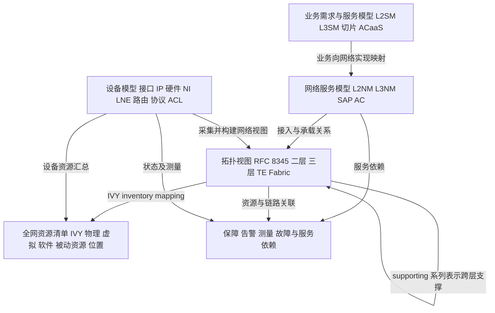

# IETF 拓扑建模与关联模型分析

核对日期：2026-10-03。对象：netops-agent 的网络数字孪生模型。本文覆盖标准能力、关联方式及适用边界；“IETF 有这个模型”与“本项目已经实现这个模型”分别判断。

实施更新（同日）：第 11 节保留修复前的审查基线；其中身份/作用域、路径确定性、未知端点分类和采集完整性问题已在 topology 0.4.15 修复并完成回归与一次只读发现验收。具体结果见[路线图 §14](network-digital-twin-roadmap.md#14-进度台账执行者维护)，后续完整模型实施见[实现方案](network-digital-twin-implementation.md)。这不表示研究目录中的全部模型已经实现。

## 1. 结论

IETF 已提供从通用网络拓扑到二层、三层、流量工程、光传输、设备接口、路由、VPN 业务和服务保障的一组模型。它们能够共同描述网络，但没有一份标准替实现者完成设备身份识别、邻接发现、跨层关联和转发验证。

当前工程不能以“采用 RFC 8345，且 JSON 通过 YANG 校验”为整个拓扑正确的依据。标准规定对象、字段和部分关系约束；**哪些观测属于同一设备、哪两端确实相连、哪条路径能转发，仍须由有作用域的事实支撑**。已有复现表明，合法的模型实例也可能承载错误推断，详见第 11 节。

本次研究还更正了旧文档的版本认知：SIMAP 概念当前为 **-14（2026-10-02）**，IVY 基础资源清单为 **-20（2026-09-29）**；被动资源清单已进入 IVY 工作组；接入电路 RFC 9833—9836 已正式发布。项目冻结的草案基线须另做差异审查后升级，本文不会自动替换运行版本。[SIMAP 概念](https://datatracker.ietf.org/doc/html/draft-ietf-nmop-simap-concept-14)、[IVY 基础模型](https://datatracker.ietf.org/doc/html/draft-ietf-ivy-network-inventory-yang-20)、[IVY 被动资源](https://datatracker.ietf.org/doc/html/draft-ietf-ivy-passive-network-inventory-01)、[RFC 9833](https://www.rfc-editor.org/rfc/rfc9833.html)

## 2. 范围与核对方法

“与拓扑建模相关”在本文中包括：拓扑图本身、图中资源和设备状态、决定邻接及转发的协议与策略、建立在网络之上的服务、跨层依赖，以及维护这些事实所需的管理机制。除 YANG 外，也纳入关键 SNMP MIB 和拓扑信息交换协议，避免把 IETF 模型等同于 YANG 文件。

目录采用三条检索线交叉核对：RFC Editor 的 RFC 索引；IANA YANG Module Names 注册表；Datatracker 中相关工作组及 topology、inventory、SIMAP 等文档和替代关系。IANA 当日快照有 **314 条注册记录**，其中包含同名模块的多个版本、子模块、兼容模块及尚待 RFC 发布的登记，不能称为“314 个拓扑模型”。草案还须查询 Datatracker，不能仅依靠 IANA。[RFC 索引](https://www.rfc-editor.org/rfc-index.xml)、[IANA 注册表](https://www.iana.org/assignments/yang-parameters/)、[Datatracker](https://datatracker.ietf.org/doc/search/)

研读深度分三类：

- **语义核对**：核对适用范围、模型树、关键 YANG 定义、对象作用域及关联约束。通用拓扑、二三层、NMDA、IVY 及与本项目直接相关的设备/服务模型属于重点。
- **模型目录核对**：核对全文中的模型概览、正式模块、主要对象和发布状态。用于说明其他技术领域的覆盖，不宣称所有叶子逐项审完。
- **背景核对**：架构、协议、MIB、管理传输或旧版沿革。明确它们不是可直接替换通用拓扑模型的 YANG。

本次不宣称穷尽所有历史个人提案，也不将每个协议的全部 TLV 扩展纳入模型数量；发现的关键过期提案保留状态，避免把过期方案当成现行标准。附录目录记录具体文档、模块与核对深度。这是可继续查漏的标准全景，**不是全目录编译或全量实机验收报告**。

状态须按以下规则读取：Standards Track RFC、Informational/Experimental RFC、BCP、工作组草案、个人草案、IRTF 研究文档分别标注。`RFC Ed Queue`、IANA 的 `RFC-ietf-…` 占位登记、草案内的 `RFC XXXX` 都不等于已发布 RFC。文档版本号与其中 YANG `revision` 日期也不是同一件事。

## 3. 模型怎样组合

下面箭头表达语义关系，不表示这些关系都已经由同一个标准中的 `leafref` 实现。

必须区分五种关系：`augment` 扩展别的模块数据树；`import/uses` 引入类型或分组；`supporting-*` 关联不同网络中的图对象；schema mount 在指定上下文装入设备数据树；inventory mapping 把拓扑节点、TP 关联到资源清单。导入两个模块不会自动产生设备归属关系。业务模型与设备配置也不是简单同名字段复制。[RFC 7950 §7](https://www.rfc-editor.org/rfc/rfc7950.html#section-7)、[RFC 8345 §4](https://www.rfc-editor.org/rfc/rfc8345.html#section-4)、[RFC 8528](https://www.rfc-editor.org/rfc/rfc8528.html)、[RFC 8309 §4](https://www.rfc-editor.org/rfc/rfc8309.html#section-4)

## 4. 通用拓扑与二三层拓扑

| 依据 | 正式模块或模型 | 支持的对象 | 不能据此断言的事 |
|---|---|---|---|
| [RFC 8345](https://www.rfc-editor.org/rfc/rfc8345.html) Standards Track | `ietf-network`、`ietf-network-topology` | network、node、link、termination-point；跨层 supporting 关系 | node 必然是一台物理机；link 必然是一根线；标准自带发现算法 |
| [RFC 8944](https://www.rfc-editor.org/rfc/rfc8944.html) Standards Track | `ietf-l2-topology` | 物理或逻辑 L2 网络；管理地址、桥标识、TP MAC/封装、VLAN/QinQ/VXLAN 特性、LAG 成员、链路速率/时延 | 完整 FDB、STP/MSTP、端口 VLAN 接纳和转发行为都已覆盖 |
| [RFC 8346](https://www.rfc-editor.org/rfc/rfc8346.html) Standards Track | `ietf-l3-unicast-topology` | L3 节点 router-id/prefix，链路 metric，IP/unnumbered/interface-name 类型的 TP | 同网段一定邻接；有路由就能送达；附录 `example-ospf-topology` 是正式 OSPF 拓扑标准 |
| [RFC 8542](https://www.rfc-editor.org/rfc/rfc8542.html) Standards Track | `ietf-dc-fabric-topology`、`ietf-dc-fabric-types` | 把 fabric 表示为节点；设备、链路、端口、角色及 VLAN/VXLAN fabric 属性 | fabric 节点就是单台设备，或已经提供全部 EVPN 控制面 |
| [RFC 8795](https://www.rfc-editor.org/rfc/rfc8795.html) Standards Track | `ietf-te-topology` | TE 资源、连通能力及多层抽象；详见第 7 节 | TE 邻接与物理跳数等价 |

这些 RFC 的 `*-state` 伴随模块用于非 NMDA 兼容，不是另外一层网络；采用 NMDA 时须遵守对应 RFC 对兼容模块的限制。[RFC 8346 §4、附录 A](https://www.rfc-editor.org/rfc/rfc8346.html#section-4)

### 4.1 标识、支撑关系与图的含义

RFC 8345 的 `node-id` 只在所在 network 内识别节点，`tp-id` 只在所在 node 内识别 TP。一个实体参与多个网络时可由多个节点表示，通过支撑关系关联。基础 link 是**有向点到点**；双向用一对 link，多点可用伪节点，聚合可用上层 link 支撑于多个下层 link。所选表示必须保持层次语义，不能把伪节点显示成已识别的真实交换机。[RFC 8345 §4.1、§4.4.5—§4.4.9](https://www.rfc-editor.org/rfc/rfc8345.html#section-4.1)

`require-instance false` 允许部分引用在 schema 层暂时悬空，但该 RFC 对 operational 中依赖对象另有完整性要求：不能因为校验器放行，就把缺失支撑资源的配置拓扑宣称为已生效。应区分完整 datastore、过滤后的检索片段和本平台尚未收齐的观测。[RFC 8345 §4.1、§4.4.3、§4.4.10](https://www.rfc-editor.org/rfc/rfc8345.html#section-4.1)

### 4.2 二层模型的字段边界

RFC 8944 的 `outer-tag/inner-tag` 是标签范围，受 feature 控制；它们不能包办设备 PVID、untagged/tagged egress、VLAN membership 和生成树状态。`mac-address` 是 TP 属性，不能直接当设备唯一身份；`rate` 单位为 Kbps，`delay` 为微秒。LAG 的成员 TP 也不能代替每个成员的运行状态。模型正文明确把深入的技术配置留给专用模块。[RFC 8944 §3—§4](https://www.rfc-editor.org/rfc/rfc8944.html#section-3)

对本项目的推论：ARP 观测要保留设备/NI/接口上下文，MAC 学习要保留桥/FDB/VLAN 上下文，再建立跨层关系。仅凭 MAC 相同就跨 VLAN 合并，或把“这个口后面学到 MAC”写成“这台主机直接接在这个口”，都超出了采集事实。

### 4.3 三层模型与转发模型不同

RFC 8346 的 `metric1/metric2` 是通用链路属性，不预先指定为 OSPF cost 或两个方向的代价；TP 属性中的 IP、unnumbered、interface-name 属于 `choice`。实际路由协议属性要看协议模型。路径计算还需 NI、路由选择、出接口、下一跳解析和底层连通，以及相关 ACL/NAT 等作用，不能用 L3 图代替全部转发判断。[RFC 8346 §6](https://www.rfc-editor.org/rfc/rfc8346.html#section-6)、[RFC 8349 §4](https://www.rfc-editor.org/rfc/rfc8349.html#section-4)、[RFC 8519](https://www.rfc-editor.org/rfc/rfc8519.html)、[RFC 8512](https://www.rfc-editor.org/rfc/rfc8512.html)

## 5. 物理资源、虚拟设备及 SIMAP

### 5.1 资源清单的分工

| 依据和当日版本 | 模块 | 能表达什么 | 适用边界 |
|---|---|---|---|
| [RFC 8348](https://www.rfc-editor.org/rfc/rfc8348.html) | `ietf-hardware`、`iana-hardware` | 单设备组件层级、序列号、状态与传感器 | 单设备树不能不加上下文地拼成全网资源库 |
| [IVY 基础 -20](https://datatracker.ietf.org/doc/html/draft-ietf-ivy-network-inventory-yang-20)，WG 草案 | `ietf-network-inventory` | 全网 NE、组件、标识、制造商和软件版本 | 基础定义的具体 NE 类型为物理 NE；完整动态运行状态与传感器不在范围内 |
| [IVY 软件 -04](https://datatracker.ietf.org/doc/html/draft-ietf-ivy-network-inventory-software-04)，WG 草案 | `ietf-network-inventory-sw-ext` | 软件/虚拟/容器 NE identity，软件和补丁安装、激活信息 | 是 inventory 扩展，不是把虚拟路由器冒充物理机箱 |
| [IVY 拓扑映射 -11](https://datatracker.ietf.org/doc/html/draft-ietf-ivy-network-inventory-topology-11)，WG 草案 | `ietf-network-inventory-topology` | node 的 `ne-ref`，TP 的 `ne-ref/port-ref`，链路介质，端口 breakout 能力 | breakout channel 到具体子接口的关联仍在范围外；此处 trunk 不能误读成 VLAN trunk 配置模型 |
| [IVY 位置 -06](https://datatracker.ietf.org/doc/html/draft-ietf-ivy-network-inventory-location-06)，WG 草案 | `ietf-ni-location` | 层级位置、机架、机箱放置 | UI 坐标不等于物理地理/机房位置 |
| [RFC 9179](https://www.rfc-editor.org/rfc/rfc9179.html) | `ietf-geo-location` | 可复用地理位置 grouping | grouping 本身不会创建全网资产树 |
| [IVY 被动资源 -01](https://datatracker.ietf.org/doc/html/draft-ietf-ivy-passive-network-inventory-01)，WG 草案 | `ietf-nwi-passive-inventory` | cable、passive-device、passive-port、缆线端点与位置 | 接线事实需要独立来源；不能从普通 ARP 倒推出配线架或暗纤 |
| [IVY entitlement -05](https://datatracker.ietf.org/doc/html/draft-ietf-ivy-entitlement-inventory-05)，WG 草案 | `ietf-entitlement-inventory` | 许可、能力、限制与 NE/组件的关联 | 许可可限制容量，但不是链路发现协议 |
| [GREEN 功率与能源 -04](https://datatracker.ietf.org/doc/html/draft-ietf-green-power-and-energy-yang-04)，WG 草案 | `ietf-power-and-energy`、`iana-power-and-energy` | 能源对象、功率/能量、状态及关系 | 是容量/节能分析的补充，不能由其推导网络邻接 |

IVY 基础模型要求服务器分配稳定的 NE 标识，同时明确如何辨认同一个 NE 属于实现问题。组件标识、序列号、设备本地名称与全网 NE 标识有不同作用域。因此“接口 IP 相同”“同一个 AS”“同厂商 MAC 前缀”都不能直接充当全网设备合并规则。[IVY -20 §3.1—§3.3](https://datatracker.ietf.org/doc/html/draft-ietf-ivy-network-inventory-yang-20#section-3)

### 5.2 SIMAP 与数字孪生文档

| 文档 | 地位与作用 | 对项目的意义 |
|---|---|---|
| [draft-ietf-nmop-simap-concept-14](https://datatracker.ietf.org/doc/html/draft-ietf-nmop-simap-concept-14) | WG 概念、需求及用例草案；不是完整 YANG Schema | 描述服务到资源导航、依赖、历史回放、仿真等目标；需求不能直接当成已定义字段 |
| [draft-havel-nmop-simap-yang-03](https://datatracker.ietf.org/doc/html/draft-havel-nmop-simap-yang-03) | 个人草案；`ietf-simap-topology` | 对 RFC 8345 提出链接类型、导航、生命周期与外部关联等扩展；逐项核对 prose、tree、code 是否一致 |
| [draft-irtf-nmrg-network-digital-twin-arch-13](https://datatracker.ietf.org/doc/html/draft-irtf-nmrg-network-digital-twin-arch-13) | IRTF NMRG 研究架构 | 提供数字孪生概念与架构；不是 IETF Standards Track，也不是全套可运行模型 |

项目已经采纳 SIMAP YANG -03 作为补充基线；这不意味着它废止 RFC 8345，也不意味着其中提议、TODO 或概念文档里的全部要求已经落成规范模块。旧研读文档记录过原模块语法兼容问题，必须保留原始来源和修补差异；本次研究不把旧修补状态当成最新全量编译通过。[既有研读记录](network-digital-twin-ietf-study.md)

## 6. 设备、路由协议与传统 MIB

### 6.1 设备模型提供拓扑节点背后的事实

| 依据 | 模块与对象 | 对拓扑的作用及限制 |
|---|---|---|
| [RFC 8343](https://www.rfc-editor.org/rfc/rfc8343.html)，替代 7223 | `ietf-interfaces`；接口名称、类型、admin/oper 状态、上下层接口、统计 | `/interfaces/interface[name]` 属于所在设备数据上下文；名字相同不能跨设备绑定 |
| [RFC 8344](https://www.rfc-editor.org/rfc/rfc8344.html)，替代 7277 | `ietf-ip`；接口 IPv4/IPv6 地址、邻居、MTU 等 | ARP/ND 是接口/网络实例内的邻居事实，不证明远端物理设备类型 |
| [RFC 8348](https://www.rfc-editor.org/rfc/rfc8348.html) | `ietf-hardware`；组件及状态 | 用于硬件事实，不能代替设备到设备的拓扑 |
| [RFC 7317](https://www.rfc-editor.org/rfc/rfc7317.html) | `ietf-system`；系统标识、时钟、管理配置 | hostname 是名称，不能直接当全网永久身份 |
| [RFC 8529](https://www.rfc-editor.org/rfc/rfc8529.html) | `ietf-network-instance`；网络实例与接口绑定、挂载关系 | NI 名称在设备内有意义；不同设备同名 VRF 不必属于同一 VPN，不同名也不必不能邻接 |
| [RFC 8530](https://www.rfc-editor.org/rfc/rfc8530.html) | `ietf-logical-network-element`；设备内 LNE | 逻辑设备划分与拓扑层次是两种关系 |
| [RFC 8349](https://www.rfc-editor.org/rfc/rfc8349.html)，替代 8022 | `ietf-routing`、IPv4/IPv6 unicast routing；RIB、路由协议、下一跳与静态路由 | 路由优先级、协议 metric、是否活跃和下一跳解析须分别处理 |
| [RFC 8431](https://www.rfc-editor.org/rfc/rfc8431.html)、[RFC 9403](https://www.rfc-editor.org/rfc/rfc9403.html) | 前者 `ietf-i2rs-rib`，后者 `ietf-rib-extension` | 两套不同用途的 RIB 建模工作，不能混为同一个模块 |
| [接口扩展 WG -19](https://datatracker.ietf.org/doc/html/draft-ietf-netmod-intf-ext-yang-19) | `ietf-if-extensions`、`ietf-if-ethernet-like` | 公共接口扩展、父接口、封装与以太属性；尚非 RFC |
| [子接口 VLAN WG -18](https://datatracker.ietf.org/doc/html/draft-ietf-netmod-sub-intf-vlan-model-18) | `ietf-if-vlan-encapsulation`、`ietf-if-flexible-encapsulation` | 按 Ethernet/VLAN 头分类到子接口、标签改写；不同于按 bridge membership 配置的 IEEE 桥模型 |

本地 NI 作用域是当前工程必须先修正的地方。应从入口设备/接口的实例上下文继续追踪路由；跨设备进入哪个实例，应由接入与邻接事实决定，不能把字符串 `default` 或 `MGMT` 作为全网域标识。[RFC 8529 §6](https://www.rfc-editor.org/rfc/rfc8529.html#section-6)

### 6.2 协议模型说明邻接与路由如何形成

| 模型族 | 正式模型及草案状态 | 可表达的事实与边界 |
|---|---|---|
| OSPF | [RFC 9129](https://www.rfc-editor.org/rfc/rfc9129.html) `ietf-ospf`；[9587](https://www.rfc-editor.org/rfc/rfc9587.html) OSPFv3 扩展 LSA | 实例、区域、接口、邻居及 LSDB；不是物理机箱识别算法 |
| IS-IS | [RFC 9130](https://www.rfc-editor.org/rfc/rfc9130.html) `ietf-isis`；[9194](https://www.rfc-editor.org/rfc/rfc9194.html) reverse metric | 实例、level、接口、邻接及 LSDB；需保留协议作用域 |
| OSPF/IS-IS SR-MPLS | [RFC 9903](https://www.rfc-editor.org/rfc/rfc9903.html)、[9902](https://www.rfc-editor.org/rfc/rfc9902.html) | 对相应协议模型增补 Segment Routing 属性；不是另建物理拓扑 |
| IGP 补充 | [RFC 9825](https://www.rfc-editor.org/rfc/rfc9825.html) admin tags、[9983](https://www.rfc-editor.org/rfc/rfc9983.html) anycast、[10041](https://www.rfc-editor.org/rfc/rfc10041.html) functional capability/unreachable links | 同名 router-id 或 anycast 地址必须结合协议语义；Flex-Algo 模型仍按草案处理 |
| BGP | [draft-ietf-idr-bgp-model-21](https://datatracker.ietf.org/doc/html/draft-ietf-idr-bgp-model-21)，WG 草案 | BGP 实例、peer、AFI/SAFI、策略和路由；协议标准已经存在不代表 YANG 模型已成为 RFC |
| RIP、Babel、RIFT | [RFC 8695](https://www.rfc-editor.org/rfc/rfc8695.html)、[9647](https://www.rfc-editor.org/rfc/rfc9647.html)、[9719](https://www.rfc-editor.org/rfc/rfc9719.html) | 不同路由协议的配置与状态，保留各自邻接/路由语义 |
| BFD | [RFC 9127](https://www.rfc-editor.org/rfc/rfc9127.html)，由 [9314](https://www.rfc-editor.org/rfc/rfc9314.html) 更新 | 单跳、多跳、LAG、MPLS BFD；检测会话并不总是一根物理线 |
| BFD 补充 | [RFC 9468](https://www.rfc-editor.org/rfc/rfc9468.html)、[9764](https://www.rfc-editor.org/rfc/rfc9764.html)；[9978](https://www.rfc-editor.org/rfc/rfc9978.html)、[9985](https://www.rfc-editor.org/rfc/rfc9985.html)、[9986](https://www.rfc-editor.org/rfc/rfc9986.html) 为 Experimental | unsolicited/large packets、稳定性及认证扩展；“已发 RFC”不等于都是 Standards Track |
| VRRP | [RFC 8347](https://www.rfc-editor.org/rfc/rfc8347.html) `ietf-vrrp`；后继 bis 尚为草案 | 虚拟路由器及成员状态；虚拟 IP/MAC 不可当单台机箱身份 |
| 多播 | [RFC 9128](https://www.rfc-editor.org/rfc/rfc9128.html) PIM、[8652](https://www.rfc-editor.org/rfc/rfc8652.html) IGMP/MLD、[9166](https://www.rfc-editor.org/rfc/rfc9166.html) snooping、[9398](https://www.rfc-editor.org/rfc/rfc9398.html) proxy、[8916](https://www.rfc-editor.org/rfc/rfc8916.html) MSDP | 组成员、邻居、接口与多播转发关系；不能用单播最短路径替代多播树 |
| MPLS、LDP、SR | [RFC 8960](https://www.rfc-editor.org/rfc/rfc8960.html)、[9070](https://www.rfc-editor.org/rfc/rfc9070.html)、[9020](https://www.rfc-editor.org/rfc/rfc9020.html)、[9702](https://www.rfc-editor.org/rfc/rfc9702.html) | MPLS 标签/接口、LDP、SR-MPLS 与 MSD；路径还要结合隧道与 TE 模型 |
| 路由策略 | [RFC 9067](https://www.rfc-editor.org/rfc/rfc9067.html) `ietf-routing-policy` | 路由匹配/动作、策略集与调用；不能忽略策略后仅按 RIB 外形模拟 |
| EVPN/L3VPN 设备模型 | [EVPN -07](https://datatracker.ietf.org/doc/html/draft-ietf-bess-evpn-yang-07)、[BGP/MPLS L3VPN -05](https://datatracker.ietf.org/doc/html/draft-ietf-bess-l3vpn-yang-05) 已过期 | 保留为在研沿革；区别于已发布的 L2NM/L3NM 网络服务模型 |

RFC 8346 附录里的 `example-ospf-topology` 是示例。后来的 [OSPF topology -01](https://datatracker.ietf.org/doc/html/draft-ogondio-nmop-ospf-topology-01) 与 [IS-IS topology -01](https://datatracker.ietf.org/doc/html/draft-ogondio-nmop-isis-topology-01) 又是独立、已过期的个人草案。不要把设备协议模型、协议特定拓扑视图和附录示例混成一个“已完成的 IETF OSPF 拓扑标准”。

多播领域另有 [AMT 模型 -09](https://datatracker.ietf.org/doc/html/draft-ietf-mboned-amt-yang-09)，处于 RFC 发布队列，以及 [BIER 模型 -10](https://datatracker.ietf.org/doc/html/draft-ietf-bier-bier-yang-10)，已过期。后者增补 `ietf-routing`，描述子域、封装、BIFT 和协议通知；两者均不能列为已发布的拓扑 RFC。本次对这两项做模型目录核对，未逐叶审查或编译。

### 6.3 SNMP MIB 仍是标准化事实来源

IETF 的建模并非始于 YANG。传统设备可通过 IF-MIB 获取接口及 ifStack、ENTITY-MIB 获取组件、IP-MIB 获取地址/邻居、IP-FORWARD-MIB 获取路由，BRIDGE/Q-BRIDGE MIB 获取桥和 VLAN/FDB 信息。它们有各自的索引、管理上下文与对象语义，不能去掉设备及实例上下文后拼成全局表。[RFC 2863](https://www.rfc-editor.org/rfc/rfc2863.html)、[RFC 6933](https://www.rfc-editor.org/rfc/rfc6933.html)、[RFC 4293](https://www.rfc-editor.org/rfc/rfc4293.html)、[RFC 4292](https://www.rfc-editor.org/rfc/rfc4292.html)、[RFC 4188](https://www.rfc-editor.org/rfc/rfc4188.html)、[RFC 4363](https://www.rfc-editor.org/rfc/rfc4363.html)

这些 MIB 可以给构建器提供结构化证据，但不是 RFC 8345 网络图的自动转换规范。源数据来自 CLI、SNMP 或 NETCONF，都必须保留相同的实体作用域；更换采集协议不会自动修复错误归并。

## 7. TE、多层传输、隧道及时间变化拓扑

### 7.1 TE 图、隧道实例与设备协议分开

[RFC 8795](https://www.rfc-editor.org/rfc/rfc8795.html) 的 `ietf-te-topology` 在 RFC 8345 上加入 TE 资源语义：带宽、SRLG、状态、连接能力、跨层适配和抽象支撑关系。TE link 可以代表多条物理链路或一条链路的一部分，因此不能拿 TE 图的边数对照物理线缆数。技术相关模型再补具体资源。[RFC 8795 §3.3、§3.12—§3.13](https://www.rfc-editor.org/rfc/rfc8795.html#section-3.3)

| 依据 | 支持模型 | 当日地位及边界 |
|---|---|---|
| [RFC 8776](https://www.rfc-editor.org/rfc/rfc8776.html) | `ietf-te-types`、`ietf-te-packet-types` | 类型/分组库，无独立隧道实例根；拟替代它的 [update -24](https://datatracker.ietf.org/doc/html/draft-ietf-teas-rfc8776-update-24) 仍在发布队列 |
| [TE tunnel WG -44](https://datatracker.ietf.org/doc/html/draft-ietf-teas-yang-te-44) | `ietf-te`、`ietf-te-device`；tunnel、LSP、path、接口与约束 | 发布队列，尚无正式 RFC 号；不自动提供路径计算算法 |
| [L3/packet TE -19](https://datatracker.ietf.org/doc/html/draft-ietf-teas-yang-l3-te-topo-19)、[MPLS-TE topology -05](https://datatracker.ietf.org/doc/html/draft-ietf-teas-yang-te-mpls-topology-05) | 包交换/L3 与 MPLS TE 拓扑 | WG 草案；与设备 `ietf-mpls` 不是同一数据树 |
| [Topology filter -03](https://datatracker.ietf.org/doc/html/draft-ietf-teas-yang-topology-filter-03)、[TE profiles -06](https://datatracker.ietf.org/doc/html/draft-ietf-teas-te-topology-profiles-06) | 前者定义过滤模型，后者分析 TE 模型的用法 | 过滤视图不是底层全图；profile 文档不新增完整 schema |
| [TE path computation -28](https://datatracker.ietf.org/doc/html/draft-ietf-teas-yang-path-computation-28) | `ietf-te-path-computation`；路径计算请求/响应 | RPC 模型，与路径计算实现和物理路径验证分别判断 |
| [RFC 9826](https://www.rfc-editor.org/rfc/rfc9826.html) | `ietf-pcep`、`ietf-pcep-stats`；PCEP 管理 | 管理 PCE/PCC 协议关系，不是全部 TE 网络的自动真值 |
| [RSVP -21](https://datatracker.ietf.org/doc/html/draft-ietf-teas-yang-rsvp-21)、[mLDP -16](https://datatracker.ietf.org/doc/html/draft-ietf-mpls-mldp-yang-16) | RSVP 会话/接口、LDP 上的多点树与状态 | YANG 仍为草案；已有 RSVP-TE/LDP 协议 RFC 不会使这些模型自动成为 RFC |
| [SRv6 base -02](https://datatracker.ietf.org/doc/html/draft-ietf-spring-srv6-yang-base-02)、[static -00](https://datatracker.ietf.org/doc/html/draft-ietf-spring-srv6-yang-static-00)、[SR policy -08](https://datatracker.ietf.org/doc/html/draft-ietf-spring-sr-policy-yang-08) | SRv6 类型/基础/静态配置、SR Policy | 草案；不要与正式 SR-MPLS RFC 9020 或 SRv6 协议 RFC 8986 混淆 |

一些旧工作已过期或被替代，例如独立 MPLS static、RSVP-TE YANG、SR-TE topology 和 TE topology/tunnel modeling 文档。目录保留状态与版本，不从旧论文或实现仓库反推它们仍是现行标准。

### 7.2 光、电、以太与微波传送

| 技术 | 模型依据与对象 | 支持程度 |
|---|---|---|
| WSON 与 Layer 0 | [RFC 9093](https://www.rfc-editor.org/rfc/rfc9093.html) `ietf-layer0-types`；[RFC 9094](https://www.rfc-editor.org/rfc/rfc9094.html) `ietf-wson-topology` | 已发布类型与拓扑；9093-bis [第 20 版](https://datatracker.ietf.org/doc/html/draft-ietf-ccamp-rfc9093-bis-20) 尚在发布队列 |
| Flexi-grid | [WG -19](https://datatracker.ietf.org/doc/html/draft-ietf-ccamp-flexigrid-yang-19) `ietf-flexi-grid-topology` | 草案，表达灵活栅格光资源及其 TE 属性 |
| 光损伤 | [WG -24](https://datatracker.ietf.org/doc/html/draft-ietf-ccamp-optical-impairment-topology-yang-24) `ietf-optical-impairment-topology` | 发布队列；光资源/损伤约束不是普通 IP metric |
| WDM 隧道/接口/计算 | [tunnel -08](https://datatracker.ietf.org/doc/html/draft-ietf-ccamp-wdm-tunnel-yang-08)、[interface -16](https://datatracker.ietf.org/doc/html/draft-ietf-ccamp-dwdm-if-param-yang-16)、[path computation -09](https://datatracker.ietf.org/doc/html/draft-ietf-ccamp-optical-path-computation-yang-09) | 草案；实例、接口参数、计算 RPC 各有模型，旧 WSON/Flexi-grid tunnel 已有替代关系 |
| OTN 与 Layer 1 | [L1 types -20](https://datatracker.ietf.org/doc/html/draft-ietf-ccamp-layer1-types-20)、[OTN topology -21](https://datatracker.ietf.org/doc/html/draft-ietf-ccamp-otn-topo-yang-21) | 发布队列；传输层容量、交换与时隙资源 |
| OTN 隧道/计算/切片 | [tunnel -26](https://datatracker.ietf.org/doc/html/draft-ietf-ccamp-otn-tunnel-model-26)、[path computation -09](https://datatracker.ietf.org/doc/html/draft-ietf-ccamp-otn-path-computation-yang-09)、[slicing -12](https://datatracker.ietf.org/doc/html/draft-ietf-ccamp-yang-otn-slicing-12)、[fgOTN -02](https://datatracker.ietf.org/doc/html/draft-ietf-ccamp-fgotn-yang-02) | 草案；不能拿包交换的链路模型完整代替这些资源约束 |
| Ethernet TE/client signal/FlexE | [eth TE -11](https://datatracker.ietf.org/doc/html/draft-ietf-ccamp-eth-client-te-topo-yang-11)、[client signal -18](https://datatracker.ietf.org/doc/html/draft-ietf-ccamp-client-signal-yang-18)、[FlexE -11](https://datatracker.ietf.org/doc/html/draft-ietf-ccamp-flexe-yang-cm-11) | 草案；承载服务、client 及 FlexE group 与园区 VLAN/FDB 不可混为一层 |
| L1 连接服务 | [L1CSM -28](https://datatracker.ietf.org/doc/html/draft-ietf-ccamp-l1csm-yang-28) `ietf-l1csm` | 发布队列；服务需求与底层光/电资源分别建模 |
| 微波 | [RFC 8561](https://www.rfc-editor.org/rfc/rfc8561.html) 设备链路/保护/类型；[RFC 9656](https://www.rfc-editor.org/rfc/rfc9656.html) `ietf-microwave-topology` | 已发布模型，支持无线传送资源，不能默认视为一条有线电缆 |

这些技术不要求当前园区实验都实现，但它们说明 IETF 的拓扑建模范围远超 LLDP 图。选择模型应由设备与业务技术决定，不能用统一的“node + edge + bandwidth”丢掉光损伤、时隙或保护关系。

### 7.3 多域抽象、确定性与时间变化

[RFC 8453](https://www.rfc-editor.org/rfc/rfc8453.html) 提供 ACTN 架构，[RFC 8454](https://www.rfc-editor.org/rfc/rfc8454.html) 提供信息模型；[RFC 9731](https://www.rfc-editor.org/rfc/rfc9731.html) 的 `ietf-vn` 则是已发布 YANG，描述 VN 及 access point，并关联 TE 资源。信息模型、管理数据模型和服务实例分别承担不同职责。

[RFC 9633](https://www.rfc-editor.org/rfc/rfc9633.html) 的 `ietf-detnet` 表达设备上的 flow、service、forwarding；独立 [DetNet topology -02](https://datatracker.ietf.org/doc/html/draft-ietf-detnet-topology-yang-02) 已过期且标为 WG Dead。[RFC 9938](https://www.rfc-editor.org/rfc/rfc9938.html) 是控制器平面（Controller Plane）框架。不能因为已有 DetNet 设备模型，便宣称已有完整正式的全网 DetNet 拓扑 YANG。

[RFC 9922](https://www.rfc-editor.org/rfc/rfc9922.html) 提供 `ietf-schedule`；[TVR schedule -12](https://datatracker.ietf.org/doc/html/draft-ietf-tvr-schedule-yang-12) 的 `ietf-tvr-schedule`、`ietf-tvr-node`、`ietf-tvr-topology` 模型仍在发布队列，描述按时间变化的资源可用性等。链路调度关联实际增补在 TP 上，不能把它误当普通 link 叶子；计划的可用窗口也不同于故障历史和实时运行状态。

### 7.4 拓扑信息如何交换

[RFC 9552](https://www.rfc-editor.org/rfc/rfc9552.html) BGP-LS 交换 IGP/TE 等链路状态信息，已替代 RFC 7752/9029；SR、SRv6、Flex-Algo、SR Policy 等还有各自扩展。[RFC 9815](https://www.rfc-editor.org/rfc/rfc9815.html)/[9816](https://www.rfc-editor.org/rfc/rfc9816.html) 是 BGP-LS SPF 与适用性文档。它们是协议/架构，**不是 YANG，也不认证远端机箱身份**。AS 与 BGP identifier 的协议身份不能直接等同物理 NE。[RFC 6286](https://www.rfc-editor.org/rfc/rfc6286.html)

ALTO 提供 network/cost/property/path-vector 等抽象信息视图；[RFC 7285](https://www.rfc-editor.org/rfc/rfc7285.html) 是基础协议，[RFC 9275](https://www.rfc-editor.org/rfc/rfc9275.html) path vector 为 Experimental。[ALTO OAM -18](https://datatracker.ietf.org/doc/html/draft-ietf-alto-oam-yang-18) 的 YANG 管理 ALTO server/client/resources，仍在发布队列。ALTO 输出的可见资源受抽象和策略影响，不能当作完整物理接线。

## 8. 服务、策略与保障模型

服务层的重点是**把客户要的服务、运营商安排的网络资源、设备实际状态连接起来**。L3SM/L2SM、L3NM/L2NM、SAP、AC 不是四种可以任意互换的“端点”。[RFC 8309](https://www.rfc-editor.org/rfc/rfc8309.html)、[RFC 8969](https://www.rfc-editor.org/rfc/rfc8969.html)

### 8.1 VPN、SAP 与接入电路

| 依据 | 模块与支持对象 | 边界与关联 |
|---|---|---|
| [RFC 8299](https://www.rfc-editor.org/rfc/rfc8299.html) L3SM，替代 8049 | `ietf-l3vpn-svc`；客户 VPN、site、接入、服务要求 | 不是设备 VRF/RIB 快照 |
| [RFC 8466](https://www.rfc-editor.org/rfc/rfc8466.html) L2SM | `ietf-l2vpn-svc`；L2VPN 站点、接入、服务拓扑与参数 | 服务连线不是物理接线 |
| [RFC 9181](https://www.rfc-editor.org/rfc/rfc9181.html) | `ietf-vpn-common`；公共类型及 groupings | 无独立 VPN 实例根；正文示例不是额外正式模块 |
| [RFC 9182](https://www.rfc-editor.org/rfc/rfc9182.html) L3NM | `ietf-l3vpn-ntw`；VPN node、PE、network access、路由实施参数 | 需映射设备本地 NI 及接口 |
| [RFC 9291](https://www.rfc-editor.org/rfc/rfc9291.html) L2NM | `ietf-l2vpn-ntw`、`ietf-ethernet-segment` 与两项 IANA 类型模块；L2VPN/VPLS/EVPN 实施对象 | 网络服务模型不是全部 EVPN 设备控制面 |
| [RFC 9408](https://www.rfc-editor.org/rfc/rfc9408.html) | `ietf-sap-ntw`；服务接入点、节点、服务支持关系 | ARP 学到的 PC 不是天然 SAP |
| [RFC 9833](https://www.rfc-editor.org/rfc/rfc9833.html) | `ietf-ac-common`；AC 公共词汇和结构 | 复用模型，不单独实现服务 |
| [RFC 9834](https://www.rfc-editor.org/rfc/rfc9834.html) | `ietf-ac-svc`、`ietf-bearer-svc`；ACaaS、承载服务 | 需要服务/承载请求或配置来源 |
| [RFC 9835](https://www.rfc-editor.org/rfc/rfc9835.html) | `ietf-ac-ntw`；网络侧 AC 实施 | 关联实际网络接入，不能只按接口同名绑定 |
| [RFC 9836](https://www.rfc-editor.org/rfc/rfc9836.html) | `ietf-ac-glue`；给 VPN 服务及网络模型增补 AC 关联 | 是明确的标准绑定，不是把所有树自由互连 |

例如 L3NM 的 `/l3vpn-ntw/vpn-services/vpn-service[vpn-id]/vpn-nodes/vpn-node[vpn-node-id]` 表示 VPN 实现节点；它与 RFC 8345 的 network/node、RFC 8529 的设备 NI 不共享天然身份。应按服务部署关系逐层对应，不能从 IP 地址反推客户 VPN 标识。[RFC 9182 §4—§5](https://www.rfc-editor.org/rfc/rfc9182.html#section-4)

### 8.2 切片与服务链

网络切片的框架在 [RFC 9543](https://www.rfc-editor.org/rfc/rfc9543.html)，NRP 资源分区框架在 [RFC 9732](https://www.rfc-editor.org/rfc/rfc9732.html)；二者不是 YANG 模块。切片服务 NBI 的 `ietf-network-slice-service` 仍为 [WG 草案 -26](https://datatracker.ietf.org/doc/html/draft-ietf-teas-ietf-network-slice-nbi-yang-26)，处于 RFC 发布队列；[切片拓扑 -04](https://datatracker.ietf.org/doc/html/draft-ietf-teas-network-slice-topology-yang-04) 和 [NRP 模型 -06](https://datatracker.ietf.org/doc/html/draft-ietf-teas-nrp-yang-06) 分别描述切片拓扑与网络/设备资源分区。VLAN、VRF 或 TE 隧道的存在不能独自证明 SLO/SLE 或资源隔离已经满足。

SFC 的 [RFC 7665](https://www.rfc-editor.org/rfc/rfc7665.html) 是架构，[RFC 8300](https://www.rfc-editor.org/rfc/rfc8300.html) 定义 NSH 协议；通用 SFC YANG 的 [draft-penno-sfc-yang-15](https://datatracker.ietf.org/doc/html/draft-penno-sfc-yang-15) 是过期个人草案。服务功能链、实际承载路径和物理接线应分别表达，不能把早期实现模块直接列为正式 IETF 模型。

服务到承载的映射也有明确建模工作：[TE service mapping -19](https://datatracker.ietf.org/doc/html/draft-ietf-teas-te-service-mapping-yang-19) 为 L3SM/L2SM/L1CSM/L3NM/L2NM 增补 TE/VN 映射。它仍是草案；引用了已发布的 VPN 模型，不会提高自身发布状态。

### 8.3 策略与安全如何改变路径

| 依据 | 模型能力 | 对路径分析的意义 |
|---|---|---|
| [RFC 8519](https://www.rfc-editor.org/rfc/rfc8519.html) | `ietf-access-control-list`、`ietf-packet-fields`、`ietf-ethertypes` | 顺序匹配、动作与接口 ingress/egress 绑定；不等同全部有状态防火墙行为 |
| [RFC 9899](https://www.rfc-editor.org/rfc/rfc9899.html) | `ietf-acl-enh` 与 IANA 报文类型定义 | 补充 ACL 匹配及动作能力；需要具体配置证据 |
| [RFC 8512](https://www.rfc-editor.org/rfc/rfc8512.html) | `ietf-nat`；NAT/NPT 实例、策略、映射 | 地址和端口可能变化，必须核对正反向流 |
| [QoS WG 草案 -16](https://datatracker.ietf.org/doc/html/draft-ietf-rtgwg-qos-model-16) | traffic-policy、qos-action、diffserv、qos-oper、scheduler/queue-policy 等 | 分类、标记、限速、排队/调度；尚非已发布 RFC |
| [RFC 9061](https://www.rfc-editor.org/rfc/rfc9061.html)、[RFC 9348](https://www.rfc-editor.org/rfc/rfc9348.html) | `ietf-i2nsf-ike`、`ietf-i2nsf-ikec`、`ietf-i2nsf-ikeless`、`ietf-ipsec-iptfs` | 安全策略、SA/IKE、IPsec 流保护及 IPTFS；隧道 up 不自动证明具体流获准 |
| [RFC 8520](https://www.rfc-editor.org/rfc/rfc8520.html)、[RFC 9761](https://www.rfc-editor.org/rfc/rfc9761.html)、[RFC 9472](https://www.rfc-editor.org/rfc/rfc9472.html) | MUD、DNS/TLS ACL 补充、软件透明度信息 | 厂商通信要求及其扩展，不能从实际流量反向伪造厂商声明 |
| [RFC 8329](https://www.rfc-editor.org/rfc/rfc8329.html) 及 I2NSF 草案族 | 安全功能能力、consumer/NSF-facing、registration、monitoring | 框架和接口模型分别核对；通用接口模型仍在 RFC 发布队列 |
| [RFC 8783](https://www.rfc-editor.org/rfc/rfc8783.html)、[RFC 9132](https://www.rfc-editor.org/rfc/rfc9132.html) | DOTS 数据/信令通道、缓解范围和状态 | 限定 DDoS 缓解场景，不是通用物理拓扑 |

### 8.4 保障、故障与测量

| 依据 | 支持对象 | 语义边界 |
|---|---|---|
| [RFC 9417](https://www.rfc-editor.org/rfc/rfc9417.html) 架构、[RFC 9418](https://www.rfc-editor.org/rfc/rfc9418.html) 模型 | `ietf-service-assurance` 及 device/interface 扩展；service/subservice、依赖、health、symptom | 保障依赖图不是物理拓扑；未知状态不能默认为健康 |
| [RFC 8632](https://www.rfc-editor.org/rfc/rfc8632.html) | `ietf-alarms`、`ietf-alarms-x733`；资源告警、清除及操作员处理 | 告警不同于任意事件；标准不自动给出根因 |
| [RFC 9940](https://www.rfc-editor.org/rfc/rfc9940.html)、[incident WG -17](https://datatracker.ietf.org/doc/html/draft-ietf-nmop-network-incident-yang-17) | 前者为故障术语；后者 `ietf-incident` 描述事件关联及生命周期 | 术语 RFC 不能当成已发布 incident schema |
| [RFC 8531](https://www.rfc-editor.org/rfc/rfc8531.html)、[8532](https://www.rfc-editor.org/rfc/rfc8532.html)、[8533](https://www.rfc-editor.org/rfc/rfc8533.html) | LIME 通用连接型/无连接 OAM，维护域、测试点、检索 RPC | OAM test point 与拓扑 termination-point 不能因缩写相同而等同 |
| [RFC 8194](https://www.rfc-editor.org/rfc/rfc8194.html) | LMAP control/report/common；测量代理、任务、调度、报告 | 测量计划与结果各有来源，不是任意接口计数器 |
| [RFC 8913](https://www.rfc-editor.org/rfc/rfc8913.html) | `ietf-twamp`；TWAMP 配置与状态 | STAMP 协议 RFC 8762 不是这个模型；STAMP YANG -12 已过期 |
| [RFC 9375](https://www.rfc-editor.org/rfc/rfc9375.html) | `ietf-network-vpn-pm`；网络及 VPN 性能监测，增补 network/node/link/TP | 需绑定网络对象及测量来源；不是 SAP 模型 |
| [RFC 9617](https://www.rfc-editor.org/rfc/rfc9617.html) | `ietf-ioam`；IOAM 域、节点及配置 | IOAM 能提供路径观测，观测条件和时间仍影响结论 |
| [RFC 6728](https://www.rfc-editor.org/rfc/rfc6728.html) | `ietf-ipfix-psamp`；导出、选择、采样等配置 | 流量/采样配置模型不能直接当成物理连线 |
| [RFC 9196](https://www.rfc-editor.org/rfc/rfc9196.html)、[RFC 9232](https://www.rfc-editor.org/rfc/rfc9232.html) | 系统/通知能力；网络遥测框架 | 能力和框架不代表相关数据已被采集 |
| [network tester WG -17](https://datatracker.ietf.org/doc/html/draft-ietf-bmwg-network-tester-cfg-17) | `ietf-traffic-generator`、`ietf-traffic-analyzer` | 实验测试模型，尚未发布 RFC；不能充当当前业务测量结果 |

本项目故障验收的合理关联是“接口/邻接事实 → 受影响的网络关系 → 依赖该关系的服务 → 对应测量或健康状态”。每个箭头都需要实例映射；一次 SSH 采集成功或一项接口恢复不能证明整个服务符合 SLA。这是基于上述模型分工的工程推论。

## 9. 模型语言、数据存储与采集机制

| 依据 | 提供的能力 | 对拓扑工程的约束 |
|---|---|---|
| [RFC 7950](https://www.rfc-editor.org/rfc/rfc7950.html) YANG 1.1 | 数据树、类型、key、choice、leafref、must/when、feature/deviation | 编译通过与现实正确不同；不能随意增加无来源字段 |
| [RFC 7951](https://www.rfc-editor.org/rfc/rfc7951.html) | YANG JSON 编码 | `empty`、64 位整数、identityref、命名空间须按编码规则 |
| [RFC 9911](https://www.rfc-editor.org/rfc/rfc9911.html) | `ietf-yang-types`、`ietf-inet-types` 公共类型；替代 RFC 6991 | 依赖也须锁版本，不能长期把 6991 视为最新 |
| [RFC 8342](https://www.rfc-editor.org/rfc/rfc8342.html) NMDA | running/intended/operational；`ietf-datastores`、`ietf-origin` | 配置、实际使用值、学到的事实必须区分 |
| [RFC 10016](https://www.rfc-editor.org/rfc/rfc10016.html)，2026-09 | `ietf-system-datastore`，系统定义配置；更新 8342 | 补全系统配置来源认知；不把新机制当成当前应用已支持 |
| [RFC 7952](https://www.rfc-editor.org/rfc/rfc7952.html) | `ietf-yang-metadata`，元数据机制 | 机制不等于已标准化任意 confidence/evidence 注解 |
| [RFC 8525](https://www.rfc-editor.org/rfc/rfc8525.html)、[RFC 10035](https://www.rfc-editor.org/rfc/rfc10035.html) | YANG Library；module-set、schema、datastore；新增 augmented-by 信息 | 需记录实际模块 revision、feature、deviation、augment 关系 |
| [RFC 8528](https://www.rfc-editor.org/rfc/rfc8528.html) | schema mount | 设备/逻辑实例可有各自数据树；必须有已定义挂载点和上下文，不能凭空建立全局 interface-ref |
| [RFC 8791](https://www.rfc-editor.org/rfc/rfc8791.html)、[RFC 9195](https://www.rfc-editor.org/rfc/rfc9195.html) | 抽象数据结构；YANG 实例数据文件 | 文件导出可有标准容器与内容 schema 描述；仍要说明完整性和来源 |
| [RFC 8340](https://www.rfc-editor.org/rfc/rfc8340.html)、[RFC 8819](https://www.rfc-editor.org/rfc/rfc8819.html) | 树图记法；模块标签 | 便于查看与分类，不产生网络事实 |
| [RFC 9907](https://www.rfc-editor.org/rfc/rfc9907.html)、[RFC 9890](https://www.rfc-editor.org/rfc/rfc9890.html) | YANG 模型编写审查 BCP；模块登记更新 | 9907 已取代 8407；区分 model、module、示例模块和正式定义 |
| [RFC 6241](https://www.rfc-editor.org/rfc/rfc6241.html)、[RFC 8040](https://www.rfc-editor.org/rfc/rfc8040.html)、[RFC 8526](https://www.rfc-editor.org/rfc/rfc8526.html)、[RFC 8527](https://www.rfc-editor.org/rfc/rfc8527.html) | NETCONF、RESTCONF 与 NMDA 扩展 | 是传输/操作机制；设备提供 API 不表示支持全部拓扑模型 |
| [RFC 8639](https://www.rfc-editor.org/rfc/rfc8639.html)、[RFC 8641](https://www.rfc-editor.org/rfc/rfc8641.html)、[RFC 8640](https://www.rfc-editor.org/rfc/rfc8640.html)、[RFC 8650](https://www.rfc-editor.org/rfc/rfc8650.html) | 订阅、YANG-Push、NETCONF/RESTCONF 承载 | 维护状态变化及新鲜度，不能替代对观测对象身份的判断 |
| [RFC 9144](https://www.rfc-editor.org/rfc/rfc9144.html) | NMDA datastore 比较 | 可比较配置/运行差异；不是 GNS3 物理接线对照器 |
| [RFC 9254](https://www.rfc-editor.org/rfc/rfc9254.html)、[RFC 9595](https://www.rfc-editor.org/rfc/rfc9595.html) | YANG-CBOR 编码与 SID | 有助于受限环境的数据表达；不另增一层拓扑语义 |

### 9.1 未采集、未使用、异常与未知不能混写

NMDA operational 的目标是报告实际使用值。RFC 8342 §5.3 在特定情形允许部分语义约束被违反，但层级、标识及类型约束仍必须满足。这不授权平台把 CLI 缺采字段补成零、默认值或虚构时间，也不意味着 CLI 片段可声明为完整 operational datastore。`origin:unknown` 表示配置来源不明，并非通用“拓扑身份不确定”。[RFC 8342 §5.3—§5.3.4](https://www.rfc-editor.org/rfc/rfc8342.html#section-5.3)

本项目应分别记录：设备是否提供该模块/feature、采集是否成功、返回是完整实例还是筛选片段、关联是否具备证据。项目要求禁止自定义 YANG 时，这些应用级采集记录不能伪装为 IETF 原生拓扑属性；有明确标准定义的字段才写进相应模型。

## 10. IETF 与其他标准的边界

园区交换建模不能只靠 IETF 网络级抽象。LLDP、802.1Q 桥/VLAN、生成树及链路聚合的重要细节来自 IEEE；RFC 8944 也直接引用 IEEE 技术和类型。旧 IETF BRIDGE/Q-BRIDGE MIB 可作为管理数据来源，但不意味着新一代 IEEE 功能都在 RFC 8944 中。[RFC 8944 §3—§4](https://www.rfc-editor.org/rfc/rfc8944.html#section-3)、[IEEE 802.1 YANG 公布目录](https://www.ieee802.org/1/files/public/YANGs/)

OpenConfig、OpenROADM、ONF/TAPI、3GPP、ETSI 模型各有适用场景，应注明各自来源。不能因为模块能被 pyang 解析，或厂商支持它，就统称为 IETF 标准。对本项目，“IETF 优先”应落实为优先采用已有 IETF 定义；缺少领域细节时明确引用相应标准组织，不能把自造结构贴上 IETF 标签。

## 11. 对当前工程审查的直接含义

以下是对当前实现的审查结论与工程推论，不是 RFC 对本项目作出的判断。依据来自此前只读代码复现和实际 GNS3 文件对照，本次没有重新运行故障实验。

| 已有证据 | 涉及模型语义 | 工程结论 |
|---|---|---|
| 已对照的 16 条受管设备 LLDP 端口对吻合；完整 GNS3 图为 18 节点、34 接线，平台画布的 18 节点、27 关系并非相同对象集合 | 物理拓扑、L2 抽象、UI 图必须声明各自对象及关系含义 | 16 条吻合只能证明已核范围；节点数量相同不证明物理复原正确 |
| ISP 两个接口观测被标成两个“终端主机”；未管理交换设备的实际身份未被证明 | node、TP、接口地址、物理 NE 是不同实体 | 现有端点显示/实体关联不足；也不能反过来凭 GNS3 名称强行把未知发现并成 ISP |
| 相同 IP 的 owner 受遍历顺序影响；相同 MAC 跨 VLAN 选择首条学习记录 | NI、桥/FDB、VLAN 和设备作用域 | 是实现的数据归属问题；不能靠换一个合法 YANG 字段解决 |
| 路径入口硬编码 default；无链路证据也能推到下一设备并返回 delivered | 设备 NI 不等于全局 VRF 名；L3 图不是已验证转发路径 | 修复作用域和证据缺口处理；缺口必须影响结果分类 |
| 无 LLDP、无 ARP、L2 链路为零的构造案例，仍因同网段/静态路由得到成功路径，同时 YANG 校验通过 | 结构合法不能校验输入事实和推理真实性 | 把 schema 校验和语义/事实验收分开 |
| 部分设备模型是已知的不完整 CLI 投影 | 模型存在、字段映射、完整实例合规是不同阶段 | 明示部分覆盖，不能把缺 mandatory 的片段报告为完整设备树通过 |

详细复现保存在本机 `.runtime/topology-model-audit-report.json`、`.runtime/topology-model-audit-repro-proof.json`、`.runtime/topology-current-compare-proof.json`；这些是本地审查素材，不是发布标准或持久验收规范。后续修复应把必要的最小反例转成仓库回归测试。

### 11.1 采用标准后仍与现实不一致，如何处理

先判定比较的是否为同一个网络层、同一时间和同一覆盖范围。物理接线与 VPN、LAG、多点段等抽象图允许不同，但这种区别必须有明确语义和可追踪映射，不能用于掩盖错误。

然后按证据定位：采集缺失就补采或声明未知；作用域/归并错误就修复构建逻辑；选错模型就改用相应层的标准；确属标准未覆盖的能力，则列出具体缺项和已有标准扩展/草案。**不能为迎合截图伪造事实，不能因符合 schema 而拒绝承认事实错误。** 这些是本项目应采用的验收原则，由上述模型边界与已复现问题推导。

## 12. 后续工程顺序与验收门槛

1. **先修事实归属与结果分类。** 解决 IP 多 owner、MAC/FDB/VLAN 作用域、NI 入口与路径缺证据仍成功的问题；用已有反例验收，避免新功能建立在错误关联上。
2. **明确各视图的模型契约。** 设备/接口事实、物理接线、L2 转发域、L3/协议邻接、业务承载各有范围；UI 要准确呈现实体类型和未知信息。GNS3 文件作为实验真值来源参与验收，不悄悄混入自动发现输入。
3. **补齐园区所需标准组合。** RFC 8345/8944/8346 + 设备接口/IP/NI/路由模型 + IEEE 桥/VLAN/LLDP；核对 SIMAP/IVY 固定版本、挂载与引用后再进入跨树绑定。按能力需要实施，不能一次引入全部目录模块。
4. **再补运行状态、协议度量、设备树导出和服务依赖。** 严格报告哪些是原生标准字段、哪些只有部分采样、哪些尚未支持；接口关闭不等于物理线被拔掉。

每个阶段都要过四道不同的检查：**语法和编码**、**作用域与引用**、**事实和推理**、**同层同范围的实网/实验真值对照**。对于业务可达性，还需有数据面验证或明确的模拟假设。四者不能相互替代。

## 13. 文档目录与核对记录

本次目录汇总 **357 份文档**，包括 **264 份 RFC** 与 **93 份草案**。RFC 数量含架构、协议、辅助机制和历史版本，不能解释为相同数量的已发布拓扑 YANG 模型。

- [逐项分析目录](network-digital-twin-ietf-model-catalog.md)：每项列出官方来源、状态、正式模块、支持能力、边界、关键对象和研读深度。
- [机器可读目录及 IANA 对照](network-digital-twin-ietf-model-catalog.json)：保留发布/替代关系、模块登记、源索引哈希及 314 条注册记录的覆盖分类。
- [此前固定基线的研读记录](network-digital-twin-ietf-study.md)：历史决定与本次状态更新分别保留。

本次核对的是标准能力与工程语义。本轮未执行全目录 YANG 编译或实机模型验收；未逐项深审的周边管理登记已在目录末尾公开列出。
