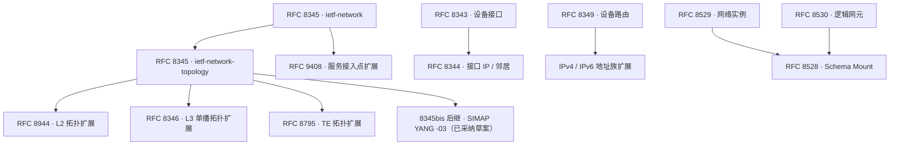

# 网络数字孪生：IETF 标准研读与原方案审查

核对日期：2026-09-28。本文是建模前的研究记录，**不是新数据模型，也不是“完整 IETF 模型已实现”的声明**。

负责人最新约束：先理解 IETF 相关定义，再按照其完整模型实施；不做按实验裁剪的最小模型，不增加项目自定义实体、字段、关系、identity、augment 或命名空间。当前采集/模板扩展暂停。

2026-09-28 采纳决定：**RFC 8345bis 相关补充工作纳入建模依据，不因其处于草案状态而排除。** 当前固定采用其后继 `draft-havel-nmop-simap-yang-03`；RFC 8345 保留为基础，SIMAP 原生扩展纳入模型范围。来源状态与项目是否采纳分别记录；“禁止自定义”不等于“禁止采用草案已有定义”。详见第 4 节。

## 1. 应先分清的模型层次

IETF 的网络拓扑、设备管理、网络资源清单、服务接入和数字孪生架构不是同一份 Schema。不能把若干数据库事实表称为完整 IETF 模型，也不能把所有树直接塞到 `ietf-network/node` 下。[RFC 8309](https://www.rfc-editor.org/rfc/rfc8309.html) 讨论服务模型和设备模型的区别；各具体模块的作用范围必须分别遵守。

图中的箭头只概括标准模块扩展/依赖关系，不表示已经完成网络拓扑节点到设备管理树的跨树绑定。此绑定仍需标准依据和实例验证，不能自行加一个关系字段解决。

## 2. 已核对的正式标准与责任边界

| 标准 | 原生模块/内容 | 核对结论 |
|---|---|---|
| [RFC 8345 §4、§6](https://www.rfc-editor.org/rfc/rfc8345.html#section-4) | `ietf-network`、`ietf-network-topology`，revision `2018-02-26` | network/node/link/termination-point 及 supporting 关系是抽象拓扑骨架，不规定每个 node 都是一台物理设备。 |
| [RFC 8944 §5](https://www.rfc-editor.org/rfc/rfc8944.html#section-5) | `ietf-l2-topology`，`2020-11-15` | 扩展 L2 网络、节点、链路、TP 属性；含 VLAN、QinQ、VXLAN feature 及 LAG 相关定义。不是完整交换机转发表模型。 |
| [RFC 8346 §4](https://www.rfc-editor.org/rfc/rfc8346.html#section-4) | `ietf-l3-unicast-topology`，`2018-02-26` | 扩展 L3 拓扑属性、前缀等；不能替代设备 RIB。 |
| [RFC 8795](https://www.rfc-editor.org/rfc/rfc8795.html) | `ietf-te-topology` | TE 的拓扑抽象、约束及 underlay 描述应按该模块研读；不能自行发明通用“支持关系”替换其含义。尚未完成全部 feature 与依赖审查。 |
| [RFC 8343](https://www.rfc-editor.org/rfc/rfc8343.html) | `ietf-interfaces`，`2018-02-20` | 设备接口及配置/运行状态；接口名在设备数据树内有作用域。 |
| [RFC 8344](https://www.rfc-editor.org/rfc/rfc8344.html) | `ietf-ip`，`2018-02-22` | augment 接口的 IPv4/IPv6 地址、邻居等。ARP/ND 应核对其 neighbor 定义，不另造标准字段。 |
| [RFC 8349 §4、§7](https://www.rfc-editor.org/rfc/rfc8349.html#section-4) | `ietf-routing`、`ietf-ipv4-unicast-routing`、`ietf-ipv6-unicast-routing`，`2018-03-13`，以及 IPv6 RA 子模块 | 路由框架、RIB、协议实例、地址族和下一跳；不等同端到端转发结果。 |
| [RFC 8348](https://www.rfc-editor.org/rfc/rfc8348.html) | `ietf-hardware`，`2018-03-13` | 单设备硬件组件、层级、状态；不能直接充当全网设备清单。 |
| [RFC 8529 §3、§6](https://www.rfc-editor.org/rfc/rfc8529.html#section-3) | `ietf-network-instance`，`2019-01-21` | NI 名称是设备范围标识；定义接口绑定和 VRF/VSI 等挂载入口。 |
| [RFC 8530](https://www.rfc-editor.org/rfc/rfc8530.html) | `ietf-logical-network-element`，`2019-01-25` | 逻辑网元资源分区；不能把其直接等同于拓扑层。 |
| [RFC 9408 §2、§6](https://www.rfc-editor.org/rfc/rfc9408.html#section-2) | `ietf-sap-ntw`，`2023-06-20` | SAP 是网络服务接入参考点，可承载多种服务；不是由 ARP 发现的一台 PC。 |
| [RFC 8519](https://www.rfc-editor.org/rfc/rfc8519.html) | `ietf-access-control-list`、`ietf-packet-fields` | ACL 匹配、动作和接口挂接属于独立模型；不能只靠路由表声称业务可达。完整数据路径模型仍需逐项审查相关协议。 |
| [RFC 8342](https://www.rfc-editor.org/rfc/rfc8342.html) | NMDA、`ietf-datastores`、`ietf-origin` | 配置与运行数据存储语义；origin 不是通用事实置信度或采集证据字段。 |
| [RFC 8528](https://www.rfc-editor.org/rfc/rfc8528.html) | `ietf-yang-schema-mount`，`2019-01-14` | 原生树的挂载机制；不能随意把设备数据放到一个自定义 device 容器。 |
| [RFC 8525](https://www.rfc-editor.org/rfc/rfc8525.html) | `ietf-yang-library`，`2019-01-04` | 声明 module-set、schema、datastore 及 feature/deviation 等能力；文件在目录里不等于服务实现了该模块。 |
| [RFC 7950](https://www.rfc-editor.org/rfc/rfc7950.html)、[RFC 7951](https://www.rfc-editor.org/rfc/rfc7951.html) | YANG 1.1、YANG JSON 编码 | 校验对象包括 key、type、identity、choice/case、when/must、leafref、feature、config 和默认值，不能只校验 JSON 字段存在。 |

该表是已核对的基础清单，**不是所有协议模块与依赖都已闭合的最终清单**。OSPF/BGP、EVPN、VPN、服务资源映射等后续目标仍须核对对应正式模块或具体草案，不得用自定义字段提前占位。

## 3. 对关键语义的核实

### 3.1 拓扑标识、方向和支撑关系

RFC 8345 的 node-id 在包含它的 network 中唯一；TP 在 node 中标识，link 在所属 network 中标识。TP 可以对应端口或其他接口抽象。基础 link 是有向点到点；双向使用一对 link，多点可用伪节点。supporting 关系描述跨拓扑支撑，不能当一般外键；部分 leafref 明确 `require-instance false`。引用未解析与数据不符合 YANG 是不同情况。依据：[§4.2–4.4、§6](https://www.rfc-editor.org/rfc/rfc8345.html#section-4.2)。

因此，原方案的“一台设备等于所有层的同一个 node”“TP 就是物理端口”“所有引用必须在当前 JSON 内存在”均不能成为替代标准的统一规则。标识符的具体取值可按标准允许的实施选择决定，不等于允许新增标识字段。

上述方向和端点数量描述限定于 RFC 8345 基础模型。纳入 SIMAP 后，须按其扩展定义核对双向、多点等表达；不能把基础模型的限制直接用来拒绝草案合法定义的扩展实例，也不能在基础命名空间自行加字段。

### 3.2 L2、L3 与设备数据不可混同

RFC 8944 的 TP `interface-name` 是字符串，文中专门说明不能直接使用只面向单设备数据存储的 `interface-ref` 来唯一引用全网接口；其 rate 使用 Kbps，不能直接填本项目的 Mbps 值。L3 拓扑的前缀属性也不等于路由表。依据：[RFC 8944 §5](https://www.rfc-editor.org/rfc/rfc8944.html#section-5)、[RFC 8346](https://www.rfc-editor.org/rfc/rfc8346.html)。

RFC 8529 定义的 NI、接口绑定与 schema mount 已有标准结构。两个设备都名为 default/blue 的 NI，不会仅因名字相同成为同一实例。其挂载模型要连同 RFC 8528 的 shared-schema 和 parent-reference 一起核对，不能用顶层 `vrf` 字符串替代。依据：[RFC 8529 §3.1–3.3](https://www.rfc-editor.org/rfc/rfc8529.html#section-3.1)。

### 3.3 路由及未知信息

RFC 8349 的下一跳有 choice：简单下一跳、特殊下一跳、多下一跳列表；特殊类型包括 blackhole、unreachable、prohibit、receive。IPv4/IPv6 模块补充目的前缀和地址族下一跳。`route-preference` 有明确选路语义，不能与协议 metric 混用；RIB 路由不能证明沿途 ACL、二层及终端均正常。依据：[RFC 8349 §4、§7](https://www.rfc-editor.org/rfc/rfc8349.html#section-4)。

“未采到”不能统一编码为 `unknown`、空数组、0、false 或 null：必须逐字段检查类型、是否必填、默认值及所在 datastore 的约束。RFC 7951 的 empty 编码为 `[null]`，并非“未知”；64 位整数也有规定的 JSON 编码。依据：[RFC 7951 §6](https://www.rfc-editor.org/rfc/rfc7951.html#section-6)、[RFC 7950 §7、§9](https://www.rfc-editor.org/rfc/rfc7950.html#section-7)。

### 3.4 NMDA 与模型来源

`intended`、`operational` 是 NMDA 数据存储语义。`ietf-origin:unknown` 表示无法识别配置来源，并不是不知道链路是否存在；`learned` 也不等于模型做出的推测。不能将 confidence、evidence_ref 等自定义属性套进 origin。依据：[RFC 8342 §5.3.4](https://www.rfc-editor.org/rfc/rfc8342.html#section-5.3.4)。

对于事实来源、历史快照、模拟等要求，先查对应标准/草案是否有准确语义；没有核实到定义时不加字段、不借 `anydata` 填入自定义结构、不宣称已经满足需求。

**2026-09-28 续查补正**：还须区分完整 Schema 约束检查、NMDA operational 语义和部分采集解析。[RFC 8342 §5.3](https://www.rfc-editor.org/rfc/rfc8342.html#section-5.3) 规定 operational 应符合约束，但为返回实际在用值，在特定情况下允许违反 when、must、mandatory、unique、min/max-elements、键唯一性等语义约束；层级、标识符与类型约束不可违反。不能由“缺 mandatory”直接推出全部已知观测不可保留，也不能由“语法解析成功”推出完整状态已验收。事先已知的设备不符合项应通过标准 deviation 表达；当前仅有 CLI 子集缺证据，不能伪造 deviation、统计中断时间或“设备未使用”结论。工具警告和数据完整性另存研究报告，不加进标准数据树。可执行核验见[运行状态验证](../models/network-twin/mount/README.md#运行状态与部分观测ietf-15)。

## 4. 已采纳的 8345bis 补充与其他草案状态

### 4.1 采纳依据与版本

此前“仅检索到修订计划/讨论”的记录不完整，现更正：Datatracker 明确记录 `draft-havel-nmop-simap-yang` 接续 `draft-davis-nmop-some-refinements-to-rfc8345`、其 OPSAWG 前身以及 digital-map 草案，并关联作者的 `RFC8345Bis` 仓库。这是本项目所称“8345bis 补充工作”的可追溯文档沿革，不是另一个已发布 RFC 编号。[官方沿革](https://datatracker.ietf.org/doc/draft-havel-nmop-simap-yang/history/)

**采纳基线为 RFC 8345 + `draft-havel-nmop-simap-yang-03`，概念和需求配套核对 `draft-ietf-nmop-simap-concept-13`。** 后继文档替代关系不代表已废止 RFC 8345；本项目采用补充模型的决定已经明确，不再以等待转为 RFC 作为进入建模的条件。模型文件的 namespace、revision、feature 和约束按原文保留；草案编号与模块 revision 分开记录。后续换版须记录差异并重做受影响的实例验证，不随移动链接或仓库 HEAD 自动替换。

SIMAP 的核心拓扑、导航、生命周期及外部关联均列入后续逐项核验范围。核验时对照第 7 节方案、第 8 节树图和第 9 节模块代码，记录哪些定义已落入原生 YANG、哪些仍是提议或 TODO；采纳不等于声称所有能力已经实现。未完成定义继续跟随原草案，不由本项目补写。[固定版本原文](https://datatracker.ietf.org/doc/html/draft-havel-nmop-simap-yang-03)

### 4.2 来源与实施边界

| 文档 | 本次核对 | 对后续建模的约束 |
|---|---|---|
| “RFC 8345bis” 补充工作 | 已核实 refinements → SIMAP YANG 的后继关系及 `RFC8345Bis` 仓库关联。[官方沿革](https://datatracker.ietf.org/doc/draft-havel-nmop-simap-yang/history/) | 已决定采纳，以后继固定版本 -03 为当前依据；旧草案用于理解沿革，不与后继版本混装。 |
| `draft-ietf-nmop-simap-concept-13` | 2026-09-04 的工作组草案；说明 SIMAP 概念、要求与用例，具体建模语言和实现并非由此文完成。[原文](https://datatracker.ietf.org/doc/html/draft-ietf-nmop-simap-concept-13) | 不能将概念要求直接转成自定义模型，并声称来自已完成的 IETF YANG。 |
| `draft-havel-nmop-simap-yang-03` | 已采纳的个人草案，模块 `ietf-simap-topology`；移动链接/搜索曾返回旧版 -02，必须固定文档版本。[原文](https://datatracker.ietf.org/doc/html/draft-havel-nmop-simap-yang-03) | 纳入 IETF-0 审查、IETF-1 模块与依赖验证、IETF-2 实例验证；区分提议、树图和模块代码，不自行补全 TODO，不将其标为已发布 RFC。 |
| `draft-ietf-ivy-network-inventory-yang-19` | 2026-09-17 工作组草案；面向全网 installed inventory，基础版仅涵盖物理 NE，软件/虚拟扩展另行定义。[原文](https://datatracker.ietf.org/doc/html/draft-ietf-ivy-network-inventory-yang-19) | 不用 RFC 8348 的单设备树假装全网 inventory；VSR 是虚拟设备，不能硬填为物理 NE。 |
| `draft-ietf-ivy-network-inventory-topology-11` | 2026-09-11 工作组草案；定义 inventory-topology 及 `ne-ref`、`port-ref` 等映射。[原文](https://datatracker.ietf.org/doc/html/draft-ietf-ivy-network-inventory-topology-11) | 拓扑与资源清单的关联已有 IETF 工作，继续核对原生映射和物理实体适用范围，不自行设计另一套关系。 |
| `draft-ietf-ivy-network-inventory-software-04` | 工作组草案；扩展非物理网元、软件组件，包括 `ne-virtual` 等 identity。[原文](https://datatracker.ietf.org/doc/html/draft-ietf-ivy-network-inventory-software-04) | 虚拟路由器需核对此扩展及基础版本兼容性，不新建项目 virtual-device 类型。 |
| `draft-irtf-nmrg-network-digital-twin-arch-13` | IRTF NMRG 的概念与参考架构文档，明确不是任何级别 Internet Standard 的候选。[原文](https://datatracker.ietf.org/doc/html/draft-irtf-nmrg-network-digital-twin-arch-13) | 可用于理解目标，不能当作一套完整、可编译的网络数字孪生 YANG Schema。 |

IETF 模块的标准依赖也必须保留来源边界。例如 RFC 8944 引用了 IEEE `ieee802-dot1q-types`，部分模块使用 IANA identity。它们不是项目自定义，但也不能改名声称是 IETF 自己定义的对象。LLDP、完整桥转发表等模型的标准来源和依赖还需继续核对。

## 5. 原方案必须撤回或重新核对的假设

| 原方案做法 | 审查结论 |
|---|---|
| 数据库字段语义对齐即可，YANG 仅作为最后导出格式 | 不符合负责人新要求。原生 YANG 是后续模型结构与语义依据，不能由现有表反向决定模型。 |
| 用 managed / observed_only / inferred_segment / endpoint 统一定义节点 kind | 这是本项目定义，不能放入无自定义的标准模型。保留旧实现供回滚，不作为新模型定义。 |
| 自定义 physical/l2/l3/endpoints/overlay 固定枚举 | 实例标识与标准 network-types/identity/feature 必须分开；不能把本地分类称为 IETF 固定层级。 |
| 将 endpoint 对应到 RFC 9408 SAP | 概念不同，撤回该等同关系。 |
| 双向 LLDP、ARP 仅有一个邻居就证明物理直连 | 这是采集推理，不能赋予标准 link 不具备的证明含义。实验接线事实不等于 CLI 观测事实。 |
| serial 或 chassis MAC 命中即自动归并，堆叠命中任一成员就自动归并 | RFC 8345 并未规定这种识别算法。需与资源/组件语义分开，不能以“标准要求”直接实施。 |
| 用 confidence、freshness、evidence_refs 自行扩展拓扑 | 当前要求禁止，停止该建模方向；不得换个容器名继续加入。 |
| 字段未知统一填 unknown 或按业务偏好改标准默认值 | 逐字段按标准校验；不伪造枚举值，不修改标准。 |

## 6. 进入建模前尚须完成的核验

逐项结果见 [原生模型核验清单](network-digital-twin-model-audit.md)。2026-09-28 已核对 RFC 8345 基础结构与 SIMAP 的全部 36 项需求；发现 -03 的方案、树图、代码不一致，原文 §9 编译失败。采纳决定保持，不能据此声称完整可执行模型已就绪。

1. 闭合整个目标所需的标准模块、子模块、import 和 revision 清单，核对勘误与替代关系；当前已闭合十八个基础入口的三十个模块，不等于目标所有协议与草案的依赖包。
2. 逐项核对 topology、device、inventory、service 之间的标准关联方式，包括虚拟设备与多实例；找不到已定义关联时记录缺口。
3. 完整审查 TE 与目标涉及的协议扩展，不从当前 H3C 样本反推或删减模型。
4. 用未经修改的原生模块验证正式示例和反例；既检查编译，也检查实例语义、数据存储范围和挂载关系。工具通过不能替代原文理解。
5. 以已采纳的 SIMAP YANG -03 为补充基线，逐项建立需求/章节、原生路径、feature、依赖和实例验证记录；与配套 concept -13 的要求核对差异。区分已定义内容与 TODO，未完成部分不由项目补写。版本与定义核验是实施工作，不再重新讨论是否因草案状态而排除。

本次只形成研究与纠偏记录。未新增生产 YANG、数据实体、迁移或 API；资料位于忽略目录 `.runtime/ietf-study/`，没有把未闭合的下载目录发布成模型包。P2-3 保持暂停、未完成状态。

### 研究验证记录

- 原生基础模块及依赖共 30 个，来源为 YangModels 仓库固定提交 `0e28ed86b0a9070b7f15fd06ba4fa501723fac84`，仅作研读副本。IETF/IANA/IEEE 来源分别保留，未改源码；不属于应用已实现模块声明。
- 使用隔离的研究环境 `pyang==2.7.1` 编译上述文件：退出码 0，`.runtime/ietf-study/pyang.log` 无诊断；生成 `.runtime/ietf-study/topology-tree.txt` 用于核对扩展位置。TE 和草案组合不在这次编译范围。
- 用 `yangson==1.6.3` 对首版冻结的 RFC 8345 原生模块运行 5 个语义正反例：允许不同网络相同 node-id；允许标准明示的未解析 leafref；拒绝同网络重复 node-id；拒绝自定义 confidence；拒绝基础 link 上不存在的 direction 字段。结果 `.runtime/ietf-study/base-semantics.json`，5 项通过。
- 这些结果验证具体标准约束，不能证明全部协议理解或完整模型交付。涉及草案的正式示例还需单独编译、回放和语义核对。
- RFC 8345 基础 link 拒绝 direction 的反例仅验证基础 Schema，不适用于判断 SIMAP 命名空间下的方向扩展。后续已对 SIMAP -03 原文执行编译并确认失败，因此扩展实例尚未验证。其他组合、18 项实例结果和语义缺口详见 [核验清单第 6 节](network-digital-twin-model-audit.md#6-验证证据)。
