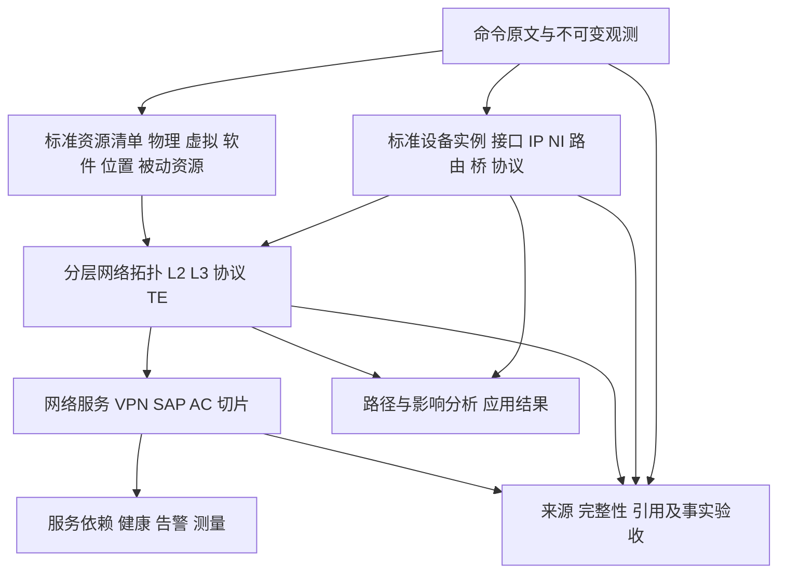

# 网络数字孪生标准模型完整实现方案

设计日期：2026-10-03。依据：[IETF 模型分析](network-digital-twin-ietf-model-landscape.md)、[逐项目录](network-digital-twin-ietf-model-catalog.md)及本轮代码反例。本文规定目标实现及验收，不把规划能力计为已实现；本轮修复结果另记在路线图进度台账。

执行状态：M0 已以 topology **0.4.15** 部署；后端 1224 通过、2 个可选模板源跳过，前端 20 通过。只读发现 8/8 成功，六台 IOS 的 default/MGMT ARP 覆盖完成，16 对受管 LLDP 端口与 GNS3 接线一致，新拓扑通过冻结 YANG 完整校验。M1—M6 是尚待实施的完整任务，不能据此把目前的部分设备树或未知对象写成已完成。详细证据、范围和部署检查见[路线图 §14](network-digital-twin-roadmap.md#14-进度台账执行者维护)。

## 1. 目标与执行边界

目标是形成可回放、可追溯的资源、设备、网络与服务模型，能够解释网络实际状态及不确定性，并支持定位、路径推导和影响分析。模型覆盖由标准决定，实例内容由证据决定；不按这套园区实验设备裁剪标准 Schema，也不通过填默认值制造“完整数据”。

遵循负责人已确定的约束：IETF 优先；IEEE 负责其技术领域的细节；采用已明确采纳的 SIMAP 草案；不增加项目自定义 YANG 字段、identity、augment 或命名空间。证据、采集任务、验证报告、画布及路径分析沿用应用接口，不能夹入标准数据树。复用当前 App、公共 SSH、事实仓库和任务机制，不引入新的服务或图数据库。

本轮授权先修复已复现的代码错误，再交付本方案；后续能力按本文任务卡实施。采集仍走已授权的公共只读 SSH，SNMP MIB 作为模型参考不意味着启用 SNMP 采集；NETCONF/RESTCONF 等协议服务也不因研究中列出而自动纳入当前接入范围。设备配置变更另需明确授权，Git 推送同样如此。

“完整”分开验收：

1. **Schema 完整**：采纳模块、依赖、feature、revision、标准挂载上下文闭合，保留原始定义。
2. **映射完整**：对每个适用数据节点说明数据来源、转换、作用域、缺项原因和校验方法。当前无设备提供的字段仍列出，不删除。
3. **实例完整**：只对声明范围内的完整实例作此结论；部分 CLI 观测保持 partial。
4. **关系可信**：每条身份、邻接、承载或服务映射均可追溯；结构校验不替代事实检查。
5. **能力完成**：需通过对应实验或标准参考实例。光传输等没有当前实机的领域可完成模型及离线验证，不能宣称实机支持。

## 2. 本轮先修复的基线

| 缺陷 | 修复原则 | 必须通过的反例 |
|---|---|---|
| `(VRF 名, IP)` 后写覆盖 owner | 保存所有设备/NI/接口候选，按当前观测上下文解歧；冲突保留 | 调换设备输入顺序不改变身份或选错邻居；同地址多个作用域全部可见 |
| SVI 附件按首条 MAC 学习定位 | 使用 VLAN/FDB 上下文，多个可能位置不选首项 | VID 10/20 同 MAC，调换学习行顺序不改变结论 |
| 源路径固定从 default 开始 | 从源接口的设备本地 NI 开始 | blue 实例的源和路由走 blue；另一个实例同地址不能串入 |
| 相同本地 VRF 名被当全网域 | 网络容器与设备本地 NI 分开；跨设备关系取自承载证据 | 同名隔离域不互连；同一真实邻接两端 NI 名不同仍可关联 |
| 无邻接仍 complete/delivered | 路由候选保留缺口；终点邻接、源接入和端口状态分开检查 | 无 LLDP/ARP/L2 证据案例不得完整成功；同前缀不等于可达 |
| ARP/MAC 被确定标为终端主机 | 显示为未识别端点 | ISP 接口地址不能仅凭 ARP 被标成 PC，也不能自动合并为 ISP |
| IOS 非 default ARP 未采、范围无提示 | 从实际实例枚举扩展精确只读命令；逐 scope 保留完成/失败信息 | 不硬编码 MGMT；空表与未采不同；名字不能注入命令 |
| 不完整本地 LLDP 提供强身份 | collection incomplete 门禁覆盖 lldp_local | 截断机箱信息不能进入身份归并 |

本轮措施要阻止错误结论继续传播。对尚无完整桥/FDB 作用域的重复 MAC，保留原始记录并报告歧义；完整的逐桥转发表建模在 M3 完成。不能把暂时不自动关联解释为“该端点不存在”。

独立复核还纳入四个同类反例：物理口 ARP 的显式 VID、空 next-hops 被判成功、非 MAC chassis 标识的编码碰撞，以及冲突本地 chassis 的 partial 解析。当前动态实例扩展只涉及 IPv4 ARP；IPv6 ND 和各 NI 的路由覆盖在 M4 完成。每设备最多读取 64 个可安全表达的 VRF 名称，超过范围或枚举/查询失败均报告缺口；NX-OS 样例解析通过不等于该平台实机验收完成。

## 3. 总体模型分工

图中箭头表示处理或语义关联，并非任意添加标准外键。标准关系只用正式定义的 augment、supporting-*、schema mount、inventory mapping 或具体服务绑定；不存在标准关系时保留独立实例和应用访问上下文，记录缺口。

| 对象/视图 | 标准入口 | 实例归属与关键约束 |
|---|---|---|
| 通用网络图 | RFC 8345 `ietf-network`、`ietf-network-topology`；SIMAP YANG -03 | network/node/link/TP；节点 ID 在网络内、TP ID 在节点内唯一；双向/多点使用冻结 SIMAP 定义 |
| 设备接口与 IP | RFC 8343/8344 | 单设备上下文的 `/interfaces/interface[name]`；地址和邻居属于接口及其 NI |
| 网络实例和逻辑设备 | RFC 8529/8530/8528 | 设备本地 NI、LNE 与标准挂载；同名不表示全网同域 |
| 二层拓扑 | RFC 8944 | L2 抽象、TP 封装、聚合关系；不能代替全部桥配置及转发表 |
| 交换行为 | IEEE 802.1Q、802.1AB、802.1AX 对应模块 | 桥、component、port、FDB、VID/FID、LLDP agent、LAG；采用实际标准键，不能凭表格行号造键 |
| 三层拓扑 | RFC 8346 | 设备 NI 对应逻辑节点，IP/unnumbered/interface-name choice；链路要有作用域明确的承载或协议证据 |
| 物理/虚拟/软件清单 | IVY base -20、software -04 | NE、组件、虚拟与容器/软件实例；不把 VSR/IOL 伪装成物理机箱 |
| 拓扑到资源 | IVY topology -11 | 标准 ne-ref/port-ref；逐路径核验目标身份类型是否适用 |
| 位置、被动资源、许可、能源 | IVY location -06、passive -01、entitlement -05；RFC 9179；GREEN -04 | 位置、线缆、许可与功率是独立事实；不可从 ARP/MAC 推出来 |
| 路由/协议 | RFC 8349/9403，OSPF 9129、IS-IS 9130、BFD 9127/9314、VRRP 8347 等 | RIB、协议实例、邻居、LSDB 与下一跳各自保留完整语义 |
| 网络服务 | RFC 8299/8466、9181/9182/9291、9408、9833—9836 | 服务需求、网络实施、SAP、AC 不混同；通过标准 AC/VPN 绑定关联 |
| TE/传输 | RFC 8795、8776、9093/9094、8561/9656 及研究目录中的适用草案 | 抽象可用资源、TE 隧道与物理端口不同；不得从普通 RIB 虚构预留带宽 |
| 策略及保障 | RFC 8519/9899/8512、9061/9348、9418、8632、9375 等 | ACL/NAT/IPsec 影响具体流；依赖、健康、告警与测量不能仅由图连通推出 |

依据与版本状态详见研究目录。RFC 8345 的层次关系见 [§4](https://www.rfc-editor.org/rfc/rfc8345.html#section-4)，NI 见 [RFC 8529](https://www.rfc-editor.org/rfc/rfc8529.html)，二层模型的范围见 [RFC 8944](https://www.rfc-editor.org/rfc/rfc8944.html)。这些标准允许不同抽象，不能用抽象差异掩盖事实错误。

## 4. 身份、作用域与关系规则

### 4.1 身份

沿用现有持久身份与观测存储，设备管理地址只作可访问别名。序列号、LLDP chassis ID、接口 MAC 等均须保留来源、类型及冲突；即使某字段通常唯一，遇到镜像克隆、虚拟 MAC、共享地址或冲突也不能自动吞并。主机名、AS、router-id、MAC 厂商前缀不能单独证明物理实体相同。

同一个设备可以有多个网络节点；一个网络节点也可能是逻辑实例或抽象。新身份关联不得改写历史观测，把关联结果和其适用快照保留下来。撤销错误关联时重建新投影，旧快照仍能解释。

标识字符串的编码属于实现策略，不是新 YANG 类型。编码必须稳定、无歧义且不因输入顺序改变。设备本地 NI 的有效键是设备上下文加 NI 名称；接口、地址、路由、ARP/ND 必须跟随该上下文。

### 4.2 物理接线与邻接

明确区分：设备资源、物理接线、LLDP 邻接、L2 可见性、L3 邻接、协议邻居、TE/业务承载和分析路径。L2 `link` 不能默认解释成一根线；LLDP 看不到被动器件，也不能自动得到完整资产清单。

GNS3 工程是本实验的外部真值。验收程序读取节点与端口接线，标明受管设备、未受管设备、终端、管理设施及被动介质的覆盖范围。发现输入不得偷偷读取 GNS3 名字或拓扑来补齐；若将来支持资产导入，应显式区分导入的资产/接线来源和设备发现来源。

同一个交换口学到多个 MAC，最多说明该观测口后方存在多个端点；不能由此确定有几台交换机、是否 Hub，或跨 VLAN 互通。未管理设备的数量、型号和内部接线保持未知。

### 4.3 二层与三层

IEEE 桥实例、component、FDB/FID、VID、端口为二层查找上下文；不能假定 FID 永远等于 VID，也不能假定两台设备上的 VID 数字相同就属于同一桥域。跨设备 VLAN 关系须通过已观测链路及两端封装/成员关系建立。Native/PVID、untagged egress、tagged membership、VLAN translation 和 QinQ 分别处理。

本轮 L3 观察容器不声明全网 VRF 域：同设备的不同 NI 是不同逻辑节点，以 supporting-node 支撑于对应 L2 设备。后续识别 VPN/业务域时用相应网络服务模型连接各设备 NI，不能恢复按 VRF 名自动分域。

链路生成至少检查：双方对象及 NI 唯一、地址族/前缀合理、底层连接或协议证据成立、VLAN/封装不冲突。只有同前缀没有邻接证据时保留两个端点和候选关系分析，不输出确定邻接。OSPF 等协议度量保留协议本义；RFC 8346 通用 metric 的投影政策单独声明。

## 5. 路径分析契约

路径 API 继续是应用分析结果，标准事实树是其输入。一次推导固定 snapshot、源/目的及其候选作用域；源地址重复时列全候选并给歧义，不能取第一台设备。未来如需要精确选 NI，选择器引用已有标准对象标识，不新增全局“VRF 域”实体。

每一跳按顺序处理：入口设备/NI → 接口可用性 → 活跃路由与最长前缀/优先级/ECMP → 递归下一跳或明确的路由泄漏 → 出接口/邻居解析 → VLAN/二层承载 → 对端接口的本地 NI → 下一设备。ACL、NAT、PBR、隧道和安全会话未覆盖时须报告适用的分析限制。

| 情形 | 允许的结论 |
|---|---|
| 源/目的确属某设备 NI 的自身地址 | 可以结束于该设备实例；仍保留此前路径缺口 |
| 有直连路由但没有终点邻居/承载证据 | 已找到出网段候选，终点邻接未证实 |
| 下一跳地址存在多个 owner | 按本地 ARP/ND、接口和邻接解歧；否则多候选/partial |
| 同前缀，未观察到完整二层关系 | 只报告同前缀，不能说“无需路由所以可达” |
| 任一必要端口 admin-down/不可用 | 路径在该处终止，并引用本次状态 |
| 状态、邻接、采集覆盖缺失 | partial，缺口随分支保留；不能用旧 UP 填新失败 |
| 数据面 ping/traceroute 验证成功 | 只对测试源、目标、流条件和时间作验证结论 |

`complete` 最终含义必须限制为“当前分析契约所需证据齐全”，不是无条件端到端业务成功。本轮的候选路径仍不等于全策略转发仿真；M4/M5 扩大契约时同步更新接口说明、工具说明和验收。

## 6. 原生实例、版本与存储

沿用 `src/apps/topology/resources/yang/`、来源清单和独立 library。M1 建立按能力组合的模块集，避免把所有互斥历史模块、兼容 state 模块和草案版本塞进同一 schema。每套记录模块/revision、原文版本、来源 URL/哈希、feature、依赖及已知修补。

当前 RFC 8345 + SIMAP -03 是运行基线。最新 IVY、SIMAP concept、公共类型、YANG Library 更新分别做差异核对，不通过覆盖同名文件静默升级。SIMAP 原文的语法修补保持可审计；TODO 或 prose 中没有落成模块的能力只列缺项，不由本项目补写。

设备、inventory、topology、服务模型分别按定义导出；先验证完整依赖和标准挂载结构，再实现实例连接。RFC 8528 提供挂载机制但不创造任意挂载点。已有 Q-IETF-1 的关联限制须按新版模块逐项复核；不能把 `ne-ref` 指向不被该版本接受的虚拟类型，也不能为连通演示造外键。

快照保留模型组合版本、输入观测集合和应用投影版本，支持同一证据分别以旧/新投影回放。跨版本 diff 先说明 Schema/投影政策差异，避免把 ID 策略变化当作设备上下线。历史快照不批量覆写。

现有 `FactRepository` 与发现快照机制保留。新增标准实例需要持久化时使用 App 包内迁移，先验证唯一键/作用域和回滚，再增加表或索引。事实表不是原生 YANG datastore 的替代品；原生导出必须独立校验。数据库结构不是本轮直接重构范围。

## 7. 采集与映射流水线

每个适用标准节点维护映射记录：原生路径、条件 feature、键的来源、设备/NI/桥作用域、读取命令、解析字段、单位转换、时间语义、缺项原因、验收样例。清单覆盖所采纳完整模块的有效数据节点，不能只列已成功映射的字段。

处理顺序固定为：核对模型 → 定义实例/反例 → 回放已有素材 → 标出缺项 → 增加必要的只读采集 → 现场验证。可复用旧采样；新增厂商命令必须有真实回显或标记尚未验证。可选 feature 未采、设备不支持、返回为空、解析失败、截断和授权失败是不同结果。

动态命令仅从已经解析并校验的实例名称生成，按原目标及当前连接签发精确授权，经过现有只读策略、预算、取消和审计。缺一个 scope 不把其他 scope 的数据换成空表；不把部分汇总标为完整。命令失败不能借另一个 NI 的同地址记录补全。

观测时间、命令原文和解析器/模型版本用于回放。多设备顺序采样不是同时刻原子快照：状态跨采样窗口变化时保留窗口与冲突。失败且无当前证据，不刷新旧事实的 observed_at/last_seen。

## 8. 分阶段实施任务卡

### M0：纠正当前事实和分析错误（本轮）

范围为第 2 节八项。修改 builder、locate/path、view 和采集门禁/实例覆盖；只调整现有界面中错误的身份、作用域和确定性表述。

验收：反例回归、现有拓扑相关单元与冻结 YANG 验证、已有园区样本回放、升级部署、授权范围内一次只读发现与 GNS3 同层对照。记录未知对象和未支持桥域的限制。完成 M0 不意味着完整物理网或业务路径已经复原。

### M1：完整模块基线与语义验收框架

执行状态（2026-10-03）：M1-1～M1-8 已完成，结果与复现见 [models/network-twin/m1](../models/network-twin/m1/README.md)。锁定 464 个文件，按修订判定（基线 309、候选 105、参考 61、不适用 2 个模块），11 个能力集的基线组合 pyang 全部无错；33 个正反例全部符合预期；VRRP 8347bis 升级回放使 3 个旧快照失败（master→active），其余 3 个候选升级为加法式。未决依赖与工具边界逐项列在该报告中。

输入：本次 357 项目录、314 条 IANA 注册审查及现有 sources/library。逐族选择“运行基线/候选升级/参考/不适用”，附理由；完整导入核心模型和依赖，生成 tree 与约束清单。以 RFC 9195 的实例文件机制研究标准化离线交换，和应用证据封装保持区别。

交付：版本锁、原文/修补差异、完整数据节点映射清单、正反例集、每套 schema 的编译/实例报告。新增文件置于现有模型研究与 App 资源目录，不自建 YANG。

验收：缺依赖、错 revision、choice 冲突、未知 identity、引用越 scope、单位错误均能被发现；每一项失败可区分 schema、语义或采集不足。原生与部分实例使用不同结论。最新草案升级必须回放旧快照样例。

### M2：设备实例与资源清单闭合

执行状态（2026-10-03，topology 0.5.0）：已完成可观测部分，见 [models/network-twin/m2](../models/network-twin/m2/README.md)。接口关断状态（`enabled`）与描述、RFC 8529 网络实例、IVY 网元（虚拟/软件类型按版本证据判定，不默认物理，不造序列号）已导出，并通过实机只读验收和 libyang 校验。物理网元、堆叠、端口与组件对应没有样本，VRF 内路由仍是缺口；被动资源、许可、位置和能耗用草案示例离线验收，并发现软件 -04、位置 -06 的示例缺陷。

依赖 M1。完成 interfaces/IP/hardware/system、NI/LNE/schema mount 的完整映射清单和导出；IVY 基础、软件、位置、topology mapping 按当前固定组合核验，随后加入被动资源、许可、能源的标准实例能力。

现有模型模块 `device_state.py`、`device_ip.py`、`device_control.py` 在各自标准范围扩展；不得把 VRRP version、原生 RIB 名称、统计中断时间、LLDP 表键从本机序号或当前时间构造出来。未观测 mandatory 项保留缺口。

验收：一设备多接口/地址、多 NI、同名接口跨设备、重复管理地址、虚拟/物理/堆叠区别；挂载内 leafref 不串设备；inventory mapping 的端口与组件真实对应。NE 缺项不能通过假序列号通过。当前实验缺物理/被动资源事实时以正式示例和脱敏素材离线验收该范围，明确无实机结论。

### M3：完整园区二层与接入

执行状态（2026-10-03，topology 0.5.0）：IOS 生成树逐 VLAN 采集、LAG 成员状态，以及逐链路逐 VLAN 的转发分析（放行、打标、生成树、聚合成员）已完成，并有桥域汇总。双上联/阻塞口在实机上验证；聚合成员变化、native 不一致、允许列表无交集用真实数据的单项修改验证。rapid-PVST 的逐 VLAN 状态没有标准 YANG 节点，只作证据；H3C 生成树、MSTP 原生导出、QinQ 没有样本。详见 [models/network-twin/m2](../models/network-twin/m2/README.md)。

依赖 M1/M2。完整纳入适用 IEEE bridge、VLAN、FDB、LLDP、LAG 及生成树模型；RFC 8944 作为网络级 L2 视图。区分物理口、聚合口、成员、子接口和桥端口。接入识别按桥/FDB/VID/接口和当次观测，禁止跨 NI/VLAN 的全局 MAC 合并。

实现 tagged/untagged、PVID、允许 VLAN、STP/MSTP 转发状态、LACP/成员运行状态、桥域连接以及 QinQ/改写的适用关系。尚未采 STP 时明确二层转发模拟缺项，不把“链路 Up”算成“VLAN 可转发”。

验收：双上联、阻塞口、同 MAC 跨 VID/FID、native mismatch、允许列表不交集、聚合成员变化、共享口不同 VLAN 端点。对没有 H3C LAG 真样本的项，先模型与回放，待另行授权加线后实机验收。不得为补素材自行改实验接线或配置。

### M4：完整三层、协议与路径推导

执行状态（2026-10-03，topology 0.6.0）：已完成可观测部分，详见 [models/network-twin/m4](../models/network-twin/m4/README.md)。
- 已采集：OSPF 邻居、BGP 邻居，以及 IOS 各 VRF 的路由表。
- 已导出：RFC 9129 OSPFv2 实例（以进程号命名）和 BGP 实例（draft -21，以本地 AS 命名），通过 libyang 校验。
- 协议邻接：单独分析，不并入 L2/L3 图；Router ID 只在协议域内有效。
- 方案列出的路径场景都有用例，新增跨 VRF 泄漏、非对称路径，以及基于真实 MGMT 路由表的同前缀隔离。
- 实机只读验收：8 台设备、10 项核对全部通过。
- 未完成：RIB 名称不可得，RIB 仍不导出；IPv6/ND、unnumbered、BFD、IS-IS、LSDB、TE 邻接以及 Comware 的按 VRF 路由都没有样本。

依赖 M2/M3。完成 RFC 8349 RIB 与当前 OSPF/VRRP/BFD 标准实例；按能力拓展 IS-IS、BGP（固定草案）、静态路由及研究目录中的其他协议。L3、LSDB、协议邻居、TE 邻接分别建模，不混入一张“物理图”。

处理 active route、ECMP、递归下一跳、设备本地实例转换、路由泄漏、IPv4/IPv6/ND、unnumbered、虚拟网关、黑洞、环路及采集不足。IP 不是唯一设备标识；协议 RID 的作用域按协议定义。

验收：同前缀隔离、不同 NI 名互联、重复地址、/32 loopback 递归、跨 VRF 泄漏、ECMP 单支失败、无 ND/ARP、邻居有而链路状态未知、故障/恢复和非对称路径。实验路径验证必须选可比的源接口、NI、地址族和时间窗口，不拿另一源的 ping 证明结果。

### M5：服务、策略与影响分析

执行状态（2026-10-04，topology 0.7.0、规则治理 1.5.0）：VPN/EVPN/VXLAN/DC fabric 部分已完成，详见 [models/network-twin/m5](../models/network-twin/m5/README.md)。
- 采集与解析：全部经规则治理的系统基础检查项。
- 路径引擎：增加 MPLS 与 VXLAN 隧道语义。
- 已导出：L3NM/L2NM 服务、RFC 8944 VXLAN 叠加网络、RFC 8542 fabric、BGP 地址族、LDP、MPLS 接口；均通过 libyang 校验。M1 正反例增至 72 个，发现 RFC 9291 的一处模块缺陷。
- 实机只读验收：17 项中 15 项通过。未通过的两项是 L3VNI 跨 leaf，原因是实验网重启后 BLUE 路由不再导入，孪生如实反映了设备状态。
- 未完成：L3SM/L2SM、SAP/AC、ACL/NAT/QoS/IPsec、服务保障。

依赖 M2—M4。依次实现 L3SM/L2SM → L3NM/L2NM → SAP/AC 标准绑定；随后接入 ACL、NAT、QoS、IPsec 与可用安全模型，扩充流条件分析。没有服务订单/部署事实不从 VRF 猜客户服务。

保障使用 RFC 9418 的 service/subservice 依赖，RFC 8632 告警及 RFC 9375/OAM 测量；只有接口 Down 可以确定时，服务影响仍由实际依赖关系决定。告警、事件、故障、根因和健康分别处理。

验收：同接口多服务、一个服务多承载、主备切换后服务仍可用、ACL 单方向丢弃、NAT 前后元组、未知安全策略导致 partial、依赖资源恢复但测量未恢复。确保没有业务证据时返回未映射而非“无影响”。

### M6：技术领域扩展

依赖核心模型契约稳定。逐个完整模型组合交付：TE/ACTN/VN、MPLS/SR/PCEP、EVPN/VXLAN/DC fabric、光/WSON/Flexi-grid/OTN、微波、DetNet、TVR、切片/NRP、多播以及 ALTO。每项同时列模型、引用、观测来源和可验证分析能力。

验收采用对应标准示例、脱敏实际素材和反例，具有实验条件后再加实机阶段。TE 带宽/延迟、SR segment list、光可达性、DetNet 资源、时间调度和切片 SLO 不从普通 IP 图推断。没有现实数据的功能保持“模型验证完成、采集/实机待验”，不自动成为平台承诺。

## 9. 研究目录中的各领域如何落地

| 领域 | 实施位置 | 输入与完成条件 |
|---|---|---|
| YANG/NMDA/Library/类型/metadata/实例文件 | M1，贯穿各阶段 | 完整依赖、语义约束、完整性分级；新协议承载另定接入范围 |
| 通用/L2/L3/SIMAP/历史兼容模块 | M0/M1/M3/M4 | 保持来源版本和层次语义；兼容 state 模块不混装为新网络层 |
| 设备/接口/IP/NI/LNE/hardware/system | M2 | 正确设备上下文、键和挂载；不虚构 mandatory 数据 |
| IVY/地理/被动/软件/许可/GREEN | M2 | 对象类型适用性、端点/组件引用、物理或虚拟素材 |
| LLDP/桥/VLAN/FDB/LAG/STP | M3 | IEEE 模块、桥实例和真实交换状态 |
| OSPF/IS-IS/BGP/RIP/Babel/RIFT/BFD/VRRP | M4 | 协议实例及状态；过期草案与正式 RFC 不混标 |
| MPLS/LDP/SR/IGP 扩展/PCEP | M4 后进入 M6 | 标签、SID、TE 引用与路径数据库，保留控制面/数据面区别 |
| PIM/IGMP/MLD/MSDP/AMT/BIER | M6 多播 | 组/源/接口、RPF、复制关系；未发布或过期模型须明确 |
| VPN/EVPN/VXLAN/DC fabric | M5/M6 | 网络服务、overlay、设备与底层支持关系分别验收 |
| SAP/AC/服务映射/ACTN VN | M5/M6 | 原生绑定与业务部署事实；无事实不造服务 |
| ACL/NAT/MUD/IPsec/QoS/I2NSF/DOTS | M5，按具体适用能力 | 配置与运行状态；草案接口、领域协议和通用路径能力区别处理 |
| assurance/incident/alarms/OAM/LMAP/IOAM/IPFIX/测试器 | M5 | 明确资源/服务标识、测量任务、时间和证据；不以框架替代实例 |
| TE/光/OTN/微波/DetNet/TVR/切片NRP | M6 | 领域资源与约束；每族独立 schema 组合和实验报告 |
| ALTO/BGP-LS/拓扑交换 | M6 或具体协议适配 | 视图抽象、来源范围及完整性；不是物理全量真值 |
| DHCP/隧道/softwire/NTP/PTP 等辅助设备模型 | M2/M4/M6 的适用扩展 | 地址分配、隧道及时间能力的真实配置/状态 |
| 传统 MIB、架构、历史版本 | M1 的映射依据和兼容审查 | 不计作新 YANG 能力；不自动启用新采集协议 |

完整逐项文档及边界仍以研究目录为索引。此表覆盖实施工作流，不意味着目录里的每份历史 RFC 都需要一个运行插件。目录末尾公开的未深审周边模块，在进入具体模块依赖或用例时先完成语义审查。

## 10. 四层验证与现实不一致的处理

每个能力发布均通过：模块编译/编码 → 原生实例与引用 → 事实作用域/算法 → 同层同范围真值对照。只允许对实际完成的层级标通过。

回归集必须包含打乱设备/表项输入、重复 IP/MAC、跨 VRF/VID、未知身份、缺命令、有效空表、截断、旧状态与当前失败、单向 LLDP、多点/聚合、错误引用和 choice 冲突。反例应从真实缺陷或标准约束导出，不能只复制实现逻辑作断言。

比较 GNS3 时逐条对齐规范化端口及实体，不以节点/边数相同验收。分别报告实际接线集合、受管可观察集合、发现事实集合、未知/缺失/误关联。当前能验证 16 条受管链路不等于验证全部 18 节点/34 接线；未受管 ISP 和交换设备应仍清楚列出覆盖缺口。

若与现实不一致，先核对时间、层次和覆盖范围，然后按采集、解析、身份、作用域、模型选择、跨层映射、算法顺序定位。发现数据错误就修正生成逻辑；标准不足则明确具体缺项与可用标准扩展。不得为了截图一致补造设备或隐藏差异。

## 11. 发布、历史兼容与回滚

本机使用既有隔离工作树开发，保留主目录运行摘要。在隔离树完成回归后，只同步本任务文件；升级 topology App 版本，使用既有 Windows 部署脚本统一部署，再验证 API、Worker 和只读发现。

部署前检查活动发现，避免取消用户正在执行的任务；记录旧版本和目标文件哈希。发生失败时恢复本次文件及旧 App 包并重新验证，不回滚无关页面或凭据。不要在失败后让 503 留给用户。

新的 NI 节点策略、端点分类和链路证据政策会改变新快照的图。旧快照保留原内容和来源；读取旧模型继续兼容。历史 host 分类在界面按未识别端点解释；跨版本关系差异不得直接宣称网络变更。必要的数据迁移应另建包内迁移与回滚，不在读接口暗改历史。

## 12. 完成记录要求

每张任务卡必须留下：标准与固定版本、原生路径/引用、修改文件、真实样例、反例、实际运行的检查、部署版本、实机覆盖和未完成项。推进顺序是 M0 → M1 → M2/M3 → M4 → M5 → 按领域交付 M6；部分模块可并行研究，但不得越过其身份、作用域和引用前置条件发布。

下一项具体工作是 M1 的基线与映射清单，其后进入 M2/M3。它们负责把当前部分投影逐项闭合成完整标准模型能力，而不是再次增加一组没有事实约束的图字段。

## 13. 负责人决定（2026-10-05）

以下三点补充本方案，与前文冲突时以本节为准。

1. **统一数据流水线。** 任何来源的数据都按同一顺序处理：原始响应（证据） → 解析或映射为标准数据树（RFC 7951 JSON，libyang 校验，不完整的标为 partial） → 从标准树抽取查询表 → 路径与影响分析读查询表，在内存建索引计算。查询表只为分析服务，按需增加，字段沿用标准节点的键和名称；它不替代标准树，标准树仍独立保存和导出（第 6 节）。现有 CLI 路径“解析记录直接写事实表”按此顺序调整。
2. **采集来源纳入 NETCONF。** 公共只读 SSH 的 CLI 与 NETCONF 并列为采集来源，以设备实际声明的模块（能力列表或 `ietf-yang-library`）为准：设备返回标准模块时只做 XML→RFC 7951 转换与校验；返回厂商私有模块时按厂商写映射。第 1 节“NETCONF 不自动纳入接入范围”的限制由本条解除；RESTCONF、gNMI、SNMP 仍不纳入。
3. **PBR 采用 OpenConfig `openconfig-policy-forwarding`。** IETF 与 IEEE 均无 PBR 标准模型，故采用这一公开模型，固定版本并纳入 M1 的来源锁和校验；仍不增加项目自定义 YANG。ACL 用 RFC 8519，NAT 用 RFC 8512。PBR 的承载采用最小 OpenConfig 宿主树（负责人 2026-10-06 确认）：只生成网络实例、接口名称及必填项和 policy-forwarding，名称与 IETF 树一致，权威数据仍以 IETF 树为准，按钉住的完整依赖闭包校验。三者按 M5 实施，进入路径流水线：入接口 → 入方向 ACL → PBR → NAT → 路由 → 出方向 ACL → ARP/ND → 二层转发；NAT 与路由的先后由平台档案声明。

**进展（2026-10-06，PBR）。** 第 3 条已在 topology 0.11.0、规则治理 1.8.0、netconf-api 0.4.0 落地，PBR 是第一个完整走第 1 条流水线的领域：Comware 的策略内容（CLI `display ip policy-based-route` 与 NETCONF `PBR` 模块，同一样本值行一致）→ 最小 OpenConfig 宿主树（`model/device_pbr.py`，openconfig/public 固定提交的完整依赖闭包，见 `models/network-twin/m5/README.md`，pyang/yangson 校验）→ 从标准树抽取的查询表（`model/pbr.py`）→ 路径在入向 ACL 之后、NAT 和路由之前计算。按 ACL 匹配、deny 节点、下一跳不可达、本机策略四个建模问题的查证结论记在 M5 README；组织方式与 ACL、NAT 照着改的办法见 [topology-standard-tree-pipeline.md](topology-standard-tree-pipeline.md)。IOS 仍只采绑定。待本地会话在 BR1 上实采并用路径工具核对。
