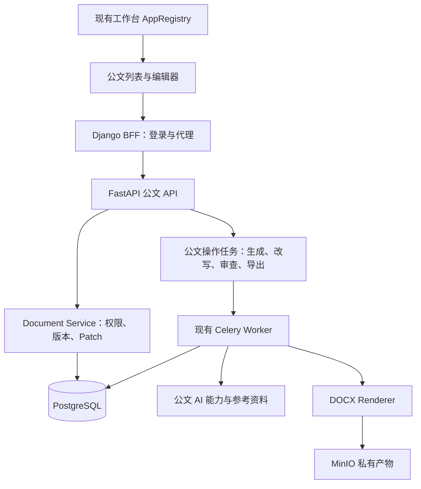

# AI 公文工作台改造方案

日期：2026-09-05。状态：proposed。本文保留原设计与验收目标；已实施范围、验证结果及限制见 [公文工作台使用与部署说明](./official-document-workspace-guide-2026-09-05.md)。

依据：[《改造公文写作》会话](chatgpt-conversation://6a9af54b-6ffc-83e8-8fbf-f91b6da98034)开头的公文列表、编辑器、AI 追问三张参考图，以及当前工作区代码。会话后半段的桌面方案已单独落地，本方案承接现有工作台。

## 1. 目标与交付范围

将公文写作升级为独立业务应用：用户从工作台打开“公文写作”，创建文档，在同一个页面完成 AI 起草、人工编辑、对话修改、审查、版本恢复和 DOCX 导出。底层继续使用现有公文 Skill 与渲染能力，文档生命周期交给 Document Service 管理。

主流程：工作台 → 公文列表 → 新建需求 → 必要信息补全 → 生成初稿 → 编辑与 AI 修改 → 审查 → 保存版本 → 导出 Word。

| 首期必须交付 | 后续扩展 |
|---|---|
| 文档列表、搜索、文种筛选、新建、软删除 | 共享文件夹、组织级文档管理 |
| 在线结构化富文本编辑、自动保存、冲突保护 | 多人实时协同、复杂分页编辑 |
| AI 起草、追问、段落改写、修改预览与接受 | 多模型切换、复杂多 Agent 编排 |
| 结构化审查、定位问题、接受建议 | 正式审批流、公文流转和签章 |
| 历史版本查看与恢复、DOCX 导出 | 任意 DOCX 导入、PDF、复杂模板管理 |
| 工作台图标、独立路由、用户隔离 | 知识库选取、引用追溯、历史公文检索 |

建议通知、请示、函先作为完整验收文种；报告、总结、纪要等已有 Skill 能力保留，逐步补齐新工作台的文种规则与导出样例。

## 2. 当前代码核对与复用边界

以下是已检查的事实；后文接口和表名均为拟新增设计。

| 现状 | 代码位置 | 改造处理 |
|---|---|---|
| Skill 提供 write/review/check/guide，生成后立即渲染并上传 | `src/skills/official_document/service.py` | 抽出无文件副作用的生成能力；旧 handler 保留兼容包装 |
| 已有结构化公文模型，分节实际字段为 `heading`、`content` | `src/skills/official_document/schema.py` | 保留旧合同，新增带稳定块 ID 的工作台模型；不能照抄会话示例的 `title/paragraphs` |
| DOCX 优先结构化直排，docxtpl 作为回退 | `src/skills/official_document/render.py` | 复用渲染基础，增加工作台模型的段落及 run 渲染 |
| 页面尺寸、页边距、固定行距已有实现；通用 run 目前统一使用正文仿宋 16pt | `src/skills/official_document/docx_format.py` | 补充角色样式映射与导出验证，不能宣称现有渲染已完整覆盖标题字体和层级 |
| prompt 要求内容具体且禁止“XXX/待补充” | `service.py:generate_document_json_with_llm` | 增加事实缺失状态，避免因输出要求诱导模型补造信息 |
| `review_document` 返回自然语言；异常分支仍返回 `success=True` | `service.py:review_document` | 新审查使用结构化合同和真实失败状态；兼容入口同步修正异常语义并补回归 |
| 当前前端没有公文列表、编辑路由或富文本依赖 | `web/react_frontend/src/App.tsx`、`package.json` | 新增应用和编辑器 |
| 桌面已具备应用注册、布局保存和新增应用补位 | `src/apps/appRegistry.ts`、`components/desktop/desktopLayout.ts`（前端目录下） | 注册公文应用；图标需改成按 Registry 元数据渲染，当前 AppGlyph 仅区分巡检和规则 |
| Chat 已有会话存储和流式传输，但 ChatRequest 没有文档上下文 | `src/gateway/schemas.py`、`chat_context.py`、前端 `services/chatStream.ts` | 复用基础设施，新增受限的文档助手接口；不能直接嵌入整个 ChatPage |
| Django 承担 BFF/登录，业务数据主要由 SQLAlchemy/Alembic 管理 | `web/django_backend/bff/`、`src/infrastructure/db/models.py`、`migrations/env.py` | 公文业务表走业务 Alembic，与已迁移的 Django 桌面布局表分开 |
| 现有公文测试验证 DOCX 字节和同步 Skill 注册 | `tests/skills/test_official_document.py` | 补语义、编辑往返、权限、并发、真实排版检查 |

## 3. 页面与交互设计

### 3.1 工作台入口和路由

- App ID：`official-document`；名称：公文写作；提供独立文档图标。
- 规范路由：`/apps/official-documents`、`/apps/official-documents/new`、`/apps/official-documents/:documentId`。
- 原讨论中的 `/documents` 作为可选兼容别名；当前仓库并无既有公文路由，不做不存在的历史 URL 数据迁移。
- 复用现有 AppRegistry、BusinessRoute、用户布局补位机制；新应用放在首个空位，保留原图标和文件夹位置，不自动固定 Dock。
- 公文应用使用独立开关，不能让关闭工作台开关同时禁用公文业务。注册表、路由守卫与后端权限分别校验。
- 桌面保持已实现的 macOS 风格。公文编辑页使用安静的浅灰工作区与白纸，不把壁纸带入编辑区域。

### 3.2 列表页

顶部提供“新建公文”、标题搜索和文种/状态筛选。主体为文档列表，显示标题、文种、状态、最后修改时间；按最近修改排序，服务端分页。默认只显示当前用户的文档，不展示重复的“用户”列。

每行提供打开、重命名、移入回收站。空列表只保留创建入口。加载失败、无搜索结果与真正无文档分别呈现。软删除后支持恢复；首期不提供永久清空。

### 3.3 新建页

输入文种、写作需求、发文机关、主送对象及已知事实，标题可自动生成；同时提供“空白起草”。先创建可恢复的空草稿，再提交生成任务，生成失败也保留已填需求。

缺少会议时间、地点、发文单位等关键事实时，助手返回具体问题。用户可以补充，或选择“先起草，保留待确认信息”。后者在文档中使用明确的待确认标记，禁止把示例地点、预算、政策文号当成真实事实。

“明天”等相对时间按任务创建时间和用户时区解析，并展示解析结果。跨日重试沿用冻结的基准时间。用户明确要求演示内容时，可以生成样例，但必须标识为演示文档。

### 3.4 编辑页

页面分为顶部工具栏、中央纸张编辑区和右侧公文助手。编辑区占主要空间，助手建议宽 340–400px，可收起。手机端切换“文档 / 助手”，不强塞两列。

```text
← 公文列表   文档标题              保存状态   历史版本   导出 Word
────────────────────────────────────────────────────────────────
段落样式 · 加粗 · 下划线 · 撤销/重做       公文助手 / 审查
┌─────────────────────────────┐  ┌───────────────────────────┐
│          白色纸张           │  │ 已绑定当前文档和版本      │
│ 标题、主送、正文、落款      │  │ AI 建议及修改前后对比     │
│ 可直接编辑并选中段落       │  │ [接受修改] [放弃]         │
│                            │  │ 输入需求…                 │
└─────────────────────────────┘  └───────────────────────────┘
```

编辑器支持中文输入法、粘贴文字、段落层级、加粗/下划线、撤销重做、选中段落交给 AI。首期采用连续纸张视图和缩放，不承诺浏览器分页与 Word 完全一致；最终分页以导出文件为准。

可编辑的富文本能力必须有对应 DOCX 渲染。首期不开放任意 HTML、脚本、嵌入网页、图片、表格及任意字号字体；从 Word 粘贴时规范化为支持的文字与段落结构，提示不支持的格式被清理。

### 3.5 AI 修改、审查和历史

- “精简这一段”：绑定当前选区所属的块 ID，显示修改前后内容；用户接受后才写入文档。
- “把会议时间改成 15:00”：可跨多个块提出修改；有多个会议或目标不明确时先追问。
- “重新生成全文”：显式独立动作，先保存当前稿，生成候选全文，用户接受后产生新版本。
- 审查结果按问题展示：分类、严重程度、定位、说明、建议；不使用缺乏量化依据的“86 分”。
- 历史版本可查看、恢复；恢复是新增一个版本，历史快照保持不可变。
- 自动保存立即提供；历史浏览和审查功能在后续阶段开启，但版本数据从第一阶段就记录。

## 4. 技术架构与职责



Document Service 是文档唯一写入口。Skill 输出候选内容、修改建议或审查结果，不直接更新用户文档。导出只读取指定的已保存版本，不调用模型重新撰写。

业务能力放在拟新增 `src/core/official_documents/`，保持现有领域模块组织方式；API 放在 `src/gateway/official_documents_api.py`。数据库模型注册到既有 `Base.metadata`，迁移沿用 Alembic，避免 Django 和 SQLAlchemy 同时管理同一组表。

## 5. 文档模型：一个权威来源，两个适配方向

原讨论同时提出 OfficialDocumentJSON 和 EditorDocument，但没有解决双向同步和格式丢失。本方案明确：**服务端持久化的工作台语义文档是唯一权威来源；Tiptap JSON、纯文本与旧 Skill JSON 都是适配结果。**

拟新增 `WorkspaceDocumentV1`，保留公文语义并补齐块 ID、段落类型和有限行内样式。这里的 V1 是新工作台合同版本，不改变旧 `OfficialDocumentJSON` 的定义。

```json
{
  "schema_version": 1,
  "doc_type": "通知",
  "blocks": [
    {
      "id": "b-title",
      "role": "title",
      "runs": [{"text": "关于组织培训的通知", "marks": []}]
    },
    {
      "id": "b-time",
      "role": "body",
      "runs": [{"text": "会议于2026年9月6日15:00开始。", "marks": []}]
    }
  ],
  "unresolved_facts": []
}
```

此示例省略主送、落款等块。完整合同包括 issuer/title/main_recipient/opening/section_heading/body/closing/signature_org/signature_date 等角色；标题层级使用明确的 `level`。单例角色限制数量和顺序，普通正文可以有多个块。草稿允许必填事实为空；标记定稿和正式导出执行更严格校验。

- 块 ID 在编辑、排序、保存、AI 修改后保持稳定；拆段为新段生成新 ID，合段保留目标 ID，复制粘贴重新分配 ID。
- Tiptap 节点通过 attrs 保存角色和块 ID。前后端共享合同样例；禁止用 DOM 索引或“第 2 段”作为持久目标。
- `toEditorDocument / fromEditorDocument` 必须对支持的语义和样式实现无损往返。服务端再次校验大小、节点类型、样式白名单、唯一 ID 和结构。
- 旧 Skill JSON → 工作台模型：按真实的 `heading/content` 结构转换；正文换行确定性拆段，创建稳定 ID。
- 工作台模型 → 旧 JSON：只用于兼容旧消费者，明确不承载行内格式；不能把这条有损路径用于新编辑器保存或富文本导出。
- 新增 `render_workspace_document_bytes` 直接遍历新模型，复用页设置和样式基础，保留所有支持的 marks。原 `render_document_bytes` 保持服务旧 Skill。
- 文档标题列、plain_text 和搜索字段由服务端从快照派生，不能成为第二份独立正文。

## 6. 数据存储和并发合同

使用两张文档核心表，加一张可恢复操作表。操作表承载 AI 和导出任务，避免把任务状态藏在浏览器或聊天文字里。

| 表 | 主要字段 | 约束与用途 |
|---|---|---|
| `official_documents` | id、owner_id、title、document_type、status、revision、current_version、conversation_id、created_at、updated_at、deleted_at | 所有权索引；标题为投影；status 为 draft/finalized，不混用 AI 运行状态 |
| `official_document_versions` | id、document_id、version、schema_version、content_json、content_hash、plain_text、change_source、change_summary、created_by、created_at、request_id | `(document_id, version)` 唯一；不可变快照；source 区分 user/ai/restore |
| `official_document_operations` | id、document_id、owner_id、kind、base_revision、base_version、request_key、request_hash、status、input_json、result_json、error_code、worker_token、lease_expires_at、attempt、created_at、updated_at | kind 为 generate/rewrite/review/export；保存候选、审查和导出对象 key；幂等提交与恢复 |

owner_id 使用现有 CurrentUser 的字符串 ID，与业务会话同一身份来源。文档表与版本/操作表建立业务外键；不新增依赖 Django schema 的跨层用户外键。

### 保存与冲突

1. 停止输入约 1 秒后自动保存；同一文档串行提交，输入法组合中暂缓提交。手动保存、发起 AI 和导出前等待当前保存完成。
2. 请求携带 `base_revision` 和幂等 request_id；服务端在事务中校验 revision、插入快照并更新当前指针。相同内容不重复创建版本。
3. 所有文档修改，包括重命名、状态变更、删除、恢复和接受 AI 修改，均检查 revision；内容提交同时增加 version，纯生命周期变更不伪造正文版本。
4. 收到 409 时停止自动覆盖，保留本地稿，提供加载服务端版本或另存本地稿。网络失败显示“未同步”，不能显示“已保存”。
5. 本地草稿按用户和文档隔离，切换账号清理内存及旧账号缓存；普通路由离开提示未保存内容，不能依赖页面关闭时的异步网络请求。
6. 首期每次实际内容保存形成快照，历史 UI 将连续自动保存折叠显示；先监测体积，后续再设计保留策略，不提前丢弃历史数据。

### 操作恢复与幂等

任务状态：queued → running → needs_input / proposed / completed / failed / cancelled。proposed 表示候选已生成，尚未修改文档。审查结果和导出可直接 completed；接受候选另走文档事务。

提交先持久化 operation，再派发既有 Celery；使用 operation 记录作为待派发表，由定时补偿扫描恢复“已入库未入队”的任务。worker 通过原子 claim、租约和 worker_token 防止旧 worker 回写；重复投递只认同一 operation 的最终结果。失败可显式重试，模型调用超时产生的费用不承诺 exactly-once。

SSE 断开只停止前端订阅，不代表取消任务。刷新后按 operation_id 查询最终状态，必要时轮询兜底。显式取消标记任务，迟到结果不得再应用；软删除文档同时阻止所有迟到写入。

## 7. AI 助手与 Patch

每篇文档绑定一个专属会话，服务器校验文档和会话归属，不接受浏览器传入任意 thread_id 作为写入依据。复用现有 conversation/message 存储与消息展示组件，文档会话在普通聊天历史中隔离，避免污染通用 Chat 的当前会话状态。

首期新增专用文档助手 API，直接调用公文能力服务。抽取并复用 SSE 解析/认证传输层，不复制整个 ChatPage，也不让文档编辑请求经过可执行任意运维 Skill 的通用路由。以后若从普通 Chat 打开或编辑文档，必须通过同一个 Document Service。

助手请求携带 action、instruction、document_id、base_revision、选中的 block_ids；服务端加载已保存快照。模型输出仅允许：clarification、proposal、review、answer 四种结构。

Patch 示例：

```json
{
  "document_id": "doc-123",
  "base_revision": 12,
  "operations": [{
    "op": "replace_block",
    "block_id": "b-time",
    "expected_hash": "原块内容摘要",
    "value": {
      "role": "body",
      "runs": [{"text": "会议于2026年9月6日15:00开始。", "marks": []}]
    }
  }]
}
```

首期允许 replace_block、insert_after、delete_block 和受控 metadata 更新；禁止任意 JSONPath、文件路径或代码执行。模型返回的新增块 ID 由服务端生成或校验。块内容摘要由服务端针对冻结快照补齐并验证，不能信任模型自报摘要。

应用流程：保存当前稿 → 冻结版本 → AI 生成候选 → 展示修改前后 → 用户接受 → 校验权限、revision、块摘要和完整文档结构 → 单事务保存新版本。

AI 运行期间用户可以继续编辑。接受时如果本地还有未保存修改，先保存；如果 revision 已变化，候选标为过期并允许按新稿重试，不自动覆盖或静默合并。只传回的目标块发生变化，其他块应保持字节级内容一致。重复点击接受通过幂等键返回同一结果。

首次“生成初稿”可在文档仍为空且 revision 未变化时自动写入；任何已有人工作品的全文生成都作为候选处理。首期选中部分文字可定位到所属段落并显示整段改写预览，跨段和字符级精确替换后续再扩展。

## 8. 审查、导出和知识来源

### 审查

结果包含 base_version、ruleset_version 和 issues。每个问题包含 id、block_id、category、severity、message、suggestion 和可选 patch；区分本地确定性校验与 AI 语言建议。文档改变后旧审查显示“基于旧版本”，不继续显示为当前通过。

首期检查结构缺项、日期格式、文种用语、段落层次、重复或矛盾表达、待确认事实。政策依据无法核实时明确标记，不能把语言审查描述为法律合规认证。审查失败必须显示失败及可重试状态，不能返回成功占位意见。

### 导出

- 请求指定已保存 version。对象 key 包含 owner/document/version/content_hash/render_version，避免覆盖旧文件和缓存错误。
- 渲染和 MinIO 上传成功后才能标记 completed；数据库仅保存 object key、内容摘要及渲染版本，下载 URL 按需生成。
- 下载前重新验证当前用户与文档归属；通过公文下载接口代理私有对象，不把旧通用签名下载接口直接当成文档授权接口。
- 未确认事实可以导出带明确标记的草稿；定稿与正式导出必须先补齐阻断项。
- 字体、层级、行距、缩进、段落换行、中文长标题和跨页实际渲染纳入验收。优先沿用仓库现有页面尺寸与页边距配置；具体规范映射需单独核对，不以“看起来像 A4”宣称标准合规。
- 前端和服务器列出可用字体及替代规则；不擅自打包未获授权的字体。

### 知识库

首期只使用现有 Skill 中随包维护的文种指导资料，记录资料版本。组织知识库选择、上传参考材料、历史公文检索在第四阶段实现，届时校验检索权限，并保存引用来源 ID、版本、引用片段和定位；参考材料只提供内容，不授予执行指令权限。首期界面不摆放不可用的知识库选择控件。

## 9. 拟新增 API

浏览器统一调用 Django `/api/official-documents/…/`；BFF 映射 FastAPI `/api/v1/official-documents/…`，保留现有认证、request_id 与错误信封。

| 浏览器方法与相对路径 | 功能与关键合同 |
|---|---|
| GET `/` | 当前用户列表；q/doc_type/status/offset/limit，默认不含已删除 |
| POST `/` | 创建空白/需求草稿，返回 id、revision、version；幂等键 |
| GET `/{id}/` | 当前文档及活动任务摘要 |
| PUT `/{id}/content/` | 保存规范化内容，携带 base_revision/request_id |
| PATCH `/{id}/` | 重命名/定稿/重新编辑；revision 校验 |
| DELETE `/{id}/` | 软删除，revision 条件 |
| POST `/{id}/undelete/` | 恢复软删除文档，revision 条件 |
| GET `/{id}/versions/`、GET `/{id}/versions/{v}/` | 历史列表及快照 |
| POST `/{id}/restore/` | 指定历史 v，创建新版本；base_revision |
| GET `/{id}/messages/` | 仅该文档的助手历史 |
| POST `/{id}/assistant/` | generate/rewrite/review/answer，返回 202 与 operation_id |
| POST `/{id}/operations/{op}/answers/` | 补充澄清信息；原任务继续或生成明确关联的重试 |
| GET `/{id}/operations/{op}/`、GET `/{id}/operations/{op}/events/` | 状态/结果查询与 SSE；断流后可查持久状态 |
| POST `/{id}/operations/{op}/apply/` | 接受候选；也支持指定审查 issue_id；revision+幂等 |
| POST `/{id}/operations/{op}/cancel/` | 显式取消 |
| POST `/{id}/exports/` | 为指定 version 创建可恢复导出任务 |
| GET `/{id}/exports/{op}/download/` | 校验所有权及导出归属后下载 |

所有嵌套资源必须同时匹配 document_id 与资源 ID。owner_id 来自已验证身份，不允许客户端设定或修改。首期以本人读写为默认，角色门禁复用现有规则，管理员也不自动获得其他人的正文。不存在与无权访问统一按项目约定处理，避免通过版本/下载接口绕过列表隔离。

## 10. 文件级实施清单

| 新增/修改位置 | 工作内容 |
|---|---|
| `src/core/official_documents/{schemas,repository,service}.py` | 工作台内容合同、保存事务、归属、状态与版本 |
| `src/core/official_documents/{patches,adapters}.py` | 稳定块定位、Patch 校验、旧 JSON 转换 |
| `src/core/official_documents/{ai_service,operations,tasks}.py` | 澄清/候选/审查、持久化任务、租约与派发补偿 |
| `src/core/official_documents/export_service.py` | 指定版本导出、对象 key 与下载授权 |
| `src/infrastructure/db/models.py`、`migrations/versions/` | 三张业务表；基于实施时真实 Alembic head 新建迁移，不预设 revision 编号 |
| `src/gateway/official_documents_api.py`、`src/gateway/main.py` | 新领域 API、认证依赖、路由注册 |
| `web/django_backend/bff/views/official_documents.py`、`bff/urls.py` | 鉴权代理、流式响应和下载代理 |
| `src/core/celery_tasks/celery_app.py`、部署 worker 配置 | 注册任务、路由至现有 AI 队列并验证 worker 订阅；导出依赖随对应 worker 镜像安装 |
| `src/skills/official_document/{service,render,docx_format}.py` | 纯生成能力抽取、真实错误状态、工作台渲染函数与角色样式；保持旧 handler 合同 |
| `src/gateway/conversation_service.py` 及必要的会话查询位置 | 专属会话绑定、隔离通用历史；不复用全局当前聊天状态 |
| 前端 `pages/OfficialDocument{List,Create,Editor}Page.tsx` | 三个独立路由页面 |
| 前端 `components/documents/` | Editor、Toolbar、Assistant、PatchPreview、ReviewPanel、HistoryDrawer、CreateForm |
| 前端 `components/documents/editor/` | Tiptap 节点扩展、块 ID、语义转换、样式和粘贴规范化 |
| 前端 `services/officialDocumentApi.ts`、`hooks/useDocumentSession.ts` | 请求、自动保存、冲突、任务订阅与销毁 |
| 前端 `services/chatStream.ts` | 抽取通用 SSE 解析/认证 fetch，可保留原函数包装，避免影响普通聊天 |
| 前端 `apps/appRegistry.ts`、`appRoutes.ts`、`DesktopCanvas.tsx`、`App.tsx` | 注册公文应用、图标元数据渲染、独立开关及路由 |

编辑器实例与选区由 Tiptap 管理；React Query 管理服务端数据；文档会话 hook 管理未保存标记和请求序列。确有跨组件需要时再使用独立 Zustand store，不让 React Query、Zustand 和编辑器同时持有可独立修改的三份正文。

## 11. 编辑器选型

采用 Tiptap 作为编辑器候选。官方 React 接入文档使用 React/Vite，并列出 `@tiptap/react`、`@tiptap/pm` 和 `@tiptap/starter-kit`；实施时在当前 React 18、StrictMode 和构建配置下做最小验证，再锁定兼容版本，不先升级整个 React 栈。[官方 React 接入说明](https://tiptap.dev/docs/editor/getting-started/install/react)

扩展按最小能力清单配置。当前 3.x StarterKit 已包含 Underline，不能照抄原讨论再重复注册下划线扩展。关闭未支持的节点；文档角色、块 ID 与 DOCX 映射由应用实现。首期不依赖其云端 AI、协同、分页或版本服务。[官方 StarterKit 清单](https://tiptap.dev/docs/editor/extensions/functionality/starterkit)

## 12. 分阶段实施与验收

估算为单名熟悉仓库的工程师的有效工作日，包含联调；不含组织模板确认、字体采购和真实模型环境等待。P0 后根据编辑器与渲染验证结果修正，不把估算当固定交付日期。

| 阶段 | 预估 | 交付与放行条件 |
|---|---:|---|
| P0：合同与技术验证 | 2–3 天 | 冻结工作台模型；通知/请示/函样例；Tiptap 中文输入、块 ID、往返转换、Word 导出证明可行 |
| P1：基础文档闭环 | 4–6 天 | 列表、新建空白、编辑、保存、权限隔离、版本快照、指定版本导出；迁移和持久任务基础可用 |
| P2：AI 起草与修改 | 4–6 天 | 专属会话、澄清、生成候选、段落 Patch、接受/放弃、断流恢复、旧版本保护；形成可试用 MVP |
| P3：审查与版本体验 | 3–4 天 | 结构化审查、定位和建议接受、历史查看与恢复、定稿规则；完成首期业务目标 |
| P4：知识库与模板扩展 | 单独估算 | 权限检索、来源追溯、组织模板；审批/协同另立方案 |

P0–P3 合计约 13–19 个有效工作日。首期交付指 P3 完成，P2 仅作为提前试用节点。

关键验收用例：

1. 创建、编辑、刷新、重新登录后标题、正文、样式与版本一致，输入法不丢字，粘贴不破坏文档结构。
2. 连续编辑、撤销重做、拆段合段后块 ID 合同正确；支持的语义和格式可无损往返。
3. 两个页面并发保存，后提交旧版本的一方收到冲突，不丢失本地稿。
4. 缺关键事实时先追问；选择先起草时明确待确认信息；跨日重试不改变原时间语义。
5. AI 只改选定块；用户在 AI 运行时继续修改，旧候选无法覆盖新稿。
6. 重复提交、重复队列消息、重复点击接受不会产生重复最终应用；刷新和断流可以恢复任务状态。
7. 审查错误如实显示；审查结果可定位且随文档版本过期；接受建议生成新快照。
8. 恢复旧版本产生新版本；取消任务、删除文档后迟到结果不会回写。
9. 账号 B 无法通过文档、版本、会话、操作、SSE 或下载 ID 访问账号 A 的内容。
10. 指定版本导出不混入后续编辑；MinIO/渲染失败不返回成功；检验 DOCX 正文、段落、run、样式，并渲染查看多页中文样例。
11. 1440、1280、768、390 宽度下可编辑、调用助手、处理冲突和下载；键盘可进入工具栏与编辑器。
12. 旧聊天公文 Skill 仍可生成和下载；巡检与巡检规则应用、原工作台布局不受影响。

## 13. 发布、兼容与回退

先上线新增数据表和兼容 API，再部署任务 worker 和新前端，最后启用公文应用开关。迁移前检查 Alembic head、计划和目标环境；这次公文业务迁移与已完成的 `bff.0001_desktop_preference` 无关。

旧聊天生成的 DOCX 不自动批量导入。后续可为有完整 document_json 的历史产物提供显式“保存到公文工作台”，记录来源并做幂等；仅有 DOCX 文件的导入单独设计，不能靠文件名猜测内容。

回退关闭新增入口与任务提交，保留文档、版本和产物数据。已完成的旧 Skill 合同继续可用；不通过删除表来回退。若编辑器 schema 后续升级，要有可读旧快照的适配器，不能让升级后的内容被旧客户端静默改写。

本方案记录设计阶段的实施边界与验收目标。用户确认 UI 后已开始实施，当前交付状态以使用与部署说明为准。
