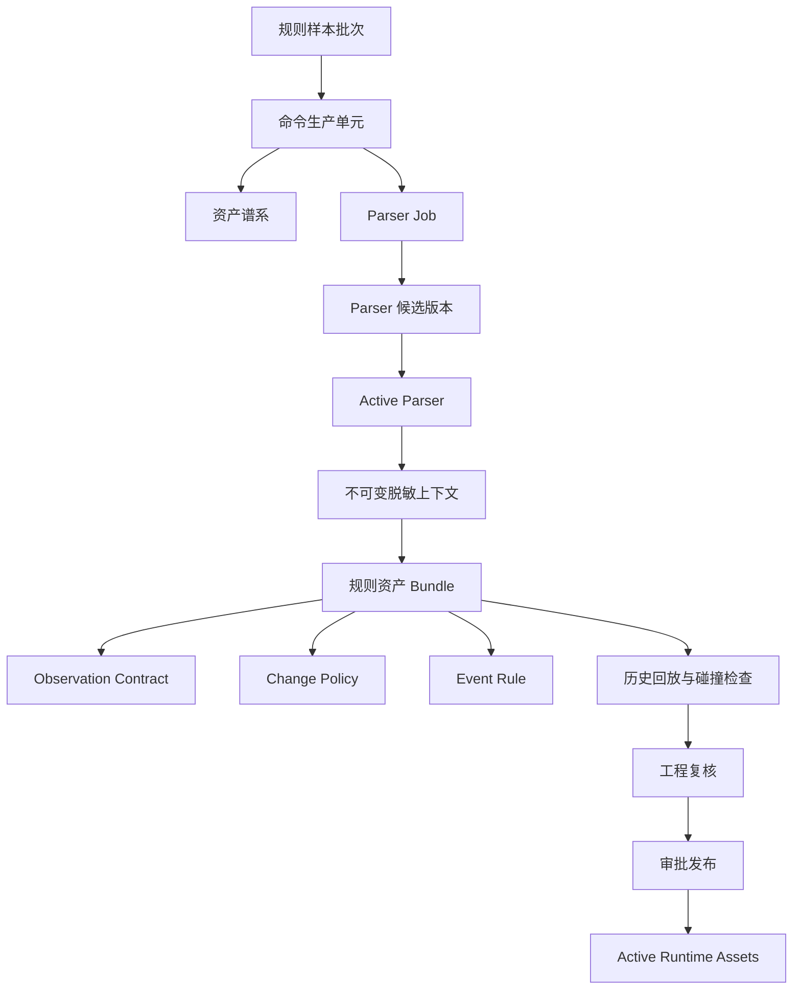
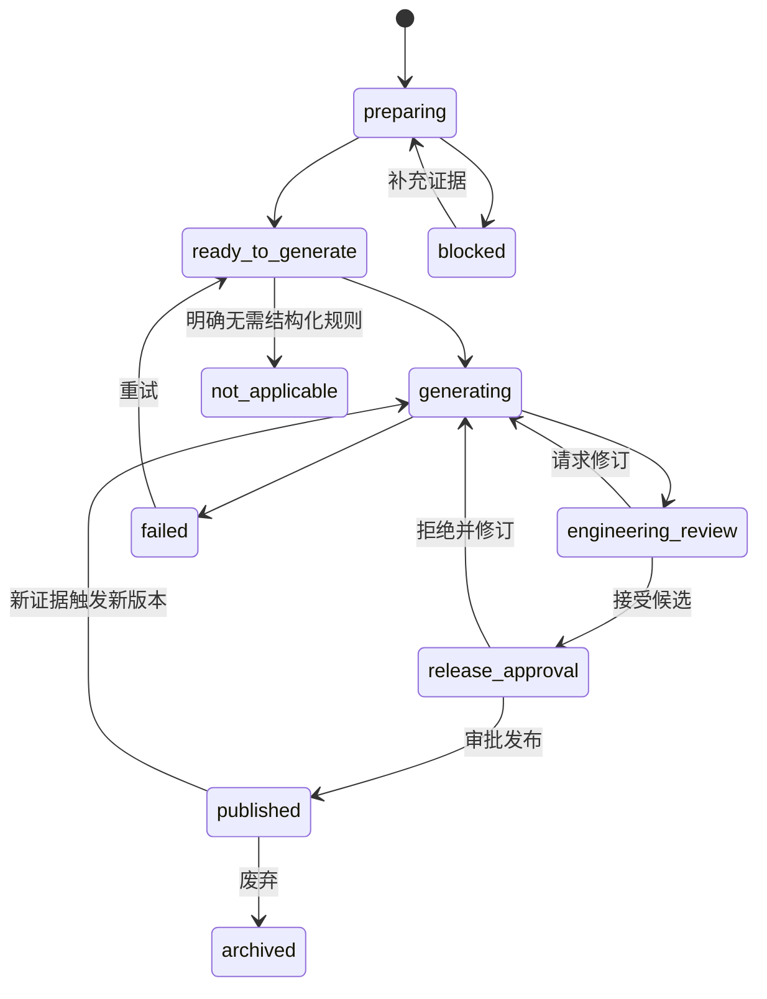

# 巡检规则资产控制面最终详细设计

<!-- document-status: superseded -->
> **历史文档，已被取代。** “最终”与“Implemented Baseline”只代表当时设计，不代表当前产品完成状态。
> 当前权威方案见[检查项中心的巡检与规则资产平台总体改造方案](check-item-centered-patrol-platform-remediation-2026-07-27.md)。

> 文档状态：Implemented Baseline  
> 版本：1.2  
> 日期：2026-07-24  
> 适用范围：`Skills -> /skills/parser`  
> 目标读者：产品负责人、前端工程师、后端工程师、测试工程师、规则工程师、平台管理员

---

## 1. 文档结论

当前页面名为“Parser 控制面”，但实际已经同时管理：

- 离线规则样本导入；
- TextFSM Parser 生成、验证与审批；
- Observation Contract；
- Change Policy；
- Event Rule；
- 历史回放、工程复核、发布和回滚；
- 运行时覆盖、历史回填和审计。

继续以 Parser 作为页面中心会导致产品心智与实际功能不一致。因此，本设计将页面正式定义为：

```text
巡检规则资产
```

核心业务对象不是后台 Job、模板表或审批表，而是：

```text
命令规则资产单元
```

每个命令规则资产单元表示一个经过治理的适用范围：

```text
vendor + compatible_profile + canonical_command
```

并承载以下完整资产链：

```text
离线样本证据
-> 命令切片与身份归组
-> TextFSM Parser
-> Observation Contract
-> Change Policy
-> Event Rule
-> 确定性验证与历史回放
-> 工程复核
-> 审批发布
```

最终页面只保留四个一级工作区：

1. 生产工作台；
2. 已发布资产；
3. 覆盖与回填；
4. 审计记录。

命令别名、身份规则、设备档案、采集命令集和调度开关归入“基础配置”，不再占用一级导航。

---

## 2. 背景与现状问题

### 2.1 当前实现

当前 `/skills/parser` 包含七个一级工作区：

```text
资产生产
待处理
资产目录
生成与验证
审批发布
生产覆盖
审计记录
```

其下继续分为二十余个二级资源页面，包括：

- 规则资产生成；
- 统一待办；
- Parser 任务队列；
- 历史回填；
- 模板资产；
- 命令别名；
- 身份规则；
- 设备档案；
- 采集命令集；
- 数据契约；
- 变化策略；
- 事件规则；
- 规则缺口；
- 规则生成任务；
- Agent 尝试；
- 数据集；
- 规则资产包；
- 回放报告；
- 资产链健康；
- 运行时资产健康；
- 审批审计。

这些页面分别对应后台表、任务或服务模块，而不是用户完成工作的自然步骤。

### 2.2 主要问题

#### 2.2.1 导航按系统模块组织

用户需要理解 Parser Job、RuleGenerationJob、Bundle、Backfill 和 Runtime Resolver 的区别，才能判断下一步应该进入哪个页签。

#### 2.2.2 同一资产生命周期被拆散

一次 TextFSM 生成需要在“资产生产”“任务队列”“模板资产”和“审批发布”之间跳转。规则资产还需要继续进入“生成与验证”和“规则资产包”。

#### 2.2.3 Job、资产、版本三个概念混在一起

- Job 是一次执行；
- 资产是生产结果；
- 版本是资产生命周期中的不可变快照。

当前 UI 经常把三者都显示为“任务”或“资产”，用户无法快速判断自己正在处理什么。

#### 2.2.4 状态直接暴露后台枚举

页面混用：

```text
collecting / pending / running / validating / succeeded
draft / pending_approval / active / rejected / deprecated
ready / needs_review / blocked / completed
```

这些状态分别属于不同模型，不能直接作为统一筛选条件。

#### 2.2.5 命令级生产单元被隐藏

现有后端已经实现十阶段 `RuleAssetCommandUnitRecord` 投影，前端也已经能够展示 Parser、Contract、Policy、Event 四类资产状态，但该能力只出现在离线任务详情中，没有成为控制面的主工作对象。

---

## 3. 项目目标与非目标

### 3.1 项目目标

1. 用户从导入离线规则样本开始，无需理解后台模块即可完成规则发布。
2. TextFSM 的生成、修正、验证、审批在同一命令资产详情页完成。
3. Observation Contract、Change Policy、Event Rule 使用同一套治理状态和工作流。
4. 每个命令资产单元只展示一个明确的下一步主操作。
5. 工程师能够查看并修正 LLM 生成的候选，而不是只能接受或拒绝。
6. 未经验证和审批的候选不得影响生产巡检。
7. 一万条生产记录下仍能通过服务端分页、筛选和搜索稳定操作。
8. 保留版本、回滚、审计、历史回填和运行时覆盖能力。
9. 保持与平台现有 Agent 工作台风格一致：安静、紧凑、面向重复操作。

### 3.2 非目标

本次不做以下改造：

- 不合并设备页的“离线巡检”和规则资产样本导入；
- 不允许正式巡检自动创建规则生成任务；
- 不允许 LLM 直接发布生产资产；
- 不重写 Simple Parser Pipeline v2；
- 不删除手工内置 Parser/Rule Provider 接口；
- 不改变巡检运行时只读取 active 资产的原则；
- 不把原始 CLI 发送到 Contract、Policy、Event Rule 的 LLM 上下文；
- 不在本页面生成甲方网络现状巡检报告。

---

## 4. 产品边界

### 4.1 巡检链路

入口：

```text
设备管理 -> 巡检运行
```

职责：

- 在线巡检；
- 离线历史巡检；
- 消费 active Parser 和 active Rule Asset；
- 生成 State、Change、Event 和正式巡检报告；
- 不创建或修改规则资产。

### 4.2 规则资产生产链路

入口：

```text
Skills -> 巡检规则资产
```

职责：

- 导入离线 CLI 作为规则生产证据；
- 生成和验证 Parser；
- 生成和验证 Contract、Policy、Event Rule；
- 工程修订、历史回放、碰撞检查；
- 审批、发布、回滚和审计；
- 只输出资产验证报告，不输出网络现状报告。

### 4.3 UI 文案边界

设备巡检页使用：

```text
导入离线巡检
巡检报告
变化数据
事件数据
```

规则资产页使用：

```text
导入规则样本
资产验证报告
历史回放
候选规则
```

两个入口可以复用底层上传、文件存储和 CLI 切片能力，但必须使用不同的 `purpose`、路由和页面文案。

---

## 5. 用户角色与权限

### 5.1 产品角色

| 产品角色 | 当前角色映射 | 主要权限 |
|---|---|---|
| 查看者 | `user` | 查看工作台、资产、验证报告和审计 |
| 规则工程师 | `operator` | 导入样本、配置 ParserSpec、生成、修订、验证、提交复核 |
| 发布审批人 | `admin` | 审批发布、拒绝、回滚、废弃、修改基础配置 |
| 平台管理员 | `admin` | 调度开关、权限、基础配置和应急内置资产 |

### 5.2 职责分离

默认规则：

- 规则工程师可以生成和修订候选；
- 发布审批人可以审批或拒绝；
- 候选创建人不得审批自己创建的版本；
- 管理员紧急绕过职责分离时必须填写原因，并产生高风险审计事件；
- 查看原始 CLI 需要 `operator` 或 `admin`；
- 普通查看者只能查看脱敏摘要和结构化结果。

### 5.3 权限矩阵

| 操作 | user | operator | admin |
|---|---:|---:|---:|
| 查看生产工作台 | 是 | 是 | 是 |
| 查看原始样本 | 否 | 是 | 是 |
| 导入规则样本 | 否 | 是 | 是 |
| 编辑 ParserSpec | 否 | 是 | 是 |
| 生成 Parser/Rule | 否 | 是 | 是 |
| 提交工程复核 | 否 | 是 | 是 |
| 接受工程复核 | 否 | 是 | 是 |
| 审批发布 | 否 | 否 | 是 |
| 拒绝/回滚/废弃 | 否 | 否 | 是 |
| 历史回填提交 | 否 | 否 | 是 |
| 修改基础配置 | 否 | 否 | 是 |

---

## 6. 核心领域模型

### 6.1 领域对象

#### 6.1.1 规则样本批次 `AssetSourceJob`

一次离线样本导入任务，负责：

- 文件上传；
- 样本周期；
- 设备识别；
- 命令切片；
- 数据集与 PatrolRun；
- 形成命令级生产单元。

当前实现：

```text
OfflinePatrolJobRecord(purpose=rule_asset_source)
```

#### 6.1.2 命令生产单元 `CommandAssetUnit`

某次样本批次中，一个兼容范围和规范命令的生产实例。

当前实现：

```text
RuleAssetCommandUnitRecord
```

它是可重建读模型，不是 Parser、Contract、Policy 或 Rule 的权威存储。

#### 6.1.3 资产谱系 `AssetLine`

跨样本批次稳定标识同一套命令资产版本历史：

```text
asset_key = sha256(
  normalize(vendor)
  + "|"
  + normalize(compatible_profile)
  + "|"
  + normalize(canonical_command)
)
```

说明：

- 同一命令在不同厂家下必须是不同资产谱系；
- 同一厂家下，未证明兼容的型号必须使用不同 Profile；
- 多个型号只有在同一 Parser/Profile 已通过全部样本验证时才能共享谱系；
- `output_signature` 是同一谱系内的输出结构变体证据，不直接成为资产主键；
- 如果一个模板无法覆盖全部结构变体，必须拆分兼容 Profile，而不是静默丢弃样本。

#### 6.1.4 Parser 任务与版本

```text
ParserTemplateJob
ParserJobSample
ParserGenerationAttempt
ParserTemplate
```

职责：

- ParserSpec；
- generation/acceptance/negative 样本；
- 确定性编译与最多三次 DeepSeek thinking 工具调用；
- 七项硬门禁；
- 候选版本、审批和回滚。

#### 6.1.5 规则资产包

```text
RuleGenerationContextRecord
RuleGenerationJobRecord
RuleAssetBundle
ObservationContractRecord
ChangePolicyRecord
EventRuleVersionRecord
```

一套可发布 Bundle 至少包含：

- 1 个 Observation Contract；
- 根据生产模式需要的 Change Policy；
- 根据生产模式需要的 Event Rule；
- 不可变脱敏上下文；
- 确定性验证报告；
- 历史回放报告；
- 工程复核结论。

### 6.2 对象关系



### 6.3 生产模式

| 模式 | Parser | Contract | Policy | Event Rule |
|---|---:|---:|---:|---:|
| `full_chain` | 必需 | 必需 | 必需 | 必需 |
| `observation_only` | 必需 | 必需 | 跳过 | 跳过 |
| `change_only` | 必需 | 必需 | 必需 | 跳过 |
| `raw_hash` | 跳过 | 跳过 | 内置原始哈希策略 | 按策略决定 |
| `ignored` | 跳过 | 跳过 | 跳过 | 跳过 |

生产模式来自显式 Command Policy，不允许由 LLM 自行决定。

---

## 7. 信息架构

### 7.1 页面名称

Skills 顶部页签：

```text
Parser 控制面
```

修改为：

```text
巡检规则资产
```

为兼容旧收藏和深链，路由继续使用：

```text
/skills/parser
```

### 7.2 一级导航

| 一级工作区 | 默认子视图 | 内容 |
|---|---|---|
| 生产工作台 | 命令资产 | 样本导入、生成、复核、审批 |
| 已发布资产 | 生产资产目录 | Active Parser、Contract、Policy、Event |
| 覆盖与回填 | 覆盖健康 | Effective Plan 覆盖、运行时完整性、历史回填 |
| 审计记录 | 操作审计 | 生成、修订、审批、发布、回滚 |

### 7.3 基础配置

页面右上角齿轮菜单进入：

```text
/skills/parser/settings
```

内容：

- 命令别名；
- 设备身份规则；
- 设备兼容 Profile；
- 采集命令集；
- Command Profile 绑定；
- Parser 自动调度开关；
- TextFSM 方言审计；
- 内置资产应急入口。

基础配置不出现在普通用户一级导航中。

### 7.4 当前路由设计

当前版本继续使用稳定的 `workspace/subtab` 深链，避免破坏历史收藏、任务通知和跨页面定位：

| 路由 | 页面 |
|---|---|
| `/skills/parser?workspace=production&subtab=asset-production-units` | 生产工作台 / 命令资产 |
| `/skills/parser?workspace=production&subtab=source-jobs` | 生产工作台 / 样本批次 |
| `/skills/parser?workspace=inventory&subtab=published-assets` | 已发布资产 |
| `/skills/parser?workspace=runtime&subtab=coverage-backfill` | 覆盖与回填 |
| `/skills/parser?workspace=audit&subtab=audit-log` | 审计记录 |

旧 `templates/contracts/policies/event-rules/asset-chain/runtime-assets/approval-audit`
等子视图由兼容解析层映射到上述产品页面，并保留 `focus/id/source_job_id`
等定位上下文。独立资源路由和设置页作为后续增强，不阻断当前产品工作流。

---

## 8. 统一治理状态

### 8.1 产品状态

| 状态码 | 页面名称 | 定义 |
|---|---|---|
| `preparing` | 资料准备中 | 正在上传、切片、识别、脱敏或确认样本 |
| `ready_to_generate` | 待生成 | 前置条件满足，等待生成 Parser 或规则 |
| `generating` | 生成验证中 | 正在生成、修复或执行确定性验证 |
| `engineering_review` | 待工程复核 | 候选已形成，需要工程师核对或修订 |
| `release_approval` | 待发布审批 | 工程复核和回放均通过，等待审批人发布 |
| `published` | 已发布 | 当前生产模式要求的资产均已 active |
| `not_applicable` | 无需规则 | 命令被明确归类为原文留痕、忽略或其他无需结构化规则的模式 |
| `blocked` | 已阻断 | 前置资产、样本、隐私或验证门禁不满足 |
| `failed` | 生成失败 | 执行异常，允许查看诊断和重试 |
| `archived` | 已归档 | 被替代、拒绝、取消、废弃或历史完成 |

### 8.2 顶部筛选桶

顶部不直接展示技术状态，而使用六个面向治理结果的筛选：

| 筛选 | 包含状态 |
|---|---|
| 待处理 | `preparing`、`ready_to_generate` |
| 进行中 | `generating` |
| 待审批 | `engineering_review`、`release_approval` |
| 已发布 | `published` |
| 无需规则 | `not_applicable` |
| 异常 | `blocked`、`failed` |

“全部”作为默认额外选项。

### 8.3 后端状态映射

| 来源 | 原始状态 | 产品状态 |
|---|---|---|
| Source Job | `draft/uploading/previewing` | `preparing` |
| Source Job | `ready` | `ready_to_generate` |
| Source Job | `queued/running` | `generating` |
| Parser Job | `collecting` | `preparing` |
| Parser Job | `pending` | `ready_to_generate` |
| Parser Job | `running/validating` | `generating` |
| Parser Job | `succeeded` 且候选待检查 | `engineering_review` |
| Parser Template | `pending_approval` | `release_approval` |
| Parser Template | `active` | 继续检查后续资产 |
| Rule Job | `draft` 且上下文未就绪 | `preparing` |
| Rule Job | `draft` 且上下文就绪 | `ready_to_generate` |
| Rule Job | `validating` | `generating` |
| Bundle | 工程复核未完成 | `engineering_review` |
| Bundle | `release_ready=true` | `release_approval` |
| Required Assets | 全部 `active` | `published` |
| Command Policy | `raw_hash_diff/ignored` 且生产单元完成 | `not_applicable` |
| 任一阶段 | `blocked` | `blocked` |
| 任一执行 | `failed` | `failed` |
| 历史版本 | `rejected/deprecated/superseded/cancelled` | `archived` |

映射必须由后端生产投影统一计算，前端不得分别猜测多个资源的状态。

### 8.4 状态转换



---

## 9. 生产工作台详细设计

### 9.1 页面目标

生产工作台回答三个问题：

1. 哪些命令规则资产需要处理？
2. 当前卡在哪一步？
3. 我现在应该做什么？

### 9.2 页面结构

```text
巡检规则资产
从离线样本生成、验证和发布巡检解析与事件规则

[导入规则样本]                              [刷新] [基础配置]

需要处理 12    生成验证中 4    待审批 3    已发布 128    无需规则 16    异常 2

[命令资产] [样本批次]

[全部] [待处理] [进行中] [待审批] [已发布] [无需规则] [异常]

[搜索命令/厂家/型号] [当前阶段] [厂家] [Profile] [资产模式] [更多筛选]

命令与适用范围 | 样本证据 | 规则资产链 | 当前状态 | 更新时间 | 操作
```

### 9.3 顶部指标

指标只统计当前用户有权访问的未归档生产单元。

| 指标 | 定义 |
|---|---|
| 需要处理 | `preparing + ready_to_generate` |
| 生成验证中 | `generating` |
| 待审批 | `engineering_review + release_approval` |
| 已发布 | `published` |
| 无需规则 | `not_applicable` |
| 异常 | `blocked + failed` |

指标可点击，点击后同步更新 URL 和列表筛选。

不再在首屏展示：

- 模板总数；
- Active 模板数；
- 待脱敏样本数；
- Agent Loop 数量；
- 失败回填数。

这些指标分别进入已发布资产、覆盖与回填或审计页面。

### 9.4 主列表

默认服务端分页：

```text
page_size=25
```

允许：

```text
25 / 50 / 100
```

默认排序：

```text
action_priority DESC,
updated_at DESC,
unit_id DESC
```

#### 9.4.1 表格列

| 列 | 建议宽度 | 内容 |
|---|---:|---|
| 命令与适用范围 | 300 | 规范命令、厂家、Profile、已验证型号 |
| 样本证据 | 170 | 样本数、设备数、输出签名数、周期数 |
| 规则资产链 | 320 | Parser、Contract、Policy、Event 四段状态 |
| 当前状态 | 220 | 产品状态、当前阶段、进度、阻断数 |
| 更新时间 | 150 | 相对时间，悬停显示精确时间 |
| 操作 | 132 | 唯一主操作、更多菜单 |

桌面表格最小宽度：

```text
1294px
```

窄屏允许横向滚动，但操作列不固定在遮挡内容的位置。

#### 9.4.2 命令与适用范围

显示格式：

```text
display transceiver diagnosis interface
H3C · Profile Comware7-transceiver
已验证：S5130S-54S-HI-G / S6850-56HF
```

若 Profile 与单一型号相同：

```text
H3C · S5130S-54S-HI-G
```

#### 9.4.3 规则资产链

```text
Parser      已验证
Contract    待复核
Policy      未开始
Event       未开始
```

每个组件状态只允许：

```text
未开始 / 待生成 / 生成中 / 待复核 / 待发布 / 已发布 / 已阻断 / 不适用
```

组件标签可点击，进入详情页对应阶段。

#### 9.4.4 主操作

主操作由后端 `next_action` 决定，只能有一个：

| 当前条件 | 主操作 |
|---|---|
| 样本未确认 | 确认样本 |
| ParserSpec 缺失 | 配置规格 |
| Parser 可生成 | 生成 Parser |
| Parser 运行中 | 查看进度 |
| Parser 候选已生成 | 复核 Parser |
| Parser 待发布 | 审批 Parser |
| Rule Context 可用 | 生成规则 |
| Bundle 候选已形成 | 工程复核 |
| Bundle 可发布 | 审批发布 |
| 已阻断 | 解决阻断 |
| 已发布 | 查看资产 |

更多菜单：

- 查看来源样本；
- 查看执行记录；
- 查看版本历史；
- 补充样本；
- 重新投影状态；
- 取消任务；
- 归档生产单元。

危险操作必须二次确认并填写原因。

### 9.5 筛选

基础筛选：

- 关键词；
- 治理状态；
- 当前阶段；
- 厂家；
- 兼容 Profile；
- 生产模式。

高级筛选：

- 型号；
- 规范命令；
- Source Job；
- 样本周期；
- Parser 状态；
- Contract 状态；
- Policy 状态；
- Event 状态；
- 是否有阻断；
- 更新时间范围；
- 创建人/负责人。

筛选写入 URL，刷新或复制链接后保持。

### 9.6 空状态

无规则样本：

```text
尚未导入规则样本
导入离线 CLI 后，平台会识别命令并建立规则资产生产单元。
[导入规则样本]
```

筛选无结果：

```text
没有符合当前筛选条件的命令资产
[清除筛选]
```

---

## 10. 样本批次详细设计

### 10.1 页面目标

样本批次用于回答：

- 哪一批文件触发了生产？
- 识别了多少设备和命令？
- 形成了多少命令生产单元？
- 哪些文件或设备识别失败？

它不是规则生成的主要操作页面。

### 10.2 列表字段

| 列 | 内容 |
|---|---|
| 批次 | 名称、Source Job ID、创建时间 |
| 样本类型 | 单周期 / 双周期 |
| 数据规模 | 文件、设备、命令输出 |
| 生产结果 | 新建、复用、需处理、阻断单元数 |
| 状态 | 上传、预检、完成、阻断、失败 |
| 操作 | 查看、继续导入、归档 |

### 10.3 批次完成摘要

```text
识别 27 条规范命令
21 条复用现有已发布资产
4 条需要生成 Parser
2 条需要补充规则资产

[处理 6 条待办] [查看样本批次]
```

点击“处理待办”返回命令资产视图，并自动带入：

```text
source_job_id=<id>
governance_bucket=action_required
```

---

## 11. 导入规则样本向导

### 11.1 入口

生产工作台唯一主按钮：

```text
导入规则样本
```

不得使用“发起巡检”或“导入离线巡检”文案。

### 11.2 交互形式

桌面端使用宽度 `720px` 的分步 Drawer。

移动端使用全屏页面。

向导关闭前，如果已有未保存文件或已创建草稿任务，必须提示：

```text
保留草稿 / 放弃草稿 / 继续编辑
```

### 11.3 步骤一：选择样本用途

选项：

```text
单周期规则样本
用于生成或修复 Parser、Contract、Policy 和 Event Rule。

双周期规则回放样本
用于验证 Change/Event 语义、恢复规则和碰撞情况。
```

字段：

- 任务名称；
- 样本类型；
- 样本采集时间；
- baseline/current 时间（双周期）；
- 可选厂家提示；
- 可选型号提示；
- 备注。

门禁：

- 双周期 baseline 必须早于 current；
- 任务名称最长 100 字；
- 采集时间必须为用户可见的明确时间。

### 11.4 步骤二：上传文件

支持：

- 单文件；
- 多文件；
- 浏览器文件夹；
- ZIP。

限制：

- 只接受 `.txt/.log/.zip`；
- ZIP 防路径穿越；
- 单文件、文件数和解压总量使用服务端配置；
- 同一任务目录使用随机存储名，保留原始相对路径；
- 显示文件哈希和重复状态。

列表字段：

```text
周期 | 相对路径 | 大小 | SHA-256 | 上传状态 | 操作
```

### 11.5 步骤三：预检与设备确认

显示：

- 文件识别结果；
- 设备名；
- 管理 IP；
- 厂家、型号；
- Inventory 匹配建议；
- 命令数量；
- 格式识别状态；
- 阻断原因。

设备匹配状态：

```text
已确认 / 建议匹配 / 存在歧义 / 外部设备
```

有歧义的 Inventory 绑定必须人工确认。

外部设备可以作为规则证据，但不能冒充 Inventory 设备。

### 11.6 步骤四：命令归组预览

显示预期生产单元：

| 规范命令 | 厂家/Profile | 型号范围 | 样本 | 输出签名 | 已有资产 | 下一步 |
|---|---|---|---:|---:|---|---|

用户可：

- 修正规范命令；
- 修正兼容 Profile；
- 拆分错误归组；
- 合并已证明兼容的型号；
- 将合法空输出标记为 negative/不适用；
- 排除无关命令。

平台不得仅因命令字符串相同而跨厂家或未验证型号归组。

### 11.7 步骤五：确认创建

确认内容：

- 文件数量；
- 设备数量；
- 命令输出数量；
- 将创建或更新的命令生产单元；
- 已有资产复用数量；
- 预计 Parser/Rule 生成数量；
- 隐私与脱敏说明。

提交必须携带幂等键。

创建成功后进入批次完成摘要，不停留在空白详情页。

---

## 12. 命令资产生产详情页

### 12.1 使用独立页面

路由：

```text
/skills/parser/assets/:unitId
```

原因：

- 原始样本、代码编辑器和结构化结果需要足够宽度；
- 规则表单、回放报告和版本差异无法在嵌套 Drawer 中稳定展示；
- 页面需要可分享深链和浏览器前进/后退；
- 移动端 Drawer 嵌套会造成焦点和遮罩问题。

Drawer 只用于简单预览，不承载完整生产流程。

### 12.2 页面头部

```text
< 返回生产工作台

display memory                                      [待工程复核]
H3C · Profile S5130S-54S-HI-G
样本 1 · 设备 1 · 输出签名 1

当前下一步：复核 Parser 候选
```

右侧主操作根据状态显示：

```text
[生成 Parser]
[重新验证]
[提交工程复核]
[接受并提交审批]
[审批发布]
[解决阻断]
```

同一时间只能有一个主色按钮。

### 12.3 六阶段导航

后端十阶段在用户界面合并为六个阶段：

| UI 阶段 | 后端阶段 |
|---|---|
| 样本准备 | `output_slicing`、`identity_grouping` |
| 解析模板 | `parser_generation`、`parser_validation`、`structured_quality` |
| 观测契约 | `observation_contract` |
| 变化与事件 | `change_policy`、`event_rule` |
| 验证复核 | `validation_review` |
| 发布 | `release` |

阶段导航使用紧凑横向 Stepper。移动端改为当前阶段下拉菜单和简化进度条。

### 12.4 页面内导航

```text
概览
样本与解析
Parser
规则资产
验证与回放
版本历史
审计
```

用户点击阶段时，自动进入最相关的页面内视图。

---

## 13. 样本与解析视图

### 13.1 页面布局

桌面端双栏：

```text
左侧 38%：样本列表与原始输出
右侧 62%：结构化解析结果和验证信息
```

移动端使用：

```text
样本选择器
[原始输出] [解析结果]
```

### 13.2 样本列表

字段：

- 文件名；
- 设备名；
- 型号；
- 周期；
- 输出分类；
- 样本角色；
- 解析状态；
- 预期记录数；
- 预期主键数。

样本角色：

```text
生成样本 / 验收样本 / 负样本
```

一份 generation 样本允许生成候选。若存在 acceptance 样本，则其失败必须阻断审批。

### 13.3 原始输出

展示：

- 文件与行号范围；
- Snapshot ID；
- SHA-256；
- 受权限控制的原始 CLI；
- 一键复制；
- 自动换行开关；
- 行号；
- 搜索。

原始 CLI 不允许进入规则资产 LLM 上下文。

### 13.4 结构化结果

展示方式：

- 小于 200 条记录：表格；
- 大于等于 200 条记录：服务端分页；
- 嵌套字段：可展开 JSON；
- 主键字段固定在左侧；
- 必填缺失和类型错误按单元格标记；
- 可切换“候选模板/当前 Active 模板”结果；
- 显示记录数、主键集合差异和字段差异。

---

## 14. Parser 生成、编辑与审批

### 14.1 Parser 页面结构

```text
ParserSpec
TextFSM 候选
全样本验证
Active 对比
生成记录
```

### 14.2 ParserSpec

默认使用结构化表单，不要求工程师手写 JSON。

字段：

- Entity；
- Primary Keys；
- Fields；
- 字段类型；
- 必填；
- Enum 值；
- 是否允许空结果；
- 记录边界预期。

系统根据样本生成建议草稿，工程师只需确认和修正。

高级模式提供只读/可编辑 JSON，并实时与表单同步。

### 14.3 TextFSM 编辑器

使用代码编辑器，提供：

- TextFSM 语法高亮；
- 行号；
- 搜索；
- 只读候选摘要；
- 与 Active 版本 diff；
- 编译检查；
- 当前选中样本试解析；
- 全样本验证；
- 恢复到生成候选。

工程师修改不得原地覆盖不可变候选。保存时创建新的 engineering revision，并记录：

- 父候选 ID；
- 修改人；
- 修改原因；
- 新模板摘要；
- diff；
- 新验证结果。

### 14.4 审批证据

Parser 审批必须同时展示：

- ParserSpec；
- TextFSM 全文；
- 候选摘要；
- 每份样本原始输出；
- 候选解析结果；
- Active 解析结果；
- 记录数差异；
- 主键集合差异；
- 七项硬门禁；
- 单样本标记；
- 生产影响范围；
- 回滚目标版本。

### 14.5 Parser 操作

| 状态 | 可用操作 |
|---|---|
| 资料准备 | 配置样本、建议 ParserSpec |
| 待生成 | 生成 Parser |
| 生成验证中 | 查看运行监控、取消 |
| 待工程复核 | 编辑候选、重新验证、提交审批 |
| 待发布审批 | 审批激活、拒绝 |
| 已发布 | 查看版本、创建修订、回滚、废弃 |
| 已阻断 | 查看门禁、补充样本 |
| 失败 | 查看诊断、重试 |

---

## 15. 规则资产生成与工程修订

### 15.1 生成顺序

```text
Active Parser
-> sanitized structured records
-> Observation Contract
-> Change Policy
-> Event Rule
-> deterministic validation
-> historical replay
-> engineering review
-> release approval
```

### 15.2 Observation Contract 编辑器

表单字段：

- `observation_type`；
- `entity_type`；
- `primary_keys`；
- 字段标准名；
- Parser 源字段；
- 类型；
- 单位；
- 是否必填；
- 比较角色；
- 标准化函数；
- 空值语义；
- 敏感字段标记。

页面同时展示：

- 输入 structured record 示例；
- 标准化后的 Observation 示例；
- Schema 校验结果；
- 未映射字段；
- 字段白名单。

### 15.3 Change Policy 编辑器

表单字段：

- Observation Type；
- 比较字段；
- 比较模式；
- 忽略字段；
- 数值容差；
- deadband；
- hysteresis；
- 基线缺失语义；
- 新增/删除实体语义；
- 原始哈希策略；
- 是否生成 Change。

光衰阈值等设备输出中携带的动态阈值，必须通过字段引用表达，不得为某一型号硬编码到业务代码。

### 15.4 Event Rule 编辑器

表单字段：

- Event Type；
- Change Type；
- 条件组；
- 严重级别；
- 阈值字段/常量；
- 恢复条件；
- dedupe key；
- 抑制窗口；
- 事件标题模板；
- 事件说明模板；
- 证据字段；
- 适用范围。

默认使用可视化条件组。高级模式允许编辑 JSON，但必须经过 Schema 校验。

### 15.5 工程修订

工程师可以：

- 接受全部候选；
- 对单个资产请求 LLM 修订；
- 手工修正 Contract；
- 手工修正 Policy；
- 手工修正 Event Rule；
- 添加或删除事件规则；
- 修改恢复条件；
- 修改严重级别和去重策略。

保存修订后：

1. 创建新 Bundle；
2. 不修改父 Bundle；
3. 重新执行所有确定性验证；
4. 重新执行历史回放；
5. 重新计算碰撞；
6. 回到“待工程复核”。

### 15.6 LLM 边界

LLM 可以：

- 根据脱敏结构化数据生成候选；
- 根据结构化诊断生成修订建议；
- 解释字段和规则含义。

LLM 不可以：

- 读取 raw CLI；
- 直接激活资产；
- 绕过确定性验证；
- 修改 active 版本；
- 决定 Command Policy 生产模式；
- 在碰撞存在时强制通过。

---

## 16. 验证、回放与工程复核

### 16.1 验证分组

页面按四组展示：

```text
Parser 验证
Contract/Policy/Rule Schema 验证
历史回放
发布影响
```

### 16.2 验证状态

```text
通过 / 警告 / 阻断 / 未执行
```

“警告”不会自动阻断，但审批人必须确认。

“阻断”禁止提交审批和发布。

### 16.3 历史回放

必须展示：

- 不可变 run_id 范围；
- baseline/current 周期；
- Change 总数；
- 实际采样数；
- 变化形态覆盖率；
- matched_change_count；
- unmatched_change_count；
- event_count；
- recovery_event_count；
- collision_count；
- estimated_daily_event_count；
- 缺少 Change 的 Run；
- 回放开始和结束时间。

硬门禁：

```text
collision_count > 0
```

时禁止审批。

### 16.4 工程复核结论

复核操作：

- 接受候选；
- 请求修订；
- 手工修订；
- 拒绝候选。

每次操作必须填写理由。

接受候选只代表工程复核通过，不代表生产发布。

---

## 17. 发布设计

### 17.1 发布前检查

发布页面展示：

- Parser 版本；
- Contract 版本；
- Policy 版本；
- Event Rule 版本；
- 工程复核人；
- 审批人；
- 验证摘要；
- 回放摘要；
- 生产影响设备/命令范围；
- 将被替代的 Active 版本；
- 回滚目标。

### 17.2 发布原则

- Parser 资产按其自身审批激活；
- Rule Bundle 内的 Contract、Policy、Event Rule 原子激活；
- 任一步失败，Rule Bundle 整体回滚；
- 命令生产单元只有在生产模式要求的全部组件 active 后才显示“已发布”；
- 发布后 Runtime Resolver 只能读取 active 版本。

### 17.3 发布操作

```text
审批发布
拒绝并退回
废弃并回滚
```

发布和回滚必须填写原因。

### 17.4 成功反馈

```text
规则资产已发布
Parser v3、Contract v2、Policy v2 和 3 条 Event Rule 已进入生产运行时。
[查看已发布资产] [返回工作台]
```

---

## 18. 已发布资产页面

### 18.1 页面目标

查询“生产环境现在实际使用什么”，不展示生成任务。

### 18.2 当前生产资产目录

页面按运行时资产类型提供四个稳定视图：

```text
Parser 模板 | 数据契约 | 变化策略 | 事件规则
```

所有查询强制使用 `status=active`，生成中、待审批和废弃版本不得混入生产目录。
每个视图支持服务端搜索、分页、数量汇总和详情查看。列表展示资产身份、
适用范围、版本、发布门禁、来源任务和激活时间；Parser 额外支持 Active 模板导出。

### 18.3 当前资产详情

详情展示：

- 当前 Active 资产身份与适用范围；
- 版本、来源任务和激活时间；
- 发布门禁摘要；
- Parser 的不可变 TextFSM 内容及哈希校验；
- Contract、Policy、Event 的治理元数据。

历史版本时间线、版本 diff、引用影响和一键回滚属于资产谱系增强，不在本次页面
收敛中伪造实现；现有审批审计和底层版本接口继续保留。

### 18.4 共享规则影响

Change Policy 和 Event Rule 可能被多个命令资产谱系引用。

修改共享资产时必须展示：

```text
该规则当前影响 4 个 Observation Type、12 个命令资产谱系和 836 台设备。
```

未经影响预览不得发布。

---

## 19. 覆盖与回填页面

### 19.1 页面分区

```text
覆盖健康 | 历史回填
```

### 19.2 运行时覆盖

指标：

- Effective Plan Parser ready 率与真实 `ready/eligible` 数量；
- Observation Contract、Change Policy、Event Rule 三阶段运行时就绪状态；
- Active 规则资产总数；
- 规则链缺口数；
- 待审批和失败回填数。

### 19.3 规则缺口

列表按生产影响排序：

| 命令/Observation | 缺失资产 | 影响设备 | 近 30 天命中 | 建议操作 |
|---|---|---:|---:|---|

正式巡检发现的缺口只出现在这里，不自动创建生产任务。

创建任务时必须选择已有离线样本批次或先导入规则样本。

### 19.4 历史回填

流程：

```text
选择 Active Parser
-> 选择设备/时间范围
-> Dry Run
-> 展示命中数量和预计写入
-> 管理员确认
-> 提交回填
```

回填不覆盖原始 Snapshot，只新增带模板版本引用的解析结果和 Observation。

---

## 20. 审计记录页面

### 20.1 审计事件

必须记录：

- 样本导入；
- 设备绑定确认；
- Profile 拆分/合并；
- ParserSpec 修改；
- 样本角色修改；
- 生成和修订；
- 工程复核；
- 审批发布；
- 拒绝；
- 回滚；
- 废弃；
- 调度开关修改；
- 历史回填；
- 管理员权限绕过。

### 20.2 当前审计列表

筛选：

- 时间；
- 操作人；
- 事件类型；
- 资产类型；
- asset_key；
- source_job_id；
- unit_id；
- 结果；
- 高风险操作。

当前基线已支持按治理动作、资产类型、操作人和全文搜索筛选，服务端分页展示
批准、拒绝、废弃的独立汇总。审计详情保留操作时间、人员、资产版本、来源 Job、
审批理由、静态验证、历史回放和不可变治理元数据。

每条审计展示：

- 谁；
- 在什么时间；
- 对哪个资产；
- 执行了什么操作；
- 原因；
- 前后版本摘要；
- 成功/失败；
- 关联 Workflow/Job。

---

## 21. 页面状态与反馈规范

### 21.1 Loading

- 首屏使用表格骨架，不使用全页 Spin；
- 筛选变化保留旧数据并显示局部加载；
- 详情页阶段切换保留头部和导航；
- 运行中任务通过 SSE 或受控轮询更新；
- 不允许因为刷新导致分页和筛选重置。

### 21.2 Error

错误必须包含：

- 用户可理解的结论；
- 失败阶段；
- 是否可重试；
- 下一步操作；
- 可复制的 request_id；
- 技术详情折叠区。

示例：

```text
Parser 全样本验证未通过
1 份验收样本缺少主键 interface，候选不能提交审批。
[查看失败样本] [编辑模板]
```

不得只显示：

```text
generation_validation_failed
```

### 21.3 Blocked

阻断与执行失败必须区分：

- 阻断：前置条件不满足；
- 失败：系统已执行但发生异常。

阻断必须提供唯一解决入口。

### 21.4 Empty

空状态必须区分：

- 系统没有数据；
- 当前筛选没有结果；
- 用户没有权限；
- 数据尚未生成；
- 当前生产模式不适用。

### 21.5 Success

成功反馈说明实际完成了什么，不使用泛化的“操作成功”。

---

## 22. 响应式与可访问性

### 22.1 桌面端

- 主内容最大宽度跟随平台现有布局；
- 表格用于扫描和批量治理；
- 复杂详情使用独立页面；
- 代码与数据对比最小可用宽度为 `1024px`；
- 不使用卡片嵌套卡片；
- 页面区块使用边框、分隔线和留白建立层级。

### 22.2 平板端

- 隐藏低优先级列；
- 规则资产链保持四段可见；
- 筛选器折叠为“更多筛选”；
- 详情双栏切换为上下布局。

### 22.3 移动端

- 命令资产表格切换为摘要列表；
- 每条摘要只展示命令、范围、总体状态、进度和主操作；
- 点击进入全屏详情；
- Stepper 改为当前阶段选择器；
- 原始输出和解析结果使用页签切换；
- 不固定操作列；
- 所有触控目标至少 `44x44px`。

### 22.4 可访问性

- 所有图标按钮提供 `aria-label` 和 Tooltip；
- 状态不能只依赖颜色；
- 表单错误与字段关联；
- Drawer/Modal 正确管理焦点；
- 代码编辑器提供文本替代和键盘操作；
- 满足 WCAG 2.1 AA 基础对比度；
- 桌面和移动视口均执行 axe。

---

## 23. 前端组件设计

### 23.1 新组件

```text
components/skills/rule-assets/
├── RuleAssetControlPage.tsx
├── RuleAssetHeader.tsx
├── ProductionWorkbench.tsx
├── ProductionSummary.tsx
├── GovernanceBucketTabs.tsx
├── CommandAssetUnitTable.tsx
├── CommandAssetUnitMobileList.tsx
├── SourceJobList.tsx
├── ImportRuleSamplesWizard.tsx
├── CommandAssetDetailPage.tsx
├── AssetStageNavigation.tsx
├── SampleEvidenceWorkspace.tsx
├── ParserEngineeringWorkspace.tsx
├── RuleEngineeringWorkspace.tsx
├── ValidationReplayWorkspace.tsx
├── ReleaseWorkspace.tsx
├── PublishedAssetCatalog.tsx
├── CoverageBackfillWorkspace.tsx
└── RuleAssetAuditWorkspace.tsx
```

### 23.2 复用组件

以下现有组件应被迁移或复用：

- `RuleAssetSourceJobsWorkspace`；
- `OfflineCommandAssetUnits`；
- `ParserTemplateApprovalDrawer` 中的证据对比能力；
- `RuleAssetEngineeringReviewDrawer` 中的表单和验证能力；
- `RuleAssetBundleWorkspace` 中的 Bundle 发布能力；
- `StandardTableShell`；
- `LifecycleActionDialog`；
- `WorkflowRunMonitor`。

### 23.3 淘汰方式

`ParserControlTab.tsx` 不一次删除。先退化为路由适配层：

```text
旧 workspace/subtab
-> 解析 legacy 参数
-> 重定向到新页面
```

所有新业务 UI 迁出后，再删除旧的七工作区拼装逻辑。

---

## 24. 后端读模型设计

### 24.1 现有模型复用

继续使用：

```text
netops_rule_asset_command_units
```

作为 Source Job 内命令单元的可重建投影。

新增或补齐字段：

```text
asset_key
governance_status
governance_bucket
action_priority
next_action_code
source_job_name
source_job_created_at
latest_activity_at
component_statuses_json
active_asset_refs_json
candidate_asset_refs_json
owner_id
assignee_id
```

### 24.2 权威性

该表只做读取优化，不成为以下事实的权威来源：

- Parser Template；
- Parser Job；
- Rule Bundle；
- Contract；
- Policy；
- Event Rule；
- Replay；
- Approval。

投影可从权威表幂等重建。

### 24.3 投影更新

以下事件触发重建：

- Source Job 完成、失败、取消；
- Parser Job 状态变化；
- Parser Template 激活、拒绝、回滚；
- Rule Context 创建；
- Rule Job 状态变化；
- Bundle 创建、修订、复核；
- Replay 完成；
- Bundle 发布、拒绝、回滚；
- Command Policy 修改。

浏览器打开页面不得作为创建投影的必要条件。

### 24.4 跨批次展示

生产工作台默认只展示：

- 每个 `asset_key` 最新的未完成生产单元；
- 或最新发布后又有新证据的生产单元。

历史完成生产单元进入资产谱系详情和样本批次历史。

这样可以避免重复导入同一命令后在工作台无限出现重复行。

---

## 25. API 详细设计

### 25.1 兼容原则

保留现有 API：

```text
/api/v1/parser/asset-source-jobs
/api/v1/parser/jobs
/api/v1/parser/templates
/api/v1/parser/rule-generation-jobs
/api/v1/parser/rule-asset-bundles
```

新增聚合 API，不要求前端在浏览器中拼接多个资源状态。

### 25.2 工作台摘要

```http
GET /api/v1/parser/asset-production/summary
```

响应：

```json
{
  "action_required": 12,
  "in_progress": 4,
  "awaiting_approval": 3,
  "published": 128,
  "exception": 2,
  "updated_at": "2026-07-23T23:00:00+08:00"
}
```

### 25.3 命令生产单元列表

```http
GET /api/v1/parser/asset-production/units
```

参数：

```text
page
page_size
search
bucket
governance_status
stage
vendor
profile
model
asset_mode
parser_status
contract_status
policy_status
event_status
source_job_id
has_blocker
updated_from
updated_to
sort
```

响应：

```json
{
  "items": [
    {
      "id": "command-unit-...",
      "asset_key": "sha256...",
      "source_job_id": "offline-...",
      "source_job_name": "Q3 规则样本",
      "vendor": "H3C",
      "profile": "S5130S-54S-HI-G",
      "models": ["S5130S-54S-HI-G"],
      "canonical_command": "display memory",
      "asset_mode": "full_chain",
      "sample_count": 1,
      "device_count": 1,
      "output_signature_count": 1,
      "governance_status": "engineering_review",
      "governance_bucket": "awaiting_approval",
      "current_stage": "parser_validation",
      "current_stage_label": "Parser 全样本验证",
      "progress_percent": 40,
      "blocker_count": 0,
      "component_statuses": {
        "parser": "engineering_review",
        "contract": "not_started",
        "policy": "not_started",
        "event": "not_started"
      },
      "next_action": {
        "code": "review_parser",
        "label": "复核 Parser",
        "enabled": true,
        "target_url": "/skills/parser/assets/command-unit-...?stage=parser"
      },
      "updated_at": "2026-07-23T22:35:40+08:00"
    }
  ],
  "total": 104,
  "page": 1,
  "page_size": 25,
  "status_counts": {
    "action_required": 12,
    "in_progress": 4,
    "awaiting_approval": 3,
    "published": 83,
    "exception": 2
  }
}
```

### 25.4 命令生产单元详情

```http
GET /api/v1/parser/asset-production/units/{unit_id}
```

参数：

```text
evidence_page
evidence_page_size
```

响应包含：

- 基本范围；
- 六个 UI 阶段；
- 十个技术阶段；
- component statuses；
- blockers；
- next action；
- Parser Job；
- Parser Candidate；
- Rule Context；
- Bundle；
- Replay；
- Review；
- Release；
- 分页证据摘要；
- 关联版本。

原始 CLI 不在该接口直接返回。

### 25.5 原始样本

```http
GET /api/v1/parser/asset-production/units/{unit_id}/samples/{sample_id}/raw
```

权限：

```text
operator/admin
```

响应必须经过对象所有权、workspace 和样本访问权校验。

### 25.6 聚合下一步操作

前端使用显式 action code，不执行服务端返回的任意 URL 或任意 HTTP 方法。

允许的 action code：

```text
confirm_samples
configure_parser_spec
generate_parser
retry_parser
review_parser
submit_parser_approval
approve_parser
build_rule_context
generate_rule_bundle
review_rule_bundle
revise_rule_bundle
submit_release
approve_release
resolve_blocker
view_published_asset
```

每个 action 映射到已有明确 API。不得新增通用的：

```text
POST /action
```

### 25.7 幂等

所有执行类接口必须接受：

```http
Idempotency-Key: <uuid>
```

相同用户、资源、动作和幂等键重复提交时返回第一次结果，不创建重复 Job 或版本。

### 25.8 并发控制

工程修订保存和审批发布使用：

```text
version / updated_at / asset_digest
```

进行乐观锁校验。

候选在审批前发生变化时返回 `409 Conflict`，前端展示差异并要求重新复核。

---

## 26. 安全与隐私

### 26.1 原始数据

- 原始 CLI 长期保留为受控证据；
- 仅 operator/admin 可查看；
- 下载和查看均记录审计；
- 不写入浏览器持久缓存；
- 不进入 Contract/Policy/Event LLM Prompt。

### 26.2 LLM 上下文

只允许：

```text
sanitized structured_json
field whitelist
historical_values
policy_intent
event_intent
```

必须执行：

- 密钥字段清除；
- 设备名假名化；
- IP 假名化；
- 字段白名单；
- 分层采样；
- 不可变摘要；
- 隐私检查报告。

### 26.3 发布安全

- 候选资产默认 draft/pending；
- runtime 只读取 active；
- collision_count > 0 禁止发布；
- 隐私检查失败禁止启动规则生成；
- 资产摘要不一致禁止审批；
- 管理员强制操作必须单独审计。

---

## 27. 可观测性

### 27.1 指标

服务端暴露：

- 工作台查询耗时；
- 各治理状态数量；
- 每阶段停留时间；
- Parser 生成成功率；
- LLM 调用次数；
- 人工修订率；
- 审批等待时长；
- Bundle 回放成功率；
- 碰撞阻断数量；
- 发布成功/回滚数量；
- 投影延迟。

### 27.2 日志关联

每次操作统一携带：

```text
request_id
source_job_id
unit_id
asset_key
parser_job_id
bundle_id
workflow_run_id
actor
```

### 27.3 超时提醒

默认提醒：

- 生成运行超过配置阈值；
- 待工程复核超过 24 小时；
- 待发布审批超过 24 小时；
- 投影落后超过 5 分钟；
- 运行时缺口影响生产巡检。

提醒进入工作台异常/待审批指标，不以多个全宽 Alert 长期占用首屏。

---

## 28. 性能与容量要求

### 28.1 列表

- 所有列表服务端分页；
- 单页最多 100 条；
- 不在浏览器全量聚合状态；
- 查询使用稳定次级排序；
- 相同筛选连续翻页不得重复或遗漏；
- 一万条生产单元下列表 API P95 目标小于 500ms；
- 工作台首屏最多并发 3 个业务请求。

### 28.2 详情

- 样本证据独立分页；
- 解析结果独立分页；
- 原始 CLI 按需加载；
- 生成尝试和审计按需加载；
- 大型 JSON 不在列表响应中返回；
- 代码 diff 在打开相应视图时加载。

### 28.3 实时更新

优先 SSE：

```text
job status
stage progress
validation result
replay result
```

SSE 不可用时：

- 只对正在查看的 active unit 轮询；
- 运行中 5 秒；
- 待审批 30 秒；
- 已发布不轮询；
- 页面不可见时暂停。

---

## 29. 迁移实施计划

### 当前交付状态（2026-07-23）

本次已完成四个一级工作区的产品化基线：

- 生产工作台：以命令资产单元和样本批次组织生成、复核与审批；
- 已发布资产：只查询 Active Parser、Contract、Policy 和 Event；
- 覆盖与回填：统一展示 Effective Plan 覆盖、三阶段运行时健康和受控回填；
- 审计记录：提供动作汇总、服务端筛选分页和发布证据详情；
- 兼容层：旧资源子视图自动落到对应产品页面；
- 生成深链：旧 `generation/rule-generation` 地址规范化到“资产生产”，
  自动筛选命令并打开该命令的“规则生成”步骤；
- 发布深链：旧 `release` 地址规范化到“资产生产”，
  自动打开命令资产的“资产与发布”步骤；
- 回填深链：旧 `inbox/backfills` 与规则缺口入口规范化到“覆盖与回填”；
- 上下文保留：规范化过程中保留 `offline_job_id`、`command`、
  `dataset_ids`、`rule_seed_job_id` 和 `bundle_id`，支持刷新、收藏与问题定位；
- 响应式：桌面表格与移动列表分别呈现，390px 视口无横向溢出；
- 视觉：石墨色用于交互强调，绿、黄、紫、红仅表达治理状态。

资产历史谱系、版本 diff、共享引用影响预览和独立设置页仍按后续阶段演进，
不影响当前从样本导入到 Active 资产治理的主路径。

### Phase 0：契约与投影准备

目标：

- 不改用户界面，先建立统一治理状态和聚合 API。

任务：

- 为 `RuleAssetCommandUnitRecord` 增加 `asset_key` 和产品状态字段；
- 实现后端治理状态映射；
- 实现 summary/list/detail 聚合 API；
- 建立事件驱动投影重建；
- 增加幂等和并发控制；
- 保留现有 API。

验收：

- 同一生产单元在不同前端页面读取到一致状态；
- 浏览器不再承担跨资源状态计算；
- 一万条数据分页压测通过。

### Phase 1：生产工作台

目标：

- 用命令资产和样本批次替换现有七工作区首屏。

任务：

- 新建 `RuleAssetControlPage`；
- 新建工作台摘要和命令资产列表；
- 提升现有 `OfflineCommandAssetUnits` 能力；
- 接入统一状态筛选；
- 实现唯一下一步操作；
- 建立旧 URL 重定向。

验收：

- 导入完成后可以一键进入待办；
- 用户无需访问任务队列即可知道下一步；
- 桌面和移动端均可操作。

### Phase 2：Parser 详情与审批

目标：

- 在同一详情页完成 ParserSpec、生成、编辑、验证和审批。

任务：

- 新建独立详情页；
- 迁移现有 Parser 审批证据；
- 接入 TextFSM 编辑器和 revision；
- 接入样本/解析对照；
- 接入 Active diff；
- 接入审批和回滚。

验收：

- 一份样本可以生成候选；
- 审批人能同时看到原始 CLI、模板和解析结果；
- 修改模板后必须重新验证；
- 不再出现嵌套 Modal/Drawer。

### Phase 3：规则资产详情与工程修订

目标：

- 在同一详情页完成 Contract、Policy、Event Rule 生成和修订。

任务：

- 迁移工程复核 Drawer；
- 建立结构化表单；
- 接入高级 JSON 模式；
- 接入历史回放和碰撞；
- 接入 Bundle 原子发布；
- 接入共享资产影响预览。

验收：

- 工程师可以修改 LLM 候选；
- 修订创建新 Bundle；
- collision_count > 0 时无法发布；
- runtime 只读取 active。

### Phase 4：资产目录、覆盖、回填和审计

目标：

- 收敛剩余治理能力。

任务：

- 建立资产谱系目录；
- 整合 runtime health 和 asset chain；
- 整合 rule gaps 和 backfill；
- 整合 replay、attempt 和 approval audit；
- 将低频配置迁移到设置页。

验收：

- 可从 active 资产追溯到来源样本和审批；
- 可从运行时缺口进入正确的样本导入流程；
- 历史回填具备 dry-run 和管理员审批。

### Phase 5：清理旧页面

目标：

- 删除重复 UI 和旧状态映射。

任务：

- 删除旧七工作区拼装；
- 删除重复任务表格；
- 删除前端分散状态映射；
- 保留旧路由兼容层至少一个发布周期；
- 更新使用说明和 E2E。

验收：

- `ParserControlTab.tsx` 不再承担业务页面拼装；
- 旧深链能够规范化跳转；
- 无重复审批入口。

---

## 30. 测试计划

### 30.1 单元测试

后端：

- 产品状态映射；
- component status rollup；
- asset_key 稳定性；
- 跨厂家/Profile 不误合并；
- next_action 唯一性；
- 幂等执行；
- 乐观锁冲突；
- 权限和职责分离；
- 投影重建；
- 状态统计。

前端：

- 状态标签；
- 筛选与 URL 同步；
- 主操作唯一性；
- Loading/Error/Blocked/Empty；
- ParserSpec 表单；
- TextFSM revision；
- Rule 表单与高级 JSON 同步；
- 发布阻断；
- 移动端摘要列表。

### 30.2 集成测试

- PostgreSQL 投影；
- Redis/Celery 状态更新；
- MinIO 文件权限；
- Parser 生成；
- Rule Context 隐私门禁；
- Bundle 回放；
- 审批事务；
- Runtime Resolver；
- 历史回填。

### 30.3 E2E 场景

使用：

```text
C:\Users\wangd\PycharmProjects\PythonProject\netops-agent\lixian
```

场景：

1. 导入单周期规则样本；
2. 自动识别多厂家、多型号和同名命令；
3. 形成命令生产单元；
4. 一份样本生成 TextFSM 候选；
5. 查看原始 CLI、TextFSM 和解析结果；
6. 工程师修改模板并重新验证；
7. 审批激活 Parser；
8. 构建 sanitized context；
9. 生成 Contract、Policy、Event Rule；
10. 工程师修正规则；
11. 执行双周期历史回放；
12. 碰撞为 0 后审批发布；
13. Runtime Resolver 读取 active 资产；
14. 创建新证据并生成新版本；
15. 回滚到上一版本。

### 30.4 容量测试

- 10,000 个生产单元；
- 单命令 2,000 台设备；
- 单任务 2,000 个文件；
- 单样本 10,000 条结构化记录；
- 100 个并发读取用户；
- 10 个并发生成/回放任务。

### 30.5 视觉与可访问性

视口：

```text
1440x900
1024x768
768x1024
390x844
```

检查：

- 无文本溢出；
- 无操作列遮挡；
- 无卡片嵌套；
- 无嵌套遮罩；
- 生产工作台使用石墨色作为交互强调色，不沿用通用 Ant 蓝色；
- 绿色、琥珀色、紫色和红色仅表达发布、复核、生成和异常等状态语义；
- 键盘可操作；
- axe 无严重问题；
- 状态不依赖颜色。

---

## 31. 验收标准

### 31.1 产品验收

- 用户从“导入规则样本”开始可以完成完整资产发布；
- 页面始终明确显示当前状态和唯一下一步；
- Parser 和 Rule 不再分散在多个一级页签；
- TextFSM 生成和审批在同一详情页；
- Change Policy 和 Event Rule 使用相同治理状态；
- 工程师能够修正 LLM 候选；
- 已发布资产与生成任务明确分离；
- 离线巡检功能仍保留在设备巡检页。

### 31.2 工程验收

- 前端不自行聚合多个后台状态；
- 列表全部服务端分页；
- 投影由服务端事件驱动更新；
- 所有执行操作幂等；
- 审批具备乐观锁；
- 原始 CLI 不进入 Rule LLM 上下文；
- 候选未经审批不进入 runtime；
- 历史版本、拒绝和回滚审计完整。

### 31.3 质量验收

- 后端相关单元和集成测试通过；
- 前端单测、ESLint、UTF-8 和 production build 通过；
- 浏览器 E2E 覆盖完整链路；
- 10,000 条列表容量测试通过；
- 桌面和移动视觉验收通过；
- axe 验收通过。

---

## 32. 最终完成定义

本项目只有同时满足以下条件才算完成：

1. `/skills/parser` 首屏不再出现七个系统模块页签；
2. 默认对象为命令规则资产单元；
3. 导入后平台自动告诉用户需要处理哪些命令；
4. 每个命令单元只有一个明确主操作；
5. Parser、Contract、Policy、Event 的状态在同一行可见；
6. Parser 原始样本、模板和解析结果可在同一详情页复核；
7. 规则工程师可以用表单或高级 JSON 修正候选；
8. 回放和碰撞结果在审批前完整可见；
9. 已发布资产可以追溯到样本、生成、修订、验证和审批；
10. 设备巡检链路仍只消费 active 资产，不参与规则生产；
11. 一万条记录和移动端场景仍可用；
12. 旧页面和重复入口完成清理。

---

## 33. 最终产品原则

```text
系统内部可以有很多 Job、表、版本和 Workflow，
但用户只需要理解：

我导入了哪些规则证据；
每条命令现在做到哪一步；
为什么被阻断；
下一步该做什么；
最终发布了哪些资产。
```

本设计不减少治理能力，而是把现有能力重新组织为一条符合人类操作逻辑的生产流程。
