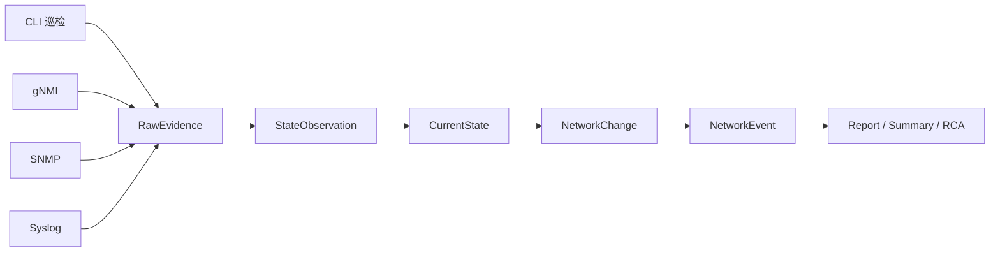
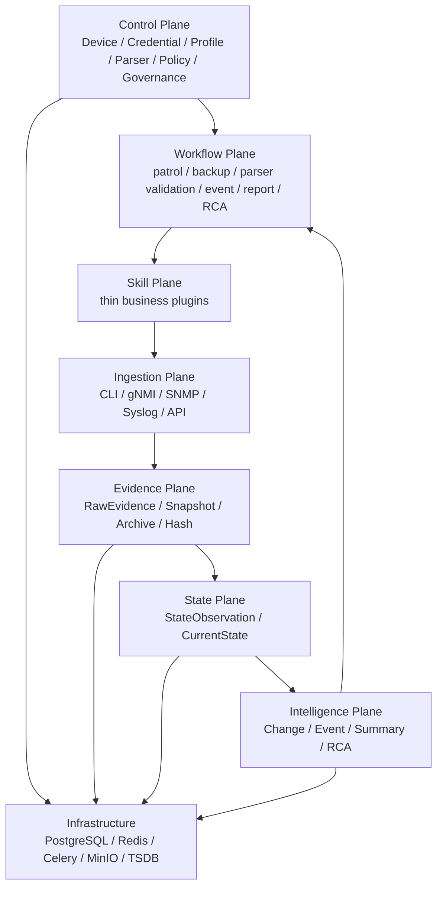

# NetOps Agent 系统总体设计、改造方案与分阶段实施计划

本文基于当前 `netops-agent` 项目代码状态、前期 Phase 1 到 Phase 6 的实现成果，以及后续接入 gRPC/gNMI、SNMP、Syslog、Telemetry 和 Agent 推理能力的目标，给出系统总体设计方案、改造方案和分阶段实施计划。

核心判断：

> `netops-agent` 不应继续围绕单个 `device-patrol` Skill 扩张，而应演进为以设备资产、采集计划、原始证据、状态事实、变化事件和工作流编排为核心的网络观测平台。

一句话原则：

> 平台负责可信事实，Skill 负责可插拔业务能力，Workflow 负责组合流程，Agent 负责解释、总结和推理。

---

## 1. 当前项目状态

当前项目已经越过了“巡检脚本 + TextFSM 模板生成器”的阶段，进入平台化过渡期。

### 1.1 已经具备的能力

| 领域 | 当前状态 | 代表模块 |
|---|---|---|
| 设备资产 | 已有设备列表、动态分组、批量导入、Profile 绑定、连通性检查、Evidence Timeline | `src/core/device_ops/`、`src/gateway/devices_api.py`、`web/react_frontend/src/pages/DevicesPage.tsx` |
| 采集策略 | 已有 Command Profile、Profile Version、Profile Binding、ExecutionPlan | `src/core/collection/policy.py` |
| Parser 控制面 | 已有 ParserRuntime、模板任务、模板资产、数据集覆盖率、模板预览和任务队列 | `src/core/parser/`、`src/gateway/parser_api.py` |
| 状态层 | 已有 StateObservation、CurrentState 和 state-normalizer Skill | `src/core/state/`、`src/skills/state-normalizer/` |
| 变化检测 | 已支持基于 StateObservation 的 Change Detector | `src/core/patrol/change_detector.py`、`src/skills/change-detector/` |
| 事件构建 | 已支持 Event Rule 版本化和 NetworkChange 到 NetworkEvent | `src/core/patrol/event_builder.py`、`src/core/patrol/event_rules.py` |
| 报告与差异 | 已拆出 patrol-diff 和 report-generator | `src/skills/patrol-diff/`、`src/skills/report-generator/` |
| 工作流 | 已有可组合 Workflow、运行记录、批次视图、重试、归档和监控 | `src/core/workflows/`、`src/gateway/workflow_api.py` |
| 模块治理 | 已有 Agent Module 控制开关雏形 | `src/core/agent_modules/` |

这说明项目的关键链路已经初步成型：

```text
Device Management
  -> ExecutionPlan
  -> device-patrol
  -> ParserRuntime
  -> StateObservation
  -> change-detector
  -> event-builder
  -> report-generator / Agent
```

### 1.2 当前主要问题

1. `device-patrol` 仍然承载过多平台职责  
   设备连接、采集、snapshot 入库是平台公共能力，但目前仍有较多执行流程散落在 Celery task 和 Skill 周边。长期看会影响复用、测试和 gNMI 接入。

2. Parser 控制面和 Device Management 还没有完全产品化整合  
   现在 Parser 页面和 Device 页面都有重要控制能力，但用户视角应围绕“设备是否可巡检、采集计划是否清楚、模板覆盖是否满足、事件链路是否可用”来组织。

3. CLI-centric 的 `CommandSnapshot` 需要抽象为 Evidence 的一种  
   当前模型天然偏 CLI 巡检。接入 gRPC/gNMI 后，系统需要统一表达 CLI 输出、gNMI 样本、Syslog 消息、SNMP 采样和外部 API 数据。

4. TextFSM Parser 只能服务 CLI 文本  
   gNMI 是 typed telemetry，不应该经过 TextFSM。应抽象出更上层的 `ObservationContract`，让 CLI Parser 和 gNMI Schema Mapper 最终产出同一种状态事实。

5. PostgreSQL 应成为平台权威存储  
   SQLite 可作为本地临时工具或历史兼容，不应继续作为生产控制面和巡检数据面。设备、采集、快照、Parser、状态、变化、事件和审计应统一进入 PostgreSQL。

6. 高遥测频率不适合全部进入 PostgreSQL  
   PostgreSQL 适合资产、状态、变化、事件、索引、审计和控制面；高频 counters、CPU 曲线、接口流量、温度时序应预留 TSDB 通道。

---

## 2. 设计理念

### 2.1 从 Patrol 中心转向 Observation 中心

`device-patrol` 是一种采集入口，不是系统中心。未来中心应是 `Observation`。



这样做的价值是：

- 新增数据源时，不需要重写 Change/Event。
- 新增 Skill 时，不需要自己实现连接、凭据、入库和状态解释。
- Agent 只读取事实和证据包，不绕过平台直接连接设备。
- 报告、事件、RCA 都能回溯到原始证据。

### 2.2 平台公共能力与 Skill 解耦

平台公共能力：

- Device Inventory
- Credential Resolver
- Collection Profile / ExecutionPlan
- Ingestion Adapter
- Evidence Store
- ParserRuntime / Schema Mapper
- StateObservation / CurrentState
- Change / Event Repository
- Audit / RBAC / Module Governance

Skill 职责：

- 暴露业务入口。
- 声明输入输出契约。
- 调用平台公共能力。
- 返回可被 Workflow 编排的结果 ID。

Skill 不应直接拥有：

- 设备筛选策略。
- 密码来源和解密逻辑。
- 连接池和连接健康逻辑。
- Parser 模板资产生命周期。
- 事件规则生命周期。
- 跨模块数据主权。

### 2.3 Workflow 只编排，不承载事实

Workflow 应传递 ID 和上下文，不传递大段 raw output 或结构化大对象。

推荐：

```text
device-patrol
  -> snapshot_run_id

state-normalizer
  -> observation_run_id

change-detector
  -> change_run_id

event-builder
  -> event_run_id

report-generator
  -> artifact_id
```

避免：

```text
Workflow step 之间传完整 CLI 输出、完整 structured_json、完整 event payload。
```

### 2.4 生产链路与验证链路分离

生产巡检不应实时触发 LLM 模板生成。

```text
生产巡检
  -> 只使用 active 模板和 active Profile
  -> 缺模板时 preflight 阻断或记录覆盖缺口

验证数据集
  -> parser-validation
  -> textfsm-generator
  -> draft template
  -> 回归验证
  -> 审批激活
```

这样可以避免生产巡检变成不可控的模板实验场。

---

## 3. 目标总体架构

### 3.1 总体分层



### 3.2 数据流目标

CLI 路径：

```text
Device
  -> CLI Adapter
  -> RawEvidence(type=cli_command_output)
  -> TextFSM ParserRuntime
  -> StateObservation
  -> CurrentState
  -> NetworkChange
  -> NetworkEvent
```

gNMI 路径：

```text
Device
  -> gNMI Adapter
  -> RawEvidence(type=gnmi_sample)
  -> Schema Mapper
  -> StateObservation 或 TSDB Metric
  -> CurrentState / Aggregation Window
  -> NetworkChange
  -> NetworkEvent
```

Syslog 路径：

```text
Device
  -> Syslog Adapter
  -> RawEvidence(type=syslog_message)
  -> Event Candidate Mapper
  -> NetworkEvent 或 StateObservation
```

### 3.3 关键边界

| 模块 | 应该做 | 不应该做 |
|---|---|---|
| Device Management | 管资产、分组、凭据引用、Profile 绑定、巡检预检 | 执行采集命令、解析密码明文 |
| device-patrol | 执行 ExecutionPlan，采集 CLI 原始证据，保存快照 | 选择设备、生成模板、构建事件、生成最终报告 |
| Parser Control Plane | 管命令策略、模板资产、验证任务、覆盖率 | 在生产巡检中同步调用 LLM |
| state-normalizer | 将结构化结果转为状态事实 | 自己决定采集命令或事件语义 |
| change-detector | 比较状态事实，产生变化 | 判定运维事件严重性 |
| event-builder | 根据规则把变化转为事件 | 直接连接设备或重跑巡检 |
| Workflow | 编排任务和上下文 | 保存业务事实主数据 |
| Agent | 总结、解释、辅助决策 | 绕过平台直接读取 secret 或连接设备 |

---

## 4. 核心领域模型

### 4.1 Device

设备资产是所有观测数据的归属根。

推荐长期模型：

```text
Device
  device_id
  hostname
  management_ip
  vendor
  model
  family
  platform
  device_type
  site
  role
  status
  credential_ref
  tags
  attributes
```

原则：

- `device_id` 是内部稳定 ID，不应依赖 hostname 或 IP。
- hostname、IP、serial、asset_tag 都是外部身份属性，可以变化。
- 凭据只保存引用，不进入前端普通列表和业务日志。

### 4.2 Credential

目标是所有执行平面只使用 `credential_ref`。

```text
credential_ref
  -> CredentialResolver
  -> short-lived credential
  -> Netmiko / gNMI client / API client
```

后续可替换为 Vault、云密钥管理、堡垒机或自建 Secret Manager，不影响 Skill。

### 4.3 Collection Profile 与 ExecutionPlan

`ExecutionPlan` 是执行类 Skill 的核心契约。

```text
ExecutionPlan
  plan_id
  device_id
  action
  mode
  profile_version_id
  binding_id
  selector
  credential_ref
  collection_items
  parser_policy_version
  collector_options
```

目标：

- Device Management 负责生成计划。
- device-patrol 和 device-backup 只执行计划。
- 历史巡检能追溯到当时使用的 Profile Version。

### 4.4 RawEvidence

RawEvidence 是不可变原始证据。

```text
RawEvidence
  evidence_id
  source_type
  evidence_type
  device_id
  observed_at
  ingested_at
  content_ref
  content_hash
  metadata_json
  retention_policy
```

当前 `CommandSnapshot` 可视作 CLI Evidence 的兼容实现。后续不应立即删除，而是逐步将其纳入 RawEvidence 体系。

### 4.5 ObservationContract

Parser Template 和 gNMI Schema Mapper 最终都应落到统一的数据契约。

```text
ObservationContract
  contract_id
  source_type
  schema_ref
  entity_type
  primary_keys
  fields
  validators
  ignore_fields
  allow_empty
  state_semantics
  version
```

这解决一个关键问题：

> TextFSM 是 CLI 解析技术，不应成为状态语义的唯一来源。

状态语义应属于 ObservationContract。

### 4.6 StateObservation 与 CurrentState

`StateObservation` 是事实日志，`CurrentState` 是可重建的当前视图。

```text
StateObservation append-only
  -> CurrentState latest by device/entity/field
```

原则：

- Observation 不覆盖。
- CurrentState 可重建。
- parser_validation/test 数据不污染生产 CurrentState。
- 同一实体字段使用稳定 `state_key`。

### 4.7 Change 与 Event

Change 是事实变化，Event 是运维语义。

```text
StateObservation A
  -> StateObservation B
  -> NetworkChange
  -> EventRule
  -> NetworkEvent
```

示例：

```text
CPU 15 -> 18
  = Change

CPU 15 -> 95
  = Change + CPUHigh Event

BGP Established -> Idle
  = Change + BGPNeighborLost Event
```

必须保持 `Change != Event != RCA`。

---

## 5. 改造方案

### 5.1 Device Management 产品化

目标：把设备管理做成真正的网络资产控制面。

改造内容：

- 完善设备资产详情：站点、角色、设备族、平台、设备类型、序列号、标签、扩展属性。
- 强化动态分组：支持可视化规则、影响预览、命中设备解释。
- 强化导入体验：模板下载、列名校验、行级错误定位、幂等导入预览。
- 强化 Profile 绑定：按设备、组、站点、角色、厂商、型号、设备族绑定。
- 强化 Patrol Ready：生产巡检前展示命令覆盖率、Parser 覆盖率、凭据状态、连接预检。
- 强化 Evidence Timeline：从设备维度串起 Workflow、Snapshot、Observation、Change、Event。
- UI 与 Parser 控制面整合：用户看的是“设备是否可观测”，不是孤立的 Parser 任务。

验收标准：

- 用户可以解释一台设备为什么使用某套采集命令。
- 用户可以在巡检前看到阻断原因。
- 用户可以从设备详情追溯到原始证据、状态变化和事件。
- 凭据明文不会出现在 UI、日志、普通 API 响应中。

### 5.2 device-patrol 执行面收敛

目标：`device-patrol` 成为薄 Skill，核心采集能力进入平台。

建议改造：

```text
src/core/celery_tasks/tasks.py
  execute_device_patrol_task
    -> DevicePatrolRunner.run()

src/core/patrol/runner.py
  DevicePatrolRunner
    -> load ExecutionPlan
    -> resolve credential
    -> call CLI Adapter
    -> persist evidence/snapshot
    -> call ParserRuntime
    -> return snapshot_run_id
```

进一步抽象：

```text
src/core/ingestion/
  domain.py
  adapter.py
  service.py
  adapters/
    cli.py
    gnmi.py
    snmp.py
    syslog.py
```

验收标准：

- Celery task 只负责异步调度和错误包装。
- API、Workflow、测试和未来 Scheduler 都可以复用 `DevicePatrolRunner`。
- `device-patrol` 不再自行决定设备筛选和命令策略。

### 5.3 PostgreSQL 统一数据面

目标：生产数据和控制面统一使用 PostgreSQL。

改造内容：

- 设备资产、采集配置、Parser 控制面、巡检快照、状态、变化、事件、审计全部进入 PostgreSQL。
- SQLite 仅保留为历史兼容或本地临时工具，不作为后续设计依赖。
- `parser-validation` 不再是独立 SQLite 文件，而是 PostgreSQL 中带 dataset/mode 标记的数据集。
- 所有私有原始数据只通过 Evidence 引用和受控归档保存，不进入 Git。

验收标准：

- 新功能不再新增 SQLite 依赖。
- Parser 任务样本只引用 PostgreSQL snapshot/evidence。
- 测试数据集可幂等导入、预览、清理和重新生成任务。

### 5.4 Parser Control Plane 治理化

目标：Parser 从模板文件集合升级为可治理资产。

改造内容：

- 只保留命令白名单作为人工策略入口。
- 命令别名、设备身份、字段、主键、验证器通过验证数据自动发现，审批后固化到 PostgreSQL。
- 模板生成只消费验证数据集，不消费生产巡检。
- 模板激活前执行回归验证集。
- 模板资产采用版本化、不可变路径。
- 激活失败时继续使用旧 active 版本。
- Parser UI 增加覆盖率、任务合并、旧任务退役、模板对比、结构化结果预览。

验收标准：

- 非白名单命令永不进入模板队列。
- 生产巡检不会触发 LLM。
- active 模板具备哈希、版本、契约、验证报告和审批记录。
- 主键缺失、主键重复、字段不稳定会阻断激活。

### 5.5 ObservationContract 抽象

目标：让 CLI 和 gNMI 最终输出同一种状态语义。

改造内容：

- 从 Parser Template `validation_json` 中抽出通用数据契约。
- `state-normalizer` 优先读取 ObservationContract，而不是直接理解 TextFSM。
- gNMI path 后续通过 Schema Mapper 映射到相同实体类型和字段。
- 对字段定义增加 `state_semantics`：状态型、指标型、描述型、忽略型、事件候选型。

验收标准：

- CLI 的接口状态和 gNMI 的接口状态能映射到同一 entity/field。
- change-detector 不关心数据来自 CLI 还是 gNMI。
- 主键稳定性检查成为契约激活门禁。

### 5.6 Change/Event 链路生产化

目标：让“网络发生了什么变化”成为平台主价值。

改造内容：

- `change-detector` 默认使用 Observation 模式。
- `NetworkChange` 记录 previous/current observation 引用。
- `event-builder` 使用版本化规则。
- Event 支持恢复事件、关联事件、证据引用和状态闭环。
- Event Summary Agent 优先读取事件库，而不是重新分析原始 CLI。

验收标准：

- Change 可追溯到 Observation 和 Evidence。
- Event 可追溯到 Change 和规则版本。
- 重跑不会产生重复 Change/Event。
- CPU 小幅变化只记录 Change，不生成 Event。

### 5.7 gRPC/gNMI 接入准备

目标：接入实时遥测时不推翻现有架构。

设计原则：

- gNMI 是 Ingestion Adapter，不是普通一次性 Skill。
- gNMI typed sample 不走 TextFSM。
- 状态型 telemetry 进入 StateObservation。
- 高频指标进入 TSDB，PostgreSQL 只保存索引、订阅、异常窗口和事件。

建议首批路径：

```text
interface oper-status
bgp neighbor session-state
fan state
power state
```

暂缓：

```text
interface counters full history
second-level CPU/memory full history
large scale temperature time series
```

验收标准：

- gNMI 状态变化能复用 change-detector 和 event-builder。
- 高频指标不会写爆 PostgreSQL。
- Telemetry 断线、重连、重复样本、delete/tombstone 可观测。

---

## 6. 分阶段实施方案

### Stage 0：架构收口与基线冻结

目标：把已有 Phase 1 到 Phase 6 统一纳入 Observation Fabric 语义。

任务：

- 明确 `CommandSnapshot` 是 CLI Evidence 兼容表。
- 明确 `StateObservation` 是统一状态事实。
- 明确 `CurrentState` 是可重建当前视图。
- 明确 `Change -> Event -> Summary/RCA` 的边界。
- 补齐本文档与现有设计文档的交叉引用。
- 固化当前测试基线。

验收：

- 现有单元测试和前端 build 通过。
- `device-patrol -> state-normalizer -> change-detector -> event-builder` Workflow 不回退。
- 防火墙策略生成、工单类 Workflow 不受影响。

### Stage 1：Device Management 成熟产品级

目标：优先把 Device Management 打造成真正可用的控制面。

任务：

- 完成中文化和产品级 UI 信息架构。
- 增强设备列表、详情、筛选、导入、批量更新、动态分组。
- 增加模板下载、列名校验说明、行级错误定位。
- 增强 Patrol Ready 和 Effective Plan 解释。
- 将 Parser 覆盖、Profile 绑定、连接健康、Evidence Timeline 融入设备视角。
- 增加权限、审计和敏感字段脱敏策略。

验收：

- 用户能从设备页完成导入、分组、绑定 Profile、预览巡检、发起巡检、查看结果。
- 巡检失败原因能定位到设备属性、凭据、连接、Profile 或 Parser 覆盖。
- UI 不暴露密码。

### Stage 2：DevicePatrolRunner 与 CLI Adapter

目标：把巡检执行逻辑从 Celery task 和 Skill 中抽出。

任务：

- 新增 `src/core/patrol/runner.py`。
- 将 `execute_device_patrol_task` 里的领域流程迁移到 Runner。
- 新增 `src/core/ingestion/` 基础接口。
- 将 Netmiko 连接、命令执行、连接健康更新收敛为 CLI Adapter。
- `device-patrol` 和 `device-backup` 共享连接与凭据解析能力。

验收：

- Celery task 显著变薄。
- Runner 可被 API、Workflow、测试复用。
- 设备连接失败分类一致。
- 现有巡检和备份行为不回退。

### Stage 3：PostgreSQL 数据面闭环

目标：停止依赖 SQLite，统一生产和验证数据集的数据主权。

任务：

- 清理新功能中的 SQLite 假设。
- parser-validation 改为 PostgreSQL dataset/mode。
- 导入流程支持预览、幂等、退役旧任务、任务合并。
- 私有原始数据使用受控 Evidence 引用，不进入 Git。
- 增加数据清理和归档策略。

验收：

- 重新导入两季度数据不会重复产生 snapshot 和候选任务。
- 旧任务能自动退役或合并。
- Parser 页面显示的数据来源全部来自 PostgreSQL。

### Stage 4：Parser 资产治理与 ObservationContract

目标：让 Parser 模板成为有契约、有版本、有审批、有回归验证的资产。

任务：

- 保留命令白名单，自动化命令别名、设备身份、字段、主键和校验器发现。
- 新增或完善 ObservationContract。
- 模板激活前执行结构化结果对比和回归验证。
- 主键唯一性、字段稳定性和 allow_empty 成为激活门禁。
- Parser UI 提供模板预览、样本对比、覆盖率和契约详情。

验收：

- 首次语义类型需要审批契约。
- REPAIR_TEMPLATE 必须审批。
- active 模板有契约版本和验证证据。
- state-normalizer 使用契约生成稳定 Observation。

### Stage 5：Change/Event 生产化

目标：让变化和事件成为平台稳定输出。

任务：

- Change Detector 默认基于 StateObservation。
- Event Builder 规则版本化、可测试、可回滚。
- 支持恢复事件和事件闭环状态。
- 增加 Event Summary Agent，回答“过去 24 小时网络发生了什么”。
- Report Generator 从 Change/Event 重建报告。

验收：

- Event 可以追溯到规则版本、Change、Observation、Evidence。
- CPU 小幅波动不升格为 Event。
- 接口 Down、BGP Lost、CPUHigh、FanFailed、PowerFailed 等规则可回归测试。
- Agent 不分析原始 CLI，也能总结事件流。

### Stage 6：Workflow 与 Agent 模块治理

目标：把 Phase 1 到 Phase 6 做成可插拔模块，而不是硬编码链路。

任务：

- 统一模块注册：Parser、State、Change、Event、Report、Topology、Telemetry。
- 模块支持 enable/disable、维护窗口、健康证据、依赖检查。
- Workflow 启动前检查所需模块状态。
- Device Management 发起巡检时展示模块依赖和阻断原因。
- 普通业务 Workflow 不被巡检链路约束影响。

验收：

- 禁用 event-builder 时，巡检仍可完成到 Change。
- 禁用 parser-control 时，不影响防火墙策略生成工单。
- Workflow 失败原因能定位到模块不可用、配置问题或执行失败。

### Stage 7：Topology Discovery MVP

目标：先建立关系事实，不急于引入复杂知识图谱。

任务：

- 新增 topology node/edge 表。
- 从 LLDP/CDP、BGP neighbor、interface、inventory 中生成最小拓扑。
- 建立 Device、Interface、Neighbor、VRF、Site 的关系。
- Event 页面展示相关设备和相邻接口。

验收：

- 从 InterfaceDown Event 可跳转到设备、接口和邻居。
- 能展示单设备一跳拓扑。
- RCA 之前已经有可查询的拓扑事实。

### Stage 8：gNMI / Telemetry Adapter MVP

目标：接入实时状态数据，验证多源 Observation。

任务：

- 新增 gNMI subscription 控制面。
- 新增 gNMI Adapter 和 stream cursor。
- 新增 Schema Mapper。
- 状态型 path 写入 StateObservation。
- 高频指标写入 TSDB 或暂存聚合窗口。

验收：

- gNMI 接口状态变化能生成 Change/Event。
- CLI 和 gNMI 可以共同维护同一实体状态。
- source/confidence 冲突可见，不互相覆盖来源。

### Stage 9：Evidence Pack、Summary Agent 与 RCA Agent

目标：Agent 基于事实和证据工作，而不是直接连接设备。

任务：

- 定义 Evidence Pack。
- Event Summary Agent 读取事件库生成日报、周报和影响设备汇总。
- RCA Agent 读取 Event、Change、CurrentState、Topology、Evidence Timeline。
- 引入置信度、证据来源和推理链路审计。

验收：

- 用户问“过去 24 小时网络发生了什么”，Agent 读取事件库回答。
- 用户问“为什么 PE01 BGP 掉了”，Agent 基于证据包回答。
- Agent 不读取 secret，不直接连接设备。

---

## 7. 近期优先级

### P0

1. Device Management 产品级完善。
2. `DevicePatrolRunner` 抽离。
3. PostgreSQL 数据面闭环。
4. ObservationContract 抽象。
5. Parser 覆盖率和主键契约治理。

### P1

1. Change/Event 生产化。
2. Event Summary Agent。
3. Workflow 模块治理。
4. Evidence Timeline 深链。
5. Topology Discovery MVP。

### P2

1. gNMI Adapter MVP。
2. TSDB 指标分流。
3. 多源证据融合。
4. RCA Evidence Pack。
5. Temporal Knowledge Graph。

---

## 8. 不建议现在做的事情

- 不建议把 gNMI 做成一次性 Skill。
- 不建议生产巡检同步触发 TextFSM 生成。
- 不建议让 Workflow 传递大段原始输出。
- 不建议把高频 telemetry 全量写入 PostgreSQL。
- 不建议让 Agent 绕过平台直接连接设备。
- 不建议急着上 Temporal Knowledge Graph。
- 不建议把 RCA 放在 Change/Event/Topology 稳定之前。

---

## 9. 最终目标

最终系统应从“巡检工具”演进为：

```text
Self-evolving Network Observation Platform

设备资产可治理
采集计划可解释
原始证据可追溯
状态事实可重建
变化检测可复现
事件语义可审计
报告总结可重放
Agent 推理有证据
```

判断系统成熟的标准不是 Skill 数量，而是：

- 任意事件都能回溯到 Change、Observation 和 Evidence。
- 任意巡检都能解释使用了哪个设备、凭据、Profile、模板和规则版本。
- 新增数据源不需要重写下游 Change/Event。
- 新增业务 Workflow 不需要直接操作设备连接和 secret。
- Agent 只消费事实与证据，不越权采集。

这条路线可以最大化复用当前项目已完成的 Parser、Device Management、State、Change、Event、Workflow 和 UI 基础，同时为 gRPC/gNMI 和后续智能化留出足够清晰的架构空间。
