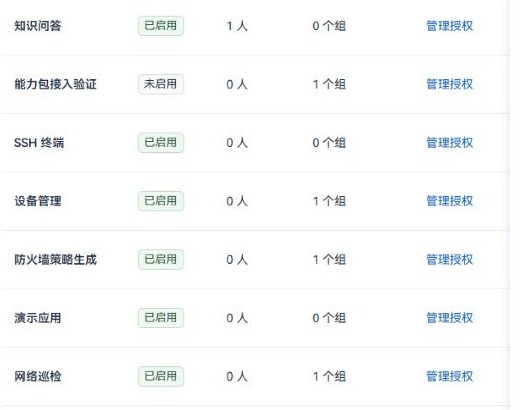
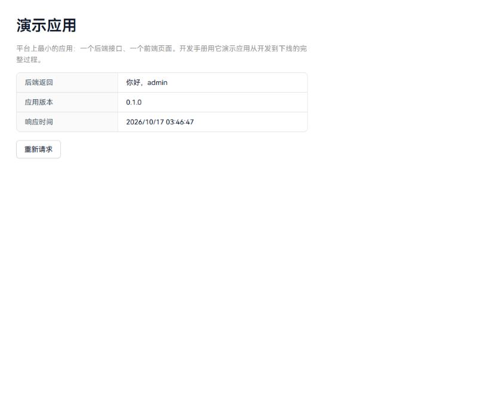
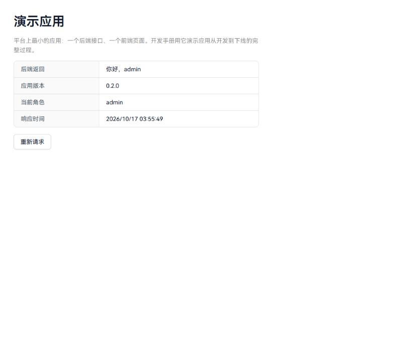

# NetOps 平台开发手册

写给要在 NetOps 上开发能力包（App）的工程师。读完前两章，你应该知道平台由哪些进程组成、一次请求怎样走到你的代码、一个包要写哪些文件；第三章用仓库里的演示应用 `hello-demo` 把开发、上线、升级、下线完整走一遍，所有命令输出都是 2026-10-17 在本地环境实际执行的记录。

核对日期：2026-10-17。文中的文件路径均相对仓库根目录。

## 一、平台整体架构

### 1.1 进程与一次请求的路径

单仓多包：React 工作台、Django BFF、FastAPI Gateway 三个进程对外，业务以能力包的形式装进 Gateway。Django 是唯一的认证来源，Gateway 自己不判断“这个人能不能用这个应用”，每个请求都回问 Django。

```architecture
浏览器
  │  /api/...
  ▼
React 工作台 :3000 ── 前端静态资源；/api 代理到 Django，/object-storage 代理到 MinIO（浏览器上传文件）
  │
  ▼
Django BFF :8001 ── 登录、用户与用户组、应用授权、应用安装状态
  │  /api/apps/<id>/... 原样转发（bff/views/app_proxy.py）
  ▼
FastAPI Gateway :8000 ── 平台内核 + 已装配的能力包
  │  每个 /api/apps/<id>/ 路由前都有 require_app(<id>)
  └──► 回问 Django /api/platform/apps/<id>/authorize/（附带本进程加载的代码摘要）
         通过：放行并带上当前用户；未启用/无权：404；代码与部署不符：503

后台：Celery Worker（每个包自己的队列）· Beat（AppScheduler，周期任务）
存储：PostgreSQL（业务事实、安装与授权、会话）· MinIO（原文件、证据、导出）· Redis / RabbitMQ
```

| 进程 | 端口 | 负责什么 | 入口 |
| --- | --- | --- | --- |
| React 工作台 | 3000 | 页面；生产模式下是 `vite build` 的产物，`/api` 代理到 Django，`/object-storage` 代理到 MinIO；浏览器只访问这一个端口 | `web/react_frontend/src/App.tsx`、`vite.config.ts` |
| Django BFF | 8001 | 认证、用户与用户组、应用授权、应用安装与生命周期、转发 `/api/apps/*` | `web/django_backend/bff/` |
| FastAPI Gateway | 8000 | 平台内核，扫描并挂载所有能力包 | `src/gateway/`、`src/platform/kernel/` |
| Celery Worker / Beat | — | 包的异步任务与周期任务 | `src/platform/kernel/worker.py`、`scheduler.py` |

### 1.2 能力包：平台如何发现和装配应用

一个能力包是 `src/apps/<目录>/` 下带 `app.yaml` 的目录。平台内核（`src/platform/kernel/registry.py`）在启动时扫描所有 `src/apps/*/app.yaml`，校验清单，按依赖排序，并为每个包计算一个**代码摘要**（包内所有发布文件的哈希，忽略 `__pycache__`、`tests` 等开发产物）。之后：

- **后端**：`mount_apps` 把每个包的 `backend.router` 挂到 `/api/apps/{id}`，并统一加上 `require_app(id)` 准入依赖。某个包加载失败只影响它自己，Gateway 和其它包照常启动。
- **前端**：`python -m src.platform.kernel.cli frontend` 生成 `web/react_frontend/src/apps/generated.ts`，静态导入每个包的 `frontend/index.tsx`；`App.tsx` 把它们的路由挂在 `/apps/{id}/*` 下，外面套一层 `PackageRoute`（只影响显示，真正的权限在后端）。
- **任务与定时**：`task_configuration()` 汇总各包的 `task_modules`、`task_names` 和队列，Worker 只消费声明过的队列；`schedules` 由 Beat 注册。
- **Agent 工具**：`agent.tools` 导出的工具以 `<应用 id 的下划线形式>__<工具名>` 注册（`src/platform/tools/registry.py`），调用前同样校验该用户的应用使用权。

当前仓库有 13 个能力包：

| 包 ID | 名称 | 说明 |
| --- | --- | --- |
| `assistant` | 知识问答 | 问答与诊断，唯一的 DSH 执行循环 |
| `materials` | 资料管理 | 资料提取、发布与修订 |
| `inspection` | 网络巡检 | 在线/离线巡检、报告 |
| `rule-governance` | 规则治理 | 检查项、适配器、解析模板、规则发布 |
| `topology` | 网络拓扑 | 拓扑发现、路径推导 |
| `device-management` | 设备管理 | 设备资产、命令集 |
| `device-access` | SSH 终端 | 设备登录 |
| `netconf-api` | NETCONF 接口 | NETCONF 采集 |
| `firewall-policy` | 防火墙策略生成 | 策略生成任务 |
| `resource-ledger` | 资源台账 | 按地域、机房、网络区域、业务系统逐级划分 IP；业务系统、主机与服务端口；运营商专线、站点韧性与故障影响；为防火墙申请表提供只读查询工具 |
| `official-documents` | 公文写作 | 公文生成 |
| `delivery-probe` | 能力包接入验证 | 功能完整的示例包：任务、数据库、Agent 工具、定时 |
| `hello-demo` | 演示应用 | 本手册的最小示例，见第三章 |

### 1.3 认证与应用准入

- **登录与身份只在 Django。** 浏览器拿到的 Bearer token 由 Django 签发；Gateway 不信任任何 `X-User-*` 头。
- **每个请求都过两道检查。** `require_app(<id>)`（`src/platform/authorization/client.py`）把原始 token 和本进程加载的包摘要发给 Django 的 `authorize` 接口（`bff/views/app_platform.py`）：摘要和数据库里登记的部署摘要不一致，返回 **503**（代码改了但还没升级）；应用未启用或用户没有使用权，返回 **404**；通过则返回当前用户。拿不到 Django 的答复时同样拒绝（fail-closed）。
- **使用权按用户或用户组授予**，入口是“系统管理 → 应用授权”。两者取并集；`admin` 默认可用所有已启用的应用；未启用的应用有授权也用不了。
- **后台任务和 Agent 工具**走同一边界：`authorize_worker` 以服务凭据代表发起人再查一次。

### 1.4 问答与诊断：DSH 执行器

平台自己不实现 Agent 循环。问答和诊断都交给 DeepSeek Harness（DSH）SDK，NetOps 只做生命周期管理、反向代理和边界检查，全部适配在 `src/platform/agent_runtime/dsh.py`：

- 启动一个只监听本机的 uvicorn，接管 DSH 的出口：`/chat/completions`（每轮注入预算提示、裁剪工具白名单、收尾阶段强制调用 `submit_answer`）、`/before` 与 `/after`（工具预算和范围检查、逐次复查权限、记录过程事件）、`/mcp`（只挂本轮已授权的业务工具）。
- `dsh_worker.py` 子进程只运行 `DeepSeekHarness(**config).run()`；`dsh_guard.cjs` 在 Node 侧限制原生工具只能读授权工作区内的文件，并把每次工具执行回调给 Python。
- 会话按用户和会话隔离（`session_store.py`），资料、筛选或工具范围一变就换新会话，旧结果不跨权限边界。
- 答案门禁（`src/apps/assistant/backend/answer_gate.py`）只接受本轮实际读过的原文行作引用；不满足时把原因反馈回同一轮让模型补读。
- 诊断时只能登录本轮 `topology__trace_path` 或 `topology__locate` 返回过的设备（`diagnostic_workspace.py`），模型不能自己扩大取证范围。

能力包要让模型用到自己的能力，就在 `agent.tools` 里导出工具；只有标记 `evidence=True` 的工具会作为查询证据提供给问答 Agent。

Skill 和 Workflow 按 DSH 自己的技能标准进入问答：每轮按当前账号的权限把可执行的 Skill、可启动的 Workflow 写成 DSH 技能目录（`<名称>/SKILL.md`），由 DSH 的 `dsh-skill` 插件列给模型、`skill` 工具加载说明，再由知识问答应用导出的 `assistant__run_skill`、`assistant__start_workflow` 执行（`src/apps/assistant/backend/automation.py`）。详见“Skill 开发手册 2.8”和“Workflow 开发手册 4.2”。

### 1.5 业务能力在哪里

| 能力 | 形态 | 关键位置 |
| --- | --- | --- |
| 网络巡检 | 范围、命令集、检查项和规则冻结后执行的固定管线：采集 → 解析 → 变化 → 事件 → 结论 → 报告 | `src/apps/inspection/backend/submission.py`、`src/core/patrol/runner.py`、`change_detector.py`、`event_builder.py` |
| 规则治理 | 维护检查项与适配器，规则由检查项编译，随检查项一起发布、回退 | `src/apps/rule_governance/backend/check_items/` |
| 拓扑与路径 | 链路以 LLDP 为准；事实 → 标准树 → 查询表 → 计算，表达不了的写进 gaps | `src/apps/topology/backend/model/path.py` |
| 故障诊断 | 没有固定的 RCA 流水线：DSH 多轮推理 × 确定性的拓扑与采集证据 | `src/apps/assistant/backend/diagnostic_workspace.py` |
| Skill 与 Workflow | 无界面的执行单元由 Workflow 串成流程，经试跑或 ITSM Webhook 触发，不进入问答 | `src/skills/`、`src/workflows/`；见“Skill 开发手册”“Workflow 开发手册” |

## 二、应用开发指南

### 2.1 最小的应用由什么组成

```text
src/apps/hello_demo/            目录名：Python 包名（小写、下划线）
├── __init__.py
├── app.yaml                    清单：平台据此发现、校验、装配
├── backend/
│   ├── __init__.py
│   └── api.py                  FastAPI 路由，挂到 /api/apps/hello-demo
└── frontend/
    ├── index.tsx               前端入口：声明路由
    └── Page.tsx                页面
```

不需要改平台的任何文件：不加路由、不登记菜单、不改 `App.tsx`。前端注册码 `generated.ts` 在构建时自动生成。

### 2.2 清单 app.yaml

```yaml
manifest_version: 1
id: hello-demo
name: 演示应用
version: 0.2.0
platform_api: '>=1.0,<2.0'
icon: document
dependencies: {}
backend:
  router: src.apps.hello_demo.backend.api:router
frontend:
  entry: frontend/index.tsx
```

| 字段 | 必填 | 规则（`registry.discover` 校验） |
| --- | --- | --- |
| `manifest_version` | 是 | 目前只能是 `1` |
| `id` | 是 | 小写字母开头，短横线分隔，如 `hello-demo`；全平台唯一；URL 和授权都用它 |
| `name` / `icon` | 是 | 非空；显示在工作台和应用授权里 |
| `version` | 是 | 合法版本号；每次发布新代码都应递增 |
| `platform_api` | 是 | 版本范围，必须包含平台版本 `1.0.0` |
| `backend.router` | 是 | `src.apps.<目录>.` 开头的符号，模块文件必须存在 |
| `frontend.entry` | 是 | 包内存在的文件 |
| `dependencies` | 否 | `{其它包 id: 版本范围}`；依赖必须先安装、先启用；不允许循环 |
| `frontend.enabled_env` | 否 | `VITE_` 开头的构建变量；构建时设为 `false`，前端就不挂这个应用的路由 |
| `backend.task_modules` / `task_names` / `queue` / `schedules` | 否 | 异步任务与定时，见 2.5 |
| `database` | 否 | `none`（默认）、`legacy` 或 `package`，见 2.5 |
| `agent.tools` | 否 | 导出给 Agent 的工具列表，见 2.5 |
| `workflow.actions` | 否 | 导出给 Workflow 步骤的动作列表，见 2.5 |
| `lifecycle.drain` / `lifecycle.pending` | 有任务时必填 | 停用时的收尾钩子与“还剩多少在途工作”，见 2.5 |
| `aliases` | 否 | 旧的路由别名 |

所有入口符号都必须落在本包内（`src.apps.<目录>.` 前缀），清单错误会让内核拒绝这个包。

### 2.3 后端

```python
from fastapi import APIRouter, Depends
from src.platform.authorization.client import require_app

router = APIRouter()
user = require_app("hello-demo")

@router.get("/greeting")
def greeting(actor=Depends(user)):
    return {"message": f"你好，{actor.username}", "role": actor.role}
```

- 路由挂在 `/api/apps/hello-demo/greeting`。挂载时内核已经加了准入；在处理函数里再写一次 `Depends(require_app(...))` 是为了拿到当前用户（`CurrentUser`：`user_id`、`username`、`role`、`permissions`）。
- 业务数据的归属（谁能读哪条记录）由包自己负责：应用使用权只决定“能不能用这个应用”。
- 只依赖平台已有的 Python 库；需要额外依赖时写进包里的 `requirements.lock`，安装和启动时检查，运行中不会自动安装。

### 2.4 前端

```tsx
// frontend/index.tsx
import { lazy } from 'react'
import type { AppFrontend } from '@netops/apps/types'

export default {
  routes: [{ path: '', component: lazy(() => import('./Page')) }],
} satisfies AppFrontend
```

- `routes` 里的 `path` 相对 `/apps/{id}`，`''` 就是应用首页。
- 调后端用平台的 `api` 客户端（`import { api } from '@netops/config/api'`），它带上登录用户的 token：`api.get('/apps/hello-demo/greeting')`。
- 用平台已有的组件库（antd）和样式，页面风格与其它应用一致；需要额外 npm 依赖时写进包里的 `package.json`，构建时检查冲突。

### 2.5 可选能力

完整的写法见 `src/apps/delivery_probe/`，它包含下面每一项。

| 能力 | 清单 | 要点 |
| --- | --- | --- |
| 异步任务 | `backend.task_modules`、`task_names`、`queue` | 每个包一个独立队列；有任务就必须提供 `lifecycle.drain` 和 `lifecycle.pending` |
| 周期任务 | `backend.schedules: [{name, task, seconds}]` | 由唯一的 Beat 注册；启用时核对 Beat 已加载这个版本 |
| 数据库 | `database: {mode: package, migrations, head, tables}` | 迁移放在包内 `migrations/versions`，独立版本表；`tables` 声明归属，两个包不能拥有同一张表。DDL 只由平台 bootstrap 执行，`install` 只检查 schema 是否就绪 |
| Agent 工具 | `agent.tools: src.apps.<目录>.backend.tools:TOOLS` | 工具有输入模型、`mutates`、`evidence` 标记；问答只拿到 `evidence=True` 的工具 |
| Workflow 动作 | `workflow.actions: src.apps.<目录>.backend.workflow_actions:ACTIONS` | 让 Workflow 步骤以 `skill: app:<应用ID>/<动作>` 调用，按运行所属用户的授权执行，可以运行几分钟，返回的文件由平台保存为步骤产物。见“Workflow 开发手册 3.3”，例子是 `src/apps/firewall_policy/backend/workflow_actions.py` |
| 停用收尾 | `lifecycle.drain`、`lifecycle.pending` | `drain` 取消排队、清理过期租约；`pending` 返回仍需处理的工作数，降到 0 才算排空 |
| 依赖其它包 | `dependencies` | 被依赖的包要先安装、先启用；停用时要先停依赖它的包 |
| 浏览器上传文件 | 不需要清单 | 用平台网盘接口：`POST /api/storage/upload/init/` 返回的 `upload_url` 是工作台地址上的 `/object-storage/...` 路径，浏览器对它 `PUT` 文件，再调用 `POST /api/storage/upload/complete/`；读取走 `/api/storage/files/<id>/content/` 或 `download/`。不要把 MinIO 的地址交给浏览器，从其他电脑访问时它是不通的。例子见 `web/react_frontend/src/pages/StoragePage.tsx` |

### 2.6 生命周期与状态

一个包的安装状态记在 Django 的 `AppInstallation` 表里，所有操作都通过 `manage.py app_packages`（实现在 `web/django_backend/bff/app_lifecycle.py`）。

```lifecycle
discovered --install--> installed --enable--> enabled --disable--> draining --(排空)--> disabled
disabled --enable--> enabled
disabled --upgrade--> installed
installing --(失败)--> failed
```

| 操作 | 命令 | 做什么 | 拒绝的情况 |
| --- | --- | --- | --- |
| 安装 / 升级 | `app_packages install <id>`、`app_packages upgrade <id>` | 检查依赖、归档本次代码（`.runtime/app-package-releases/`）、检查 schema，登记版本和代码摘要 | 应用仍在启用或排空中；依赖未安装 |
| 启用 | `app_packages enable <id> --gateway-url ... --frontend-url ...` | 逐项核对部署：每个 Gateway 加载的包摘要、生产前端 `netops-apps.json` 里的摘要和每个静态资源的哈希、Worker 队列、Beat 定时 | 部署的代码与登记的不一致；依赖未启用 |
| 停用 | `app_packages disable <id>` | 立即关闭准入，调用 `drain` 钩子，等在途请求和 `pending` 归零后变为 `disabled` | 还有启用中的应用依赖它 |
| 继续排空 | `app_packages drain <id>` | 停用后还有在途工作时，再次检查并收尾 | 应用未停用 |
| 查看 | `app_packages status [--compact]` | 版本、状态、错误、部署证据 | — |

日常不必逐条执行这些命令，启动脚本已经封装好（Windows）：

| 场景 | 命令 |
| --- | --- |
| 首次上线一个新包 | `.\scripts\windows\stop.ps1 -KeepMiddleware -KeepLangfuse`，然后 `.\scripts\windows\start.ps1 -ApplyDatabase -EnableApps <id> -NoBrowser` |
| 升级已启用的包 | `.\scripts\windows\stop.ps1 -KeepMiddleware -KeepLangfuse`，然后 `.\scripts\windows\start.ps1 -UpgradeApps <id>[,依赖它的包] -NoBrowser` |
| 下线 | `venv\Scripts\python.exe web\django_backend\manage.py app_packages disable <id>` |

`start.ps1` 每次启动都会生成前端注册码、构建生产前端，并核对数据库和包登记（`bootstrap check`），但**不会登记新包或改动过的代码**。登记（相当于 `install` / `upgrade`）由 `bootstrap apply` 完成：带 `-ApplyDatabase` 或 `-UpgradeApps` 时执行，也可以单独运行 `.\scripts\windows\bootstrap.ps1 -Action apply`，它会跳过仍在启用中、代码却已改动的包。`-UpgradeApps` 先用旧代码完成停用和排空，再登记新版本、启动服务、重新启用；`-EnableApps` 只负责启用，所以首次上线要和 `-ApplyDatabase` 一起用。两者都要求生产构建，不能和 `-DevMode` 一起用。

### 2.7 发布前自检

- `python -m src.platform.kernel.cli status` 能列出你的包，且没有清单错误。
- 后端处理函数用 `Depends(require_app("<id>"))` 拿当前用户；业务记录有自己的归属检查。
- 前端只通过 `api` 客户端访问 `/apps/<id>/...`。
- 平台按代码摘要判断包是否变化：包内任何发布文件（包括 README）改动，都要按“升级”流程上线，直接改正在运行的包会让它返回 503，直到升级完成。`version` 是给人看的，每次发布都应递增。
- 有任务的包实现了 `drain` 和 `pending`，并在停用时真的会收尾。
- 在“系统管理 → 应用授权”里授予需要的用户或用户组。

## 三、演示：hello-demo 从开发到下线

下面是 2026-10-17 在本地环境（Windows、本机 Docker 中间件）对 `src/apps/hello_demo` 实际执行的全过程。命令在仓库根目录执行，`python` 指 `venv\Scripts\python.exe`。

### 3.1 开发：写好四个文件

按 2.1 的结构写好 `app.yaml`、`backend/api.py`、`frontend/index.tsx`、`frontend/Page.tsx`（版本 `0.1.0`，接口返回问候语、版本和时间）。内核马上就能发现它：

```text
> python -m src.platform.kernel.cli status
  ...
  "id": "hello-demo",
  "name": "演示应用",
  "version": "0.1.0",
  "route": "/apps/hello-demo",
```

此时它还没有安装记录，`app_packages status` 里看不到它。

### 3.2 安装

```text
> python web\django_backend\manage.py app_packages install hello-demo
hello-demo 0.1.0 installed
```

安装只登记版本和代码摘要，并归档这次的代码。服务还没加载这份代码，这时去启用会被部署检查拦下：

```text
> python web\django_backend\manage.py app_packages enable hello-demo --gateway-url http://localhost:8000 --frontend-url http://localhost:3000
[1/1] Checking hello-demo: Gateway, frontend, Worker and Beat (this can take tens of seconds)...
CommandError: Gateway deployment does not match package code
```

### 3.3 部署：让服务加载新代码

```text
> .\scripts\windows\stop.ps1 -KeepMiddleware -KeepLangfuse
> .\scripts\windows\start.ps1 -NoBrowser
[OK] hello-demo: locked dependencies available
hello-demo 0.1.0 installed
All checks passed.
```

Gateway 已经挂上了这个包、生产前端也构建进了它的页面，但应用还没启用。这时访问：

```text
GET /api/apps/hello-demo/greeting  →  404 {"success": false, "error": "应用不可用或没有使用权限"}
页面 /apps/hello-demo             →  应用未启用或你没有使用权限
```

### 3.4 上线：启用并授权

```text
> python web\django_backend\manage.py app_packages enable hello-demo --gateway-url http://localhost:8000 --frontend-url http://localhost:3000 --wait-seconds 120
[1/1] Checking hello-demo: Gateway, frontend, Worker and Beat (this can take tens of seconds)...
hello-demo 0.1.0 enabled
```

启用通过后，`admin` 立即可用；其他人要在“系统管理 → 应用授权”里按用户或用户组授予：



```text
GET /api/apps/hello-demo/greeting  →  200 {"message": "你好，admin", "version": "0.1.0", ...}
```



### 3.5 升级到 0.2.0

把清单版本改为 `0.2.0`，接口多返回一个 `role` 字段，页面多显示一行“当前角色”。改完、还没升级时：

```text
GET /api/apps/hello-demo/greeting  →  503 {"success": false, "error": "应用不可用或没有使用权限"}
（其它应用不受影响）

> python web\django_backend\manage.py app_packages prepare hello-demo
CommandError: hello-demo: code changed since deployment; upgrade with start.ps1 -UpgradeApps hello-demo
```

这是有意的：正在运行的进程还是旧代码，平台不让新旧代码混跑，只关闭这一个应用。按提示升级：

```text
> .\scripts\windows\stop.ps1 -KeepMiddleware -KeepLangfuse
> .\scripts\windows\start.ps1 -UpgradeApps hello-demo -NoBrowser
[Step 2/7] Check platform database and App readiness before stopping services...
  [OK] hello-demo disabled and drained
[1/1] Checking hello-demo: Gateway, frontend, Worker and Beat (this can take tens of seconds)...
hello-demo 0.2.0 enabled
```

```text
GET /api/apps/hello-demo/greeting  →  200 {"message": "你好，admin", "version": "0.2.0", ..., "role": "admin"}
```



### 3.6 下线

```text
> python web\django_backend\manage.py app_packages disable hello-demo
hello-demo 0.2.0 disabled
```

这个包没有在途工作，排空立即完成。下线后：

```text
GET /api/apps/hello-demo/greeting  →  404 {"success": false, "error": "应用不可用或没有使用权限"}
页面 /apps/hello-demo             →  应用未启用或你没有使用权限
其它应用                           →  照常
```

授权记录、安装记录和业务数据都保留；再次 `enable` 即可恢复。平台没有“卸载”命令：如果要把包从发布中彻底移除，先停用，再删除 `src/apps/<目录>` 并重新部署；安装记录保留为 `disabled`，包自己的数据表和迁移记录不会被删除。

演示结束后，`hello-demo` 保持在 `disabled` 状态，你可以照 3.4 自己把它启用。

## 四、常见问题

**改了代码，应用返回 503。** 这是升级保护：部署中的进程还是旧代码。按 2.6 的升级流程处理；不要直接改数据库里的状态。

**停用后一直是 `draining`。** 说明还有在途工作或排空出错。保留当前代码，用 `app_packages status` 查看 `error`，处理后执行 `app_packages drain <id>`。服务已经停止时，排空会按“已停止的部署”处理，不再等待。

**启动时提示 `<id> unavailable: package registration pending; run bootstrap apply`。** 包的代码和登记的不一致（新包，或停用状态下改过文件）。用 `-ApplyDatabase` 重新启动，或运行 `.\scripts\windows\bootstrap.ps1 -Action apply` 登记后再启用。

**启用时报 `Install/upgrade the current package and finish draining first` 或 `Install the application first`。** 同上，代码还没有登记。

**启用时报 `Frontend build does not match package code`。** 前端没有按当前代码重新构建，或者访问的不是生产构建。用 `start.ps1`（不带 `-DevMode`）重新启动。

**`Disable dependent applications first`。** 还有启用中的包依赖它。升级时把依赖它的包一起列进 `-UpgradeApps`。

**停用是暂停吗？** 不是。停用会关闭准入并执行包自己的收尾逻辑，排队中的任务可能被取消；重新启用不会自动恢复它们。

**更多参考：** 仓库中的 `docs/deployment-windows.md`、`docs/deployment-linux.md`（安装、升级与应用启用），`src/apps/delivery_probe/`（功能完整的示例包）。
