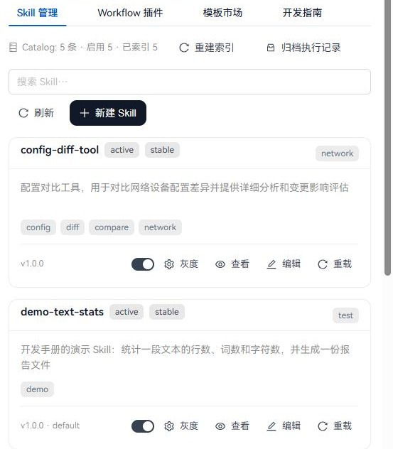

# Skill 开发手册

写给要写 Skill 的工程师：一个 Skill 是什么、什么时候该写 Skill 而不是应用、怎样写一个能被 Workflow 和问答助手调用的 Skill。第三章用演示 Skill `demo-text-stats` 走一遍，所有结果都是在本地环境实际执行的记录。

核对日期：2026-10-18。文中的文件路径均相对仓库根目录。

## 一、Skill 在平台中的位置

### 1.1 Skill 是什么

Skill 是一个独立的执行单元：一个目录、一份 `SKILL.md` 描述、一个入口脚本。平台把输入写进 `params.json`，在子进程里运行脚本，读取它最后一行输出的 JSON 作为结果；脚本写出的文件由平台打包上传，作为可下载的产物返回。

Skill 没有自己的页面和 API。它由三处调用：

| 调用方 | 方式 |
| --- | --- |
| Workflow 步骤 | 步骤里写 `skill: <名称>`，由 Celery Worker 执行（见“Workflow 开发手册”） |
| 问答助手 | 按 DSH 的技能标准：问答每轮把当前账号能执行的 Skill 写成 DSH 技能目录，模型用 DSH 的 `skill` 工具加载说明，再调用平台工具执行，见 2.8 |
| Skill 试跑 | “Skill 管理”页或 `POST /api/skills/<名称>/test-run/`，在 Gateway 进程里同步执行，用于调试 |

平台的 `SKILL.md` 本身就是 DSH 技能格式（`<名称>/SKILL.md`，YAML 头里有 `name` 和 `description`）；DSH 只读它认识的字段，平台的其他字段（入口、队列、灰度）不影响它。

### 1.2 写 Skill 还是写应用

| 你要做的事 | 写什么 |
| --- | --- |
| 有页面、有自己的数据、要授权给特定用户、要给问答提供查询证据的工具 | 应用包（见“平台开发手册”） |
| 一个无界面的处理步骤：输入几个参数、输出结果或文件，被 Workflow 串起来，或在问答中按用户要求执行 | Skill |
| 设备巡检、规则治理、防火墙策略、公文写作 | 已是应用，不要再写成 Skill |

巡检、规则生成、防火墙策略和公文写作原来的 Skill 已迁入各自的应用包（清单里的 `agent.legacy_skills`）。这些名称不能再作为 Skill 执行：试跑返回 410，Workflow 步骤报 “该能力已迁入业务应用：/apps/<应用>”。

### 1.3 现有的 Skill

`src/skills/` 下带 `SKILL.md` 的目录才是 Skill；其余目录是迁移后保留的共享代码。

| Skill | 说明 | 入口 | 问答可用 |
| --- | --- | --- | --- |
| `config-diff-tool` | 对比两份配置，列出增删的行 | `scripts/run.py`，不产生文件 | 是 |
| `demo-text-stats` | 本手册的演示 Skill | `scripts/run.py`，产出报告文件 | 是 |
| `device-backup` | 设备配置备份 | 没有入口脚本，当前不能执行 | 否 |
| `itsm-callback` | 把结果回调给 ITSM 系统 | `scripts/itsm_callback.py`，异步任务 | 否，只作 Workflow 步骤 |



## 二、写一个 Skill

### 2.1 目录结构

```text
src/skills/<名称>/
├── SKILL.md            描述：元数据（YAML 头）+ 说明正文
└── scripts/
    └── run.py          入口脚本
```

可以用脚手架生成，再改成自己的实现：

```text
> python scripts/create_skill.py --name my-skill --description "我的新技能" --category network
> python scripts/validate_skill.py src/skills/my-skill/SKILL.md
```

脚手架只生成骨架，不会替你实现业务。

### 2.2 SKILL.md 的元数据

```yaml
---
name: demo-text-stats
version: 1.0.0
description: 统计一段文本的行数、词数和字符数，并生成一份报告文件
category: test
triggers: []
inputs:
- name: text
  type: string
  required: true
outputs:
- name: summary
  type: text
entry_script: scripts/run.py
entry_output: dir
execution_mode: async
celery_queue: netops.default
min_permission_level: user
rollout_status: stable
enabled_ratio: 100
enabled: true
fallback_to_rag: false
---
```

| 字段 | 说明 |
| --- | --- |
| `name`、`version`、`description`、`category`、`triggers` | 校验器要求必填。`name` 用小写短横线（DSH 只认这种名字）；`description` 会出现在问答的技能目录里，写清它做什么。`triggers` 是旧聊天的触发词，现在不起作用，写 `[]` 即可 |
| `disable-model-invocation` | DSH 标准字段。写 `true` 时问答助手看不到、也不能执行这个 Skill，只能作 Workflow 步骤或试跑；不写时可以 |
| `whenToUse` | DSH 标准字段，可选：什么时候该用它，随说明一起给模型 |
| `inputs` / `outputs` | 参数说明：Workflow 编辑器的参数提示；问答里列给模型，执行前检查 `required: true` 的参数是否给了。脚本仍要自己检查输入 |
| `entry_script` | 入口脚本，相对 Skill 目录。新 Skill 都应写明 |
| `entry_output` | `none`、`file` 或 `dir`，决定平台传给脚本的输出参数，见 2.4。**不写时平台按文件名猜**：`run.py` 视为 `dir`，名字含 callback 视为 `none`，其他视为 `file` |
| `execution_mode` / `celery_queue` | Workflow 步骤投递到哪个 Celery 队列。本地核心 Worker 消费 `netops.default`、`netops.firewall`、`netops.device`、`netops.health` |
| `execution_timeout_seconds` | 脚本运行的时限，默认 600 秒 |
| `rollout_status`、`enabled_ratio`、`enabled`、`deprecated`、`min_platform_version` | 治理与灰度，见 2.6 |
| `min_permission_level` | 声明的最低角色，记入 Catalog；Workflow 步骤和试跑都**不检查**它。真正的权限要在脚本处理的业务对象上检查 |
| `fallback_to_rag` | 旧问答的回退开关，当前问答不再使用 |

### 2.3 SKILL.md 的正文

校验器（`scripts/validate_skill.py`）要求正文有标题，以及“核心能力”“工作流程”“输出格式”“示例”“注意事项”几节；“核心原则”“输入参数说明”“安全规范”“实际执行说明”是推荐章节。正文写给人看：说清这个 Skill 做什么、不做什么、失败时返回什么。

### 2.4 入口脚本约定

平台这样调用入口脚本（`src/core/skills/executor.py`）：

```text
python <entry_script> --params <临时目录>/params.json            entry_output: none
python <entry_script> --params ... --output-dir <临时目录>/output   entry_output: dir
python <entry_script> --params ... -o <临时目录>/output.xlsx       entry_output: file
```

- **输入**只在 `params.json` 里。平台先把 URL 或对象存储中的文件下载到本地，再把本地路径写进去。脚本的标准输入是空的。
- **工作目录**是 Skill 目录；环境里设置了 UTF-8 输出。
- **结果**：标准输出的**最后一行**必须是一个 JSON 对象。约定用 `success` 表示成败，失败时给出 `error`。
- **退出码**：非 0 视为脚本失败，平台记录标准错误和最后一行 JSON。业务上的失败（如输入为空）建议返回 `{"success": false, "error": "..."}` 并以 0 退出，让调用方看到清楚的原因。
- **时限**：超过 `execution_timeout_seconds` 会被终止，结果记为 `skill_execution_timeout`。

```python
parser = argparse.ArgumentParser()
parser.add_argument("--params", required=True)
parser.add_argument("--output-dir")
args = parser.parse_args()
params = json.loads(Path(args.params).read_text(encoding="utf-8"))
...
print(json.dumps({"success": True, "summary": summary}, ensure_ascii=False))
```

### 2.5 产物

- `entry_output: dir`：脚本写进输出目录的所有文件，被打包成一个 zip 上传，结果里出现 `artifacts.config_zip`（`file_key` 和签名下载地址 `download_url`）。**键名总是 `config_zip`**，这是沿用自防火墙策略 Skill 的名字，与内容无关。
- `entry_output: file`：脚本写 `-o` 指定的文件，平台上传后作为产物返回。
- `entry_output: none`：不产生文件。**不产生文件的 Skill 一定要写 `none`**：否则按文件名会被猜成 `dir`，平台会上传一个空 zip，并在 Workflow 里覆盖前一个步骤同名的 `config_zip`。
- 下载地址是平台签名的 `/api/artifacts/download/?key=...&sig=...`，不要把对象存储地址或服务器本地路径返回给浏览器。

### 2.6 治理、灰度与上线

- **重新加载**：新增或修改 `SKILL.md` 后，在“Skill 管理”点“重载”（单个）或调用 `POST /api/skills/reload-all/`，不需要重启服务。改了入口脚本不需要重载，下一次执行就会用新代码。
- **能否执行**由 Catalog 记录决定（`src/skill_system/governance/rollout.py`）：未启用、`deprecated`、平台版本不够、`rollout_status` 为 `draft` 或 `deprecated` 都会拒绝；`canary` 或 `enabled_ratio` 小于 100 时按用户分批放开。“Skill 管理”页的开关和“灰度”按钮改的就是这些。
- **部署**：Gateway 和 Worker 必须是同一份 Skill 代码；Workflow 步骤在 Worker 中执行。

### 2.7 测试

- 用 `scripts/validate_skill.py` 检查 `SKILL.md`；它只检查格式，不证明脚本能运行。
- 用试跑接口或“Skill 管理”页实际执行一次。
- 为入口脚本写单元测试，按平台的方式调用（`--params` 文件、空标准输入）。

### 2.8 在问答中使用（DSH 技能标准）

问答由 DeepSeek Harness（DSH）执行，Skill 按 DSH 自己的技能机制进入问答，不另做一套：

1. 每轮问答开始时，平台把**当前账号能执行**的 Skill（管理员或运维人员角色、Catalog 允许、未写 `disable-model-invocation: true`）和能启动的 Workflow 写成一个 DSH 技能目录：每项一个 `<名称>/SKILL.md`，头部只有 `name`、`description`（和 `whenToUse`），正文是执行方法和参数表，后面附上原 `SKILL.md` 的说明。
2. DSH 的 `dsh-skill`、`dsh-skill-filesystem`、`dsh-tool-skill` 插件只扫描这个目录，把名称和描述作为技能目录（`<available_skills>`）给模型。
3. 用户要求做某件事时，模型先用 DSH 的 `skill` 工具加载对应说明，再调用平台工具 `assistant__run_skill` 执行；结果、下载链接和证据编号在工具返回里，回答要引用证据编号。
4. 用户也可以在消息里直接写 `/<名称>`（DSH 的显式调用），这一项的说明会直接注入当轮。

执行仍在平台：同步运行入口脚本，平台把当前用户写进执行上下文做灰度判断，缺少必填参数时不执行、请模型向用户询问。问答里的一次调用最多等 75 秒，耗时更长的 Skill 应放进 Workflow，由聊天启动 Workflow。

**聊天附件**：用户在聊天里上传的文件存进他网盘的“问答附件”文件夹。文本类附件（配置、日志、CSV 等）放进这一轮的资料目录 `attachments/`，模型用 DSH 的 `read`、`grep` 阅读，像资料一样按行引用（答案里显示为“附件”引用）；所以对比两份配置这类请求，可以直接上传两个配置文件，模型读出内容再交给 `config-diff-tool`。图片在对话选用的模型支持图片输入时，作为 DSH 图片附件交给模型；当前可选的 V4 Flash、V4 Pro 只读文本。表格、PDF 等模型不能直接读的文件，留给需要文件的 Workflow 使用。

## 三、演示：demo-text-stats

`src/skills/demo-text-stats/` 统计文本的行数、词数和字符数，把报告写进输出目录。

**校验**

```text
> python scripts/validate_skill.py src/skills/demo-text-stats/SKILL.md
[OK] PASS | src\skills\demo-text-stats\SKILL.md
   WARN  缺少推荐章节: ## 核心原则
   ...
```

**重新加载**（不重启服务）

```text
POST /api/skills/reload-all/  →  {"success": true, "message": "成功重新加载 5 个 Skill", "count": 5}
```

**试跑**

```text
POST /api/skills/demo-text-stats/test-run/
{"params": {"text": "hostname R1\ninterface Gi0/0\n shutdown", "title": "R1 配置", "ticket_id": "DEMO-1"}}

→ 200  success: true
       summary: "3 行，5 个词，37 个字符"
       artifacts.config_zip.file_key: "skill_outputs/demo-text-stats/DEMO-1/demo_text_stats_DEMO-1.zip"
```

zip 里是 `report.md`：

```text
# R1 配置

- 行数：3
- 词数：5
- 字符数：37
```

**在问答中执行**（2026-10-18，本地演示管理员；以 `config-diff-tool` 为例）

```text
用户：用配置对比工具比较两份配置。修改前：hostname R1; interface Gi0/0; ip address 10.0.0.1 255.255.255.0。
      修改后：hostname R1; interface Gi0/0; ip address 10.0.0.2 255.255.255.0; shutdown。每个分号是一行。

  ✓ 加载技能说明  skill({"name": "config-diff-tool"})
  ✓ 执行 Skill    assistant__run_skill({"skill": "config-diff-tool", ...})

助手：配置对比已完成……共 3 处差异：新增 2 行、删除 1 行……
      本次对比结果：新增 ip address 10.0.0.2 255.255.255.0、shutdown，删除 ip address 10.0.0.1 255.255.255.0
      [evidence-f2aa766f462cc16e36e147f0]
      业务证据 1 · 执行 Skill
```

产出文件的 Skill（如 `demo-text-stats`）在工具返回里带签名下载链接，模型原样写进回答。

在 Workflow 里串联它的例子见“Workflow 开发手册”第七章。

## 四、核对时发现并修复的问题

| 问题 | 影响 | 处理 |
| --- | --- | --- |
| 平台运行入口脚本时，子进程继承了父进程的标准输入 | 读标准输入的脚本会一直等到超时；`config-diff-tool` 试跑在 30 秒后返回 504 | 平台给入口脚本空的标准输入（`executor.py`） |
| `config-diff-tool` 只从标准输入读参数，不认平台传的 `--params` | 通过平台调用时拿不到输入 | 改为读 `--params` 文件，手工运行仍可从标准输入读；修复后试跑约 0.5 秒返回 |
| `config-diff-tool` 没写 `entry_output` | 被猜成 `dir`，上传空 zip，覆盖前一步的产物 | 补 `entry_output: none` |
