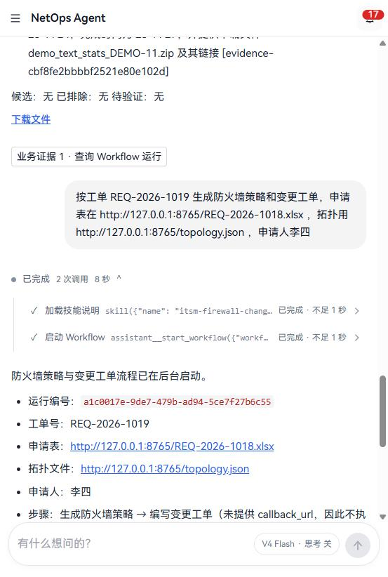

# Workflow 开发手册

写给要用 Workflow 把几个 Skill 或应用动作串成一条流程的工程师。第七章用演示流程 `demo-text-report` 和防火墙 ITSM 流程实际跑了一遍，所有结果都是在本地环境执行的记录。本手册替换了原来的“Workflow 插件开发指南”，核对时发现的差异和后来的修改列在最后一章。

核对日期：2026-10-18。文中的文件路径均相对仓库根目录。

## 一、现状：能做什么

| 能用 | 说明 |
| --- | --- |
| 由全局 Skill 和应用动作组成的流程 | 可用的 Skill 见“Skill 开发手册 1.3”；应用动作见 3.3 |
| 试跑触发 | “Workflow 插件”页或编辑向导里的试跑，或 `POST /api/workflows/runs/test/` |
| 聊天触发 | 用户在问答里要求时，助手按 DSH 技能标准启动，见 4.2 |
| ITSM Webhook 触发 | 经工作台 `/api/itsm/webhook/<route_key>/`，用平台账号的用户名和密码认证，见 4.3 |
| 重试 | 只有接口：`POST /api/workflows/<run_id>/retry/`（页面上没有入口） |

| 不能用 | 原因 |
| --- | --- |
| 巡检、规则制作类流程（`src/workflows/network/` 下的模板） | 已改为应用内的固定任务，引擎拒绝启动它们 |

## 二、插件结构

```text
src/workflows/<任意子目录>/<插件名>/
├── WORKFLOW.yaml        步骤、输入表达式、完成通知
├── ITSM.webhook.yaml    可选：Webhook 路由
└── CHAT.intent.yaml     可选：允许在问答中启动，见 4.2
```

- 平台扫描 `src/workflows/**/WORKFLOW.yaml`（`src/core/workflows/registry.py`），子目录名（`itsm`、`network`、`custom`）只是分类习惯。
- 新增或修改后，在“Workflow 插件”页点热重载，或调用 `POST /api/workflows/reload/`，不需要重启；多个 Worker 会收到广播一起重载。
- 引用的 Skill 要存在且可执行（见“Skill 开发手册 2.6”）。

## 三、WORKFLOW.yaml

```yaml
name: demo-text-report
description: 统计文本并生成报告；提供修改后的文本时再对比前后差异
category: custom
version: "1.0"

steps:
  - name: stats
    label: 统计文本
    skill: demo-text-stats
    inputs:
      text: ${context.text}
      title: ${context.title}
      ticket_id: ${context.ticket_id}

  - name: compare
    label: 对比修改前后
    skill: config-diff-tool
    when: ${context.text_after}
    inputs:
      config1: ${context.text}
      config2: ${context.text_after}

on_complete:
  message: 文本报告已生成
  notify_each_step: false
  notify_on_failure: true
  notification:
    title: "文本报告已生成 (${context.ticket_id})"
    body: "统计结果：${steps.stats.result.summary}"
    level: success
```

**步骤字段**

| 字段 | 说明 |
| --- | --- |
| `name` | 步骤名，表达式里用它引用这一步 |
| `skill` / `subworkflow` | 二选一：调用一个 Skill（或写成 `app:<应用ID>/<动作>` 调用应用动作，见 3.3），或嵌套运行另一个 Workflow |
| `inputs` | 传给 Skill 的参数，值可以是表达式或固定值 |
| `label` | 显示名 |
| `when` | 条件；为假时整步跳过，见 3.2 |
| `parallel_group` | 同组的相邻步骤并发执行，全部完成后再继续 |
| `depends_on` | 只用于编辑器的校验和参数映射提示，**不改变执行顺序**；步骤按列表顺序执行 |

**完成设置 `on_complete`**

| 字段 | 说明 |
| --- | --- |
| `notification.title` / `body` / `level` | 完成通知；标题和正文可以写表达式 |
| `notify_each_step` | 每步完成都发通知，默认 false |
| `notify_on_failure` | 失败时通知，默认 true |
| `message` | 完成时写入运行记录的说明 |

### 3.1 表达式

| 表达式 | 含义 |
| --- | --- |
| `${context.<字段>}` | 触发时传入的上下文：试跑请求的 `context`，或 Webhook 按映射取出的字段 |
| `${run.id}` | 当前运行的 ID |
| `${steps.<步骤名>.result.<字段>}` | 某一步 Skill 结果 JSON 中的字段 |
| `${steps.<步骤名>.artifacts.<键>.file_key}` | 某一步产物在对象存储中的键，给下游 Skill 当输入 |
| `${steps.<步骤名>.artifacts.<键>.download_url}` | 某一步产物的签名下载地址 |

`entry_output: dir` 的 Skill 产物键名总是 `config_zip`（见“Skill 开发手册 2.5”）。

### 3.2 条件 `when`

- 只写一个表达式（如 `${context.text_after}`）：取值为空、`false`、`0`、`no`、`none`、`null` 时跳过，其他情况执行。
- 写比较（如 `${context.priority} == high`）：替换变量后按简单比较求值，支持 `==`、`!=`、`in`、`<`、`>`、`and`、`or`、`not`；求值出错按假处理。

### 3.3 应用动作

业务能力迁入应用后，Workflow 通过**应用动作**调用它们：步骤的 `skill` 写成 `app:<应用ID>/<动作名>`。

```yaml
  - name: policy_generation
    label: 生成防火墙策略
    skill: app:firewall-policy/generate_policy
    inputs:
      ticket_id: ${context.ticket_id}
      policy_file_url: ${context.policy_file_url}
```

- 应用在 `app.yaml` 的 `workflow.actions` 导出动作（`src/platform/tools/actions.py` 的 `Action`：名称、说明、输入模型、处理函数）。
- 动作以**运行所属的用户**执行，平台先按该用户检查应用授权；运行没有用户（例如不带账号的调用）时步骤直接失败。
- 输入按动作的输入模型校验，参数不对时步骤失败并指出字段。动作可以运行几分钟（在 Worker 里）。
- 动作返回的文件由平台保存为步骤产物，和 Skill 产物一样有签名下载地址，可用 `${steps.<步骤>.artifacts.<键>.download_url}` 引用。
- 编辑器认识这种写法：参数自动映射按动作的输入模型补全，校验会提示不存在的动作。

现有的应用动作：

| 动作 | 输入 | 结果与产物 |
| --- | --- | --- |
| `app:firewall-policy/generate_policy` | `ticket_id`、`policy_file_url`（http 地址），可选 `topology_file_url`、`merge_policies`、`include_business_paths` | `policy_run_id`、`devices`、`risk_level`；产物 `config_zip`、`policy_preview`、`policy_request` |
| `app:firewall-policy/write_change_ticket` | `policy_run_id`，工单头字段（`ticket_title`、`change_background`、`requester` 等） | `ticket_run_id`；产物 `change_excel` |

## 四、触发

### 4.1 试跑

“Workflow 插件”页或编辑向导里的试跑，或：

```text
POST /api/workflows/runs/test/
{"template_name": "demo-text-report", "context": {"ticket_id": "DEMO-3", "text": "...", "text_after": "..."}}
```

运行归属于发起试跑的用户，完成后通知发给他。

### 4.2 聊天

问答由 DSH 执行，Workflow 按 DSH 的技能标准进入问答（和 Skill 一样，见“Skill 开发手册 2.8”）：

1. 插件目录里有 `CHAT.intent.yaml`、治理状态为已发布（或没有治理记录）的 Workflow，才能在问答里启动；只有管理员和运维人员角色的账号能看到它们。
2. 每轮问答把它们写进 DSH 技能目录：技能名就是 Workflow 名（与某个 Skill 同名时加前缀 `workflow-`），描述是“启动 Workflow：”加上 `CHAT.intent.yaml` 的 `description`，正文列出步骤、必填和可选的 `context` 字段、默认值。
3. 用户明确要求时，模型先用 DSH 的 `skill` 工具加载说明，再调用 `assistant__start_workflow`。平台只接受说明里列出的 `context` 字段，其余忽略；缺少必填字段时不启动，返回 `missing` 让模型向用户询问。
4. 运行属于提问的用户：应用动作按他的授权执行，完成通知发给他。用户问进度时模型调用 `assistant__read_workflow_run`，只能查自己启动的运行。

`CHAT.intent.yaml` 里用到的字段：

| 字段 | 作用 |
| --- | --- |
| `workflow` | 对应的 Workflow 名 |
| `description` | 写进技能目录的描述，告诉模型什么时候用它。写清楚输入从哪来（例如“policy_file_url，http 地址”） |
| `required_context` | 必填的 `context` 字段；和 `WORKFLOW.yaml` 里 `test.required_context` 合并 |
| `context_defaults` | 用户没给时的默认值 |
| `files` | 由聊天附件自动填写的文件字段及接受的扩展名，如 `policy_file_url: [.xlsx]`，见下文“附件” |
| `match`、`priority`、`response_template` | 只用于编辑器里的“匹配预览”，聊天不使用 |

可选的 `context` 字段取自 `WORKFLOW.yaml` 的 `test.context` 的键，所以要在聊天里启动的 Workflow 应写好 `test.context`。

**附件**：用户在聊天输入框上传文件（最多 5 个，单个不超过 10 MB），文件存进他网盘的“问答附件”文件夹，消息记下网盘文件 ID。启动 Workflow 时：

- `files` 里声明的字段，模型没填时由平台从本对话的附件里按扩展名挑：本条消息里只有一个合适的就用它，否则看整个对话；有两个以上候选时不猜，返回 `ambiguous` 让模型问用户，用户说出文件名后再按名字对应。
- 填进字段的是 `netdisk:<文件ID>`。启动前确认发起人能读这个文件；执行时应用动作再以发起人身份从网盘读取（`src/platform/files.py` 的 `fetch`），同一字段也照旧接受 http(s) 地址。
- 附件在网盘里可以查看和删除；删除后，后续轮次会告诉模型这个文件不能再用。

```yaml
files:
  policy_file_url: [.xlsx]
  topology_file_url: [.json]
```



### 4.3 ITSM Webhook

```yaml
route_key: demo-text-report
workflow: demo-text-report
accepted_message: 已受理，正在生成文本报告
context_mapping:
  ticket_id: ticket_id
  title: title
  text: text
  text_after: text_after
```

`context_mapping` 把请求体的字段映射成 `context`，可写 `a.b` 或 `$.a.b` 取嵌套字段；取不到或为空的字段不写入。

ITSM 系统调用工作台地址 `POST /api/itsm/webhook/<route_key>/`，用一个平台账号做 **HTTP Basic 认证**（请求头 `Authorization: Basic base64(用户名:密码)`）：

- Django 校验用户名和密码，账号须启用且是管理员或运维人员角色；失败返回 401（带 `WWW-Authenticate`）或 403。连续失败和登录共用限流，超过后返回 429。每次调用记入认证审计。
- 校验通过后 Django 把账号身份转发给 Gateway，**密码不会转发**。Gateway 用这个账号启动 Workflow：步骤按它的应用授权执行，完成通知发给它。
- 直接调用 Gateway 的 `/api/v1/itsm/webhook/<route_key>` 而不带身份时返回 401。
- 防火墙的固定地址 `/api/itsm/webhook/firewall-policy/` 同样需要账号。

建议为 ITSM 单独建一个运维人员账号，只授予它要用到的应用。

```text
> curl -X POST http://<工作台>/api/itsm/webhook/demo-text-report/ -u <账号>:<密码> \
       -H "Content-Type: application/json" -d '{"ticket_id": "DEMO-10", "title": "R1", "text": "hostname R1"}'
202 {"success": true, "data": {"workflow_run_id": "3702f5fb-...", "ticket_id": "DEMO-10", "status": "accepted",
     "message": "已受理，正在生成文本报告", "query_endpoint": "/api/v1/workflows/3702f5fb-..."}}

不带账号：401 需要平台账号的用户名和密码（HTTP Basic 认证）
密码错误：401 用户名或密码错误
```

## 五、执行、产物与通知

- **执行**：每一步按所用 Skill 的 `celery_queue` 投递给 Worker，由 Worker 运行入口脚本（约定见“Skill 开发手册 2.4”）；应用动作在默认队列的 Worker 里执行。
- **运行记录**：`GET /api/workflows/<run_id>/` 返回每一步的状态和产物（`output_artifacts`）；`/timeline/` 返回事件时间线；“开发指南 → Workflow 开发手册”页底部可以查询最近的运行。
- **通知**：发给运行所属的用户——试跑的发起人、聊天的提问人、Webhook 认证的账号。完成通知的正文后会附上所有产物的下载链接，同时写入通知的 `payload.downloads`，铃铛里可以直接点击下载。
- **同名产物**：链接按产物键名汇总，两步都产出 `config_zip` 时只保留后一步的。不产生文件的 Skill 要写 `entry_output: none`，产出文件的步骤尽量放在最后。
- **下载地址**：平台签名的 `/api/artifacts/download/?key=...&sig=...`，7 天有效。配置了 `PUBLIC_APP_URL` 时是绝对地址；没配置时是相对地址，ITSM 系统无法下载；这时 `itsm-callback` 照常回调，但在步骤结果里写明哪些附件地址是相对路径，提示配置 `PUBLIC_APP_URL`。

## 六、治理状态

插件有 `draft`、`review`、`published`、`archived` 四种状态，在“Workflow 插件”页提交审核、发布、驳回、归档。没有治理记录的插件按 `published` 处理。**只有已发布的插件会出现在问答的技能目录里**；发布状态也决定能否发布到模板市场。试跑和 Webhook 不检查状态。

## 七、演示

演示插件 `demo-text-report` 在 `src/workflows/custom/demo-text-report/`，两步：`demo-text-stats` 统计文本，`config-diff-tool` 在提供了修改后的文本时对比前后差异。

**热重载**

```text
POST /api/workflows/reload/  →  {"success": true, "count": 10, "intents": 5, "message": "Workflow 插件已重载（含多 Worker 广播）"}
```

**试跑：两步都执行**

```text
POST /api/workflows/runs/test/
{"template_name": "demo-text-report",
 "context": {"ticket_id": "DEMO-3", "title": "R1 配置",
             "text": "hostname R1\ninterface Gi0/0\n shutdown",
             "text_after": "hostname R2\ninterface Gi0/0\n shutdown"}}

运行状态：completed
  stats   / demo-text-stats : completed，产物 config_zip
  compare / config-diff-tool: completed，无产物
完成通知 1 条：
  标题：文本报告已生成 (DEMO-3)
  正文：统计结果：3 行，5 个词，37 个字符
  下载：demo_text_stats_DEMO-3.zip
```

**试跑：条件不满足时跳过**

```text
context: {"ticket_id": "DEMO-4", "text": "hostname R1"}

运行状态：completed
  stats / demo-text-stats: completed
  （compare 因 when 为空被跳过）
```

**聊天启动**（2026-10-18，本地演示管理员）

```text
用户：启动文本报告流程，工单号 DEMO-11，标题 R2 配置，文本是 hostname R2 interface Gi0/1 description uplink

  ✓ 加载技能说明  skill({"name": "demo-text-report"})
  ✓ 启动 Workflow  assistant__start_workflow({"workflow": "demo-text-report", ...})

助手：文本报告流程已在后台启动。运行编号：6154e44c-...  ……
      [evidence-0cfea0460f38537ba9f6b27c]

用户：这个流程跑完了吗？把报告下载链接给我
  ✓ 查询 Workflow 运行  assistant__read_workflow_run({"run_id": "6154e44c-..."})
助手：该流程已运行完成。……下载链接：demo_text_stats_DEMO-11.zip（签名链接，下载 200）
```

**Webhook 启动**：见 4.3 的调用记录。运行属于认证的账号（`user_id` 为该账号），完成通知 “文本报告已生成 (DEMO-10)” 发给它，附下载链接。

### 7.1 防火墙 ITSM 流程

`src/workflows/itsm/itsm-firewall-change/` 三步：`app:firewall-policy/generate_policy` 生成策略，`app:firewall-policy/write_change_ticket` 编写变更工单，提供了 `callback_url` 时 `itsm-callback` 回调 ITSM。

**Webhook 启动**（申请表和拓扑由本地 http 服务提供，回调地址是 Gateway 自带的模拟 ITSM 接收端）

```text
POST /api/itsm/webhook/firewall-policy/   （HTTP Basic）
{"ticket_id": "REQ-2026-1018", "ticket_title": "开通 Web 访问", "requester": "张三",
 "policy_file": {"filename": "REQ-2026-1018.xlsx", "url": "http://127.0.0.1:8765/REQ-2026-1018.xlsx"},
 "topology_file": {"filename": "topology.json", "url": "http://127.0.0.1:8765/topology.json"},
 "callback_url": "http://127.0.0.1:8000/api/v1/itsm/webhook/callback"}

202  ITSM 防火墙变更流程已启动（策略生成 → 变更工单 → 回调）
运行状态：completed，属于认证的账号
  policy_generation / app:firewall-policy/generate_policy    : 已为 1 台防火墙生成策略配置
        产物 config_zip（REQ-2026-1018-策略配置.zip）、policy_preview、policy_request
  change_ticket     / app:firewall-policy/write_change_ticket: 变更工单已生成
        产物 change_excel（REQ-2026-1018-变更工单.xlsx）
  itsm_callback     / itsm-callback                          : ITSM 回调成功（HTTP 200）
四个产物经签名链接下载均返回 200。
```

策略任务和工单也出现在该账号的“防火墙策略生成”应用历史里，工单头（标题“开通 Web 访问”、申请人“张三”）来自 ITSM 请求。

**聊天启动**：“按工单 REQ-2026-1019 生成防火墙策略和变更工单，申请表在 http://127.0.0.1:8765/REQ-2026-1018.xlsx ，拓扑用 http://127.0.0.1:8765/topology.json ，申请人李四” → 模型加载 `itsm-firewall-change` 的说明后启动流程（没有回调地址，回调步骤跳过）；两步完成，通知 “变更工单已完成 (REQ-2026-1019)” 附 4 个下载链接。截图见 4.2。

**聊天附件启动**（2026-10-22）：在聊天输入框上传 `REQ-2026-1018.xlsx` 和 `topology.json`，说“按工单 REQ-2026-1021 用附件里的申请表和拓扑生成防火墙策略和变更工单，申请人王五”。平台把两个附件存进网盘“问答附件”（同名文件自动改名为 “REQ-2026-1018 (3).xlsx” 等），模型启动 `itsm-firewall-change`，两个文件字段自动填成 `policy_file_url: netdisk:file-59f6…`、`topology_file_url: netdisk:file-eb42…`；生成策略一步以发起人身份从网盘读到两份文件，生成了 1 台防火墙的配置，随后编写变更工单，通知 “变更工单已完成 (REQ-2026-1021)” 附 4 个下载链接。只上传申请表时使用应用自带的默认拓扑；样例申请表的地址不在默认拓扑的安全域里，策略生成按业务规则报“路径没有需要配置的域间策略”。

### 7.2 按资源台账开通防火墙策略

`src/workflows/itsm/firewall-access-from-ledger/` 三步：`app:firewall-policy/draft_request` 按资源台账生成策略申请表（经平台工具 `resource_ledger__plan_access` 以发起人身份读取台账，申请表存进发起人网盘“防火墙申请表”文件夹，结果 `policy_file_url` 是 `netdisk:<文件ID>`），接着 `generate_policy` 和 `write_change_ticket`。`context` 字段：`ticket_id`、`source`、`destination`（必填，IP、网段、范围或业务系统名称），`source_subsystem`、`destination_subsystem`、`ports`、`start_time`、`end_time`、`long_link`、`topology_file_url` 和工单头字段（可选）。聊天里附带的拓扑 JSON 会自动填进 `topology_file_url`，不附带时用系统默认拓扑。

**聊天启动**（2026-10-23，台账里有风险评估系统的 3 个子系统、8 台主机）：

1. “请开通北京10.248.255.11到西安风险评估系统的防火墙安全策略” → 模型用资源台账的 `find_systems`、`list_hosts`、`plan_access` 核对：目的 8 台主机在西安机房 region2；源不在台账，照常放行。没有工单号，模型没有启动，列出要确认的事项（工单号、是否只开部分子系统、端口、有效期、长连接）。
2. “工单号 CHG-2026-1023，只开通 Web（风险评估子系统1）的端口，有效期 2026-11-01 20:00 到 2026-11-30，长连接 168 小时，申请人张三” → 模型启动流程，`destination_subsystem` 为“风险评估子系统1”，`ports` 为 `tcp/80,tcp/443`。三步 17 秒完成：申请表 2 行（10.248.255.11 → 10.1.1.11–10.1.1.14，TCP 80、443，说明行注明源不在台账）；华为配置 `time-range CHG-2026-1023`、`long-link aging-time 168`，华三配置 `time-range CHG-2026-1023 from … to …`、`session persistent aging-time 168`；变更工单随后生成。

这次模型把只给了日期的结束时间补成了和开始相同的时刻并告诉了用户；`CHAT.intent.yaml` 的说明已改为“只说了日期时只填日期”。

下发到哪台防火墙、哪个安全域以拓扑为准：上面这次按默认拓扑生成了 ICL-FW1 和 tra-FW1 两台的配置。资源台账不登记防火墙，台账的聊天工具和 `draft_request` 也不返回防火墙，避免和策略生成的结果不一致。

## 八、发布检查清单

- 引用的 Skill 都在“Skill 管理”中启用，且不是已迁入应用的名称；应用动作写成 `app:<应用ID>/<动作>`，对应应用已启用。
- `${steps.*}` 里的步骤名与 `name` 一致；需要上一步结果的步骤排在它后面。
- 不产生文件的 Skill 写了 `entry_output: none`。
- 改完后已热重载；Worker 在运行且消费所用 Skill 的队列。
- 用试跑实际跑一次，检查每一步的状态、产物和完成通知。
- 要在聊天里启动：有 `CHAT.intent.yaml`（`description` 写清用途和输入）、`WORKFLOW.yaml` 写了 `test.context`、插件已发布；在问答里实际问一次。
- 用 Webhook 触发时：为 ITSM 建专用账号并授予用到的应用，配置 `PUBLIC_APP_URL` 让回调里的下载地址是绝对地址。

## 九、核对记录

与原“Workflow 插件开发指南”（`src/workflows/itsm/README.md` 和本页旧内容）相比：

| 原指南的说法 | 现在 |
| --- | --- |
| 聊天消息按 `CHAT.intent.yaml` 的关键词匹配后启动流程 | 改为 DSH 技能标准：模型从技能目录加载说明后调用工具启动；关键词只用于编辑器预览 |
| 示例：`firewall-policy-generator` → `itsm-change-ticket-writer` → `itsm-callback` | 前两步改为防火墙策略应用的动作 `app:firewall-policy/generate_policy`、`write_change_ticket` |
| Webhook 启动时自动注册路由，外部直接调用 Gateway | 经工作台 `/api/itsm/webhook/<route_key>/` 并用平台账号认证；运行属于该账号，有通知 |
| 只有 `name`、`skill`、`inputs` 三个步骤字段 | 还有 `when`、`parallel_group`、`depends_on`、`subworkflow`、`label`，以及应用动作写法 |
| 完成后发一条通知 | 曾发两条（事件消费者和直接写入各一条）；已修复，同一事件只保留一条 |

本轮修改（2026-10-18）：

| 修改 | 位置 |
| --- | --- |
| 问答按 DSH 技能标准接入 Skill 和 Workflow：每轮生成技能目录，挂载 `dsh-skill`、`dsh-skill-filesystem`、`dsh-tool-skill` | `src/platform/agent_runtime/dsh.py`、`src/apps/assistant/backend/automation.py`、`diagnostic_workspace.py` |
| SKILL.md 用 DSH 字段 `disable-model-invocation` 决定能否在问答中使用 | `src/skill_system/metadata.py`，`itsm-callback`、`device-backup` 写了 `true` |
| Workflow 步骤可调用应用动作；防火墙策略应用导出两个动作，两个 ITSM 流程改用它们 | `src/platform/tools/actions.py`、`src/core/workflows/app_steps.py`、`src/apps/firewall_policy/backend/workflow_actions.py` |
| Webhook 经 Django 转发并用 HTTP Basic 认证，Gateway 要求身份 | `web/django_backend/bff/views/itsm.py`、`src/gateway/itsm_webhook_handler.py` |
| 编辑器的防火墙协同模板和参数映射改用应用动作 | `src/core/workflows/manager.py`、`generator.py`、`mapping.py`，前端 `types/workflowDsl.ts` |

聊天附件（2026-10-20）：

| 修改 | 位置 |
| --- | --- |
| 聊天输入框上传附件，存进用户网盘“问答附件”；提问带网盘文件 ID，开始前校验归属 | `src/apps/assistant/backend/attachments.py`、`api.py`、`turns.py`，前端 `InputArea.tsx`、`ChatPage.tsx` |
| 文本附件放进资料目录由 DSH 的 read/grep 阅读并按行引用；图片在支持图片的模型下作为 DSH 图片附件 | `workspace.py`、`src/platform/agent_runtime/dsh.py` |
| `CHAT.intent.yaml` 的 `files` 声明，启动 Workflow 时按类型自动用附件，多个候选时询问 | `automation.py`、`src/core/plugins/chat_intent.py` |
| 网盘文件引用 `netdisk:<文件ID>`，应用动作以发起人身份读取 | `src/platform/files.py`、防火墙 `workflow_actions.py` |
| 停用旧的 `/api/v1/chat/upload`（写 Gateway 本机临时目录、不校验身份） | `src/gateway/main.py`、`web/django_backend/bff/urls.py` |

下线 LLM 结果分析（2026-10-22）：

| 修改 | 位置 |
| --- | --- |
| 删除 `llm-result-analyzer` Skill 和 `itsm-firewall-llm-analysis` 流程；问答里可以直接让模型读附件、解释结果 | `src/skills/`、`src/workflows/itsm/` |
| 编辑向导去掉“Step 3（LLM 分析）”选项；新建 Skill 不再提供“引用 llm-result-analyzer” | 前端 `WorkflowWizard.tsx`、`types/workflowDsl.ts`、`SkillCreateWizard.tsx`，后端 `generator.py` |
| 模板市场的两个“模式 A”内置模板换成“防火墙变更：生成策略 → 编写变更工单”；代码里不再提供的内置模板自动从市场移除 | `src/core/workflows/manager.py`、`marketplace.py` |
| 参数映射、表达式提示、Dry-run、执行器、队列路由里对该 Skill 的特殊处理一并删除 | `mapping.py`、`expression_hints.py`、`dry_run.py`、`src/core/skills/executor.py`、`celery_routing.py`、`contract.py` |

以前跑过的分析流程保留在运行记录里（问答里按运行编号仍可查询），完成通知里的分析报告链接照常可以下载；“Workflow 插件”页不再列出这个流程，也就没有它的“最近运行”入口。Skill 目录（`netops_skill_catalog`）里的旧条目在下次 `bootstrap apply` 或 Skill 页“重建索引”时清除。
